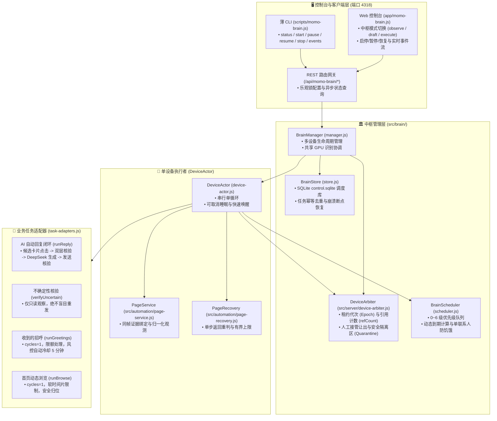

# MOMO 持续监听与调度中枢 (MOMO Brain)

> 控制台访问地址：`http://127.0.0.1:4318/`。
> 定位：长期运行、统一感知、有界恢复与公平任务调度的后台中枢，负责在云手机上持续巡检新消息、协调 AI 回复及受控空闲任务。

---

## 一、系统架构与运行主线

调度中枢采用**分层单执行者模型 (Single-Actor Execution Architecture)**，确保同一台设备在任何时刻仅存在一条互斥的操作主线：

```text
启动/恢复 → 设备租约仲裁 (DeviceArbiter) → 统一页面服务 (PageService)
                                           ↓
                       不在任务预设范围：按一次返回键 → 重新截图观测
                                           ↓
                       到达消息列表 → 周期性快速巡检 / 分片覆盖巡检
                                           ↓
                 发现待回复：优先排入队列 (Priority 2) → 触发 AI 闭环回复
                 无待回复：检查空闲任务 (招呼处理 / 首页浏览) 是否到期
                                           ↓
                   安全让出 (Checkpoint / Yield) → 归位回消息列表 → 可取消等待
```



---

## 二、核心设计原则与实现细节

### 1. 统一页面服务 (PageService)
- **单一判断入口**：所有模块对页面和场景的判断统一通过 `observePage(sessionContext)`，严禁各脚本各自写规则猜测。
- **同帧证据绑定**：对一次高清抓帧（`source: 'stream'`，1280 高清截帧），并行或按需派发页面分类（Model 3）、OCR 识别及卡片/详情检测（Model 1/2），共享同一个 `snapshotId`。
- **正交维度归一化**：
  - `app`：`momo` / `android_launcher` / `other` / `unknown`
  - `page`：`message_list` / `chat_detail` / `home_feed` / `greetings` / `other`
  - `scene`：`normal` / `greetings_card` / `greetings_list` / `chat_settings` / `launcher`
  - `overlay`：`none` / `safe_dismissible`（如助手关闭叉） / `exit_confirm` / `login` / `captcha` / `risk` / `permission`
  - `keyboard`：`open` / `closed` / `unknown`

### 2. 统一导航恢复策略 (PageRecovery)
- **核心逻辑**：若当前页面不在当前任务的预设白名单范围：
  1. 检查是否存在阻断性弹窗（登录过期、滑块、风控提示），若有立即停止自动操作并转入 `blocked_by_guard`。
  2. 若为安全可关闭浮窗（如 AI 助手），点击关闭叉。
  3. 若不在目标页且不是桌面，**按一次返回键 (Back)**，等待 400ms，再次截图重判。
  4. 连续 3 次按返回无任何页面变化（`noProgressBacks >= 3`）立即熔断退出，防死循环。
  5. 最多执行 8 次返回键（`maxBackSteps = 8`）或总耗时 30000ms。
  6. **到达桌面立刻停止按返回**！若允许且在上限内，仅调用一次 `openMomo` 重新进入，绝不反复回桌面。

### 3. 严格优先级队列与公平调度 (Scheduler)
| 优先级 | 任务类型 | 调度规则 |
|---|---|---|
| **0** | `emergency_stop` / `manual_takeover` | 用户停止、人工接管、风控拦截，立刻让出设备 |
| **1** | `verify_uncertain` | 发送/通过不确定性核验，先核验现场，绝不重发 |
| **2** | `reply` | 已确认的新来信自动回复，优先处理 |
| **3** | `inspect_list` | 消息列表快速巡检，到期周期性触发 |
| **4** | `sweep_list` | 消息列表分片覆盖巡检与基线更新 |
| **5** | `greetings` | 空闲处理收到的招呼（仅在无待回复且巡检新鲜时运行） |
| **6** | `browse` | 空闲首页动态浏览（仅在无待回复且巡检新鲜时运行） |

> **防单人饥饿设计 (T20)**：即使同一联系人连续发送多条消息，单轮也只处理该联系人的一个批次，随后必须让出执行权完成消息列表巡检，保证多联系人间调度绝对公平。

### 4. 统一租约仲裁与隔离保护 (DeviceArbiter)
- **租约代次 (Epoch)**：每次新所有者获取锁时 `epoch` 自动递增，旧会话的迟到回调动作因代次过期自动失效。
- **嵌套借用与引用计数 (refCount)**：子任务借用父租约时只增加引用计数，子任务退出时不提前释放父租约。
- **安全隔离区 (Quarantine)**：遇到看门狗超时、取消未确认或不可恢复异常时，设备被强制移入隔离区，自动拒绝后续一切自动任务，保护现场等待人工排查。

---

## 三、四种运行模式 (Brain Modes)

| 模式 | 页面导航与巡检 | 写数据库 | 外部 DeepSeek API | 模拟打字发送 | 典型场景 |
| --- | --- | --- | --- | --- | --- |
| **`plan`** | ❌ 禁止 | ❌ 禁止 | ❌ 禁止 | ❌ 禁止 | 离线调度规划与沙箱模拟 |
| **`observe`** (默认) | ✅ 巡检与归位 | ✅ 仅记录调度/事件 | ❌ 禁止 | ❌ 禁止 | 安全巡检、发现新消息入库、不回复 |
| **`draft`** | ✅ 允许进入会话 | ✅ 保存增量与草稿 | ✅ 调用生成回复 | ❌ 禁止 | 自动为新来信生成草稿供人工复核 |
| **`execute`** | ✅ 完整闭环 | ✅ 完整事务持久化 | ✅ 调用生成回复 | ✅ 通过校验后发送 | 全自动无人值守持续监听与回复 |

---

## 四、本地控制台与 REST 接口 (`http://127.0.0.1:4318/`)

在本地控制台已挂载 8 个中枢专用 REST API：

| Method | 路径 | 核心功能 | 请求载荷 / 参数 | 响应样例 |
|---|---|---|---|---|
| **GET** | `/api/momo-brain/config` | 读取中枢配置 | `?deviceId=...` (可选) | `{ ok: true, config: { mode, pollIntervalMs, revision } }` |
| **POST** | `/api/momo-brain/config` | 保存中枢调度配置 | `{ mode, pollIntervalMs, expectedRevision }` | `{ ok: true, config: { revision: 2, ... } }` |
| **POST** | `/api/momo-brain/start` | 启动设备中枢 Actor | `{ deviceId, mode: "observe" }` | `{ ok: true, status: { deviceId, running: true, actualState: "idle" } }` |
| **POST** | `/api/momo-brain/pause` | 暂停中枢执行 | `{ deviceId }` | `{ ok: true, status: { desiredState: "paused" } }` |
| **POST** | `/api/momo-brain/resume` | 恢复中枢执行 | `{ deviceId }` | `{ ok: true, status: { desiredState: "running" } }` |
| **POST** | `/api/momo-brain/stop` | 停止中枢执行 | `{ deviceId, reason: "..." }` | `{ ok: true, status: { desiredState: "stopped" } }` |
| **GET** | `/api/momo-brain/status` | 查询设备或集群状态 | `?deviceId=...` (可选) | `{ ok: true, status: { actualState, currentPhase, busy, quarantined } }` |
| **GET** | `/api/momo-brain/events` | 查询近期调度事件轨迹 | `?deviceId=...&limit=20` | `{ ok: true, events: [ { eventType, detailsJson, createdAt } ] }` |

---

## 五、CLI 命令行调用与运维指引

```powershell
# 1. 查询目标设备中枢运行状态
$env:YUNMOMO_DEVICE_ID = "2033060279606353921"
npm run momo:brain -- status

# 2. 启动中枢 (默认 observe 观察巡检模式)
npm run momo:brain -- start

# 3. 启动中枢并指定全自动闭环回复 (execute 模式)
npm run momo:brain -- start --mode execute

# 4. 暂停中枢 (让出设备控制权，便于人工接管)
npm run momo:brain -- pause

# 5. 恢复中枢运行
npm run momo:brain -- resume

# 6. 停止中枢
npm run momo:brain -- stop

# 7. 查看近期调度事件轨迹
npm run momo:brain -- events
```

---


---

## 七、代码审查修复与调用链对账 (F01 ~ F19 闭环表)

| 编号 | 审查发现的问题与调用链断点 | 修复位置与核心措施 | 验证测试与断言 |
|---|---|---|---|
| **F01** | `manager.js` 默认空适配器；Actor 无实现时仍将任务标记为 completed | `src/brain/manager.js` 显式装配默认业务适配器；`device-actor.js` 缺失适配器立即抛出 `TASK_ADAPTER_MISSING`，任务状态置为 `failed` | `test/remediation-r1.test.js` (断言缺失适配器抛出异常且任务落库 failed) |
| **F02** | `PageService` 未回传上层扫描所需的 `ocrData` / `listRaw` / `detailRaw` 原始数据 | `src/automation/page-service.js` 统一在 `evidence` 对象中完整携带同帧识别的所有模型原始结果 | `test/remediation-r2.test.js` (断言 evidence.ocrData, listRaw, detailRaw 齐全) |
| **F03** | 会话模式未向下传递；`runReply` 默认 execute；`autoReplyEnabled` 开关未生效 | `src/brain/device-actor.js` 严格校验会话模式与开关；在 observe 模式或开关关闭时强制降权，禁止下发 execute 动作 | `test/remediation-r1.test.js` (断言 observe 模式下传给适配器的 mode 为 observe) |
| **F04** | Actor 持有设备锁，子工作流 `runMomoAiReplyOnce` 生成新 runId 抢同机锁导致 `DEVICE_BUSY` | `src/workflows/momo-ai-reply.js` 支持传入 `leaseToken` / `parentSessionId` 借用父级租约；`task-adapters.js` 透传租约上下文 | `test/remediation-r3.test.js` (断言借用父租约不报错且正常进入工作流) |
| **F05** | 指定 `contactName` 时候选缺少坐标，未点击进入聊天就核验页面导致失败 | `src/workflows/momo-ai-reply.js` 完善目标卡片查找与点击；先在列表中定位真实坐标并点击，再双层核验聊天页；未找到明确标记 `target_not_found` | `test/remediation-r6.test.js` (断言缺失目标时进入 needs_review 并不盲目核验) |
| **F06** | 网页控制台获取目标云机 ID 时读取了模态操作窗旧残留的 `deckDeviceId` | `app/app.js` 暴露 `window.getSelectedDeviceId`；`app/momo-brain.js` 与 `app/ai-reply.js` 优先读取当前激活卡片，订阅 `device:selected` 事件 | `test/remediation-r9.test.js` (断言 UI 设备解析逻辑严格指向当前激活设备) |
| **F07** | 截图或模型返回 `ok:false` 时被误当成功，恢复器在失明状态下盲目按 Back 键 | `src/automation/page-service.js` 校验截图与识别数据完整性，失败时返回 `ok:false`；`page-recovery.js` 遇依赖故障立即返回 `dependency_failed`，Back 计数为零 | `test/remediation-r2.test.js` (断言截图失败时恢复器 Back 次数严格为 0) |
| **F08** | `openControl` 仅构造实例未 `connect()`；重复创建 tools 且缺少资源回收 | `src/workflows/momo-ai-reply.js` 复用上下文中的 tools/control，若自行创建则等待 `connect()` 就绪，并在 `finally` 显式 `close()` 释放连接 | `src/workflows/momo-ai-reply.js` (代码连接与回收审计) |
| **F09** | 候选卡片入队硬编码 `triggerSeq: 0`，同一联系人后续来信永久命中旧任务被丢弃 | 候选队列按设备与联系人合并活跃任务；回复 Job 按归档消息 seq 范围与正文摘要持久去重，终态候选允许重新入队核验 | `test/remediation-r5.test.js` (断言同一联系人后续新消息可成功入队并被认领) |
| **F10** | 手动操作台、旧脚本与中枢仲裁器割裂；未能实现统一互斥 | `src/server/manual-control.js` 与 `src/server/app-server.js` 全部接入 `defaultArbiter`；操作窗打开或脚本运行即锁定设备，关闭时自动释放 | `test/remediation-r3.test.js` (断言人工控制台锁定后中枢获取被拒) |
| **F11** | `verifyUncertain` 仅检查页面类型，无气泡依然标记成功；且未加入任务队列 | `src/brain/task-adapters.js` 严格对齐具体 `replyJobId` 与预期正文，未观察到己方气泡绝不伪造成功；`device-actor.js` 重启对账自动将未决任务排入 Priority 1 | `test/remediation-r7.test.js` (断言无气泡核验失败返回 uncertain，有气泡才更新成功) |
| **F12** | 平台风控提示被安全悬浮窗覆盖跳过；限频未持久化到调度器 | `src/automation/page-service.js` 将 `captcha`、`login`、`risk` 优先级置于 `safe_dismissible` 之前；遇风控写入持久设备守卫并暂停，另记录 20 分钟调度冷却；时间到不自动解除设备守卫 | `test/remediation-r2.test.js` (断言安全滑块绝对优先于关闭叉) |
| **F13** | `sweep_list` 与 `inspect_list` 完全相同，缺少真实多屏滑动覆盖与预算标记 | `src/brain/device-actor.js` 为 `sweep_list` 实现真实多屏滑动遍历 (达到 `maxListPagesPerSlice`)，预算耗尽明确在 checkpoint 记录 `partial: true` 并安全归位 | `test/remediation-r8.test.js` (断言触发多屏滑动且 checkpoint.partial 为 true) |
| **F14** | 设备上下文与控制初始化在 try 外，一旦异常会导致任务永久滞留在 running 状态 | `src/brain/device-actor.js` 将包含设备上下文创建在内的全流程置入 `try/catch/finally`，异常时原子将任务更新为 `failed` 并记录错误码 | `test/remediation-r4.test.js` (断言上下文初始化抛错时任务状态落库为 failed) |
| **F15** | `updateSchedule` 缺省值 0 清空已有冷却与配额，导致风控限制失效 | `src/brain/store.js` 实现真正的 PATCH 语义：更新时保留已有字段，未显式传入的字段不被覆盖为 0 | `test/remediation-r5.test.js` (断言仅更新 dueAt 时 cooldownUntil 和 quotaUsed 严格保留) |
| **F16** | 中枢配置缺少参数范围与枚举校验；保存后运行中的 Actor 未同步生效 | `src/brain/config.js` 新增 `validateBrainConfig` 校验模式枚举与数值上下界；`manager.js` 在配置更新时动态通知受管 Actor 应用新配置 | `test/remediation-r1.test.js` (断言非法 mode 与越界间隔被拦截抛出 INVALID_CONFIG) |
| **F17** | 固定优先级导致回复洪峰下巡检永久饥饿；缺少调度公平性保护 | `src/brain/scheduler.js` 引入 `claimNextFairTask`：上一轮处理回复后，若巡检到期优先轮转执行巡检一次，彻底避免单人占满设备 | `test/remediation-r5.test.js` (断言回复完成后到期巡检任务优先出队) |
| **F18** | `manager.close()` 未 await `stopAll()` 即关闭数据库，导致异步 Actor 抛出 DB closed 异常 | `src/brain/manager.js` 将 `close()` 改造为异步方法，严格等待所有 Actor 循环退出并释放后再关闭 SQLite 存储 | `test/remediation-r4.test.js` (断言 async close 等待完成，零未处理异常) |
| **F19** | 外部传入的旧帧或跨设备帧被直接重新盖上新 snapshotId 与代次 | `src/automation/page-service.js` 严格校验传入帧的 `deviceId` 与 `generation`，不匹配时拒绝并返回 `FRAME_MISMATCH` / `FRAME_STALE` | `test/remediation-r2.test.js` (断言跨设备帧被拒绝并返回 FRAME_MISMATCH) |

## 八、异常故障码与处理策略

| 错误码 | 异常场景 | 自动处理与恢复策略 |
|---|---|---|
| `RECOVERY_NO_PROGRESS` | 连续 3 次按返回键页面完全无变化 | 立即停止返回，将设备置为 `needs_review`，记录现场截图 |
| `RECOVERY_BUDGET_EXHAUSTED` | 达到 8 次返回上限仍未恢复到目标页 | 停止盲目按键，暂停当前任务，记录路径历史 |
| `GUARD_LOGIN` / `GUARD_CAPTCHA` | 遇到登录过期或人机滑块 | 立即停机转入人工处理，绝对不自动乱点 |
| `GUARD_RISK` | 平台提示“操作过于频繁” | 持久设备阻断并暂停；20 分钟冷却结束仍需人工处理后显式恢复，不自动重试 |
| `DEVICE_QUARANTINED` | 设备进入保护隔离区 | 拒绝一切新自动任务，直到调用 unquarantine 确认安全 |
| `DEVICE_BUSY` | 设备正在被人工控制台或旧脚本占用 | 中枢自动让出，等待人工释放后在下一轮恢复 |
| `ACTION_UNCERTAIN` | 发送或通过结果未获最终气泡确认 | 压入 Priority 1 的只读核验任务，严禁自动重发 |
