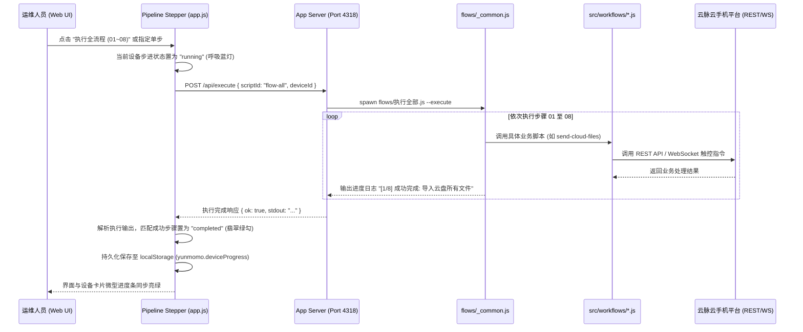
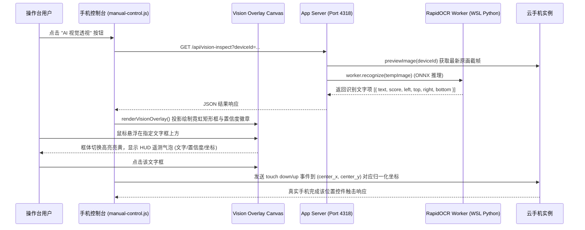

# 📖 云脉云手机自动化代码符号与架构全景索引

> **生成时间**：2026/10/21 17:51:22  
> **服务默认端口**：`4318` (`http://127.0.0.1:4318/`)  
> **GPU 识别常驻端口**：`4329` (`http://127.0.0.1:4329/`)  
> **项目定位**：基于 Yunmomo 云手机平台的高性能自动化控制、YOLO/RapidOCR 本地视觉感知与端到端 RPA 调度中台。

---

## 🏛️ 一、系统全景架构与模块拓扑 (System Architecture)

```mermaid
flowchart TD
    subgraph UI_Console["🖥️ Web 控制台与操作台 (app/ & src/server/)"]
        App["Web 前端 (app.js / index.html)<br/>• 01~08 步进器状态感知<br/>• 云手机集群画面与编号管理"]
        Workstation["原画工作台 (manual-control.js)<br/>• 9:16 真机操控面板<br/>• AI 视觉透视图层 (HUD Overlay)"]
        Server["本地控制台服务 (src/server/app-server.js)<br/>• 默认端口 4318<br/>• REST /api/* 接口网关<br/>• WebSocket 触控中继"]
    end

    subgraph Core_SDK["⚙️ 核心 SDK 与底层协议 (src/)"]
        Client["YunmomoClient (client.js)<br/>• 云机 REST API 封装<br/>• 截图/音频/代理/重置"]
        Control["CloudPhoneControl (control.js)<br/>• WebSocket scrcpy 触控协议<br/>• 键盘/剪贴板/文件推送"]
        Protocol["协议编解码器 (protocol.js)<br/>• scrcpy 二进制帧打包<br/>• Keycode / Touch 序列化"]
        Management["云盘与 VPC 管理 (management.js)<br/>• CloudDisk (文件导入/分发)<br/>• VpcManager (代理池增删改查)"]
        StreamShot["原画抓帧 (stream-screenshot.js)<br/>• 极低延迟视频帧解码<br/>• 1280 高清截图"]
    end

    subgraph Workflows["🚀 01~14 自动化业务流程与消息监听 (src/workflows/ & flows/)"]
        F01["01 导入云盘所有文件 (send-cloud-files.js)"]
        F02["02 上传证书 (upload-certificate.js)"]
        F03["03 设置 VPC 代理 (set-vpc-proxy.js)"]
        F04["04 环境配置 (configure-environment.js)"]
        F05["05 一键生成全部 (generate-all.js)"]
        F06["06 定位到 IP 地 (locate-ip.js)"]
        F07["07 高德初始化 (initialize-gaode.js)"]
        F08["08 输入法初始化 (initialize-input-method.js)"]
        F09["09 改机重置 (change-model-reset.js)"]
        F10["10 增加 VPC 网络 (add-vpc-network.js)"]
        F11["11 MOMO首页养号 (momo-warmup.js)"]
        F12["12 MOMO招呼处理 (momo-greetings.js)"]
        F13["13 MOMO联系人及消息入库 (momo-contact-sync.js)"]
        F14["14 MOMO AI回复 (momo-ai-reply.js)"]
        FWatch["消息列表持续监听 (momo-message-watch.js)"]
        FAll["执行全部 01~08 (flows/执行全部.js)"]
    end

    subgraph Brain_Core["🧠 持续监听与调度中枢 (src/brain/ & src/automation/)"]
        BrainManager["BrainManager (src/brain/manager.js)<br/>• 多设备生命周期总控<br/>• 调度配置与全局状态"]
        DeviceActor["DeviceActor (src/brain/device-actor.js)<br/>• 单设备单串行循环<br/>• 可取消睡眠与事件流"]
        Scheduler["BrainScheduler (src/brain/scheduler.js)<br/>• 0~6 级任务优先级队列<br/>• 单联系人防饥饿公平调度"]
        PageSvc["PageService (src/automation/page-service.js)<br/>• 统一同帧页面/场景/遮挡观测"]
        PageRec["PageRecovery (src/automation/page-recovery.js)<br/>• 单步返回重判与有界上限"]
        BrainStore["BrainStore (src/brain/store.js)<br/>• control.sqlite 调度控制库"]
    end

    subgraph Data_Storage["💾 数据持久化与状态 (SQLite / .runtime/)"]
        MomoDB["MomoDatabase (src/tools/momo/db.js)<br/>• SQLite3 线程安全独立库<br/>• 联系人/消息去重/增量同步"]
    end

    subgraph AI_Engine["🧠 AI大脑与本地视觉感知 (src/ai/ & src/automation/ & python_*)"]
        DeepSeek["DeepSeek API 引擎 (src/ai/)
• 官方 OpenAI 兼容接口
• deepseek-chat 智能会话"]
        OCR["RapidOCR 引擎 (ocr.js & rapidocr_worker.py)<br/>• WSL Python 本地 ONNX 推理<br/>• 控件边界与文字置信度"]
        GPU_Pool["GPU 识别池 (recognition-service.js)<br/>• 端口 4329 常驻 RPC 服务<br/>• YOLO 页面/聊天框/头像检测"]
        TypingEngine["自然拼音打字引擎 (python_typing/ & ws-ime-input.js)<br/>• jieba 分词 + 拼音映射<br/>• 虚拟键盘按键计划生成"]
    end

    App -->|HTTP / API| Server
    Workstation -->|WebSocket /api/control| Server
    Workstation -->|HTTP /api/vision-inspect| Server
    Server --> Client
    Server --> OCR
    Server --> FAll
    FAll --> F01 & F02 & F03 & F04 & F05 & F06 & F07 & F08
    Client --> Control
    Control --> Protocol
    Workflows --> Client
    Workflows --> GPU_Pool
    Workflows --> TypingEngine
    F14 --> DeepSeek
    F13 --> MomoDB
    FWatch --> PageSvc & GPU_Pool
```



---

## 📂 二、目录职责与工程分工

| 目录路径 | 文件数量 | 核心职责与关键技术 |
|---|---|---|
| [`src/`](file:///d:/AA-project/自动化/src) | 核心库 | 云端 REST 客户端、scrcpy 协议帧编解码、WebSocket 实时真机控制器、高清抓帧引擎 |
| [`src/automation/`](file:///d:/AA-project/自动化/src/automation) | 自动化引擎 | 路径/环境隔离、WSL RapidOCR 桥接、4329 GPU 识别常驻服务、并发锁、页面导航恢复 |
| [`src/tools/`](file:///d:/AA-project/自动化/src/tools) | 工具与视觉算子 | 点击/滑动/区域加权采样、MOMO 页面识别、红点候选、聊天详情提取 |
| [`src/workflows/`](file:///d:/AA-project/自动化/src/workflows) | 业务流程实现 | 01~14 业务流程、MOMO 消息持续监听、参数校验、上游调用、重试熔断 |
| [`src/typing/`](file:///d:/AA-project/自动化/src/typing) | 2 个模块 | WebSocket 输入法按键注入、聊天消息自然拼音分词输入控制器 |
| [`src/server/`](file:///d:/AA-project/自动化/src/server) | 本地服务 | 本地 Web 控制台 HTTP/WS 服务（默认端口 4318）、设备锁、真机触控桥接、视频流代理 |
| [`app/`](file:///d:/AA-project/自动化/app) | 5 个前端文件 | 业务控制台 UI、01~08 全流程状态感知步进器、微型进度条、AI 视觉 HUD 覆盖层 |
| [`flows/`](file:///d:/AA-project/自动化/flows) | 流程入口 | 01~14 CLI 规范执行入口、`_common.js` 串行流水线调度执行器 |
| [`python_typing/`](file:///d:/AA-project/自动化/python_typing) | 10 个模块 | 纯 Python 中文分词、拼音拼写转换、候选词匹配、九宫格/全键盘按键动作生成 |
| [`python_workers/`](file:///d:/AA-project/自动化/python_workers) | 3 个 Worker | RapidOCR 常驻进程、输入法候选 OCR 进程、分词拼音计划输出管道 |
| [`docs/`](file:///d:/AA-project/自动化/docs) | 20 篇文档 | API 接口文档、协议定义、MOMO 自动化规范、性能基准、架构约定 |

---

## 📑 三、核心类与导出符号全览 (Classes & Symbols)

### 1. 核心 SDK 与客户端 (src/client, control, protocol, management)

#### 📄 [`src/ai/config.js`](file:///d:/AA-project/自动化/src/ai/config.js) (144 行)

**函数与方法 (Functions)**:
- [`maskApiKey(key)`](file:///d:/AA-project/自动化/src/ai/config.js#L34) —— 第 34 行
- [`ensureConfigDir()`](file:///d:/AA-project/自动化/src/ai/config.js#L41) —— 第 41 行
- [`loadSettings()`](file:///d:/AA-project/自动化/src/ai/config.js#L47) —— 第 47 行
- [`getSanitizedSettings(deviceId = null)`](file:///d:/AA-project/自动化/src/ai/config.js#L64) —— 第 64 行
- [`saveSettings(updates = {}, expectedRevision = null)`](file:///d:/AA-project/自动化/src/ai/config.js#L84) —— 第 84 行
- [`getEffectiveConfig(deviceId = null)`](file:///d:/AA-project/自动化/src/ai/config.js#L127) —— 第 127 行

**关键配置与枚举常量**:
[`CONFIG_DIR`](file:///d:/AA-project/自动化/src/ai/config.js#L17), [`CONFIG_FILE`](file:///d:/AA-project/自动化/src/ai/config.js#L18), [`DEFAULT_SETTINGS`](file:///d:/AA-project/自动化/src/ai/config.js#L20)

#### 📄 [`src/ai/context.js`](file:///d:/AA-project/自动化/src/ai/context.js) (70 行)

**函数与方法 (Functions)**:
- [`buildChatContext(rawMessages = [], config = {}, options = {})`](file:///d:/AA-project/自动化/src/ai/context.js#L16) —— 第 16 行

**模块导出 (Exports)**: `buildChatContext`

#### 📄 [`src/ai/provider.js`](file:///d:/AA-project/自动化/src/ai/provider.js) (60 行)

**核心类定义 (Classes)**:
- [`DeepSeekProvider`](file:///d:/AA-project/自动化/src/ai/provider.js#L4) —— 第 4 行

**模块导出 (Exports)**: `DeepSeekProvider`

#### 📄 [`src/ai/reply-service.js`](file:///d:/AA-project/自动化/src/ai/reply-service.js) (52 行)

**函数与方法 (Functions)**:
- [`generateReply(rawMessages = [], config = null, options = {})`](file:///d:/AA-project/自动化/src/ai/reply-service.js#L16) *(async)* —— 第 16 行

#### 📄 [`src/brain/config.js`](file:///d:/AA-project/自动化/src/brain/config.js) (211 行)

**函数与方法 (Functions)**:
- [`validateBrainConfig(updates = {}, current = DEFAULT_BRAIN_CONFIG)`](file:///d:/AA-project/自动化/src/brain/config.js#L43) —— 第 43 行
- [`ensureBrainDir()`](file:///d:/AA-project/自动化/src/brain/config.js#L137) —— 第 137 行
- [`loadBrainConfig()`](file:///d:/AA-project/自动化/src/brain/config.js#L143) —— 第 143 行
- [`saveBrainConfig(updates = {}, expectedRevision = null)`](file:///d:/AA-project/自动化/src/brain/config.js#L159) —— 第 159 行
- [`getEffectiveBrainConfig(deviceId = null)`](file:///d:/AA-project/自动化/src/brain/config.js#L192) —— 第 192 行

**关键配置与枚举常量**:
[`BRAIN_DIR`](file:///d:/AA-project/自动化/src/brain/config.js#L16), [`BRAIN_CONFIG_FILE`](file:///d:/AA-project/自动化/src/brain/config.js#L17), [`VALID_MODES`](file:///d:/AA-project/自动化/src/brain/config.js#L19), [`DEFAULT_BRAIN_CONFIG`](file:///d:/AA-project/自动化/src/brain/config.js#L21)

#### 📄 [`src/brain/device-actor.js`](file:///d:/AA-project/自动化/src/brain/device-actor.js) (418 行)

**核心类定义 (Classes)**:
- [`DeviceActor`](file:///d:/AA-project/自动化/src/brain/device-actor.js#L21) —— 第 21 行

**模块导出 (Exports)**: `DeviceActor`

#### 📄 [`src/brain/manager.js`](file:///d:/AA-project/自动化/src/brain/manager.js) (161 行)

**核心类定义 (Classes)**:
- [`BrainManager`](file:///d:/AA-project/自动化/src/brain/manager.js#L20) —— 第 20 行

**函数与方法 (Functions)**:
- [`getDefaultBrainManager(options = {})`](file:///d:/AA-project/自动化/src/brain/manager.js#L158) —— 第 158 行

**模块导出 (Exports)**: `BrainManager`, `getDefaultBrainManager`

#### 📄 [`src/brain/scheduler.js`](file:///d:/AA-project/自动化/src/brain/scheduler.js) (191 行)

**核心类定义 (Classes)**:
- [`BrainScheduler`](file:///d:/AA-project/自动化/src/brain/scheduler.js#L30) —— 第 30 行

**关键配置与枚举常量**:
[`TASK_PRIORITIES`](file:///d:/AA-project/自动化/src/brain/scheduler.js#L19)

#### 📄 [`src/brain/store.js`](file:///d:/AA-project/自动化/src/brain/store.js) (346 行)

**核心类定义 (Classes)**:
- [`BrainStore`](file:///d:/AA-project/自动化/src/brain/store.js#L21) —— 第 21 行

**关键配置与枚举常量**:
[`DEFAULT_BRAIN_DB_PATH`](file:///d:/AA-project/自动化/src/brain/store.js#L19)

#### 📄 [`src/brain/task-adapters.js`](file:///d:/AA-project/自动化/src/brain/task-adapters.js) (184 行)

**函数与方法 (Functions)**:
- [`runReply(deviceId, task, sessionContext, options = {})`](file:///d:/AA-project/自动化/src/brain/task-adapters.js#L21) *(async)* —— 第 21 行
- [`runGreetings(deviceId, task, sessionContext, options = {})`](file:///d:/AA-project/自动化/src/brain/task-adapters.js#L47) *(async)* —— 第 47 行
- [`runBrowse(deviceId, task, sessionContext, options = {})`](file:///d:/AA-project/自动化/src/brain/task-adapters.js#L78) *(async)* —— 第 78 行
- [`verifyUncertain(deviceId, task, sessionContext, options = {})`](file:///d:/AA-project/自动化/src/brain/task-adapters.js#L102) *(async)* —— 第 102 行

#### 📄 [`src/browser-view.js`](file:///d:/AA-project/自动化/src/browser-view.js) (124 行)

**核心类定义 (Classes)**:
- [`CloudPhoneBrowserView`](file:///d:/AA-project/自动化/src/browser-view.js#L15) —— 第 15 行

**关键配置与枚举常量**:
[`TOOLBAR_ITEMS`](file:///d:/AA-project/自动化/src/browser-view.js#L6)

**模块导出 (Exports)**: `CloudPhoneBrowserView`, `TOOLBAR_ITEMS`

#### 📄 [`src/client.js`](file:///d:/AA-project/自动化/src/client.js) (281 行)

**核心类定义 (Classes)**:
- [`YunmomoHttpError`](file:///d:/AA-project/自动化/src/client.js#L38) *(继承自 `Error`)* —— 第 38 行
- [`YunmomoClient`](file:///d:/AA-project/自动化/src/client.js#L47) —— 第 47 行
- [`CloudPhoneDevice`](file:///d:/AA-project/自动化/src/client.js#L215) —— 第 215 行

**函数与方法 (Functions)**:
- [`appendQuery(url, query, prefix = '')`](file:///d:/AA-project/自动化/src/client.js#L28) —— 第 28 行
- [`proxyAction(version, operation)`](file:///d:/AA-project/自动化/src/client.js#L275) —— 第 275 行

**关键配置与枚举常量**:
[`DEVICE`](file:///d:/AA-project/自动化/src/client.js#L6), [`BACKEND_ACTIONS`](file:///d:/AA-project/自动化/src/client.js#L8)

**模块导出 (Exports)**: `YunmomoClient`, `CloudPhoneControl`, `CloudPhoneDevice`, `YunmomoHttpError`, `BACKEND_ACTIONS`

#### 📄 [`src/control.js`](file:///d:/AA-project/自动化/src/control.js) (410 行)

**核心类定义 (Classes)**:
- [`CloudPhoneControl`](file:///d:/AA-project/自动化/src/control.js#L26) *(继承自 `EventEmitter`)* —— 第 26 行

**函数与方法 (Functions)**:
- [`requiredString(name, value)`](file:///d:/AA-project/自动化/src/control.js#L10) —— 第 10 行
- [`delay(ms, signal)`](file:///d:/AA-project/自动化/src/control.js#L16) —— 第 16 行
- [`abort()`](file:///d:/AA-project/自动化/src/control.js#L21) —— 第 21 行

**模块导出 (Exports)**: `CloudPhoneControl`, `requiredString`

#### 📄 [`src/index.d.ts`](file:///d:/AA-project/自动化/src/index.d.ts) (695 行)

**核心类定义 (Classes)**:
- [`CloudDisk`](file:///d:/AA-project/自动化/src/index.d.ts#L45) —— 第 45 行
- [`VpcManager`](file:///d:/AA-project/自动化/src/index.d.ts#L66) —— 第 66 行
- [`VpcGroupManager`](file:///d:/AA-project/自动化/src/index.d.ts#L83) —— 第 83 行
- [`CloudPhoneControl`](file:///d:/AA-project/自动化/src/index.d.ts#L124) —— 第 124 行
- [`YunmomoHttpError`](file:///d:/AA-project/自动化/src/index.d.ts#L167) *(继承自 `Error`)* —— 第 167 行
- [`YunmomoClient`](file:///d:/AA-project/自动化/src/index.d.ts#L171) —— 第 171 行
- [`CloudPhoneDevice`](file:///d:/AA-project/自动化/src/index.d.ts#L192) —— 第 192 行
- [`MomoMessageListWatcher`](file:///d:/AA-project/自动化/src/index.d.ts#L500) —— 第 500 行
- [`CloudPhoneTools`](file:///d:/AA-project/自动化/src/index.d.ts#L512) —— 第 512 行
- [`RecognitionError`](file:///d:/AA-project/自动化/src/index.d.ts#L633) *(继承自 `Error`)* —— 第 633 行
- [`GpuRecognitionPool`](file:///d:/AA-project/自动化/src/index.d.ts#L637) —— 第 637 行
- [`SharedRecognitionClient`](file:///d:/AA-project/自动化/src/index.d.ts#L653) —— 第 653 行
- [`CloudPhoneBrowserView`](file:///d:/AA-project/自动化/src/index.d.ts#L665) —— 第 665 行

**函数与方法 (Functions)**:
- [`createMessageListWatcher(options: MessageListWatcherOptions)`](file:///d:/AA-project/自动化/src/index.d.ts#L510) —— 第 510 行
- [`createDeviceTools(device: CloudPhoneDevice, options?: DeviceToolsOptions)`](file:///d:/AA-project/自动化/src/index.d.ts#L536) —— 第 536 行
- [`createRecognitionPool(options?: RecognitionPoolOptions)`](file:///d:/AA-project/自动化/src/index.d.ts#L650) —— 第 650 行

#### 📄 [`src/index.js`](file:///d:/AA-project/自动化/src/index.js) (6 行)

#### 📄 [`src/management.js`](file:///d:/AA-project/自动化/src/management.js) (282 行)

**核心类定义 (Classes)**:
- [`CloudDisk`](file:///d:/AA-project/自动化/src/management.js#L91) —— 第 91 行
- [`VpcManager`](file:///d:/AA-project/自动化/src/management.js#L188) —— 第 188 行
- [`VpcGroupManager`](file:///d:/AA-project/自动化/src/management.js#L259) —— 第 259 行

**函数与方法 (Functions)**:
- [`call(client, action, payload = {}, options = {})`](file:///d:/AA-project/自动化/src/management.js#L32) —— 第 32 行
- [`record(value, name = 'record')`](file:///d:/AA-project/自动化/src/management.js#L39) —— 第 39 行
- [`idsCsv(ids)`](file:///d:/AA-project/自动化/src/management.js#L44) —— 第 44 行
- [`pageResult(promise)`](file:///d:/AA-project/自动化/src/management.js#L54) *(async)* —— 第 54 行
- [`channelValue(channel)`](file:///d:/AA-project/自动化/src/management.js#L62) —— 第 62 行
- [`multipart(data, options)`](file:///d:/AA-project/自动化/src/management.js#L67) —— 第 67 行
- [`importFile(client, action, data, options)`](file:///d:/AA-project/自动化/src/management.js#L78) —— 第 78 行
- [`spreadsheet(client, action, query, options)`](file:///d:/AA-project/自动化/src/management.js#L85) *(async)* —— 第 85 行
- [`vpcRecord(config, batch = false)`](file:///d:/AA-project/自动化/src/management.js#L154) —— 第 154 行
- [`vpcRowsForHost(manager, ip, requestOptions)`](file:///d:/AA-project/自动化/src/management.js#L165) *(async)* —— 第 165 行
- [`sameVpcConnection(row, expected)`](file:///d:/AA-project/自动化/src/management.js#L175) —— 第 175 行

**关键配置与枚举常量**:
[`FILE`](file:///d:/AA-project/自动化/src/management.js#L6), [`VPC`](file:///d:/AA-project/自动化/src/management.js#L7), [`GROUP`](file:///d:/AA-project/自动化/src/management.js#L8), [`TRANSFER`](file:///d:/AA-project/自动化/src/management.js#L9), [`MANAGEMENT_ACTIONS`](file:///d:/AA-project/自动化/src/management.js#L12)

**模块导出 (Exports)**: `CloudDisk`, `VpcManager`, `VpcGroupManager`, `MANAGEMENT_ACTIONS`

#### 📄 [`src/protocol.js`](file:///d:/AA-project/自动化/src/protocol.js) (400 行)

**函数与方法 (Functions)**:
- [`integer(name, value, min, max)`](file:///d:/AA-project/自动化/src/protocol.js#L117) —— 第 117 行
- [`screenSize(options)`](file:///d:/AA-project/自动化/src/protocol.js#L125) —— 第 125 行
- [`encodeKey(options)`](file:///d:/AA-project/自动化/src/protocol.js#L132) —— 第 132 行
- [`encodeText(text)`](file:///d:/AA-project/自动化/src/protocol.js#L158) —— 第 158 行
- [`encodeTouch(options)`](file:///d:/AA-project/自动化/src/protocol.js#L167) —— 第 167 行
- [`encodeScroll(options)`](file:///d:/AA-project/自动化/src/protocol.js#L209) —— 第 209 行
- [`encodeSetClipboard(text, options)`](file:///d:/AA-project/自动化/src/protocol.js#L237) —— 第 237 行
- [`encodeScreenPower(on)`](file:///d:/AA-project/自动化/src/protocol.js#L248) —— 第 248 行
- [`encodeCommand(type)`](file:///d:/AA-project/自动化/src/protocol.js#L256) —— 第 256 行
- [`encodeVideoSettings(options = {})`](file:///d:/AA-project/自动化/src/protocol.js#L264) —— 第 264 行
- [`encodePushFile({ id = 0, state, fileName, fileSize, chunk } = {})`](file:///d:/AA-project/自动化/src/protocol.js#L288) —— 第 288 行
- [`binaryReader(data, offset = 0)`](file:///d:/AA-project/自动化/src/protocol.js#L315) —— 第 315 行
- [`decodeVideoSettings(data)`](file:///d:/AA-project/自动化/src/protocol.js#L331) —— 第 331 行
- [`decodeInitial(data)`](file:///d:/AA-project/自动化/src/protocol.js#L343) —— 第 343 行
- [`decodeDeviceMessage(data)`](file:///d:/AA-project/自动化/src/protocol.js#L368) —— 第 368 行

**关键配置与枚举常量**:
[`CONTROL`](file:///d:/AA-project/自动化/src/protocol.js#L3), [`ACTION`](file:///d:/AA-project/自动化/src/protocol.js#L20), [`META`](file:///d:/AA-project/自动化/src/protocol.js#L26), [`KEY_CODES`](file:///d:/AA-project/自动化/src/protocol.js#L37), [`INITIAL_MAGIC`](file:///d:/AA-project/自动化/src/protocol.js#L113), [`MESSAGE_MAGIC`](file:///d:/AA-project/自动化/src/protocol.js#L114), [`FILE_STATE`](file:///d:/AA-project/自动化/src/protocol.js#L115)

#### 📄 [`src/stream-screenshot.js`](file:///d:/AA-project/自动化/src/stream-screenshot.js) (229 行)

**核心类定义 (Classes)**:
- [`StreamScreenshotError`](file:///d:/AA-project/自动化/src/stream-screenshot.js#L11) *(继承自 `Error`)* —— 第 11 行
- [`StreamCapture`](file:///d:/AA-project/自动化/src/stream-screenshot.js#L16) —— 第 16 行

**函数与方法 (Functions)**:
- [`failure(code, message)`](file:///d:/AA-project/自动化/src/stream-screenshot.js#L14) —— 第 14 行
- [`captureStream(client, deviceId, options = {})`](file:///d:/AA-project/自动化/src/stream-screenshot.js#L190) —— 第 190 行
- [`closeStreams(client)`](file:///d:/AA-project/自动化/src/stream-screenshot.js#L220) *(async)* —— 第 220 行

**关键配置与枚举常量**:
[`PNG`](file:///d:/AA-project/自动化/src/stream-screenshot.js#L8), [`MAX_BUFFER`](file:///d:/AA-project/自动化/src/stream-screenshot.js#L9)

**模块导出 (Exports)**: `captureStream`, `closeStreams`, `StreamScreenshotError`

### 2. 自动化感知与基础服务 (src/automation/)

#### 📄 [`src/automation/app-navigation.js`](file:///d:/AA-project/自动化/src/automation/app-navigation.js) (155 行)

**函数与方法 (Functions)**:
- [`navigationError(code, message, observation, report)`](file:///d:/AA-project/自动化/src/automation/app-navigation.js#L8) —— 第 8 行
- [`recoverySettings(options)`](file:///d:/AA-project/自动化/src/automation/app-navigation.js#L16) —— 第 16 行
- [`pageFingerprint(observation)`](file:///d:/AA-project/自动化/src/automation/app-navigation.js#L31) —— 第 31 行
- [`launcherMatches(observation, launcher)`](file:///d:/AA-project/自动化/src/automation/app-navigation.js#L38) —— 第 38 行
- [`recoverAppPage(phone, control, worker, directory, state, initial, options, config)`](file:///d:/AA-project/自动化/src/automation/app-navigation.js#L52) *(async)* —— 第 52 行
- [`openAppWithRecovery(phone, control, worker, directory, state, found, options, config)`](file:///d:/AA-project/自动化/src/automation/app-navigation.js#L118) *(async)* —— 第 118 行

**模块导出 (Exports)**: `openAppWithRecovery`, `recoverAppPage`

#### 📄 [`src/automation/cancellation.js`](file:///d:/AA-project/自动化/src/automation/cancellation.js) (28 行)

**函数与方法 (Functions)**:
- [`cancelled(code = 'ABORTED')`](file:///d:/AA-project/自动化/src/automation/cancellation.js#L2) —— 第 2 行
- [`checkSignal(signal)`](file:///d:/AA-project/自动化/src/automation/cancellation.js#L3) —— 第 3 行
- [`waitFor(pending, { signal, timeoutMs, timeoutCode = 'TIMEOUT' } = {})`](file:///d:/AA-project/自动化/src/automation/cancellation.js#L4) —— 第 4 行
- [`sleep(ms, signal)`](file:///d:/AA-project/自动化/src/automation/cancellation.js#L16) —— 第 16 行

#### 📄 [`src/automation/concurrency.js`](file:///d:/AA-project/自动化/src/automation/concurrency.js) (23 行)

**函数与方法 (Functions)**:
- [`mapLimit(values, limit, read, signal)`](file:///d:/AA-project/自动化/src/automation/concurrency.js#L5) *(async)* —— 第 5 行

**模块导出 (Exports)**: `mapLimit`

#### 📄 [`src/automation/coordinates.js`](file:///d:/AA-project/自动化/src/automation/coordinates.js) (12 行)

**函数与方法 (Functions)**:
- [`observedPoint(control, observation, point)`](file:///d:/AA-project/自动化/src/automation/coordinates.js#L5) —— 第 5 行

**模块导出 (Exports)**: `observedPoint`

#### 📄 [`src/automation/message-list-navigation.js`](file:///d:/AA-project/自动化/src/automation/message-list-navigation.js) (104 行)

**函数与方法 (Functions)**:
- [`listSignature(obs)`](file:///d:/AA-project/自动化/src/automation/message-list-navigation.js#L6) —— 第 6 行
- [`normalizeOcrFeature(text)`](file:///d:/AA-project/自动化/src/automation/message-list-navigation.js#L12) —— 第 12 行
- [`editDistance(left, right)`](file:///d:/AA-project/自动化/src/automation/message-list-navigation.js#L16) —— 第 16 行
- [`ocrFeatureMatches(text, target)`](file:///d:/AA-project/自动化/src/automation/message-list-navigation.js#L35) —— 第 35 行
- [`topFeatureEvidence(obs)`](file:///d:/AA-project/自动化/src/automation/message-list-navigation.js#L55) —— 第 55 行
- [`hasTopHeader(obs)`](file:///d:/AA-project/自动化/src/automation/message-list-navigation.js#L74) —— 第 74 行
- [`returnMessageListTop(session, observation, options = {})`](file:///d:/AA-project/自动化/src/automation/message-list-navigation.js#L77) *(async)* —— 第 77 行

#### 📄 [`src/automation/ocr.js`](file:///d:/AA-project/自动化/src/automation/ocr.js) (193 行)

**核心类定义 (Classes)**:
- [`LegacyRapidOcrWorker`](file:///d:/AA-project/自动化/src/automation/ocr.js#L37) —— 第 37 行
- [`RapidOcrWorker`](file:///d:/AA-project/自动化/src/automation/ocr.js#L135) —— 第 135 行

**函数与方法 (Functions)**:
- [`numberOr(value, fallback)`](file:///d:/AA-project/自动化/src/automation/ocr.js#L9) —— 第 9 行
- [`shellQuote(value)`](file:///d:/AA-project/自动化/src/automation/ocr.js#L11) —— 第 11 行
- [`toWslPath(filePath)`](file:///d:/AA-project/自动化/src/automation/ocr.js#L15) —— 第 15 行
- [`resolveOcrEnvironment({ runtime = process.platform === 'win32' ? 'wsl' : 'native' } = {})`](file:///d:/AA-project/自动化/src/automation/ocr.js#L26) —— 第 26 行

**关键配置与枚举常量**:
[`DEFAULT_OCR_TIMEOUT_MS`](file:///d:/AA-project/自动化/src/automation/ocr.js#L8)

**模块导出 (Exports)**: `RapidOcrWorker`, `LegacyRapidOcrWorker`, `shellQuote`, `toWslPath`, `resolveOcrEnvironment`

#### 📄 [`src/automation/page-recovery.js`](file:///d:/AA-project/自动化/src/automation/page-recovery.js) (283 行)

**函数与方法 (Functions)**:
- [`cancellableSleep(ms, signal)`](file:///d:/AA-project/自动化/src/automation/page-recovery.js#L30) —— 第 30 行
- [`recoverToAllowedPage(session, allowedPages = ['message_list'], options = {})`](file:///d:/AA-project/自动化/src/automation/page-recovery.js#L55) *(async)* —— 第 55 行

**关键配置与枚举常量**:
[`DEFAULT_RECOVERY_OPTIONS`](file:///d:/AA-project/自动化/src/automation/page-recovery.js#L21)

#### 📄 [`src/automation/page-service.js`](file:///d:/AA-project/自动化/src/automation/page-service.js) (386 行)

**函数与方法 (Functions)**:
- [`classifyApp(pageRaw, ocrItems = [])`](file:///d:/AA-project/自动化/src/automation/page-service.js#L20) —— 第 20 行
- [`classifyOverlay(ocrItems = [], detailRaw = null)`](file:///d:/AA-project/自动化/src/automation/page-service.js#L33) —— 第 33 行
- [`classifyPageAndScene(app, pageRaw, ocrData, listRaw, detailRaw)`](file:///d:/AA-project/自动化/src/automation/page-service.js#L69) —— 第 69 行
- [`detectKeyboardState(page, detailRaw, ocrItems = [], h = 1280)`](file:///d:/AA-project/自动化/src/automation/page-service.js#L114) —— 第 114 行
- [`observePageInternal(session, options = {})`](file:///d:/AA-project/自动化/src/automation/page-service.js#L146) *(async)* —— 第 146 行
- [`observePage(session, options = {})`](file:///d:/AA-project/自动化/src/automation/page-service.js#L369) *(async)* —— 第 369 行

#### 📄 [`src/automation/planner.js`](file:///d:/AA-project/自动化/src/automation/planner.js) (68 行)

**核心类定义 (Classes)**:
- [`PersistentPlanner`](file:///d:/AA-project/自动化/src/automation/planner.js#L9) —— 第 9 行

**关键配置与枚举常量**:
[`ROOT`](file:///d:/AA-project/自动化/src/automation/planner.js#L7)

**模块导出 (Exports)**: `PersistentPlanner`

#### 📄 [`src/automation/recognition-service.js`](file:///d:/AA-project/自动化/src/automation/recognition-service.js) (184 行)

**核心类定义 (Classes)**:
- [`SharedRecognitionClient`](file:///d:/AA-project/自动化/src/automation/recognition-service.js#L100) —— 第 100 行

**函数与方法 (Functions)**:
- [`rpc(session, route, body, { timeoutMs = 30000, signal, settings } = {})`](file:///d:/AA-project/自动化/src/automation/recognition-service.js#L18) —— 第 18 行
- [`discovery()`](file:///d:/AA-project/自动化/src/automation/recognition-service.js#L63) *(async)* —— 第 63 行
- [`ensureService()`](file:///d:/AA-project/自动化/src/automation/recognition-service.js#L75) *(async)* —— 第 75 行
- [`planShared(text, options = {})`](file:///d:/AA-project/自动化/src/automation/recognition-service.js#L162) *(async)* —— 第 162 行
- [`momoShared(route, image, settings, ctx)`](file:///d:/AA-project/自动化/src/automation/recognition-service.js#L167) *(async)* —— 第 167 行
- [`serviceCommand(command)`](file:///d:/AA-project/自动化/src/automation/recognition-service.js#L174) *(async)* —— 第 174 行

**关键配置与枚举常量**:
[`ROOT`](file:///d:/AA-project/自动化/src/automation/recognition-service.js#L13), [`PORT`](file:///d:/AA-project/自动化/src/automation/recognition-service.js#L14), [`SESSION`](file:///d:/AA-project/自动化/src/automation/recognition-service.js#L15)

#### 📄 [`src/automation/runtime.js`](file:///d:/AA-project/自动化/src/automation/runtime.js) (22 行)

**函数与方法 (Functions)**:
- [`redact(value)`](file:///d:/AA-project/自动化/src/automation/runtime.js#L8) —— 第 8 行
- [`launchCli(main)`](file:///d:/AA-project/自动化/src/automation/runtime.js#L13) —— 第 13 行

**关键配置与枚举常量**:
[`PROJECT_ROOT`](file:///d:/AA-project/自动化/src/automation/runtime.js#L6)

**模块导出 (Exports)**: `PROJECT_ROOT`, `redact`, `launchCli`

#### 📄 [`src/automation/screen.js`](file:///d:/AA-project/自动化/src/automation/screen.js) (395 行)

**函数与方法 (Functions)**:
- [`numberOr(value, fallback)`](file:///d:/AA-project/自动化/src/automation/screen.js#L18) —— 第 18 行
- [`sleep(ms)`](file:///d:/AA-project/自动化/src/automation/screen.js#L23) —— 第 23 行
- [`deviceIdOf(record)`](file:///d:/AA-project/自动化/src/automation/screen.js#L27) —— 第 27 行
- [`normalizeText(value)`](file:///d:/AA-project/自动化/src/automation/screen.js#L31) —— 第 31 行
- [`textOf(items)`](file:///d:/AA-project/自动化/src/automation/screen.js#L38) —— 第 38 行
- [`normalizedTextOf(items)`](file:///d:/AA-project/自动化/src/automation/screen.js#L42) —— 第 42 行
- [`scoreOf(item)`](file:///d:/AA-project/自动化/src/automation/screen.js#L46) —— 第 46 行
- [`validItems(ocr)`](file:///d:/AA-project/自动化/src/automation/screen.js#L50) —— 第 50 行
- [`sameLine(left, right)`](file:///d:/AA-project/自动化/src/automation/screen.js#L66) —— 第 66 行
- [`closeHorizontally(left, right)`](file:///d:/AA-project/自动化/src/automation/screen.js#L73) —— 第 73 行
- [`mergedBox(items)`](file:///d:/AA-project/自动化/src/automation/screen.js#L79) —— 第 79 行
- [`findPhrase(items, phrase, options = {})`](file:///d:/AA-project/自动化/src/automation/screen.js#L89) —— 第 89 行
- [`findStrictPhrase(items, phrase, options = {})`](file:///d:/AA-project/自动化/src/automation/screen.js#L122) —— 第 122 行
- [`hasAllPhrases(items, phrases)`](file:///d:/AA-project/自动化/src/automation/screen.js#L148) —— 第 148 行
- [`homeAnchorMatches(items)`](file:///d:/AA-project/自动化/src/automation/screen.js#L152) —— 第 152 行
- [`clipboardToastVisible(items)`](file:///d:/AA-project/自动化/src/automation/screen.js#L161) —— 第 161 行
- [`appTargetBox(items)`](file:///d:/AA-project/自动化/src/automation/screen.js#L165) —— 第 165 行
- [`pageSignature(items)`](file:///d:/AA-project/自动化/src/automation/screen.js#L177) —— 第 177 行
- [`createOcrDirectory(prefix)`](file:///d:/AA-project/自动化/src/automation/screen.js#L186) *(async)* —— 第 186 行
- [`screenshotAndOcr(phone, worker, directory, counter)`](file:///d:/AA-project/自动化/src/automation/screen.js#L202) *(async)* —— 第 202 行
- [`screenshotAndOcrMeasured(phone, worker, directory, counter)`](file:///d:/AA-project/自动化/src/automation/screen.js#L206) *(async)* —— 第 206 行
- [`observeUntil(phone, worker, directory, state, predicate, timeoutMs, pollMs, label)`](file:///d:/AA-project/自动化/src/automation/screen.js#L230) *(async)* —— 第 230 行
- [`sendHome(control)`](file:///d:/AA-project/自动化/src/automation/screen.js#L243) *(async)* —— 第 243 行
- [`confirmHome(phone, control, worker, directory, state, options)`](file:///d:/AA-project/自动化/src/automation/screen.js#L248) *(async)* —— 第 248 行
- [`swipeHomePage(control, direction)`](file:///d:/AA-project/自动化/src/automation/screen.js#L298) *(async)* —— 第 298 行
- [`tapBox(control, box, observation, yOffset = 0)`](file:///d:/AA-project/自动化/src/automation/screen.js#L362) —— 第 362 行

**关键配置与枚举常量**:
[`SCREENSHOT_LEVEL`](file:///d:/AA-project/自动化/src/automation/screen.js#L8), [`HOME_ANCHORS`](file:///d:/AA-project/自动化/src/automation/screen.js#L9)

#### 📄 [`src/automation/timing.js`](file:///d:/AA-project/自动化/src/automation/timing.js) (161 行)

**函数与方法 (Functions)**:
- [`round(value)`](file:///d:/AA-project/自动化/src/automation/timing.js#L16) —— 第 16 行
- [`outcome(value, error)`](file:///d:/AA-project/自动化/src/automation/timing.js#L18) —— 第 18 行
- [`metadata(input = {})`](file:///d:/AA-project/自动化/src/automation/timing.js#L29) —— 第 29 行
- [`createTimingRecorder({ sink, clock = ()`](file:///d:/AA-project/自动化/src/automation/timing.js#L39) —— 第 39 行
- [`begin(name, info = {})`](file:///d:/AA-project/自动化/src/automation/timing.js#L48) —— 第 48 行
- [`measure(name, info, work)`](file:///d:/AA-project/自动化/src/automation/timing.js#L77) —— 第 77 行
- [`timed(name, fn, selectMetadata = ()`](file:///d:/AA-project/自动化/src/automation/timing.js#L91) —— 第 91 行
- [`warning()`](file:///d:/AA-project/自动化/src/automation/timing.js#L109) —— 第 109 行
- [`flush()`](file:///d:/AA-project/自动化/src/automation/timing.js#L110) —— 第 110 行
- [`warn()`](file:///d:/AA-project/自动化/src/automation/timing.js#L138) —— 第 138 行
- [`timedScript(name, fn)`](file:///d:/AA-project/自动化/src/automation/timing.js#L143) —— 第 143 行

**关键配置与枚举常量**:
[`CODE`](file:///d:/AA-project/自动化/src/automation/timing.js#L12), [`STATES`](file:///d:/AA-project/自动化/src/automation/timing.js#L13), [`NON_EXECUTED`](file:///d:/AA-project/自动化/src/automation/timing.js#L15)

### 3. 视觉算子与工具集 (src/tools/)

#### 📄 [`src/tools/block-layout.js`](file:///d:/AA-project/自动化/src/tools/block-layout.js) (79 行)

**函数与方法 (Functions)**:
- [`topChatAvatar(view)`](file:///d:/AA-project/自动化/src/tools/block-layout.js#L8) —— 第 8 行
- [`normalized(value)`](file:///d:/AA-project/自动化/src/tools/block-layout.js#L34) —— 第 34 行
- [`blockPage(ocr, minimumScore = .55)`](file:///d:/AA-project/自动化/src/tools/block-layout.js#L35) —— 第 35 行

**模块导出 (Exports)**: `topChatAvatar`, `blockPage`

#### 📄 [`src/tools/block-peer.js`](file:///d:/AA-project/自动化/src/tools/block-peer.js) (132 行)

**函数与方法 (Functions)**:
- [`blockPeer(host, options, ctx)`](file:///d:/AA-project/自动化/src/tools/block-peer.js#L13) *(async)* —— 第 13 行
- [`checkControl()`](file:///d:/AA-project/自动化/src/tools/block-peer.js#L36) —— 第 36 行
- [`capture()`](file:///d:/AA-project/自动化/src/tools/block-peer.js#L42) *(async)* —— 第 42 行
- [`tap(frame, target, role)`](file:///d:/AA-project/自动化/src/tools/block-peer.js#L48) *(async)* —— 第 48 行
- [`readPage()`](file:///d:/AA-project/自动化/src/tools/block-peer.js#L62) *(async)* —— 第 62 行
- [`waitPage(wanted, code, message)`](file:///d:/AA-project/自动化/src/tools/block-peer.js#L72) *(async)* —— 第 72 行

**关键配置与枚举常量**:
[`BLOCK_OPTIONS`](file:///d:/AA-project/自动化/src/tools/block-peer.js#L10)

**模块导出 (Exports)**: `BLOCK_OPTIONS`, `blockPeer`

#### 📄 [`src/tools/chat-layout.js`](file:///d:/AA-project/自动化/src/tools/chat-layout.js) (49 行)

**函数与方法 (Functions)**:
- [`chatLayout(view)`](file:///d:/AA-project/自动化/src/tools/chat-layout.js#L5) —— 第 5 行
- [`element(name, required = true)`](file:///d:/AA-project/自动化/src/tools/chat-layout.js#L11) —— 第 11 行
- [`inputRegions(layout, candidateRoi)`](file:///d:/AA-project/自动化/src/tools/chat-layout.js#L36) —— 第 36 行

**模块导出 (Exports)**: `chatLayout`, `inputRegions`

#### 📄 [`src/tools/click.js`](file:///d:/AA-project/自动化/src/tools/click.js) (33 行)

**函数与方法 (Functions)**:
- [`clickPlan(x, y, options, screenSize)`](file:///d:/AA-project/自动化/src/tools/click.js#L9) —— 第 9 行

**关键配置与枚举常量**:
[`COMMON`](file:///d:/AA-project/自动化/src/tools/click.js#L7)

**模块导出 (Exports)**: `COMMON`, `clickPlan`

#### 📄 [`src/tools/coordinates.js`](file:///d:/AA-project/自动化/src/tools/coordinates.js) (39 行)

**函数与方法 (Functions)**:
- [`coordinateMapper(options, screenSize)`](file:///d:/AA-project/自动化/src/tools/coordinates.js#L6) —— 第 6 行
- [`axis(value, shift, extent, targetExtent, field)`](file:///d:/AA-project/自动化/src/tools/coordinates.js#L18) —— 第 18 行

**模块导出 (Exports)**: `coordinateMapper`

#### 📄 [`src/tools/gestures.js`](file:///d:/AA-project/自动化/src/tools/gestures.js) (112 行)

**函数与方法 (Functions)**:
- [`checkControl(control, snapshot)`](file:///d:/AA-project/自动化/src/tools/gestures.js#L7) —— 第 7 行
- [`dispatch(control, plan, ctx, operation)`](file:///d:/AA-project/自动化/src/tools/gestures.js#L15) *(async)* —— 第 15 行
- [`gesture(control, planner, ctx, operation)`](file:///d:/AA-project/自动化/src/tools/gestures.js#L82) *(async)* —— 第 82 行

**模块导出 (Exports)**: `gesture`

#### 📄 [`src/tools/index.js`](file:///d:/AA-project/自动化/src/tools/index.js) (362 行)

**核心类定义 (Classes)**:
- [`CloudPhoneTools`](file:///d:/AA-project/自动化/src/tools/index.js#L25) —— 第 25 行

**函数与方法 (Functions)**:
- [`createDeviceTools(device, options)`](file:///d:/AA-project/自动化/src/tools/index.js#L357) —— 第 357 行

#### 📄 [`src/tools/momo/chat-history.js`](file:///d:/AA-project/自动化/src/tools/momo/chat-history.js) (190 行)

**函数与方法 (Functions)**:
- [`textOf(value)`](file:///d:/AA-project/自动化/src/tools/momo/chat-history.js#L6) —— 第 6 行
- [`viewportStable(previous, current, height)`](file:///d:/AA-project/自动化/src/tools/momo/chat-history.js#L8) —— 第 8 行
- [`messageKey(message)`](file:///d:/AA-project/自动化/src/tools/momo/chat-history.js#L23) —— 第 23 行
- [`sameMessage(a, b)`](file:///d:/AA-project/自动化/src/tools/momo/chat-history.js#L27) —— 第 27 行
- [`longestCommonSubstringLength(first, second)`](file:///d:/AA-project/自动化/src/tools/momo/chat-history.js#L46) —— 第 46 行
- [`fuzzyTextMatches(first, second)`](file:///d:/AA-project/自动化/src/tools/momo/chat-history.js#L66) —— 第 66 行
- [`yOf(message)`](file:///d:/AA-project/自动化/src/tools/momo/chat-history.js#L75) —— 第 75 行
- [`overlapShiftIsConsistent(first, second, height)`](file:///d:/AA-project/自动化/src/tools/momo/chat-history.js#L79) —— 第 79 行
- [`visibleMessages(parsed)`](file:///d:/AA-project/自动化/src/tools/momo/chat-history.js#L89) —— 第 89 行
- [`appendChatPage(history, previous, current, height)`](file:///d:/AA-project/自动化/src/tools/momo/chat-history.js#L97) —— 第 97 行
- [`prependChatPage(history, previous, current, height)`](file:///d:/AA-project/自动化/src/tools/momo/chat-history.js#L145) —— 第 145 行

**模块导出 (Exports)**: `viewportStable`, `appendChatPage`, `prependChatPage`, `visibleMessages`

#### 📄 [`src/tools/momo/chat-message-parser.js`](file:///d:/AA-project/自动化/src/tools/momo/chat-message-parser.js) (402 行)

**函数与方法 (Functions)**:
- [`isTimestampText(text)`](file:///d:/AA-project/自动化/src/tools/momo/chat-message-parser.js#L14) —— 第 14 行
- [`isChatStatusBannerText(text)`](file:///d:/AA-project/自动化/src/tools/momo/chat-message-parser.js#L26) —— 第 26 行
- [`isConversationMessage(message)`](file:///d:/AA-project/自动化/src/tools/momo/chat-message-parser.js#L38) —— 第 38 行
- [`isLikelyChatStatusBanner(text, centerX, centerY, itemWidth, width, height)`](file:///d:/AA-project/自动化/src/tools/momo/chat-message-parser.js#L47) —— 第 47 行
- [`normalizeOcrShortText(text)`](file:///d:/AA-project/自动化/src/tools/momo/chat-message-parser.js#L58) —— 第 58 行
- [`levenshteinDistance(left, right)`](file:///d:/AA-project/自动化/src/tools/momo/chat-message-parser.js#L64) —— 第 64 行
- [`ocrTemplateMatches(text, target, maxDistance = 1, allowSubstring = true)`](file:///d:/AA-project/自动化/src/tools/momo/chat-message-parser.js#L124) —— 第 124 行
- [`matchesOcrTemplateList(text, templates)`](file:///d:/AA-project/自动化/src/tools/momo/chat-message-parser.js#L153) —— 第 153 行
- [`isFollowBannerText(text)`](file:///d:/AA-project/自动化/src/tools/momo/chat-message-parser.js#L162) —— 第 162 行
- [`isSystemNoticeText(text)`](file:///d:/AA-project/自动化/src/tools/momo/chat-message-parser.js#L166) —— 第 166 行
- [`isPublishedPostNotice(text)`](file:///d:/AA-project/自动化/src/tools/momo/chat-message-parser.js#L175) —— 第 175 行
- [`bubbleColorMatch(item, bubbleRegions)`](file:///d:/AA-project/自动化/src/tools/momo/chat-message-parser.js#L186) —— 第 186 行
- [`parseChatMessages(ocrData, detailData, options = {})`](file:///d:/AA-project/自动化/src/tools/momo/chat-message-parser.js#L218) —— 第 218 行

**关键配置与枚举常量**:
[`FOLLOW_NOTICE_TEMPLATES`](file:///d:/AA-project/自动化/src/tools/momo/chat-message-parser.js#L83), [`SYSTEM_NOTICE_TEMPLATES`](file:///d:/AA-project/自动化/src/tools/momo/chat-message-parser.js#L97)

#### 📄 [`src/tools/momo/contact-layout.js`](file:///d:/AA-project/自动化/src/tools/momo/contact-layout.js) (253 行)

**函数与方法 (Functions)**:
- [`isConfirmedMessageList(pageData)`](file:///d:/AA-project/自动化/src/tools/momo/contact-layout.js#L20) —— 第 20 行
- [`messageListEvidence(ocrData, listData)`](file:///d:/AA-project/自动化/src/tools/momo/contact-layout.js#L24) —— 第 24 行
- [`area(box)`](file:///d:/AA-project/自动化/src/tools/momo/contact-layout.js#L41) —— 第 41 行
- [`overlapRatio(a, b)`](file:///d:/AA-project/自动化/src/tools/momo/contact-layout.js#L48) —— 第 48 行
- [`detectionCenter(box)`](file:///d:/AA-project/自动化/src/tools/momo/contact-layout.js#L56) —— 第 56 行
- [`unreadBadgeForCard(card, otherElements, width)`](file:///d:/AA-project/自动化/src/tools/momo/contact-layout.js#L63) —— 第 63 行
- [`parseMessageListContacts(ocrData, listData, pageData)`](file:///d:/AA-project/自动化/src/tools/momo/contact-layout.js#L79) —— 第 79 行

**关键配置与枚举常量**:
[`SYSTEM_CARD_NAMES`](file:///d:/AA-project/自动化/src/tools/momo/contact-layout.js#L7), [`MATCH_PROMOTION_MARKERS`](file:///d:/AA-project/自动化/src/tools/momo/contact-layout.js#L17), [`CONTACT_TIME_MARKERS`](file:///d:/AA-project/自动化/src/tools/momo/contact-layout.js#L18)

#### 📄 [`src/tools/momo/contact-sync.js`](file:///d:/AA-project/自动化/src/tools/momo/contact-sync.js) (1103 行)

**函数与方法 (Functions)**:
- [`extractChatContactName(ocrData)`](file:///d:/AA-project/自动化/src/tools/momo/contact-sync.js#L26) —— 第 26 行
- [`normalizeContactName(value)`](file:///d:/AA-project/自动化/src/tools/momo/contact-sync.js#L50) —— 第 50 行
- [`storedChatMessages(messages)`](file:///d:/AA-project/自动化/src/tools/momo/contact-sync.js#L54) —— 第 54 行
- [`parseSettings(options, hostDryRun)`](file:///d:/AA-project/自动化/src/tools/momo/contact-sync.js#L64) —— 第 64 行
- [`syncMomoContacts(host, options, ctx)`](file:///d:/AA-project/自动化/src/tools/momo/contact-sync.js#L103) *(async)* —— 第 103 行
- [`openDatabase(readOnly = false)`](file:///d:/AA-project/自动化/src/tools/momo/contact-sync.js#L107) —— 第 107 行
- [`checkControl()`](file:///d:/AA-project/自动化/src/tools/momo/contact-sync.js#L190) —— 第 190 行
- [`scaleLegacyBox(box, shot)`](file:///d:/AA-project/自动化/src/tools/momo/contact-sync.js#L199) —— 第 199 行
- [`observeScreen(includeDetail = false, requireChat = false)`](file:///d:/AA-project/自动化/src/tools/momo/contact-sync.js#L209) *(async)* —— 第 209 行
- [`clickBox(box, label)`](file:///d:/AA-project/自动化/src/tools/momo/contact-sync.js#L279) *(async)* —— 第 279 行
- [`swipeContent(pathOrGesture, label)`](file:///d:/AA-project/自动化/src/tools/momo/contact-sync.js#L297) *(async)* —— 第 297 行
- [`ensureMessageList()`](file:///d:/AA-project/自动化/src/tools/momo/contact-sync.js#L317) *(async)* —— 第 317 行
- [`waitForChat(timeoutMs = 3000)`](file:///d:/AA-project/自动化/src/tools/momo/contact-sync.js#L413) *(async)* —— 第 413 行
- [`randomTravelFraction()`](file:///d:/AA-project/自动化/src/tools/momo/contact-sync.js#L428) —— 第 428 行
- [`contentSwipe(obs, towardsTop, travelFraction)`](file:///d:/AA-project/自动化/src/tools/momo/contact-sync.js#L432) —— 第 432 行
- [`messageListScrollGesture(obs)`](file:///d:/AA-project/自动化/src/tools/momo/contact-sync.js#L450) —— 第 450 行
- [`observeChatAfterSwipe(direction)`](file:///d:/AA-project/自动化/src/tools/momo/contact-sync.js#L468) *(async)* —— 第 468 行
- [`chatViewportStable(previous, current, height)`](file:///d:/AA-project/自动化/src/tools/momo/contact-sync.js#L481) —— 第 481 行
- [`validateCollectedHistory(messages)`](file:///d:/AA-project/自动化/src/tools/momo/contact-sync.js#L497) —— 第 497 行
- [`alignUpwardPage(history, previousMessages, currentObs, parsed, currentVisible, height, scrolls, phase)`](file:///d:/AA-project/自动化/src/tools/momo/contact-sync.js#L513) *(async)* —— 第 513 行
- [`recoverAndReobserveHistoryPage(observation, failedTravelFraction, scrolls, phase)`](file:///d:/AA-project/自动化/src/tools/momo/contact-sync.js#L566) *(async)* —— 第 566 行
- [`alignHistoryPageWithRecovery(history, previousMessages, currentObs, parsed, currentVisible, height, failedTravelFraction, scrolls, phase)`](file:///d:/AA-project/自动化/src/tools/momo/contact-sync.js#L603) *(async)* —— 第 603 行
- [`collectMessagesFromBottom(startObs, w, h)`](file:///d:/AA-project/自动化/src/tools/momo/contact-sync.js#L627) *(async)* —— 第 627 行
- [`ensureChatReady(chatCurrentObs)`](file:///d:/AA-project/自动化/src/tools/momo/contact-sync.js#L709) *(async)* —— 第 709 行
- [`ingestCurrentChat(targetContact, startObs)`](file:///d:/AA-project/自动化/src/tools/momo/contact-sync.js#L726) *(async)* —— 第 726 行
- [`listViewport(obs)`](file:///d:/AA-project/自动化/src/tools/momo/contact-sync.js#L785) —— 第 785 行
- [`findUnsyncedContact(initialObs)`](file:///d:/AA-project/自动化/src/tools/momo/contact-sync.js#L794) *(async)* —— 第 794 行
- [`boxesOverlapEnough(first, second)`](file:///d:/AA-project/自动化/src/tools/momo/contact-sync.js#L861) —— 第 861 行
- [`revalidateContactTarget(target)`](file:///d:/AA-project/自动化/src/tools/momo/contact-sync.js#L870) *(async)* —— 第 870 行

**关键配置与枚举常量**:
[`MOMO_SYNC_OPTIONS`](file:///d:/AA-project/自动化/src/tools/momo/contact-sync.js#L17), [`DESCRIPTION`](file:///d:/AA-project/自动化/src/tools/momo/contact-sync.js#L24)

#### 📄 [`src/tools/momo/conversation-reader.js`](file:///d:/AA-project/自动化/src/tools/momo/conversation-reader.js) (111 行)

**函数与方法 (Functions)**:
- [`verifyChatScreenAndTarget(ocrData, chatLayoutView, expectedPeerName, options = {})`](file:///d:/AA-project/自动化/src/tools/momo/conversation-reader.js#L20) —— 第 20 行
- [`readAndAlignRecentMessages(ocrData, archivedMessages = [], options = {})`](file:///d:/AA-project/自动化/src/tools/momo/conversation-reader.js#L91) —— 第 91 行

#### 📄 [`src/tools/momo/db.js`](file:///d:/AA-project/自动化/src/tools/momo/db.js) (235 行)

**核心类定义 (Classes)**:
- [`MomoDatabase`](file:///d:/AA-project/自动化/src/tools/momo/db.js#L24) —— 第 24 行

**函数与方法 (Functions)**:
- [`getDeviceDatabasePath(deviceId)`](file:///d:/AA-project/自动化/src/tools/momo/db.js#L15) —— 第 15 行
- [`getMomoDatabase(dbPath = DEFAULT_DB_PATH)`](file:///d:/AA-project/自动化/src/tools/momo/db.js#L224) —— 第 224 行

**关键配置与枚举常量**:
[`DEFAULT_DB_DIR`](file:///d:/AA-project/自动化/src/tools/momo/db.js#L10), [`DEFAULT_DB_PATH`](file:///d:/AA-project/自动化/src/tools/momo/db.js#L11)

#### 📄 [`src/tools/momo/greetings-layout.js`](file:///d:/AA-project/自动化/src/tools/momo/greetings-layout.js) (194 行)

**函数与方法 (Functions)**:
- [`isApproveButtonText(text)`](file:///d:/AA-project/自动化/src/tools/momo/greetings-layout.js#L16) —— 第 16 行
- [`isRejectButtonText(text)`](file:///d:/AA-project/自动化/src/tools/momo/greetings-layout.js#L22) —— 第 22 行
- [`expandButtonBox(textItem, width, height, isApprove)`](file:///d:/AA-project/自动化/src/tools/momo/greetings-layout.js#L28) —— 第 28 行
- [`classifyGreetingsScreen(ocrData, pageData, viewData)`](file:///d:/AA-project/自动化/src/tools/momo/greetings-layout.js#L71) —— 第 71 行
- [`heightPadding(h)`](file:///d:/AA-project/自动化/src/tools/momo/greetings-layout.js#L184) —— 第 184 行

#### 📄 [`src/tools/momo/greetings.js`](file:///d:/AA-project/自动化/src/tools/momo/greetings.js) (485 行)

**函数与方法 (Functions)**:
- [`range(value, fallback, field, min, max)`](file:///d:/AA-project/自动化/src/tools/momo/greetings.js#L24) —— 第 24 行
- [`pick(value)`](file:///d:/AA-project/自动化/src/tools/momo/greetings.js#L33) —— 第 33 行
- [`parseSettings(options, hostDryRun)`](file:///d:/AA-project/自动化/src/tools/momo/greetings.js#L37) —— 第 37 行
- [`greetingsTimeoutMs(options = {})`](file:///d:/AA-project/自动化/src/tools/momo/greetings.js#L66) —— 第 66 行
- [`processMomoGreetings(host, options, ctx)`](file:///d:/AA-project/自动化/src/tools/momo/greetings.js#L75) *(async)* —— 第 75 行
- [`checkControl()`](file:///d:/AA-project/自动化/src/tools/momo/greetings.js#L131) —— 第 131 行
- [`observe()`](file:///d:/AA-project/自动化/src/tools/momo/greetings.js#L140) *(async)* —— 第 140 行
- [`clickBox(box, label)`](file:///d:/AA-project/自动化/src/tools/momo/greetings.js#L173) *(async)* —— 第 173 行
- [`ensureMessageList()`](file:///d:/AA-project/自动化/src/tools/momo/greetings.js#L191) *(async)* —— 第 191 行
- [`waitForGreetingsPage(phase, { deadline, allowMessageList = false } = {})`](file:///d:/AA-project/自动化/src/tools/momo/greetings.js#L227) *(async)* —— 第 227 行

**关键配置与枚举常量**:
[`MAX_GREETINGS_TIMEOUT_MS`](file:///d:/AA-project/自动化/src/tools/momo/greetings.js#L13), [`MOMO_GREETINGS_OPTIONS`](file:///d:/AA-project/自动化/src/tools/momo/greetings.js#L15), [`DESCRIPTION`](file:///d:/AA-project/自动化/src/tools/momo/greetings.js#L22)

#### 📄 [`src/tools/momo/home-feed.js`](file:///d:/AA-project/自动化/src/tools/momo/home-feed.js) (267 行)

**函数与方法 (Functions)**:
- [`range(value, fallback, field, min, max)`](file:///d:/AA-project/自动化/src/tools/momo/home-feed.js#L19) —— 第 19 行
- [`pick(value)`](file:///d:/AA-project/自动化/src/tools/momo/home-feed.js#L24) —— 第 24 行
- [`intervalRange(value, fallback, field, min, max)`](file:///d:/AA-project/自动化/src/tools/momo/home-feed.js#L32) —— 第 32 行
- [`pickInterval(config)`](file:///d:/AA-project/自动化/src/tools/momo/home-feed.js#L53) —— 第 53 行
- [`settingsFor(options, hostDryRun, browsing)`](file:///d:/AA-project/自动化/src/tools/momo/home-feed.js#L62) —— 第 62 行
- [`runHome(host, options, ctx, browsing)`](file:///d:/AA-project/自动化/src/tools/momo/home-feed.js#L87) *(async)* —— 第 87 行
- [`checkControl()`](file:///d:/AA-project/自动化/src/tools/momo/home-feed.js#L109) —— 第 109 行
- [`observe(strict = true)`](file:///d:/AA-project/自动化/src/tools/momo/home-feed.js#L115) *(async)* —— 第 115 行
- [`confirmedHome(initial = false)`](file:///d:/AA-project/自动化/src/tools/momo/home-feed.js#L141) *(async)* —— 第 141 行
- [`action(frame, kind, role)`](file:///d:/AA-project/自动化/src/tools/momo/home-feed.js#L181) *(async)* —— 第 181 行
- [`refresh(frame, cycle)`](file:///d:/AA-project/自动化/src/tools/momo/home-feed.js#L208) *(async)* —— 第 208 行
- [`refreshMomoHome(host, options, ctx)`](file:///d:/AA-project/自动化/src/tools/momo/home-feed.js#L263) —— 第 263 行
- [`browseMomoHome(host, options, ctx)`](file:///d:/AA-project/自动化/src/tools/momo/home-feed.js#L264) —— 第 264 行

**关键配置与枚举常量**:
[`REFRESH_HOME_OPTIONS`](file:///d:/AA-project/自动化/src/tools/momo/home-feed.js#L13), [`BROWSE_HOME_OPTIONS`](file:///d:/AA-project/自动化/src/tools/momo/home-feed.js#L16), [`DESCRIPTION`](file:///d:/AA-project/自动化/src/tools/momo/home-feed.js#L17), [`DEFAULT_SCROLL_INTERVAL`](file:///d:/AA-project/自动化/src/tools/momo/home-feed.js#L26)

**模块导出 (Exports)**: `REFRESH_HOME_OPTIONS`, `BROWSE_HOME_OPTIONS`, `refreshMomoHome`, `browseMomoHome`

#### 📄 [`src/tools/momo/home-layout.js`](file:///d:/AA-project/自动化/src/tools/momo/home-layout.js) (38 行)

**函数与方法 (Functions)**:
- [`homeLayout(page, view, minimumConfidence = .45, options = {})`](file:///d:/AA-project/自动化/src/tools/momo/home-layout.js#L5) —— 第 5 行

**模块导出 (Exports)**: `homeLayout`

#### 📄 [`src/tools/momo/message-list-watcher.js`](file:///d:/AA-project/自动化/src/tools/momo/message-list-watcher.js) (903 行)

**核心类定义 (Classes)**:
- [`MomoMessageListWatcher`](file:///d:/AA-project/自动化/src/tools/momo/message-list-watcher.js#L184) —— 第 184 行

**函数与方法 (Functions)**:
- [`asError(error, fallbackCode = 'MESSAGE_WATCH_FAILED')`](file:///d:/AA-project/自动化/src/tools/momo/message-list-watcher.js#L27) —— 第 27 行
- [`watcherFailure(code, message, details = {})`](file:///d:/AA-project/自动化/src/tools/momo/message-list-watcher.js#L34) —— 第 34 行
- [`candidateSignature(candidate)`](file:///d:/AA-project/自动化/src/tools/momo/message-list-watcher.js#L38) —— 第 38 行
- [`normalizeContactName(value)`](file:///d:/AA-project/自动化/src/tools/momo/message-list-watcher.js#L47) —— 第 47 行
- [`editDistance(left, right)`](file:///d:/AA-project/自动化/src/tools/momo/message-list-watcher.js#L51) —— 第 51 行
- [`contactRecordIsRegistered(record)`](file:///d:/AA-project/自动化/src/tools/momo/message-list-watcher.js#L69) —— 第 69 行
- [`findDatabaseContact(database, peerName)`](file:///d:/AA-project/自动化/src/tools/momo/message-list-watcher.js#L73) —— 第 73 行
- [`findCandidateByPeerName(scan, peerName)`](file:///d:/AA-project/自动化/src/tools/momo/message-list-watcher.js#L98) —— 第 98 行
- [`targetPageFailure(observation)`](file:///d:/AA-project/自动化/src/tools/momo/message-list-watcher.js#L121) —— 第 121 行
- [`detailPageFailure(observation)`](file:///d:/AA-project/自动化/src/tools/momo/message-list-watcher.js#L137) —— 第 137 行
- [`viewportSignature(observation, scan)`](file:///d:/AA-project/自动化/src/tools/momo/message-list-watcher.js#L149) —— 第 149 行
- [`safeCandidate(candidate)`](file:///d:/AA-project/自动化/src/tools/momo/message-list-watcher.js#L160) —— 第 160 行
- [`optionInteger(value, name, fallback, min, max)`](file:///d:/AA-project/自动化/src/tools/momo/message-list-watcher.js#L171) —— 第 171 行
- [`currentCandidate(scan, peerName)`](file:///d:/AA-project/自动化/src/tools/momo/message-list-watcher.js#L179) —— 第 179 行
- [`createMessageListWatcher(options)`](file:///d:/AA-project/自动化/src/tools/momo/message-list-watcher.js#L895) —— 第 895 行

**关键配置与枚举常量**:
[`BASELINE_MODES`](file:///d:/AA-project/自动化/src/tools/momo/message-list-watcher.js#L25)

#### 📄 [`src/tools/momo/message-merge.js`](file:///d:/AA-project/自动化/src/tools/momo/message-merge.js) (151 行)

**函数与方法 (Functions)**:
- [`normalizeText(text)`](file:///d:/AA-project/自动化/src/tools/momo/message-merge.js#L13) —— 第 13 行
- [`isMessageEqual(a, b)`](file:///d:/AA-project/自动化/src/tools/momo/message-merge.js#L18) —— 第 18 行
- [`alignMessageSequences(archivedMessages = [], observedMessages = [], options = {})`](file:///d:/AA-project/自动化/src/tools/momo/message-merge.js#L35) —— 第 35 行

#### 📄 [`src/tools/momo/message-watch.js`](file:///d:/AA-project/自动化/src/tools/momo/message-watch.js) (98 行)

**函数与方法 (Functions)**:
- [`isEdgeCard(box, screenHeight)`](file:///d:/AA-project/自动化/src/tools/momo/message-watch.js#L15) —— 第 15 行
- [`scanMessageListCandidates(ocrData, listData, pageData, options = {})`](file:///d:/AA-project/自动化/src/tools/momo/message-watch.js#L39) —— 第 39 行

#### 📄 [`src/tools/momo/recognition-check.js`](file:///d:/AA-project/自动化/src/tools/momo/recognition-check.js) (47 行)

**函数与方法 (Functions)**:
- [`recognitionData(result, model, shot)`](file:///d:/AA-project/自动化/src/tools/momo/recognition-check.js#L6) —— 第 6 行
- [`isChatPage(page)`](file:///d:/AA-project/自动化/src/tools/momo/recognition-check.js#L23) —— 第 23 行
- [`isMessageListPage(page, ocr)`](file:///d:/AA-project/自动化/src/tools/momo/recognition-check.js#L27) —— 第 27 行

**模块导出 (Exports)**: `recognitionData`, `isChatPage`, `isMessageListPage`

#### 📄 [`src/tools/momo/reply-store.js`](file:///d:/AA-project/自动化/src/tools/momo/reply-store.js) (351 行)

**核心类定义 (Classes)**:
- [`ReplyStore`](file:///d:/AA-project/自动化/src/tools/momo/reply-store.js#L17) —— 第 17 行

**模块导出 (Exports)**: `ReplyStore`

#### 📄 [`src/tools/momo/send-evidence.js`](file:///d:/AA-project/自动化/src/tools/momo/send-evidence.js) (39 行)

**函数与方法 (Functions)**:
- [`messageEvidence(observation)`](file:///d:/AA-project/自动化/src/tools/momo/send-evidence.js#L5) —— 第 5 行
- [`newOwnBubble(beforeMessages, observation, expectedText, { expandedViewport = false, requireChatPage = true } = {})`](file:///d:/AA-project/自动化/src/tools/momo/send-evidence.js#L11) —— 第 11 行

**模块导出 (Exports)**: `messageEvidence`, `newOwnBubble`

#### 📄 [`src/tools/momo-vision.js`](file:///d:/AA-project/自动化/src/tools/momo-vision.js) (159 行)

**核心类定义 (Classes)**:
- [`MomoVision`](file:///d:/AA-project/自动化/src/tools/momo-vision.js#L35) —— 第 35 行
- [`ChatDetailVision`](file:///d:/AA-project/自动化/src/tools/momo-vision.js#L154) *(继承自 `MomoVision`)* —— 第 154 行

**函数与方法 (Functions)**:
- [`wslPath(value)`](file:///d:/AA-project/自动化/src/tools/momo-vision.js#L11) —— 第 11 行
- [`visionOptions(options = {})`](file:///d:/AA-project/自动化/src/tools/momo-vision.js#L16) —— 第 16 行

**关键配置与枚举常量**:
[`ROOT`](file:///d:/AA-project/自动化/src/tools/momo-vision.js#L9)

**模块导出 (Exports)**: `MomoVision`, `ChatDetailVision`, `visionOptions`

#### 📄 [`src/tools/momo.js`](file:///d:/AA-project/自动化/src/tools/momo.js) (211 行)

**函数与方法 (Functions)**:
- [`settingsFor(options, defaultDryRun)`](file:///d:/AA-project/自动化/src/tools/momo.js#L12) —— 第 12 行
- [`similar(a, b)`](file:///d:/AA-project/自动化/src/tools/momo.js#L24) —— 第 24 行
- [`fingerprintDistance(a, b)`](file:///d:/AA-project/自动化/src/tools/momo.js#L30) —— 第 30 行
- [`openMomo(host, options, ctx)`](file:///d:/AA-project/自动化/src/tools/momo.js#L36) *(async)* —— 第 36 行
- [`record(stage, details = {})`](file:///d:/AA-project/自动化/src/tools/momo.js#L46) —— 第 46 行
- [`checkSession()`](file:///d:/AA-project/自动化/src/tools/momo.js#L55) —— 第 55 行
- [`observe()`](file:///d:/AA-project/自动化/src/tools/momo.js#L64) *(async)* —— 第 64 行
- [`stableUntil(predicate, budgetMs, first = null, stability = similar)`](file:///d:/AA-project/自动化/src/tools/momo.js#L86) *(async)* —— 第 86 行
- [`blocked(observation)`](file:///d:/AA-project/自动化/src/tools/momo.js#L98) —— 第 98 行
- [`ready(first, budgetMs)`](file:///d:/AA-project/自动化/src/tools/momo.js#L104) *(async)* —— 第 104 行
- [`goHome()`](file:///d:/AA-project/自动化/src/tools/momo.js#L128) *(async)* —— 第 128 行
- [`action(kind, planner)`](file:///d:/AA-project/自动化/src/tools/momo.js#L144) *(async)* —— 第 144 行
- [`tryIcon(observation)`](file:///d:/AA-project/自动化/src/tools/momo.js#L154) *(async)* —— 第 154 行

**关键配置与枚举常量**:
[`MOMO_OPTIONS`](file:///d:/AA-project/自动化/src/tools/momo.js#L9)

**模块导出 (Exports)**: `MOMO_OPTIONS`, `openMomo`

#### 📄 [`src/tools/recognition.js`](file:///d:/AA-project/自动化/src/tools/recognition.js) (485 行)

**核心类定义 (Classes)**:
- [`RecognitionError`](file:///d:/AA-project/自动化/src/tools/recognition.js#L13) *(继承自 `Error`)* —— 第 13 行
- [`GpuRecognitionPool`](file:///d:/AA-project/自动化/src/tools/recognition.js#L106) —— 第 106 行
- [`PooledChatDetailVision`](file:///d:/AA-project/自动化/src/tools/recognition.js#L454) —— 第 454 行

**函数与方法 (Functions)**:
- [`errorOf(error, stage = 'validate')`](file:///d:/AA-project/自动化/src/tools/recognition.js#L21) —— 第 21 行
- [`text(value, field)`](file:///d:/AA-project/自动化/src/tools/recognition.js#L28) —— 第 28 行
- [`wslPath(value)`](file:///d:/AA-project/自动化/src/tools/recognition.js#L35) —— 第 35 行
- [`configuration(input)`](file:///d:/AA-project/自动化/src/tools/recognition.js#L39) —— 第 39 行
- [`requestOptions(model, options)`](file:///d:/AA-project/自动化/src/tools/recognition.js#L76) —— 第 76 行
- [`createRecognitionPool(options)`](file:///d:/AA-project/自动化/src/tools/recognition.js#L482) —— 第 482 行

**关键配置与枚举常量**:
[`MODELS`](file:///d:/AA-project/自动化/src/tools/recognition.js#L9), [`ROOT`](file:///d:/AA-project/自动化/src/tools/recognition.js#L10), [`MAX_IMAGE_BYTES`](file:///d:/AA-project/自动化/src/tools/recognition.js#L11)

**模块导出 (Exports)**: `GpuRecognitionPool`, `createRecognitionPool`, `RecognitionError`, `PooledChatDetailVision`

#### 📄 [`src/tools/region-click.js`](file:///d:/AA-project/自动化/src/tools/region-click.js) (20 行)

**函数与方法 (Functions)**:
- [`regionClickPlan(box, options, screenSize)`](file:///d:/AA-project/自动化/src/tools/region-click.js#L10) —— 第 10 行

**关键配置与枚举常量**:
[`REGION_CLICK_OPTIONS`](file:///d:/AA-project/自动化/src/tools/region-click.js#L7)

**模块导出 (Exports)**: `REGION_CLICK_OPTIONS`, `regionClickPlan`

#### 📄 [`src/tools/runtime.js`](file:///d:/AA-project/自动化/src/tools/runtime.js) (164 行)

**核心类定义 (Classes)**:
- [`ToolFailure`](file:///d:/AA-project/自动化/src/tools/runtime.js#L6) *(继承自 `Error`)* —— 第 6 行
- [`OperationContext`](file:///d:/AA-project/自动化/src/tools/runtime.js#L94) —— 第 94 行

**函数与方法 (Functions)**:
- [`fail(code, message, details)`](file:///d:/AA-project/自动化/src/tools/runtime.js#L15) —— 第 15 行
- [`object(value, field = 'options')`](file:///d:/AA-project/自动化/src/tools/runtime.js#L16) —— 第 16 行
- [`keys(value, allowed, field = 'options')`](file:///d:/AA-project/自动化/src/tools/runtime.js#L23) —— 第 23 行
- [`number(value, field, min, max, integral = true)`](file:///d:/AA-project/自动化/src/tools/runtime.js#L29) —— 第 29 行
- [`boolean(value, field)`](file:///d:/AA-project/自动化/src/tools/runtime.js#L36) —— 第 36 行
- [`size(value, field)`](file:///d:/AA-project/自动化/src/tools/runtime.js#L40) —— 第 40 行
- [`snapshot(value, depth = 0)`](file:///d:/AA-project/自动化/src/tools/runtime.js#L47) —— 第 47 行
- [`describeError(error, ctx)`](file:///d:/AA-project/自动化/src/tools/runtime.js#L59) —— 第 59 行

**模块导出 (Exports)**: `ToolFailure`, `fail`, `object`, `keys`, `number`, `boolean`, `size`, `snapshot`, `describeError`, `OperationContext`

#### 📄 [`src/tools/screen-text.js`](file:///d:/AA-project/自动化/src/tools/screen-text.js) (29 行)

**核心类定义 (Classes)**:
- [`ScreenText`](file:///d:/AA-project/自动化/src/tools/screen-text.js#L7) —— 第 7 行

**模块导出 (Exports)**: `ScreenText`

#### 📄 [`src/tools/screenshot.js`](file:///d:/AA-project/自动化/src/tools/screenshot.js) (86 行)

**函数与方法 (Functions)**:
- [`imageInfo(data)`](file:///d:/AA-project/自动化/src/tools/screenshot.js#L9) —— 第 9 行
- [`screenshot(device, options, ctx)`](file:///d:/AA-project/自动化/src/tools/screenshot.js#L40) *(async)* —— 第 40 行

**关键配置与枚举常量**:
[`PNG`](file:///d:/AA-project/自动化/src/tools/screenshot.js#L5), [`SOF`](file:///d:/AA-project/自动化/src/tools/screenshot.js#L6)

**模块导出 (Exports)**: `screenshot`

#### 📄 [`src/tools/send-chat-message.js`](file:///d:/AA-project/自动化/src/tools/send-chat-message.js) (331 行)

**函数与方法 (Functions)**:
- [`parseSendChatSettings(text, options = {}, hostDryRun = false)`](file:///d:/AA-project/自动化/src/tools/send-chat-message.js#L33) —— 第 33 行
- [`sendChatMessage(host, text, options = {}, ctx = null, dependencies = {})`](file:///d:/AA-project/自动化/src/tools/send-chat-message.js#L72) *(async)* —— 第 72 行
- [`checkControl()`](file:///d:/AA-project/自动化/src/tools/send-chat-message.js#L122) —— 第 122 行
- [`capture()`](file:///d:/AA-project/自动化/src/tools/send-chat-message.js#L129) *(async)* —— 第 129 行
- [`tap(x, y, frame)`](file:///d:/AA-project/自动化/src/tools/send-chat-message.js#L137) *(async)* —— 第 137 行
- [`verifyFrame(frame)`](file:///d:/AA-project/自动化/src/tools/send-chat-message.js#L142) *(async)* —— 第 142 行

**关键配置与枚举常量**:
[`SEND_CHAT_OPTIONS`](file:///d:/AA-project/自动化/src/tools/send-chat-message.js#L26)

#### 📄 [`src/tools/send-contact.js`](file:///d:/AA-project/自动化/src/tools/send-contact.js) (198 行)

**函数与方法 (Functions)**:
- [`contactSettings(contact, options, hostDryRun)`](file:///d:/AA-project/自动化/src/tools/send-contact.js#L14) —— 第 14 行
- [`sendContact(host, contact, options, ctx)`](file:///d:/AA-project/自动化/src/tools/send-contact.js#L53) *(async)* —— 第 53 行
- [`observe()`](file:///d:/AA-project/自动化/src/tools/send-contact.js#L81) *(async)* —— 第 81 行
- [`tap(x, y, frame, jitterPx = 1)`](file:///d:/AA-project/自动化/src/tools/send-contact.js#L107) *(async)* —— 第 107 行
- [`ensureKeyboard()`](file:///d:/AA-project/自动化/src/tools/send-contact.js#L120) *(async)* —— 第 120 行

**关键配置与枚举常量**:
[`CONTACT_OPTIONS`](file:///d:/AA-project/自动化/src/tools/send-contact.js#L10)

**模块导出 (Exports)**: `CONTACT_OPTIONS`, `sendContact`, `contactSettings`

#### 📄 [`src/tools/shared-momo-vision.js`](file:///d:/AA-project/自动化/src/tools/shared-momo-vision.js) (66 行)

**核心类定义 (Classes)**:
- [`SharedMomoVision`](file:///d:/AA-project/自动化/src/tools/shared-momo-vision.js#L9) —— 第 9 行
- [`ResidentMomoVision`](file:///d:/AA-project/自动化/src/tools/shared-momo-vision.js#L36) —— 第 36 行

**模块导出 (Exports)**: `SharedMomoVision`, `ResidentMomoVision`

#### 📄 [`src/tools/swipe.js`](file:///d:/AA-project/自动化/src/tools/swipe.js) (61 行)

**函数与方法 (Functions)**:
- [`swipePlan(points, options, screenSize)`](file:///d:/AA-project/自动化/src/tools/swipe.js#L7) —— 第 7 行

**模块导出 (Exports)**: `swipePlan`

#### 📄 [`src/tools/target-sampling.js`](file:///d:/AA-project/自动化/src/tools/target-sampling.js) (47 行)

**函数与方法 (Functions)**:
- [`chance(probability)`](file:///d:/AA-project/自动化/src/tools/target-sampling.js#L6) —— 第 6 行
- [`sampleWeightedBox(box, options, screenSize)`](file:///d:/AA-project/自动化/src/tools/target-sampling.js#L10) —— 第 10 行

**模块导出 (Exports)**: `sampleWeightedBox`, `chance`

#### 📄 [`src/tools/vision/bubble_color.py`](file:///d:/AA-project/自动化/src/tools/vision/bubble_color.py) (91 行)

**函数与方法 (Functions)**:
- [`_odd(value)`](file:///d:/AA-project/自动化/src/tools/vision/bubble_color.py#L9) —— 第 9 行
- [`_regions_from_mask(mask, color, sender, cv2, np, width, height)`](file:///d:/AA-project/自动化/src/tools/vision/bubble_color.py#L14) —— 第 14 行
- [`detect_bubble_regions(image, cv2, np)`](file:///d:/AA-project/自动化/src/tools/vision/bubble_color.py#L54) —— 第 54 行

#### 📄 [`src/tools/vision/chat_detail_worker.py`](file:///d:/AA-project/自动化/src/tools/vision/chat_detail_worker.py) (91 行)

**核心类定义 (Classes)**:
- [`WorkerError`](file:///d:/AA-project/自动化/src/tools/vision/chat_detail_worker.py#L16) *(继承自 `Exception`)* —— 第 16 行
- [`Engine`](file:///d:/AA-project/自动化/src/tools/vision/chat_detail_worker.py#L22) —— 第 22 行

**函数与方法 (Functions)**:
- [`main()`](file:///d:/AA-project/自动化/src/tools/vision/chat_detail_worker.py#L66) —— 第 66 行

#### 📄 [`src/tools/vision/momo_worker.py`](file:///d:/AA-project/自动化/src/tools/vision/momo_worker.py) (255 行)

**核心类定义 (Classes)**:
- [`VisionFailure`](file:///d:/AA-project/自动化/src/tools/vision/momo_worker.py#L14) *(继承自 `Exception`)* —— 第 14 行
- [`Engine`](file:///d:/AA-project/自动化/src/tools/vision/momo_worker.py#L25) —— 第 25 行

**函数与方法 (Functions)**:
- [`require(condition, code, message)`](file:///d:/AA-project/自动化/src/tools/vision/momo_worker.py#L20) —— 第 20 行
- [`main()`](file:///d:/AA-project/自动化/src/tools/vision/momo_worker.py#L228) —— 第 228 行

#### 📄 [`src/tools/vision/recognition_worker.py`](file:///d:/AA-project/自动化/src/tools/vision/recognition_worker.py) (408 行)

**核心类定义 (Classes)**:
- [`RecognitionFailure`](file:///d:/AA-project/自动化/src/tools/vision/recognition_worker.py#L29) *(继承自 `Exception`)* —— 第 29 行
- [`Lane`](file:///d:/AA-project/自动化/src/tools/vision/recognition_worker.py#L117) —— 第 117 行
- [`Service`](file:///d:/AA-project/自动化/src/tools/vision/recognition_worker.py#L246) —— 第 246 行

**函数与方法 (Functions)**:
- [`require(condition, code, message, stage, details=None)`](file:///d:/AA-project/自动化/src/tools/vision/recognition_worker.py#L40) —— 第 40 行
- [`send(value)`](file:///d:/AA-project/自动化/src/tools/vision/recognition_worker.py#L45) —— 第 45 行
- [`checked_stop()`](file:///d:/AA-project/自动化/src/tools/vision/recognition_worker.py#L54) —— 第 54 行
- [`load_module(name, source)`](file:///d:/AA-project/自动化/src/tools/vision/recognition_worker.py#L58) —— 第 58 行
- [`legacy_ocr_class(root, configured=None)`](file:///d:/AA-project/自动化/src/tools/vision/recognition_worker.py#L67) —— 第 67 行
- [`classify_exception(error, stage, model=None, lane=None)`](file:///d:/AA-project/自动化/src/tools/vision/recognition_worker.py#L99) —— 第 99 行
- [`read_requests(inbox)`](file:///d:/AA-project/自动化/src/tools/vision/recognition_worker.py#L354) —— 第 354 行
- [`main()`](file:///d:/AA-project/自动化/src/tools/vision/recognition_worker.py#L373) —— 第 373 行

### 4. 业务工作流核心实现 (src/workflows/)

#### 📄 [`src/workflows/add-vpc-network.js`](file:///d:/AA-project/自动化/src/workflows/add-vpc-network.js) (121 行)

**函数与方法 (Functions)**:
- [`normalized(config, line, defaults)`](file:///d:/AA-project/自动化/src/workflows/add-vpc-network.js#L8) —— 第 8 行
- [`tailFields(value)`](file:///d:/AA-project/自动化/src/workflows/add-vpc-network.js#L19) —— 第 19 行
- [`parseVpcData(text, defaults = {})`](file:///d:/AA-project/自动化/src/workflows/add-vpc-network.js#L32) —— 第 32 行
- [`safeRows(rows)`](file:///d:/AA-project/自动化/src/workflows/add-vpc-network.js#L60) —— 第 60 行
- [`main(argv = process.argv.slice(2)`](file:///d:/AA-project/自动化/src/workflows/add-vpc-network.js#L64) *(async)* —— 第 64 行

**模块导出 (Exports)**: `parseVpcData`, `main`

#### 📄 [`src/workflows/change-model-reset.js`](file:///d:/AA-project/自动化/src/workflows/change-model-reset.js) (159 行)

**函数与方法 (Functions)**:
- [`countryOptions(raw)`](file:///d:/AA-project/自动化/src/workflows/change-model-reset.js#L12) —— 第 12 行
- [`prepareChangeModelReset(client, deviceId, options = {})`](file:///d:/AA-project/自动化/src/workflows/change-model-reset.js#L30) *(async)* —— 第 30 行
- [`publicPlan(plan)`](file:///d:/AA-project/自动化/src/workflows/change-model-reset.js#L64) —— 第 64 行
- [`submitChangeModelReset(client, plan)`](file:///d:/AA-project/自动化/src/workflows/change-model-reset.js#L70) *(async)* —— 第 70 行
- [`parseArguments(argv)`](file:///d:/AA-project/自动化/src/workflows/change-model-reset.js#L83) —— 第 83 行
- [`main(argv = process.argv.slice(2)`](file:///d:/AA-project/自动化/src/workflows/change-model-reset.js#L97) *(async)* —— 第 97 行

**关键配置与枚举常量**:
[`WEB_ANDROID_VERSIONS`](file:///d:/AA-project/自动化/src/workflows/change-model-reset.js#L10)

**模块导出 (Exports)**: `WEB_ANDROID_VERSIONS`, `countryOptions`, `prepareChangeModelReset`, `submitChangeModelReset`, `main`

#### 📄 [`src/workflows/configure-environment.js`](file:///d:/AA-project/自动化/src/workflows/configure-environment.js) (128 行)

**函数与方法 (Functions)**:
- [`successState(items)`](file:///d:/AA-project/自动化/src/workflows/configure-environment.js#L20) —— 第 20 行
- [`openKeyAuth(phone, control, worker, directory, state, found, options)`](file:///d:/AA-project/自动化/src/workflows/configure-environment.js#L33) *(async)* —— 第 33 行
- [`main()`](file:///d:/AA-project/自动化/src/workflows/configure-environment.js#L42) *(async)* —— 第 42 行

**关键配置与枚举常量**:
[`DEFAULT_DEVICE_ID`](file:///d:/AA-project/自动化/src/workflows/configure-environment.js#L10), [`DEFAULT_POLL_MS`](file:///d:/AA-project/自动化/src/workflows/configure-environment.js#L11), [`DEFAULT_HOME_TIMEOUT_MS`](file:///d:/AA-project/自动化/src/workflows/configure-environment.js#L12), [`DEFAULT_APP_TIMEOUT_MS`](file:///d:/AA-project/自动化/src/workflows/configure-environment.js#L13), [`DEFAULT_MAX_PAGES_PER_DIRECTION`](file:///d:/AA-project/自动化/src/workflows/configure-environment.js#L14)

**模块导出 (Exports)**: `main`

#### 📄 [`src/workflows/generate-all.js`](file:///d:/AA-project/自动化/src/workflows/generate-all.js) (335 行)

**函数与方法 (Functions)**:
- [`statsFingerprint(items)`](file:///d:/AA-project/自动化/src/workflows/generate-all.js#L37) —— 第 37 行
- [`toolBox(items)`](file:///d:/AA-project/自动化/src/workflows/generate-all.js#L45) —— 第 45 行
- [`toolReady(items)`](file:///d:/AA-project/自动化/src/workflows/generate-all.js#L49) —— 第 49 行
- [`generatingState(items)`](file:///d:/AA-project/自动化/src/workflows/generate-all.js#L53) —— 第 53 行
- [`smsPermissionPrompt(items)`](file:///d:/AA-project/自动化/src/workflows/generate-all.js#L62) —— 第 62 行
- [`allowButtonBox(items)`](file:///d:/AA-project/自动化/src/workflows/generate-all.js#L70) —— 第 70 行
- [`completionEvidence(items)`](file:///d:/AA-project/自动化/src/workflows/generate-all.js#L87) —— 第 87 行
- [`tapToolAndWaitReady(phone, control, worker, directory, state, found, options)`](file:///d:/AA-project/自动化/src/workflows/generate-all.js#L95) *(async)* —— 第 95 行
- [`clickGenerateAllAndWait(phone, control, worker, directory, state, ready, options)`](file:///d:/AA-project/自动化/src/workflows/generate-all.js#L105) *(async)* —— 第 105 行
- [`main()`](file:///d:/AA-project/自动化/src/workflows/generate-all.js#L219) *(async)* —— 第 219 行

**关键配置与枚举常量**:
[`DEFAULT_DEVICE_ID`](file:///d:/AA-project/自动化/src/workflows/generate-all.js#L26), [`DEFAULT_POLL_MS`](file:///d:/AA-project/自动化/src/workflows/generate-all.js#L27), [`DEFAULT_HOME_TIMEOUT_MS`](file:///d:/AA-project/自动化/src/workflows/generate-all.js#L28), [`DEFAULT_APP_TIMEOUT_MS`](file:///d:/AA-project/自动化/src/workflows/generate-all.js#L29), [`DEFAULT_GENERATION_TIMEOUT_MS`](file:///d:/AA-project/自动化/src/workflows/generate-all.js#L30), [`DEFAULT_COMPLETION_STABLE_OBSERVATIONS`](file:///d:/AA-project/自动化/src/workflows/generate-all.js#L31), [`DEFAULT_MIN_POST_GENERATION_WAIT_MS`](file:///d:/AA-project/自动化/src/workflows/generate-all.js#L32), [`DEFAULT_COMPLETION_QUIET_MS`](file:///d:/AA-project/自动化/src/workflows/generate-all.js#L33), [`DEFAULT_MAX_PAGES_PER_DIRECTION`](file:///d:/AA-project/自动化/src/workflows/generate-all.js#L34), [`SCREENSHOT_LEVEL`](file:///d:/AA-project/自动化/src/workflows/generate-all.js#L35)

**模块导出 (Exports)**: `main`, `statsFingerprint`, `toolBox`, `toolReady`, `generatingState`, `completionEvidence`

#### 📄 [`src/workflows/initialize-gaode.js`](file:///d:/AA-project/自动化/src/workflows/initialize-gaode.js) (357 行)

**函数与方法 (Functions)**:
- [`gaodeTargetBox(items)`](file:///d:/AA-project/自动化/src/workflows/initialize-gaode.js#L39) —— 第 39 行
- [`launcherVisible(items)`](file:///d:/AA-project/自动化/src/workflows/initialize-gaode.js#L47) —— 第 47 行
- [`mapEvidenceCount(items)`](file:///d:/AA-project/自动化/src/workflows/initialize-gaode.js#L55) —— 第 55 行
- [`gaodeLaunchEvidence(items)`](file:///d:/AA-project/自动化/src/workflows/initialize-gaode.js#L63) —— 第 63 行
- [`gaodeMapReady(items)`](file:///d:/AA-project/自动化/src/workflows/initialize-gaode.js#L87) —— 第 87 行
- [`promptCue(items)`](file:///d:/AA-project/自动化/src/workflows/initialize-gaode.js#L97) —— 第 97 行
- [`exactActionBox(items, phrases)`](file:///d:/AA-project/自动化/src/workflows/initialize-gaode.js#L106) —— 第 106 行
- [`findPromptAction(observation)`](file:///d:/AA-project/自动化/src/workflows/initialize-gaode.js#L116) —— 第 116 行
- [`openGaode(phone, control, worker, directory, state, found, options)`](file:///d:/AA-project/自动化/src/workflows/initialize-gaode.js#L157) *(async)* —— 第 157 行
- [`initializeGaode(phone, control, worker, directory, state, opened, options)`](file:///d:/AA-project/自动化/src/workflows/initialize-gaode.js#L166) *(async)* —— 第 166 行
- [`main()`](file:///d:/AA-project/自动化/src/workflows/initialize-gaode.js#L210) *(async)* —— 第 210 行

**关键配置与枚举常量**:
[`DEFAULT_DEVICE_ID`](file:///d:/AA-project/自动化/src/workflows/initialize-gaode.js#L27), [`DEFAULT_POLL_MS`](file:///d:/AA-project/自动化/src/workflows/initialize-gaode.js#L28), [`DEFAULT_HOME_TIMEOUT_MS`](file:///d:/AA-project/自动化/src/workflows/initialize-gaode.js#L29), [`DEFAULT_APP_TIMEOUT_MS`](file:///d:/AA-project/自动化/src/workflows/initialize-gaode.js#L30), [`DEFAULT_OPEN_ATTEMPT_TIMEOUT_MS`](file:///d:/AA-project/自动化/src/workflows/initialize-gaode.js#L31), [`DEFAULT_INIT_TIMEOUT_MS`](file:///d:/AA-project/自动化/src/workflows/initialize-gaode.js#L32), [`DEFAULT_PROMPT_SETTLE_MS`](file:///d:/AA-project/自动化/src/workflows/initialize-gaode.js#L33), [`DEFAULT_APP_VISIBLE_MS`](file:///d:/AA-project/自动化/src/workflows/initialize-gaode.js#L34), [`DEFAULT_STABLE_OBSERVATIONS`](file:///d:/AA-project/自动化/src/workflows/initialize-gaode.js#L35), [`DEFAULT_MAX_PAGES_PER_DIRECTION`](file:///d:/AA-project/自动化/src/workflows/initialize-gaode.js#L36), [`SCREENSHOT_LEVEL`](file:///d:/AA-project/自动化/src/workflows/initialize-gaode.js#L37)

#### 📄 [`src/workflows/initialize-input-method.js`](file:///d:/AA-project/自动化/src/workflows/initialize-input-method.js) (889 行)

**函数与方法 (Functions)**:
- [`exactBox(items, labels)`](file:///d:/AA-project/自动化/src/workflows/initialize-input-method.js#L42) —— 第 42 行
- [`phraseBox(items, phrases)`](file:///d:/AA-project/自动化/src/workflows/initialize-input-method.js#L49) —— 第 49 行
- [`sogouTargetBox(items)`](file:///d:/AA-project/自动化/src/workflows/initialize-input-method.js#L59) —— 第 59 行
- [`namedInputMethodBox(items, aliases)`](file:///d:/AA-project/自动化/src/workflows/initialize-input-method.js#L63) —— 第 63 行
- [`inputMethodListReady(items)`](file:///d:/AA-project/自动化/src/workflows/initialize-input-method.js#L71) —— 第 71 行
- [`inputSettingsRoot(items)`](file:///d:/AA-project/自动化/src/workflows/initialize-input-method.js#L83) —— 第 83 行
- [`inputSettingsEvidence(items)`](file:///d:/AA-project/自动化/src/workflows/initialize-input-method.js#L93) —— 第 93 行
- [`sogouAppReady(items)`](file:///d:/AA-project/自动化/src/workflows/initialize-input-method.js#L97) —— 第 97 行
- [`sogouLaunchEvidence(items)`](file:///d:/AA-project/自动化/src/workflows/initialize-input-method.js#L103) —— 第 103 行
- [`enableButtonBox(items)`](file:///d:/AA-project/自动化/src/workflows/initialize-input-method.js#L115) —— 第 115 行
- [`switchButtonBox(items)`](file:///d:/AA-project/自动化/src/workflows/initialize-input-method.js#L124) —— 第 124 行
- [`virtualKeyboardEntryBox(items)`](file:///d:/AA-project/自动化/src/workflows/initialize-input-method.js#L134) —— 第 134 行
- [`inputMethodWarning(items)`](file:///d:/AA-project/自动化/src/workflows/initialize-input-method.js#L138) —— 第 138 行
- [`settingsConfirmBox(observation)`](file:///d:/AA-project/自动化/src/workflows/initialize-input-method.js#L147) —— 第 147 行
- [`pickerVisible(items)`](file:///d:/AA-project/自动化/src/workflows/initialize-input-method.js#L159) —— 第 159 行
- [`pickerOptionBox(items)`](file:///d:/AA-project/自动化/src/workflows/initialize-input-method.js#L173) —— 第 173 行
- [`pickerSogouOptionBox(items)`](file:///d:/AA-project/自动化/src/workflows/initialize-input-method.js#L177) —— 第 177 行
- [`sogouAgreementButtonBox(items)`](file:///d:/AA-project/自动化/src/workflows/initialize-input-method.js#L192) —— 第 192 行
- [`sogouAgreementVisible(items)`](file:///d:/AA-project/自动化/src/workflows/initialize-input-method.js#L199) —— 第 199 行
- [`sogouNotificationPermissionButtonBox(items)`](file:///d:/AA-project/自动化/src/workflows/initialize-input-method.js#L205) —— 第 205 行
- [`sameRow(left, right)`](file:///d:/AA-project/自动化/src/workflows/initialize-input-method.js#L211) —— 第 211 行
- [`inputMethodState(observation, labelBox)`](file:///d:/AA-project/自动化/src/workflows/initialize-input-method.js#L217) —— 第 217 行
- [`inputMethodSwitch(observation, labelBox)`](file:///d:/AA-project/自动化/src/workflows/initialize-input-method.js#L231) —— 第 231 行
- [`togglePoint(control, observation, labelBox)`](file:///d:/AA-project/自动化/src/workflows/initialize-input-method.js#L238) —— 第 238 行
- [`capture(phone, worker, directory, state, label)`](file:///d:/AA-project/自动化/src/workflows/initialize-input-method.js#L253) *(async)* —— 第 253 行
- [`chooseSogouFromPicker(phone, control, worker, directory, state, picker, options)`](file:///d:/AA-project/自动化/src/workflows/initialize-input-method.js#L260) *(async)* —— 第 260 行
- [`acceptSogouAgreement(phone, control, worker, directory, state, page, options)`](file:///d:/AA-project/自动化/src/workflows/initialize-input-method.js#L282) *(async)* —— 第 282 行
- [`settleSogouStartup(phone, control, worker, directory, state, page, options)`](file:///d:/AA-project/自动化/src/workflows/initialize-input-method.js#L296) *(async)* —— 第 296 行
- [`openSogou(phone, control, worker, directory, state, found, options)`](file:///d:/AA-project/自动化/src/workflows/initialize-input-method.js#L323) *(async)* —— 第 323 行
- [`waitForInputSettings(phone, control, worker, directory, state, options, initial)`](file:///d:/AA-project/自动化/src/workflows/initialize-input-method.js#L333) *(async)* —— 第 333 行
- [`enterInputMethodList(phone, control, worker, directory, state, page, options)`](file:///d:/AA-project/自动化/src/workflows/initialize-input-method.js#L353) *(async)* —— 第 353 行
- [`findInputMethodRow(phone, control, worker, directory, state, initial, aliases, options)`](file:///d:/AA-project/自动化/src/workflows/initialize-input-method.js#L387) *(async)* —— 第 387 行
- [`enableOneInputMethod(phone, control, worker, directory, state, initial, aliases, options)`](file:///d:/AA-project/自动化/src/workflows/initialize-input-method.js#L413) *(async)* —— 第 413 行
- [`returnToSogou(phone, control, worker, directory, state, page, options, home)`](file:///d:/AA-project/自动化/src/workflows/initialize-input-method.js#L488) *(async)* —— 第 488 行
- [`clickSwitchAndChooseIfly(phone, control, worker, directory, state, app, options)`](file:///d:/AA-project/自动化/src/workflows/initialize-input-method.js#L500) *(async)* —— 第 500 行
- [`main()`](file:///d:/AA-project/自动化/src/workflows/initialize-input-method.js#L592) *(async)* —— 第 592 行

**关键配置与枚举常量**:
[`DEFAULT_DEVICE_ID`](file:///d:/AA-project/自动化/src/workflows/initialize-input-method.js#L27), [`DEFAULT_POLL_MS`](file:///d:/AA-project/自动化/src/workflows/initialize-input-method.js#L28), [`DEFAULT_HOME_TIMEOUT_MS`](file:///d:/AA-project/自动化/src/workflows/initialize-input-method.js#L29), [`DEFAULT_APP_TIMEOUT_MS`](file:///d:/AA-project/自动化/src/workflows/initialize-input-method.js#L30), [`DEFAULT_SETTINGS_TIMEOUT_MS`](file:///d:/AA-project/自动化/src/workflows/initialize-input-method.js#L31), [`DEFAULT_TOGGLE_TIMEOUT_MS`](file:///d:/AA-project/自动化/src/workflows/initialize-input-method.js#L32), [`DEFAULT_PICKER_TIMEOUT_MS`](file:///d:/AA-project/自动化/src/workflows/initialize-input-method.js#L33), [`DEFAULT_MAX_PAGES_PER_DIRECTION`](file:///d:/AA-project/自动化/src/workflows/initialize-input-method.js#L34), [`DEFAULT_MAX_SETTINGS_SWIPES`](file:///d:/AA-project/自动化/src/workflows/initialize-input-method.js#L35), [`DEFAULT_PROMPT_SETTLE_MS`](file:///d:/AA-project/自动化/src/workflows/initialize-input-method.js#L36), [`DEFAULT_APP_VISIBLE_MS`](file:///d:/AA-project/自动化/src/workflows/initialize-input-method.js#L37), [`SOGOU_ALIASES`](file:///d:/AA-project/自动化/src/workflows/initialize-input-method.js#L39)

#### 📄 [`src/workflows/locate-ip.js`](file:///d:/AA-project/自动化/src/workflows/locate-ip.js) (695 行)

**函数与方法 (Functions)**:
- [`extensionServicesBox(items)`](file:///d:/AA-project/自动化/src/workflows/locate-ip.js#L51) —— 第 51 行
- [`extensionServicesReady(items)`](file:///d:/AA-project/自动化/src/workflows/locate-ip.js#L55) —— 第 55 行
- [`extensionServicesChildPage(items)`](file:///d:/AA-project/自动化/src/workflows/locate-ip.js#L62) —— 第 62 行
- [`virtualLocationTitleBox(items)`](file:///d:/AA-project/自动化/src/workflows/locate-ip.js#L70) —— 第 70 行
- [`amapTabBox(items)`](file:///d:/AA-project/自动化/src/workflows/locate-ip.js#L74) —— 第 74 行
- [`ipLocationButtonBox(items)`](file:///d:/AA-project/自动化/src/workflows/locate-ip.js#L84) —— 第 84 行
- [`mapEvidence(items)`](file:///d:/AA-project/自动化/src/workflows/locate-ip.js#L102) —— 第 102 行
- [`mapPageReady(items)`](file:///d:/AA-project/自动化/src/workflows/locate-ip.js#L111) —— 第 111 行
- [`locationLoading(items)`](file:///d:/AA-project/自动化/src/workflows/locate-ip.js#L119) —— 第 119 行
- [`settleHome(phone, control, worker, directory, state, options)`](file:///d:/AA-project/自动化/src/workflows/locate-ip.js#L129) *(async)* —— 第 129 行
- [`openVirtualLocation(phone, control, worker, directory, state, opened, options)`](file:///d:/AA-project/自动化/src/workflows/locate-ip.js#L154) *(async)* —— 第 154 行
- [`openAmapAndWaitMap(phone, control, worker, directory, state, page, options)`](file:///d:/AA-project/自动化/src/workflows/locate-ip.js#L196) *(async)* —— 第 196 行
- [`mapDifference(left, right)`](file:///d:/AA-project/自动化/src/workflows/locate-ip.js#L231) —— 第 231 行
- [`locationToastVisible(items)`](file:///d:/AA-project/自动化/src/workflows/locate-ip.js#L238) —— 第 238 行
- [`randomLocationConfirmationBox(items)`](file:///d:/AA-project/自动化/src/workflows/locate-ip.js#L242) —— 第 242 行
- [`waitForLocationComplete(phone, worker, directory, state, map, options, phase = 'ip')`](file:///d:/AA-project/自动化/src/workflows/locate-ip.js#L260) *(async)* —— 第 260 行
- [`locationIconPoint(control, options)`](file:///d:/AA-project/自动化/src/workflows/locate-ip.js#L313) —— 第 313 行
- [`clamp(value, minimum, maximum)`](file:///d:/AA-project/自动化/src/workflows/locate-ip.js#L320) —— 第 320 行
- [`randomNearbyLocationPoint(control, options, anchor = null)`](file:///d:/AA-project/自动化/src/workflows/locate-ip.js#L324) —— 第 324 行
- [`randomLocationMarkerPoint(control, observation)`](file:///d:/AA-project/自动化/src/workflows/locate-ip.js#L339) —— 第 339 行
- [`waitForRandomLocationMarker(phone, control, worker, directory, state, options, centeredMap)`](file:///d:/AA-project/自动化/src/workflows/locate-ip.js#L354) *(async)* —— 第 354 行
- [`main()`](file:///d:/AA-project/自动化/src/workflows/locate-ip.js#L472) *(async)* —— 第 472 行

**关键配置与枚举常量**:
[`TARGET_DEVICE_ID`](file:///d:/AA-project/自动化/src/workflows/locate-ip.js#L30), [`DEFAULT_POLL_MS`](file:///d:/AA-project/自动化/src/workflows/locate-ip.js#L31), [`DEFAULT_HOME_TIMEOUT_MS`](file:///d:/AA-project/自动化/src/workflows/locate-ip.js#L32), [`DEFAULT_HOME_SETTLE_MS`](file:///d:/AA-project/自动化/src/workflows/locate-ip.js#L33), [`DEFAULT_APP_TIMEOUT_MS`](file:///d:/AA-project/自动化/src/workflows/locate-ip.js#L34), [`DEFAULT_ENTRY_ATTEMPT_TIMEOUT_MS`](file:///d:/AA-project/自动化/src/workflows/locate-ip.js#L35), [`DEFAULT_AMAP_ENTRY_WAIT_MS`](file:///d:/AA-project/自动化/src/workflows/locate-ip.js#L36), [`DEFAULT_LOCATION_TIMEOUT_MS`](file:///d:/AA-project/自动化/src/workflows/locate-ip.js#L37), [`DEFAULT_LOCATION_MIN_WAIT_MS`](file:///d:/AA-project/自动化/src/workflows/locate-ip.js#L38), [`DEFAULT_LOCATION_STABLE_OBSERVATIONS`](file:///d:/AA-project/自动化/src/workflows/locate-ip.js#L39), [`DEFAULT_AFTER_ICON_WAIT_MS`](file:///d:/AA-project/自动化/src/workflows/locate-ip.js#L40), [`DEFAULT_MAX_PAGES_PER_DIRECTION`](file:///d:/AA-project/自动化/src/workflows/locate-ip.js#L41), [`DEFAULT_LOCATION_ICON_X_RATIO`](file:///d:/AA-project/自动化/src/workflows/locate-ip.js#L42), [`DEFAULT_LOCATION_ICON_Y_RATIO`](file:///d:/AA-project/自动化/src/workflows/locate-ip.js#L43), [`DEFAULT_MAP_CENTER_X_RATIO`](file:///d:/AA-project/自动化/src/workflows/locate-ip.js#L44), [`DEFAULT_MAP_CENTER_Y_RATIO`](file:///d:/AA-project/自动化/src/workflows/locate-ip.js#L45), [`DEFAULT_RANDOM_RADIUS_X_RATIO`](file:///d:/AA-project/自动化/src/workflows/locate-ip.js#L46), [`DEFAULT_RANDOM_RADIUS_Y_RATIO`](file:///d:/AA-project/自动化/src/workflows/locate-ip.js#L47), [`RANDOM_LOCATION_MARKER_SETTLE_MS`](file:///d:/AA-project/自动化/src/workflows/locate-ip.js#L48), [`SCREENSHOT_LEVEL`](file:///d:/AA-project/自动化/src/workflows/locate-ip.js#L49)

#### 📄 [`src/workflows/momo-ai-reply.js`](file:///d:/AA-project/自动化/src/workflows/momo-ai-reply.js) (225 行)

**函数与方法 (Functions)**:
- [`runMomoAiReplyOnce(client, deviceId, options = {})`](file:///d:/AA-project/自动化/src/workflows/momo-ai-reply.js#L29) *(async)* —— 第 29 行
- [`main(argv = process.argv.slice(2)`](file:///d:/AA-project/自动化/src/workflows/momo-ai-reply.js#L170) *(async)* —— 第 170 行

**关键配置与枚举常量**:
[`DESCRIPTION`](file:///d:/AA-project/自动化/src/workflows/momo-ai-reply.js#L27)

#### 📄 [`src/workflows/momo-contact-sync.js`](file:///d:/AA-project/自动化/src/workflows/momo-contact-sync.js) (266 行)

**函数与方法 (Functions)**:
- [`runMomoContactSync(client, deviceId, options = {})`](file:///d:/AA-project/自动化/src/workflows/momo-contact-sync.js#L24) *(async)* —— 第 24 行
- [`printContactSyncSummary(result)`](file:///d:/AA-project/自动化/src/workflows/momo-contact-sync.js#L70) —— 第 70 行
- [`main(argv = process.argv.slice(2)`](file:///d:/AA-project/自动化/src/workflows/momo-contact-sync.js#L106) *(async)* —— 第 106 行

**关键配置与枚举常量**:
[`DESCRIPTION`](file:///d:/AA-project/自动化/src/workflows/momo-contact-sync.js#L22), [`STEP_NAMES`](file:///d:/AA-project/自动化/src/workflows/momo-contact-sync.js#L57)

#### 📄 [`src/workflows/momo-greetings.js`](file:///d:/AA-project/自动化/src/workflows/momo-greetings.js) (237 行)

**函数与方法 (Functions)**:
- [`parseRange(str, fallback)`](file:///d:/AA-project/自动化/src/workflows/momo-greetings.js#L26) —— 第 26 行
- [`runMomoGreetings(client, deviceId, options = {})`](file:///d:/AA-project/自动化/src/workflows/momo-greetings.js#L35) *(async)* —— 第 35 行
- [`printGreetingsSummary(result)`](file:///d:/AA-project/自动化/src/workflows/momo-greetings.js#L78) —— 第 78 行
- [`main(argv = process.argv.slice(2)`](file:///d:/AA-project/自动化/src/workflows/momo-greetings.js#L112) *(async)* —— 第 112 行

**关键配置与枚举常量**:
[`DESCRIPTION`](file:///d:/AA-project/自动化/src/workflows/momo-greetings.js#L24), [`GREETINGS_STEP_NAMES`](file:///d:/AA-project/自动化/src/workflows/momo-greetings.js#L67)

#### 📄 [`src/workflows/momo-message-watch.js`](file:///d:/AA-project/自动化/src/workflows/momo-message-watch.js) (294 行)

**函数与方法 (Functions)**:
- [`onUnreadCandidate(event)`](file:///d:/AA-project/自动化/src/workflows/momo-message-watch.js#L18) *(async)* —— 第 18 行
- [`onUnreadContact(context)`](file:///d:/AA-project/自动化/src/workflows/momo-message-watch.js#L37) *(async)* —— 第 37 行
- [`onUnregisteredContact(context)`](file:///d:/AA-project/自动化/src/workflows/momo-message-watch.js#L78) *(async)* —— 第 78 行
- [`runMomoMessageWatch(client, deviceId, options = {})`](file:///d:/AA-project/自动化/src/workflows/momo-message-watch.js#L114) *(async)* —— 第 114 行
- [`parseContacts(value)`](file:///d:/AA-project/自动化/src/workflows/momo-message-watch.js#L161) —— 第 161 行
- [`main(argv = process.argv.slice(2)`](file:///d:/AA-project/自动化/src/workflows/momo-message-watch.js#L167) *(async)* —— 第 167 行

**关键配置与枚举常量**:
[`DESCRIPTION`](file:///d:/AA-project/自动化/src/workflows/momo-message-watch.js#L16)

**模块导出 (Exports)**: `DESCRIPTION`, `onUnreadCandidate`, `onUnreadContact`, `onUnregisteredContact`, `runMomoMessageWatch`, `main`

#### 📄 [`src/workflows/momo-warmup.js`](file:///d:/AA-project/自动化/src/workflows/momo-warmup.js) (200 行)

**函数与方法 (Functions)**:
- [`parseRange(str, fallback)`](file:///d:/AA-project/自动化/src/workflows/momo-warmup.js#L31) —— 第 31 行
- [`runMomoWarmup(client, deviceId, options = {})`](file:///d:/AA-project/自动化/src/workflows/momo-warmup.js#L40) *(async)* —— 第 40 行
- [`main(argv = process.argv.slice(2)`](file:///d:/AA-project/自动化/src/workflows/momo-warmup.js#L70) *(async)* —— 第 70 行

**关键配置与枚举常量**:
[`DESCRIPTION`](file:///d:/AA-project/自动化/src/workflows/momo-warmup.js#L29)

#### 📄 [`src/workflows/send-cloud-files.js`](file:///d:/AA-project/自动化/src/workflows/send-cloud-files.js) (123 行)

**函数与方法 (Functions)**:
- [`asBoolean(value)`](file:///d:/AA-project/自动化/src/workflows/send-cloud-files.js#L12) —— 第 12 行
- [`numberOr(value, fallback)`](file:///d:/AA-project/自动化/src/workflows/send-cloud-files.js#L16) —— 第 16 行
- [`summarizeStatus(raw)`](file:///d:/AA-project/自动化/src/workflows/send-cloud-files.js#L21) —— 第 21 行
- [`deviceIdOf(record)`](file:///d:/AA-project/自动化/src/workflows/send-cloud-files.js#L45) —— 第 45 行
- [`sleep(ms)`](file:///d:/AA-project/自动化/src/workflows/send-cloud-files.js#L49) —— 第 49 行
- [`waitForTransfer(disk, totalCount, options = {})`](file:///d:/AA-project/自动化/src/workflows/send-cloud-files.js#L53) *(async)* —— 第 53 行
- [`main()`](file:///d:/AA-project/自动化/src/workflows/send-cloud-files.js#L67) *(async)* —— 第 67 行

**关键配置与枚举常量**:
[`DEFAULT_DEVICE_ID`](file:///d:/AA-project/自动化/src/workflows/send-cloud-files.js#L8), [`DEFAULT_POLL_MS`](file:///d:/AA-project/自动化/src/workflows/send-cloud-files.js#L9), [`DEFAULT_WAIT_MS`](file:///d:/AA-project/自动化/src/workflows/send-cloud-files.js#L10)

**模块导出 (Exports)**: `main`, `summarizeStatus`, `waitForTransfer`

#### 📄 [`src/workflows/set-vpc-proxy.js`](file:///d:/AA-project/自动化/src/workflows/set-vpc-proxy.js) (157 行)

**函数与方法 (Functions)**:
- [`requestedVpcId()`](file:///d:/AA-project/自动化/src/workflows/set-vpc-proxy.js#L11) *(async)* —— 第 11 行
- [`deviceIdOf(record)`](file:///d:/AA-project/自动化/src/workflows/set-vpc-proxy.js#L24) —— 第 24 行
- [`isExpired(record)`](file:///d:/AA-project/自动化/src/workflows/set-vpc-proxy.js#L28) —— 第 28 行
- [`safeShape(raw)`](file:///d:/AA-project/自动化/src/workflows/set-vpc-proxy.js#L34) —— 第 34 行
- [`selectLine(records, requestedId)`](file:///d:/AA-project/自动化/src/workflows/set-vpc-proxy.js#L41) —— 第 41 行
- [`main()`](file:///d:/AA-project/自动化/src/workflows/set-vpc-proxy.js#L52) *(async)* —— 第 52 行

**关键配置与枚举常量**:
[`DEFAULT_DEVICE_ID`](file:///d:/AA-project/自动化/src/workflows/set-vpc-proxy.js#L8), [`DEFAULT_VPC_ID`](file:///d:/AA-project/自动化/src/workflows/set-vpc-proxy.js#L9)

**模块导出 (Exports)**: `main`, `selectLine`, `requestedVpcId`

#### 📄 [`src/workflows/upload-certificate.js`](file:///d:/AA-project/自动化/src/workflows/upload-certificate.js) (68 行)

**函数与方法 (Functions)**:
- [`deviceIdOf(record)`](file:///d:/AA-project/自动化/src/workflows/upload-certificate.js#L12) —— 第 12 行
- [`main()`](file:///d:/AA-project/自动化/src/workflows/upload-certificate.js#L16) *(async)* —— 第 16 行

**关键配置与枚举常量**:
[`DEFAULT_DEVICE_ID`](file:///d:/AA-project/自动化/src/workflows/upload-certificate.js#L9), [`DEFAULT_CERT_PATH`](file:///d:/AA-project/自动化/src/workflows/upload-certificate.js#L10)

**模块导出 (Exports)**: `main`

### 4.6 持续监听与调度中枢 (src/brain/)

#### 📄 [`src/brain/config.js`](file:///d:/AA-project/自动化/src/brain/config.js) (211 行)

**函数与方法 (Functions)**:
- [`validateBrainConfig(updates = {}, current = DEFAULT_BRAIN_CONFIG)`](file:///d:/AA-project/自动化/src/brain/config.js#L43) —— 第 43 行
- [`ensureBrainDir()`](file:///d:/AA-project/自动化/src/brain/config.js#L137) —— 第 137 行
- [`loadBrainConfig()`](file:///d:/AA-project/自动化/src/brain/config.js#L143) —— 第 143 行
- [`saveBrainConfig(updates = {}, expectedRevision = null)`](file:///d:/AA-project/自动化/src/brain/config.js#L159) —— 第 159 行
- [`getEffectiveBrainConfig(deviceId = null)`](file:///d:/AA-project/自动化/src/brain/config.js#L192) —— 第 192 行

**关键配置与枚举常量**:
[`BRAIN_DIR`](file:///d:/AA-project/自动化/src/brain/config.js#L16), [`BRAIN_CONFIG_FILE`](file:///d:/AA-project/自动化/src/brain/config.js#L17), [`VALID_MODES`](file:///d:/AA-project/自动化/src/brain/config.js#L19), [`DEFAULT_BRAIN_CONFIG`](file:///d:/AA-project/自动化/src/brain/config.js#L21)

#### 📄 [`src/brain/device-actor.js`](file:///d:/AA-project/自动化/src/brain/device-actor.js) (418 行)

**核心类定义 (Classes)**:
- [`DeviceActor`](file:///d:/AA-project/自动化/src/brain/device-actor.js#L21) —— 第 21 行

**模块导出 (Exports)**: `DeviceActor`

#### 📄 [`src/brain/manager.js`](file:///d:/AA-project/自动化/src/brain/manager.js) (161 行)

**核心类定义 (Classes)**:
- [`BrainManager`](file:///d:/AA-project/自动化/src/brain/manager.js#L20) —— 第 20 行

**函数与方法 (Functions)**:
- [`getDefaultBrainManager(options = {})`](file:///d:/AA-project/自动化/src/brain/manager.js#L158) —— 第 158 行

**模块导出 (Exports)**: `BrainManager`, `getDefaultBrainManager`

#### 📄 [`src/brain/scheduler.js`](file:///d:/AA-project/自动化/src/brain/scheduler.js) (191 行)

**核心类定义 (Classes)**:
- [`BrainScheduler`](file:///d:/AA-project/自动化/src/brain/scheduler.js#L30) —— 第 30 行

**关键配置与枚举常量**:
[`TASK_PRIORITIES`](file:///d:/AA-project/自动化/src/brain/scheduler.js#L19)

#### 📄 [`src/brain/store.js`](file:///d:/AA-project/自动化/src/brain/store.js) (346 行)

**核心类定义 (Classes)**:
- [`BrainStore`](file:///d:/AA-project/自动化/src/brain/store.js#L21) —— 第 21 行

**关键配置与枚举常量**:
[`DEFAULT_BRAIN_DB_PATH`](file:///d:/AA-project/自动化/src/brain/store.js#L19)

#### 📄 [`src/brain/task-adapters.js`](file:///d:/AA-project/自动化/src/brain/task-adapters.js) (184 行)

**函数与方法 (Functions)**:
- [`runReply(deviceId, task, sessionContext, options = {})`](file:///d:/AA-project/自动化/src/brain/task-adapters.js#L21) *(async)* —— 第 21 行
- [`runGreetings(deviceId, task, sessionContext, options = {})`](file:///d:/AA-project/自动化/src/brain/task-adapters.js#L47) *(async)* —— 第 47 行
- [`runBrowse(deviceId, task, sessionContext, options = {})`](file:///d:/AA-project/自动化/src/brain/task-adapters.js#L78) *(async)* —— 第 78 行
- [`verifyUncertain(deviceId, task, sessionContext, options = {})`](file:///d:/AA-project/自动化/src/brain/task-adapters.js#L102) *(async)* —— 第 102 行

### 4.5 AI 回复与大模型接入 (src/ai/)

#### 📄 [`src/ai/config.js`](file:///d:/AA-project/自动化/src/ai/config.js) (144 行)

**函数与方法 (Functions)**:
- [`maskApiKey(key)`](file:///d:/AA-project/自动化/src/ai/config.js#L34) —— 第 34 行
- [`ensureConfigDir()`](file:///d:/AA-project/自动化/src/ai/config.js#L41) —— 第 41 行
- [`loadSettings()`](file:///d:/AA-project/自动化/src/ai/config.js#L47) —— 第 47 行
- [`getSanitizedSettings(deviceId = null)`](file:///d:/AA-project/自动化/src/ai/config.js#L64) —— 第 64 行
- [`saveSettings(updates = {}, expectedRevision = null)`](file:///d:/AA-project/自动化/src/ai/config.js#L84) —— 第 84 行
- [`getEffectiveConfig(deviceId = null)`](file:///d:/AA-project/自动化/src/ai/config.js#L127) —— 第 127 行

**关键配置与枚举常量**:
[`CONFIG_DIR`](file:///d:/AA-project/自动化/src/ai/config.js#L17), [`CONFIG_FILE`](file:///d:/AA-project/自动化/src/ai/config.js#L18), [`DEFAULT_SETTINGS`](file:///d:/AA-project/自动化/src/ai/config.js#L20)

#### 📄 [`src/ai/context.js`](file:///d:/AA-project/自动化/src/ai/context.js) (70 行)

**函数与方法 (Functions)**:
- [`buildChatContext(rawMessages = [], config = {}, options = {})`](file:///d:/AA-project/自动化/src/ai/context.js#L16) —— 第 16 行

**模块导出 (Exports)**: `buildChatContext`

#### 📄 [`src/ai/provider.js`](file:///d:/AA-project/自动化/src/ai/provider.js) (60 行)

**核心类定义 (Classes)**:
- [`DeepSeekProvider`](file:///d:/AA-project/自动化/src/ai/provider.js#L4) —— 第 4 行

**模块导出 (Exports)**: `DeepSeekProvider`

#### 📄 [`src/ai/reply-service.js`](file:///d:/AA-project/自动化/src/ai/reply-service.js) (52 行)

**函数与方法 (Functions)**:
- [`generateReply(rawMessages = [], config = null, options = {})`](file:///d:/AA-project/自动化/src/ai/reply-service.js#L16) *(async)* —— 第 16 行

### 5. 拼音打字与输入法系统 (src/typing/ & python_typing/)

#### 📄 [`src/typing/chat-input.js`](file:///d:/AA-project/自动化/src/typing/chat-input.js) (192 行)

**核心类定义 (Classes)**:
- [`ChatInput`](file:///d:/AA-project/自动化/src/typing/chat-input.js#L44) —— 第 44 行

**函数与方法 (Functions)**:
- [`prepareMessages(messages, python, ctx)`](file:///d:/AA-project/自动化/src/typing/chat-input.js#L12) *(async)* —— 第 12 行

**模块导出 (Exports)**: `ChatInput`, `prepareMessages`

#### 📄 [`src/typing/ws-ime-input.js`](file:///d:/AA-project/自动化/src/typing/ws-ime-input.js) (250 行)

**函数与方法 (Functions)**:
- [`sleep(ms)`](file:///d:/AA-project/自动化/src/typing/ws-ime-input.js#L19) —— 第 19 行
- [`planText(text, python = path.join(ROOT, '.venv-zhtyping', 'Scripts', 'python.exe')`](file:///d:/AA-project/自动化/src/typing/ws-ime-input.js#L21) *(async)* —— 第 21 行
- [`directKey(char)`](file:///d:/AA-project/自动化/src/typing/ws-ime-input.js#L50) —— 第 50 行
- [`selectExactCandidate(candidates, wanted, minimumScore = 0.8)`](file:///d:/AA-project/自动化/src/typing/ws-ime-input.js#L63) —— 第 63 行
- [`runWsImeInput(options)`](file:///d:/AA-project/自动化/src/typing/ws-ime-input.js#L77) *(async)* —— 第 77 行
- [`capture(label, fullField = false)`](file:///d:/AA-project/自动化/src/typing/ws-ime-input.js#L95) *(async)* —— 第 95 行
- [`key(code, meta = 0)`](file:///d:/AA-project/自动化/src/typing/ws-ime-input.js#L106) *(async)* —— 第 106 行
- [`tapNormalized(x, y)`](file:///d:/AA-project/自动化/src/typing/ws-ime-input.js#L113) *(async)* —— 第 113 行
- [`verify(expected, label, empty = false)`](file:///d:/AA-project/自动化/src/typing/ws-ime-input.js#L117) *(async)* —— 第 117 行
- [`main()`](file:///d:/AA-project/自动化/src/typing/ws-ime-input.js#L223) *(async)* —— 第 223 行

**关键配置与枚举常量**:
[`BROWSER_NINE_KEY`](file:///d:/AA-project/自动化/src/typing/ws-ime-input.js#L13)

**模块导出 (Exports)**: `main`, `BROWSER_NINE_KEY`, `planText`, `directKey`, `selectExactCandidate`, `runWsImeInput`

#### 📄 [`python_typing/candidate.py`](file:///d:/AA-project/自动化/python_typing/candidate.py) (34 行)

**核心类定义 (Classes)**:
- [`KeyboardLike`](file:///d:/AA-project/自动化/python_typing/candidate.py#L14) *(继承自 `Protocol`)* —— 第 14 行
- [`CandidateConfirmer`](file:///d:/AA-project/自动化/python_typing/candidate.py#L18) *(继承自 `Protocol`)* —— 第 18 行
- [`SpaceCandidateConfirmer`](file:///d:/AA-project/自动化/python_typing/candidate.py#L22) —— 第 22 行
- [`NoopCandidateConfirmer`](file:///d:/AA-project/自动化/python_typing/candidate.py#L29) —— 第 29 行

#### 📄 [`python_typing/cli.py`](file:///d:/AA-project/自动化/python_typing/cli.py) (66 行)

**函数与方法 (Functions)**:
- [`parser()`](file:///d:/AA-project/自动化/python_typing/cli.py#L13) `-> argparse.ArgumentParser` —— 第 13 行
- [`_load_segments(args: argparse.Namespace)`](file:///d:/AA-project/自动化/python_typing/cli.py#L26) `-> Any | None` —— 第 26 行
- [`main(argv: list[str] | None = None)`](file:///d:/AA-project/自动化/python_typing/cli.py#L36) `-> int` —— 第 36 行

#### 📄 [`python_typing/engine.py`](file:///d:/AA-project/自动化/python_typing/engine.py) (142 行)

**核心类定义 (Classes)**:
- [`TypingConfig`](file:///d:/AA-project/自动化/python_typing/engine.py#L17) —— 第 17 行

**函数与方法 (Functions)**:
- [`_countdown(seconds: int, sleep_fn: Callable[[float], None], output: Callable[[str], None])`](file:///d:/AA-project/自动化/python_typing/engine.py#L30) `-> None` —— 第 30 行
- [`report_json(report: dict[str, Any])`](file:///d:/AA-project/自动化/python_typing/engine.py#L140) `-> str` —— 第 140 行

#### 📄 [`python_typing/keyboard.py`](file:///d:/AA-project/自动化/python_typing/keyboard.py) (44 行)

**核心类定义 (Classes)**:
- [`KeyboardBackend`](file:///d:/AA-project/自动化/python_typing/keyboard.py#L10) *(继承自 `Protocol`)* —— 第 10 行
- [`RecordingKeyboard`](file:///d:/AA-project/自动化/python_typing/keyboard.py#L16) —— 第 16 行
- [`PyAutoGUIKeyboard`](file:///d:/AA-project/自动化/python_typing/keyboard.py#L29) —— 第 29 行

#### 📄 [`python_typing/models.py`](file:///d:/AA-project/自动化/python_typing/models.py) (44 行)

**核心类定义 (Classes)**:
- [`KeyAction`](file:///d:/AA-project/自动化/python_typing/models.py#L13) —— 第 13 行
- [`InputUnit`](file:///d:/AA-project/自动化/python_typing/models.py#L24) —— 第 24 行

#### 📄 [`python_typing/pinyin.py`](file:///d:/AA-project/自动化/python_typing/pinyin.py) (34 行)

**函数与方法 (Functions)**:
- [`contains_cjk(value: str)`](file:///d:/AA-project/自动化/python_typing/pinyin.py#L14) `-> bool` —— 第 14 行
- [`chinese_runs(value: str)`](file:///d:/AA-project/自动化/python_typing/pinyin.py#L18) `-> list[str]` —— 第 18 行
- [`to_pinyin(value: str)`](file:///d:/AA-project/自动化/python_typing/pinyin.py#L22) `-> str` —— 第 22 行

#### 📄 [`python_typing/pipeline.py`](file:///d:/AA-project/自动化/python_typing/pipeline.py) (106 行)

**函数与方法 (Functions)**:
- [`_pinyin_unit(text: str, pinyin: str | None, source: str)`](file:///d:/AA-project/自动化/python_typing/pipeline.py#L18) `-> InputUnit` —— 第 18 行
- [`_units_for_token(token: str, source: str = "jieba", explicit_pinyin: str | None = None)`](file:///d:/AA-project/自动化/python_typing/pipeline.py#L32) `-> list[InputUnit]` —— 第 32 行
- [`units_from_tokens(tokens: Iterable[str], source: str = "jieba")`](file:///d:/AA-project/自动化/python_typing/pipeline.py#L50) `-> list[InputUnit]` —— 第 50 行
- [`text_to_units(text: str, userdict: str | None = None)`](file:///d:/AA-project/自动化/python_typing/pipeline.py#L57) `-> tuple[list[str], list[InputUnit]]` —— 第 57 行
- [`_segment_items(payload: Any)`](file:///d:/AA-project/自动化/python_typing/pipeline.py#L62) `-> list[Any]` —— 第 62 行
- [`ai_segments_to_units(original: str, payload: Any)`](file:///d:/AA-project/自动化/python_typing/pipeline.py#L73) `-> tuple[list[str], list[InputUnit]]` —— 第 73 行

#### 📄 [`python_typing/punctuation.py`](file:///d:/AA-project/自动化/python_typing/punctuation.py) (73 行)

**函数与方法 (Functions)**:
- [`direct_actions(value: str)`](file:///d:/AA-project/自动化/python_typing/punctuation.py#L51) `-> tuple[KeyAction, ...]` —— 第 51 行

#### 📄 [`python_typing/segmenter.py`](file:///d:/AA-project/自动化/python_typing/segmenter.py) (58 行)

**函数与方法 (Functions)**:
- [`_tokenizer(dictionary_path, dictionary_content)`](file:///d:/AA-project/自动化/python_typing/segmenter.py#L18) —— 第 18 行
- [`segment_text(text: str, userdict: str | os.PathLike[str] | None = None)`](file:///d:/AA-project/自动化/python_typing/segmenter.py#L26) `-> list[str]` —— 第 26 行
- [`tokens_text(tokens: Iterable[str])`](file:///d:/AA-project/自动化/python_typing/segmenter.py#L51) `-> str` —— 第 51 行

#### 📄 [`python_typing/__init__.py`](file:///d:/AA-project/自动化/python_typing/__init__.py) (21 行)

### 6. Web 服务端与前端控制台 (src/server/ & app/)

#### 📄 [`src/server/ai-reply-routes.js`](file:///d:/AA-project/自动化/src/server/ai-reply-routes.js) (215 行)

**函数与方法 (Functions)**:
- [`sendJson(res, statusCode, data)`](file:///d:/AA-project/自动化/src/server/ai-reply-routes.js#L24) —— 第 24 行
- [`handleAiReplyRoutes(req, res, urlObj, bodyJson = null, clientInstance = null)`](file:///d:/AA-project/自动化/src/server/ai-reply-routes.js#L32) —— 第 32 行

#### 📄 [`src/server/app-server.js`](file:///d:/AA-project/自动化/src/server/app-server.js) (907 行)

**函数与方法 (Functions)**:
- [`brainManager()`](file:///d:/AA-project/自动化/src/server/app-server.js#L46) —— 第 46 行
- [`parseLocalEnv(source)`](file:///d:/AA-project/自动化/src/server/app-server.js#L50) —— 第 50 行
- [`loadLocalEnv()`](file:///d:/AA-project/自动化/src/server/app-server.js#L72) *(async)* —— 第 72 行
- [`configuredValue(name)`](file:///d:/AA-project/自动化/src/server/app-server.js#L81) —— 第 81 行
- [`quoteEnvValue(value)`](file:///d:/AA-project/自动化/src/server/app-server.js#L85) —— 第 85 行
- [`persistToken(token)`](file:///d:/AA-project/自动化/src/server/app-server.js#L89) *(async)* —— 第 89 行
- [`portValue(value)`](file:///d:/AA-project/自动化/src/server/app-server.js#L179) —— 第 179 行
- [`activeToken()`](file:///d:/AA-project/自动化/src/server/app-server.js#L187) —— 第 187 行
- [`client()`](file:///d:/AA-project/自动化/src/server/app-server.js#L191) —— 第 191 行
- [`deviceIdOf(record)`](file:///d:/AA-project/自动化/src/server/app-server.js#L200) —— 第 200 行
- [`deviceNameOf(record)`](file:///d:/AA-project/自动化/src/server/app-server.js#L204) —— 第 204 行
- [`publicDevice(record)`](file:///d:/AA-project/自动化/src/server/app-server.js#L208) —— 第 208 行
- [`listDevices()`](file:///d:/AA-project/自动化/src/server/app-server.js#L220) *(async)* —— 第 220 行
- [`selectedDevice(deviceId)`](file:///d:/AA-project/自动化/src/server/app-server.js#L235) *(async)* —— 第 235 行
- [`scriptById(id)`](file:///d:/AA-project/自动化/src/server/app-server.js#L251) —— 第 251 行
- [`appendOutput(current, chunk)`](file:///d:/AA-project/自动化/src/server/app-server.js#L257) —— 第 257 行
- [`redact(value)`](file:///d:/AA-project/自动化/src/server/app-server.js#L264) —— 第 264 行
- [`createScriptRunRecord(scriptRunId, script)`](file:///d:/AA-project/自动化/src/server/app-server.js#L271) —— 第 271 行
- [`pruneScriptStopState(now = Date.now()`](file:///d:/AA-project/自动化/src/server/app-server.js#L290) —— 第 290 行
- [`rememberScriptRun(map, scriptRunId, expiresAt)`](file:///d:/AA-project/自动化/src/server/app-server.js#L299) —— 第 299 行
- [`settleScriptChild(run, result)`](file:///d:/AA-project/自动化/src/server/app-server.js#L305) —— 第 305 行
- [`runTaskkill(pid)`](file:///d:/AA-project/自动化/src/server/app-server.js#L311) —— 第 311 行
- [`signalProcessGroup(pid, signal)`](file:///d:/AA-project/自动化/src/server/app-server.js#L322) —— 第 322 行
- [`terminateScriptProcess(run)`](file:///d:/AA-project/自动化/src/server/app-server.js#L330) *(async)* —— 第 330 行
- [`runScript(script, env, run)`](file:///d:/AA-project/自动化/src/server/app-server.js#L357) *(async)* —— 第 357 行
- [`runScriptMeasured(script, env, run)`](file:///d:/AA-project/自动化/src/server/app-server.js#L362) *(async)* —— 第 362 行
- [`stopActiveScript(body = {})`](file:///d:/AA-project/自动化/src/server/app-server.js#L406) *(async)* —— 第 406 行
- [`executeScript(body)`](file:///d:/AA-project/自动化/src/server/app-server.js#L461) *(async)* —— 第 461 行
- [`executeScriptMeasured(body)`](file:///d:/AA-project/自动化/src/server/app-server.js#L476) *(async)* —— 第 476 行
- [`invalidOptions(message)`](file:///d:/AA-project/自动化/src/server/app-server.js#L562) —— 第 562 行
- [`configureScript(script, body, env)`](file:///d:/AA-project/自动化/src/server/app-server.js#L566) —— 第 566 行
- [`readJsonBody(request)`](file:///d:/AA-project/自动化/src/server/app-server.js#L621) *(async)* —— 第 621 行
- [`json(response, status, value)`](file:///d:/AA-project/自动化/src/server/app-server.js#L637) —— 第 637 行
- [`staticFile(response, pathname)`](file:///d:/AA-project/自动化/src/server/app-server.js#L647) *(async)* —— 第 647 行
- [`errorStatus(error)`](file:///d:/AA-project/自动化/src/server/app-server.js#L671) —— 第 671 行
- [`allowedRequest(request)`](file:///d:/AA-project/自动化/src/server/app-server.js#L680) —— 第 680 行
- [`previewImage(deviceId)`](file:///d:/AA-project/自动化/src/server/app-server.js#L688) *(async)* —— 第 688 行
- [`getOcrWorker()`](file:///d:/AA-project/自动化/src/server/app-server.js#L699) —— 第 699 行
- [`inspectVision(deviceId)`](file:///d:/AA-project/自动化/src/server/app-server.js#L706) *(async)* —— 第 706 行
- [`handler(request, response)`](file:///d:/AA-project/自动化/src/server/app-server.js#L731) *(async)* —— 第 731 行
- [`createServer()`](file:///d:/AA-project/自动化/src/server/app-server.js#L866) —— 第 866 行
- [`start()`](file:///d:/AA-project/自动化/src/server/app-server.js#L876) *(async)* —— 第 876 行

**关键配置与枚举常量**:
[`APP_ROOT`](file:///d:/AA-project/自动化/src/server/app-server.js#L23), [`LOCAL_ENV_FILE`](file:///d:/AA-project/自动化/src/server/app-server.js#L24), [`HOST`](file:///d:/AA-project/自动化/src/server/app-server.js#L25), [`DEFAULT_PORT`](file:///d:/AA-project/自动化/src/server/app-server.js#L26), [`MAX_BODY_BYTES`](file:///d:/AA-project/自动化/src/server/app-server.js#L27), [`MAX_OUTPUT_BYTES`](file:///d:/AA-project/自动化/src/server/app-server.js#L28), [`SCRIPT_STOP_INTENT_TTL_MS`](file:///d:/AA-project/自动化/src/server/app-server.js#L40), [`SCRIPT_STOP_INTENT_MAX`](file:///d:/AA-project/自动化/src/server/app-server.js#L41), [`SCRIPT_DEFINITIONS`](file:///d:/AA-project/自动化/src/server/app-server.js#L98), [`MIME_TYPES`](file:///d:/AA-project/自动化/src/server/app-server.js#L170)

**模块导出 (Exports)**: `start`, `createServer`, `SCRIPT_DEFINITIONS`

#### 📄 [`src/server/device-arbiter.js`](file:///d:/AA-project/自动化/src/server/device-arbiter.js) (77 行)

**核心类定义 (Classes)**:
- [`DeviceArbiter`](file:///d:/AA-project/自动化/src/server/device-arbiter.js#L3) —— 第 3 行

**模块导出 (Exports)**: `DeviceArbiter`, `defaultArbiter`

#### 📄 [`src/server/manual-control.js`](file:///d:/AA-project/自动化/src/server/manual-control.js) (274 行)

**函数与方法 (Functions)**:
- [`attachManualControl(server, { allowedRequest, selectedDevice, client, busyDevices, redact })`](file:///d:/AA-project/自动化/src/server/manual-control.js#L9) —— 第 9 行
- [`clearIdle()`](file:///d:/AA-project/自动化/src/server/manual-control.js#L64) —— 第 64 行
- [`canSendInput(owner)`](file:///d:/AA-project/自动化/src/server/manual-control.js#L65) —— 第 65 行
- [`resetInput()`](file:///d:/AA-project/自动化/src/server/manual-control.js#L69) —— 第 69 行
- [`armRelease()`](file:///d:/AA-project/自动化/src/server/manual-control.js#L87) —— 第 87 行
- [`resetDeviceInput()`](file:///d:/AA-project/自动化/src/server/manual-control.js#L97) —— 第 97 行
- [`processInput(message)`](file:///d:/AA-project/自动化/src/server/manual-control.js#L101) —— 第 101 行
- [`queueInput(message, allowClosed = false)`](file:///d:/AA-project/自动化/src/server/manual-control.js#L172) —— 第 172 行
- [`close()`](file:///d:/AA-project/自动化/src/server/manual-control.js#L191) *(async)* —— 第 191 行

**模块导出 (Exports)**: `attachManualControl`

#### 📄 [`src/server/momo-brain-routes.js`](file:///d:/AA-project/自动化/src/server/momo-brain-routes.js) (167 行)

**函数与方法 (Functions)**:
- [`sendJson(res, statusCode, data)`](file:///d:/AA-project/自动化/src/server/momo-brain-routes.js#L20) —— 第 20 行
- [`handleMomoBrainRoutes(req, res, urlObj, bodyJson = null, brainManager = null)`](file:///d:/AA-project/自动化/src/server/momo-brain-routes.js#L28) —— 第 28 行

#### 📄 [`src/server/video-stream.js`](file:///d:/AA-project/自动化/src/server/video-stream.js) (204 行)

**函数与方法 (Functions)**:
- [`physicalDisplayBounds(control)`](file:///d:/AA-project/自动化/src/server/video-stream.js#L12) —— 第 12 行
- [`createVideoStreams({ client })`](file:///d:/AA-project/自动化/src/server/video-stream.js#L22) —— 第 22 行
- [`getOrCreate(device)`](file:///d:/AA-project/自动化/src/server/video-stream.js#L25) —— 第 25 行
- [`scheduleIdleClose(entry)`](file:///d:/AA-project/自动化/src/server/video-stream.js#L35) —— 第 35 行
- [`subscribe(device, ws, { onSize, onClose, onError })`](file:///d:/AA-project/自动化/src/server/video-stream.js#L41) —— 第 41 行
- [`hold(device, { onSize = ()`](file:///d:/AA-project/自动化/src/server/video-stream.js#L63) —— 第 63 行
- [`create(device)`](file:///d:/AA-project/自动化/src/server/video-stream.js#L80) —— 第 80 行

**关键配置与枚举常量**:
[`SETTINGS`](file:///d:/AA-project/自动化/src/server/video-stream.js#L5), [`MAX_BUFFER`](file:///d:/AA-project/自动化/src/server/video-stream.js#L7), [`UPSTREAM_PING_MS`](file:///d:/AA-project/自动化/src/server/video-stream.js#L8), [`UPSTREAM_PONG_MS`](file:///d:/AA-project/自动化/src/server/video-stream.js#L9), [`FRAME_STALL_MS`](file:///d:/AA-project/自动化/src/server/video-stream.js#L10)

**模块导出 (Exports)**: `createVideoStreams`

#### 📄 [`app/ai-reply.js`](file:///d:/AA-project/自动化/app/ai-reply.js) (225 行)

**函数与方法 (Functions)**:
- [`showStatus(text, type = 'normal')`](file:///d:/AA-project/自动化/app/ai-reply.js#L27) —— 第 27 行
- [`displayResult(content)`](file:///d:/AA-project/自动化/app/ai-reply.js#L33) —— 第 33 行
- [`loadSettings()`](file:///d:/AA-project/自动化/app/ai-reply.js#L39) *(async)* —— 第 39 行
- [`saveConfig()`](file:///d:/AA-project/自动化/app/ai-reply.js#L57) *(async)* —— 第 57 行
- [`testApi()`](file:///d:/AA-project/自动化/app/ai-reply.js#L91) *(async)* —— 第 91 行
- [`runAiReply()`](file:///d:/AA-project/自动化/app/ai-reply.js#L120) *(async)* —— 第 120 行
- [`pollStatus(runId)`](file:///d:/AA-project/自动化/app/ai-reply.js#L172) —— 第 172 行
- [`cancelRun()`](file:///d:/AA-project/自动化/app/ai-reply.js#L208) *(async)* —— 第 208 行

#### 📄 [`app/app.js`](file:///d:/AA-project/自动化/app/app.js) (1165 行)

**函数与方法 (Functions)**:
- [`createPageId()`](file:///d:/AA-project/自动化/app/app.js#L3) —— 第 3 行
- [`byId(id)`](file:///d:/AA-project/自动化/app/app.js#L26) —— 第 26 行
- [`saveDeviceProgress()`](file:///d:/AA-project/自动化/app/app.js#L79) —— 第 79 行
- [`getStepState(deviceId, order)`](file:///d:/AA-project/自动化/app/app.js#L85) —— 第 85 行
- [`setStepState(deviceId, order, status)`](file:///d:/AA-project/自动化/app/app.js#L90) —— 第 90 行
- [`resetDeviceProgress(deviceId)`](file:///d:/AA-project/自动化/app/app.js#L99) —— 第 99 行
- [`updateMiniStepperForDevice(deviceId)`](file:///d:/AA-project/自动化/app/app.js#L108) —— 第 108 行
- [`renderPipelineStepper()`](file:///d:/AA-project/自动化/app/app.js#L124) —— 第 124 行
- [`copyToClipboard(text, successToast = '已复制到剪贴板')`](file:///d:/AA-project/自动化/app/app.js#L197) —— 第 197 行
- [`fallbackCopy(text, successToast)`](file:///d:/AA-project/自动化/app/app.js#L209) —— 第 209 行
- [`requestJson(url, options)`](file:///d:/AA-project/自动化/app/app.js#L228) *(async)* —— 第 228 行
- [`createScriptRunId()`](file:///d:/AA-project/自动化/app/app.js#L246) —— 第 246 行
- [`findScriptRunButton(scriptId)`](file:///d:/AA-project/自动化/app/app.js#L251) —— 第 251 行
- [`updateScriptRunControls(run)`](file:///d:/AA-project/自动化/app/app.js#L257) —— 第 257 行
- [`setService(kind, text)`](file:///d:/AA-project/自动化/app/app.js#L270) —— 第 270 行
- [`showToast(message)`](file:///d:/AA-project/自动化/app/app.js#L277) —— 第 277 行
- [`isOnline(device)`](file:///d:/AA-project/自动化/app/app.js#L284) —— 第 284 行
- [`shortDeviceId(device)`](file:///d:/AA-project/自动化/app/app.js#L288) —— 第 288 行
- [`deviceLabel(device)`](file:///d:/AA-project/自动化/app/app.js#L292) —— 第 292 行
- [`currentDevice()`](file:///d:/AA-project/自动化/app/app.js#L296) —— 第 296 行
- [`externalScriptForDevice(deviceId)`](file:///d:/AA-project/自动化/app/app.js#L300) —— 第 300 行
- [`manualWindowsForDevice(deviceId)`](file:///d:/AA-project/自动化/app/app.js#L304) —— 第 304 行
- [`renderSharedActivity()`](file:///d:/AA-project/自动化/app/app.js#L308) —— 第 308 行
- [`remoteRunForScript(script)`](file:///d:/AA-project/自动化/app/app.js#L332) —— 第 332 行
- [`updateSharedRunControls()`](file:///d:/AA-project/自动化/app/app.js#L339) —— 第 339 行
- [`loadSharedRuntimeState()`](file:///d:/AA-project/自动化/app/app.js#L378) *(async)* —— 第 378 行
- [`renderPreviewSummary()`](file:///d:/AA-project/自动化/app/app.js#L396) —— 第 396 行
- [`selectDevice(deviceId)`](file:///d:/AA-project/自动化/app/app.js#L422) —— 第 422 行
- [`renderSelectedDevice()`](file:///d:/AA-project/自动化/app/app.js#L432) —— 第 432 行
- [`createDeviceCard(device)`](file:///d:/AA-project/自动化/app/app.js#L440) —— 第 440 行
- [`renderDeviceGrid()`](file:///d:/AA-project/自动化/app/app.js#L576) —— 第 576 行
- [`stopPreview()`](file:///d:/AA-project/自动化/app/app.js#L602) —— 第 602 行
- [`requestDevicePreview(device, card)`](file:///d:/AA-project/自动化/app/app.js#L612) —— 第 612 行
- [`requestAllPreviews()`](file:///d:/AA-project/自动化/app/app.js#L653) —— 第 653 行
- [`startPreview()`](file:///d:/AA-project/自动化/app/app.js#L661) —— 第 661 行
- [`parameterChoiceLabel(field, value)`](file:///d:/AA-project/自动化/app/app.js#L667) —— 第 667 行
- [`createScriptCard(script)`](file:///d:/AA-project/自动化/app/app.js#L675) —— 第 675 行
- [`stopRunningScript()`](file:///d:/AA-project/自动化/app/app.js#L772) *(async)* —— 第 772 行
- [`renderScripts()`](file:///d:/AA-project/自动化/app/app.js#L817) —— 第 817 行
- [`writeOutput(title, lines)`](file:///d:/AA-project/自动化/app/app.js#L827) —— 第 827 行
- [`executeScript(script, button, card)`](file:///d:/AA-project/自动化/app/app.js#L834) *(async)* —— 第 834 行
- [`loadStatus()`](file:///d:/AA-project/自动化/app/app.js#L997) *(async)* —— 第 997 行
- [`loadScripts()`](file:///d:/AA-project/自动化/app/app.js#L1018) *(async)* —— 第 1018 行
- [`loadDevices()`](file:///d:/AA-project/自动化/app/app.js#L1033) *(async)* —— 第 1033 行
- [`init()`](file:///d:/AA-project/自动化/app/app.js#L1154) *(async)* —— 第 1154 行

**关键配置与枚举常量**:
[`STEPS_META`](file:///d:/AA-project/自动化/app/app.js#L60), [`STATUS_LABELS`](file:///d:/AA-project/自动化/app/app.js#L71)

#### 📄 [`app/console.css`](file:///d:/AA-project/自动化/app/console.css) (245 行)

#### 📄 [`app/index.html`](file:///d:/AA-project/自动化/app/index.html) (445 行)

#### 📄 [`app/manual-control.js`](file:///d:/AA-project/自动化/app/manual-control.js) (702 行)

**函数与方法 (Functions)**:
- [`escapeHtml(str)`](file:///d:/AA-project/自动化/app/manual-control.js#L44) —— 第 44 行
- [`sendInput(message)`](file:///d:/AA-project/自动化/app/manual-control.js#L48) —— 第 48 行
- [`releaseManual()`](file:///d:/AA-project/自动化/app/manual-control.js#L59) —— 第 59 行
- [`captureManual()`](file:///d:/AA-project/自动化/app/manual-control.js#L63) —— 第 63 行
- [`activeControlCanvas()`](file:///d:/AA-project/自动化/app/manual-control.js#L74) —— 第 74 行
- [`latestControlFrameAt()`](file:///d:/AA-project/自动化/app/manual-control.js#L78) —— 第 78 行
- [`getImageDisplayGeometry()`](file:///d:/AA-project/自动化/app/manual-control.js#L85) —— 第 85 行
- [`clearVisionCanvas()`](file:///d:/AA-project/自动化/app/manual-control.js#L100) —— 第 100 行
- [`renderVisionOverlay()`](file:///d:/AA-project/自动化/app/manual-control.js#L106) —— 第 106 行
- [`renderVisionItemsList()`](file:///d:/AA-project/自动化/app/manual-control.js#L178) —— 第 178 行
- [`inspectVisionCurrentFrame()`](file:///d:/AA-project/自动化/app/manual-control.js#L232) *(async)* —— 第 232 行
- [`setVisionActive(active)`](file:///d:/AA-project/自动化/app/manual-control.js#L268) —— 第 268 行
- [`handleVisionPointerMove(event)`](file:///d:/AA-project/自动化/app/manual-control.js#L286) —— 第 286 行
- [`updateDeckTelemetry(device)`](file:///d:/AA-project/自动化/app/manual-control.js#L335) —— 第 335 行
- [`takePreviewCanvas(device)`](file:///d:/AA-project/自动化/app/manual-control.js#L352) —— 第 352 行
- [`restorePreviewCanvas()`](file:///d:/AA-project/自动化/app/manual-control.js#L359) —— 第 359 行
- [`openManualControl(device)`](file:///d:/AA-project/自动化/app/manual-control.js#L379) —— 第 379 行
- [`startManualInput()`](file:///d:/AA-project/自动化/app/manual-control.js#L420) —— 第 420 行
- [`startManualVideo()`](file:///d:/AA-project/自动化/app/manual-control.js#L489) —— 第 489 行
- [`stopManualVideo()`](file:///d:/AA-project/自动化/app/manual-control.js#L538) —— 第 538 行
- [`bindCopyBtn(btnId, getText)`](file:///d:/AA-project/自动化/app/manual-control.js#L550) —— 第 550 行
- [`normalizedPoint(event, clamp = false)`](file:///d:/AA-project/自动化/app/manual-control.js#L618) —— 第 618 行
- [`keyboard(event, action)`](file:///d:/AA-project/自动化/app/manual-control.js#L670) —— 第 670 行
- [`resizePreviews()`](file:///d:/AA-project/自动化/app/manual-control.js#L696) —— 第 696 行

#### 📄 [`app/momo-brain.js`](file:///d:/AA-project/自动化/app/momo-brain.js) (181 行)

**函数与方法 (Functions)**:
- [`getSelectedDeviceId()`](file:///d:/AA-project/自动化/app/momo-brain.js#L28) —— 第 28 行
- [`setBadge(text, type = 'normal')`](file:///d:/AA-project/自动化/app/momo-brain.js#L38) —— 第 38 行
- [`loadBrainConfig()`](file:///d:/AA-project/自动化/app/momo-brain.js#L44) *(async)* —— 第 44 行
- [`saveBrainConfig()`](file:///d:/AA-project/自动化/app/momo-brain.js#L65) *(async)* —— 第 65 行
- [`pollStatus()`](file:///d:/AA-project/自动化/app/momo-brain.js#L96) *(async)* —— 第 96 行
- [`postAction(actionPath)`](file:///d:/AA-project/自动化/app/momo-brain.js#L150) *(async)* —— 第 150 行

#### 📄 [`app/styles.css`](file:///d:/AA-project/自动化/app/styles.css) (2151 行)

#### 📄 [`app/video-player.js`](file:///d:/AA-project/自动化/app/video-player.js) (305 行)

**核心类定义 (Classes)**:
- [`CloudVideoPlayer`](file:///d:/AA-project/自动化/app/video-player.js#L25) —— 第 25 行

**函数与方法 (Functions)**:
- [`nalUnits(data)`](file:///d:/AA-project/自动化/app/video-player.js#L8) —— 第 8 行
- [`join(parts)`](file:///d:/AA-project/自动化/app/video-player.js#L18) —— 第 18 行

### 7. 流程执行入口 (flows/)

#### 📄 [`flows/01-导入云盘所有文件.js`](file:///d:/AA-project/自动化/flows/01-导入云盘所有文件.js) (3 行)

#### 📄 [`flows/02-上传证书.js`](file:///d:/AA-project/自动化/flows/02-上传证书.js) (3 行)

#### 📄 [`flows/03-设置VPC代理.js`](file:///d:/AA-project/自动化/flows/03-设置VPC代理.js) (3 行)

#### 📄 [`flows/04-环境配置.js`](file:///d:/AA-project/自动化/flows/04-环境配置.js) (3 行)

#### 📄 [`flows/05-一键生成全部.js`](file:///d:/AA-project/自动化/flows/05-一键生成全部.js) (3 行)

#### 📄 [`flows/06-定位到ip地.js`](file:///d:/AA-project/自动化/flows/06-定位到ip地.js) (3 行)

#### 📄 [`flows/07-高德初始化.js`](file:///d:/AA-project/自动化/flows/07-高德初始化.js) (3 行)

#### 📄 [`flows/08-输入法初始化.js`](file:///d:/AA-project/自动化/flows/08-输入法初始化.js) (3 行)

#### 📄 [`flows/09-改机重置.js`](file:///d:/AA-project/自动化/flows/09-改机重置.js) (7 行)

#### 📄 [`flows/10-增加VPC网络.js`](file:///d:/AA-project/自动化/flows/10-增加VPC网络.js) (5 行)

#### 📄 [`flows/11-momo首页养号.js`](file:///d:/AA-project/自动化/flows/11-momo首页养号.js) (11 行)

#### 📄 [`flows/12-momo招呼处理.js`](file:///d:/AA-project/自动化/flows/12-momo招呼处理.js) (11 行)

#### 📄 [`flows/13-momo联系人及消息入库.js`](file:///d:/AA-project/自动化/flows/13-momo联系人及消息入库.js) (11 行)

#### 📄 [`flows/14-momoAI回复.js`](file:///d:/AA-project/自动化/flows/14-momoAI回复.js) (11 行)

#### 📄 [`flows/_common.js`](file:///d:/AA-project/自动化/flows/_common.js) (63 行)

**函数与方法 (Functions)**:
- [`runStep(order, { env = process.env, onOutput = text => process.stdout.write(text)`](file:///d:/AA-project/自动化/flows/_common.js#L19) *(async)* —— 第 19 行
- [`launch(order)`](file:///d:/AA-project/自动化/flows/_common.js#L53) —— 第 53 行

**关键配置与枚举常量**:
[`STEPS`](file:///d:/AA-project/自动化/flows/_common.js#L8)

**模块导出 (Exports)**: `STEPS`, `PROJECT_ROOT`, `redact`, `runStep`, `launch`

#### 📄 [`flows/执行全部.js`](file:///d:/AA-project/自动化/flows/执行全部.js) (141 行)

**函数与方法 (Functions)**:
- [`writeReport(directory, report)`](file:///d:/AA-project/自动化/flows/执行全部.js#L10) *(async)* —— 第 10 行
- [`retainOcr(output, directory)`](file:///d:/AA-project/自动化/flows/执行全部.js#L24) *(async)* —— 第 24 行
- [`main()`](file:///d:/AA-project/自动化/flows/执行全部.js#L35) *(async)* —— 第 35 行

---

## 🌐 四、本地 Web 控制台 API 与 WebSocket 路由索引 (HTTP / WS Endpoints)

控制台核心网关位于 [`src/server/app-server.js`](file:///d:/AA-project/自动化/src/server/app-server.js)，默认运行在 **`http://127.0.0.1:4318`**：

| 协议 / Method | 路由路径 | 核心处理逻辑 | 请求参数 / 数据载荷 | 响应规范 |
|---|---|---|---|---|
| **GET** | `/api/status` | 获取本地控制台服务与登录态状态 | 无 | `{ ok: true, tokenConfigured: boolean, sessionSource: string, host: string }` |
| **GET** | `/api/devices` | 获取当前账号下的云手机列表及在线状态 | 无 | `{ ok: true, devices: Array<CloudDeviceInfo> }` |
| **GET** | `/api/scripts` | 获取 01~14 流程、MOMO 监听及执行全部定义 | 无 | `{ ok: true, scripts: Array<ScriptDefinition> }` |
| **GET** | `/api/screenshot` | 高速读取单台云手机的最新高清原画画面 | `deviceId` (云机 ID) | 二进制图片流 (`image/jpeg` / `image/png`) |
| **GET** | `/api/vision-inspect` | **AI 视觉识别透视**：调用 RapidOCR 解析当前画面所有文字及坐标 | `deviceId` (云机 ID) | `{ ok: true, width, height, count, items: Array<{text, score, left, top, right, bottom, center_x, center_y}> }` |
| **POST** | `/api/execute` | 执行指定的自动化业务脚本（01~10 或执行全部） | `{ scriptId, deviceId, options, resetConfirmed }` | `{ ok: boolean, exitCode: number, stdout: string, stderr: string }` |
| **POST** | `/api/session` | 保存更新本地浏览器登录 Token 到 `.env.local` | `{ token: string }` | `{ ok: true }` |
| **GET** | `/api/runtime-state` | 查询正在运行的脚本、停止请求和设备占用状态 | 无 | `{ ok: true, runs: Array<ScriptRun> }` |
| **POST** | `/api/execute/stop` / `/api/scripts/stop` | 请求停止指定脚本运行 | `{ scriptRunId, scriptId?, deviceId? }` | 停止意图与运行状态 |
| **GET/POST** | `/api/ai-reply/*` | AI 配置、连通性测试、回复任务和取消 | 见 `src/server/ai-reply-routes.js` | 脱敏配置或异步 run 状态 |
| **GET/POST** | `/api/momo-brain/*` | Brain 配置、设备启动/暂停/恢复/停止、状态和事件 | 见 `src/server/momo-brain-routes.js` | 调度状态与脱敏事件 |
| **WS** | `/api/control` | **实时真机触控桥**：双向中继网页触控/滚动/按键到手机 scrcpy 协议 | `deviceId` (URL Query) | 客户端发送 JSON 触控包，中继到云端二进制协议 |
| **WS** | `/api/control-input` / `/api/video` | 手动输入与视频流通道 | `deviceId` (URL Query) | 输入确认或 H264 视频帧 |

---

## 🔄 五、业务数据流与执行链路 (Data Flow Sequences)

### 1. 01~08 全流程状态感知步进链路



### 2. AI 视觉识别与一键触击定位链路



---

## ⚡ 六、快速开发与调用指引 (Quick Reference)

### 1. 运行本地控制台
```powershell
# 启动本地控制台（默认运行在 4318 端口）
npm run app

# 打开浏览器访问
http://127.0.0.1:4318/
```

### 2. 命令行执行独立流程
```powershell
# 对指定云手机执行 01 导入云盘
$env:YUNMOMO_DEVICE_ID = "2033060279606353921"
npm run flow:01 -- --execute

# 执行全部 01~08 初始化
npm run flow:all -- --execute
```

### 3. 本地测试套件
```powershell
# 运行完整自动化测试套件（测试数量随源码变化）
npm test
```

### 4. 刷新本索引
```powershell
node scripts/generate-code-index.js
```
