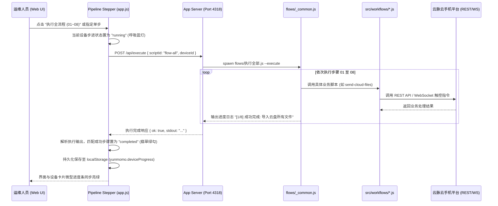
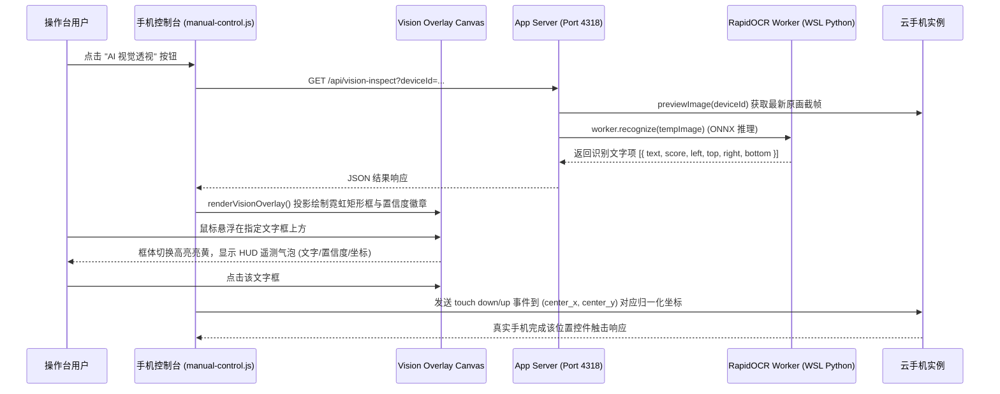

# 📖 云脉云手机自动化代码符号与架构全景索引

> **生成时间**：2026/11/5 21:25:49  
> **符号来源**：Serena 语言服务（LSP）文档符号缓存，覆盖 178 个源文件 / 248 个扫描文件，  
> 解析出 175 个类与接口、1558 个成员方法、1239 个函数、711 个模块级常量。  
> **服务默认端口**：`4318` (`http://127.0.0.1:4318/`)  
> **GPU 识别常驻端口**：`4329` (`http://127.0.0.1:4329/`)  
> **项目定位**：基于 Yunmomo 云手机平台的高性能自动化控制、YOLO/RapidOCR 本地视觉感知与端到端 RPA 调度中台。

> ⚠️ **缓存滞后**：有 41 个源文件的修改时间晚于 Serena 符号缓存，行号可能偏移。  
> 刷新方式：`serena project index` → `npm run index`。

---

## 🏛️ 一、系统全景架构与模块拓扑 (System Architecture)


---

## 📂 二、目录职责与工程分工

| 目录路径 | 源文件数 | 核心职责与关键技术 |
|---|---|---|
| [`src/`](file:///d:/AA-project/自动化/src) | 151 | 云端 REST 客户端、scrcpy 协议帧编解码、WebSocket 实时真机控制器、高清抓帧引擎 |
| [`src/automation/`](file:///d:/AA-project/自动化/src/automation) | 18 | 路径/环境隔离、WSL RapidOCR 桥接、4329 GPU 识别常驻服务、并发锁、页面导航恢复 |
| [`src/tools/`](file:///d:/AA-project/自动化/src/tools) | 48 | 点击/滑动/区域加权采样、MOMO 页面识别、红点候选、聊天详情提取 |
| [`src/workflows/`](file:///d:/AA-project/自动化/src/workflows) | 42 | 01~16 业务流程实现、MOMO 消息持续监听、参数校验、上游调用、重试熔断 |
| [`src/brain/`](file:///d:/AA-project/自动化/src/brain) | 6 | 多设备监听调度中枢、串行 DeviceActor、优先级任务队列与调度控制库 |
| [`src/ai/`](file:///d:/AA-project/自动化/src/ai) | 4 | DeepSeek 会话配置、上下文拼装与 AI 回复任务执行 |
| [`src/typing/`](file:///d:/AA-project/自动化/src/typing) | 2 | WebSocket 输入法按键注入、聊天消息自然拼音分词输入控制器 |
| [`src/server/`](file:///d:/AA-project/自动化/src/server) | 22 | 本地 Web 控制台 HTTP/WS 服务（默认端口 4318）、设备锁、真机触控桥接、视频流代理 |
| [`app/`](file:///d:/AA-project/自动化/app) | 26 | 业务控制台 UI、01~16 全流程状态感知步进器、微型进度条、AI 视觉 HUD 覆盖层 |
| [`flows/`](file:///d:/AA-project/自动化/flows) | 33 | 中文编号 CLI 执行入口（v2/v3/momo 三套），统一转发至 `src/workflows/` |
| [`python_typing/`](file:///d:/AA-project/自动化/python_typing) | 10 | 纯 Python 中文分词、拼音拼写转换、候选词匹配、九宫格/全键盘按键动作生成 |
| [`python_workers/`](file:///d:/AA-project/自动化/python_workers) | 3 | RapidOCR 常驻进程、输入法候选 OCR 进程、分词拼音计划输出管道 |
| [`scripts/`](file:///d:/AA-project/自动化/scripts) | 25 | 控制台启动入口、识别常驻服务、4318 穿透、索引生成与 UI 校验脚本 |

---

## 📑 三、核心类与导出符号全览 (Classes & Symbols)

> 以下符号、签名与行号全部来自 Serena 语言服务解析结果；类成员（方法/字段）随类缩进列出。

### 1. 核心 SDK 与客户端 (src/client, control, protocol, management)

#### 📄 [`src/browser-view.js`](file:///d:/AA-project/自动化/src/browser-view.js) (123 行)

**类与接口 (Classes)**:
- [`CloudPhoneBrowserView`](file:///d:/AA-project/自动化/src/browser-view.js#L15) —— 第 15–121 行
  - [`constructor(page,`](file:///d:/AA-project/自动化/src/browser-view.js#L16) — L16
  - [`async _popup()`](file:///d:/AA-project/自动化/src/browser-view.js#L22) — L22
  - [`async setPreferences(preferences)`](file:///d:/AA-project/自动化/src/browser-view.js#L36) — L36
  - [`async refresh()`](file:///d:/AA-project/自动化/src/browser-view.js#L71) — L71
  - [`async setSize(size)`](file:///d:/AA-project/自动化/src/browser-view.js#L76) — L76
  - [`async openSidebarAction(category, item)`](file:///d:/AA-project/自动化/src/browser-view.js#L101) — L101

**模块级常量与状态**:
[`TOOLBAR_ITEMS`](file:///d:/AA-project/自动化/src/browser-view.js#L6) (第 6 行)

**模块导出 (Exports)**: `CloudPhoneBrowserView`, `TOOLBAR_ITEMS`

#### 📄 [`src/client.js`](file:///d:/AA-project/自动化/src/client.js) (286 行)

**类与接口 (Classes)**:
- [`YunmomoHttpError`](file:///d:/AA-project/自动化/src/client.js#L38) —— 第 38–45 行
  - [`constructor(message, status, data)`](file:///d:/AA-project/自动化/src/client.js#L39) — L39
- [`YunmomoClient`](file:///d:/AA-project/自动化/src/client.js#L47) —— 第 47–219 行
  - [`constructor(options`](file:///d:/AA-project/自动化/src/client.js#L48) — L48
  - [`_readOnce(key, read)`](file:///d:/AA-project/自动化/src/client.js#L61) — L61
  - [`requireToken()`](file:///d:/AA-project/自动化/src/client.js#L77) — L77
  - [`async request(path, options`](file:///d:/AA-project/自动化/src/client.js#L79) — L79
  - [`async _requestMeasured(path, options`](file:///d:/AA-project/自动化/src/client.js#L85) — L85
  - [`invoke(action, payload`](file:///d:/AA-project/自动化/src/client.js#L132) — L132
  - [`async listDevices(options`](file:///d:/AA-project/自动化/src/client.js#L141) — L141
  - [`getDevice(id, options`](file:///d:/AA-project/自动化/src/client.js#L155) — L155
  - [`async listModels()`](file:///d:/AA-project/自动化/src/client.js#L158) — L158
  - [`async screenshot(deviceId, options`](file:///d:/AA-project/自动化/src/client.js#L167) — L167
  - [`closeScreenshots()`](file:///d:/AA-project/自动化/src/client.js#L186) — L186
  - [`openControl(options`](file:///d:/AA-project/自动化/src/client.js#L188) — L188
  - [`device(deviceId)`](file:///d:/AA-project/自动化/src/client.js#L189) — L189
  - [`cloudDisk()`](file:///d:/AA-project/自动化/src/client.js#L190) — L190
  - [`vpc()`](file:///d:/AA-project/自动化/src/client.js#L191) — L191
  - [`async uploadCloudFile(data, options`](file:///d:/AA-project/自动化/src/client.js#L193) — L193
  - [`uploadGoogleCertificate(deviceIds, data, options`](file:///d:/AA-project/自动化/src/client.js#L200) — L200
  - [`sendFiles(deviceIds, urls, options`](file:///d:/AA-project/自动化/src/client.js#L210) — L210
- [`CloudPhoneDevice`](file:///d:/AA-project/自动化/src/client.js#L221) —— 第 221–279 行
  - [`constructor(client, deviceId)`](file:///d:/AA-project/自动化/src/client.js#L222) — L222
  - [`getInfo(options)`](file:///d:/AA-project/自动化/src/client.js#L223) — L223
  - [`screenshot(options)`](file:///d:/AA-project/自动化/src/client.js#L224) — L224
  - [`tools(options)`](file:///d:/AA-project/自动化/src/client.js#L225) — L225
  - [`invoke(action, fields`](file:///d:/AA-project/自动化/src/client.js#L226) — L226
  - [`start()`](file:///d:/AA-project/自动化/src/client.js#L227) — L227
  - [`stop()`](file:///d:/AA-project/自动化/src/client.js#L228) — L228
  - [`reboot(containerId)`](file:///d:/AA-project/自动化/src/client.js#L229) — L229
  - [`rename(name)`](file:///d:/AA-project/自动化/src/client.js#L230) — L230
  - [`reset()`](file:///d:/AA-project/自动化/src/client.js#L231) — L231
  - [`resetV3(countryCode)`](file:///d:/AA-project/自动化/src/client.js#L232) — L232
  - [`countryCodes()`](file:///d:/AA-project/自动化/src/client.js#L233) — L233
  - [`switchModel(config, options`](file:///d:/AA-project/自动化/src/client.js#L234) — L234
  - [`randomDeviceInfo()`](file:///d:/AA-project/自动化/src/client.js#L248) — L248
  - [`randomFingerprint()`](file:///d:/AA-project/自动化/src/client.js#L249) — L249
  - [`restartVpc()`](file:///d:/AA-project/自动化/src/client.js#L250) — L250
  - [`listFiles(path = '/sdcard/')`](file:///d:/AA-project/自动化/src/client.js#L251) — L251
  - [`downloadFile(path)`](file:///d:/AA-project/自动化/src/client.js#L252) — L252
  - [`playAudio(path)`](file:///d:/AA-project/自动化/src/client.js#L253) — L253
  - [`stopAudio(path)`](file:///d:/AA-project/自动化/src/client.js#L254) — L254
  - [`_audio(act, path)`](file:///d:/AA-project/自动化/src/client.js#L255) — L255
  - [`getProxy(version = 'v1')`](file:///d:/AA-project/自动化/src/client.js#L259) — L259
  - [`stopProxy(version = 'v1')`](file:///d:/AA-project/自动化/src/client.js#L260) — L260
  - [`setProxy(config, version = 'v1')`](file:///d:/AA-project/自动化/src/client.js#L261) — L261
  - [`setDeviceInfo(config)`](file:///d:/AA-project/自动化/src/client.js#L266) — L266
  - [`uploadGoogleCertificate(data, options)`](file:///d:/AA-project/自动化/src/client.js#L272) — L272
  - [`sendFiles(urls, options)`](file:///d:/AA-project/自动化/src/client.js#L273) — L273
  - [`async openControl(options`](file:///d:/AA-project/自动化/src/client.js#L274) — L274

**函数 (Functions)**:
- [`function appendQuery(url, query, prefix = '')`](file:///d:/AA-project/自动化/src/client.js#L28) —— 第 28–36 行
- [`function proxyAction(version, operation)`](file:///d:/AA-project/自动化/src/client.js#L281) —— 第 281–284 行

**模块级常量与状态**:
[`DEVICE`](file:///d:/AA-project/自动化/src/client.js#L6) (第 6 行) · [`BACKEND_ACTIONS`](file:///d:/AA-project/自动化/src/client.js#L8) (第 8 行)

**模块导出 (Exports)**: `YunmomoClient`, `CloudPhoneControl`, `CloudPhoneDevice`, `YunmomoHttpError`, `BACKEND_ACTIONS`

#### 📄 [`src/control.js`](file:///d:/AA-project/自动化/src/control.js) (547 行)

**类与接口 (Classes)**:
- [`CloudPhoneControl`](file:///d:/AA-project/自动化/src/control.js#L28) —— 第 28–525 行
  - [`constructor(options`](file:///d:/AA-project/自动化/src/control.js#L29) — L29
  - [`buildWebSocketUrl()`](file:///d:/AA-project/自动化/src/control.js#L66) — L66
  - [`redactedWebSocketUrl()`](file:///d:/AA-project/自动化/src/control.js#L79) — L79
  - [`toJSON()`](file:///d:/AA-project/自动化/src/control.js#L85) — L85
  - [`connect(options`](file:///d:/AA-project/自动化/src/control.js#L92) — L92
  - [`control._streamError = streamErr;`](file:///d:/AA-project/自动化/src/control.js#L211) — L211
  - [`this.emit('device-message', message);`](file:///d:/AA-project/自动化/src/control.js#L250) — L250
  - [`return;`](file:///d:/AA-project/自动化/src/control.js#L256) — L256
  - [`}`](file:///d:/AA-project/自动化/src/control.js#L265) — L265
  - [`}`](file:///d:/AA-project/自动化/src/control.js#L272) — L272
  - [`this._streamError = null;`](file:///d:/AA-project/自动化/src/control.js#L288) — L288
  - [`close`](file:///d:/AA-project/自动化/src/control.js#L298) — L298
  - [`tasks.push(new Promise(resolve =>`](file:///d:/AA-project/自动化/src/control.js#L318) — L318
  - [`}));`](file:///d:/AA-project/自动化/src/control.js#L323) — L323
  - [`if (typeof enabled !== 'boolean') throw new TypeError('enabled must be a boolean');`](file:///d:/AA-project/自动化/src/control.js#L335) — L335
  - [`_scheduleReconnect()`](file:///d:/AA-project/自动化/src/control.js#L346) — L346
  - [`this._retryTimer = setTimeout(() =>`](file:///d:/AA-project/自动化/src/control.js#L352) — L352
  - [`if (handler !== false && typeof handler !== 'function') throw new TypeError('Pass a clipboard callback or false');`](file:///d:/AA-project/自动化/src/control.js#L358) — L358
  - [`return pending;`](file:///d:/AA-project/自动化/src/control.js#L366) — L366
  - [`...options,`](file:///d:/AA-project/自动化/src/control.js#L371) — L371
  - [`return this.send(p.encodeTouch(`](file:///d:/AA-project/自动化/src/control.js#L376) — L376
  - [`longPress`](file:///d:/AA-project/自动化/src/control.js#L380) — L380
  - [`}`](file:///d:/AA-project/自动化/src/control.js#L384) — L384
  - [`y: clamp(clampedFrom.y + (clampedTo.y - clampedFrom.y) * i / steps, this.screenHeight)`](file:///d:/AA-project/自动化/src/control.js#L425) — L425
  - [`};`](file:///d:/AA-project/自动化/src/control.js#L426) — L426
  - [`if (clampedFrom.x !== clampedTo.x || clampedFrom.y !== clampedTo.y) this.touch(p.ACTION.MOVE, current.x, current.y, options);`](file:///d:/AA-project/自动化/src/control.js#L427) — L427
  - [`const upY = clamp(current.y, this.screenHeight);`](file:///d:/AA-project/自动化/src/control.js#L432) — L432
  - [`this.touch(p.ACTION.UP, upX, upY,`](file:///d:/AA-project/自动化/src/control.js#L433) — L433
  - [`}`](file:///d:/AA-project/自动化/src/control.js#L434) — L434
  - [`}`](file:///d:/AA-project/自动化/src/control.js#L435) — L435
  - [`return this;`](file:///d:/AA-project/自动化/src/control.js#L436) — L436
  - [`});`](file:///d:/AA-project/自动化/src/control.js#L437) — L437
  - [`key(keycode, options)`](file:///d:/AA-project/自动化/src/control.js#L441) — L441
  - [`pressKey(name, options)`](file:///d:/AA-project/自动化/src/control.js#L442) — L442
  - [`const code = typeof name === 'number' ? name : p.KEY_CODES\[String(name).trim().toUpperCase().replace(/\[- \]/g, '_')\];`](file:///d:/AA-project/自动化/src/control.js#L443) — L443
  - [`if (code === undefined) throw new TypeError('Unknown Android key: ' + name);`](file:///d:/AA-project/自动化/src/control.js#L444) — L444
  - [`return this.key(code, options);`](file:///d:/AA-project/自动化/src/control.js#L445) — L445
  - [`}`](file:///d:/AA-project/自动化/src/control.js#L446) — L446
  - [`back(options)`](file:///d:/AA-project/自动化/src/control.js#L447) — L447
  - [`home(options)`](file:///d:/AA-project/自动化/src/control.js#L448) — L448
  - [`overview(options)`](file:///d:/AA-project/自动化/src/control.js#L449) — L449
  - [`volumeDown(options)`](file:///d:/AA-project/自动化/src/control.js#L451) — L451
  - [`const cleanup = () =>`](file:///d:/AA-project/自动化/src/control.js#L470) — L470
  - [`const receive = value =>`](file:///d:/AA-project/自动化/src/control.js#L475) — L475
  - [`}`](file:///d:/AA-project/自动化/src/control.js#L483) — L483
  - [`pushFile`](file:///d:/AA-project/自动化/src/control.js#L489) — L489

**函数 (Functions)**:
- [`function requiredString(name, value)`](file:///d:/AA-project/自动化/src/control.js#L12) —— 第 12–16 行
- [`function delay(ms, signal)`](file:///d:/AA-project/自动化/src/control.js#L18) —— 第 18–26 行

**模块级常量与状态**:
[`name`](file:///d:/AA-project/自动化/src/control.js#L528) (第 528 行)

**模块导出 (Exports)**: `CloudPhoneControl`, `requiredString`

#### 📄 [`src/index.d.ts`](file:///d:/AA-project/自动化/src/index.d.ts) (705 行)

**类与接口 (Classes)**:
- [`ImageResponse`](file:///d:/AA-project/自动化/src/index.d.ts#L1) —— 第 1–4 行
  - [`data: Uint8Array; contentType: string; status: number;`](file:///d:/AA-project/自动化/src/index.d.ts#L2) — L2
  - [`data: Uint8Array; contentType: string; status: number;`](file:///d:/AA-project/自动化/src/index.d.ts#L2) — L2
  - [`data: Uint8Array; contentType: string; status: number;`](file:///d:/AA-project/自动化/src/index.d.ts#L2) — L2
  - [`source?: 'stream'; width?: number; height?: number; decodedAt?: string;`](file:///d:/AA-project/自动化/src/index.d.ts#L3) — L3
  - [`source?: 'stream'; width?: number; height?: number; decodedAt?: string;`](file:///d:/AA-project/自动化/src/index.d.ts#L3) — L3
  - [`source?: 'stream'; width?: number; height?: number; decodedAt?: string;`](file:///d:/AA-project/自动化/src/index.d.ts#L3) — L3
  - [`source?: 'stream'; width?: number; height?: number; decodedAt?: string;`](file:///d:/AA-project/自动化/src/index.d.ts#L3) — L3
- [`ManagementPage`](file:///d:/AA-project/自动化/src/index.d.ts#L7) —— 第 7 行
  - [`export interface ManagementPage<T>`](file:///d:/AA-project/自动化/src/index.d.ts#L7) — L7
  - [`export interface ManagementPage<T>`](file:///d:/AA-project/自动化/src/index.d.ts#L7) — L7
  - [`export interface ManagementPage<T>`](file:///d:/AA-project/自动化/src/index.d.ts#L7) — L7
  - [`export interface ManagementPage<T>`](file:///d:/AA-project/自动化/src/index.d.ts#L7) — L7
  - [`export interface ManagementPage<T>`](file:///d:/AA-project/自动化/src/index.d.ts#L7) — L7
  - [`export interface ManagementPage<T>`](file:///d:/AA-project/自动化/src/index.d.ts#L7) — L7
- [`SortOrder`](file:///d:/AA-project/自动化/src/index.d.ts#L8) —— 第 8 行
  - [`export interface SortOrder`](file:///d:/AA-project/自动化/src/index.d.ts#L8) — L8
  - [`export interface SortOrder`](file:///d:/AA-project/自动化/src/index.d.ts#L8) — L8
- [`CloudFile`](file:///d:/AA-project/自动化/src/index.d.ts#L9) —— 第 9–12 行
  - [`id: string; name: string; url: string; channel?: string; fileType?: string; fileSize?: number;`](file:///d:/AA-project/自动化/src/index.d.ts#L10) — L10
  - [`id: string; name: string; url: string; channel?: string; fileType?: string; fileSize?: number;`](file:///d:/AA-project/自动化/src/index.d.ts#L10) — L10
  - [`id: string; name: string; url: string; channel?: string; fileType?: string; fileSize?: number;`](file:///d:/AA-project/自动化/src/index.d.ts#L10) — L10
  - [`id: string; name: string; url: string; channel?: string; fileType?: string; fileSize?: number;`](file:///d:/AA-project/自动化/src/index.d.ts#L10) — L10
  - [`id: string; name: string; url: string; channel?: string; fileType?: string; fileSize?: number;`](file:///d:/AA-project/自动化/src/index.d.ts#L10) — L10
  - [`id: string; name: string; url: string; channel?: string; fileType?: string; fileSize?: number;`](file:///d:/AA-project/自动化/src/index.d.ts#L10) — L10
  - [`appName?: string; packageName?: string; versionName?: string; \[field: string\]: unknown;`](file:///d:/AA-project/自动化/src/index.d.ts#L11) — L11
  - [`appName?: string; packageName?: string; versionName?: string; \[field: string\]: unknown;`](file:///d:/AA-project/自动化/src/index.d.ts#L11) — L11
  - [`appName?: string; packageName?: string; versionName?: string; \[field: string\]: unknown;`](file:///d:/AA-project/自动化/src/index.d.ts#L11) — L11
- [`CloudListOptions`](file:///d:/AA-project/自动化/src/index.d.ts#L13) —— 第 13–16 行
  - [`page?: number; size?: number; channel?: '1' | '2'; fileType?: string;`](file:///d:/AA-project/自动化/src/index.d.ts#L14) — L14
  - [`page?: number; size?: number; channel?: '1' | '2'; fileType?: string;`](file:///d:/AA-project/自动化/src/index.d.ts#L14) — L14
  - [`page?: number; size?: number; channel?: '1' | '2'; fileType?: string;`](file:///d:/AA-project/自动化/src/index.d.ts#L14) — L14
  - [`page?: number; size?: number; channel?: '1' | '2'; fileType?: string;`](file:///d:/AA-project/自动化/src/index.d.ts#L14) — L14
  - [`sort?: 'default' | 'time' | 'size' | 'name'; orders?: SortOrder\[\]; \[filter: string\]: unknown;`](file:///d:/AA-project/自动化/src/index.d.ts#L15) — L15
  - [`sort?: 'default' | 'time' | 'size' | 'name'; orders?: SortOrder\[\]; \[filter: string\]: unknown;`](file:///d:/AA-project/自动化/src/index.d.ts#L15) — L15
- [`FileUploadOptions`](file:///d:/AA-project/自动化/src/index.d.ts#L17) —— 第 17–19 行
  - [`fileName: string; fields?: Record<string, unknown>; public?: boolean;`](file:///d:/AA-project/自动化/src/index.d.ts#L18) — L18
  - [`fileName: string; fields?: Record<string, unknown>; public?: boolean;`](file:///d:/AA-project/自动化/src/index.d.ts#L18) — L18
  - [`fileName: string; fields?: Record<string, unknown>; public?: boolean;`](file:///d:/AA-project/自动化/src/index.d.ts#L18) — L18
- [`FileTypeCount`](file:///d:/AA-project/自动化/src/index.d.ts#L20) —— 第 20 行
  - [`export interface FileTypeCount`](file:///d:/AA-project/自动化/src/index.d.ts#L20) — L20
  - [`export interface FileTypeCount`](file:///d:/AA-project/自动化/src/index.d.ts#L20) — L20
- [`PrivateCloudUsage`](file:///d:/AA-project/自动化/src/index.d.ts#L21) —— 第 21 行
  - [`export interface PrivateCloudUsage`](file:///d:/AA-project/自动化/src/index.d.ts#L21) — L21
  - [`export interface PrivateCloudUsage`](file:///d:/AA-project/自动化/src/index.d.ts#L21) — L21
- [`PublicCloudUsage`](file:///d:/AA-project/自动化/src/index.d.ts#L22) —— 第 22 行
  - [`export interface PublicCloudUsage`](file:///d:/AA-project/自动化/src/index.d.ts#L22) — L22
  - [`export interface PublicCloudUsage`](file:///d:/AA-project/自动化/src/index.d.ts#L22) — L22
- [`TransferPair`](file:///d:/AA-project/自动化/src/index.d.ts#L23) —— 第 23 行
  - [`export interface TransferPair`](file:///d:/AA-project/自动化/src/index.d.ts#L23) — L23
  - [`export interface TransferPair`](file:///d:/AA-project/自动化/src/index.d.ts#L23) — L23
  - [`export interface TransferPair`](file:///d:/AA-project/自动化/src/index.d.ts#L23) — L23
- [`TransferStatus`](file:///d:/AA-project/自动化/src/index.d.ts#L24) —— 第 24–27 行
  - [`finished?: boolean; expired?: boolean; totalCount?: number; successCount?: number; failCount?: number;`](file:///d:/AA-project/自动化/src/index.d.ts#L25) — L25
  - [`finished?: boolean; expired?: boolean; totalCount?: number; successCount?: number; failCount?: number;`](file:///d:/AA-project/自动化/src/index.d.ts#L25) — L25
  - [`finished?: boolean; expired?: boolean; totalCount?: number; successCount?: number; failCount?: number;`](file:///d:/AA-project/自动化/src/index.d.ts#L25) — L25
  - [`finished?: boolean; expired?: boolean; totalCount?: number; successCount?: number; failCount?: number;`](file:///d:/AA-project/自动化/src/index.d.ts#L25) — L25
  - [`finished?: boolean; expired?: boolean; totalCount?: number; successCount?: number; failCount?: number;`](file:///d:/AA-project/自动化/src/index.d.ts#L25) — L25
  - [`startTime?: string | number; message?: string; details?: Array<Record<string, unknown>>; \[field: string\]: unknown;`](file:///d:/AA-project/自动化/src/index.d.ts#L26) — L26
  - [`startTime?: string | number; message?: string; details?: Array<Record<string, unknown>>; \[field: string\]: unknown;`](file:///d:/AA-project/自动化/src/index.d.ts#L26) — L26
  - [`startTime?: string | number; message?: string; details?: Array<Record<string, unknown>>; \[field: string\]: unknown;`](file:///d:/AA-project/自动化/src/index.d.ts#L26) — L26
- [`VpcConfig`](file:///d:/AA-project/自动化/src/index.d.ts#L28) —— 第 28–31 行
  - [`id?: string; ip: string; port: string | number; username: string; password: string;`](file:///d:/AA-project/自动化/src/index.d.ts#L29) — L29
  - [`id?: string; ip: string; port: string | number; username: string; password: string;`](file:///d:/AA-project/自动化/src/index.d.ts#L29) — L29
  - [`id?: string; ip: string; port: string | number; username: string; password: string;`](file:///d:/AA-project/自动化/src/index.d.ts#L29) — L29
  - [`id?: string; ip: string; port: string | number; username: string; password: string;`](file:///d:/AA-project/自动化/src/index.d.ts#L29) — L29
  - [`id?: string; ip: string; port: string | number; username: string; password: string;`](file:///d:/AA-project/自动化/src/index.d.ts#L29) — L29
  - [`expTime?: string; userId?: string; groupId?: string; remarks?: string; \[field: string\]: unknown;`](file:///d:/AA-project/自动化/src/index.d.ts#L30) — L30
  - [`expTime?: string; userId?: string; groupId?: string; remarks?: string; \[field: string\]: unknown;`](file:///d:/AA-project/自动化/src/index.d.ts#L30) — L30
  - [`expTime?: string; userId?: string; groupId?: string; remarks?: string; \[field: string\]: unknown;`](file:///d:/AA-project/自动化/src/index.d.ts#L30) — L30
  - [`expTime?: string; userId?: string; groupId?: string; remarks?: string; \[field: string\]: unknown;`](file:///d:/AA-project/自动化/src/index.d.ts#L30) — L30
- [`VpcRecord`](file:///d:/AA-project/自动化/src/index.d.ts#L32) —— 第 32 行
  - [`export interface VpcRecord extends VpcConfig`](file:///d:/AA-project/自动化/src/index.d.ts#L32) — L32
- [`AddedVpc`](file:///d:/AA-project/自动化/src/index.d.ts#L33) —— 第 33 行
  - [`export interface AddedVpc`](file:///d:/AA-project/自动化/src/index.d.ts#L33) — L33
  - [`export interface AddedVpc`](file:///d:/AA-project/自动化/src/index.d.ts#L33) — L33
  - [`export interface AddedVpc`](file:///d:/AA-project/自动化/src/index.d.ts#L33) — L33
  - [`export interface AddedVpc`](file:///d:/AA-project/自动化/src/index.d.ts#L33) — L33
  - [`export interface AddedVpc`](file:///d:/AA-project/自动化/src/index.d.ts#L33) — L33
  - [`export interface AddedVpc`](file:///d:/AA-project/自动化/src/index.d.ts#L33) — L33
- [`VpcListOptions`](file:///d:/AA-project/自动化/src/index.d.ts#L34) —— 第 34–37 行
  - [`current?: number; size?: number; ip?: string; remarks?: string; groupId?: string;`](file:///d:/AA-project/自动化/src/index.d.ts#L35) — L35
  - [`current?: number; size?: number; ip?: string; remarks?: string; groupId?: string;`](file:///d:/AA-project/自动化/src/index.d.ts#L35) — L35
  - [`current?: number; size?: number; ip?: string; remarks?: string; groupId?: string;`](file:///d:/AA-project/自动化/src/index.d.ts#L35) — L35
  - [`current?: number; size?: number; ip?: string; remarks?: string; groupId?: string;`](file:///d:/AA-project/自动化/src/index.d.ts#L35) — L35
  - [`current?: number; size?: number; ip?: string; remarks?: string; groupId?: string;`](file:///d:/AA-project/自动化/src/index.d.ts#L35) — L35
  - [`orders?: SortOrder\[\]; \[filter: string\]: unknown;`](file:///d:/AA-project/自动化/src/index.d.ts#L36) — L36
- [`VpcGroup`](file:///d:/AA-project/自动化/src/index.d.ts#L38) —— 第 38 行
  - [`export interface VpcGroup`](file:///d:/AA-project/自动化/src/index.d.ts#L38) — L38
  - [`export interface VpcGroup`](file:///d:/AA-project/自动化/src/index.d.ts#L38) — L38
  - [`export interface VpcGroup`](file:///d:/AA-project/自动化/src/index.d.ts#L38) — L38
- [`SpreadsheetQuery`](file:///d:/AA-project/自动化/src/index.d.ts#L39) —— 第 39–43 行
  - [`current?: number; size?: number; orders?: SortOrder\[\]; filename?: string; sheetName?: string;`](file:///d:/AA-project/自动化/src/index.d.ts#L40) — L40
  - [`current?: number; size?: number; orders?: SortOrder\[\]; filename?: string; sheetName?: string;`](file:///d:/AA-project/自动化/src/index.d.ts#L40) — L40
  - [`current?: number; size?: number; orders?: SortOrder\[\]; filename?: string; sheetName?: string;`](file:///d:/AA-project/自动化/src/index.d.ts#L40) — L40
  - [`current?: number; size?: number; orders?: SortOrder\[\]; filename?: string; sheetName?: string;`](file:///d:/AA-project/自动化/src/index.d.ts#L40) — L40
  - [`current?: number; size?: number; orders?: SortOrder\[\]; filename?: string; sheetName?: string;`](file:///d:/AA-project/自动化/src/index.d.ts#L40) — L40
  - [`isHeader?: boolean; original?: boolean; mode?: 'current' | 'selected' | 'all'; selectIds?: string\[\];`](file:///d:/AA-project/自动化/src/index.d.ts#L41) — L41
  - [`isHeader?: boolean; original?: boolean; mode?: 'current' | 'selected' | 'all'; selectIds?: string\[\];`](file:///d:/AA-project/自动化/src/index.d.ts#L41) — L41
  - [`isHeader?: boolean; original?: boolean; mode?: 'current' | 'selected' | 'all'; selectIds?: string\[\];`](file:///d:/AA-project/自动化/src/index.d.ts#L41) — L41
  - [`isHeader?: boolean; original?: boolean; mode?: 'current' | 'selected' | 'all'; selectIds?: string\[\];`](file:///d:/AA-project/自动化/src/index.d.ts#L41) — L41
  - [`exportFields?: string\[\]; \[filter: string\]: unknown;`](file:///d:/AA-project/自动化/src/index.d.ts#L42) — L42
- [`CloudDisk`](file:///d:/AA-project/自动化/src/index.d.ts#L45) —— 第 45–65 行
  - [`constructor(client: YunmomoClient);`](file:///d:/AA-project/自动化/src/index.d.ts#L46) — L46
  - [`readonly client: YunmomoClient;`](file:///d:/AA-project/自动化/src/index.d.ts#L47) — L47
  - [`list(options?: CloudListOptions, requestOptions?: ManagementRequestOptions): Promise<ManagementPage<CloudFile>>;`](file:///d:/AA-project/自动化/src/index.d.ts#L48) — L48
  - [`get(id: string, options?: ManagementRequestOptions): Promise<CloudFile>;`](file:///d:/AA-project/自动化/src/index.d.ts#L49) — L49
  - [`usage(channel?: '1', options?: ManagementRequestOptions): Promise<PrivateCloudUsage>;`](file:///d:/AA-project/自动化/src/index.d.ts#L50) — L50
  - [`upload(data: Uint8Array | Blob, options: FileUploadOptions): Promise<any>;`](file:///d:/AA-project/自动化/src/index.d.ts#L53) — L53
  - [`rename(id: string, name: string, options?: ManagementRequestOptions): Promise<any>;`](file:///d:/AA-project/自动化/src/index.d.ts#L54) — L54
  - [`delete(ids: string | string\[\], options?: ManagementRequestOptions): Promise<any>;`](file:///d:/AA-project/自动化/src/index.d.ts#L55) — L55
  - [`resolveUrl(file: CloudFile | string, options?: ManagementRequestOptions): Promise<string>;`](file:///d:/AA-project/自动化/src/index.d.ts#L56) — L56
  - [`sendToDevices(deviceIds: string\[\], files: Array<CloudFile | string>, options: ManagementRequestOptions &`](file:///d:/AA-project/自动化/src/index.d.ts#L57) — L57
  - [`transferStatus(options?: ManagementRequestOptions): Promise<TransferStatus | null>;`](file:///d:/AA-project/自动化/src/index.d.ts#L58) — L58
  - [`sendPairs(pairs: TransferPair\[\], options?: ManagementRequestOptions &`](file:///d:/AA-project/自动化/src/index.d.ts#L59) — L59
  - [`pairStatus(options?: ManagementRequestOptions): Promise<TransferStatus | null>;`](file:///d:/AA-project/自动化/src/index.d.ts#L60) — L60
  - [`clearPairStatus(options?: ManagementRequestOptions): Promise<any>;`](file:///d:/AA-project/自动化/src/index.d.ts#L61) — L61
  - [`importExcel(data: Uint8Array | Blob, options: Omit<FileUploadOptions, 'public'>): Promise<any>;`](file:///d:/AA-project/自动化/src/index.d.ts#L62) — L62
  - [`exportExcel(query?: SpreadsheetQuery, options?: ManagementRequestOptions): Promise<BinaryResponse>;`](file:///d:/AA-project/自动化/src/index.d.ts#L63) — L63
  - [`exportTemplate(options?: ManagementRequestOptions): Promise<BinaryResponse>;`](file:///d:/AA-project/自动化/src/index.d.ts#L64) — L64
- [`VpcManager`](file:///d:/AA-project/自动化/src/index.d.ts#L66) —— 第 66–82 行
  - [`constructor(client: YunmomoClient);`](file:///d:/AA-project/自动化/src/index.d.ts#L67) — L67
  - [`readonly client: YunmomoClient;`](file:///d:/AA-project/自动化/src/index.d.ts#L68) — L68
  - [`list(options?: VpcListOptions, requestOptions?: ManagementRequestOptions): Promise<ManagementPage<VpcRecord>>;`](file:///d:/AA-project/自动化/src/index.d.ts#L69) — L69
  - [`get(id: string, options?: ManagementRequestOptions): Promise<VpcRecord>;`](file:///d:/AA-project/自动化/src/index.d.ts#L70) — L70
  - [`save(config: VpcConfig, options?: ManagementRequestOptions): Promise<any>;`](file:///d:/AA-project/自动化/src/index.d.ts#L71) — L71
  - [`batchSave(configs: VpcConfig\[\], options?: ManagementRequestOptions): Promise<any>;`](file:///d:/AA-project/自动化/src/index.d.ts#L72) — L72
  - [`addAndGetIds(configs: VpcConfig | VpcConfig\[\], options?: ManagementRequestOptions &`](file:///d:/AA-project/自动化/src/index.d.ts#L73) — L73
  - [`delete(ids: string | string\[\], options?: ManagementRequestOptions): Promise<any>;`](file:///d:/AA-project/自动化/src/index.d.ts#L76) — L76
  - [`testConnection(id: string, options?: ManagementRequestOptions): Promise<boolean>;`](file:///d:/AA-project/自动化/src/index.d.ts#L77) — L77
  - [`groups(): VpcGroupManager;`](file:///d:/AA-project/自动化/src/index.d.ts#L78) — L78
  - [`importExcel(data: Uint8Array | Blob, options: Omit<FileUploadOptions, 'public'>): Promise<any>;`](file:///d:/AA-project/自动化/src/index.d.ts#L79) — L79
  - [`exportExcel(query?: SpreadsheetQuery, options?: ManagementRequestOptions): Promise<BinaryResponse>;`](file:///d:/AA-project/自动化/src/index.d.ts#L80) — L80
  - [`exportTemplate(options?: ManagementRequestOptions): Promise<BinaryResponse>;`](file:///d:/AA-project/自动化/src/index.d.ts#L81) — L81
- [`VpcGroupManager`](file:///d:/AA-project/自动化/src/index.d.ts#L83) —— 第 83–90 行
  - [`constructor(client: YunmomoClient);`](file:///d:/AA-project/自动化/src/index.d.ts#L84) — L84
  - [`readonly client: YunmomoClient;`](file:///d:/AA-project/自动化/src/index.d.ts#L85) — L85
  - [`list(options?`](file:///d:/AA-project/自动化/src/index.d.ts#L86) — L86
  - [`get(id: string, options?: ManagementRequestOptions): Promise<VpcGroup>;`](file:///d:/AA-project/自动化/src/index.d.ts#L87) — L87
  - [`save(config`](file:///d:/AA-project/自动化/src/index.d.ts#L88) — L88
  - [`delete(ids: string | string\[\], options?: ManagementRequestOptions &`](file:///d:/AA-project/自动化/src/index.d.ts#L89) — L89
- [`RequestOptions`](file:///d:/AA-project/自动化/src/index.d.ts#L91) —— 第 91–94 行
  - [`method?: string; query?: Record<string, unknown>; body?: unknown;`](file:///d:/AA-project/自动化/src/index.d.ts#L92) — L92
  - [`method?: string; query?: Record<string, unknown>; body?: unknown;`](file:///d:/AA-project/自动化/src/index.d.ts#L92) — L92
  - [`method?: string; query?: Record<string, unknown>; body?: unknown;`](file:///d:/AA-project/自动化/src/index.d.ts#L92) — L92
  - [`headers?: Record<string, string>; timeoutMs?: number; signal?: AbortSignal; responseType?: 'buffer';`](file:///d:/AA-project/自动化/src/index.d.ts#L93) — L93
  - [`headers?: Record<string, string>; timeoutMs?: number; signal?: AbortSignal; responseType?: 'buffer';`](file:///d:/AA-project/自动化/src/index.d.ts#L93) — L93
  - [`headers?: Record<string, string>; timeoutMs?: number; signal?: AbortSignal; responseType?: 'buffer';`](file:///d:/AA-project/自动化/src/index.d.ts#L93) — L93
  - [`headers?: Record<string, string>; timeoutMs?: number; signal?: AbortSignal; responseType?: 'buffer';`](file:///d:/AA-project/自动化/src/index.d.ts#L93) — L93
- [`VideoSettings`](file:///d:/AA-project/自动化/src/index.d.ts#L95) —— 第 95–100 行
  - [`bitrate?: number; maxFps?: number; iFrameInterval?: number;`](file:///d:/AA-project/自动化/src/index.d.ts#L96) — L96
  - [`bitrate?: number; maxFps?: number; iFrameInterval?: number;`](file:///d:/AA-project/自动化/src/index.d.ts#L96) — L96
  - [`bitrate?: number; maxFps?: number; iFrameInterval?: number;`](file:///d:/AA-project/自动化/src/index.d.ts#L96) — L96
  - [`bounds?`](file:///d:/AA-project/自动化/src/index.d.ts#L97) — L97
  - [`bounds?`](file:///d:/AA-project/自动化/src/index.d.ts#L97) — L97
  - [`sendFrameMeta?: boolean; lockedVideoOrientation?: -1 | 0 | 1 | 2 | 3;`](file:///d:/AA-project/自动化/src/index.d.ts#L98) — L98
  - [`sendFrameMeta?: boolean; lockedVideoOrientation?: -1 | 0 | 1 | 2 | 3;`](file:///d:/AA-project/自动化/src/index.d.ts#L98) — L98
  - [`displayId?: number; codecOptions?: string; encoderName?: string;`](file:///d:/AA-project/自动化/src/index.d.ts#L99) — L99
  - [`displayId?: number; codecOptions?: string; encoderName?: string;`](file:///d:/AA-project/自动化/src/index.d.ts#L99) — L99
  - [`displayId?: number; codecOptions?: string; encoderName?: string;`](file:///d:/AA-project/自动化/src/index.d.ts#L99) — L99
- [`ControlOptions`](file:///d:/AA-project/自动化/src/index.d.ts#L101) —— 第 101–106 行
  - [`token: string; deviceId: string; udid: string; origin?: string; endpoint?: string;`](file:///d:/AA-project/自动化/src/index.d.ts#L102) — L102
  - [`token: string; deviceId: string; udid: string; origin?: string; endpoint?: string;`](file:///d:/AA-project/自动化/src/index.d.ts#L102) — L102
  - [`token: string; deviceId: string; udid: string; origin?: string; endpoint?: string;`](file:///d:/AA-project/自动化/src/index.d.ts#L102) — L102
  - [`token: string; deviceId: string; udid: string; origin?: string; endpoint?: string;`](file:///d:/AA-project/自动化/src/index.d.ts#L102) — L102
  - [`token: string; deviceId: string; udid: string; origin?: string; endpoint?: string;`](file:///d:/AA-project/自动化/src/index.d.ts#L102) — L102
  - [`screenWidth?: number; screenHeight?: number; displayId?: number; maxFps?: number;`](file:///d:/AA-project/自动化/src/index.d.ts#L103) — L103
  - [`screenWidth?: number; screenHeight?: number; displayId?: number; maxFps?: number;`](file:///d:/AA-project/自动化/src/index.d.ts#L103) — L103
  - [`screenWidth?: number; screenHeight?: number; displayId?: number; maxFps?: number;`](file:///d:/AA-project/自动化/src/index.d.ts#L103) — L103
  - [`screenWidth?: number; screenHeight?: number; displayId?: number; maxFps?: number;`](file:///d:/AA-project/自动化/src/index.d.ts#L103) — L103
  - [`videoSettings?: VideoSettings; autoRefresh?: boolean; autoCopy?: (text: string) => void | Promise<void>;`](file:///d:/AA-project/自动化/src/index.d.ts#L104) — L104
  - [`videoSettings?: VideoSettings; autoRefresh?: boolean; autoCopy?: (text: string) => void | Promise<void>;`](file:///d:/AA-project/自动化/src/index.d.ts#L104) — L104
  - [`videoSettings?: VideoSettings; autoRefresh?: boolean; autoCopy?: (text: string) => void | Promise<void>;`](file:///d:/AA-project/自动化/src/index.d.ts#L104) — L104
  - [`inputOverStream?: boolean;`](file:///d:/AA-project/自动化/src/index.d.ts#L105) — L105
- [`TouchOptions`](file:///d:/AA-project/自动化/src/index.d.ts#L107) —— 第 107–109 行
  - [`pointerId?: number; pressure?: number; buttons?: number; screenWidth?: number; screenHeight?: number;`](file:///d:/AA-project/自动化/src/index.d.ts#L108) — L108
  - [`pointerId?: number; pressure?: number; buttons?: number; screenWidth?: number; screenHeight?: number;`](file:///d:/AA-project/自动化/src/index.d.ts#L108) — L108
  - [`pointerId?: number; pressure?: number; buttons?: number; screenWidth?: number; screenHeight?: number;`](file:///d:/AA-project/自动化/src/index.d.ts#L108) — L108
  - [`pointerId?: number; pressure?: number; buttons?: number; screenWidth?: number; screenHeight?: number;`](file:///d:/AA-project/自动化/src/index.d.ts#L108) — L108
  - [`pointerId?: number; pressure?: number; buttons?: number; screenWidth?: number; screenHeight?: number;`](file:///d:/AA-project/自动化/src/index.d.ts#L108) — L108
- [`GestureOptions`](file:///d:/AA-project/自动化/src/index.d.ts#L110) —— 第 110 行
  - [`export interface GestureOptions extends TouchOptions`](file:///d:/AA-project/自动化/src/index.d.ts#L110) — L110
  - [`export interface GestureOptions extends TouchOptions`](file:///d:/AA-project/自动化/src/index.d.ts#L110) — L110
  - [`export interface GestureOptions extends TouchOptions`](file:///d:/AA-project/自动化/src/index.d.ts#L110) — L110
- [`KeyOptions`](file:///d:/AA-project/自动化/src/index.d.ts#L111) —— 第 111 行
  - [`export interface KeyOptions`](file:///d:/AA-project/自动化/src/index.d.ts#L111) — L111
  - [`export interface KeyOptions`](file:///d:/AA-project/自动化/src/index.d.ts#L111) — L111
- [`ReplyOptions`](file:///d:/AA-project/自动化/src/index.d.ts#L112) —— 第 112 行
  - [`export interface ReplyOptions`](file:///d:/AA-project/自动化/src/index.d.ts#L112) — L112
  - [`export interface ReplyOptions`](file:///d:/AA-project/自动化/src/index.d.ts#L112) — L112
- [`ScreenshotOptions`](file:///d:/AA-project/自动化/src/index.d.ts#L113) —— 第 113–117 行
  - [`source?: 'rest' | 'stream'; level?: 1 | 2;`](file:///d:/AA-project/自动化/src/index.d.ts#L114) — L114
  - [`source?: 'rest' | 'stream'; level?: 1 | 2;`](file:///d:/AA-project/自动化/src/index.d.ts#L114) — L114
  - [`maxSize?: number; bitrate?: number; maxAgeMs?: number; udid?: string;`](file:///d:/AA-project/自动化/src/index.d.ts#L116) — L116
  - [`maxSize?: number; bitrate?: number; maxAgeMs?: number; udid?: string;`](file:///d:/AA-project/自动化/src/index.d.ts#L116) — L116
  - [`maxSize?: number; bitrate?: number; maxAgeMs?: number; udid?: string;`](file:///d:/AA-project/自动化/src/index.d.ts#L116) — L116
  - [`maxSize?: number; bitrate?: number; maxAgeMs?: number; udid?: string;`](file:///d:/AA-project/自动化/src/index.d.ts#L116) — L116
- [`DisplayInfo`](file:///d:/AA-project/自动化/src/index.d.ts#L118) —— 第 118–122 行
  - [`displayId: number; width: number; height: number; rotation: number; layerStack: number; flags: number; connections: number;`](file:///d:/AA-project/自动化/src/index.d.ts#L119) — L119
  - [`displayId: number; width: number; height: number; rotation: number; layerStack: number; flags: number; connections: number;`](file:///d:/AA-project/自动化/src/index.d.ts#L119) — L119
  - [`displayId: number; width: number; height: number; rotation: number; layerStack: number; flags: number; connections: number;`](file:///d:/AA-project/自动化/src/index.d.ts#L119) — L119
  - [`displayId: number; width: number; height: number; rotation: number; layerStack: number; flags: number; connections: number;`](file:///d:/AA-project/自动化/src/index.d.ts#L119) — L119
  - [`displayId: number; width: number; height: number; rotation: number; layerStack: number; flags: number; connections: number;`](file:///d:/AA-project/自动化/src/index.d.ts#L119) — L119
  - [`displayId: number; width: number; height: number; rotation: number; layerStack: number; flags: number; connections: number;`](file:///d:/AA-project/自动化/src/index.d.ts#L119) — L119
  - [`displayId: number; width: number; height: number; rotation: number; layerStack: number; flags: number; connections: number;`](file:///d:/AA-project/自动化/src/index.d.ts#L119) — L119
  - [`screenInfo?`](file:///d:/AA-project/自动化/src/index.d.ts#L120) — L120
  - [`videoSettings?: VideoSettings;`](file:///d:/AA-project/自动化/src/index.d.ts#L121) — L121
- [`InitialInfo`](file:///d:/AA-project/自动化/src/index.d.ts#L123) —— 第 123 行
  - [`export interface InitialInfo`](file:///d:/AA-project/自动化/src/index.d.ts#L123) — L123
  - [`export interface InitialInfo`](file:///d:/AA-project/自动化/src/index.d.ts#L123) — L123
  - [`export interface InitialInfo`](file:///d:/AA-project/自动化/src/index.d.ts#L123) — L123
  - [`export interface InitialInfo`](file:///d:/AA-project/自动化/src/index.d.ts#L123) — L123
- [`CloudPhoneControl`](file:///d:/AA-project/自动化/src/index.d.ts#L125) —— 第 125–166 行
  - [`constructor(options: ControlOptions);`](file:///d:/AA-project/自动化/src/index.d.ts#L126) — L126
  - [`readonly deviceId: string; readonly udid: string;`](file:///d:/AA-project/自动化/src/index.d.ts#L127) — L127
  - [`readonly deviceId: string; readonly udid: string;`](file:///d:/AA-project/自动化/src/index.d.ts#L127) — L127
  - [`connected: boolean; ready: boolean; screenWidth: number; screenHeight: number;`](file:///d:/AA-project/自动化/src/index.d.ts#L128) — L128
  - [`connected: boolean; ready: boolean; screenWidth: number; screenHeight: number;`](file:///d:/AA-project/自动化/src/index.d.ts#L128) — L128
  - [`connected: boolean; ready: boolean; screenWidth: number; screenHeight: number;`](file:///d:/AA-project/自动化/src/index.d.ts#L128) — L128
  - [`connected: boolean; ready: boolean; screenWidth: number; screenHeight: number;`](file:///d:/AA-project/自动化/src/index.d.ts#L128) — L128
  - [`info: InitialInfo | null; initialFrame: Uint8Array | null; videoSettings: VideoSettings; autoRefresh: boolean;`](file:///d:/AA-project/自动化/src/index.d.ts#L129) — L129
  - [`info: InitialInfo | null; initialFrame: Uint8Array | null; videoSettings: VideoSettings; autoRefresh: boolean;`](file:///d:/AA-project/自动化/src/index.d.ts#L129) — L129
  - [`info: InitialInfo | null; initialFrame: Uint8Array | null; videoSettings: VideoSettings; autoRefresh: boolean;`](file:///d:/AA-project/自动化/src/index.d.ts#L129) — L129
  - [`info: InitialInfo | null; initialFrame: Uint8Array | null; videoSettings: VideoSettings; autoRefresh: boolean;`](file:///d:/AA-project/自动化/src/index.d.ts#L129) — L129
  - [`on(event: string, listener: (...args: any\[\]) => void): this;`](file:///d:/AA-project/自动化/src/index.d.ts#L130) — L130
  - [`once(event: string, listener: (...args: any\[\]) => void): this;`](file:///d:/AA-project/自动化/src/index.d.ts#L131) — L131
  - [`off(event: string, listener: (...args: any\[\]) => void): this;`](file:///d:/AA-project/自动化/src/index.d.ts#L132) — L132
  - [`listenerCount(event: string): number;`](file:///d:/AA-project/自动化/src/index.d.ts#L133) — L133
  - [`connect(options?`](file:///d:/AA-project/自动化/src/index.d.ts#L134) — L134
  - [`close(options?`](file:///d:/AA-project/自动化/src/index.d.ts#L135) — L135
  - [`refresh(options?`](file:///d:/AA-project/自动化/src/index.d.ts#L136) — L136
  - [`flush(): Promise<this>;`](file:///d:/AA-project/自动化/src/index.d.ts#L137) — L137
  - [`send(frame: Uint8Array): this;`](file:///d:/AA-project/自动化/src/index.d.ts#L138) — L138
  - [`buildWebSocketUrl(): string;`](file:///d:/AA-project/自动化/src/index.d.ts#L139) — L139
  - [`redactedWebSocketUrl(): string;`](file:///d:/AA-project/自动化/src/index.d.ts#L140) — L140
  - [`toJSON(): Record<string, unknown>;`](file:///d:/AA-project/自动化/src/index.d.ts#L141) — L141
  - [`tap(x: number, y: number, options?: GestureOptions): Promise<this>;`](file:///d:/AA-project/自动化/src/index.d.ts#L142) — L142
  - [`longPress(x: number, y: number, options?: GestureOptions): Promise<this>;`](file:///d:/AA-project/自动化/src/index.d.ts#L143) — L143
  - [`swipe(from`](file:///d:/AA-project/自动化/src/index.d.ts#L144) — L144
  - [`touch(action: 0 | 1 | 2, x: number, y: number, options?: TouchOptions): this;`](file:///d:/AA-project/自动化/src/index.d.ts#L145) — L145
  - [`text(value: string): this;`](file:///d:/AA-project/自动化/src/index.d.ts#L146) — L146
  - [`keyDown(code: number, options?: KeyOptions): this;`](file:///d:/AA-project/自动化/src/index.d.ts#L147) — L147
  - [`keyUp(code: number, options?: KeyOptions): this;`](file:///d:/AA-project/自动化/src/index.d.ts#L148) — L148
  - [`key(code: number, options?: KeyOptions): this;`](file:///d:/AA-project/自动化/src/index.d.ts#L149) — L149
  - [`pressKey(name: string | number, options?: KeyOptions): this;`](file:///d:/AA-project/自动化/src/index.d.ts#L150) — L150
  - [`back(options?: KeyOptions): this; home(options?: KeyOptions): this; overview(options?: KeyOptions): this;`](file:///d:/AA-project/自动化/src/index.d.ts#L151) — L151
  - [`back(options?: KeyOptions): this; home(options?: KeyOptions): this; overview(options?: KeyOptions): this;`](file:///d:/AA-project/自动化/src/index.d.ts#L151) — L151
  - [`back(options?: KeyOptions): this; home(options?: KeyOptions): this; overview(options?: KeyOptions): this;`](file:///d:/AA-project/自动化/src/index.d.ts#L151) — L151
  - [`volumeUp(options?: KeyOptions): this; volumeDown(options?: KeyOptions): this;`](file:///d:/AA-project/自动化/src/index.d.ts#L152) — L152
  - [`volumeUp(options?: KeyOptions): this; volumeDown(options?: KeyOptions): this;`](file:///d:/AA-project/自动化/src/index.d.ts#L152) — L152
  - [`scroll(x: number, y: number, options?: TouchOptions &`](file:///d:/AA-project/自动化/src/index.d.ts#L153) — L153
  - [`command(type: number): this; backOrScreenOn(): this;`](file:///d:/AA-project/自动化/src/index.d.ts#L154) — L154
  - [`command(type: number): this; backOrScreenOn(): this;`](file:///d:/AA-project/自动化/src/index.d.ts#L154) — L154
  - [`expandNotifications(): this; expandSettings(): this; collapsePanels(): this; rotate(): this;`](file:///d:/AA-project/自动化/src/index.d.ts#L155) — L155
  - [`expandNotifications(): this; expandSettings(): this; collapsePanels(): this; rotate(): this;`](file:///d:/AA-project/自动化/src/index.d.ts#L155) — L155
  - [`expandNotifications(): this; expandSettings(): this; collapsePanels(): this; rotate(): this;`](file:///d:/AA-project/自动化/src/index.d.ts#L155) — L155
  - [`expandNotifications(): this; expandSettings(): this; collapsePanels(): this; rotate(): this;`](file:///d:/AA-project/自动化/src/index.d.ts#L155) — L155
  - [`screenPower(on: boolean): this;`](file:///d:/AA-project/自动化/src/index.d.ts#L156) — L156
  - [`getClipboard(options?: ReplyOptions): Promise<string>;`](file:///d:/AA-project/自动化/src/index.d.ts#L157) — L157
  - [`setClipboard(text: string, options?`](file:///d:/AA-project/自动化/src/index.d.ts#L158) — L158
  - [`paste(text: string): this;`](file:///d:/AA-project/自动化/src/index.d.ts#L159) — L159
  - [`setVideoSettings(options: VideoSettings): this;`](file:///d:/AA-project/自动化/src/index.d.ts#L160) — L160
  - [`setStreamSize(size: number): this;`](file:///d:/AA-project/自动化/src/index.d.ts#L161) — L161
  - [`setAutoRefresh(enabled: boolean, options?`](file:///d:/AA-project/自动化/src/index.d.ts#L162) — L162
  - [`setAutoCopy(handler: false | ((text: string) => void | Promise<void>)): this;`](file:///d:/AA-project/自动化/src/index.d.ts#L163) — L163
  - [`pushFile(source: string | Uint8Array, options?: ReplyOptions &`](file:///d:/AA-project/自动化/src/index.d.ts#L164) — L164
- [`YunmomoHttpError`](file:///d:/AA-project/自动化/src/index.d.ts#L168) —— 第 168–171 行
  - [`constructor(message: string, status: number, data: unknown);`](file:///d:/AA-project/自动化/src/index.d.ts#L169) — L169
  - [`readonly status: number; readonly data: unknown;`](file:///d:/AA-project/自动化/src/index.d.ts#L170) — L170
  - [`readonly status: number; readonly data: unknown;`](file:///d:/AA-project/自动化/src/index.d.ts#L170) — L170
- [`YunmomoClient`](file:///d:/AA-project/自动化/src/index.d.ts#L172) —— 第 172–192 行
  - [`constructor(options?`](file:///d:/AA-project/自动化/src/index.d.ts#L173) — L173
  - [`token: string; baseUrl: string; timeoutMs: number;`](file:///d:/AA-project/自动化/src/index.d.ts#L174) — L174
  - [`token: string; baseUrl: string; timeoutMs: number;`](file:///d:/AA-project/自动化/src/index.d.ts#L174) — L174
  - [`token: string; baseUrl: string; timeoutMs: number;`](file:///d:/AA-project/自动化/src/index.d.ts#L174) — L174
  - [`request(path: string, options: RequestOptions &`](file:///d:/AA-project/自动化/src/index.d.ts#L175) — L175
  - [`invoke(action: string, payload?: Record<string, unknown>, options?: RequestOptions): Promise<any>;`](file:///d:/AA-project/自动化/src/index.d.ts#L177) — L177
  - [`listDevices(options?`](file:///d:/AA-project/自动化/src/index.d.ts#L178) — L178
  - [`getDevice(id: string, options?: ReplyOptions): Promise<any>;`](file:///d:/AA-project/自动化/src/index.d.ts#L180) — L180
  - [`listModels(): Promise<`](file:///d:/AA-project/自动化/src/index.d.ts#L181) — L181
  - [`screenshot(id: string, options?: ScreenshotOptions): Promise<ImageResponse>;`](file:///d:/AA-project/自动化/src/index.d.ts#L183) — L183
  - [`closeScreenshots(): Promise<void>;`](file:///d:/AA-project/自动化/src/index.d.ts#L184) — L184
  - [`openControl(options: Omit<ControlOptions, 'token'>): CloudPhoneControl;`](file:///d:/AA-project/自动化/src/index.d.ts#L185) — L185
  - [`device(id: string): CloudPhoneDevice;`](file:///d:/AA-project/自动化/src/index.d.ts#L186) — L186
  - [`cloudDisk(): CloudDisk;`](file:///d:/AA-project/自动化/src/index.d.ts#L187) — L187
  - [`vpc(): VpcManager;`](file:///d:/AA-project/自动化/src/index.d.ts#L188) — L188
  - [`uploadCloudFile(data: Uint8Array, options`](file:///d:/AA-project/自动化/src/index.d.ts#L189) — L189
  - [`uploadGoogleCertificate(ids: string\[\], data: Uint8Array, options`](file:///d:/AA-project/自动化/src/index.d.ts#L190) — L190
  - [`sendFiles(ids: string\[\], urls: string\[\], options`](file:///d:/AA-project/自动化/src/index.d.ts#L191) — L191
- [`CloudPhoneDevice`](file:///d:/AA-project/自动化/src/index.d.ts#L193) —— 第 193–214 行
  - [`constructor(client: YunmomoClient, deviceId: string);`](file:///d:/AA-project/自动化/src/index.d.ts#L194) — L194
  - [`readonly client: YunmomoClient; readonly deviceId: string;`](file:///d:/AA-project/自动化/src/index.d.ts#L195) — L195
  - [`readonly client: YunmomoClient; readonly deviceId: string;`](file:///d:/AA-project/自动化/src/index.d.ts#L195) — L195
  - [`getInfo(options?: ReplyOptions): Promise<any>; screenshot(options?: ScreenshotOptions): Promise<ImageResponse>;`](file:///d:/AA-project/自动化/src/index.d.ts#L196) — L196
  - [`getInfo(options?: ReplyOptions): Promise<any>; screenshot(options?: ScreenshotOptions): Promise<ImageResponse>;`](file:///d:/AA-project/自动化/src/index.d.ts#L196) — L196
  - [`tools(options?: DeviceToolsOptions): CloudPhoneTools;`](file:///d:/AA-project/自动化/src/index.d.ts#L197) — L197
  - [`invoke(action: string, fields?: Record<string, unknown>, options?: RequestOptions): Promise<any>;`](file:///d:/AA-project/自动化/src/index.d.ts#L198) — L198
  - [`start(): Promise<any>; stop(): Promise<any>; reboot(containerId: string): Promise<any>;`](file:///d:/AA-project/自动化/src/index.d.ts#L199) — L199
  - [`start(): Promise<any>; stop(): Promise<any>; reboot(containerId: string): Promise<any>;`](file:///d:/AA-project/自动化/src/index.d.ts#L199) — L199
  - [`start(): Promise<any>; stop(): Promise<any>; reboot(containerId: string): Promise<any>;`](file:///d:/AA-project/自动化/src/index.d.ts#L199) — L199
  - [`rename(name: string): Promise<any>; reset(): Promise<any>; resetV3(countryCode: string): Promise<any>;`](file:///d:/AA-project/自动化/src/index.d.ts#L200) — L200
  - [`rename(name: string): Promise<any>; reset(): Promise<any>; resetV3(countryCode: string): Promise<any>;`](file:///d:/AA-project/自动化/src/index.d.ts#L200) — L200
  - [`rename(name: string): Promise<any>; reset(): Promise<any>; resetV3(countryCode: string): Promise<any>;`](file:///d:/AA-project/自动化/src/index.d.ts#L200) — L200
  - [`countryCodes(): Promise<any>;`](file:///d:/AA-project/自动化/src/index.d.ts#L201) — L201
  - [`switchModel(config`](file:///d:/AA-project/自动化/src/index.d.ts#L202) — L202
  - [`randomDeviceInfo(): Promise<any>; randomFingerprint(): Promise<any>; restartVpc(): Promise<any>;`](file:///d:/AA-project/自动化/src/index.d.ts#L204) — L204
  - [`randomDeviceInfo(): Promise<any>; randomFingerprint(): Promise<any>; restartVpc(): Promise<any>;`](file:///d:/AA-project/自动化/src/index.d.ts#L204) — L204
  - [`randomDeviceInfo(): Promise<any>; randomFingerprint(): Promise<any>; restartVpc(): Promise<any>;`](file:///d:/AA-project/自动化/src/index.d.ts#L204) — L204
  - [`listFiles(path?: string): Promise<any>; downloadFile(path: string): Promise<ImageResponse>;`](file:///d:/AA-project/自动化/src/index.d.ts#L205) — L205
  - [`listFiles(path?: string): Promise<any>; downloadFile(path: string): Promise<ImageResponse>;`](file:///d:/AA-project/自动化/src/index.d.ts#L205) — L205
  - [`playAudio(path: string): Promise<any>; stopAudio(path: string): Promise<any>;`](file:///d:/AA-project/自动化/src/index.d.ts#L206) — L206
  - [`playAudio(path: string): Promise<any>; stopAudio(path: string): Promise<any>;`](file:///d:/AA-project/自动化/src/index.d.ts#L206) — L206
  - [`getProxy(version?: 'legacy' | 'v1'): Promise<any>; stopProxy(version?: 'legacy' | 'v1'): Promise<any>;`](file:///d:/AA-project/自动化/src/index.d.ts#L207) — L207
  - [`getProxy(version?: 'legacy' | 'v1'): Promise<any>; stopProxy(version?: 'legacy' | 'v1'): Promise<any>;`](file:///d:/AA-project/自动化/src/index.d.ts#L207) — L207
  - [`setProxy(config`](file:///d:/AA-project/自动化/src/index.d.ts#L208) — L208
  - [`setDeviceInfo(config`](file:///d:/AA-project/自动化/src/index.d.ts#L210) — L210
  - [`uploadGoogleCertificate(data: Uint8Array, options`](file:///d:/AA-project/自动化/src/index.d.ts#L211) — L211
  - [`sendFiles(urls: string\[\], options`](file:///d:/AA-project/自动化/src/index.d.ts#L212) — L212
  - [`openControl(options?: Partial<Omit<ControlOptions, 'token' | 'deviceId'>>): Promise<CloudPhoneControl>;`](file:///d:/AA-project/自动化/src/index.d.ts#L213) — L213
- [`PixelSize`](file:///d:/AA-project/自动化/src/index.d.ts#L215) —— 第 215 行
  - [`export interface PixelSize`](file:///d:/AA-project/自动化/src/index.d.ts#L215) — L215
  - [`export interface PixelSize`](file:///d:/AA-project/自动化/src/index.d.ts#L215) — L215
- [`ToolExecution`](file:///d:/AA-project/自动化/src/index.d.ts#L216) —— 第 216–220 行
  - [`state: 'not_started' | 'partial' | 'sent'; framesSent: number; completedClicks: number;`](file:///d:/AA-project/自动化/src/index.d.ts#L217) — L217
  - [`state: 'not_started' | 'partial' | 'sent'; framesSent: number; completedClicks: number;`](file:///d:/AA-project/自动化/src/index.d.ts#L217) — L217
  - [`state: 'not_started' | 'partial' | 'sent'; framesSent: number; completedClicks: number;`](file:///d:/AA-project/自动化/src/index.d.ts#L217) — L217
  - [`release: 'not_needed' | 'pending' | 'sent' | 'failed' | 'connection_lost';`](file:///d:/AA-project/自动化/src/index.d.ts#L218) — L218
  - [`localWriteConfirmed: boolean; deviceConfirmed: false;`](file:///d:/AA-project/自动化/src/index.d.ts#L219) — L219
  - [`localWriteConfirmed: boolean; deviceConfirmed: false;`](file:///d:/AA-project/自动化/src/index.d.ts#L219) — L219
- [`ToolError`](file:///d:/AA-project/自动化/src/index.d.ts#L221) —— 第 221–224 行
  - [`code: string; message: string; stage: string; details: Record<string, unknown>;`](file:///d:/AA-project/自动化/src/index.d.ts#L222) — L222
  - [`code: string; message: string; stage: string; details: Record<string, unknown>;`](file:///d:/AA-project/自动化/src/index.d.ts#L222) — L222
  - [`code: string; message: string; stage: string; details: Record<string, unknown>;`](file:///d:/AA-project/自动化/src/index.d.ts#L222) — L222
  - [`code: string; message: string; stage: string; details: Record<string, unknown>;`](file:///d:/AA-project/自动化/src/index.d.ts#L222) — L222
  - [`retrySafe: boolean; retryable: boolean;`](file:///d:/AA-project/自动化/src/index.d.ts#L223) — L223
  - [`retrySafe: boolean; retryable: boolean;`](file:///d:/AA-project/自动化/src/index.d.ts#L223) — L223
- [`ToolResultBase`](file:///d:/AA-project/自动化/src/index.d.ts#L225) —— 第 225–228 行
  - [`operation: 'screenshot' | 'click' | 'clickRegion' | 'swipe' | 'openMomo' | 'sendContact' | 'blockPeer' | 'refreshMomoHome' | 'browseMomoHome'; operati …`](file:///d:/AA-project/自动化/src/index.d.ts#L226) — L226
  - [`operation: 'screenshot' | 'click' | 'clickRegion' | 'swipe' | 'openMomo' | 'sendContact' | 'blockPeer' | 'refreshMomoHome' | 'browseMomoHome'; operati …`](file:///d:/AA-project/自动化/src/index.d.ts#L226) — L226
  - [`operation: 'screenshot' | 'click' | 'clickRegion' | 'swipe' | 'openMomo' | 'sendContact' | 'blockPeer' | 'refreshMomoHome' | 'browseMomoHome'; operati …`](file:///d:/AA-project/自动化/src/index.d.ts#L226) — L226
  - [`startedAt: string; durationMs: number; attempts: number; execution: ToolExecution; warnings?: string\[\];`](file:///d:/AA-project/自动化/src/index.d.ts#L227) — L227
  - [`startedAt: string; durationMs: number; attempts: number; execution: ToolExecution; warnings?: string\[\];`](file:///d:/AA-project/自动化/src/index.d.ts#L227) — L227
  - [`startedAt: string; durationMs: number; attempts: number; execution: ToolExecution; warnings?: string\[\];`](file:///d:/AA-project/自动化/src/index.d.ts#L227) — L227
  - [`startedAt: string; durationMs: number; attempts: number; execution: ToolExecution; warnings?: string\[\];`](file:///d:/AA-project/自动化/src/index.d.ts#L227) — L227
  - [`startedAt: string; durationMs: number; attempts: number; execution: ToolExecution; warnings?: string\[\];`](file:///d:/AA-project/自动化/src/index.d.ts#L227) — L227
- [`DeviceToolsOptions`](file:///d:/AA-project/自动化/src/index.d.ts#L237) —— 第 237–245 行
  - [`control?: CloudPhoneControl; udid?: string; timeoutMs?: number; connectTimeoutMs?: number;`](file:///d:/AA-project/自动化/src/index.d.ts#L238) — L238
  - [`control?: CloudPhoneControl; udid?: string; timeoutMs?: number; connectTimeoutMs?: number;`](file:///d:/AA-project/自动化/src/index.d.ts#L238) — L238
  - [`control?: CloudPhoneControl; udid?: string; timeoutMs?: number; connectTimeoutMs?: number;`](file:///d:/AA-project/自动化/src/index.d.ts#L238) — L238
  - [`control?: CloudPhoneControl; udid?: string; timeoutMs?: number; connectTimeoutMs?: number;`](file:///d:/AA-project/自动化/src/index.d.ts#L238) — L238
  - [`dryRun?: boolean; screenSize?: PixelSize;`](file:///d:/AA-project/自动化/src/index.d.ts#L239) — L239
  - [`dryRun?: boolean; screenSize?: PixelSize;`](file:///d:/AA-project/自动化/src/index.d.ts#L239) — L239
  - [`momoVision?: MomoVisionOptions;`](file:///d:/AA-project/自动化/src/index.d.ts#L240) — L240
  - [`recognitionPool?: GpuRecognitionPool | SharedRecognitionClient;`](file:///d:/AA-project/自动化/src/index.d.ts#L242) — L242
  - [`logger?: (entry: ToolLogEntry) => void;`](file:///d:/AA-project/自动化/src/index.d.ts#L244) — L244
- [`ScreenshotToolOptions`](file:///d:/AA-project/自动化/src/index.d.ts#L246) —— 第 246–249 行
  - [`level?: 1 | 2; attempts?: number; retryDelayMs?: number; maxBytes?: number;`](file:///d:/AA-project/自动化/src/index.d.ts#L247) — L247
  - [`level?: 1 | 2; attempts?: number; retryDelayMs?: number; maxBytes?: number;`](file:///d:/AA-project/自动化/src/index.d.ts#L247) — L247
  - [`level?: 1 | 2; attempts?: number; retryDelayMs?: number; maxBytes?: number;`](file:///d:/AA-project/自动化/src/index.d.ts#L247) — L247
  - [`level?: 1 | 2; attempts?: number; retryDelayMs?: number; maxBytes?: number;`](file:///d:/AA-project/自动化/src/index.d.ts#L247) — L247
  - [`source?: 'rest' | 'stream'; maxSize?: number; bitrate?: number; maxAgeMs?: number;`](file:///d:/AA-project/自动化/src/index.d.ts#L248) — L248
  - [`source?: 'rest' | 'stream'; maxSize?: number; bitrate?: number; maxAgeMs?: number;`](file:///d:/AA-project/自动化/src/index.d.ts#L248) — L248
  - [`source?: 'rest' | 'stream'; maxSize?: number; bitrate?: number; maxAgeMs?: number;`](file:///d:/AA-project/自动化/src/index.d.ts#L248) — L248
  - [`source?: 'rest' | 'stream'; maxSize?: number; bitrate?: number; maxAgeMs?: number;`](file:///d:/AA-project/自动化/src/index.d.ts#L248) — L248
- [`ScreenshotToolData`](file:///d:/AA-project/自动化/src/index.d.ts#L250) —— 第 250–254 行
  - [`image: Uint8Array; format: 'png' | 'jpeg'; mimeType: 'image/png' | 'image/jpeg';`](file:///d:/AA-project/自动化/src/index.d.ts#L251) — L251
  - [`image: Uint8Array; format: 'png' | 'jpeg'; mimeType: 'image/png' | 'image/jpeg';`](file:///d:/AA-project/自动化/src/index.d.ts#L251) — L251
  - [`image: Uint8Array; format: 'png' | 'jpeg'; mimeType: 'image/png' | 'image/jpeg';`](file:///d:/AA-project/自动化/src/index.d.ts#L251) — L251
  - [`width: number; height: number; bytes: number; httpStatus: number; capturedAt: string;`](file:///d:/AA-project/自动化/src/index.d.ts#L252) — L252
  - [`width: number; height: number; bytes: number; httpStatus: number; capturedAt: string;`](file:///d:/AA-project/自动化/src/index.d.ts#L252) — L252
  - [`width: number; height: number; bytes: number; httpStatus: number; capturedAt: string;`](file:///d:/AA-project/自动化/src/index.d.ts#L252) — L252
  - [`width: number; height: number; bytes: number; httpStatus: number; capturedAt: string;`](file:///d:/AA-project/自动化/src/index.d.ts#L252) — L252
  - [`width: number; height: number; bytes: number; httpStatus: number; capturedAt: string;`](file:///d:/AA-project/自动化/src/index.d.ts#L252) — L252
  - [`source: 'rest' | 'stream'; decodedAt?: string;`](file:///d:/AA-project/自动化/src/index.d.ts#L253) — L253
  - [`source: 'rest' | 'stream'; decodedAt?: string;`](file:///d:/AA-project/自动化/src/index.d.ts#L253) — L253
- [`CoordinateToolOptions`](file:///d:/AA-project/自动化/src/index.d.ts#L255) —— 第 255–257 行
  - [`dryRun?: boolean; coordinateSpace?: PixelSize; offset?`](file:///d:/AA-project/自动化/src/index.d.ts#L256) — L256
  - [`dryRun?: boolean; coordinateSpace?: PixelSize; offset?`](file:///d:/AA-project/自动化/src/index.d.ts#L256) — L256
  - [`dryRun?: boolean; coordinateSpace?: PixelSize; offset?`](file:///d:/AA-project/自动化/src/index.d.ts#L256) — L256
  - [`dryRun?: boolean; coordinateSpace?: PixelSize; offset?`](file:///d:/AA-project/自动化/src/index.d.ts#L256) — L256
- [`ClickToolOptions`](file:///d:/AA-project/自动化/src/index.d.ts#L258) —— 第 258–260 行
  - [`button?: 'left'; count?: 1 | 2 | 3; holdMs?: number; intervalMs?: number;`](file:///d:/AA-project/自动化/src/index.d.ts#L259) — L259
  - [`button?: 'left'; count?: 1 | 2 | 3; holdMs?: number; intervalMs?: number;`](file:///d:/AA-project/自动化/src/index.d.ts#L259) — L259
  - [`button?: 'left'; count?: 1 | 2 | 3; holdMs?: number; intervalMs?: number;`](file:///d:/AA-project/自动化/src/index.d.ts#L259) — L259
  - [`button?: 'left'; count?: 1 | 2 | 3; holdMs?: number; intervalMs?: number;`](file:///d:/AA-project/自动化/src/index.d.ts#L259) — L259
- [`ClickToolData`](file:///d:/AA-project/自动化/src/index.d.ts#L261) —— 第 261–264 行
  - [`coordinateSpace: PixelSize; screenSize: PixelSize; button: 'left'; count: number;`](file:///d:/AA-project/自动化/src/index.d.ts#L262) — L262
  - [`coordinateSpace: PixelSize; screenSize: PixelSize; button: 'left'; count: number;`](file:///d:/AA-project/自动化/src/index.d.ts#L262) — L262
  - [`coordinateSpace: PixelSize; screenSize: PixelSize; button: 'left'; count: number;`](file:///d:/AA-project/自动化/src/index.d.ts#L262) — L262
  - [`coordinateSpace: PixelSize; screenSize: PixelSize; button: 'left'; count: number;`](file:///d:/AA-project/自动化/src/index.d.ts#L262) — L262
  - [`intervalMs: number; durationMs: number; clicks: Array<`](file:///d:/AA-project/自动化/src/index.d.ts#L263) — L263
  - [`intervalMs: number; durationMs: number; clicks: Array<`](file:///d:/AA-project/自动化/src/index.d.ts#L263) — L263
  - [`intervalMs: number; durationMs: number; clicks: Array<`](file:///d:/AA-project/自动化/src/index.d.ts#L263) — L263
- [`RegionClickOptions`](file:///d:/AA-project/自动化/src/index.d.ts#L265) —— 第 265–271 行
  - [`dryRun?: boolean; coordinateSpace?: PixelSize; holdMs?: number;`](file:///d:/AA-project/自动化/src/index.d.ts#L266) — L266
  - [`dryRun?: boolean; coordinateSpace?: PixelSize; holdMs?: number;`](file:///d:/AA-project/自动化/src/index.d.ts#L266) — L266
  - [`dryRun?: boolean; coordinateSpace?: PixelSize; holdMs?: number;`](file:///d:/AA-project/自动化/src/index.d.ts#L266) — L266
  - [`centerFraction?: number;`](file:///d:/AA-project/自动化/src/index.d.ts#L268) — L268
  - [`centerProbability?: number; insetPx?: number;`](file:///d:/AA-project/自动化/src/index.d.ts#L270) — L270
  - [`centerProbability?: number; insetPx?: number;`](file:///d:/AA-project/自动化/src/index.d.ts#L270) — L270
- [`WeightedTarget`](file:///d:/AA-project/自动化/src/index.d.ts#L272) —— 第 272–276 行
  - [`x: number; y: number; region: 'center' | 'outer';`](file:///d:/AA-project/自动化/src/index.d.ts#L273) — L273
  - [`x: number; y: number; region: 'center' | 'outer';`](file:///d:/AA-project/自动化/src/index.d.ts#L273) — L273
  - [`x: number; y: number; region: 'center' | 'outer';`](file:///d:/AA-project/自动化/src/index.d.ts#L273) — L273
  - [`box: number\[\]; safeBox: number\[\]; centerBox: number\[\];`](file:///d:/AA-project/自动化/src/index.d.ts#L274) — L274
  - [`box: number\[\]; safeBox: number\[\]; centerBox: number\[\];`](file:///d:/AA-project/自动化/src/index.d.ts#L274) — L274
  - [`box: number\[\]; safeBox: number\[\]; centerBox: number\[\];`](file:///d:/AA-project/自动化/src/index.d.ts#L274) — L274
  - [`centerFraction: number; centerProbability: number; insetPx: number;`](file:///d:/AA-project/自动化/src/index.d.ts#L275) — L275
  - [`centerFraction: number; centerProbability: number; insetPx: number;`](file:///d:/AA-project/自动化/src/index.d.ts#L275) — L275
  - [`centerFraction: number; centerProbability: number; insetPx: number;`](file:///d:/AA-project/自动化/src/index.d.ts#L275) — L275
- [`RegionClickData`](file:///d:/AA-project/自动化/src/index.d.ts#L277) —— 第 277 行
  - [`export interface RegionClickData extends ClickToolData`](file:///d:/AA-project/自动化/src/index.d.ts#L277) — L277
- [`SwipePoint`](file:///d:/AA-project/自动化/src/index.d.ts#L278) —— 第 278 行
  - [`export interface SwipePoint`](file:///d:/AA-project/自动化/src/index.d.ts#L278) — L278
  - [`export interface SwipePoint`](file:///d:/AA-project/自动化/src/index.d.ts#L278) — L278
  - [`export interface SwipePoint`](file:///d:/AA-project/自动化/src/index.d.ts#L278) — L278
- [`SwipeToolOptions`](file:///d:/AA-project/自动化/src/index.d.ts#L279) —— 第 279–282 行
  - [`durationMs?: number; segmentDurationsMs?: number\[\]; stepMs?: number;`](file:///d:/AA-project/自动化/src/index.d.ts#L280) — L280
  - [`durationMs?: number; segmentDurationsMs?: number\[\]; stepMs?: number;`](file:///d:/AA-project/自动化/src/index.d.ts#L280) — L280
  - [`durationMs?: number; segmentDurationsMs?: number\[\]; stepMs?: number;`](file:///d:/AA-project/自动化/src/index.d.ts#L280) — L280
  - [`startHoldMs?: number; endHoldMs?: number; easing?: 'linear' | 'easeInOut';`](file:///d:/AA-project/自动化/src/index.d.ts#L281) — L281
  - [`startHoldMs?: number; endHoldMs?: number; easing?: 'linear' | 'easeInOut';`](file:///d:/AA-project/自动化/src/index.d.ts#L281) — L281
  - [`startHoldMs?: number; endHoldMs?: number; easing?: 'linear' | 'easeInOut';`](file:///d:/AA-project/自动化/src/index.d.ts#L281) — L281
- [`SwipeToolData`](file:///d:/AA-project/自动化/src/index.d.ts#L283) —— 第 283–287 行
  - [`coordinateSpace: PixelSize; screenSize: PixelSize; points: Array<Required<SwipePoint>>;`](file:///d:/AA-project/自动化/src/index.d.ts#L284) — L284
  - [`coordinateSpace: PixelSize; screenSize: PixelSize; points: Array<Required<SwipePoint>>;`](file:///d:/AA-project/自动化/src/index.d.ts#L284) — L284
  - [`coordinateSpace: PixelSize; screenSize: PixelSize; points: Array<Required<SwipePoint>>;`](file:///d:/AA-project/自动化/src/index.d.ts#L284) — L284
  - [`durationMs: number; segmentDurationsMs: number\[\]; stepMs: number; startHoldMs: number;`](file:///d:/AA-project/自动化/src/index.d.ts#L285) — L285
  - [`durationMs: number; segmentDurationsMs: number\[\]; stepMs: number; startHoldMs: number;`](file:///d:/AA-project/自动化/src/index.d.ts#L285) — L285
  - [`durationMs: number; segmentDurationsMs: number\[\]; stepMs: number; startHoldMs: number;`](file:///d:/AA-project/自动化/src/index.d.ts#L285) — L285
  - [`durationMs: number; segmentDurationsMs: number\[\]; stepMs: number; startHoldMs: number;`](file:///d:/AA-project/自动化/src/index.d.ts#L285) — L285
  - [`endHoldMs: number; easing: 'linear' | 'easeInOut'; moveCount: number;`](file:///d:/AA-project/自动化/src/index.d.ts#L286) — L286
  - [`endHoldMs: number; easing: 'linear' | 'easeInOut'; moveCount: number;`](file:///d:/AA-project/自动化/src/index.d.ts#L286) — L286
  - [`endHoldMs: number; easing: 'linear' | 'easeInOut'; moveCount: number;`](file:///d:/AA-project/自动化/src/index.d.ts#L286) — L286
- [`MomoVisionOptions`](file:///d:/AA-project/自动化/src/index.d.ts#L288) —— 第 288–291 行
  - [`runtime?: 'wsl' | 'native'; pythonPath?: string; distribution?: string; device?: 'cuda:0' | 'cpu';`](file:///d:/AA-project/自动化/src/index.d.ts#L289) — L289
  - [`runtime?: 'wsl' | 'native'; pythonPath?: string; distribution?: string; device?: 'cuda:0' | 'cpu';`](file:///d:/AA-project/自动化/src/index.d.ts#L289) — L289
  - [`runtime?: 'wsl' | 'native'; pythonPath?: string; distribution?: string; device?: 'cuda:0' | 'cpu';`](file:///d:/AA-project/自动化/src/index.d.ts#L289) — L289
  - [`runtime?: 'wsl' | 'native'; pythonPath?: string; distribution?: string; device?: 'cuda:0' | 'cpu';`](file:///d:/AA-project/自动化/src/index.d.ts#L289) — L289
  - [`manifestPath?: string; listWeights?: string; detailWeights?: string;`](file:///d:/AA-project/自动化/src/index.d.ts#L290) — L290
  - [`manifestPath?: string; listWeights?: string; detailWeights?: string;`](file:///d:/AA-project/自动化/src/index.d.ts#L290) — L290
  - [`manifestPath?: string; listWeights?: string; detailWeights?: string;`](file:///d:/AA-project/自动化/src/index.d.ts#L290) — L290
- [`OpenMomoOptions`](file:///d:/AA-project/自动化/src/index.d.ts#L292) —— 第 292–296 行
  - [`dryRun?: boolean; maxPagesPerDirection?: number; pollMs?: number; homeTimeoutMs?: number;`](file:///d:/AA-project/自动化/src/index.d.ts#L293) — L293
  - [`dryRun?: boolean; maxPagesPerDirection?: number; pollMs?: number; homeTimeoutMs?: number;`](file:///d:/AA-project/自动化/src/index.d.ts#L293) — L293
  - [`dryRun?: boolean; maxPagesPerDirection?: number; pollMs?: number; homeTimeoutMs?: number;`](file:///d:/AA-project/自动化/src/index.d.ts#L293) — L293
  - [`dryRun?: boolean; maxPagesPerDirection?: number; pollMs?: number; homeTimeoutMs?: number;`](file:///d:/AA-project/自动化/src/index.d.ts#L293) — L293
  - [`launchTimeoutMs?: number; stableObservations?: number; confidence?: number;`](file:///d:/AA-project/自动化/src/index.d.ts#L294) — L294
  - [`launchTimeoutMs?: number; stableObservations?: number; confidence?: number;`](file:///d:/AA-project/自动化/src/index.d.ts#L294) — L294
  - [`launchTimeoutMs?: number; stableObservations?: number; confidence?: number;`](file:///d:/AA-project/自动化/src/index.d.ts#L294) — L294
  - [`iconThreshold?: number; anchorThreshold?: number;`](file:///d:/AA-project/自动化/src/index.d.ts#L295) — L295
  - [`iconThreshold?: number; anchorThreshold?: number;`](file:///d:/AA-project/自动化/src/index.d.ts#L295) — L295
- [`MomoTemplateMatch`](file:///d:/AA-project/自动化/src/index.d.ts#L297) —— 第 297–300 行
  - [`id: string; role: 'app_icon' | 'home_anchor' | 'dock_anchor' | 'login' | 'permission' | 'update' | 'blocked';`](file:///d:/AA-project/自动化/src/index.d.ts#L298) — L298
  - [`id: string; role: 'app_icon' | 'home_anchor' | 'dock_anchor' | 'login' | 'permission' | 'update' | 'blocked';`](file:///d:/AA-project/自动化/src/index.d.ts#L298) — L298
  - [`confidence: number; box: \[number, number, number, number\];`](file:///d:/AA-project/自动化/src/index.d.ts#L299) — L299
  - [`confidence: number; box: \[number, number, number, number\];`](file:///d:/AA-project/自动化/src/index.d.ts#L299) — L299
- [`MomoScene`](file:///d:/AA-project/自动化/src/index.d.ts#L301) —— 第 301–304 行
  - [`page: 'message_list' | 'chat_detail' | 'momo_main'; confidence: number;`](file:///d:/AA-project/自动化/src/index.d.ts#L302) — L302
  - [`page: 'message_list' | 'chat_detail' | 'momo_main'; confidence: number;`](file:///d:/AA-project/自动化/src/index.d.ts#L302) — L302
  - [`anchors: Array<`](file:///d:/AA-project/自动化/src/index.d.ts#L303) — L303
- [`MomoObservation`](file:///d:/AA-project/自动化/src/index.d.ts#L305) —— 第 305–310 行
  - [`width: number; height: number; homeConfirmed: boolean; launcher: boolean;`](file:///d:/AA-project/自动化/src/index.d.ts#L306) — L306
  - [`width: number; height: number; homeConfirmed: boolean; launcher: boolean;`](file:///d:/AA-project/自动化/src/index.d.ts#L306) — L306
  - [`width: number; height: number; homeConfirmed: boolean; launcher: boolean;`](file:///d:/AA-project/自动化/src/index.d.ts#L306) — L306
  - [`width: number; height: number; homeConfirmed: boolean; launcher: boolean;`](file:///d:/AA-project/自动化/src/index.d.ts#L306) — L306
  - [`icons: MomoTemplateMatch\[\]; homeAnchors: MomoTemplateMatch\[\]; dockAnchors: MomoTemplateMatch\[\];`](file:///d:/AA-project/自动化/src/index.d.ts#L307) — L307
  - [`icons: MomoTemplateMatch\[\]; homeAnchors: MomoTemplateMatch\[\]; dockAnchors: MomoTemplateMatch\[\];`](file:///d:/AA-project/自动化/src/index.d.ts#L307) — L307
  - [`icons: MomoTemplateMatch\[\]; homeAnchors: MomoTemplateMatch\[\]; dockAnchors: MomoTemplateMatch\[\];`](file:///d:/AA-project/自动化/src/index.d.ts#L307) — L307
  - [`blocked: MomoTemplateMatch | null; modal: boolean; scene: MomoScene | null;`](file:///d:/AA-project/自动化/src/index.d.ts#L308) — L308
  - [`blocked: MomoTemplateMatch | null; modal: boolean; scene: MomoScene | null;`](file:///d:/AA-project/自动化/src/index.d.ts#L308) — L308
  - [`blocked: MomoTemplateMatch | null; modal: boolean; scene: MomoScene | null;`](file:///d:/AA-project/自动化/src/index.d.ts#L308) — L308
  - [`fingerprint: string; elapsedMs: number;`](file:///d:/AA-project/自动化/src/index.d.ts#L309) — L309
  - [`fingerprint: string; elapsedMs: number;`](file:///d:/AA-project/自动化/src/index.d.ts#L309) — L309
- [`OpenMomoReport`](file:///d:/AA-project/自动化/src/index.d.ts#L311) —— 第 311–317 行
  - [`app: 'momo'; alreadyOpen: boolean; page: 'unknown' | MomoScene\['page'\]; pageConfirmed: boolean;`](file:///d:/AA-project/自动化/src/index.d.ts#L312) — L312
  - [`app: 'momo'; alreadyOpen: boolean; page: 'unknown' | MomoScene\['page'\]; pageConfirmed: boolean;`](file:///d:/AA-project/自动化/src/index.d.ts#L312) — L312
  - [`app: 'momo'; alreadyOpen: boolean; page: 'unknown' | MomoScene\['page'\]; pageConfirmed: boolean;`](file:///d:/AA-project/自动化/src/index.d.ts#L312) — L312
  - [`app: 'momo'; alreadyOpen: boolean; page: 'unknown' | MomoScene\['page'\]; pageConfirmed: boolean;`](file:///d:/AA-project/自动化/src/index.d.ts#L312) — L312
  - [`verifiedBy: 'yolo_scene_signature' | null; screenshots: number; homeKeysSent: number; pagesVisited: number;`](file:///d:/AA-project/自动化/src/index.d.ts#L313) — L313
  - [`verifiedBy: 'yolo_scene_signature' | null; screenshots: number; homeKeysSent: number; pagesVisited: number;`](file:///d:/AA-project/自动化/src/index.d.ts#L313) — L313
  - [`verifiedBy: 'yolo_scene_signature' | null; screenshots: number; homeKeysSent: number; pagesVisited: number;`](file:///d:/AA-project/自动化/src/index.d.ts#L313) — L313
  - [`verifiedBy: 'yolo_scene_signature' | null; screenshots: number; homeKeysSent: number; pagesVisited: number;`](file:///d:/AA-project/自动化/src/index.d.ts#L313) — L313
  - [`iconClickAttempted: boolean; iconClickSent: boolean; lastScreenshot: ScreenshotToolData | null;`](file:///d:/AA-project/自动化/src/index.d.ts#L314) — L314
  - [`iconClickAttempted: boolean; iconClickSent: boolean; lastScreenshot: ScreenshotToolData | null;`](file:///d:/AA-project/自动化/src/index.d.ts#L314) — L314
  - [`iconClickAttempted: boolean; iconClickSent: boolean; lastScreenshot: ScreenshotToolData | null;`](file:///d:/AA-project/自动化/src/index.d.ts#L314) — L314
  - [`lastObservation: MomoObservation | null; history: Array<`](file:///d:/AA-project/自动化/src/index.d.ts#L315) — L315
  - [`lastObservation: MomoObservation | null; history: Array<`](file:///d:/AA-project/自动化/src/index.d.ts#L315) — L315
  - [`vision`](file:///d:/AA-project/自动化/src/index.d.ts#L316) — L316
- [`OpenMomoPlan`](file:///d:/AA-project/自动化/src/index.d.ts#L318) —— 第 318–320 行
  - [`app: 'momo'; settings: Required<Omit<OpenMomoOptions, 'signal' | 'timeoutMs'>>; steps: string\[\]; note: string;`](file:///d:/AA-project/自动化/src/index.d.ts#L319) — L319
  - [`app: 'momo'; settings: Required<Omit<OpenMomoOptions, 'signal' | 'timeoutMs'>>; steps: string\[\]; note: string;`](file:///d:/AA-project/自动化/src/index.d.ts#L319) — L319
  - [`app: 'momo'; settings: Required<Omit<OpenMomoOptions, 'signal' | 'timeoutMs'>>; steps: string\[\]; note: string;`](file:///d:/AA-project/自动化/src/index.d.ts#L319) — L319
  - [`app: 'momo'; settings: Required<Omit<OpenMomoOptions, 'signal' | 'timeoutMs'>>; steps: string\[\]; note: string;`](file:///d:/AA-project/自动化/src/index.d.ts#L319) — L319
- [`SendContactOptions`](file:///d:/AA-project/自动化/src/index.d.ts#L321) —— 第 321–327 行
  - [`execute?: boolean; dryRun?: boolean; introText?: string; python?: string;`](file:///d:/AA-project/自动化/src/index.d.ts#L323) — L323
  - [`execute?: boolean; dryRun?: boolean; introText?: string; python?: string;`](file:///d:/AA-project/自动化/src/index.d.ts#L323) — L323
  - [`execute?: boolean; dryRun?: boolean; introText?: string; python?: string;`](file:///d:/AA-project/自动化/src/index.d.ts#L323) — L323
  - [`execute?: boolean; dryRun?: boolean; introText?: string; python?: string;`](file:///d:/AA-project/自动化/src/index.d.ts#L323) — L323
  - [`keyIntervalMs?: number; settleMs?: number; messageIntervalMs?: number; pollMs?: number;`](file:///d:/AA-project/自动化/src/index.d.ts#L324) — L324
  - [`keyIntervalMs?: number; settleMs?: number; messageIntervalMs?: number; pollMs?: number;`](file:///d:/AA-project/自动化/src/index.d.ts#L324) — L324
  - [`keyIntervalMs?: number; settleMs?: number; messageIntervalMs?: number; pollMs?: number;`](file:///d:/AA-project/自动化/src/index.d.ts#L324) — L324
  - [`keyIntervalMs?: number; settleMs?: number; messageIntervalMs?: number; pollMs?: number;`](file:///d:/AA-project/自动化/src/index.d.ts#L324) — L324
  - [`keyboardTimeoutMs?: number; sendTimeoutMs?: number; confidence?: number; minimumScore?: number;`](file:///d:/AA-project/自动化/src/index.d.ts#L325) — L325
  - [`keyboardTimeoutMs?: number; sendTimeoutMs?: number; confidence?: number; minimumScore?: number;`](file:///d:/AA-project/自动化/src/index.d.ts#L325) — L325
  - [`keyboardTimeoutMs?: number; sendTimeoutMs?: number; confidence?: number; minimumScore?: number;`](file:///d:/AA-project/自动化/src/index.d.ts#L325) — L325
  - [`keyboardTimeoutMs?: number; sendTimeoutMs?: number; confidence?: number; minimumScore?: number;`](file:///d:/AA-project/自动化/src/index.d.ts#L325) — L325
  - [`candidateRoi?: \[number, number, number, number\]; emptyLabels?: string\[\];`](file:///d:/AA-project/自动化/src/index.d.ts#L326) — L326
  - [`candidateRoi?: \[number, number, number, number\]; emptyLabels?: string\[\];`](file:///d:/AA-project/自动化/src/index.d.ts#L326) — L326
- [`SendContactPlan`](file:///d:/AA-project/自动化/src/index.d.ts#L328) —— 第 328–330 行
  - [`messages: string\[\]; split: '3+3+remainder'; execute: false; steps: string\[\];`](file:///d:/AA-project/自动化/src/index.d.ts#L329) — L329
  - [`messages: string\[\]; split: '3+3+remainder'; execute: false; steps: string\[\];`](file:///d:/AA-project/自动化/src/index.d.ts#L329) — L329
  - [`messages: string\[\]; split: '3+3+remainder'; execute: false; steps: string\[\];`](file:///d:/AA-project/自动化/src/index.d.ts#L329) — L329
  - [`messages: string\[\]; split: '3+3+remainder'; execute: false; steps: string\[\];`](file:///d:/AA-project/自动化/src/index.d.ts#L329) — L329
- [`ChatDetailObservation`](file:///d:/AA-project/自动化/src/index.d.ts#L331) —— 第 331–339 行
  - [`width: number; height: number; resolution: \[number, number\]; is_occluded: boolean;`](file:///d:/AA-project/自动化/src/index.d.ts#L332) — L332
  - [`width: number; height: number; resolution: \[number, number\]; is_occluded: boolean;`](file:///d:/AA-project/自动化/src/index.d.ts#L332) — L332
  - [`width: number; height: number; resolution: \[number, number\]; is_occluded: boolean;`](file:///d:/AA-project/自动化/src/index.d.ts#L332) — L332
  - [`width: number; height: number; resolution: \[number, number\]; is_occluded: boolean;`](file:///d:/AA-project/自动化/src/index.d.ts#L332) — L332
  - [`elements: Record<string,`](file:///d:/AA-project/自动化/src/index.d.ts#L333) — L333
  - [`all_detections: Array<`](file:///d:/AA-project/自动化/src/index.d.ts#L334) — L334
  - [`avatars: Array<`](file:///d:/AA-project/自动化/src/index.d.ts#L335) — L335
  - [`bubbleRegions: Array<`](file:///d:/AA-project/自动化/src/index.d.ts#L336) — L336
  - [`headerSignature: number\[\]; elapsedMs: number; occlusion_info: unknown;`](file:///d:/AA-project/自动化/src/index.d.ts#L337) — L337
  - [`headerSignature: number\[\]; elapsedMs: number; occlusion_info: unknown;`](file:///d:/AA-project/自动化/src/index.d.ts#L337) — L337
  - [`headerSignature: number\[\]; elapsedMs: number; occlusion_info: unknown;`](file:///d:/AA-project/自动化/src/index.d.ts#L337) — L337
  - [`assistant_overlay_candidate?`](file:///d:/AA-project/自动化/src/index.d.ts#L338) — L338
- [`SendContactReport`](file:///d:/AA-project/自动化/src/index.d.ts#L340) —— 第 340–347 行
  - [`messages: Array<`](file:///d:/AA-project/自动化/src/index.d.ts#L341) — L341
  - [`completedMessages: number; uncertainMessageIndex: number | null; screenshots: number; inputClicks: number;`](file:///d:/AA-project/自动化/src/index.d.ts#L342) — L342
  - [`completedMessages: number; uncertainMessageIndex: number | null; screenshots: number; inputClicks: number;`](file:///d:/AA-project/自动化/src/index.d.ts#L342) — L342
  - [`completedMessages: number; uncertainMessageIndex: number | null; screenshots: number; inputClicks: number;`](file:///d:/AA-project/自动化/src/index.d.ts#L342) — L342
  - [`completedMessages: number; uncertainMessageIndex: number | null; screenshots: number; inputClicks: number;`](file:///d:/AA-project/自动化/src/index.d.ts#L342) — L342
  - [`keyboard: 'unknown' | 'open' | 'closed' | 'ambiguous'; completion: 'not_started' | 'ui_input_cleared';`](file:///d:/AA-project/自动化/src/index.d.ts#L343) — L343
  - [`keyboard: 'unknown' | 'open' | 'closed' | 'ambiguous'; completion: 'not_started' | 'ui_input_cleared';`](file:///d:/AA-project/自动化/src/index.d.ts#L343) — L343
  - [`lastScreenshot: ScreenshotToolData | null; lastObservation: ChatDetailObservation | null;`](file:///d:/AA-project/自动化/src/index.d.ts#L344) — L344
  - [`lastScreenshot: ScreenshotToolData | null; lastObservation: ChatDetailObservation | null;`](file:///d:/AA-project/自动化/src/index.d.ts#L344) — L344
  - [`vision`](file:///d:/AA-project/自动化/src/index.d.ts#L345) — L345
  - [`history: Array<`](file:///d:/AA-project/自动化/src/index.d.ts#L346) — L346
- [`BlockPeerOptions`](file:///d:/AA-project/自动化/src/index.d.ts#L348) —— 第 348–352 行
  - [`execute?: boolean; dryRun?: boolean; confidence?: number; minimumScore?: number;`](file:///d:/AA-project/自动化/src/index.d.ts#L350) — L350
  - [`execute?: boolean; dryRun?: boolean; confidence?: number; minimumScore?: number;`](file:///d:/AA-project/自动化/src/index.d.ts#L350) — L350
  - [`execute?: boolean; dryRun?: boolean; confidence?: number; minimumScore?: number;`](file:///d:/AA-project/自动化/src/index.d.ts#L350) — L350
  - [`execute?: boolean; dryRun?: boolean; confidence?: number; minimumScore?: number;`](file:///d:/AA-project/自动化/src/index.d.ts#L350) — L350
  - [`pollMs?: number; stepTimeoutMs?: number; stableObservations?: number;`](file:///d:/AA-project/自动化/src/index.d.ts#L351) — L351
  - [`pollMs?: number; stepTimeoutMs?: number; stableObservations?: number;`](file:///d:/AA-project/自动化/src/index.d.ts#L351) — L351
  - [`pollMs?: number; stepTimeoutMs?: number; stableObservations?: number;`](file:///d:/AA-project/自动化/src/index.d.ts#L351) — L351
- [`BlockPeerPlan`](file:///d:/AA-project/自动化/src/index.d.ts#L353) —— 第 353–355 行
  - [`app: 'momo'; execute: false; avatarSelection: 'model2_topmost_header_avatar_only'; steps: string\[\]; note: string;`](file:///d:/AA-project/自动化/src/index.d.ts#L354) — L354
  - [`app: 'momo'; execute: false; avatarSelection: 'model2_topmost_header_avatar_only'; steps: string\[\]; note: string;`](file:///d:/AA-project/自动化/src/index.d.ts#L354) — L354
  - [`app: 'momo'; execute: false; avatarSelection: 'model2_topmost_header_avatar_only'; steps: string\[\]; note: string;`](file:///d:/AA-project/自动化/src/index.d.ts#L354) — L354
  - [`app: 'momo'; execute: false; avatarSelection: 'model2_topmost_header_avatar_only'; steps: string\[\]; note: string;`](file:///d:/AA-project/自动化/src/index.d.ts#L354) — L354
  - [`app: 'momo'; execute: false; avatarSelection: 'model2_topmost_header_avatar_only'; steps: string\[\]; note: string;`](file:///d:/AA-project/自动化/src/index.d.ts#L354) — L354
- [`BlockPeerReport`](file:///d:/AA-project/自动化/src/index.d.ts#L356) —— 第 356–366 行
  - [`avatarClickAttempted: boolean; avatarClickSent: boolean; menuClickAttempted: boolean; menuClickSent: boolean;`](file:///d:/AA-project/自动化/src/index.d.ts#L357) — L357
  - [`avatarClickAttempted: boolean; avatarClickSent: boolean; menuClickAttempted: boolean; menuClickSent: boolean;`](file:///d:/AA-project/自动化/src/index.d.ts#L357) — L357
  - [`avatarClickAttempted: boolean; avatarClickSent: boolean; menuClickAttempted: boolean; menuClickSent: boolean;`](file:///d:/AA-project/自动化/src/index.d.ts#L357) — L357
  - [`avatarClickAttempted: boolean; avatarClickSent: boolean; menuClickAttempted: boolean; menuClickSent: boolean;`](file:///d:/AA-project/自动化/src/index.d.ts#L357) — L357
  - [`confirmationClickAttempted: boolean; confirmationClickSent: boolean;`](file:///d:/AA-project/自动化/src/index.d.ts#L358) — L358
  - [`confirmationClickAttempted: boolean; confirmationClickSent: boolean;`](file:///d:/AA-project/自动化/src/index.d.ts#L358) — L358
  - [`blockedUiConfirmed: boolean;`](file:///d:/AA-project/自动化/src/index.d.ts#L360) — L360
  - [`outcome: 'not_started' | 'unknown_after_confirm' | 'confirmation_clicked' | 'already_blocked_ui'; screenshots: number;`](file:///d:/AA-project/自动化/src/index.d.ts#L361) — L361
  - [`outcome: 'not_started' | 'unknown_after_confirm' | 'confirmation_clicked' | 'already_blocked_ui'; screenshots: number;`](file:///d:/AA-project/自动化/src/index.d.ts#L361) — L361
  - [`avatar`](file:///d:/AA-project/自动化/src/index.d.ts#L362) — L362
  - [`lastScreenshot: ScreenshotToolData | null; lastObservation: Record<string, unknown> | null;`](file:///d:/AA-project/自动化/src/index.d.ts#L363) — L363
  - [`lastScreenshot: ScreenshotToolData | null; lastObservation: Record<string, unknown> | null;`](file:///d:/AA-project/自动化/src/index.d.ts#L363) — L363
  - [`history: Array<`](file:///d:/AA-project/自动化/src/index.d.ts#L364) — L364
  - [`vision: SendContactReport\['vision'\];`](file:///d:/AA-project/自动化/src/index.d.ts#L365) — L365
- [`IntegerRange`](file:///d:/AA-project/自动化/src/index.d.ts#L367) —— 第 367 行
  - [`export interface IntegerRange`](file:///d:/AA-project/自动化/src/index.d.ts#L367) — L367
  - [`export interface IntegerRange`](file:///d:/AA-project/自动化/src/index.d.ts#L367) — L367
- [`RefreshMomoHomeOptions`](file:///d:/AA-project/自动化/src/index.d.ts#L368) —— 第 368–375 行
  - [`execute?: boolean; dryRun?: boolean; mode?: 'random' | 'button' | 'pull';`](file:///d:/AA-project/自动化/src/index.d.ts#L370) — L370
  - [`execute?: boolean; dryRun?: boolean; mode?: 'random' | 'button' | 'pull';`](file:///d:/AA-project/自动化/src/index.d.ts#L370) — L370
  - [`execute?: boolean; dryRun?: boolean; mode?: 'random' | 'button' | 'pull';`](file:///d:/AA-project/自动化/src/index.d.ts#L370) — L370
  - [`buttonProbability?: number; centerFraction?: number; centerProbability?: number; insetPx?: number;`](file:///d:/AA-project/自动化/src/index.d.ts#L371) — L371
  - [`buttonProbability?: number; centerFraction?: number; centerProbability?: number; insetPx?: number;`](file:///d:/AA-project/自动化/src/index.d.ts#L371) — L371
  - [`buttonProbability?: number; centerFraction?: number; centerProbability?: number; insetPx?: number;`](file:///d:/AA-project/自动化/src/index.d.ts#L371) — L371
  - [`buttonProbability?: number; centerFraction?: number; centerProbability?: number; insetPx?: number;`](file:///d:/AA-project/自动化/src/index.d.ts#L371) — L371
  - [`resetBeforePull?: boolean; confidence?: number; pollMs?: number; stepTimeoutMs?: number;`](file:///d:/AA-project/自动化/src/index.d.ts#L373) — L373
  - [`resetBeforePull?: boolean; confidence?: number; pollMs?: number; stepTimeoutMs?: number;`](file:///d:/AA-project/自动化/src/index.d.ts#L373) — L373
  - [`resetBeforePull?: boolean; confidence?: number; pollMs?: number; stepTimeoutMs?: number;`](file:///d:/AA-project/自动化/src/index.d.ts#L373) — L373
  - [`resetBeforePull?: boolean; confidence?: number; pollMs?: number; stepTimeoutMs?: number;`](file:///d:/AA-project/自动化/src/index.d.ts#L373) — L373
  - [`stableObservations?: number; settleMs?: number; swipeDurationMs?: IntegerRange;`](file:///d:/AA-project/自动化/src/index.d.ts#L374) — L374
  - [`stableObservations?: number; settleMs?: number; swipeDurationMs?: IntegerRange;`](file:///d:/AA-project/自动化/src/index.d.ts#L374) — L374
  - [`stableObservations?: number; settleMs?: number; swipeDurationMs?: IntegerRange;`](file:///d:/AA-project/自动化/src/index.d.ts#L374) — L374
- [`BrowseMomoHomeOptions`](file:///d:/AA-project/自动化/src/index.d.ts#L376) —— 第 376–378 行
  - [`cycles?: number; refreshCount?: IntegerRange; scrollCount?: IntegerRange; scrollIntervalMs?: IntegerRange;`](file:///d:/AA-project/自动化/src/index.d.ts#L377) — L377
  - [`cycles?: number; refreshCount?: IntegerRange; scrollCount?: IntegerRange; scrollIntervalMs?: IntegerRange;`](file:///d:/AA-project/自动化/src/index.d.ts#L377) — L377
  - [`cycles?: number; refreshCount?: IntegerRange; scrollCount?: IntegerRange; scrollIntervalMs?: IntegerRange;`](file:///d:/AA-project/自动化/src/index.d.ts#L377) — L377
  - [`cycles?: number; refreshCount?: IntegerRange; scrollCount?: IntegerRange; scrollIntervalMs?: IntegerRange;`](file:///d:/AA-project/自动化/src/index.d.ts#L377) — L377
- [`MomoHomeSettings`](file:///d:/AA-project/自动化/src/index.d.ts#L379) —— 第 379–384 行
  - [`execute: boolean; dryRun: boolean; mode: 'random' | 'button' | 'pull'; buttonProbability: number;`](file:///d:/AA-project/自动化/src/index.d.ts#L380) — L380
  - [`execute: boolean; dryRun: boolean; mode: 'random' | 'button' | 'pull'; buttonProbability: number;`](file:///d:/AA-project/自动化/src/index.d.ts#L380) — L380
  - [`execute: boolean; dryRun: boolean; mode: 'random' | 'button' | 'pull'; buttonProbability: number;`](file:///d:/AA-project/自动化/src/index.d.ts#L380) — L380
  - [`execute: boolean; dryRun: boolean; mode: 'random' | 'button' | 'pull'; buttonProbability: number;`](file:///d:/AA-project/自动化/src/index.d.ts#L380) — L380
  - [`centerFraction: number; centerProbability: number; insetPx: number; resetBeforePull: boolean;`](file:///d:/AA-project/自动化/src/index.d.ts#L381) — L381
  - [`centerFraction: number; centerProbability: number; insetPx: number; resetBeforePull: boolean;`](file:///d:/AA-project/自动化/src/index.d.ts#L381) — L381
  - [`centerFraction: number; centerProbability: number; insetPx: number; resetBeforePull: boolean;`](file:///d:/AA-project/自动化/src/index.d.ts#L381) — L381
  - [`centerFraction: number; centerProbability: number; insetPx: number; resetBeforePull: boolean;`](file:///d:/AA-project/自动化/src/index.d.ts#L381) — L381
  - [`confidence: number; pollMs: number; stepTimeoutMs: number; stableObservations: number; settleMs: number;`](file:///d:/AA-project/自动化/src/index.d.ts#L382) — L382
  - [`confidence: number; pollMs: number; stepTimeoutMs: number; stableObservations: number; settleMs: number;`](file:///d:/AA-project/自动化/src/index.d.ts#L382) — L382
  - [`confidence: number; pollMs: number; stepTimeoutMs: number; stableObservations: number; settleMs: number;`](file:///d:/AA-project/自动化/src/index.d.ts#L382) — L382
  - [`confidence: number; pollMs: number; stepTimeoutMs: number; stableObservations: number; settleMs: number;`](file:///d:/AA-project/自动化/src/index.d.ts#L382) — L382
  - [`confidence: number; pollMs: number; stepTimeoutMs: number; stableObservations: number; settleMs: number;`](file:///d:/AA-project/自动化/src/index.d.ts#L382) — L382
  - [`swipeDurationMs: IntegerRange; cycles?: number; refreshCount?: IntegerRange; scrollCount?: IntegerRange; scrollIntervalMs?: IntegerRange;`](file:///d:/AA-project/自动化/src/index.d.ts#L383) — L383
  - [`swipeDurationMs: IntegerRange; cycles?: number; refreshCount?: IntegerRange; scrollCount?: IntegerRange; scrollIntervalMs?: IntegerRange;`](file:///d:/AA-project/自动化/src/index.d.ts#L383) — L383
  - [`swipeDurationMs: IntegerRange; cycles?: number; refreshCount?: IntegerRange; scrollCount?: IntegerRange; scrollIntervalMs?: IntegerRange;`](file:///d:/AA-project/自动化/src/index.d.ts#L383) — L383
  - [`swipeDurationMs: IntegerRange; cycles?: number; refreshCount?: IntegerRange; scrollCount?: IntegerRange; scrollIntervalMs?: IntegerRange;`](file:///d:/AA-project/自动化/src/index.d.ts#L383) — L383
  - [`swipeDurationMs: IntegerRange; cycles?: number; refreshCount?: IntegerRange; scrollCount?: IntegerRange; scrollIntervalMs?: IntegerRange;`](file:///d:/AA-project/自动化/src/index.d.ts#L383) — L383
- [`MomoHomePlan`](file:///d:/AA-project/自动化/src/index.d.ts#L385) —— 第 385–387 行
  - [`app: 'momo'; description: string; execute: false; settings: MomoHomeSettings; steps: string\[\]; note: string;`](file:///d:/AA-project/自动化/src/index.d.ts#L386) — L386
  - [`app: 'momo'; description: string; execute: false; settings: MomoHomeSettings; steps: string\[\]; note: string;`](file:///d:/AA-project/自动化/src/index.d.ts#L386) — L386
  - [`app: 'momo'; description: string; execute: false; settings: MomoHomeSettings; steps: string\[\]; note: string;`](file:///d:/AA-project/自动化/src/index.d.ts#L386) — L386
  - [`app: 'momo'; description: string; execute: false; settings: MomoHomeSettings; steps: string\[\]; note: string;`](file:///d:/AA-project/自动化/src/index.d.ts#L386) — L386
  - [`app: 'momo'; description: string; execute: false; settings: MomoHomeSettings; steps: string\[\]; note: string;`](file:///d:/AA-project/自动化/src/index.d.ts#L386) — L386
  - [`app: 'momo'; description: string; execute: false; settings: MomoHomeSettings; steps: string\[\]; note: string;`](file:///d:/AA-project/自动化/src/index.d.ts#L386) — L386
- [`MomoHomeCycle`](file:///d:/AA-project/自动化/src/index.d.ts#L388) —— 第 388–391 行
  - [`index: number; refreshTarget: number; scrollTarget: number; refreshesSent: number; scrollsSent: number;`](file:///d:/AA-project/自动化/src/index.d.ts#L389) — L389
  - [`index: number; refreshTarget: number; scrollTarget: number; refreshesSent: number; scrollsSent: number;`](file:///d:/AA-project/自动化/src/index.d.ts#L389) — L389
  - [`index: number; refreshTarget: number; scrollTarget: number; refreshesSent: number; scrollsSent: number;`](file:///d:/AA-project/自动化/src/index.d.ts#L389) — L389
  - [`index: number; refreshTarget: number; scrollTarget: number; refreshesSent: number; scrollsSent: number;`](file:///d:/AA-project/自动化/src/index.d.ts#L389) — L389
  - [`index: number; refreshTarget: number; scrollTarget: number; refreshesSent: number; scrollsSent: number;`](file:///d:/AA-project/自动化/src/index.d.ts#L389) — L389
  - [`methods: Array<'button' | 'pull'>; waitsMs: number\[\]; completed: boolean;`](file:///d:/AA-project/自动化/src/index.d.ts#L390) — L390
  - [`methods: Array<'button' | 'pull'>; waitsMs: number\[\]; completed: boolean;`](file:///d:/AA-project/自动化/src/index.d.ts#L390) — L390
  - [`methods: Array<'button' | 'pull'>; waitsMs: number\[\]; completed: boolean;`](file:///d:/AA-project/自动化/src/index.d.ts#L390) — L390
- [`MomoHomeReport`](file:///d:/AA-project/自动化/src/index.d.ts#L392) —— 第 392–402 行
  - [`app: 'momo'; description: string; settings: MomoHomeSettings;`](file:///d:/AA-project/自动化/src/index.d.ts#L393) — L393
  - [`app: 'momo'; description: string; settings: MomoHomeSettings;`](file:///d:/AA-project/自动化/src/index.d.ts#L393) — L393
  - [`app: 'momo'; description: string; settings: MomoHomeSettings;`](file:///d:/AA-project/自动化/src/index.d.ts#L393) — L393
  - [`outcome: 'not_started' | 'running' | 'stopped' | 'refresh_sent_home_reconfirmed' | 'cycles_completed_home_reconfirmed';`](file:///d:/AA-project/自动化/src/index.d.ts#L394) — L394
  - [`requestedCycles: number; completedCycles: number; refreshesSent: number; buttonRefreshesSent: number;`](file:///d:/AA-project/自动化/src/index.d.ts#L395) — L395
  - [`requestedCycles: number; completedCycles: number; refreshesSent: number; buttonRefreshesSent: number;`](file:///d:/AA-project/自动化/src/index.d.ts#L395) — L395
  - [`requestedCycles: number; completedCycles: number; refreshesSent: number; buttonRefreshesSent: number;`](file:///d:/AA-project/自动化/src/index.d.ts#L395) — L395
  - [`requestedCycles: number; completedCycles: number; refreshesSent: number; buttonRefreshesSent: number;`](file:///d:/AA-project/自动化/src/index.d.ts#L395) — L395
  - [`pullRefreshesSent: number; scrollsSent: number; topResetsSent: number; method?: 'button' | 'pull';`](file:///d:/AA-project/自动化/src/index.d.ts#L396) — L396
  - [`pullRefreshesSent: number; scrollsSent: number; topResetsSent: number; method?: 'button' | 'pull';`](file:///d:/AA-project/自动化/src/index.d.ts#L396) — L396
  - [`pullRefreshesSent: number; scrollsSent: number; topResetsSent: number; method?: 'button' | 'pull';`](file:///d:/AA-project/自动化/src/index.d.ts#L396) — L396
  - [`pullRefreshesSent: number; scrollsSent: number; topResetsSent: number; method?: 'button' | 'pull';`](file:///d:/AA-project/自动化/src/index.d.ts#L396) — L396
  - [`homeConfirmed: boolean; refreshContentConfirmed: false; screenshots: number; cycles: MomoHomeCycle\[\];`](file:///d:/AA-project/自动化/src/index.d.ts#L397) — L397
  - [`homeConfirmed: boolean; refreshContentConfirmed: false; screenshots: number; cycles: MomoHomeCycle\[\];`](file:///d:/AA-project/自动化/src/index.d.ts#L397) — L397
  - [`homeConfirmed: boolean; refreshContentConfirmed: false; screenshots: number; cycles: MomoHomeCycle\[\];`](file:///d:/AA-project/自动化/src/index.d.ts#L397) — L397
  - [`homeConfirmed: boolean; refreshContentConfirmed: false; screenshots: number; cycles: MomoHomeCycle\[\];`](file:///d:/AA-project/自动化/src/index.d.ts#L397) — L397
  - [`pendingAction`](file:///d:/AA-project/自动化/src/index.d.ts#L398) — L398
  - [`pendingAction`](file:///d:/AA-project/自动化/src/index.d.ts#L398) — L398
  - [`lastObservation`](file:///d:/AA-project/自动化/src/index.d.ts#L399) — L399
  - [`history: Array<`](file:///d:/AA-project/自动化/src/index.d.ts#L401) — L401
- [`MomoGreetingsOptions`](file:///d:/AA-project/自动化/src/index.d.ts#L403) —— 第 403–409 行
  - [`execute?: boolean; dryRun?: boolean; maxApproved?: number;`](file:///d:/AA-project/自动化/src/index.d.ts#L404) — L404
  - [`execute?: boolean; dryRun?: boolean; maxApproved?: number;`](file:///d:/AA-project/自动化/src/index.d.ts#L404) — L404
  - [`execute?: boolean; dryRun?: boolean; maxApproved?: number;`](file:///d:/AA-project/自动化/src/index.d.ts#L404) — L404
  - [`approveProbability?: number; rejectProbability?: number; cycles?: number;`](file:///d:/AA-project/自动化/src/index.d.ts#L405) — L405
  - [`approveProbability?: number; rejectProbability?: number; cycles?: number;`](file:///d:/AA-project/自动化/src/index.d.ts#L405) — L405
  - [`approveProbability?: number; rejectProbability?: number; cycles?: number;`](file:///d:/AA-project/自动化/src/index.d.ts#L405) — L405
  - [`cycleIntervalMinutes?`](file:///d:/AA-project/自动化/src/index.d.ts#L406) — L406
  - [`cycleIntervalMinutes?`](file:///d:/AA-project/自动化/src/index.d.ts#L406) — L406
  - [`stepTimeoutMs?: number; settleMs?: number; pollMs?: number;`](file:///d:/AA-project/自动化/src/index.d.ts#L407) — L407
  - [`stepTimeoutMs?: number; settleMs?: number; pollMs?: number;`](file:///d:/AA-project/自动化/src/index.d.ts#L407) — L407
  - [`stepTimeoutMs?: number; settleMs?: number; pollMs?: number;`](file:///d:/AA-project/自动化/src/index.d.ts#L407) — L407
  - [`centerFraction?: number; centerProbability?: number; insetPx?: number;`](file:///d:/AA-project/自动化/src/index.d.ts#L408) — L408
  - [`centerFraction?: number; centerProbability?: number; insetPx?: number;`](file:///d:/AA-project/自动化/src/index.d.ts#L408) — L408
  - [`centerFraction?: number; centerProbability?: number; insetPx?: number;`](file:///d:/AA-project/自动化/src/index.d.ts#L408) — L408
- [`MomoContactSyncOptions`](file:///d:/AA-project/自动化/src/index.d.ts#L410) —— 第 410–419 行
  - [`execute?: boolean; dryRun?: boolean; boundaryStableCount?: number;`](file:///d:/AA-project/自动化/src/index.d.ts#L411) — L411
  - [`execute?: boolean; dryRun?: boolean; boundaryStableCount?: number;`](file:///d:/AA-project/自动化/src/index.d.ts#L411) — L411
  - [`execute?: boolean; dryRun?: boolean; boundaryStableCount?: number;`](file:///d:/AA-project/自动化/src/index.d.ts#L411) — L411
  - [`settleMs?: number; scrollSettleMs?: number; swipeDurationMs?: number; pollMs?: number; dbPath?: string;`](file:///d:/AA-project/自动化/src/index.d.ts#L412) — L412
  - [`settleMs?: number; scrollSettleMs?: number; swipeDurationMs?: number; pollMs?: number; dbPath?: string;`](file:///d:/AA-project/自动化/src/index.d.ts#L412) — L412
  - [`settleMs?: number; scrollSettleMs?: number; swipeDurationMs?: number; pollMs?: number; dbPath?: string;`](file:///d:/AA-project/自动化/src/index.d.ts#L412) — L412
  - [`settleMs?: number; scrollSettleMs?: number; swipeDurationMs?: number; pollMs?: number; dbPath?: string;`](file:///d:/AA-project/自动化/src/index.d.ts#L412) — L412
  - [`settleMs?: number; scrollSettleMs?: number; swipeDurationMs?: number; pollMs?: number; dbPath?: string;`](file:///d:/AA-project/自动化/src/index.d.ts#L412) — L412
  - [`screenshotsDir?: string;`](file:///d:/AA-project/自动化/src/index.d.ts#L414) — L414
  - [`contactName: string;`](file:///d:/AA-project/自动化/src/index.d.ts#L416) — L416
  - [`currentChatOnly?: true;`](file:///d:/AA-project/自动化/src/index.d.ts#L418) — L418
- [`MomoWorkflowPlan`](file:///d:/AA-project/自动化/src/index.d.ts#L420) —— 第 420–424 行
  - [`app: 'momo'; action: 'greetings' | 'contact_sync'; description: string; execute: false;`](file:///d:/AA-project/自动化/src/index.d.ts#L421) — L421
  - [`app: 'momo'; action: 'greetings' | 'contact_sync'; description: string; execute: false;`](file:///d:/AA-project/自动化/src/index.d.ts#L421) — L421
  - [`app: 'momo'; action: 'greetings' | 'contact_sync'; description: string; execute: false;`](file:///d:/AA-project/自动化/src/index.d.ts#L421) — L421
  - [`app: 'momo'; action: 'greetings' | 'contact_sync'; description: string; execute: false;`](file:///d:/AA-project/自动化/src/index.d.ts#L421) — L421
  - [`settings: Record<string, unknown>; steps: string\[\]; note: string;`](file:///d:/AA-project/自动化/src/index.d.ts#L422) — L422
  - [`settings: Record<string, unknown>; steps: string\[\]; note: string;`](file:///d:/AA-project/自动化/src/index.d.ts#L422) — L422
  - [`settings: Record<string, unknown>; steps: string\[\]; note: string;`](file:///d:/AA-project/自动化/src/index.d.ts#L422) — L422
  - [`database?`](file:///d:/AA-project/自动化/src/index.d.ts#L423) — L423
- [`MomoGreetingsReport`](file:///d:/AA-project/自动化/src/index.d.ts#L425) —— 第 425–434 行
  - [`app: 'momo'; action: 'greetings'; description: string; settings: Record<string, unknown>;`](file:///d:/AA-project/自动化/src/index.d.ts#L426) — L426
  - [`app: 'momo'; action: 'greetings'; description: string; settings: Record<string, unknown>;`](file:///d:/AA-project/自动化/src/index.d.ts#L426) — L426
  - [`app: 'momo'; action: 'greetings'; description: string; settings: Record<string, unknown>;`](file:///d:/AA-project/自动化/src/index.d.ts#L426) — L426
  - [`app: 'momo'; action: 'greetings'; description: string; settings: Record<string, unknown>;`](file:///d:/AA-project/自动化/src/index.d.ts#L426) — L426
  - [`outcome: 'not_started' | 'running' | 'completed' | 'rate_limited' | 'stopped';`](file:///d:/AA-project/自动化/src/index.d.ts#L427) — L427
  - [`requestedCycles: number; completedCycles: number; totalApproved: number; totalRejected: number;`](file:///d:/AA-project/自动化/src/index.d.ts#L428) — L428
  - [`requestedCycles: number; completedCycles: number; totalApproved: number; totalRejected: number;`](file:///d:/AA-project/自动化/src/index.d.ts#L428) — L428
  - [`requestedCycles: number; completedCycles: number; totalApproved: number; totalRejected: number;`](file:///d:/AA-project/自动化/src/index.d.ts#L428) — L428
  - [`requestedCycles: number; completedCycles: number; totalApproved: number; totalRejected: number;`](file:///d:/AA-project/自动化/src/index.d.ts#L428) — L428
  - [`rateLimited: boolean;`](file:///d:/AA-project/自动化/src/index.d.ts#L429) — L429
  - [`cycles: Array<`](file:///d:/AA-project/自动化/src/index.d.ts#L430) — L430
  - [`screenshots: number; lastScreenshot: ScreenshotToolData | null; lastObservation: Record<string, unknown> | null;`](file:///d:/AA-project/自动化/src/index.d.ts#L432) — L432
  - [`screenshots: number; lastScreenshot: ScreenshotToolData | null; lastObservation: Record<string, unknown> | null;`](file:///d:/AA-project/自动化/src/index.d.ts#L432) — L432
  - [`screenshots: number; lastScreenshot: ScreenshotToolData | null; lastObservation: Record<string, unknown> | null;`](file:///d:/AA-project/自动化/src/index.d.ts#L432) — L432
  - [`history: Array<`](file:///d:/AA-project/自动化/src/index.d.ts#L433) — L433
- [`MomoContactSyncReport`](file:///d:/AA-project/自动化/src/index.d.ts#L435) —— 第 435–452 行
  - [`app: 'momo'; action: 'contact_sync'; description: string; settings: Record<string, unknown>;`](file:///d:/AA-project/自动化/src/index.d.ts#L436) — L436
  - [`app: 'momo'; action: 'contact_sync'; description: string; settings: Record<string, unknown>;`](file:///d:/AA-project/自动化/src/index.d.ts#L436) — L436
  - [`app: 'momo'; action: 'contact_sync'; description: string; settings: Record<string, unknown>;`](file:///d:/AA-project/自动化/src/index.d.ts#L436) — L436
  - [`app: 'momo'; action: 'contact_sync'; description: string; settings: Record<string, unknown>;`](file:///d:/AA-project/自动化/src/index.d.ts#L436) — L436
  - [`databasePath: string; outcome: 'not_started' | 'running' | 'completed' | 'stopped';`](file:///d:/AA-project/自动化/src/index.d.ts#L437) — L437
  - [`databasePath: string; outcome: 'not_started' | 'running' | 'completed' | 'stopped';`](file:///d:/AA-project/自动化/src/index.d.ts#L437) — L437
  - [`contactsProcessed: number; newContactsAdded: number; totalMessagesCollected: number;`](file:///d:/AA-project/自动化/src/index.d.ts#L438) — L438
  - [`contactsProcessed: number; newContactsAdded: number; totalMessagesCollected: number;`](file:///d:/AA-project/自动化/src/index.d.ts#L438) — L438
  - [`contactsProcessed: number; newContactsAdded: number; totalMessagesCollected: number;`](file:///d:/AA-project/自动化/src/index.d.ts#L438) — L438
  - [`totalMessagesAlreadyStored: number; totalMessagesIngested: number;`](file:///d:/AA-project/自动化/src/index.d.ts#L439) — L439
  - [`totalMessagesAlreadyStored: number; totalMessagesIngested: number;`](file:///d:/AA-project/自动化/src/index.d.ts#L439) — L439
  - [`version: 2; collectionScope: 'verified_bottom_to_history_top'; startMode: 'current_chat';`](file:///d:/AA-project/自动化/src/index.d.ts#L440) — L440
  - [`version: 2; collectionScope: 'verified_bottom_to_history_top'; startMode: 'current_chat';`](file:///d:/AA-project/自动化/src/index.d.ts#L440) — L440
  - [`version: 2; collectionScope: 'verified_bottom_to_history_top'; startMode: 'current_chat';`](file:///d:/AA-project/自动化/src/index.d.ts#L440) — L440
  - [`collectedMessages: Array<`](file:///d:/AA-project/自动化/src/index.d.ts#L441) — L441
  - [`frames: Array<Record<string, unknown>>;`](file:///d:/AA-project/自动化/src/index.d.ts#L442) — L442
  - [`currentContact`](file:///d:/AA-project/自动化/src/index.d.ts#L443) — L443
  - [`details: Array<`](file:///d:/AA-project/自动化/src/index.d.ts#L444) — L444
  - [`screenshots: number; screenshotsDirectory: string | null;`](file:///d:/AA-project/自动化/src/index.d.ts#L446) — L446
  - [`screenshots: number; screenshotsDirectory: string | null;`](file:///d:/AA-project/自动化/src/index.d.ts#L446) — L446
  - [`savedScreenshots: Array<`](file:///d:/AA-project/自动化/src/index.d.ts#L447) — L447
  - [`lastScreenshot: ScreenshotToolData | null;`](file:///d:/AA-project/自动化/src/index.d.ts#L450) — L450
  - [`history: Array<`](file:///d:/AA-project/自动化/src/index.d.ts#L451) — L451
- [`MessageListUnreadEvidence`](file:///d:/AA-project/自动化/src/index.d.ts#L455) —— 第 455–457 行
  - [`type: 'model_badge' | 'ocr_badge'; box: number\[\]; confidence: number | null;`](file:///d:/AA-project/自动化/src/index.d.ts#L456) — L456
  - [`type: 'model_badge' | 'ocr_badge'; box: number\[\]; confidence: number | null;`](file:///d:/AA-project/自动化/src/index.d.ts#L456) — L456
  - [`type: 'model_badge' | 'ocr_badge'; box: number\[\]; confidence: number | null;`](file:///d:/AA-project/自动化/src/index.d.ts#L456) — L456
- [`MessageListCandidate`](file:///d:/AA-project/自动化/src/index.d.ts#L458) —— 第 458–462 行
  - [`peerName: string; box: number\[\]; center: number\[\]; unreadCount: number | null;`](file:///d:/AA-project/自动化/src/index.d.ts#L459) — L459
  - [`peerName: string; box: number\[\]; center: number\[\]; unreadCount: number | null;`](file:///d:/AA-project/自动化/src/index.d.ts#L459) — L459
  - [`peerName: string; box: number\[\]; center: number\[\]; unreadCount: number | null;`](file:///d:/AA-project/自动化/src/index.d.ts#L459) — L459
  - [`peerName: string; box: number\[\]; center: number\[\]; unreadCount: number | null;`](file:///d:/AA-project/自动化/src/index.d.ts#L459) — L459
  - [`hasUnread: boolean; unreadState: MessageListUnreadState;`](file:///d:/AA-project/自动化/src/index.d.ts#L460) — L460
  - [`hasUnread: boolean; unreadState: MessageListUnreadState;`](file:///d:/AA-project/自动化/src/index.d.ts#L460) — L460
  - [`unreadEvidence: MessageListUnreadEvidence | null; lastMessage: string; confidence: number;`](file:///d:/AA-project/自动化/src/index.d.ts#L461) — L461
  - [`unreadEvidence: MessageListUnreadEvidence | null; lastMessage: string; confidence: number;`](file:///d:/AA-project/自动化/src/index.d.ts#L461) — L461
  - [`unreadEvidence: MessageListUnreadEvidence | null; lastMessage: string; confidence: number;`](file:///d:/AA-project/自动化/src/index.d.ts#L461) — L461
- [`MessageListScan`](file:///d:/AA-project/自动化/src/index.d.ts#L463) —— 第 463–466 行
  - [`isOnMatchTab: boolean; isConfirmedMessageList: boolean; confirmationMode?: string;`](file:///d:/AA-project/自动化/src/index.d.ts#L464) — L464
  - [`isOnMatchTab: boolean; isConfirmedMessageList: boolean; confirmationMode?: string;`](file:///d:/AA-project/自动化/src/index.d.ts#L464) — L464
  - [`isOnMatchTab: boolean; isConfirmedMessageList: boolean; confirmationMode?: string;`](file:///d:/AA-project/自动化/src/index.d.ts#L464) — L464
  - [`msgTopTabBox: number\[\] | null; candidates: MessageListCandidate\[\]; totalFound: number; timestamp: number;`](file:///d:/AA-project/自动化/src/index.d.ts#L465) — L465
  - [`msgTopTabBox: number\[\] | null; candidates: MessageListCandidate\[\]; totalFound: number; timestamp: number;`](file:///d:/AA-project/自动化/src/index.d.ts#L465) — L465
  - [`msgTopTabBox: number\[\] | null; candidates: MessageListCandidate\[\]; totalFound: number; timestamp: number;`](file:///d:/AA-project/自动化/src/index.d.ts#L465) — L465
  - [`msgTopTabBox: number\[\] | null; candidates: MessageListCandidate\[\]; totalFound: number; timestamp: number;`](file:///d:/AA-project/自动化/src/index.d.ts#L465) — L465
- [`MessageWatchActionContext`](file:///d:/AA-project/自动化/src/index.d.ts#L467) —— 第 467–472 行
  - [`deviceId: string; peerName: string; candidate: MessageListCandidate;`](file:///d:/AA-project/自动化/src/index.d.ts#L468) — L468
  - [`deviceId: string; peerName: string; candidate: MessageListCandidate;`](file:///d:/AA-project/自动化/src/index.d.ts#L468) — L468
  - [`deviceId: string; peerName: string; candidate: MessageListCandidate;`](file:///d:/AA-project/自动化/src/index.d.ts#L468) — L468
  - [`observation: Record<string, unknown>; scan: MessageListScan;`](file:///d:/AA-project/自动化/src/index.d.ts#L469) — L469
  - [`observation: Record<string, unknown>; scan: MessageListScan;`](file:///d:/AA-project/自动化/src/index.d.ts#L469) — L469
  - [`tools: CloudPhoneTools | null; control: CloudPhoneControl | null;`](file:///d:/AA-project/自动化/src/index.d.ts#L470) — L470
  - [`tools: CloudPhoneTools | null; control: CloudPhoneControl | null;`](file:///d:/AA-project/自动化/src/index.d.ts#L470) — L470
  - [`assertTargetPage(): Promise<MessageWatchActionContext>;`](file:///d:/AA-project/自动化/src/index.d.ts#L471) — L471
- [`MessageListContactActionContext`](file:///d:/AA-project/自动化/src/index.d.ts#L473) —— 第 473–484 行
  - [`type: 'unread_contact_opened' | 'unregistered_contact_opened'; deviceId: string; peerName: string;`](file:///d:/AA-project/自动化/src/index.d.ts#L474) — L474
  - [`type: 'unread_contact_opened' | 'unregistered_contact_opened'; deviceId: string; peerName: string;`](file:///d:/AA-project/自动化/src/index.d.ts#L474) — L474
  - [`type: 'unread_contact_opened' | 'unregistered_contact_opened'; deviceId: string; peerName: string;`](file:///d:/AA-project/自动化/src/index.d.ts#L474) — L474
  - [`contactName: string;`](file:///d:/AA-project/自动化/src/index.d.ts#L475) — L475
  - [`candidate: MessageListCandidate;`](file:///d:/AA-project/自动化/src/index.d.ts#L476) — L476
  - [`listObservation: Record<string, unknown>; detailObservation: Record<string, unknown>;`](file:///d:/AA-project/自动化/src/index.d.ts#L477) — L477
  - [`listObservation: Record<string, unknown>; detailObservation: Record<string, unknown>;`](file:///d:/AA-project/自动化/src/index.d.ts#L477) — L477
  - [`client: YunmomoClient | null; tools: CloudPhoneTools | null; control: CloudPhoneControl | null; signal?: AbortSignal;`](file:///d:/AA-project/自动化/src/index.d.ts#L478) — L478
  - [`client: YunmomoClient | null; tools: CloudPhoneTools | null; control: CloudPhoneControl | null; signal?: AbortSignal;`](file:///d:/AA-project/自动化/src/index.d.ts#L478) — L478
  - [`client: YunmomoClient | null; tools: CloudPhoneTools | null; control: CloudPhoneControl | null; signal?: AbortSignal;`](file:///d:/AA-project/自动化/src/index.d.ts#L478) — L478
  - [`client: YunmomoClient | null; tools: CloudPhoneTools | null; control: CloudPhoneControl | null; signal?: AbortSignal;`](file:///d:/AA-project/自动化/src/index.d.ts#L478) — L478
  - [`leaseToken: string | null; assertActive(): void;`](file:///d:/AA-project/自动化/src/index.d.ts#L479) — L479
  - [`leaseToken: string | null; assertActive(): void;`](file:///d:/AA-project/自动化/src/index.d.ts#L479) — L479
  - [`isUnread: boolean; isUnregistered: boolean;`](file:///d:/AA-project/自动化/src/index.d.ts#L480) — L480
  - [`isUnread: boolean; isUnregistered: boolean;`](file:///d:/AA-project/自动化/src/index.d.ts#L480) — L480
  - [`contactRecord: Record<string, unknown> | null; dbPath: string | null;`](file:///d:/AA-project/自动化/src/index.d.ts#L481) — L481
  - [`contactRecord: Record<string, unknown> | null; dbPath: string | null;`](file:///d:/AA-project/自动化/src/index.d.ts#L481) — L481
  - [`contactSyncOptions: Record<string, unknown>; aiReplyOptions: Record<string, unknown>;`](file:///d:/AA-project/自动化/src/index.d.ts#L482) — L482
  - [`contactSyncOptions: Record<string, unknown>; aiReplyOptions: Record<string, unknown>;`](file:///d:/AA-project/自动化/src/index.d.ts#L482) — L482
  - [`assertChatDetail(): Promise<Record<string, unknown>>;`](file:///d:/AA-project/自动化/src/index.d.ts#L483) — L483
- [`MessageListDrainOptions`](file:///d:/AA-project/自动化/src/index.d.ts#L485) —— 第 485–489 行
  - [`execute?: boolean; maxPages?: number; maxRounds?: number; maxContacts?: number;`](file:///d:/AA-project/自动化/src/index.d.ts#L486) — L486
  - [`execute?: boolean; maxPages?: number; maxRounds?: number; maxContacts?: number;`](file:///d:/AA-project/自动化/src/index.d.ts#L486) — L486
  - [`execute?: boolean; maxPages?: number; maxRounds?: number; maxContacts?: number;`](file:///d:/AA-project/自动化/src/index.d.ts#L486) — L486
  - [`execute?: boolean; maxPages?: number; maxRounds?: number; maxContacts?: number;`](file:///d:/AA-project/自动化/src/index.d.ts#L486) — L486
  - [`settleMs?: number; swipeDurationMs?: number; stopOnActionError?: boolean;`](file:///d:/AA-project/自动化/src/index.d.ts#L487) — L487
  - [`settleMs?: number; swipeDurationMs?: number; stopOnActionError?: boolean;`](file:///d:/AA-project/自动化/src/index.d.ts#L487) — L487
  - [`settleMs?: number; swipeDurationMs?: number; stopOnActionError?: boolean;`](file:///d:/AA-project/自动化/src/index.d.ts#L487) — L487
  - [`includeUnregistered?: boolean; dbPath?: string;`](file:///d:/AA-project/自动化/src/index.d.ts#L488) — L488
  - [`includeUnregistered?: boolean; dbPath?: string;`](file:///d:/AA-project/自动化/src/index.d.ts#L488) — L488
- [`MessageWatchEvent`](file:///d:/AA-project/自动化/src/index.d.ts#L490) —— 第 490–495 行
  - [`type: 'baseline_unread' | 'new_unread' | 'unread_changed'; peerName: string;`](file:///d:/AA-project/自动化/src/index.d.ts#L491) — L491
  - [`type: 'baseline_unread' | 'new_unread' | 'unread_changed'; peerName: string;`](file:///d:/AA-project/自动化/src/index.d.ts#L491) — L491
  - [`candidate: MessageListCandidate; previous: MessageListCandidate | null;`](file:///d:/AA-project/自动化/src/index.d.ts#L492) — L492
  - [`candidate: MessageListCandidate; previous: MessageListCandidate | null;`](file:///d:/AA-project/自动化/src/index.d.ts#L492) — L492
  - [`snapshotId?: string; capturedAt?: string; generation?: number; detectedAt: string;`](file:///d:/AA-project/自动化/src/index.d.ts#L493) — L493
  - [`snapshotId?: string; capturedAt?: string; generation?: number; detectedAt: string;`](file:///d:/AA-project/自动化/src/index.d.ts#L493) — L493
  - [`snapshotId?: string; capturedAt?: string; generation?: number; detectedAt: string;`](file:///d:/AA-project/自动化/src/index.d.ts#L493) — L493
  - [`snapshotId?: string; capturedAt?: string; generation?: number; detectedAt: string;`](file:///d:/AA-project/自动化/src/index.d.ts#L493) — L493
  - [`withTargetPage(action: (context: MessageWatchActionContext) => unknown | Promise<unknown>): Promise<unknown>;`](file:///d:/AA-project/自动化/src/index.d.ts#L494) — L494
- [`MessageListWatcherOptions`](file:///d:/AA-project/自动化/src/index.d.ts#L496) —— 第 496–508 行
  - [`client?: YunmomoClient; tools?: CloudPhoneTools; control?: CloudPhoneControl; deviceId: string;`](file:///d:/AA-project/自动化/src/index.d.ts#L497) — L497
  - [`client?: YunmomoClient; tools?: CloudPhoneTools; control?: CloudPhoneControl; deviceId: string;`](file:///d:/AA-project/自动化/src/index.d.ts#L497) — L497
  - [`client?: YunmomoClient; tools?: CloudPhoneTools; control?: CloudPhoneControl; deviceId: string;`](file:///d:/AA-project/自动化/src/index.d.ts#L497) — L497
  - [`client?: YunmomoClient; tools?: CloudPhoneTools; control?: CloudPhoneControl; deviceId: string;`](file:///d:/AA-project/自动化/src/index.d.ts#L497) — L497
  - [`intervalMs?: number; timeoutMs?: number; baselineMode?: 'skip' | 'process'; missingScansToClear?: number;`](file:///d:/AA-project/自动化/src/index.d.ts#L498) — L498
  - [`intervalMs?: number; timeoutMs?: number; baselineMode?: 'skip' | 'process'; missingScansToClear?: number;`](file:///d:/AA-project/自动化/src/index.d.ts#L498) — L498
  - [`intervalMs?: number; timeoutMs?: number; baselineMode?: 'skip' | 'process'; missingScansToClear?: number;`](file:///d:/AA-project/自动化/src/index.d.ts#L498) — L498
  - [`intervalMs?: number; timeoutMs?: number; baselineMode?: 'skip' | 'process'; missingScansToClear?: number;`](file:///d:/AA-project/自动化/src/index.d.ts#L498) — L498
  - [`onlyContacts?: string\[\]; ownerId?: string; arbiter?: unknown; lease?: unknown;`](file:///d:/AA-project/自动化/src/index.d.ts#L499) — L499
  - [`onlyContacts?: string\[\]; ownerId?: string; arbiter?: unknown; lease?: unknown;`](file:///d:/AA-project/自动化/src/index.d.ts#L499) — L499
  - [`onlyContacts?: string\[\]; ownerId?: string; arbiter?: unknown; lease?: unknown;`](file:///d:/AA-project/自动化/src/index.d.ts#L499) — L499
  - [`onlyContacts?: string\[\]; ownerId?: string; arbiter?: unknown; lease?: unknown;`](file:///d:/AA-project/自动化/src/index.d.ts#L499) — L499
  - [`onUnread?: (event: MessageWatchEvent) => unknown | Promise<unknown>;`](file:///d:/AA-project/自动化/src/index.d.ts#L500) — L500
  - [`onContact?: (context: MessageListContactActionContext) => unknown | Promise<unknown>;`](file:///d:/AA-project/自动化/src/index.d.ts#L501) — L501
  - [`onUnregisteredContact?: (context: MessageListContactActionContext) => unknown | Promise<unknown>;`](file:///d:/AA-project/自动化/src/index.d.ts#L502) — L502
  - [`includeUnregistered?: boolean; dbPath?: string;`](file:///d:/AA-project/自动化/src/index.d.ts#L503) — L503
  - [`includeUnregistered?: boolean; dbPath?: string;`](file:///d:/AA-project/自动化/src/index.d.ts#L503) — L503
  - [`contactLookup?: (peerName: string) => Record<string, unknown> | null | Promise<Record<string, unknown> | null>;`](file:///d:/AA-project/自动化/src/index.d.ts#L504) — L504
  - [`contactSyncOptions?: Record<string, unknown>;`](file:///d:/AA-project/自动化/src/index.d.ts#L505) — L505
  - [`aiReplyOptions?: Record<string, unknown>;`](file:///d:/AA-project/自动化/src/index.d.ts#L506) — L506
  - [`onState?: (state: Record<string, unknown>) => unknown | Promise<unknown>;`](file:///d:/AA-project/自动化/src/index.d.ts#L507) — L507
- [`MomoMessageListWatcher`](file:///d:/AA-project/自动化/src/index.d.ts#L509) —— 第 509–518 行
  - [`constructor(options: MessageListWatcherOptions);`](file:///d:/AA-project/自动化/src/index.d.ts#L510) — L510
  - [`observeTargetPage(options?: ReplyOptions): Promise<Record<string, unknown>>;`](file:///d:/AA-project/自动化/src/index.d.ts#L511) — L511
  - [`pollOnce(options?: ReplyOptions): Promise<Record<string, unknown>>;`](file:///d:/AA-project/自动化/src/index.d.ts#L512) — L512
  - [`run(options?: ReplyOptions &`](file:///d:/AA-project/自动化/src/index.d.ts#L513) — L513
  - [`drainUnread(options?: MessageListDrainOptions): Promise<Record<string, unknown>>;`](file:///d:/AA-project/自动化/src/index.d.ts#L514) — L514
  - [`runDrainLoop(options?: MessageListDrainOptions &`](file:///d:/AA-project/自动化/src/index.d.ts#L515) — L515
  - [`runWithTargetPage(peerName: string, action: (context: MessageWatchActionContext) => unknown | Promise<unknown>, options?: ReplyOptions): Promise<unkno …`](file:///d:/AA-project/自动化/src/index.d.ts#L516) — L516
  - [`close(): Promise<void>;`](file:///d:/AA-project/自动化/src/index.d.ts#L517) — L517
- [`CloudPhoneTools`](file:///d:/AA-project/自动化/src/index.d.ts#L521) —— 第 521–544 行
  - [`constructor(device: CloudPhoneDevice, options?: DeviceToolsOptions);`](file:///d:/AA-project/自动化/src/index.d.ts#L522) — L522
  - [`readonly deviceId: string;`](file:///d:/AA-project/自动化/src/index.d.ts#L523) — L523
  - [`screenshot(options?: ScreenshotToolOptions): Promise<ToolResult<ScreenshotToolData, 'captured'>>;`](file:///d:/AA-project/自动化/src/index.d.ts#L524) — L524
  - [`click(x: number, y: number, options?: ClickToolOptions): Promise<ToolResult<ClickToolData, 'sent' | 'planned'>>;`](file:///d:/AA-project/自动化/src/index.d.ts#L525) — L525
  - [`clickRegion(box: \[number, number, number, number\], options?: RegionClickOptions): Promise<ToolResult<RegionClickData, 'sent' | 'planned'>>;`](file:///d:/AA-project/自动化/src/index.d.ts#L527) — L527
  - [`swipe(points: SwipePoint\[\], options?: SwipeToolOptions): Promise<ToolResult<SwipeToolData, 'sent' | 'planned'>>;`](file:///d:/AA-project/自动化/src/index.d.ts#L528) — L528
  - [`openMomo(options?: OpenMomoOptions): Promise<ToolResult<OpenMomoReport, 'opened'> | ToolResult<OpenMomoPlan, 'planned'>>;`](file:///d:/AA-project/自动化/src/index.d.ts#L529) — L529
  - [`sendContact(contact: string, options?: SendContactOptions): Promise<ToolResult<SendContactReport, 'sent'> | ToolResult<SendContactPlan, 'planned'>>;`](file:///d:/AA-project/自动化/src/index.d.ts#L531) — L531
  - [`blockPeer(options?: BlockPeerOptions): Promise<ToolResult<BlockPeerReport, 'sent'> | ToolResult<BlockPeerPlan, 'planned'>>;`](file:///d:/AA-project/自动化/src/index.d.ts#L533) — L533
  - [`refreshMomoHome(options?: RefreshMomoHomeOptions): Promise<ToolResult<MomoHomeReport, 'sent'> | ToolResult<MomoHomePlan, 'planned'>>;`](file:///d:/AA-project/自动化/src/index.d.ts#L535) — L535
  - [`browseMomoHome(options?: BrowseMomoHomeOptions): Promise<ToolResult<MomoHomeReport, 'sent'> | ToolResult<MomoHomePlan, 'planned'>>;`](file:///d:/AA-project/自动化/src/index.d.ts#L537) — L537
  - [`processMomoGreetings(options?: MomoGreetingsOptions): Promise<ToolResult<MomoGreetingsReport, 'sent'> | ToolResult<MomoWorkflowPlan, 'planned'>>;`](file:///d:/AA-project/自动化/src/index.d.ts#L539) — L539
  - [`syncMomoContacts(options: MomoContactSyncOptions): Promise<ToolResult<MomoContactSyncReport, 'sent'> | ToolResult<MomoWorkflowPlan, 'planned'>>;`](file:///d:/AA-project/自动化/src/index.d.ts#L541) — L541
  - [`close(): Promise<void>;`](file:///d:/AA-project/自动化/src/index.d.ts#L543) — L543
- [`RecognitionOptions`](file:///d:/AA-project/自动化/src/index.d.ts#L548) —— 第 548 行
- [`ChatDetailRecognitionOptions`](file:///d:/AA-project/自动化/src/index.d.ts#L549) —— 第 549 行
  - [`export interface ChatDetailRecognitionOptions extends RecognitionOptions`](file:///d:/AA-project/自动化/src/index.d.ts#L549) — L549
- [`ChatListRecognitionOptions`](file:///d:/AA-project/自动化/src/index.d.ts#L550) —— 第 550–552 行
  - [`filterEdgeCards?: boolean; returnAllWithStatus?: boolean;`](file:///d:/AA-project/自动化/src/index.d.ts#L551) — L551
  - [`filterEdgeCards?: boolean; returnAllWithStatus?: boolean;`](file:///d:/AA-project/自动化/src/index.d.ts#L551) — L551
- [`OcrRecognitionOptions`](file:///d:/AA-project/自动化/src/index.d.ts#L553) —— 第 553–561 行
  - [`mode?: 'general' | 'ime';`](file:///d:/AA-project/自动化/src/index.d.ts#L554) — L554
  - [`regions?: Array<\[number, number, number, number\]>;`](file:///d:/AA-project/自动化/src/index.d.ts#L556) — L556
  - [`input_roi?: \[number, number, number, number\];`](file:///d:/AA-project/自动化/src/index.d.ts#L557) — L557
  - [`input_full_roi?: \[number, number, number, number\];`](file:///d:/AA-project/自动化/src/index.d.ts#L558) — L558
  - [`candidate_roi?: \[number, number, number, number\];`](file:///d:/AA-project/自动化/src/index.d.ts#L559) — L559
  - [`full_field?: boolean; detected_candidates?: boolean;`](file:///d:/AA-project/自动化/src/index.d.ts#L560) — L560
  - [`full_field?: boolean; detected_candidates?: boolean;`](file:///d:/AA-project/自动化/src/index.d.ts#L560) — L560
- [`OcrTextItem`](file:///d:/AA-project/自动化/src/index.d.ts#L562) —— 第 562–565 行
  - [`text: string; score: number; left: number; top: number; right: number; bottom: number;`](file:///d:/AA-project/自动化/src/index.d.ts#L563) — L563
  - [`text: string; score: number; left: number; top: number; right: number; bottom: number;`](file:///d:/AA-project/自动化/src/index.d.ts#L563) — L563
  - [`text: string; score: number; left: number; top: number; right: number; bottom: number;`](file:///d:/AA-project/自动化/src/index.d.ts#L563) — L563
  - [`text: string; score: number; left: number; top: number; right: number; bottom: number;`](file:///d:/AA-project/自动化/src/index.d.ts#L563) — L563
  - [`text: string; score: number; left: number; top: number; right: number; bottom: number;`](file:///d:/AA-project/自动化/src/index.d.ts#L563) — L563
  - [`text: string; score: number; left: number; top: number; right: number; bottom: number;`](file:///d:/AA-project/自动化/src/index.d.ts#L563) — L563
  - [`center_x: number; center_y: number; source?: string;`](file:///d:/AA-project/自动化/src/index.d.ts#L564) — L564
  - [`center_x: number; center_y: number; source?: string;`](file:///d:/AA-project/自动化/src/index.d.ts#L564) — L564
  - [`center_x: number; center_y: number; source?: string;`](file:///d:/AA-project/自动化/src/index.d.ts#L564) — L564
- [`OcrObservation`](file:///d:/AA-project/自动化/src/index.d.ts#L566) —— 第 566–573 行
  - [`ok: true; width: number; height: number; elapsedMs: number;`](file:///d:/AA-project/自动化/src/index.d.ts#L567) — L567
  - [`ok: true; width: number; height: number; elapsedMs: number;`](file:///d:/AA-project/自动化/src/index.d.ts#L567) — L567
  - [`ok: true; width: number; height: number; elapsedMs: number;`](file:///d:/AA-project/自动化/src/index.d.ts#L567) — L567
  - [`ok: true; width: number; height: number; elapsedMs: number;`](file:///d:/AA-project/自动化/src/index.d.ts#L567) — L567
  - [`items?: OcrTextItem\[\];`](file:///d:/AA-project/自动化/src/index.d.ts#L568) — L568
  - [`keyboardSwitches?: Array<`](file:///d:/AA-project/自动化/src/index.d.ts#L569) — L569
  - [`mapVision?`](file:///d:/AA-project/自动化/src/index.d.ts#L570) — L570
  - [`elapsed?: Array<number | null>;`](file:///d:/AA-project/自动化/src/index.d.ts#L571) — L571
  - [`candidates?: OcrTextItem\[\]; input_text?: string; input_scores?: number\[\]; elapsed_ms?: number;`](file:///d:/AA-project/自动化/src/index.d.ts#L572) — L572
  - [`candidates?: OcrTextItem\[\]; input_text?: string; input_scores?: number\[\]; elapsed_ms?: number;`](file:///d:/AA-project/自动化/src/index.d.ts#L572) — L572
  - [`candidates?: OcrTextItem\[\]; input_text?: string; input_scores?: number\[\]; elapsed_ms?: number;`](file:///d:/AA-project/自动化/src/index.d.ts#L572) — L572
  - [`candidates?: OcrTextItem\[\]; input_text?: string; input_scores?: number\[\]; elapsed_ms?: number;`](file:///d:/AA-project/自动化/src/index.d.ts#L572) — L572
- [`RecognitionFailureInfo`](file:///d:/AA-project/自动化/src/index.d.ts#L574) —— 第 574–576 行
  - [`code: string; message: string; stage: string; details: Record<string, unknown>;`](file:///d:/AA-project/自动化/src/index.d.ts#L575) — L575
  - [`code: string; message: string; stage: string; details: Record<string, unknown>;`](file:///d:/AA-project/自动化/src/index.d.ts#L575) — L575
  - [`code: string; message: string; stage: string; details: Record<string, unknown>;`](file:///d:/AA-project/自动化/src/index.d.ts#L575) — L575
  - [`code: string; message: string; stage: string; details: Record<string, unknown>;`](file:///d:/AA-project/自动化/src/index.d.ts#L575) — L575
- [`RecognitionTimings`](file:///d:/AA-project/自动化/src/index.d.ts#L577) —— 第 577–580 行
  - [`queueMs: number; processingMs: number | null; decodeMs: number | null;`](file:///d:/AA-project/自动化/src/index.d.ts#L578) — L578
  - [`queueMs: number; processingMs: number | null; decodeMs: number | null;`](file:///d:/AA-project/自动化/src/index.d.ts#L578) — L578
  - [`queueMs: number; processingMs: number | null; decodeMs: number | null;`](file:///d:/AA-project/自动化/src/index.d.ts#L578) — L578
  - [`predictMs: number | null; totalMs: number;`](file:///d:/AA-project/自动化/src/index.d.ts#L579) — L579
  - [`predictMs: number | null; totalMs: number;`](file:///d:/AA-project/自动化/src/index.d.ts#L579) — L579
- [`ChatListDetection`](file:///d:/AA-project/自动化/src/index.d.ts#L586) —— 第 586–588 行
  - [`class: string; confidence: number; box: number\[\]; center: number\[\]; area: number;`](file:///d:/AA-project/自动化/src/index.d.ts#L587) — L587
  - [`class: string; confidence: number; box: number\[\]; center: number\[\]; area: number;`](file:///d:/AA-project/自动化/src/index.d.ts#L587) — L587
  - [`class: string; confidence: number; box: number\[\]; center: number\[\]; area: number;`](file:///d:/AA-project/自动化/src/index.d.ts#L587) — L587
  - [`class: string; confidence: number; box: number\[\]; center: number\[\]; area: number;`](file:///d:/AA-project/自动化/src/index.d.ts#L587) — L587
  - [`class: string; confidence: number; box: number\[\]; center: number\[\]; area: number;`](file:///d:/AA-project/自动化/src/index.d.ts#L587) — L587
- [`ChatListObservation`](file:///d:/AA-project/自动化/src/index.d.ts#L589) —— 第 589–594 行
  - [`width: number; height: number; resolution: \[number, number\]; elapsedMs: number;`](file:///d:/AA-project/自动化/src/index.d.ts#L590) — L590
  - [`width: number; height: number; resolution: \[number, number\]; elapsedMs: number;`](file:///d:/AA-project/自动化/src/index.d.ts#L590) — L590
  - [`width: number; height: number; resolution: \[number, number\]; elapsedMs: number;`](file:///d:/AA-project/自动化/src/index.d.ts#L590) — L590
  - [`width: number; height: number; resolution: \[number, number\]; elapsedMs: number;`](file:///d:/AA-project/自动化/src/index.d.ts#L590) — L590
  - [`tab_top_y: number; header_bottom_y: number; total_detections: number;`](file:///d:/AA-project/自动化/src/index.d.ts#L591) — L591
  - [`tab_top_y: number; header_bottom_y: number; total_detections: number;`](file:///d:/AA-project/自动化/src/index.d.ts#L591) — L591
  - [`tab_top_y: number; header_bottom_y: number; total_detections: number;`](file:///d:/AA-project/自动化/src/index.d.ts#L591) — L591
  - [`chat_cards: Array<ChatListDetection &`](file:///d:/AA-project/自动化/src/index.d.ts#L592) — L592
  - [`other_elements: ChatListDetection\[\];`](file:///d:/AA-project/自动化/src/index.d.ts#L593) — L593
- [`MomoPageObservation`](file:///d:/AA-project/自动化/src/index.d.ts#L595) —— 第 595–601 行
  - [`width: number; height: number; elapsedMs: number;`](file:///d:/AA-project/自动化/src/index.d.ts#L596) — L596
  - [`width: number; height: number; elapsedMs: number;`](file:///d:/AA-project/自动化/src/index.d.ts#L596) — L596
  - [`width: number; height: number; elapsedMs: number;`](file:///d:/AA-project/自动化/src/index.d.ts#L596) — L596
  - [`page_level: '1级页面' | '2级消息页' | '可能不在momoapp';`](file:///d:/AA-project/自动化/src/index.d.ts#L597) — L597
  - [`sub_page: '首页' | '消息列表' | '未知1级页面' | '聊天详情页' | null; is_momo: boolean;`](file:///d:/AA-project/自动化/src/index.d.ts#L598) — L598
  - [`sub_page: '首页' | '消息列表' | '未知1级页面' | '聊天详情页' | null; is_momo: boolean;`](file:///d:/AA-project/自动化/src/index.d.ts#L598) — L598
  - [`confidence?`](file:///d:/AA-project/自动化/src/index.d.ts#L599) — L599
  - [`matched_tabs?: string\[\]; top_keywords?: string\[\];`](file:///d:/AA-project/自动化/src/index.d.ts#L600) — L600
  - [`matched_tabs?: string\[\]; top_keywords?: string\[\];`](file:///d:/AA-project/自动化/src/index.d.ts#L600) — L600
- [`RecognitionDataMap`](file:///d:/AA-project/自动化/src/index.d.ts#L602) —— 第 602–604 行
  - [`chatList: ChatListObservation; chatDetail: ChatDetailObservation; page: MomoPageObservation; ocr: OcrObservation;`](file:///d:/AA-project/自动化/src/index.d.ts#L603) — L603
  - [`chatList: ChatListObservation; chatDetail: ChatDetailObservation; page: MomoPageObservation; ocr: OcrObservation;`](file:///d:/AA-project/自动化/src/index.d.ts#L603) — L603
  - [`chatList: ChatListObservation; chatDetail: ChatDetailObservation; page: MomoPageObservation; ocr: OcrObservation;`](file:///d:/AA-project/自动化/src/index.d.ts#L603) — L603
  - [`chatList: ChatListObservation; chatDetail: ChatDetailObservation; page: MomoPageObservation; ocr: OcrObservation;`](file:///d:/AA-project/自动化/src/index.d.ts#L603) — L603
- [`RecognitionRequestMap`](file:///d:/AA-project/自动化/src/index.d.ts#L605) —— 第 605–607 行
  - [`chatList: ChatListRecognitionOptions; chatDetail: ChatDetailRecognitionOptions; page: RecognitionOptions; ocr: OcrRecognitionOptions;`](file:///d:/AA-project/自动化/src/index.d.ts#L606) — L606
  - [`chatList: ChatListRecognitionOptions; chatDetail: ChatDetailRecognitionOptions; page: RecognitionOptions; ocr: OcrRecognitionOptions;`](file:///d:/AA-project/自动化/src/index.d.ts#L606) — L606
  - [`chatList: ChatListRecognitionOptions; chatDetail: ChatDetailRecognitionOptions; page: RecognitionOptions; ocr: OcrRecognitionOptions;`](file:///d:/AA-project/自动化/src/index.d.ts#L606) — L606
  - [`chatList: ChatListRecognitionOptions; chatDetail: ChatDetailRecognitionOptions; page: RecognitionOptions; ocr: OcrRecognitionOptions;`](file:///d:/AA-project/自动化/src/index.d.ts#L606) — L606
- [`RecognitionLaneInfo`](file:///d:/AA-project/自动化/src/index.d.ts#L608) —— 第 608–616 行
  - [`lane: number; device: 'cuda:0'; classes: string\[\]; warmupMs: number;`](file:///d:/AA-project/自动化/src/index.d.ts#L609) — L609
  - [`lane: number; device: 'cuda:0'; classes: string\[\]; warmupMs: number;`](file:///d:/AA-project/自动化/src/index.d.ts#L609) — L609
  - [`lane: number; device: 'cuda:0'; classes: string\[\]; warmupMs: number;`](file:///d:/AA-project/自动化/src/index.d.ts#L609) — L609
  - [`lane: number; device: 'cuda:0'; classes: string\[\]; warmupMs: number;`](file:///d:/AA-project/自动化/src/index.d.ts#L609) — L609
  - [`ocr?`](file:///d:/AA-project/自动化/src/index.d.ts#L610) — L610
- [`RecognitionPoolInfo`](file:///d:/AA-project/自动化/src/index.d.ts#L617) —— 第 617–621 行
  - [`ready: true; device: 'cuda:0'; gpu: string; pid: number; startupMs: number;`](file:///d:/AA-project/自动化/src/index.d.ts#L618) — L618
  - [`ready: true; device: 'cuda:0'; gpu: string; pid: number; startupMs: number;`](file:///d:/AA-project/自动化/src/index.d.ts#L618) — L618
  - [`ready: true; device: 'cuda:0'; gpu: string; pid: number; startupMs: number;`](file:///d:/AA-project/自动化/src/index.d.ts#L618) — L618
  - [`ready: true; device: 'cuda:0'; gpu: string; pid: number; startupMs: number;`](file:///d:/AA-project/自动化/src/index.d.ts#L618) — L618
  - [`ready: true; device: 'cuda:0'; gpu: string; pid: number; startupMs: number;`](file:///d:/AA-project/自动化/src/index.d.ts#L618) — L618
  - [`warmupSizes: Array<\[number, number\]>; maxInFlight: number;`](file:///d:/AA-project/自动化/src/index.d.ts#L619) — L619
  - [`warmupSizes: Array<\[number, number\]>; maxInFlight: number;`](file:///d:/AA-project/自动化/src/index.d.ts#L619) — L619
  - [`models: Record<RecognitionModel,`](file:///d:/AA-project/自动化/src/index.d.ts#L620) — L620
- [`RecognitionLogEntry`](file:///d:/AA-project/自动化/src/index.d.ts#L622) —— 第 622–627 行
  - [`event: string; requestId: string | null; model: RecognitionModel | null;`](file:///d:/AA-project/自动化/src/index.d.ts#L623) — L623
  - [`event: string; requestId: string | null; model: RecognitionModel | null;`](file:///d:/AA-project/自动化/src/index.d.ts#L623) — L623
  - [`event: string; requestId: string | null; model: RecognitionModel | null;`](file:///d:/AA-project/自动化/src/index.d.ts#L623) — L623
  - [`lane: number | null; queued: number | null; active: number;`](file:///d:/AA-project/自动化/src/index.d.ts#L624) — L624
  - [`lane: number | null; queued: number | null; active: number;`](file:///d:/AA-project/自动化/src/index.d.ts#L624) — L624
  - [`lane: number | null; queued: number | null; active: number;`](file:///d:/AA-project/自动化/src/index.d.ts#L624) — L624
  - [`ok?: boolean; timings?: RecognitionTimings;`](file:///d:/AA-project/自动化/src/index.d.ts#L625) — L625
  - [`ok?: boolean; timings?: RecognitionTimings;`](file:///d:/AA-project/自动化/src/index.d.ts#L625) — L625
  - [`error?: Pick<RecognitionFailureInfo, 'code' | 'stage'> | null;`](file:///d:/AA-project/自动化/src/index.d.ts#L626) — L626
- [`RecognitionPoolOptions`](file:///d:/AA-project/自动化/src/index.d.ts#L628) —— 第 628–635 行
  - [`runtime?: 'wsl' | 'native'; pythonPath?: string; distribution?: string;`](file:///d:/AA-project/自动化/src/index.d.ts#L629) — L629
  - [`runtime?: 'wsl' | 'native'; pythonPath?: string; distribution?: string;`](file:///d:/AA-project/自动化/src/index.d.ts#L629) — L629
  - [`runtime?: 'wsl' | 'native'; pythonPath?: string; distribution?: string;`](file:///d:/AA-project/自动化/src/index.d.ts#L629) — L629
  - [`listWeights?: string; detailWeights?: string;`](file:///d:/AA-project/自动化/src/index.d.ts#L630) — L630
  - [`listWeights?: string; detailWeights?: string;`](file:///d:/AA-project/自动化/src/index.d.ts#L630) — L630
  - [`workers?: Partial<Record<RecognitionModel, number>>;`](file:///d:/AA-project/自动化/src/index.d.ts#L631) — L631
  - [`maxInFlight?: number; maxQueueSize?: number; maxPendingBytes?: number;`](file:///d:/AA-project/自动化/src/index.d.ts#L632) — L632
  - [`maxInFlight?: number; maxQueueSize?: number; maxPendingBytes?: number;`](file:///d:/AA-project/自动化/src/index.d.ts#L632) — L632
  - [`maxInFlight?: number; maxQueueSize?: number; maxPendingBytes?: number;`](file:///d:/AA-project/自动化/src/index.d.ts#L632) — L632
  - [`timeoutMs?: number; startupTimeoutMs?: number; warmupSizes?: Array<\[number, number\]>;`](file:///d:/AA-project/自动化/src/index.d.ts#L633) — L633
  - [`timeoutMs?: number; startupTimeoutMs?: number; warmupSizes?: Array<\[number, number\]>;`](file:///d:/AA-project/自动化/src/index.d.ts#L633) — L633
  - [`timeoutMs?: number; startupTimeoutMs?: number; warmupSizes?: Array<\[number, number\]>;`](file:///d:/AA-project/自动化/src/index.d.ts#L633) — L633
  - [`logger?: (entry: RecognitionLogEntry) => void | Promise<void>;`](file:///d:/AA-project/自动化/src/index.d.ts#L634) — L634
- [`RecognitionPoolStatus`](file:///d:/AA-project/自动化/src/index.d.ts#L636) —— 第 636–643 行
  - [`state: 'idle' | 'starting' | 'ready' | 'draining' | 'closing' | 'closed' | 'failed';`](file:///d:/AA-project/自动化/src/index.d.ts#L637) — L637
  - [`ready: boolean; accepting: boolean; active: number; pending: number; pendingBytes: number;`](file:///d:/AA-project/自动化/src/index.d.ts#L638) — L638
  - [`ready: boolean; accepting: boolean; active: number; pending: number; pendingBytes: number;`](file:///d:/AA-project/自动化/src/index.d.ts#L638) — L638
  - [`ready: boolean; accepting: boolean; active: number; pending: number; pendingBytes: number;`](file:///d:/AA-project/自动化/src/index.d.ts#L638) — L638
  - [`ready: boolean; accepting: boolean; active: number; pending: number; pendingBytes: number;`](file:///d:/AA-project/自动化/src/index.d.ts#L638) — L638
  - [`ready: boolean; accepting: boolean; active: number; pending: number; pendingBytes: number;`](file:///d:/AA-project/自动化/src/index.d.ts#L638) — L638
  - [`maxInFlight: number; maxQueueSize: number; maxPendingBytes: number;`](file:///d:/AA-project/自动化/src/index.d.ts#L639) — L639
  - [`maxInFlight: number; maxQueueSize: number; maxPendingBytes: number;`](file:///d:/AA-project/自动化/src/index.d.ts#L639) — L639
  - [`maxInFlight: number; maxQueueSize: number; maxPendingBytes: number;`](file:///d:/AA-project/自动化/src/index.d.ts#L639) — L639
  - [`models: Record<RecognitionModel,`](file:///d:/AA-project/自动化/src/index.d.ts#L640) — L640
  - [`metrics`](file:///d:/AA-project/自动化/src/index.d.ts#L641) — L641
  - [`lastError: RecognitionFailureInfo | null; info: RecognitionPoolInfo | null;`](file:///d:/AA-project/自动化/src/index.d.ts#L642) — L642
  - [`lastError: RecognitionFailureInfo | null; info: RecognitionPoolInfo | null;`](file:///d:/AA-project/自动化/src/index.d.ts#L642) — L642
- [`RecognitionError`](file:///d:/AA-project/自动化/src/index.d.ts#L644) —— 第 644–647 行
  - [`constructor(code: string, message: string, stage?: string, details?: Record<string, unknown>);`](file:///d:/AA-project/自动化/src/index.d.ts#L645) — L645
  - [`readonly code: string; readonly stage: string; readonly details: Record<string, unknown>;`](file:///d:/AA-project/自动化/src/index.d.ts#L646) — L646
  - [`readonly code: string; readonly stage: string; readonly details: Record<string, unknown>;`](file:///d:/AA-project/自动化/src/index.d.ts#L646) — L646
  - [`readonly code: string; readonly stage: string; readonly details: Record<string, unknown>;`](file:///d:/AA-project/自动化/src/index.d.ts#L646) — L646
- [`GpuRecognitionPool`](file:///d:/AA-project/自动化/src/index.d.ts#L648) —— 第 648–660 行
  - [`constructor(options?: RecognitionPoolOptions);`](file:///d:/AA-project/自动化/src/index.d.ts#L649) — L649
  - [`readonly closed: boolean; readonly info: RecognitionPoolInfo | null;`](file:///d:/AA-project/自动化/src/index.d.ts#L650) — L650
  - [`readonly closed: boolean; readonly info: RecognitionPoolInfo | null;`](file:///d:/AA-project/自动化/src/index.d.ts#L650) — L650
  - [`start(): Promise<RecognitionPoolInfo>;`](file:///d:/AA-project/自动化/src/index.d.ts#L651) — L651
  - [`recognize<M extends RecognitionModel>(model: M, image: Uint8Array, options?: RecognitionRequestMap\[M\])`](file:///d:/AA-project/自动化/src/index.d.ts#L652) — L652
  - [`chatList(image: Uint8Array, options?: ChatListRecognitionOptions): Promise<RecognitionResult<ChatListObservation>>;`](file:///d:/AA-project/自动化/src/index.d.ts#L654) — L654
  - [`chatDetail(image: Uint8Array, options?: ChatDetailRecognitionOptions): Promise<RecognitionResult<ChatDetailObservation>>;`](file:///d:/AA-project/自动化/src/index.d.ts#L655) — L655
  - [`page(image: Uint8Array, options?: RecognitionOptions): Promise<RecognitionResult<MomoPageObservation>>;`](file:///d:/AA-project/自动化/src/index.d.ts#L656) — L656
  - [`ocr(image: Uint8Array, options?: OcrRecognitionOptions): Promise<RecognitionResult<OcrObservation>>;`](file:///d:/AA-project/自动化/src/index.d.ts#L657) — L657
  - [`status(): RecognitionPoolStatus;`](file:///d:/AA-project/自动化/src/index.d.ts#L658) — L658
  - [`close(options?`](file:///d:/AA-project/自动化/src/index.d.ts#L659) — L659
- [`SharedRecognitionClient`](file:///d:/AA-project/自动化/src/index.d.ts#L664) —— 第 664–674 行
  - [`readonly closed: boolean; readonly info: RecognitionPoolInfo | null;`](file:///d:/AA-project/自动化/src/index.d.ts#L665) — L665
  - [`readonly closed: boolean; readonly info: RecognitionPoolInfo | null;`](file:///d:/AA-project/自动化/src/index.d.ts#L665) — L665
  - [`start(): Promise<RecognitionPoolInfo>;`](file:///d:/AA-project/自动化/src/index.d.ts#L666) — L666
  - [`recognize<M extends RecognitionModel>(model: M, image: Uint8Array, options?: RecognitionRequestMap\[M\]): Promise<RecognitionResult<RecognitionDataMap\[M …`](file:///d:/AA-project/自动化/src/index.d.ts#L667) — L667
  - [`chatList(image: Uint8Array, options?: ChatListRecognitionOptions): Promise<RecognitionResult<ChatListObservation>>;`](file:///d:/AA-project/自动化/src/index.d.ts#L668) — L668
  - [`chatDetail(image: Uint8Array, options?: ChatDetailRecognitionOptions): Promise<RecognitionResult<ChatDetailObservation>>;`](file:///d:/AA-project/自动化/src/index.d.ts#L669) — L669
  - [`page(image: Uint8Array, options?: RecognitionOptions): Promise<RecognitionResult<MomoPageObservation>>;`](file:///d:/AA-project/自动化/src/index.d.ts#L670) — L670
  - [`ocr(image: Uint8Array, options?: OcrRecognitionOptions): Promise<RecognitionResult<OcrObservation>>;`](file:///d:/AA-project/自动化/src/index.d.ts#L671) — L671
  - [`status(): Promise<RecognitionPoolStatus &`](file:///d:/AA-project/自动化/src/index.d.ts#L672) — L672
  - [`close(): Promise<void>;`](file:///d:/AA-project/自动化/src/index.d.ts#L673) — L673
- [`CloudPhoneBrowserView`](file:///d:/AA-project/自动化/src/index.d.ts#L676) —— 第 676–683 行
  - [`constructor(page: any, options`](file:///d:/AA-project/自动化/src/index.d.ts#L677) — L677
  - [`setPreferences(options`](file:///d:/AA-project/自动化/src/index.d.ts#L678) — L678
  - [`refresh(): Promise<void>;`](file:///d:/AA-project/自动化/src/index.d.ts#L680) — L680
  - [`setSize(size: number): Promise<number>;`](file:///d:/AA-project/自动化/src/index.d.ts#L681) — L681
  - [`openSidebarAction(category: string, item?: string): Promise<`](file:///d:/AA-project/自动化/src/index.d.ts#L682) — L682

**函数 (Functions)**:
- [`export function createMessageListWatcher(options: MessageListWatcherOptions): MomoMessageListWatcher;`](file:///d:/AA-project/自动化/src/index.d.ts#L519) —— 第 519 行
- [`export function createDeviceTools(device: CloudPhoneDevice, options?: DeviceToolsOptions): CloudPhoneTools;`](file:///d:/AA-project/自动化/src/index.d.ts#L545) —— 第 545 行
- [`export function createRecognitionPool(options?: RecognitionPoolOptions): GpuRecognitionPool;`](file:///d:/AA-project/自动化/src/index.d.ts#L661) —— 第 661 行

**模块级常量与状态**:
[`TOOLBAR_ITEMS`](file:///d:/AA-project/自动化/src/index.d.ts#L684) (第 684 行) · [`BACKEND_ACTIONS`](file:///d:/AA-project/自动化/src/index.d.ts#L685) (第 685 行) · [`MANAGEMENT_ACTIONS`](file:///d:/AA-project/自动化/src/index.d.ts#L686) (第 686 行) · [`protocol`](file:///d:/AA-project/自动化/src/index.d.ts#L687) (第 687 行)

**模块导出 (Exports)**: `CloudDisk`, `VpcManager`, `VpcGroupManager`, `CloudPhoneControl`, `YunmomoHttpError`, `YunmomoClient`, `CloudPhoneDevice`, `MomoMessageListWatcher`, `createMessageListWatcher`, `CloudPhoneTools`, `createDeviceTools`, `RecognitionError`, `GpuRecognitionPool`, `createRecognitionPool`, `SharedRecognitionClient`, `CloudPhoneBrowserView`, `TOOLBAR_ITEMS`, `BACKEND_ACTIONS`, `MANAGEMENT_ACTIONS`, `protocol`

#### 📄 [`src/index.js`](file:///d:/AA-project/自动化/src/index.js) (5 行)

_纯转发壳（re-export / CLI 引导），无顶层可执行符号。_

#### 📄 [`src/management.js`](file:///d:/AA-project/自动化/src/management.js) (281 行)

**类与接口 (Classes)**:
- [`CloudDisk`](file:///d:/AA-project/自动化/src/management.js#L91) —— 第 91–152 行
  - [`constructor(client)`](file:///d:/AA-project/自动化/src/management.js#L92) — L92
  - [`list(options`](file:///d:/AA-project/自动化/src/management.js#L93) — L93
  - [`get(id, options)`](file:///d:/AA-project/自动化/src/management.js#L102) — L102
  - [`usage(channel = '1', options)`](file:///d:/AA-project/自动化/src/management.js#L103) — L103
  - [`upload(data, options`](file:///d:/AA-project/自动化/src/management.js#L106) — L106
  - [`rename(id, name, options)`](file:///d:/AA-project/自动化/src/management.js#L111) — L111
  - [`delete(ids, options)`](file:///d:/AA-project/自动化/src/management.js#L114) — L114
  - [`resolveUrl(file, options)`](file:///d:/AA-project/自动化/src/management.js#L115) — L115
  - [`async sendToDevices(deviceIds, files, options`](file:///d:/AA-project/自动化/src/management.js#L123) — L123
  - [`transferStatus(options)`](file:///d:/AA-project/自动化/src/management.js#L135) — L135
  - [`sendPairs(pairs, options`](file:///d:/AA-project/自动化/src/management.js#L136) — L136
  - [`pairStatus(options)`](file:///d:/AA-project/自动化/src/management.js#L147) — L147
  - [`clearPairStatus(options)`](file:///d:/AA-project/自动化/src/management.js#L148) — L148
  - [`importExcel(data, options`](file:///d:/AA-project/自动化/src/management.js#L149) — L149
  - [`exportExcel(query`](file:///d:/AA-project/自动化/src/management.js#L150) — L150
  - [`exportTemplate(options)`](file:///d:/AA-project/自动化/src/management.js#L151) — L151
- [`VpcManager`](file:///d:/AA-project/自动化/src/management.js#L188) —— 第 188–257 行
  - [`constructor(client)`](file:///d:/AA-project/自动化/src/management.js#L189) — L189
  - [`list(options`](file:///d:/AA-project/自动化/src/management.js#L190) — L190
  - [`get(id, options)`](file:///d:/AA-project/自动化/src/management.js#L196) — L196
  - [`save(config, options)`](file:///d:/AA-project/自动化/src/management.js#L197) — L197
  - [`batchSave(configs, options)`](file:///d:/AA-project/自动化/src/management.js#L198) — L198
  - [`async addAndGetIds(configs, options`](file:///d:/AA-project/自动化/src/management.js#L202) — L202
  - [`delete(ids, options)`](file:///d:/AA-project/自动化/src/management.js#L251) — L251
  - [`testConnection(id, options)`](file:///d:/AA-project/自动化/src/management.js#L252) — L252
  - [`groups()`](file:///d:/AA-project/自动化/src/management.js#L253) — L253
  - [`importExcel(data, options`](file:///d:/AA-project/自动化/src/management.js#L254) — L254
  - [`exportExcel(query`](file:///d:/AA-project/自动化/src/management.js#L255) — L255
  - [`exportTemplate(options)`](file:///d:/AA-project/自动化/src/management.js#L256) — L256
- [`VpcGroupManager`](file:///d:/AA-project/自动化/src/management.js#L259) —— 第 259–279 行
  - [`constructor(client)`](file:///d:/AA-project/自动化/src/management.js#L260) — L260
  - [`list(options`](file:///d:/AA-project/自动化/src/management.js#L261) — L261
  - [`get(id, options)`](file:///d:/AA-project/自动化/src/management.js#L267) — L267
  - [`save(config, options)`](file:///d:/AA-project/自动化/src/management.js#L268) — L268
  - [`delete(ids, options`](file:///d:/AA-project/自动化/src/management.js#L274) — L274

**函数 (Functions)**:
- [`function call(client, action, payload`](file:///d:/AA-project/自动化/src/management.js#L32) —— 第 32–37 行
- [`function record(value, name = 'record')`](file:///d:/AA-project/自动化/src/management.js#L39) —— 第 39–42 行
- [`function idsCsv(ids)`](file:///d:/AA-project/自动化/src/management.js#L44) —— 第 44–52 行
- [`async function pageResult(promise)`](file:///d:/AA-project/自动化/src/management.js#L54) —— 第 54–60 行
- [`function channelValue(channel)`](file:///d:/AA-project/自动化/src/management.js#L62) —— 第 62–65 行
- [`function multipart(data, options)`](file:///d:/AA-project/自动化/src/management.js#L67) —— 第 67–76 行
- [`function importFile(client, action, data, options)`](file:///d:/AA-project/自动化/src/management.js#L78) —— 第 78–83 行
- [`async function spreadsheet(client, action, query, options)`](file:///d:/AA-project/自动化/src/management.js#L85) —— 第 85–89 行
- [`function vpcRecord(config, batch = false)`](file:///d:/AA-project/自动化/src/management.js#L154) —— 第 154–163 行
- [`async function vpcRowsForHost(manager, ip, requestOptions)`](file:///d:/AA-project/自动化/src/management.js#L165) —— 第 165–173 行
- [`function sameVpcConnection(row, expected)`](file:///d:/AA-project/自动化/src/management.js#L175) —— 第 175–186 行

**模块级常量与状态**:
[`FILE`](file:///d:/AA-project/自动化/src/management.js#L6) (第 6 行) · [`VPC`](file:///d:/AA-project/自动化/src/management.js#L7) (第 7 行) · [`GROUP`](file:///d:/AA-project/自动化/src/management.js#L8) (第 8 行) · [`TRANSFER`](file:///d:/AA-project/自动化/src/management.js#L9) (第 9 行) · [`MANAGEMENT_ACTIONS`](file:///d:/AA-project/自动化/src/management.js#L12) (第 12 行)

**模块导出 (Exports)**: `CloudDisk`, `VpcManager`, `VpcGroupManager`, `MANAGEMENT_ACTIONS`

#### 📄 [`src/protocol.js`](file:///d:/AA-project/自动化/src/protocol.js) (399 行)

**函数 (Functions)**:
- [`function integer(name, value, min, max)`](file:///d:/AA-project/自动化/src/protocol.js#L117) —— 第 117–123 行
- [`function screenSize(options)`](file:///d:/AA-project/自动化/src/protocol.js#L125) —— 第 125–130 行
- [`function encodeKey(options)`](file:///d:/AA-project/自动化/src/protocol.js#L132) —— 第 132–156 行
- [`function encodeText(text)`](file:///d:/AA-project/自动化/src/protocol.js#L158) —— 第 158–165 行
- [`function encodeTouch(options)`](file:///d:/AA-project/自动化/src/protocol.js#L167) —— 第 167–207 行
- [`function encodeScroll(options)`](file:///d:/AA-project/自动化/src/protocol.js#L209) —— 第 209–235 行
- [`function encodeSetClipboard(text, options)`](file:///d:/AA-project/自动化/src/protocol.js#L237) —— 第 237–246 行
- [`function encodeScreenPower(on)`](file:///d:/AA-project/自动化/src/protocol.js#L248) —— 第 248–254 行
- [`function encodeCommand(type)`](file:///d:/AA-project/自动化/src/protocol.js#L256) —— 第 256–261 行
- [`function encodeVideoSettings(options`](file:///d:/AA-project/自动化/src/protocol.js#L264) —— 第 264–286 行
- [`function encodePushFile(`](file:///d:/AA-project/自动化/src/protocol.js#L288) —— 第 288–313 行
- [`function binaryReader(data, offset = 0)`](file:///d:/AA-project/自动化/src/protocol.js#L315) —— 第 315–329 行
- [`function decodeVideoSettings(data)`](file:///d:/AA-project/自动化/src/protocol.js#L331) —— 第 331–341 行
- [`function decodeInitial(data)`](file:///d:/AA-project/自动化/src/protocol.js#L343) —— 第 343–366 行
- [`function decodeDeviceMessage(data)`](file:///d:/AA-project/自动化/src/protocol.js#L368) —— 第 368–376 行

**模块级常量与状态**:
[`CONTROL`](file:///d:/AA-project/自动化/src/protocol.js#L3) (第 3 行) · [`ACTION`](file:///d:/AA-project/自动化/src/protocol.js#L20) (第 20 行) · [`META`](file:///d:/AA-project/自动化/src/protocol.js#L26) (第 26 行) · [`KEY_CODES`](file:///d:/AA-project/自动化/src/protocol.js#L37) (第 37 行) · [`INITIAL_MAGIC`](file:///d:/AA-project/自动化/src/protocol.js#L113) (第 113 行) · [`MESSAGE_MAGIC`](file:///d:/AA-project/自动化/src/protocol.js#L114) (第 114 行) · [`FILE_STATE`](file:///d:/AA-project/自动化/src/protocol.js#L115) (第 115 行)

**模块导出 (Exports)**: `ACTION`, `CONTROL`, `INITIAL_MAGIC`, `MESSAGE_MAGIC`, `FILE_STATE`, `KEY_CODES`, `META`, `encodeCommand`, `encodeKey`, `encodeScreenPower`, `encodeScroll`, `encodeSetClipboard`, `encodeText`, `encodeTouch`, `encodeVideoSettings`, `encodePushFile`, `decodeVideoSettings`, `decodeInitial`, `decodeDeviceMessage`, `integer`

#### 📄 [`src/stream-control.js`](file:///d:/AA-project/自动化/src/stream-control.js) (319 行)

**类与接口 (Classes)**:
- [`StreamInput`](file:///d:/AA-project/自动化/src/stream-control.js#L31) —— 第 31–222 行
  - [`class StreamInput extends EventEmitter`](file:///d:/AA-project/自动化/src/stream-control.js#L32) — L32
  - [`buildUrl`](file:///d:/AA-project/自动化/src/stream-control.js#L51) — L51
  - [`open`](file:///d:/AA-project/自动化/src/stream-control.js#L61) — L61
  - [`connect`](file:///d:/AA-project/自动化/src/stream-control.js#L65) — L65
  - [`}`](file:///d:/AA-project/自动化/src/stream-control.js#L94) — L94
  - [`}`](file:///d:/AA-project/自动化/src/stream-control.js#L114) — L114
  - [`};`](file:///d:/AA-project/自动化/src/stream-control.js#L120) — L120
  - [`} else if (CONFLICT_CLOSE_CODES.has(code))`](file:///d:/AA-project/自动化/src/stream-control.js#L126) — L126
  - [`if (!frame || typeof frame !== 'object') return;`](file:///d:/AA-project/自动化/src/stream-control.js#L140) — L140
  - [`}`](file:///d:/AA-project/自动化/src/stream-control.js#L148) — L148
  - [`});`](file:///d:/AA-project/自动化/src/stream-control.js#L178) — L178
  - [`const request = this._pendingRequests.shift();`](file:///d:/AA-project/自动化/src/stream-control.js#L184) — L184
  - [`screenWidth: this.videoWidth, screenHeight: this.videoHeight, ...frame,`](file:///d:/AA-project/自动化/src/stream-control.js#L204) — L204

**函数 (Functions)**:
- [`inputError`](file:///d:/AA-project/自动化/src/stream-control.js#L25) —— 第 25–29 行
- [`const deadline = Date.now() + Math.max(1000, Number(timeoutMs) || 5000);`](file:///d:/AA-project/自动化/src/stream-control.js#L227) —— 第 227–240 行
- [`}`](file:///d:/AA-project/自动化/src/stream-control.js#L242) —— 第 242–245 行
- [`this._drainRequests();`](file:///d:/AA-project/自动化/src/stream-control.js#L247) —— 第 247–252 行

**模块级常量与状态**:
[`FATAL_CLOSE_CODES`](file:///d:/AA-project/自动化/src/stream-control.js#L21) (第 21 行) · [`POINTER_ID_MOUSE`](file:///d:/AA-project/自动化/src/stream-control.js#L22) (第 22 行) · [`sleep`](file:///d:/AA-project/自动化/src/stream-control.js#L23) (第 23 行)

**模块导出 (Exports)**: `StreamInput`, `sharedStreamInput`, `closeStreamInput`, `closeAllStreamInputs`, `INPUT_ERROR_CODES`, `REJECTED`, `REJECTED_PERMANENT`, `CONFLICT`

#### 📄 [`src/stream-screenshot.js`](file:///d:/AA-project/自动化/src/stream-screenshot.js) (231 行)

**类与接口 (Classes)**:
- [`StreamScreenshotError`](file:///d:/AA-project/自动化/src/stream-screenshot.js#L11) —— 第 11–13 行
  - [`constructor(code, message)`](file:///d:/AA-project/自动化/src/stream-screenshot.js#L12) — L12
- [`StreamCapture`](file:///d:/AA-project/自动化/src/stream-screenshot.js#L16) —— 第 16–191 行
  - [`constructor(client, deviceId, options, remove)`](file:///d:/AA-project/自动化/src/stream-screenshot.js#L17) — L17
  - [`touch()`](file:///d:/AA-project/自动化/src/stream-screenshot.js#L53) — L53
  - [`async start()`](file:///d:/AA-project/自动化/src/stream-screenshot.js#L59) — L59
  - [`lifetime = new AbortController();`](file:///d:/AA-project/自动化/src/stream-screenshot.js#L111) — L111
  - [`consume(data)`](file:///d:/AA-project/自动化/src/stream-screenshot.js#L113) — L113
  - [`get(`](file:///d:/AA-project/自动化/src/stream-screenshot.js#L149) — L149
  - [`close(error = failure('STREAM_CLOSED', 'HD capture session is closed'))`](file:///d:/AA-project/自动化/src/stream-screenshot.js#L177) — L177

**函数 (Functions)**:
- [`function captureStream(client, deviceId, options`](file:///d:/AA-project/自动化/src/stream-screenshot.js#L193) —— 第 193–221 行
- [`async function closeStreams(client)`](file:///d:/AA-project/自动化/src/stream-screenshot.js#L223) —— 第 223–229 行

**模块级常量与状态**:
[`pools`](file:///d:/AA-project/自动化/src/stream-screenshot.js#L7) (第 7 行) · [`PNG`](file:///d:/AA-project/自动化/src/stream-screenshot.js#L8) (第 8 行) · [`MAX_BUFFER`](file:///d:/AA-project/自动化/src/stream-screenshot.js#L9) (第 9 行) · [`failure`](file:///d:/AA-project/自动化/src/stream-screenshot.js#L14) (第 14 行)

**模块导出 (Exports)**: `captureStream`, `closeStreams`, `StreamScreenshotError`

### 2. 自动化感知与基础服务 (src/automation/)

#### 📄 [`src/automation/app-navigation.js`](file:///d:/AA-project/自动化/src/automation/app-navigation.js) (154 行)

**函数 (Functions)**:
- [`function navigationError(code, message, observation, report)`](file:///d:/AA-project/自动化/src/automation/app-navigation.js#L8) —— 第 8–14 行
- [`function recoverySettings(options)`](file:///d:/AA-project/自动化/src/automation/app-navigation.js#L16) —— 第 16–29 行
- [`function pageFingerprint(observation)`](file:///d:/AA-project/自动化/src/automation/app-navigation.js#L31) —— 第 31–36 行
- [`function launcherMatches(observation, launcher)`](file:///d:/AA-project/自动化/src/automation/app-navigation.js#L38) —— 第 38–50 行
- [`async function recoverAppPage(phone, control, worker, directory, state, initial, options, config)`](file:///d:/AA-project/自动化/src/automation/app-navigation.js#L52) —— 第 52–116 行
- [`async function openAppWithRecovery(phone, control, worker, directory, state, found, options, config)`](file:///d:/AA-project/自动化/src/automation/app-navigation.js#L118) —— 第 118–152 行

**模块导出 (Exports)**: `openAppWithRecovery`, `recoverAppPage`

#### 📄 [`src/automation/auth-session.js`](file:///d:/AA-project/自动化/src/automation/auth-session.js) (218 行)

**函数 (Functions)**:
- [`function formatDuration(ms)`](file:///d:/AA-project/自动化/src/automation/auth-session.js#L25) —— 第 25–34 行
- [`async function recordAuthStart(`](file:///d:/AA-project/自动化/src/automation/auth-session.js#L39) —— 第 39–53 行
- [`async function getAuthSession(deviceId = null)`](file:///d:/AA-project/自动化/src/automation/auth-session.js#L58) —— 第 58–110 行
- [`async function logAuthBudget(logger, deviceId, stepDesc = '')`](file:///d:/AA-project/自动化/src/automation/auth-session.js#L115) —— 第 115–139 行
- [`async function recordPhoneCodeRequested(`](file:///d:/AA-project/自动化/src/automation/auth-session.js#L144) —— 第 144–158 行
- [`async function getPhoneBindState(deviceId = null, phoneNumber = null)`](file:///d:/AA-project/自动化/src/automation/auth-session.js#L163) —— 第 163–190 行
- [`async function clearAuthSession()`](file:///d:/AA-project/自动化/src/automation/auth-session.js#L195) —— 第 195–199 行
- [`async function clearPhoneBindState()`](file:///d:/AA-project/自动化/src/automation/auth-session.js#L201) —— 第 201–205 行

**模块级常量与状态**:
[`AUTH_BUDGET_MS`](file:///d:/AA-project/自动化/src/automation/auth-session.js#L18) (第 18 行) · [`AUTH_WARNING_MS`](file:///d:/AA-project/自动化/src/automation/auth-session.js#L19) (第 19 行) · [`AUTH_SESSION_FILE`](file:///d:/AA-project/自动化/src/automation/auth-session.js#L21) (第 21 行) · [`YAYA_HISTORY_FILE`](file:///d:/AA-project/自动化/src/automation/auth-session.js#L22) (第 22 行) · [`PHONE_BIND_STATE_FILE`](file:///d:/AA-project/自动化/src/automation/auth-session.js#L23) (第 23 行)

**模块导出 (Exports)**: `AUTH_BUDGET_MS`, `AUTH_WARNING_MS`, `formatDuration`, `recordAuthStart`, `getAuthSession`, `logAuthBudget`, `recordPhoneCodeRequested`, `getPhoneBindState`, `clearAuthSession`, `clearPhoneBindState`

#### 📄 [`src/automation/cancellation.js`](file:///d:/AA-project/自动化/src/automation/cancellation.js) (27 行)

**函数 (Functions)**:
- [`function cancelled(code = 'ABORTED')`](file:///d:/AA-project/自动化/src/automation/cancellation.js#L2) —— 第 2 行
- [`function checkSignal(signal)`](file:///d:/AA-project/自动化/src/automation/cancellation.js#L3) —— 第 3 行
- [`function waitFor(pending,`](file:///d:/AA-project/自动化/src/automation/cancellation.js#L4) —— 第 4–15 行
- [`function sleep(ms, signal)`](file:///d:/AA-project/自动化/src/automation/cancellation.js#L16) —— 第 16–25 行

**模块导出 (Exports)**: `checkSignal`, `waitFor`, `sleep`

#### 📄 [`src/automation/concurrency.js`](file:///d:/AA-project/自动化/src/automation/concurrency.js) (22 行)

**函数 (Functions)**:
- [`async function mapLimit(values, limit, read, signal)`](file:///d:/AA-project/自动化/src/automation/concurrency.js#L5) —— 第 5–20 行

**模块导出 (Exports)**: `mapLimit`

#### 📄 [`src/automation/coordinates.js`](file:///d:/AA-project/自动化/src/automation/coordinates.js) (11 行)

**函数 (Functions)**:
- [`function observedPoint(control, observation, point)`](file:///d:/AA-project/自动化/src/automation/coordinates.js#L5) —— 第 5–10 行

**模块导出 (Exports)**: `observedPoint`

#### 📄 [`src/automation/image-format.js`](file:///d:/AA-project/自动化/src/automation/image-format.js) (10 行)

**函数 (Functions)**:
- [`function imageExtension(data)`](file:///d:/AA-project/自动化/src/automation/image-format.js#L2) —— 第 2–9 行

**模块导出 (Exports)**: `imageExtension`

#### 📄 [`src/automation/log-file.js`](file:///d:/AA-project/自动化/src/automation/log-file.js) (40 行)

**函数 (Functions)**:
- [`async function rotateIfNeeded(filePath, maxBytes)`](file:///d:/AA-project/自动化/src/automation/log-file.js#L9) —— 第 9–21 行
- [`function appendLogLine(filePath, line,`](file:///d:/AA-project/自动化/src/automation/log-file.js#L24) —— 第 24–38 行

**模块级常量与状态**:
[`DEFAULT_MAX_BYTES`](file:///d:/AA-project/自动化/src/automation/log-file.js#L6) (第 6 行) · [`writeQueues`](file:///d:/AA-project/自动化/src/automation/log-file.js#L7) (第 7 行)

**模块导出 (Exports)**: `appendLogLine`

#### 📄 [`src/automation/message-list-navigation.js`](file:///d:/AA-project/自动化/src/automation/message-list-navigation.js) (145 行)

**函数 (Functions)**:
- [`function listSignature(obs)`](file:///d:/AA-project/自动化/src/automation/message-list-navigation.js#L6) —— 第 6–10 行
- [`function normalizeOcrFeature(text)`](file:///d:/AA-project/自动化/src/automation/message-list-navigation.js#L12) —— 第 12–14 行
- [`function editDistance(left, right)`](file:///d:/AA-project/自动化/src/automation/message-list-navigation.js#L16) —— 第 16–31 行
- [`function ocrFeatureMatches(text, target)`](file:///d:/AA-project/自动化/src/automation/message-list-navigation.js#L35) —— 第 35–50 行
- [`function topFeatureEvidence(obs)`](file:///d:/AA-project/自动化/src/automation/message-list-navigation.js#L58) —— 第 58–86 行
- [`function hasTopHeader(obs)`](file:///d:/AA-project/自动化/src/automation/message-list-navigation.js#L88) —— 第 88–90 行
- [`async function returnMessageListTop(session, observation, options`](file:///d:/AA-project/自动化/src/automation/message-list-navigation.js#L92) —— 第 92–121 行
- [`function sameContactNames(before, after)`](file:///d:/AA-project/自动化/src/automation/message-list-navigation.js#L123) —— 第 123–135 行

**模块导出 (Exports)**: `returnMessageListTop`, `listSignature`, `topFeatureEvidence`, `hasTopHeader`, `ocrFeatureMatches`, `sameContactNames`

#### 📄 [`src/automation/nickname-generator.js`](file:///d:/AA-project/自动化/src/automation/nickname-generator.js) (345 行)

**函数 (Functions)**:
- [`function pick(list)`](file:///d:/AA-project/自动化/src/automation/nickname-generator.js#L275) —— 第 275–277 行
- [`function weightedPick(pairs)`](file:///d:/AA-project/自动化/src/automation/nickname-generator.js#L279) —— 第 279–286 行
- [`function makeOne(style)`](file:///d:/AA-project/自动化/src/automation/nickname-generator.js#L288) —— 第 288–294 行
- [`function naturalEnough(name)`](file:///d:/AA-project/自动化/src/automation/nickname-generator.js#L296) —— 第 296–302 行
- [`function generateGirlNicknames(`](file:///d:/AA-project/自动化/src/automation/nickname-generator.js#L311) —— 第 311–327 行
- [`function generateGirlNickname(options`](file:///d:/AA-project/自动化/src/automation/nickname-generator.js#L330) —— 第 330–332 行
- [`function resolveGirlNickname(setting, style = "混合")`](file:///d:/AA-project/自动化/src/automation/nickname-generator.js#L340) —— 第 340–343 行

**模块级常量与状态**:
[`WORDS`](file:///d:/AA-project/自动化/src/automation/nickname-generator.js#L8) (第 8 行) · [`RULES`](file:///d:/AA-project/自动化/src/automation/nickname-generator.js#L114) (第 114 行) · [`STYLE_WEIGHTS`](file:///d:/AA-project/自动化/src/automation/nickname-generator.js#L254) (第 254 行) · [`ALIASES`](file:///d:/AA-project/自动化/src/automation/nickname-generator.js#L259) (第 259 行) · [`TEMPLATE_FIELDS`](file:///d:/AA-project/自动化/src/automation/nickname-generator.js#L266) (第 266 行)

**模块导出 (Exports)**: `generateGirlNickname`, `generateGirlNicknames`, `resolveGirlNickname`

#### 📄 [`src/automation/ocr.js`](file:///d:/AA-project/自动化/src/automation/ocr.js) (192 行)

**类与接口 (Classes)**:
- [`LegacyRapidOcrWorker`](file:///d:/AA-project/自动化/src/automation/ocr.js#L37) —— 第 37–131 行
  - [`constructor(options`](file:///d:/AA-project/自动化/src/automation/ocr.js#L38) — L38
  - [`onStdout(chunk)`](file:///d:/AA-project/自动化/src/automation/ocr.js#L66) — L66
  - [`failAll(error)`](file:///d:/AA-project/自动化/src/automation/ocr.js#L85) — L85
  - [`recognize(image, options`](file:///d:/AA-project/自动化/src/automation/ocr.js#L93) — L93
  - [`async close()`](file:///d:/AA-project/自动化/src/automation/ocr.js#L119) — L119
- [`RapidOcrWorker`](file:///d:/AA-project/自动化/src/automation/ocr.js#L135) —— 第 135–187 行
  - [`constructor(options`](file:///d:/AA-project/自动化/src/automation/ocr.js#L136) — L136
  - [`async recognize(image, options`](file:///d:/AA-project/自动化/src/automation/ocr.js#L149) — L149
  - [`async close()`](file:///d:/AA-project/自动化/src/automation/ocr.js#L182) — L182

**函数 (Functions)**:
- [`function numberOr(value, fallback)`](file:///d:/AA-project/自动化/src/automation/ocr.js#L9) —— 第 9 行
- [`function shellQuote(value)`](file:///d:/AA-project/自动化/src/automation/ocr.js#L11) —— 第 11–13 行
- [`function toWslPath(filePath)`](file:///d:/AA-project/自动化/src/automation/ocr.js#L15) —— 第 15–24 行
- [`function resolveOcrEnvironment(`](file:///d:/AA-project/自动化/src/automation/ocr.js#L26) —— 第 26–35 行

**模块级常量与状态**:
[`DEFAULT_OCR_TIMEOUT_MS`](file:///d:/AA-project/自动化/src/automation/ocr.js#L8) (第 8 行)

**模块导出 (Exports)**: `RapidOcrWorker`, `LegacyRapidOcrWorker`, `shellQuote`, `toWslPath`, `resolveOcrEnvironment`

#### 📄 [`src/automation/page-recovery.js`](file:///d:/AA-project/自动化/src/automation/page-recovery.js) (336 行)

**函数 (Functions)**:
- [`function cancellableSleep(ms, signal)`](file:///d:/AA-project/自动化/src/automation/page-recovery.js#L30) —— 第 30–53 行
- [`async function recoverToAllowedPage(session, allowedPages = \['message_list'\], options`](file:///d:/AA-project/自动化/src/automation/page-recovery.js#L55) —— 第 55–331 行

**模块级常量与状态**:
[`DEFAULT_RECOVERY_OPTIONS`](file:///d:/AA-project/自动化/src/automation/page-recovery.js#L21) (第 21 行)

**模块导出 (Exports)**: `DEFAULT_RECOVERY_OPTIONS`, `recoverToAllowedPage`

#### 📄 [`src/automation/page-service.js`](file:///d:/AA-project/自动化/src/automation/page-service.js) (460 行)

**函数 (Functions)**:
- [`function classifyApp(pageRaw, ocrItems = \[\])`](file:///d:/AA-project/自动化/src/automation/page-service.js#L20) —— 第 20–31 行
- [`function classifyOverlay(ocrItems = \[\], detailRaw = null, h = 1280)`](file:///d:/AA-project/自动化/src/automation/page-service.js#L33) —— 第 33–99 行
- [`function classifyPageAndScene(app, pageRaw, ocrData, listRaw, detailRaw)`](file:///d:/AA-project/自动化/src/automation/page-service.js#L101) —— 第 101–144 行
- [`function detectKeyboardState(page, detailRaw, ocrItems = \[\], h = 1280)`](file:///d:/AA-project/自动化/src/automation/page-service.js#L146) —— 第 146–168 行
- [`async function observePageInternal(session, options`](file:///d:/AA-project/自动化/src/automation/page-service.js#L178) —— 第 178–442 行
- [`async function observePage(session, options`](file:///d:/AA-project/自动化/src/automation/page-service.js#L444) —— 第 444–452 行

**模块导出 (Exports)**: `observePage`, `classifyApp`, `classifyOverlay`, `classifyPageAndScene`, `detectKeyboardState`

#### 📄 [`src/automation/planner.js`](file:///d:/AA-project/自动化/src/automation/planner.js) (78 行)

**类与接口 (Classes)**:
- [`PersistentPlanner`](file:///d:/AA-project/自动化/src/automation/planner.js#L9) —— 第 9–77 行
  - [`constructor()`](file:///d:/AA-project/自动化/src/automation/planner.js#L10) — L10
  - [`start()`](file:///d:/AA-project/自动化/src/automation/planner.js#L16) — L16
  - [`plan(text)`](file:///d:/AA-project/自动化/src/automation/planner.js#L50) — L50
  - [`fail(code)`](file:///d:/AA-project/自动化/src/automation/planner.js#L62) — L62
  - [`async close()`](file:///d:/AA-project/自动化/src/automation/planner.js#L69) — L69

**模块级常量与状态**:
[`ROOT`](file:///d:/AA-project/自动化/src/automation/planner.js#L7) (第 7 行)

**模块导出 (Exports)**: `PersistentPlanner`

#### 📄 [`src/automation/recognition-service.js`](file:///d:/AA-project/自动化/src/automation/recognition-service.js) (183 行)

**类与接口 (Classes)**:
- [`SharedRecognitionClient`](file:///d:/AA-project/自动化/src/automation/recognition-service.js#L100) —— 第 100–160 行
  - [`constructor()`](file:///d:/AA-project/自动化/src/automation/recognition-service.js#L101) — L101
  - [`get closed()`](file:///d:/AA-project/自动化/src/automation/recognition-service.js#L102) — L102
  - [`async start()`](file:///d:/AA-project/自动化/src/automation/recognition-service.js#L103) — L103
  - [`async _startMeasured()`](file:///d:/AA-project/自动化/src/automation/recognition-service.js#L106) — L106
  - [`async recognize(model, image, options`](file:///d:/AA-project/自动化/src/automation/recognition-service.js#L112) — L112
  - [`async _recognizeMeasured(model, image, options`](file:///d:/AA-project/自动化/src/automation/recognition-service.js#L116) — L116
  - [`chatList(image, options)`](file:///d:/AA-project/自动化/src/automation/recognition-service.js#L151) — L151
  - [`chatDetail(image, options)`](file:///d:/AA-project/自动化/src/automation/recognition-service.js#L152) — L152
  - [`page(image, options)`](file:///d:/AA-project/自动化/src/automation/recognition-service.js#L153) — L153
  - [`ocr(image, options)`](file:///d:/AA-project/自动化/src/automation/recognition-service.js#L154) — L154
  - [`async status()`](file:///d:/AA-project/自动化/src/automation/recognition-service.js#L155) — L155
  - [`async close()`](file:///d:/AA-project/自动化/src/automation/recognition-service.js#L159) — L159

**函数 (Functions)**:
- [`function rpc(session, route, body,`](file:///d:/AA-project/自动化/src/automation/recognition-service.js#L18) —— 第 18–61 行
- [`async function discovery()`](file:///d:/AA-project/自动化/src/automation/recognition-service.js#L63) —— 第 63–73 行
- [`async function ensureService()`](file:///d:/AA-project/自动化/src/automation/recognition-service.js#L75) —— 第 75–98 行
- [`async function planShared(text, options`](file:///d:/AA-project/自动化/src/automation/recognition-service.js#L162) —— 第 162–165 行
- [`async function momoShared(route, image, settings, ctx)`](file:///d:/AA-project/自动化/src/automation/recognition-service.js#L167) —— 第 167–172 行
- [`async function serviceCommand(command)`](file:///d:/AA-project/自动化/src/automation/recognition-service.js#L174) —— 第 174–177 行

**模块级常量与状态**:
[`ROOT`](file:///d:/AA-project/自动化/src/automation/recognition-service.js#L13) (第 13 行) · [`PORT`](file:///d:/AA-project/自动化/src/automation/recognition-service.js#L14) (第 14 行) · [`SESSION`](file:///d:/AA-project/自动化/src/automation/recognition-service.js#L15) (第 15 行) · [`endpoint`](file:///d:/AA-project/自动化/src/automation/recognition-service.js#L16) (第 16 行) · [`launching`](file:///d:/AA-project/自动化/src/automation/recognition-service.js#L16) (第 16 行)

**模块导出 (Exports)**: `SharedRecognitionClient`, `planShared`, `momoShared`, `serviceCommand`, `ensureService`, `ROOT`, `PORT`, `SESSION`

#### 📄 [`src/automation/runtime.js`](file:///d:/AA-project/自动化/src/automation/runtime.js) (55 行)

**函数 (Functions)**:
- [`function loadLocalEnv()`](file:///d:/AA-project/自动化/src/automation/runtime.js#L9) —— 第 9–29 行
- [`function redact(value)`](file:///d:/AA-project/自动化/src/automation/runtime.js#L33) —— 第 33–36 行
- [`function targetDeviceId(explicitId, env = process.env)`](file:///d:/AA-project/自动化/src/automation/runtime.js#L39) —— 第 39–45 行
- [`function launchCli(main)`](file:///d:/AA-project/自动化/src/automation/runtime.js#L47) —— 第 47–53 行

**模块级常量与状态**:
[`PROJECT_ROOT`](file:///d:/AA-project/自动化/src/automation/runtime.js#L7) (第 7 行)

**模块导出 (Exports)**: `PROJECT_ROOT`, `redact`, `launchCli`, `targetDeviceId`

#### 📄 [`src/automation/screen.js`](file:///d:/AA-project/自动化/src/automation/screen.js) (539 行)

**函数 (Functions)**:
- [`function numberOr(value, fallback)`](file:///d:/AA-project/自动化/src/automation/screen.js#L22) —— 第 22–25 行
- [`function sleep(ms)`](file:///d:/AA-project/自动化/src/automation/screen.js#L27) —— 第 27–29 行
- [`function deviceIdOf(record)`](file:///d:/AA-project/自动化/src/automation/screen.js#L31) —— 第 31–33 行
- [`function normalizeText(value)`](file:///d:/AA-project/自动化/src/automation/screen.js#L35) —— 第 35–40 行
- [`function textOf(items)`](file:///d:/AA-project/自动化/src/automation/screen.js#L42) —— 第 42–44 行
- [`function normalizedTextOf(items)`](file:///d:/AA-project/自动化/src/automation/screen.js#L46) —— 第 46–48 行
- [`function scoreOf(item)`](file:///d:/AA-project/自动化/src/automation/screen.js#L50) —— 第 50–52 行
- [`function validItems(ocr)`](file:///d:/AA-project/自动化/src/automation/screen.js#L54) —— 第 54–68 行
- [`function sameLine(left, right)`](file:///d:/AA-project/自动化/src/automation/screen.js#L70) —— 第 70–75 行
- [`function closeHorizontally(left, right)`](file:///d:/AA-project/自动化/src/automation/screen.js#L77) —— 第 77–81 行
- [`function mergedBox(items)`](file:///d:/AA-project/自动化/src/automation/screen.js#L83) —— 第 83–91 行
- [`function findPhrase(items, phrase, options`](file:///d:/AA-project/自动化/src/automation/screen.js#L93) —— 第 93–121 行
- [`function findStrictPhrase(items, phrase, options`](file:///d:/AA-project/自动化/src/automation/screen.js#L126) —— 第 126–150 行
- [`function hasAllPhrases(items, phrases)`](file:///d:/AA-project/自动化/src/automation/screen.js#L152) —— 第 152–154 行
- [`function homeAnchorMatches(items)`](file:///d:/AA-project/自动化/src/automation/screen.js#L156) —— 第 156–163 行
- [`function clipboardToastVisible(items)`](file:///d:/AA-project/自动化/src/automation/screen.js#L165) —— 第 165–167 行
- [`function appTargetBox(items)`](file:///d:/AA-project/自动化/src/automation/screen.js#L169) —— 第 169–179 行
- [`function pageSignature(items)`](file:///d:/AA-project/自动化/src/automation/screen.js#L181) —— 第 181–188 行
- [`async function createOcrDirectory(prefix)`](file:///d:/AA-project/自动化/src/automation/screen.js#L190) —— 第 190–204 行
- [`async function screenshotAndOcr(phone, worker, directory, counter)`](file:///d:/AA-project/自动化/src/automation/screen.js#L206) —— 第 206–208 行
- [`async function screenshotAndOcrMeasured(phone, worker, directory, counter)`](file:///d:/AA-project/自动化/src/automation/screen.js#L210) —— 第 210–232 行
- [`async function observeUntil(phone, worker, directory, state, predicate, timeoutMs, pollMs, label)`](file:///d:/AA-project/自动化/src/automation/screen.js#L234) —— 第 234–245 行
- [`async function sendHome(control)`](file:///d:/AA-project/自动化/src/automation/screen.js#L247) —— 第 247–250 行
- [`async function clearAllRecentTasks(phone, control, worker, directory, state, log = console)`](file:///d:/AA-project/自动化/src/automation/screen.js#L252) —— 第 252–293 行
- [`function areObservationsStable(obsA, obsB, tolerance)`](file:///d:/AA-project/自动化/src/automation/screen.js#L295) —— 第 295–365 行
- [`'home',`](file:///d:/AA-project/自动化/src/automation/screen.js#L367) —— 第 367–381 行
- [`state,`](file:///d:/AA-project/自动化/src/automation/screen.js#L383) —— 第 383–448 行
- [`phone, worker, directory, state, current,`](file:///d:/AA-project/自动化/src/automation/screen.js#L450) —— 第 450–458 行

**模块级常量与状态**:
[`SCREENSHOT_LEVEL`](file:///d:/AA-project/自动化/src/automation/screen.js#L8) (第 8 行) · [`HOME_ANCHORS`](file:///d:/AA-project/自动化/src/automation/screen.js#L9) (第 9 行)

**模块导出 (Exports)**: `numberOr`, `sleep`, `deviceIdOf`, `normalizeText`, `textOf`, `normalizedTextOf`, `validItems`, `findPhrase`, `findStrictPhrase`, `homeAnchorMatches`, `clipboardToastVisible`, `appTargetBox`, `shellQuote`, `toWslPath`, `RapidOcrWorker`, `screenshotAndOcr`, `observeUntil`, `sendHome`, `clearAllRecentTasks`, `confirmHome`, `swipeHomePage`, `findApp`, `tapBox`, `createOcrDirectory`, `areObservationsStable`, `ensureStableObservation`

#### 📄 [`src/automation/timing.js`](file:///d:/AA-project/自动化/src/automation/timing.js) (160 行)

**函数 (Functions)**:
- [`function outcome(value, error)`](file:///d:/AA-project/自动化/src/automation/timing.js#L18) —— 第 18–27 行
- [`function metadata(input`](file:///d:/AA-project/自动化/src/automation/timing.js#L29) —— 第 29–37 行
- [`function createTimingRecorder(`](file:///d:/AA-project/自动化/src/automation/timing.js#L39) —— 第 39–103 行
- [`function createFileJournal(`](file:///d:/AA-project/自动化/src/automation/timing.js#L105) —— 第 105–135 行
- [`function timedScript(name, fn)`](file:///d:/AA-project/自动化/src/automation/timing.js#L143) —— 第 143–157 行
- [`module.exports`](file:///d:/AA-project/自动化/src/automation/timing.js#L159) —— 第 159 行

**模块级常量与状态**:
[`ID`](file:///d:/AA-project/自动化/src/automation/timing.js#L11) (第 11 行) · [`CODE`](file:///d:/AA-project/自动化/src/automation/timing.js#L12) (第 12 行) · [`STATES`](file:///d:/AA-project/自动化/src/automation/timing.js#L13) (第 13 行) · [`NON_EXECUTED`](file:///d:/AA-project/自动化/src/automation/timing.js#L15) (第 15 行) · [`round`](file:///d:/AA-project/自动化/src/automation/timing.js#L16) (第 16 行) · [`enabled`](file:///d:/AA-project/自动化/src/automation/timing.js#L137) (第 137 行) · [`warn`](file:///d:/AA-project/自动化/src/automation/timing.js#L138) (第 138 行) · [`journal`](file:///d:/AA-project/自动化/src/automation/timing.js#L139) (第 139 行) · [`recorder`](file:///d:/AA-project/自动化/src/automation/timing.js#L140) (第 140 行)

**模块导出 (Exports)**: `timedScript`, `flushTimings`, `createTimingRecorder`, `createFileJournal`

#### 📄 [`src/automation/url-guard.js`](file:///d:/AA-project/自动化/src/automation/url-guard.js) (272 行)

**函数 (Functions)**:
- [`function classifyIpv4(ip)`](file:///d:/AA-project/自动化/src/automation/url-guard.js#L43) —— 第 43–55 行
- [`function expandIpv6ToBytes(input)`](file:///d:/AA-project/自动化/src/automation/url-guard.js#L61) —— 第 61–99 行
- [`function classifyIpv6(ip)`](file:///d:/AA-project/自动化/src/automation/url-guard.js#L105) —— 第 105–129 行
- [`function describePrivateAddress(ip)`](file:///d:/AA-project/自动化/src/automation/url-guard.js#L132) —— 第 132–137 行
- [`function isReasonAllowed(reason,`](file:///d:/AA-project/自动化/src/automation/url-guard.js#L139) —— 第 139–144 行
- [`function isObfuscatedIpHost(hostname)`](file:///d:/AA-project/自动化/src/automation/url-guard.js#L151) —— 第 151–165 行
- [`function checkUrlShape(rawUrl,`](file:///d:/AA-project/自动化/src/automation/url-guard.js#L170) —— 第 170–222 行
- [`function assertSafeOutboundUrlSync(rawUrl, options`](file:///d:/AA-project/自动化/src/automation/url-guard.js#L228) —— 第 228–231 行
- [`async function assertSafeOutboundUrl(rawUrl, options`](file:///d:/AA-project/自动化/src/automation/url-guard.js#L237) —— 第 237–265 行

**模块导出 (Exports)**: `assertSafeOutboundUrl`, `assertSafeOutboundUrlSync`, `describePrivateAddress`, `isObfuscatedIpHost`

### 3. 视觉算子与工具集 (src/tools/)

#### 📄 [`src/tools/block-layout.js`](file:///d:/AA-project/自动化/src/tools/block-layout.js) (4 行)

_纯转发壳（re-export / CLI 引导），无顶层可执行符号。_

#### 📄 [`src/tools/block-peer.js`](file:///d:/AA-project/自动化/src/tools/block-peer.js) (254 行)

**类与接口 (Classes)**:
- [`ScreenText`](file:///d:/AA-project/自动化/src/tools/block-peer.js#L22) —— 第 22–41 行
  - [`constructor(pool)`](file:///d:/AA-project/自动化/src/tools/block-peer.js#L23) — L23
  - [`async read(shot, ctx)`](file:///d:/AA-project/自动化/src/tools/block-peer.js#L24) — L24
  - [`async close()`](file:///d:/AA-project/自动化/src/tools/block-peer.js#L38) — L38

**函数 (Functions)**:
- [`function topChatAvatar(view)`](file:///d:/AA-project/自动化/src/tools/block-peer.js#L50) —— 第 50–76 行
- [`function blockPage(ocr, minimumScore = .55)`](file:///d:/AA-project/自动化/src/tools/block-peer.js#L80) —— 第 80–121 行
- [`async function blockPeer(host, options, ctx)`](file:///d:/AA-project/自动化/src/tools/block-peer.js#L130) —— 第 130–246 行

**模块级常量与状态**:
[`normalized`](file:///d:/AA-project/自动化/src/tools/block-peer.js#L78) (第 78 行) · [`BLOCK_OPTIONS`](file:///d:/AA-project/自动化/src/tools/block-peer.js#L127) (第 127 行)

**模块导出 (Exports)**: `BLOCK_OPTIONS`, `blockPeer`, `topChatAvatar`, `blockPage`, `ScreenText`

#### 📄 [`src/tools/captcha.js`](file:///d:/AA-project/自动化/src/tools/captcha.js) (349 行)

**函数 (Functions)**:
- [`function resolveApiKey(customKey)`](file:///d:/AA-project/自动化/src/tools/captcha.js#L61) —— 第 61–86 行
- [`function getImageDimensions(buffer)`](file:///d:/AA-project/自动化/src/tools/captcha.js#L91) —— 第 91–113 行
- [`async function solveCaptcha(imageInput, options`](file:///d:/AA-project/自动化/src/tools/captcha.js#L125) —— 第 125–323 行

**模块级常量与状态**:
[`targetPath`](file:///d:/AA-project/自动化/src/tools/captcha.js#L329) (第 329 行)

**模块导出 (Exports)**: `solveCaptcha`, `solveClickCaptcha`

#### 📄 [`src/tools/chat-layout.js`](file:///d:/AA-project/自动化/src/tools/chat-layout.js) (4 行)

_纯转发壳（re-export / CLI 引导），无顶层可执行符号。_

#### 📄 [`src/tools/click.js`](file:///d:/AA-project/自动化/src/tools/click.js) (3 行)

_纯转发壳（re-export / CLI 引导），无顶层可执行符号。_

#### 📄 [`src/tools/coordinates.js`](file:///d:/AA-project/自动化/src/tools/coordinates.js) (3 行)

_纯转发壳（re-export / CLI 引导），无顶层可执行符号。_

#### 📄 [`src/tools/gestures.js`](file:///d:/AA-project/自动化/src/tools/gestures.js) (3 行)

_纯转发壳（re-export / CLI 引导），无顶层可执行符号。_

#### 📄 [`src/tools/index.js`](file:///d:/AA-project/自动化/src/tools/index.js) (357 行)

**类与接口 (Classes)**:
- [`CloudPhoneTools`](file:///d:/AA-project/自动化/src/tools/index.js#L21) —— 第 21–351 行
  - [`constructor(device, options`](file:///d:/AA-project/自动化/src/tools/index.js#L22) — L22
  - [`screenshot(options`](file:///d:/AA-project/自动化/src/tools/index.js#L62) — L62
  - [`click(x, y, options`](file:///d:/AA-project/自动化/src/tools/index.js#L71) — L71
  - [`clickRegion(box, options`](file:///d:/AA-project/自动化/src/tools/index.js#L72) — L72
  - [`swipe(points, options`](file:///d:/AA-project/自动化/src/tools/index.js#L75) — L75
  - [`openMomo(options`](file:///d:/AA-project/自动化/src/tools/index.js#L79) — L79
  - [`sendChatMessage(text, options`](file:///d:/AA-project/自动化/src/tools/index.js#L81) — L81
  - [`sendContact(contact, options`](file:///d:/AA-project/自动化/src/tools/index.js#L88) — L88
  - [`blockPeer(options`](file:///d:/AA-project/自动化/src/tools/index.js#L92) — L92
  - [`refreshMomoHome(options`](file:///d:/AA-project/自动化/src/tools/index.js#L94) — L94
  - [`browseMomoHome(options`](file:///d:/AA-project/自动化/src/tools/index.js#L95) — L95
  - [`processMomoGreetings(options`](file:///d:/AA-project/自动化/src/tools/index.js#L96) — L96
  - [`syncMomoContacts(options`](file:///d:/AA-project/自动化/src/tools/index.js#L97) — L97
  - [`async _ensureChatDetailVision(ctx)`](file:///d:/AA-project/自动化/src/tools/index.js#L99) — L99
  - [`async _ensureMomoVision(ctx)`](file:///d:/AA-project/自动化/src/tools/index.js#L108) — L108
  - [`async _sendHome(control, ctx)`](file:///d:/AA-project/自动化/src/tools/index.js#L117) — L117
  - [`async _sendBack(control, ctx)`](file:///d:/AA-project/自动化/src/tools/index.js#L149) — L149
  - [`_gesture(operation, options, planner, input)`](file:///d:/AA-project/自动化/src/tools/index.js#L181) — L181
  - [`async _executeGesture(control, planner, ctx, operation)`](file:///d:/AA-project/自动化/src/tools/index.js#L202) — L202
  - [`_requireToken()`](file:///d:/AA-project/自动化/src/tools/index.js#L214) — L214
  - [`async _ensureControl(ctx)`](file:///d:/AA-project/自动化/src/tools/index.js#L220) — L220
  - [`async _retire(control)`](file:///d:/AA-project/自动化/src/tools/index.js#L254) — L254
  - [`async _run(operation, options, work, input)`](file:///d:/AA-project/自动化/src/tools/index.js#L263) — L263
  - [`async _runMeasured(operation, options, work, input)`](file:///d:/AA-project/自动化/src/tools/index.js#L268) — L268
  - [`close()`](file:///d:/AA-project/自动化/src/tools/index.js#L335) — L335

**函数 (Functions)**:
- [`function createDeviceTools(device, options)`](file:///d:/AA-project/自动化/src/tools/index.js#L353) —— 第 353 行

**模块导出 (Exports)**: `CloudPhoneTools`, `createDeviceTools`, `GpuRecognitionPool`, `createRecognitionPool`, `RecognitionError`, `MomoMessageListWatcher`, `createMessageListWatcher`, `MOMO_GREETINGS_OPTIONS`, `processMomoGreetings`, `MOMO_SYNC_OPTIONS`, `syncMomoContacts`, `SEND_CHAT_OPTIONS`, `sendChatMessage`

#### 📄 [`src/tools/momo-vision.js`](file:///d:/AA-project/自动化/src/tools/momo-vision.js) (226 行)

**类与接口 (Classes)**:
- [`MomoVision`](file:///d:/AA-project/自动化/src/tools/momo-vision.js#L35) —— 第 35–152 行
  - [`constructor(options`](file:///d:/AA-project/自动化/src/tools/momo-vision.js#L36) — L36
  - [`async start(ctx)`](file:///d:/AA-project/自动化/src/tools/momo-vision.js#L45) — L45
  - [`async inspect(image, settings, ctx)`](file:///d:/AA-project/自动化/src/tools/momo-vision.js#L77) — L77
  - [`_receive(chunk)`](file:///d:/AA-project/自动化/src/tools/momo-vision.js#L86) — L86
  - [`async _request(command, payload, ctx)`](file:///d:/AA-project/自动化/src/tools/momo-vision.js#L116) — L116
  - [`_fail(error)`](file:///d:/AA-project/自动化/src/tools/momo-vision.js#L134) — L134
  - [`close()`](file:///d:/AA-project/自动化/src/tools/momo-vision.js#L140) — L140
- [`ChatDetailVision`](file:///d:/AA-project/自动化/src/tools/momo-vision.js#L154) —— 第 154–156 行
  - [`constructor(options)`](file:///d:/AA-project/自动化/src/tools/momo-vision.js#L155) — L155
- [`SharedMomoVision`](file:///d:/AA-project/自动化/src/tools/momo-vision.js#L160) —— 第 160–184 行
  - [`constructor()`](file:///d:/AA-project/自动化/src/tools/momo-vision.js#L161) — L161
  - [`async start(ctx)`](file:///d:/AA-project/自动化/src/tools/momo-vision.js#L162) — L162
  - [`async inspect(image, settings, ctx)`](file:///d:/AA-project/自动化/src/tools/momo-vision.js#L167) — L167
  - [`async _call(command, image, settings, ctx)`](file:///d:/AA-project/自动化/src/tools/momo-vision.js#L173) — L173
  - [`async close()`](file:///d:/AA-project/自动化/src/tools/momo-vision.js#L183) — L183
- [`ResidentMomoVision`](file:///d:/AA-project/自动化/src/tools/momo-vision.js#L188) —— 第 188–217 行
  - [`constructor()`](file:///d:/AA-project/自动化/src/tools/momo-vision.js#L189) — L189
  - [`async run(command, image, settings, signal)`](file:///d:/AA-project/自动化/src/tools/momo-vision.js#L190) — L190
  - [`status()`](file:///d:/AA-project/自动化/src/tools/momo-vision.js#L215) — L215
  - [`async close()`](file:///d:/AA-project/自动化/src/tools/momo-vision.js#L216) — L216

**函数 (Functions)**:
- [`function wslPath(value)`](file:///d:/AA-project/自动化/src/tools/momo-vision.js#L11) —— 第 11–14 行
- [`function visionOptions(options`](file:///d:/AA-project/自动化/src/tools/momo-vision.js#L16) —— 第 16–33 行

**模块级常量与状态**:
[`ROOT`](file:///d:/AA-project/自动化/src/tools/momo-vision.js#L9) (第 9 行)

**模块导出 (Exports)**: `MomoVision`, `ChatDetailVision`, `visionOptions`, `SharedMomoVision`, `ResidentMomoVision`

#### 📄 [`src/tools/momo.js`](file:///d:/AA-project/自动化/src/tools/momo.js) (237 行)

**函数 (Functions)**:
- [`function settingsFor(options, defaultDryRun)`](file:///d:/AA-project/自动化/src/tools/momo.js#L11) —— 第 11–21 行
- [`function similar(a, b)`](file:///d:/AA-project/自动化/src/tools/momo.js#L23) —— 第 23–27 行
- [`function fingerprintDistance(a, b)`](file:///d:/AA-project/自动化/src/tools/momo.js#L29) —— 第 29–33 行
- [`async function openMomo(host, options, ctx)`](file:///d:/AA-project/自动化/src/tools/momo.js#L35) —— 第 35–235 行

**模块级常量与状态**:
[`MOMO_OPTIONS`](file:///d:/AA-project/自动化/src/tools/momo.js#L8) (第 8 行)

**模块导出 (Exports)**: `MOMO_OPTIONS`, `openMomo`

#### 📄 [`src/tools/momo/assistant-overlay.js`](file:///d:/AA-project/自动化/src/tools/momo/assistant-overlay.js) (4 行)

_纯转发壳（re-export / CLI 引导），无顶层可执行符号。_

#### 📄 [`src/tools/momo/chat-bubble-ocr.js`](file:///d:/AA-project/自动化/src/tools/momo/chat-bubble-ocr.js) (4 行)

_纯转发壳（re-export / CLI 引导），无顶层可执行符号。_

#### 📄 [`src/tools/momo/chat-detail-parser.js`](file:///d:/AA-project/自动化/src/tools/momo/chat-detail-parser.js) (868 行)

**函数 (Functions)**:
- [`function normalizeDraftText(text)`](file:///d:/AA-project/自动化/src/tools/momo/chat-detail-parser.js#L20) —— 第 20–35 行
- [`function stripTrailingArtifacts(text)`](file:///d:/AA-project/自动化/src/tools/momo/chat-detail-parser.js#L37) —— 第 37–40 行
- [`function stripPunctuation(text)`](file:///d:/AA-project/自动化/src/tools/momo/chat-detail-parser.js#L42) —— 第 42–45 行
- [`function draftMatches(actual, expected)`](file:///d:/AA-project/自动化/src/tools/momo/chat-detail-parser.js#L47) —— 第 47–62 行
- [`function isTimestampText(text)`](file:///d:/AA-project/自动化/src/tools/momo/chat-detail-parser.js#L66) —— 第 66–76 行
- [`function isChatStatusBannerText(text)`](file:///d:/AA-project/自动化/src/tools/momo/chat-detail-parser.js#L78) —— 第 78–88 行
- [`function isConversationMessage(message)`](file:///d:/AA-project/自动化/src/tools/momo/chat-detail-parser.js#L93) —— 第 93–100 行
- [`function isLikelyChatStatusBanner(text, centerX, centerY, itemWidth, width, height)`](file:///d:/AA-project/自动化/src/tools/momo/chat-detail-parser.js#L102) —— 第 102–111 行
- [`function normalizeOcrShortText(text)`](file:///d:/AA-project/自动化/src/tools/momo/chat-detail-parser.js#L113) —— 第 113–117 行
- [`function levenshteinDistance(left, right)`](file:///d:/AA-project/自动化/src/tools/momo/chat-detail-parser.js#L119) —— 第 119–132 行
- [`function ocrTemplateMatches(text, target, maxDistance = 1, allowSubstring = true)`](file:///d:/AA-project/自动化/src/tools/momo/chat-detail-parser.js#L185) —— 第 185–212 行
- [`function matchesOcrTemplateList(text, templates)`](file:///d:/AA-project/自动化/src/tools/momo/chat-detail-parser.js#L214) —— 第 214–221 行
- [`function isFollowBannerText(text)`](file:///d:/AA-project/自动化/src/tools/momo/chat-detail-parser.js#L223) —— 第 223–225 行
- [`function isSystemNoticeText(text)`](file:///d:/AA-project/自动化/src/tools/momo/chat-detail-parser.js#L227) —— 第 227–234 行
- [`function isPublishedPostNotice(text)`](file:///d:/AA-project/自动化/src/tools/momo/chat-detail-parser.js#L236) —— 第 236–245 行
- [`function centerInBox(item, box)`](file:///d:/AA-project/自动化/src/tools/momo/chat-detail-parser.js#L247) —— 第 247–251 行
- [`function matchCardRegions(items, bubbleRegions, width, height, topBoundary, bottomBoundary)`](file:///d:/AA-project/自动化/src/tools/momo/chat-detail-parser.js#L253) —— 第 253–334 行
- [`function bubbleColorMatch(item, bubbleRegions)`](file:///d:/AA-project/自动化/src/tools/momo/chat-detail-parser.js#L336) —— 第 336–366 行
- [`function parseChatMessages(ocrData, detailData, options`](file:///d:/AA-project/自动化/src/tools/momo/chat-detail-parser.js#L368) —— 第 368–558 行
- [`function finiteBox(box, width, height)`](file:///d:/AA-project/自动化/src/tools/momo/chat-detail-parser.js#L565) —— 第 565–569 行
- [`function boxesOverlap(first, second)`](file:///d:/AA-project/自动化/src/tools/momo/chat-detail-parser.js#L571) —— 第 571–576 行
- [`function pointInBox(x, y, box, padding = 0)`](file:///d:/AA-project/自动化/src/tools/momo/chat-detail-parser.js#L578) —— 第 578–581 行
- [`function assessAssistantOverlay(detailRaw, dimensions`](file:///d:/AA-project/自动化/src/tools/momo/chat-detail-parser.js#L583) —— 第 583–655 行
- [`function chatLayout(view)`](file:///d:/AA-project/自动化/src/tools/momo/chat-detail-parser.js#L661) —— 第 661–699 行
- [`function inputRegions(layout, candidateRoi)`](file:///d:/AA-project/自动化/src/tools/momo/chat-detail-parser.js#L701) —— 第 701–724 行
- [`function verifyChatScreenAndTarget(ocrData, chatLayoutView, expectedPeerName, options`](file:///d:/AA-project/自动化/src/tools/momo/chat-detail-parser.js#L730) —— 第 730–787 行
- [`function messageEvidence(observation)`](file:///d:/AA-project/自动化/src/tools/momo/chat-detail-parser.js#L793) —— 第 793–799 行
- [`function newOwnBubble(beforeMessages, observation, expectedText,`](file:///d:/AA-project/自动化/src/tools/momo/chat-detail-parser.js#L801) —— 第 801–813 行
- [`async function completeChatBubbleOcr(pool, observation, request`](file:///d:/AA-project/自动化/src/tools/momo/chat-detail-parser.js#L819) —— 第 819–840 行

**模块级常量与状态**:
[`FOLLOW_NOTICE_TEMPLATES`](file:///d:/AA-project/自动化/src/tools/momo/chat-detail-parser.js#L138) (第 138 行) · [`SYSTEM_NOTICE_TEMPLATES`](file:///d:/AA-project/自动化/src/tools/momo/chat-detail-parser.js#L152) (第 152 行)

**模块导出 (Exports)**: `boxesOverlap`, `pointInBox`, `assessAssistantOverlay`, `chatLayout`, `inputRegions`, `isTimestampText`, `isFollowBannerText`, `isChatStatusBannerText`, `isConversationMessage`, `isSystemNoticeText`, `isPublishedPostNotice`, `matchCardRegions`, `newOwnBubble`, `completeChatBubbleOcr`

#### 📄 [`src/tools/momo/chat-frame.js`](file:///d:/AA-project/自动化/src/tools/momo/chat-frame.js) (4 行)

_纯转发壳（re-export / CLI 引导），无顶层可执行符号。_

#### 📄 [`src/tools/momo/chat-history-sync.js`](file:///d:/AA-project/自动化/src/tools/momo/chat-history-sync.js) (529 行)

**函数 (Functions)**:
- [`function normalizeText(text)`](file:///d:/AA-project/自动化/src/tools/momo/chat-history-sync.js#L29) —— 第 29–32 行
- [`function isMessageEqual(a, b)`](file:///d:/AA-project/自动化/src/tools/momo/chat-history-sync.js#L36) —— 第 36–41 行
- [`function fuzzyTextMatches(first, second)`](file:///d:/AA-project/自动化/src/tools/momo/chat-history-sync.js#L43) —— 第 43–59 行
- [`function sameMessage(a, b)`](file:///d:/AA-project/自动化/src/tools/momo/chat-history-sync.js#L61) —— 第 61–77 行
- [`function alignMessageSequences(archivedMessages = \[\], observedMessages = \[\], options`](file:///d:/AA-project/自动化/src/tools/momo/chat-history-sync.js#L83) —— 第 83–178 行
- [`function viewportStable(previous, current, height)`](file:///d:/AA-project/自动化/src/tools/momo/chat-history-sync.js#L184) —— 第 184–193 行
- [`function yOf(message)`](file:///d:/AA-project/自动化/src/tools/momo/chat-history-sync.js#L195) —— 第 195–197 行
- [`function overlapShiftIsConsistent(first, second, height)`](file:///d:/AA-project/自动化/src/tools/momo/chat-history-sync.js#L199) —— 第 199–207 行
- [`function visibleMessages(parsed)`](file:///d:/AA-project/自动化/src/tools/momo/chat-history-sync.js#L209) —— 第 209–211 行
- [`function chatMessagesStable(previous, current, height)`](file:///d:/AA-project/自动化/src/tools/momo/chat-history-sync.js#L213) —— 第 213–220 行
- [`function upwardOverlap(previous, current, height)`](file:///d:/AA-project/自动化/src/tools/momo/chat-history-sync.js#L222) —— 第 222–233 行
- [`function appendChatPage(history, previous, current, height)`](file:///d:/AA-project/自动化/src/tools/momo/chat-history-sync.js#L235) —— 第 235–276 行
- [`function prependChatPage(history, previous, current, height)`](file:///d:/AA-project/自动化/src/tools/momo/chat-history-sync.js#L278) —— 第 278–316 行
- [`function coverage(inner, outer)`](file:///d:/AA-project/自动化/src/tools/momo/chat-history-sync.js#L327) —— 第 327–330 行
- [`function extractChatContactName(ocr)`](file:///d:/AA-project/自动化/src/tools/momo/chat-history-sync.js#L332) —— 第 332–337 行
- [`function systemText(text)`](file:///d:/AA-project/自动化/src/tools/momo/chat-history-sync.js#L339) —— 第 339–342 行
- [`function parseFrame(ocr, detail)`](file:///d:/AA-project/自动化/src/tools/momo/chat-history-sync.js#L344) —— 第 344–433 行
- [`async function readFrame(pool, observation, request`](file:///d:/AA-project/自动化/src/tools/momo/chat-history-sync.js#L435) —— 第 435–453 行
- [`function stableFrames(first, second, tolerance = .015)`](file:///d:/AA-project/自动化/src/tools/momo/chat-history-sync.js#L455) —— 第 455–468 行
- [`function mergeOlder(history, previous, current, height)`](file:///d:/AA-project/自动化/src/tools/momo/chat-history-sync.js#L470) —— 第 470–484 行
- [`function mergeNewer(history, previous, current, height)`](file:///d:/AA-project/自动化/src/tools/momo/chat-history-sync.js#L486) —— 第 486–500 行

**模块级常量与状态**:
[`textOf`](file:///d:/AA-project/自动化/src/tools/momo/chat-history-sync.js#L27) (第 27 行) · [`normalize`](file:///d:/AA-project/自动化/src/tools/momo/chat-history-sync.js#L34) (第 34 行) · [`center`](file:///d:/AA-project/自动化/src/tools/momo/chat-history-sync.js#L322) (第 322 行) · [`rect`](file:///d:/AA-project/自动化/src/tools/momo/chat-history-sync.js#L323) (第 323 行) · [`contains`](file:///d:/AA-project/自动化/src/tools/momo/chat-history-sync.js#L324) (第 324 行) · [`area`](file:///d:/AA-project/自动化/src/tools/momo/chat-history-sync.js#L325) (第 325 行)

**模块导出 (Exports)**: `normalize`, `isMessageEqual`, `sameMessage`, `fuzzyTextMatches`, `visibleMessages`, `chatMessagesStable`, `upwardOverlap`, `appendChatPage`, `prependChatPage`, `readFrame`, `stableFrames`, `mergeOlder`, `mergeNewer`, `extractChatContactName`, `coverage`

#### 📄 [`src/tools/momo/chat-history.js`](file:///d:/AA-project/自动化/src/tools/momo/chat-history.js) (4 行)

_纯转发壳（re-export / CLI 引导），无顶层可执行符号。_

#### 📄 [`src/tools/momo/chat-message-parser.js`](file:///d:/AA-project/自动化/src/tools/momo/chat-message-parser.js) (4 行)

_纯转发壳（re-export / CLI 引导），无顶层可执行符号。_

#### 📄 [`src/tools/momo/contact-layout.js`](file:///d:/AA-project/自动化/src/tools/momo/contact-layout.js) (4 行)

_纯转发壳（re-export / CLI 引导），无顶层可执行符号。_

#### 📄 [`src/tools/momo/contact-sync-runner.js`](file:///d:/AA-project/自动化/src/tools/momo/contact-sync-runner.js) (4 行)

_纯转发壳（re-export / CLI 引导），无顶层可执行符号。_

#### 📄 [`src/tools/momo/contact-sync.js`](file:///d:/AA-project/自动化/src/tools/momo/contact-sync.js) (805 行)

**函数 (Functions)**:
- [`function storedChatMessages(messages)`](file:///d:/AA-project/自动化/src/tools/momo/contact-sync.js#L45) —— 第 45–52 行
- [`function settingsOf(options, host)`](file:///d:/AA-project/自动化/src/tools/momo/contact-sync.js#L57) —— 第 57–85 行
- [`function realisticSwipePath(w, h, upper, lower, travel, towardsTop, probe = false)`](file:///d:/AA-project/自动化/src/tools/momo/contact-sync.js#L90) —— 第 90–115 行
- [`function adaptiveDistance(frame, isProbe = false)`](file:///d:/AA-project/自动化/src/tools/momo/contact-sync.js#L120) —— 第 120–130 行
- [`function originBridge(previous, current)`](file:///d:/AA-project/自动化/src/tools/momo/contact-sync.js#L135) —— 第 135–146 行
- [`function keyboardStateOf(detail)`](file:///d:/AA-project/自动化/src/tools/momo/contact-sync.js#L151) —— 第 151–157 行
- [`function matchesTailAnchor(msgs, anchors)`](file:///d:/AA-project/自动化/src/tools/momo/contact-sync.js#L162) —— 第 162–172 行
- [`async function syncMomoContacts(host, options, ctx)`](file:///d:/AA-project/自动化/src/tools/momo/contact-sync.js#L177) —— 第 177–797 行

**模块级常量与状态**:
[`MOMO_SYNC_OPTIONS`](file:///d:/AA-project/自动化/src/tools/momo/contact-sync.js#L24) (第 24 行) · [`DESCRIPTION`](file:///d:/AA-project/自动化/src/tools/momo/contact-sync.js#L40) (第 40 行)

**模块导出 (Exports)**: `MOMO_SYNC_OPTIONS`, `syncMomoContacts`, `extractChatContactName`, `normalizeContactName`, `storedChatMessages`

#### 📄 [`src/tools/momo/conversation-reader.js`](file:///d:/AA-project/自动化/src/tools/momo/conversation-reader.js) (4 行)

_纯转发壳（re-export / CLI 引导），无顶层可执行符号。_

#### 📄 [`src/tools/momo/db.js`](file:///d:/AA-project/自动化/src/tools/momo/db.js) (434 行)

**类与接口 (Classes)**:
- [`MomoDatabase`](file:///d:/AA-project/自动化/src/tools/momo/db.js#L150) —— 第 150–420 行
  - [`constructor(dbPath = DEFAULT_DB_PATH, options`](file:///d:/AA-project/自动化/src/tools/momo/db.js#L151) — L151
  - [`init()`](file:///d:/AA-project/自动化/src/tools/momo/db.js#L165) — L165
  - [`getContactByName(name)`](file:///d:/AA-project/自动化/src/tools/momo/db.js#L211) — L211
  - [`getContactById(id)`](file:///d:/AA-project/自动化/src/tools/momo/db.js#L217) — L217
  - [`upsertContact(contact)`](file:///d:/AA-project/自动化/src/tools/momo/db.js#L223) — L223
  - [`updateContactIntent(name,`](file:///d:/AA-project/自动化/src/tools/momo/db.js#L282) — L282
  - [`updateHandoffState(name, state)`](file:///d:/AA-project/自动化/src/tools/momo/db.js#L295) — L295
  - [`saveMessages(contactId, contactName, messageList = \[\])`](file:///d:/AA-project/自动化/src/tools/momo/db.js#L300) — L300
  - [`_appendNewMessages(contactId, messageList, verifiedConversation = false)`](file:///d:/AA-project/自动化/src/tools/momo/db.js#L305) — L305
  - [`completeContactSync(contact, messages,`](file:///d:/AA-project/自动化/src/tools/momo/db.js#L349) — L349
  - [`getMessagesByContact(contactId)`](file:///d:/AA-project/自动化/src/tools/momo/db.js#L377) — L377
  - [`getMessagesByContactName(name)`](file:///d:/AA-project/自动化/src/tools/momo/db.js#L383) — L383
  - [`listContacts(limit = 100)`](file:///d:/AA-project/自动化/src/tools/momo/db.js#L390) — L390
  - [`deleteContact(contactId)`](file:///d:/AA-project/自动化/src/tools/momo/db.js#L395) — L395
  - [`transaction(work)`](file:///d:/AA-project/自动化/src/tools/momo/db.js#L402) — L402
  - [`close()`](file:///d:/AA-project/自动化/src/tools/momo/db.js#L414) — L414

**函数 (Functions)**:
- [`function getDeviceDatabasePath(deviceId)`](file:///d:/AA-project/自动化/src/tools/momo/db.js#L16) —— 第 16–23 行
- [`function reconcileMessageSequences(existing = \[\], incoming = \[\])`](file:///d:/AA-project/自动化/src/tools/momo/db.js#L35) —— 第 35–142 行
- [`function findNewMessages(existing = \[\], incoming = \[\])`](file:///d:/AA-project/自动化/src/tools/momo/db.js#L144) —— 第 144–148 行
- [`function getMomoDatabase(dbPath = DEFAULT_DB_PATH)`](file:///d:/AA-project/自动化/src/tools/momo/db.js#L422) —— 第 422–425 行

**模块级常量与状态**:
[`DEFAULT_DB_DIR`](file:///d:/AA-project/自动化/src/tools/momo/db.js#L11) (第 11 行) · [`DEFAULT_DB_PATH`](file:///d:/AA-project/自动化/src/tools/momo/db.js#L12) (第 12 行) · [`instances`](file:///d:/AA-project/自动化/src/tools/momo/db.js#L14) (第 14 行)

**模块导出 (Exports)**: `MomoDatabase`, `getMomoDatabase`, `DEFAULT_DB_PATH`, `getDeviceDatabasePath`, `findNewMessages`, `reconcileMessageSequences`

#### 📄 [`src/tools/momo/greetings-layout.js`](file:///d:/AA-project/自动化/src/tools/momo/greetings-layout.js) (245 行)

**函数 (Functions)**:
- [`function extractDistanceKm(text)`](file:///d:/AA-project/自动化/src/tools/momo/greetings-layout.js#L27) —— 第 27–41 行
- [`function isApproveButtonText(text)`](file:///d:/AA-project/自动化/src/tools/momo/greetings-layout.js#L43) —— 第 43–47 行
- [`function isRejectButtonText(text)`](file:///d:/AA-project/自动化/src/tools/momo/greetings-layout.js#L49) —— 第 49–53 行
- [`function expandButtonBox(textItem, width, height, isApprove)`](file:///d:/AA-project/自动化/src/tools/momo/greetings-layout.js#L55) —— 第 55–96 行
- [`function classifyGreetingsScreen(ocrData, pageData, viewData = null)`](file:///d:/AA-project/自动化/src/tools/momo/greetings-layout.js#L101) —— 第 101–237 行

**模块级常量与状态**:
[`RE_RATE_LIMIT`](file:///d:/AA-project/自动化/src/tools/momo/greetings-layout.js#L17) (第 17 行) · [`RE_LOADING`](file:///d:/AA-project/自动化/src/tools/momo/greetings-layout.js#L18) (第 18 行) · [`RE_EMPTY_STATE`](file:///d:/AA-project/自动化/src/tools/momo/greetings-layout.js#L19) (第 19 行) · [`RE_GREETINGS_HEADER`](file:///d:/AA-project/自动化/src/tools/momo/greetings-layout.js#L20) (第 20 行) · [`RE_LIST_FILTER`](file:///d:/AA-project/自动化/src/tools/momo/greetings-layout.js#L21) (第 21 行) · [`RE_UNREAD_COUNT`](file:///d:/AA-project/自动化/src/tools/momo/greetings-layout.js#L22) (第 22 行) · [`RE_STRIP_NON_CHINESE`](file:///d:/AA-project/自动化/src/tools/momo/greetings-layout.js#L23) (第 23 行) · [`RE_KM`](file:///d:/AA-project/自动化/src/tools/momo/greetings-layout.js#L24) (第 24 行) · [`RE_METER`](file:///d:/AA-project/自动化/src/tools/momo/greetings-layout.js#L25) (第 25 行)

**模块导出 (Exports)**: `classifyGreetingsScreen`, `expandButtonBox`, `isApproveButtonText`, `isRejectButtonText`, `extractDistanceKm`

#### 📄 [`src/tools/momo/greetings.js`](file:///d:/AA-project/自动化/src/tools/momo/greetings.js) (654 行)

**函数 (Functions)**:
- [`function range(value, fallback, field, min, max)`](file:///d:/AA-project/自动化/src/tools/momo/greetings.js#L41) —— 第 41–48 行
- [`function pick(value)`](file:///d:/AA-project/自动化/src/tools/momo/greetings.js#L50) —— 第 50–52 行
- [`function notify(callback, event)`](file:///d:/AA-project/自动化/src/tools/momo/greetings.js#L54) —— 第 54–62 行
- [`function parseSettings(options, hostDryRun)`](file:///d:/AA-project/自动化/src/tools/momo/greetings.js#L64) —— 第 64–98 行
- [`function greetingsTimeoutMs(options`](file:///d:/AA-project/自动化/src/tools/momo/greetings.js#L100) —— 第 100–107 行
- [`async function processMomoGreetings(host, options, ctx)`](file:///d:/AA-project/自动化/src/tools/momo/greetings.js#L109) —— 第 109–647 行

**模块级常量与状态**:
[`MAX_GREETINGS_TIMEOUT_MS`](file:///d:/AA-project/自动化/src/tools/momo/greetings.js#L12) (第 12 行) · [`MOMO_GREETINGS_OPTIONS`](file:///d:/AA-project/自动化/src/tools/momo/greetings.js#L14) (第 14 行) · [`DESCRIPTION`](file:///d:/AA-project/自动化/src/tools/momo/greetings.js#L22) (第 22 行) · [`CONSTANTS`](file:///d:/AA-project/自动化/src/tools/momo/greetings.js#L24) (第 24 行)

**模块导出 (Exports)**: `MOMO_GREETINGS_OPTIONS`, `MAX_GREETINGS_TIMEOUT_MS`, `greetingsTimeoutMs`, `processMomoGreetings`

#### 📄 [`src/tools/momo/home-feed.js`](file:///d:/AA-project/自动化/src/tools/momo/home-feed.js) (390 行)

**函数 (Functions)**:
- [`function nowTime()`](file:///d:/AA-project/自动化/src/tools/momo/home-feed.js#L24) —— 第 24–28 行
- [`function log(msg)`](file:///d:/AA-project/自动化/src/tools/momo/home-feed.js#L30) —— 第 30–32 行
- [`function parseHomeState(page, view)`](file:///d:/AA-project/自动化/src/tools/momo/home-feed.js#L39) —— 第 39–83 行
- [`function randomFloat(min, max)`](file:///d:/AA-project/自动化/src/tools/momo/home-feed.js#L85) —— 第 85–87 行
- [`function buildHomeGesturePlan(frame, kind, screen, customBox)`](file:///d:/AA-project/自动化/src/tools/momo/home-feed.js#L89) —— 第 89–158 行
- [`async function runHome(host, options, ctx, browsing)`](file:///d:/AA-project/自动化/src/tools/momo/home-feed.js#L160) —— 第 160–379 行
- [`function refreshMomoHome(host, options, ctx)`](file:///d:/AA-project/自动化/src/tools/momo/home-feed.js#L381) —— 第 381 行
- [`function browseMomoHome(host, options, ctx)`](file:///d:/AA-project/自动化/src/tools/momo/home-feed.js#L382) —— 第 382 行

**模块级常量与状态**:
[`REFRESH_HOME_OPTIONS`](file:///d:/AA-project/自动化/src/tools/momo/home-feed.js#L10) (第 10 行) · [`BROWSE_HOME_OPTIONS`](file:///d:/AA-project/自动化/src/tools/momo/home-feed.js#L11) (第 11 行) · [`DESCRIPTION`](file:///d:/AA-project/自动化/src/tools/momo/home-feed.js#L12) (第 12 行) · [`BUTTON_PROBABILITY`](file:///d:/AA-project/自动化/src/tools/momo/home-feed.js#L15) (第 15 行) · [`CENTER_FRACTION`](file:///d:/AA-project/自动化/src/tools/momo/home-feed.js#L16) (第 16 行) · [`CENTER_PROBABILITY`](file:///d:/AA-project/自动化/src/tools/momo/home-feed.js#L17) (第 17 行) · [`INSET_PX`](file:///d:/AA-project/自动化/src/tools/momo/home-feed.js#L18) (第 18 行) · [`SETTLE_MS`](file:///d:/AA-project/自动化/src/tools/momo/home-feed.js#L19) (第 19 行) · [`STEP_TIMEOUT_MS`](file:///d:/AA-project/自动化/src/tools/momo/home-feed.js#L20) (第 20 行) · [`STABLE_OBSERVATIONS`](file:///d:/AA-project/自动化/src/tools/momo/home-feed.js#L21) (第 21 行) · [`SWIPE_DURATION_MS`](file:///d:/AA-project/自动化/src/tools/momo/home-feed.js#L22) (第 22 行) · [`pick`](file:///d:/AA-project/自动化/src/tools/momo/home-feed.js#L34) (第 34 行) · [`pickInterval`](file:///d:/AA-project/自动化/src/tools/momo/home-feed.js#L35) (第 35 行)

**模块导出 (Exports)**: `REFRESH_HOME_OPTIONS`, `BROWSE_HOME_OPTIONS`, `refreshMomoHome`, `browseMomoHome`, `buildHomeGesturePlan`

#### 📄 [`src/tools/momo/message-list-parser.js`](file:///d:/AA-project/自动化/src/tools/momo/message-list-parser.js) (363 行)

**函数 (Functions)**:
- [`function hasReadableName(name)`](file:///d:/AA-project/自动化/src/tools/momo/message-list-parser.js#L45) —— 第 45–47 行
- [`function isConfirmedMessageList(pageData)`](file:///d:/AA-project/自动化/src/tools/momo/message-list-parser.js#L49) —— 第 49–51 行
- [`function isMessageListPage(page, ocr)`](file:///d:/AA-project/自动化/src/tools/momo/message-list-parser.js#L53) —— 第 53–76 行
- [`function area(box)`](file:///d:/AA-project/自动化/src/tools/momo/message-list-parser.js#L78) —— 第 78–83 行
- [`function overlapRatio(a, b)`](file:///d:/AA-project/自动化/src/tools/momo/message-list-parser.js#L85) —— 第 85–91 行
- [`function detectionCenter(box)`](file:///d:/AA-project/自动化/src/tools/momo/message-list-parser.js#L93) —— 第 93–98 行
- [`function messageListEvidence(ocrData, listData)`](file:///d:/AA-project/自动化/src/tools/momo/message-list-parser.js#L100) —— 第 100–115 行
- [`function unreadBadgeForCard(card, otherElements, width)`](file:///d:/AA-project/自动化/src/tools/momo/message-list-parser.js#L117) —— 第 117–129 行
- [`function parseMessageListContacts(ocrData, listData, pageData)`](file:///d:/AA-project/自动化/src/tools/momo/message-list-parser.js#L131) —— 第 131–289 行
- [`function isEdgeCard(box, screenHeight)`](file:///d:/AA-project/自动化/src/tools/momo/message-list-parser.js#L295) —— 第 295–305 行
- [`function scanMessageListCandidates(ocrData, listData, pageData, options`](file:///d:/AA-project/自动化/src/tools/momo/message-list-parser.js#L307) —— 第 307–352 行

**模块级常量与状态**:
[`SYSTEM_CARD_NAMES`](file:///d:/AA-project/自动化/src/tools/momo/message-list-parser.js#L12) (第 12 行) · [`MATCH_PROMOTION_MARKERS`](file:///d:/AA-project/自动化/src/tools/momo/message-list-parser.js#L38) (第 38 行) · [`CONTACT_TIME_MARKERS`](file:///d:/AA-project/自动化/src/tools/momo/message-list-parser.js#L39) (第 39 行) · [`READABLE_NAME_RE`](file:///d:/AA-project/自动化/src/tools/momo/message-list-parser.js#L43) (第 43 行)

**模块导出 (Exports)**: `SYSTEM_CARD_NAMES`, `isConfirmedMessageList`, `isMessageListPage`, `messageListEvidence`, `parseMessageListContacts`, `isEdgeCard`, `scanMessageListCandidates`, `hasReadableName`

#### 📄 [`src/tools/momo/message-list-watcher.js`](file:///d:/AA-project/自动化/src/tools/momo/message-list-watcher.js) (931 行)

**类与接口 (Classes)**:
- [`MomoMessageListWatcher`](file:///d:/AA-project/自动化/src/tools/momo/message-list-watcher.js#L184) —— 第 184–922 行
  - [`constructor(options`](file:///d:/AA-project/自动化/src/tools/momo/message-list-watcher.js#L185) — L185
  - [`_assertLease()`](file:///d:/AA-project/自动化/src/tools/momo/message-list-watcher.js#L266) — L266
  - [`async _ensureRuntime()`](file:///d:/AA-project/自动化/src/tools/momo/message-list-watcher.js#L270) — L270
  - [`_syncRuntimeControl()`](file:///d:/AA-project/自动化/src/tools/momo/message-list-watcher.js#L284) — L284
  - [`_session()`](file:///d:/AA-project/自动化/src/tools/momo/message-list-watcher.js#L289) — L289
  - [`async _observe(options`](file:///d:/AA-project/自动化/src/tools/momo/message-list-watcher.js#L302) — L302
  - [`_ensureContactDatabase()`](file:///d:/AA-project/自动化/src/tools/momo/message-list-watcher.js#L312) — L312
  - [`async _contactStatus(peerName)`](file:///d:/AA-project/自动化/src/tools/momo/message-list-watcher.js#L327) — L327
  - [`async _findNextActionCandidate(scan, handled, includeUnregistered)`](file:///d:/AA-project/自动化/src/tools/momo/message-list-watcher.js#L334) — L334
  - [`async observeTargetPage(options`](file:///d:/AA-project/自动化/src/tools/momo/message-list-watcher.js#L349) — L349
  - [`clearActiveSignal(peerName)`](file:///d:/AA-project/自动化/src/tools/momo/message-list-watcher.js#L366) — L366
  - [`_reconcile(scan, observation)`](file:///d:/AA-project/自动化/src/tools/momo/message-list-watcher.js#L370) — L370
  - [`_event(type, candidate, previous, observation)`](file:///d:/AA-project/自动化/src/tools/momo/message-list-watcher.js#L396) — L396
  - [`async runWithTargetPage(peerName, action, options`](file:///d:/AA-project/自动化/src/tools/momo/message-list-watcher.js#L414) — L414
  - [`async _requireTargetPage(options`](file:///d:/AA-project/自动化/src/tools/momo/message-list-watcher.js#L455) — L455
  - [`async _requireChatDetail(options`](file:///d:/AA-project/自动化/src/tools/momo/message-list-watcher.js#L463) — L463
  - [`async _swipeList(observation, direction, options`](file:///d:/AA-project/自动化/src/tools/momo/message-list-watcher.js#L470) — L470
  - [`async _moveToTop(observation, options`](file:///d:/AA-project/自动化/src/tools/momo/message-list-watcher.js#L499) — L499
  - [`async _returnToMessageList(options`](file:///d:/AA-project/自动化/src/tools/momo/message-list-watcher.js#L527) — L527
  - [`async _processContact(peerName, options`](file:///d:/AA-project/自动化/src/tools/momo/message-list-watcher.js#L545) — L545
  - [`async drainUnread(options`](file:///d:/AA-project/自动化/src/tools/momo/message-list-watcher.js#L650) — L650
  - [`async runDrainLoop(options`](file:///d:/AA-project/自动化/src/tools/momo/message-list-watcher.js#L792) — L792
  - [`async pollOnce(options`](file:///d:/AA-project/自动化/src/tools/momo/message-list-watcher.js#L820) — L820
  - [`async _acquireLease()`](file:///d:/AA-project/自动化/src/tools/momo/message-list-watcher.js#L853) — L853
  - [`async run(options`](file:///d:/AA-project/自动化/src/tools/momo/message-list-watcher.js#L863) — L863
  - [`async close()`](file:///d:/AA-project/自动化/src/tools/momo/message-list-watcher.js#L908) — L908

**函数 (Functions)**:
- [`function asError(error, fallbackCode = 'MESSAGE_WATCH_FAILED')`](file:///d:/AA-project/自动化/src/tools/momo/message-list-watcher.js#L27) —— 第 27–32 行
- [`function watcherFailure(code, message, details`](file:///d:/AA-project/自动化/src/tools/momo/message-list-watcher.js#L34) —— 第 34–36 行
- [`function candidateSignature(candidate)`](file:///d:/AA-project/自动化/src/tools/momo/message-list-watcher.js#L38) —— 第 38–45 行
- [`function normalizeContactName(value)`](file:///d:/AA-project/自动化/src/tools/momo/message-list-watcher.js#L47) —— 第 47–49 行
- [`function editDistance(left, right)`](file:///d:/AA-project/自动化/src/tools/momo/message-list-watcher.js#L51) —— 第 51–67 行
- [`function contactRecordIsRegistered(record)`](file:///d:/AA-project/自动化/src/tools/momo/message-list-watcher.js#L69) —— 第 69–71 行
- [`function findDatabaseContact(database, peerName)`](file:///d:/AA-project/自动化/src/tools/momo/message-list-watcher.js#L73) —— 第 73–96 行
- [`function findCandidateByPeerName(scan, peerName)`](file:///d:/AA-project/自动化/src/tools/momo/message-list-watcher.js#L98) —— 第 98–119 行
- [`function targetPageFailure(observation)`](file:///d:/AA-project/自动化/src/tools/momo/message-list-watcher.js#L121) —— 第 121–135 行
- [`function detailPageFailure(observation)`](file:///d:/AA-project/自动化/src/tools/momo/message-list-watcher.js#L137) —— 第 137–147 行
- [`function viewportSignature(observation, scan)`](file:///d:/AA-project/自动化/src/tools/momo/message-list-watcher.js#L149) —— 第 149–158 行
- [`function safeCandidate(candidate)`](file:///d:/AA-project/自动化/src/tools/momo/message-list-watcher.js#L160) —— 第 160–169 行
- [`function optionInteger(value, name, fallback, min, max)`](file:///d:/AA-project/自动化/src/tools/momo/message-list-watcher.js#L171) —— 第 171–177 行
- [`function currentCandidate(scan, peerName)`](file:///d:/AA-project/自动化/src/tools/momo/message-list-watcher.js#L179) —— 第 179–182 行
- [`function createMessageListWatcher(options)`](file:///d:/AA-project/自动化/src/tools/momo/message-list-watcher.js#L924) —— 第 924 行

**模块级常量与状态**:
[`BASELINE_MODES`](file:///d:/AA-project/自动化/src/tools/momo/message-list-watcher.js#L25) (第 25 行)

**模块导出 (Exports)**: `MomoMessageListWatcher`, `createMessageListWatcher`, `candidateSignature`, `targetPageFailure`

#### 📄 [`src/tools/momo/message-merge.js`](file:///d:/AA-project/自动化/src/tools/momo/message-merge.js) (4 行)

_纯转发壳（re-export / CLI 引导），无顶层可执行符号。_

#### 📄 [`src/tools/momo/message-watch.js`](file:///d:/AA-project/自动化/src/tools/momo/message-watch.js) (4 行)

_纯转发壳（re-export / CLI 引导），无顶层可执行符号。_

#### 📄 [`src/tools/momo/recognition-check.js`](file:///d:/AA-project/自动化/src/tools/momo/recognition-check.js) (88 行)

**函数 (Functions)**:
- [`function recognitionData(result, model, shot)`](file:///d:/AA-project/自动化/src/tools/momo/recognition-check.js#L6) —— 第 6–21 行
- [`function isChatPage(page, ocr, detailRaw)`](file:///d:/AA-project/自动化/src/tools/momo/recognition-check.js#L23) —— 第 23–61 行
- [`function isMessageListPage(page, ocr)`](file:///d:/AA-project/自动化/src/tools/momo/recognition-check.js#L63) —— 第 63–86 行

**模块导出 (Exports)**: `recognitionData`, `isChatPage`, `isMessageListPage`

#### 📄 [`src/tools/momo/reply-store.js`](file:///d:/AA-project/自动化/src/tools/momo/reply-store.js) (362 行)

**类与接口 (Classes)**:
- [`ReplyStore`](file:///d:/AA-project/自动化/src/tools/momo/reply-store.js#L17) —— 第 17–360 行
  - [`constructor(momoDb)`](file:///d:/AA-project/自动化/src/tools/momo/reply-store.js#L21) — L21
  - [`initSchema()`](file:///d:/AA-project/自动化/src/tools/momo/reply-store.js#L30) — L30
  - [`getOrCreateConversation(deviceId, contactName, options`](file:///d:/AA-project/自动化/src/tools/momo/reply-store.js#L100) — L100
  - [`importLegacyBaseline(conversationId)`](file:///d:/AA-project/自动化/src/tools/momo/reply-store.js#L131) — L131
  - [`getConversationMessages(conversationId, options`](file:///d:/AA-project/自动化/src/tools/momo/reply-store.js#L204) — L204
  - [`getConversationState(conversationId)`](file:///d:/AA-project/自动化/src/tools/momo/reply-store.js#L217) — L217
  - [`appendNewMessages(conversationId, newMessages = \[\], options`](file:///d:/AA-project/自动化/src/tools/momo/reply-store.js#L221) — L221
  - [`createReplyJob(conversationId,`](file:///d:/AA-project/自动化/src/tools/momo/reply-store.js#L280) — L280
  - [`getReplyJob(jobId)`](file:///d:/AA-project/自动化/src/tools/momo/reply-store.js#L321) — L321
  - [`updateReplyJobState(jobId, expectedState, newState, updates`](file:///d:/AA-project/自动化/src/tools/momo/reply-store.js#L325) — L325

**模块导出 (Exports)**: `ReplyStore`

#### 📄 [`src/tools/momo/send-evidence.js`](file:///d:/AA-project/自动化/src/tools/momo/send-evidence.js) (4 行)

_纯转发壳（re-export / CLI 引导），无顶层可执行符号。_

#### 📄 [`src/tools/recognition.js`](file:///d:/AA-project/自动化/src/tools/recognition.js) (492 行)

**类与接口 (Classes)**:
- [`RecognitionError`](file:///d:/AA-project/自动化/src/tools/recognition.js#L13) —— 第 13–19 行
  - [`constructor(code, message, stage = 'queue', details`](file:///d:/AA-project/自动化/src/tools/recognition.js#L14) — L14
- [`GpuRecognitionPool`](file:///d:/AA-project/自动化/src/tools/recognition.js#L114) —— 第 114–459 行
  - [`constructor(options`](file:///d:/AA-project/自动化/src/tools/recognition.js#L115) — L115
  - [`get closed()`](file:///d:/AA-project/自动化/src/tools/recognition.js#L134) — L134
  - [`start()`](file:///d:/AA-project/自动化/src/tools/recognition.js#L136) — L136
  - [`chatList(image, options`](file:///d:/AA-project/自动化/src/tools/recognition.js#L181) — L181
  - [`chatDetail(image, options`](file:///d:/AA-project/自动化/src/tools/recognition.js#L182) — L182
  - [`page(image, options`](file:///d:/AA-project/自动化/src/tools/recognition.js#L183) — L183
  - [`ocr(image, options`](file:///d:/AA-project/自动化/src/tools/recognition.js#L184) — L184
  - [`recognize(model, image, options`](file:///d:/AA-project/自动化/src/tools/recognition.js#L186) — L186
  - [`_recognizeMeasured(model, image, options`](file:///d:/AA-project/自动化/src/tools/recognition.js#L192) — L192
  - [`status()`](file:///d:/AA-project/自动化/src/tools/recognition.js#L233) — L233
  - [`_write(message)`](file:///d:/AA-project/自动化/src/tools/recognition.js#L243) — L243
  - [`_receive(chunk)`](file:///d:/AA-project/自动化/src/tools/recognition.js#L251) — L251
  - [`_protocolFailure()`](file:///d:/AA-project/自动化/src/tools/recognition.js#L302) — L302
  - [`_pump()`](file:///d:/AA-project/自动化/src/tools/recognition.js#L304) — L304
  - [`_cancel(job, error)`](file:///d:/AA-project/自动化/src/tools/recognition.js#L335) — L335
  - [`_complete(job, ok, data, error, timings)`](file:///d:/AA-project/自动化/src/tools/recognition.js#L347) — L347
  - [`_release(job)`](file:///d:/AA-project/自动化/src/tools/recognition.js#L356) — L356
  - [`_result(job, ok, data, error, workerTimings)`](file:///d:/AA-project/自动化/src/tools/recognition.js#L369) — L369
  - [`_settle(job, ok, data, error, timings)`](file:///d:/AA-project/自动化/src/tools/recognition.js#L380) — L380
  - [`_log(event, job, result)`](file:///d:/AA-project/自动化/src/tools/recognition.js#L391) — L391
  - [`_fail(error)`](file:///d:/AA-project/自动化/src/tools/recognition.js#L402) — L402
  - [`close(options`](file:///d:/AA-project/自动化/src/tools/recognition.js#L419) — L419
- [`PooledChatDetailVision`](file:///d:/AA-project/自动化/src/tools/recognition.js#L462) —— 第 462–488 行
  - [`constructor(pool)`](file:///d:/AA-project/自动化/src/tools/recognition.js#L463) — L463
  - [`get closed()`](file:///d:/AA-project/自动化/src/tools/recognition.js#L464) — L464
  - [`async start(ctx)`](file:///d:/AA-project/自动化/src/tools/recognition.js#L465) — L465
  - [`async inspect(image, settings, ctx)`](file:///d:/AA-project/自动化/src/tools/recognition.js#L479) — L479
  - [`async close()`](file:///d:/AA-project/自动化/src/tools/recognition.js#L487) — L487

**函数 (Functions)**:
- [`function errorOf(error, stage = 'validate')`](file:///d:/AA-project/自动化/src/tools/recognition.js#L21) —— 第 21–26 行
- [`function text(value, field)`](file:///d:/AA-project/自动化/src/tools/recognition.js#L28) —— 第 28–33 行
- [`function wslPath(value)`](file:///d:/AA-project/自动化/src/tools/recognition.js#L35) —— 第 35–37 行
- [`function configuration(input)`](file:///d:/AA-project/自动化/src/tools/recognition.js#L39) —— 第 39–74 行
- [`function requestOptions(model, options)`](file:///d:/AA-project/自动化/src/tools/recognition.js#L76) —— 第 76–112 行
- [`function createRecognitionPool(options)`](file:///d:/AA-project/自动化/src/tools/recognition.js#L490) —— 第 490 行

**模块级常量与状态**:
[`MODELS`](file:///d:/AA-project/自动化/src/tools/recognition.js#L9) (第 9 行) · [`ROOT`](file:///d:/AA-project/自动化/src/tools/recognition.js#L10) (第 10 行) · [`MAX_IMAGE_BYTES`](file:///d:/AA-project/自动化/src/tools/recognition.js#L11) (第 11 行)

**模块导出 (Exports)**: `GpuRecognitionPool`, `createRecognitionPool`, `RecognitionError`, `PooledChatDetailVision`

#### 📄 [`src/tools/region-click.js`](file:///d:/AA-project/自动化/src/tools/region-click.js) (3 行)

_纯转发壳（re-export / CLI 引导），无顶层可执行符号。_

#### 📄 [`src/tools/runtime.js`](file:///d:/AA-project/自动化/src/tools/runtime.js) (163 行)

**类与接口 (Classes)**:
- [`ToolFailure`](file:///d:/AA-project/自动化/src/tools/runtime.js#L6) —— 第 6–13 行
  - [`constructor(code, message, details`](file:///d:/AA-project/自动化/src/tools/runtime.js#L7) — L7
- [`OperationContext`](file:///d:/AA-project/自动化/src/tools/runtime.js#L94) —— 第 94–161 行
  - [`constructor(timeoutMs, signal, lifetimeSignal)`](file:///d:/AA-project/自动化/src/tools/runtime.js#L95) — L95
  - [`get stage()`](file:///d:/AA-project/自动化/src/tools/runtime.js#L126) — L126
  - [`check()`](file:///d:/AA-project/自动化/src/tools/runtime.js#L132) — L132
  - [`remaining()`](file:///d:/AA-project/自动化/src/tools/runtime.js#L136) — L136
  - [`wait(pending)`](file:///d:/AA-project/自动化/src/tools/runtime.js#L137) — L137
  - [`sleep(ms)`](file:///d:/AA-project/自动化/src/tools/runtime.js#L147) — L147
  - [`_sleepMeasured(ms)`](file:///d:/AA-project/自动化/src/tools/runtime.js#L150) — L150

**函数 (Functions)**:
- [`function fail(code, message, details)`](file:///d:/AA-project/自动化/src/tools/runtime.js#L15) —— 第 15 行
- [`function object(value, field = 'options')`](file:///d:/AA-project/自动化/src/tools/runtime.js#L16) —— 第 16–22 行
- [`function keys(value, allowed, field = 'options')`](file:///d:/AA-project/自动化/src/tools/runtime.js#L23) —— 第 23–28 行
- [`function number(value, field, min, max, integral = true)`](file:///d:/AA-project/自动化/src/tools/runtime.js#L29) —— 第 29–35 行
- [`function boolean(value, field)`](file:///d:/AA-project/自动化/src/tools/runtime.js#L36) —— 第 36–39 行
- [`function size(value, field)`](file:///d:/AA-project/自动化/src/tools/runtime.js#L40) —— 第 40–44 行
- [`function snapshot(value, depth = 0)`](file:///d:/AA-project/自动化/src/tools/runtime.js#L47) —— 第 47–56 行
- [`function describeError(error, ctx)`](file:///d:/AA-project/自动化/src/tools/runtime.js#L59) —— 第 59–92 行

**模块导出 (Exports)**: `ToolFailure`, `fail`, `object`, `keys`, `number`, `boolean`, `size`, `snapshot`, `describeError`, `OperationContext`

#### 📄 [`src/tools/screen-text.js`](file:///d:/AA-project/自动化/src/tools/screen-text.js) (4 行)

_纯转发壳（re-export / CLI 引导），无顶层可执行符号。_

#### 📄 [`src/tools/screenshot.js`](file:///d:/AA-project/自动化/src/tools/screenshot.js) (93 行)

**函数 (Functions)**:
- [`function imageInfo(data)`](file:///d:/AA-project/自动化/src/tools/screenshot.js#L9) —— 第 9–38 行
- [`async function screenshot(device, options, ctx)`](file:///d:/AA-project/自动化/src/tools/screenshot.js#L40) —— 第 40–91 行

**模块级常量与状态**:
[`PNG`](file:///d:/AA-project/自动化/src/tools/screenshot.js#L5) (第 5 行) · [`SOF`](file:///d:/AA-project/自动化/src/tools/screenshot.js#L6) (第 6 行)

**模块导出 (Exports)**: `screenshot`

#### 📄 [`src/tools/send-chat-message.js`](file:///d:/AA-project/自动化/src/tools/send-chat-message.js) (444 行)

**函数 (Functions)**:
- [`function resolveSendButtonTarget(frame, finalObs)`](file:///d:/AA-project/自动化/src/tools/send-chat-message.js#L35) —— 第 35–103 行
- [`function parseSendChatSettings(text, options`](file:///d:/AA-project/自动化/src/tools/send-chat-message.js#L105) —— 第 105–143 行
- [`async function sendChatMessage(host, text, options`](file:///d:/AA-project/自动化/src/tools/send-chat-message.js#L145) —— 第 145–438 行

**模块级常量与状态**:
[`SEND_CHAT_OPTIONS`](file:///d:/AA-project/自动化/src/tools/send-chat-message.js#L24) (第 24 行)

**模块导出 (Exports)**: `SEND_CHAT_OPTIONS`, `parseSendChatSettings`, `sendChatMessage`

#### 📄 [`src/tools/send-contact.js`](file:///d:/AA-project/自动化/src/tools/send-contact.js) (197 行)

**函数 (Functions)**:
- [`function contactSettings(contact, options, hostDryRun)`](file:///d:/AA-project/自动化/src/tools/send-contact.js#L14) —— 第 14–51 行
- [`async function sendContact(host, contact, options, ctx)`](file:///d:/AA-project/自动化/src/tools/send-contact.js#L53) —— 第 53–195 行

**模块级常量与状态**:
[`CONTACT_OPTIONS`](file:///d:/AA-project/自动化/src/tools/send-contact.js#L10) (第 10 行)

**模块导出 (Exports)**: `CONTACT_OPTIONS`, `sendContact`, `contactSettings`

#### 📄 [`src/tools/shared-momo-vision.js`](file:///d:/AA-project/自动化/src/tools/shared-momo-vision.js) (4 行)

_纯转发壳（re-export / CLI 引导），无顶层可执行符号。_

#### 📄 [`src/tools/swipe.js`](file:///d:/AA-project/自动化/src/tools/swipe.js) (3 行)

_纯转发壳（re-export / CLI 引导），无顶层可执行符号。_

#### 📄 [`src/tools/target-sampling.js`](file:///d:/AA-project/自动化/src/tools/target-sampling.js) (3 行)

_纯转发壳（re-export / CLI 引导），无顶层可执行符号。_

#### 📄 [`src/tools/touch-gestures.js`](file:///d:/AA-project/自动化/src/tools/touch-gestures.js) (366 行)

**函数 (Functions)**:
- [`function chance(probability)`](file:///d:/AA-project/自动化/src/tools/touch-gestures.js#L22) —— 第 22–24 行
- [`function sampleWeightedBox(box, options`](file:///d:/AA-project/自动化/src/tools/touch-gestures.js#L29) —— 第 29–85 行
- [`function coordinateMapper(options`](file:///d:/AA-project/自动化/src/tools/touch-gestures.js#L91) —— 第 91–128 行
- [`function clickPlan(pointOrX, optionsOrY`](file:///d:/AA-project/自动化/src/tools/touch-gestures.js#L136) —— 第 136–176 行
- [`function regionClickPlan(box, options`](file:///d:/AA-project/自动化/src/tools/touch-gestures.js#L178) —— 第 178–184 行
- [`function swipePlan(points, options`](file:///d:/AA-project/自动化/src/tools/touch-gestures.js#L186) —— 第 186–241 行
- [`function checkControl(control, snapshot)`](file:///d:/AA-project/自动化/src/tools/touch-gestures.js#L247) —— 第 247–253 行
- [`async function dispatch(control, plan, ctx, operation)`](file:///d:/AA-project/自动化/src/tools/touch-gestures.js#L255) —— 第 255–318 行
- [`async function gesture(control, planner, ctx, operation)`](file:///d:/AA-project/自动化/src/tools/touch-gestures.js#L320) —— 第 320–345 行

**模块级常量与状态**:
[`COMMON_GESTURE_OPTIONS`](file:///d:/AA-project/自动化/src/tools/touch-gestures.js#L134) (第 134 行) · [`REGION_CLICK_OPTIONS`](file:///d:/AA-project/自动化/src/tools/touch-gestures.js#L350) (第 350 行)

**模块导出 (Exports)**: `chance`, `sampleWeightedBox`, `coordinateMapper`, `clickPlan`, `regionClickPlan`, `swipePlan`, `dispatch`, `checkControl`, `gesture`, `COMMON`, `COMMON_GESTURE_OPTIONS`, `REGION_CLICK_OPTIONS`

#### 📄 [`src/tools/vision/bubble_color.py`](file:///d:/AA-project/自动化/src/tools/vision/bubble_color.py) (123 行)

**函数 (Functions)**:
- [`def _odd(value)`](file:///d:/AA-project/自动化/src/tools/vision/bubble_color.py#L9) —— 第 9–11 行
- [`def _regions_from_mask(mask, color, sender, cv2, np, width, height)`](file:///d:/AA-project/自动化/src/tools/vision/bubble_color.py#L14) —— 第 14–79 行
- [`def detect_bubble_regions(image, cv2, np)`](file:///d:/AA-project/自动化/src/tools/vision/bubble_color.py#L82) —— 第 82–123 行

#### 📄 [`src/tools/vision/chat_detail_worker.py`](file:///d:/AA-project/自动化/src/tools/vision/chat_detail_worker.py) (107 行)

**类与接口 (Classes)**:
- [`WorkerError`](file:///d:/AA-project/自动化/src/tools/vision/chat_detail_worker.py#L16) —— 第 16–19 行
  - [`def __init__(self, code, message)`](file:///d:/AA-project/自动化/src/tools/vision/chat_detail_worker.py#L17) — L17
  - [`self.code = code`](file:///d:/AA-project/自动化/src/tools/vision/chat_detail_worker.py#L19) — L19
- [`Engine`](file:///d:/AA-project/自动化/src/tools/vision/chat_detail_worker.py#L22) —— 第 22–80 行
  - [`def __init__(self, settings)`](file:///d:/AA-project/自动化/src/tools/vision/chat_detail_worker.py#L23) — L23
  - [`self.parser = module.ChatDetailYOLOParser(str(weights), device=0 if device != 'cpu' else 'cpu')`](file:///d:/AA-project/自动化/src/tools/vision/chat_detail_worker.py#L38) — L38
  - [`self.cv2, self.np = cv2, np`](file:///d:/AA-project/自动化/src/tools/vision/chat_detail_worker.py#L43) — L43
  - [`self.cv2, self.np = cv2, np`](file:///d:/AA-project/自动化/src/tools/vision/chat_detail_worker.py#L43) — L43
  - [`self.info`](file:///d:/AA-project/自动化/src/tools/vision/chat_detail_worker.py#L45) — L45
  - [`def inspect(self, payload)`](file:///d:/AA-project/自动化/src/tools/vision/chat_detail_worker.py#L48) — L48

**函数 (Functions)**:
- [`def main()`](file:///d:/AA-project/自动化/src/tools/vision/chat_detail_worker.py#L83) —— 第 83–103 行

#### 📄 [`src/tools/vision/momo_worker.py`](file:///d:/AA-project/自动化/src/tools/vision/momo_worker.py) (254 行)

**类与接口 (Classes)**:
- [`VisionFailure`](file:///d:/AA-project/自动化/src/tools/vision/momo_worker.py#L14) —— 第 14–17 行
  - [`def __init__(self, code, message)`](file:///d:/AA-project/自动化/src/tools/vision/momo_worker.py#L15) — L15
  - [`self.code = code`](file:///d:/AA-project/自动化/src/tools/vision/momo_worker.py#L17) — L17
- [`Engine`](file:///d:/AA-project/自动化/src/tools/vision/momo_worker.py#L25) —— 第 25–225 行
  - [`def __init__(self, options)`](file:///d:/AA-project/自动化/src/tools/vision/momo_worker.py#L26) — L26
  - [`self.device = options.get("device", "cuda:0")`](file:///d:/AA-project/自动化/src/tools/vision/momo_worker.py#L36) — L36
  - [`self.imgsz = 832`](file:///d:/AA-project/自动化/src/tools/vision/momo_worker.py#L39) — L39
  - [`self.scaled_templates`](file:///d:/AA-project/自动化/src/tools/vision/momo_worker.py#L40) — L40
  - [`self.templates = \[\]`](file:///d:/AA-project/自动化/src/tools/vision/momo_worker.py#L46) — L46
  - [`self.models = \[YOLO(str(path)) for path in paths\]`](file:///d:/AA-project/自动化/src/tools/vision/momo_worker.py#L70) — L70
  - [`self.info`](file:///d:/AA-project/自动化/src/tools/vision/momo_worker.py#L82) — L82
  - [`def overlap(a, b)`](file:///d:/AA-project/自动化/src/tools/vision/momo_worker.py#L87) — L87
  - [`def matches(self, image, item, threshold)`](file:///d:/AA-project/自动化/src/tools/vision/momo_worker.py#L92) — L92
  - [`def predict(self, model, image, threshold)`](file:///d:/AA-project/自动化/src/tools/vision/momo_worker.py#L127) — L127
  - [`def page_signature(detections, w, h, detail=False)`](file:///d:/AA-project/自动化/src/tools/vision/momo_worker.py#L133) — L133
  - [`def modal_present(image)`](file:///d:/AA-project/自动化/src/tools/vision/momo_worker.py#L168) — L168
  - [`def inspect(self, payload)`](file:///d:/AA-project/自动化/src/tools/vision/momo_worker.py#L184) — L184

**函数 (Functions)**:
- [`def require(condition, code, message)`](file:///d:/AA-project/自动化/src/tools/vision/momo_worker.py#L20) —— 第 20–22 行
- [`def main()`](file:///d:/AA-project/自动化/src/tools/vision/momo_worker.py#L228) —— 第 228–250 行

#### 📄 [`src/tools/vision/recognition_worker.py`](file:///d:/AA-project/自动化/src/tools/vision/recognition_worker.py) (409 行)

**类与接口 (Classes)**:
- [`RecognitionFailure`](file:///d:/AA-project/自动化/src/tools/vision/recognition_worker.py#L29) —— 第 29–37 行
  - [`def __init__(self, code, message, stage, details=None, fatal=False)`](file:///d:/AA-project/自动化/src/tools/vision/recognition_worker.py#L30) — L30
  - [`self.code, self.stage = code, stage`](file:///d:/AA-project/自动化/src/tools/vision/recognition_worker.py#L32) — L32
  - [`self.code, self.stage = code, stage`](file:///d:/AA-project/自动化/src/tools/vision/recognition_worker.py#L32) — L32
  - [`self.details, self.fatal = details or`](file:///d:/AA-project/自动化/src/tools/vision/recognition_worker.py#L33) — L33
  - [`self.details, self.fatal = details or`](file:///d:/AA-project/自动化/src/tools/vision/recognition_worker.py#L33) — L33
  - [`def public(self)`](file:///d:/AA-project/自动化/src/tools/vision/recognition_worker.py#L35) — L35
- [`Lane`](file:///d:/AA-project/自动化/src/tools/vision/recognition_worker.py#L117) —— 第 117–245 行
  - [`def __init__(self, model, index, service)`](file:///d:/AA-project/自动化/src/tools/vision/recognition_worker.py#L118) — L118
  - [`self.model, self.index, self.service = model, index, service`](file:///d:/AA-project/自动化/src/tools/vision/recognition_worker.py#L120) — L120
  - [`self.model, self.index, self.service = model, index, service`](file:///d:/AA-project/自动化/src/tools/vision/recognition_worker.py#L120) — L120
  - [`self.model, self.index, self.service = model, index, service`](file:///d:/AA-project/自动化/src/tools/vision/recognition_worker.py#L120) — L120
  - [`self.stream = torch.cuda.Stream(device=0)`](file:///d:/AA-project/自动化/src/tools/vision/recognition_worker.py#L124) — L124
  - [`self.engine = service.gpu_ocr(general=True)`](file:///d:/AA-project/自动化/src/tools/vision/recognition_worker.py#L125) — L125
  - [`self.info`](file:///d:/AA-project/自动化/src/tools/vision/recognition_worker.py#L139) — L139
  - [`self.yolo = self.engine.chat_model if model == "page" else self.engine.model`](file:///d:/AA-project/自动化/src/tools/vision/recognition_worker.py#L156) — L156
  - [`def predict(self, image, options)`](file:///d:/AA-project/自动化/src/tools/vision/recognition_worker.py#L195) — L195
  - [`def inspect(self, payload)`](file:///d:/AA-project/自动化/src/tools/vision/recognition_worker.py#L217) — L217
- [`Service`](file:///d:/AA-project/自动化/src/tools/vision/recognition_worker.py#L248) —— 第 248–353 行
  - [`def __init__(self, settings)`](file:///d:/AA-project/自动化/src/tools/vision/recognition_worker.py#L249) — L249
  - [`self.list_weights = str(Path(settings\["listWeights"\]))`](file:///d:/AA-project/自动化/src/tools/vision/recognition_worker.py#L267) — L267
  - [`self.detail_weights = str(Path(settings\["detailWeights"\]))`](file:///d:/AA-project/自动化/src/tools/vision/recognition_worker.py#L268) — L268
  - [`self.list_module = load_module("pool_list_parser", Path(self.list_weights).parent.parent / "predict_chat_list.py")`](file:///d:/AA-project/自动化/src/tools/vision/recognition_worker.py#L271) — L271
  - [`self.detail_module = load_module("pool_detail_parser", Path(self.detail_weights).parent.parent / "predict_chat_detail.py")`](file:///d:/AA-project/自动化/src/tools/vision/recognition_worker.py#L272) — L272
  - [`self.page_module = load_module("pool_page_parser", root / "models/识别app页面/detector.py")`](file:///d:/AA-project/自动化/src/tools/vision/recognition_worker.py#L273) — L273
  - [`self.warmup_sizes = settings\["warmupSizes"\]`](file:///d:/AA-project/自动化/src/tools/vision/recognition_worker.py#L274) — L274
  - [`self.max_active = settings\["maxInFlight"\]`](file:///d:/AA-project/自动化/src/tools/vision/recognition_worker.py#L275) — L275
  - [`self.gpu_ocr = gpu_ocr`](file:///d:/AA-project/自动化/src/tools/vision/recognition_worker.py#L297) — L297
  - [`self.ocr_module = load_module("rapidocr_worker", ocr_dir / "rapidocr_worker.py")`](file:///d:/AA-project/自动化/src/tools/vision/recognition_worker.py#L300) — L300
  - [`self.ime_module = load_module("pool_ime_ocr", ocr_dir / "ime_ocr_worker.py")`](file:///d:/AA-project/自动化/src/tools/vision/recognition_worker.py#L302) — L302
  - [`self.lanes`](file:///d:/AA-project/自动化/src/tools/vision/recognition_worker.py#L305) — L305
  - [`self.busy, self.ids, self.lock = set(), set(), threading.Lock()`](file:///d:/AA-project/自动化/src/tools/vision/recognition_worker.py#L306) — L306
  - [`self.busy, self.ids, self.lock = set(), set(), threading.Lock()`](file:///d:/AA-project/自动化/src/tools/vision/recognition_worker.py#L306) — L306
  - [`self.busy, self.ids, self.lock = set(), set(), threading.Lock()`](file:///d:/AA-project/自动化/src/tools/vision/recognition_worker.py#L306) — L306
  - [`self.executor = ThreadPoolExecutor(max_workers=self.max_active, thread_name_prefix="gpu-recognition")`](file:///d:/AA-project/自动化/src/tools/vision/recognition_worker.py#L313) — L313
  - [`self.info`](file:///d:/AA-project/自动化/src/tools/vision/recognition_worker.py#L314) — L314
  - [`def dispatch(self, request)`](file:///d:/AA-project/自动化/src/tools/vision/recognition_worker.py#L320) — L320
  - [`def close(self)`](file:///d:/AA-project/自动化/src/tools/vision/recognition_worker.py#L350) — L350

**函数 (Functions)**:
- [`def require(condition, code, message, stage, details=None)`](file:///d:/AA-project/自动化/src/tools/vision/recognition_worker.py#L40) —— 第 40–42 行
- [`def send(value)`](file:///d:/AA-project/自动化/src/tools/vision/recognition_worker.py#L45) —— 第 45–51 行
- [`def checked_stop()`](file:///d:/AA-project/自动化/src/tools/vision/recognition_worker.py#L54) —— 第 54–55 行
- [`def load_module(name, source)`](file:///d:/AA-project/自动化/src/tools/vision/recognition_worker.py#L58) —— 第 58–64 行
- [`def legacy_ocr_class(root, configured=None)`](file:///d:/AA-project/自动化/src/tools/vision/recognition_worker.py#L67) —— 第 67–96 行
- [`def classify_exception(error, stage, model=None, lane=None)`](file:///d:/AA-project/自动化/src/tools/vision/recognition_worker.py#L99) —— 第 99–114 行
- [`def read_requests(inbox)`](file:///d:/AA-project/自动化/src/tools/vision/recognition_worker.py#L356) —— 第 356–372 行
- [`def main()`](file:///d:/AA-project/自动化/src/tools/vision/recognition_worker.py#L375) —— 第 375–405 行

#### 📄 [`src/tools/vpc-dialog.js`](file:///d:/AA-project/自动化/src/tools/vpc-dialog.js) (187 行)

**函数 (Functions)**:
- [`function showVpcDialog(options`](file:///d:/AA-project/自动化/src/tools/vpc-dialog.js#L16) —— 第 16–132 行
- [`function promptTerminal(query = '请输入 VPC 代理（5 种格式之一）：')`](file:///d:/AA-project/自动化/src/tools/vpc-dialog.js#L137) —— 第 137–150 行
- [`async function promptVpcProxy(options`](file:///d:/AA-project/自动化/src/tools/vpc-dialog.js#L155) —— 第 155–181 行

**模块导出 (Exports)**: `showVpcDialog`, `promptTerminal`, `promptVpcProxy`

### 4. 业务工作流核心实现 (src/workflows/)

#### 📄 [`src/workflows/add-vpc-network.js`](file:///d:/AA-project/自动化/src/workflows/add-vpc-network.js) (120 行)

**函数 (Functions)**:
- [`function normalized(config, line, defaults)`](file:///d:/AA-project/自动化/src/workflows/add-vpc-network.js#L8) —— 第 8–17 行
- [`function tailFields(value)`](file:///d:/AA-project/自动化/src/workflows/add-vpc-network.js#L19) —— 第 19–30 行
- [`function parseVpcData(text, defaults`](file:///d:/AA-project/自动化/src/workflows/add-vpc-network.js#L32) —— 第 32–58 行
- [`function safeRows(rows)`](file:///d:/AA-project/自动化/src/workflows/add-vpc-network.js#L60) —— 第 60–62 行
- [`async function main(argv = process.argv.slice(2))`](file:///d:/AA-project/自动化/src/workflows/add-vpc-network.js#L64) —— 第 64–115 行

**模块导出 (Exports)**: `parseVpcData`, `main`

#### 📄 [`src/workflows/change-model-reset.js`](file:///d:/AA-project/自动化/src/workflows/change-model-reset.js) (9 行)

**模块级常量与状态**:
[`version`](file:///d:/AA-project/自动化/src/workflows/change-model-reset.js#L4) (第 4 行)

#### 📄 [`src/workflows/configure-environment.js`](file:///d:/AA-project/自动化/src/workflows/configure-environment.js) (9 行)

**模块级常量与状态**:
[`version`](file:///d:/AA-project/自动化/src/workflows/configure-environment.js#L4) (第 4 行)

#### 📄 [`src/workflows/generate-all.js`](file:///d:/AA-project/自动化/src/workflows/generate-all.js) (9 行)

**模块级常量与状态**:
[`version`](file:///d:/AA-project/自动化/src/workflows/generate-all.js#L4) (第 4 行)

#### 📄 [`src/workflows/initialize-gaode.js`](file:///d:/AA-project/自动化/src/workflows/initialize-gaode.js) (9 行)

**模块级常量与状态**:
[`version`](file:///d:/AA-project/自动化/src/workflows/initialize-gaode.js#L4) (第 4 行)

#### 📄 [`src/workflows/initialize-input-method.js`](file:///d:/AA-project/自动化/src/workflows/initialize-input-method.js) (19 行)

**模块级常量与状态**:
[`main`](file:///d:/AA-project/自动化/src/workflows/initialize-input-method.js#L5) (第 5 行)

**模块导出 (Exports)**: `main`

#### 📄 [`src/workflows/locate-ip.js`](file:///d:/AA-project/自动化/src/workflows/locate-ip.js) (9 行)

**模块级常量与状态**:
[`version`](file:///d:/AA-project/自动化/src/workflows/locate-ip.js#L4) (第 4 行)

#### 📄 [`src/workflows/momo-ai-reply.js`](file:///d:/AA-project/自动化/src/workflows/momo-ai-reply.js) (756 行)

**函数 (Functions)**:
- [`function getTimestamp()`](file:///d:/AA-project/自动化/src/workflows/momo-ai-reply.js#L55) —— 第 55–59 行
- [`function logLive(step, message)`](file:///d:/AA-project/自动化/src/workflows/momo-ai-reply.js#L61) —— 第 61–64 行
- [`async function captureMilestoneScreenshot(phone, tools, dir, filename, desc)`](file:///d:/AA-project/自动化/src/workflows/momo-ai-reply.js#L69) —— 第 69–91 行
- [`function acquireWorkflowLock(deviceId, runId, options`](file:///d:/AA-project/自动化/src/workflows/momo-ai-reply.js#L96) —— 第 96–104 行
- [`function persistSentMessage(momoDb, deviceId, contactName, text)`](file:///d:/AA-project/自动化/src/workflows/momo-ai-reply.js#L109) —— 第 109–128 行
- [`async function releaseResources(`](file:///d:/AA-project/自动化/src/workflows/momo-ai-reply.js#L133) —— 第 133–151 行
- [`function buildSuccessReport(`](file:///d:/AA-project/自动化/src/workflows/momo-ai-reply.js#L156) —— 第 156–177 行
- [`function buildFailureReport(`](file:///d:/AA-project/自动化/src/workflows/momo-ai-reply.js#L182) —— 第 182–204 行
- [`function randomSegmentGapMs()`](file:///d:/AA-project/自动化/src/workflows/momo-ai-reply.js#L206) —— 第 206–208 行
- [`async function runContactHandoff(`](file:///d:/AA-project/自动化/src/workflows/momo-ai-reply.js#L214) —— 第 214–266 行
- [`async function runAutoBlockAfterHandoff(`](file:///d:/AA-project/自动化/src/workflows/momo-ai-reply.js#L271) —— 第 271–291 行
- [`async function runMomoAiReplyOnce(client, deviceId, options`](file:///d:/AA-project/自动化/src/workflows/momo-ai-reply.js#L296) —— 第 296–647 行
- [`function parseArgs(argv = process.argv.slice(2))`](file:///d:/AA-project/自动化/src/workflows/momo-ai-reply.js#L652) —— 第 652–682 行
- [`function printExecutionSummary(result,`](file:///d:/AA-project/自动化/src/workflows/momo-ai-reply.js#L687) —— 第 687–714 行
- [`async function main(argv = process.argv.slice(2))`](file:///d:/AA-project/自动化/src/workflows/momo-ai-reply.js#L719) —— 第 719–742 行

**模块级常量与状态**:
[`DESCRIPTION`](file:///d:/AA-project/自动化/src/workflows/momo-ai-reply.js#L31) (第 31 行) · [`TIMEOUTS`](file:///d:/AA-project/自动化/src/workflows/momo-ai-reply.js#L34) (第 34 行) · [`HANDOFF`](file:///d:/AA-project/自动化/src/workflows/momo-ai-reply.js#L42) (第 42 行) · [`MODES`](file:///d:/AA-project/自动化/src/workflows/momo-ai-reply.js#L48) (第 48 行) · [`timedRun`](file:///d:/AA-project/自动化/src/workflows/momo-ai-reply.js#L744) (第 744 行) · [`timedMain`](file:///d:/AA-project/自动化/src/workflows/momo-ai-reply.js#L747) (第 747 行)

**模块导出 (Exports)**: `DESCRIPTION`, `runMomoAiReplyOnce`, `main`

#### 📄 [`src/workflows/momo-block-peer.js`](file:///d:/AA-project/自动化/src/workflows/momo-block-peer.js) (285 行)

**函数 (Functions)**:
- [`function getTimestamp()`](file:///d:/AA-project/自动化/src/workflows/momo-block-peer.js#L31) —— 第 31–35 行
- [`function logLive(step, message)`](file:///d:/AA-project/自动化/src/workflows/momo-block-peer.js#L37) —— 第 37–40 行
- [`async function captureEvidenceScreenshot(tools, dir, filename, desc)`](file:///d:/AA-project/自动化/src/workflows/momo-block-peer.js#L45) —— 第 45–59 行
- [`async function runMomoBlockPeerOnce(client, deviceId, options`](file:///d:/AA-project/自动化/src/workflows/momo-block-peer.js#L64) —— 第 64–184 行
- [`function checkResult(result)`](file:///d:/AA-project/自动化/src/workflows/momo-block-peer.js#L189) —— 第 189–194 行
- [`function printExecutionSummary(result,`](file:///d:/AA-project/自动化/src/workflows/momo-block-peer.js#L199) —— 第 199–218 行
- [`async function main(argv = process.argv.slice(2))`](file:///d:/AA-project/自动化/src/workflows/momo-block-peer.js#L223) —— 第 223–283 行

**模块级常量与状态**:
[`DESCRIPTION`](file:///d:/AA-project/自动化/src/workflows/momo-block-peer.js#L22) (第 22 行) · [`TIMEOUTS`](file:///d:/AA-project/自动化/src/workflows/momo-block-peer.js#L24) (第 24 行)

**模块导出 (Exports)**: `DESCRIPTION`, `runMomoBlockPeerOnce`, `main`

#### 📄 [`src/workflows/momo-contact-sync.js`](file:///d:/AA-project/自动化/src/workflows/momo-contact-sync.js) (254 行)

**函数 (Functions)**:
- [`async function runMomoContactSync(client, deviceId, options`](file:///d:/AA-project/自动化/src/workflows/momo-contact-sync.js#L22) —— 第 22–51 行
- [`function scriptRunId()`](file:///d:/AA-project/自动化/src/workflows/momo-contact-sync.js#L66) —— 第 66–69 行
- [`function printContactSyncSummary(result)`](file:///d:/AA-project/自动化/src/workflows/momo-contact-sync.js#L71) —— 第 71–110 行
- [`async function main(argv = process.argv.slice(2))`](file:///d:/AA-project/自动化/src/workflows/momo-contact-sync.js#L112) —— 第 112–236 行

**模块级常量与状态**:
[`DESCRIPTION`](file:///d:/AA-project/自动化/src/workflows/momo-contact-sync.js#L20) (第 20 行) · [`STEP_NAMES`](file:///d:/AA-project/自动化/src/workflows/momo-contact-sync.js#L53) (第 53 行) · [`runId`](file:///d:/AA-project/自动化/src/workflows/momo-contact-sync.js#L243) (第 243 行)

**模块导出 (Exports)**: `runMomoContactSync`, `main`, `scriptRunId`

#### 📄 [`src/workflows/momo-greetings.js`](file:///d:/AA-project/自动化/src/workflows/momo-greetings.js) (296 行)

**函数 (Functions)**:
- [`function formatLogTime()`](file:///d:/AA-project/自动化/src/workflows/momo-greetings.js#L17) —— 第 17–23 行
- [`function createLogger(enabled = true, logFile = null)`](file:///d:/AA-project/自动化/src/workflows/momo-greetings.js#L25) —— 第 25–35 行
- [`async function captureStepScreenshot(phone, dir, filename, desc, log = null)`](file:///d:/AA-project/自动化/src/workflows/momo-greetings.js#L37) —— 第 37–54 行
- [`function parseArgs(argv = process.argv.slice(2))`](file:///d:/AA-project/自动化/src/workflows/momo-greetings.js#L56) —— 第 56–101 行
- [`function createProgressHandler(log, phone = null, runDir = null)`](file:///d:/AA-project/自动化/src/workflows/momo-greetings.js#L103) —— 第 103–152 行
- [`async function runMomoGreetings(client, deviceId, options`](file:///d:/AA-project/自动化/src/workflows/momo-greetings.js#L154) —— 第 154–173 行
- [`async function main(argv = process.argv.slice(2))`](file:///d:/AA-project/自动化/src/workflows/momo-greetings.js#L175) —— 第 175–294 行

**模块导出 (Exports)**: `runMomoGreetings`, `main`

#### 📄 [`src/workflows/momo-message-watch.js`](file:///d:/AA-project/自动化/src/workflows/momo-message-watch.js) (1201 行)

**类与接口 (Classes)**:
- [`IgnoredCards`](file:///d:/AA-project/自动化/src/workflows/momo-message-watch.js#L202) —— 第 202–239 行
  - [`constructor(filePath)`](file:///d:/AA-project/自动化/src/workflows/momo-message-watch.js#L203) — L203
  - [`async load()`](file:///d:/AA-project/自动化/src/workflows/momo-message-watch.js#L208) — L208
  - [`has(name)`](file:///d:/AA-project/自动化/src/workflows/momo-message-watch.js#L224) — L224
  - [`get size()`](file:///d:/AA-project/自动化/src/workflows/momo-message-watch.js#L228) — L228
  - [`async add(name, info)`](file:///d:/AA-project/自动化/src/workflows/momo-message-watch.js#L232) — L232
- [`WatchHub`](file:///d:/AA-project/自动化/src/workflows/momo-message-watch.js#L246) —— 第 246–1110 行
  - [`constructor(client, deviceId, options`](file:///d:/AA-project/自动化/src/workflows/momo-message-watch.js#L247) — L247
  - [`get healDir()`](file:///d:/AA-project/自动化/src/workflows/momo-message-watch.js#L271) — L271
  - [`async ensureControl()`](file:///d:/AA-project/自动化/src/workflows/momo-message-watch.js#L276) — L276
  - [`session()`](file:///d:/AA-project/自动化/src/workflows/momo-message-watch.js#L285) — L285
  - [`observe(timeoutMs = 10000)`](file:///d:/AA-project/自动化/src/workflows/momo-message-watch.js#L298) — L298
  - [`pause(ms)`](file:///d:/AA-project/自动化/src/workflows/momo-message-watch.js#L302) — L302
  - [`async tap(box, obs, desc)`](file:///d:/AA-project/自动化/src/workflows/momo-message-watch.js#L306) — L306
  - [`async back(desc)`](file:///d:/AA-project/自动化/src/workflows/momo-message-watch.js#L318) — L318
  - [`async stop(code, message, shotName = code.toLowerCase())`](file:///d:/AA-project/自动化/src/workflows/momo-message-watch.js#L326) — L326
  - [`async toMessageList()`](file:///d:/AA-project/自动化/src/workflows/momo-message-watch.js#L337) — L337
  - [`async correct(obs)`](file:///d:/AA-project/自动化/src/workflows/momo-message-watch.js#L410) — L410
  - [`async dismissOverlay(obs)`](file:///d:/AA-project/自动化/src/workflows/momo-message-watch.js#L458) — L458
  - [`async launchMomo()`](file:///d:/AA-project/自动化/src/workflows/momo-message-watch.js#L495) — L495
  - [`async exitChat(obs)`](file:///d:/AA-project/自动化/src/workflows/momo-message-watch.js#L511) — L511
  - [`async toTop(maxSteps = 8)`](file:///d:/AA-project/自动化/src/workflows/momo-message-watch.js#L524) — L524
  - [`async nextPage(ready)`](file:///d:/AA-project/自动化/src/workflows/momo-message-watch.js#L550) — L550
  - [`isSkipped(candidate)`](file:///d:/AA-project/自动化/src/workflows/momo-message-watch.js#L590) — L590
  - [`pickUnread(scan)`](file:///d:/AA-project/自动化/src/workflows/momo-message-watch.js#L597) — L597
  - [`async coolDown(peerName, reason)`](file:///d:/AA-project/自动化/src/workflows/momo-message-watch.js#L601) — L601
  - [`async reportUnreadable(scan)`](file:///d:/AA-project/自动化/src/workflows/momo-message-watch.js#L606) — L606
  - [`async waitAfterTap()`](file:///d:/AA-project/自动化/src/workflows/momo-message-watch.js#L620) — L620
  - [`async openChat(candidate, contactDir)`](file:///d:/AA-project/自动化/src/workflows/momo-message-watch.js#L645) — L645
  - [`async syncContact(peerName, stage)`](file:///d:/AA-project/自动化/src/workflows/momo-message-watch.js#L668) — L668
  - [`async replyContact(peerName, screenshotsDir)`](file:///d:/AA-project/自动化/src/workflows/momo-message-watch.js#L691) — L691
  - [`async handleContact(candidate)`](file:///d:/AA-project/自动化/src/workflows/momo-message-watch.js#L726) — L726
  - [`limitReached()`](file:///d:/AA-project/自动化/src/workflows/momo-message-watch.js#L818) — L818
  - [`async sweep()`](file:///d:/AA-project/自动化/src/workflows/momo-message-watch.js#L828) — L828
  - [`async drainAll(label)`](file:///d:/AA-project/自动化/src/workflows/momo-message-watch.js#L857) — L857
  - [`async runDrain()`](file:///d:/AA-project/自动化/src/workflows/momo-message-watch.js#L873) — L873
  - [`async runWatch()`](file:///d:/AA-project/自动化/src/workflows/momo-message-watch.js#L881) — L881
  - [`async lookForNew(needsTop = false)`](file:///d:/AA-project/自动化/src/workflows/momo-message-watch.js#L943) — L943
  - [`async runDueTimer()`](file:///d:/AA-project/自动化/src/workflows/momo-message-watch.js#L979) — L979
  - [`async runWarmup()`](file:///d:/AA-project/自动化/src/workflows/momo-message-watch.js#L993) — L993
  - [`async runGreetings()`](file:///d:/AA-project/自动化/src/workflows/momo-message-watch.js#L1016) — L1016
  - [`async run()`](file:///d:/AA-project/自动化/src/workflows/momo-message-watch.js#L1062) — L1062

**函数 (Functions)**:
- [`function nowTime()`](file:///d:/AA-project/自动化/src/workflows/momo-message-watch.js#L66) —— 第 66–70 行
- [`async function log(level, message, meta = null)`](file:///d:/AA-project/自动化/src/workflows/momo-message-watch.js#L72) —— 第 72–82 行
- [`async function captureStepScreenshot(tools, dir, filename, desc)`](file:///d:/AA-project/自动化/src/workflows/momo-message-watch.js#L84) —— 第 84–104 行
- [`function safeDirName(value)`](file:///d:/AA-project/自动化/src/workflows/momo-message-watch.js#L106) —— 第 106–108 行
- [`function fatal(code, message)`](file:///d:/AA-project/自动化/src/workflows/momo-message-watch.js#L111) —— 第 111–113 行
- [`function minutes(ms)`](file:///d:/AA-project/自动化/src/workflows/momo-message-watch.js#L115) —— 第 115–117 行
- [`function calcNextWarmupIntervalMs()`](file:///d:/AA-project/自动化/src/workflows/momo-message-watch.js#L119) —— 第 119–122 行
- [`function calcNextGreetingsIntervalMs()`](file:///d:/AA-project/自动化/src/workflows/momo-message-watch.js#L124) —— 第 124–127 行
- [`function pageKey(obs)`](file:///d:/AA-project/自动化/src/workflows/momo-message-watch.js#L130) —— 第 130–132 行
- [`function listReady(obs, options`](file:///d:/AA-project/自动化/src/workflows/momo-message-watch.js#L138) —— 第 138–145 行
- [`function findBottomMessageTab(obs)`](file:///d:/AA-project/自动化/src/workflows/momo-message-watch.js#L148) —— 第 148–157 行
- [`function hasBottomTabs(obs)`](file:///d:/AA-project/自动化/src/workflows/momo-message-watch.js#L160) —— 第 160–163 行
- [`function findTopMessageTab(obs)`](file:///d:/AA-project/自动化/src/workflows/momo-message-watch.js#L166) —— 第 166–171 行
- [`function findGreetingsEntry(obs)`](file:///d:/AA-project/自动化/src/workflows/momo-message-watch.js#L174) —— 第 174–185 行
- [`function contactClickBox(candidate, obs)`](file:///d:/AA-project/自动化/src/workflows/momo-message-watch.js#L188) —— 第 188–196 行
- [`function ignoredCardsPath(deviceId, dbPath)`](file:///d:/AA-project/自动化/src/workflows/momo-message-watch.js#L241) —— 第 241–244 行
- [`async function runMomoMessageWatch(client, deviceId, options`](file:///d:/AA-project/自动化/src/workflows/momo-message-watch.js#L1115) —— 第 1115–1123 行
- [`function intOption(raw, min, fallback)`](file:///d:/AA-project/自动化/src/workflows/momo-message-watch.js#L1125) —— 第 1125–1128 行
- [`function parseArgs(argv)`](file:///d:/AA-project/自动化/src/workflows/momo-message-watch.js#L1130) —— 第 1130–1164 行
- [`async function main(argv = process.argv.slice(2))`](file:///d:/AA-project/自动化/src/workflows/momo-message-watch.js#L1166) —— 第 1166–1195 行

**模块级常量与状态**:
[`DESCRIPTION`](file:///d:/AA-project/自动化/src/workflows/momo-message-watch.js#L41) (第 41 行) · [`DEFAULT_GREETINGS_MIN_MINUTES`](file:///d:/AA-project/自动化/src/workflows/momo-message-watch.js#L43) (第 43 行) · [`DEFAULT_GREETINGS_MAX_MINUTES`](file:///d:/AA-project/自动化/src/workflows/momo-message-watch.js#L44) (第 44 行) · [`DEFAULT_WARMUP_MIN_MINUTES`](file:///d:/AA-project/自动化/src/workflows/momo-message-watch.js#L45) (第 45 行) · [`DEFAULT_WARMUP_MAX_MINUTES`](file:///d:/AA-project/自动化/src/workflows/momo-message-watch.js#L46) (第 46 行) · [`DEFAULT_MAX_WATCH_PAGES`](file:///d:/AA-project/自动化/src/workflows/momo-message-watch.js#L47) (第 47 行) · [`MIN_APPROVED_GREETINGS`](file:///d:/AA-project/自动化/src/workflows/momo-message-watch.js#L48) (第 48 行) · [`MAX_APPROVED_GREETINGS`](file:///d:/AA-project/自动化/src/workflows/momo-message-watch.js#L49) (第 49 行) · [`DEFAULT_IDLE_INTERVAL_MS`](file:///d:/AA-project/自动化/src/workflows/momo-message-watch.js#L50) (第 50 行) · [`DRAIN_MAX_PAGES`](file:///d:/AA-project/自动化/src/workflows/momo-message-watch.js#L51) (第 51 行) · [`DRAIN_MAX_ROUNDS`](file:///d:/AA-project/自动化/src/workflows/momo-message-watch.js#L52) (第 52 行) · [`PEER_COOLDOWN_MS`](file:///d:/AA-project/自动化/src/workflows/momo-message-watch.js#L53) (第 53 行) · [`GREETINGS_RETRY_MS`](file:///d:/AA-project/自动化/src/workflows/momo-message-watch.js#L54) (第 54 行) · [`NAV_MAX_STEPS`](file:///d:/AA-project/自动化/src/workflows/momo-message-watch.js#L55) (第 55 行) · [`NAV_MAX_SAME_STATE`](file:///d:/AA-project/自动化/src/workflows/momo-message-watch.js#L56) (第 56 行) · [`MAX_OBSERVE_FAILURES`](file:///d:/AA-project/自动化/src/workflows/momo-message-watch.js#L57) (第 57 行) · [`MAX_LIST_MODEL_MISSING`](file:///d:/AA-project/自动化/src/workflows/momo-message-watch.js#L58) (第 58 行) · [`RISK_RECHECKS`](file:///d:/AA-project/自动化/src/workflows/momo-message-watch.js#L59) (第 59 行) · [`RISK_WAIT_MS`](file:///d:/AA-project/自动化/src/workflows/momo-message-watch.js#L60) (第 60 行) · [`STOP_OVERLAYS`](file:///d:/AA-project/自动化/src/workflows/momo-message-watch.js#L61) (第 61 行) · [`activeRunDir`](file:///d:/AA-project/自动化/src/workflows/momo-message-watch.js#L63) (第 63 行) · [`activeLogFile`](file:///d:/AA-project/自动化/src/workflows/momo-message-watch.js#L64) (第 64 行)

**模块导出 (Exports)**: `DESCRIPTION`, `runMomoMessageWatch`, `main`

#### 📄 [`src/workflows/momo-warmup.js`](file:///d:/AA-project/自动化/src/workflows/momo-warmup.js) (139 行)

**函数 (Functions)**:
- [`function parseRange(str, fallback)`](file:///d:/AA-project/自动化/src/workflows/momo-warmup.js#L24) —— 第 24–28 行
- [`function parseCliArgs(argv)`](file:///d:/AA-project/自动化/src/workflows/momo-warmup.js#L30) —— 第 30–62 行
- [`function printSummary(result)`](file:///d:/AA-project/自动化/src/workflows/momo-warmup.js#L64) —— 第 64–84 行
- [`async function runMomoWarmup(client, deviceId, options`](file:///d:/AA-project/自动化/src/workflows/momo-warmup.js#L86) —— 第 86–103 行
- [`async function main(argv = process.argv.slice(2))`](file:///d:/AA-project/自动化/src/workflows/momo-warmup.js#L105) —— 第 105–124 行

**模块级常量与状态**:
[`DESCRIPTION`](file:///d:/AA-project/自动化/src/workflows/momo-warmup.js#L11) (第 11 行) · [`HELP_TEXT`](file:///d:/AA-project/自动化/src/workflows/momo-warmup.js#L13) (第 13 行)

**模块导出 (Exports)**: `main`, `runMomoWarmup`, `DESCRIPTION`

#### 📄 [`src/workflows/reset-data.js`](file:///d:/AA-project/自动化/src/workflows/reset-data.js) (8 行)

_纯转发壳（re-export / CLI 引导），无顶层可执行符号。_

#### 📄 [`src/workflows/send-cloud-files.js`](file:///d:/AA-project/自动化/src/workflows/send-cloud-files.js) (9 行)

**模块级常量与状态**:
[`version`](file:///d:/AA-project/自动化/src/workflows/send-cloud-files.js#L4) (第 4 行)

#### 📄 [`src/workflows/set-vpc-proxy.js`](file:///d:/AA-project/自动化/src/workflows/set-vpc-proxy.js) (9 行)

**模块级常量与状态**:
[`version`](file:///d:/AA-project/自动化/src/workflows/set-vpc-proxy.js#L4) (第 4 行)

#### 📄 [`src/workflows/upload-certificate.js`](file:///d:/AA-project/自动化/src/workflows/upload-certificate.js) (9 行)

**模块级常量与状态**:
[`version`](file:///d:/AA-project/自动化/src/workflows/upload-certificate.js#L4) (第 4 行)

#### 📄 [`src/workflows/v2/bind-phone.js`](file:///d:/AA-project/自动化/src/workflows/v2/bind-phone.js) (993 行)

**函数 (Functions)**:
- [`function formatLogTime()`](file:///d:/AA-project/自动化/src/workflows/v2/bind-phone.js#L57) —— 第 57–61 行
- [`function createLogger(logFilePath)`](file:///d:/AA-project/自动化/src/workflows/v2/bind-phone.js#L63) —— 第 63–83 行
- [`async function captureMilestoneScreenshot(phone, dir, filename, desc, log = null)`](file:///d:/AA-project/自动化/src/workflows/v2/bind-phone.js#L85) —— 第 85–99 行
- [`function matchesDevice(record, targetId)`](file:///d:/AA-project/自动化/src/workflows/v2/bind-phone.js#L101) —— 第 101–107 行
- [`function isBindPhoneScreen(items)`](file:///d:/AA-project/自动化/src/workflows/v2/bind-phone.js#L109) —— 第 109–117 行
- [`function isCaptchaVerifyScreen(items)`](file:///d:/AA-project/自动化/src/workflows/v2/bind-phone.js#L119) —— 第 119–124 行
- [`function findPhoneInputBox(items)`](file:///d:/AA-project/自动化/src/workflows/v2/bind-phone.js#L126) —— 第 126–137 行
- [`function findVerifyCodeInputBox(items)`](file:///d:/AA-project/自动化/src/workflows/v2/bind-phone.js#L139) —— 第 139–150 行
- [`function getExistingVerifyCodeOnScreen(items)`](file:///d:/AA-project/自动化/src/workflows/v2/bind-phone.js#L152) —— 第 152–163 行
- [`function findGetCodeBtn(items)`](file:///d:/AA-project/自动化/src/workflows/v2/bind-phone.js#L165) —— 第 165–173 行
- [`function findSubmitBtn(items)`](file:///d:/AA-project/自动化/src/workflows/v2/bind-phone.js#L175) —— 第 175–177 行
- [`function isMomoHomeScreen(items, screenHeight = 640)`](file:///d:/AA-project/自动化/src/workflows/v2/bind-phone.js#L183) —— 第 183–226 行
- [`function findContactsDismissButton(items)`](file:///d:/AA-project/自动化/src/workflows/v2/bind-phone.js#L228) —— 第 228–235 行
- [`function findGeneralDismissAction(items)`](file:///d:/AA-project/自动化/src/workflows/v2/bind-phone.js#L237) —— 第 237–244 行
- [`async function handleCaptchaChallenge(phone, control, worker, ocrDir, screenshotsDir, log, maxRounds = 3)`](file:///d:/AA-project/自动化/src/workflows/v2/bind-phone.js#L249) —— 第 249–350 行
- [`async function runBindPhone(client, targetDeviceId, options`](file:///d:/AA-project/自动化/src/workflows/v2/bind-phone.js#L352) —— 第 352–865 行
- [`function parseCliArgs(argv)`](file:///d:/AA-project/自动化/src/workflows/v2/bind-phone.js#L867) —— 第 867–893 行
- [`function printSummary(result, duration, error = null)`](file:///d:/AA-project/自动化/src/workflows/v2/bind-phone.js#L895) —— 第 895–952 行
- [`async function main()`](file:///d:/AA-project/自动化/src/workflows/v2/bind-phone.js#L954) —— 第 954–980 行

**模块级常量与状态**:
[`DEFAULT_DEVICE_ID`](file:///d:/AA-project/自动化/src/workflows/v2/bind-phone.js#L42) (第 42 行) · [`DEFAULT_POLL_MS`](file:///d:/AA-project/自动化/src/workflows/v2/bind-phone.js#L43) (第 43 行) · [`DEFAULT_PROJECT_CODE`](file:///d:/AA-project/自动化/src/workflows/v2/bind-phone.js#L45) (第 45 行) · [`DEFAULT_FIXED_PHONE`](file:///d:/AA-project/自动化/src/workflows/v2/bind-phone.js#L47) (第 47 行) · [`DEFAULT_VERIFY_CODE`](file:///d:/AA-project/自动化/src/workflows/v2/bind-phone.js#L49) (第 49 行) · [`PHONE_POLL_INTERVAL_MS`](file:///d:/AA-project/自动化/src/workflows/v2/bind-phone.js#L51) (第 51 行) · [`PHONE_POLL_MAX_ATTEMPTS`](file:///d:/AA-project/自动化/src/workflows/v2/bind-phone.js#L52) (第 52 行) · [`SMS_POLL_INTERVAL_MS`](file:///d:/AA-project/自动化/src/workflows/v2/bind-phone.js#L54) (第 54 行) · [`SMS_POLL_MAX_ATTEMPTS`](file:///d:/AA-project/自动化/src/workflows/v2/bind-phone.js#L55) (第 55 行)

**模块导出 (Exports)**: `main`, `runBindPhone`, `isBindPhoneScreen`

#### 📄 [`src/workflows/v2/change-model-reset.js`](file:///d:/AA-project/自动化/src/workflows/v2/change-model-reset.js) (166 行)

**函数 (Functions)**:
- [`function countryOptions(raw)`](file:///d:/AA-project/自动化/src/workflows/v2/change-model-reset.js#L12) —— 第 12–28 行
- [`async function prepareChangeModelReset(client, deviceId, options`](file:///d:/AA-project/自动化/src/workflows/v2/change-model-reset.js#L30) —— 第 30–68 行
- [`function publicPlan(plan)`](file:///d:/AA-project/自动化/src/workflows/v2/change-model-reset.js#L70) —— 第 70–74 行
- [`async function submitChangeModelReset(client, plan)`](file:///d:/AA-project/自动化/src/workflows/v2/change-model-reset.js#L76) —— 第 76–87 行
- [`function parseArguments(argv)`](file:///d:/AA-project/自动化/src/workflows/v2/change-model-reset.js#L89) —— 第 89–101 行
- [`async function main(argv = process.argv.slice(2))`](file:///d:/AA-project/自动化/src/workflows/v2/change-model-reset.js#L103) —— 第 103–159 行

**模块级常量与状态**:
[`WEB_ANDROID_VERSIONS`](file:///d:/AA-project/自动化/src/workflows/v2/change-model-reset.js#L10) (第 10 行)

**模块导出 (Exports)**: `WEB_ANDROID_VERSIONS`, `countryOptions`, `prepareChangeModelReset`, `submitChangeModelReset`, `main`

#### 📄 [`src/workflows/v2/check-home.js`](file:///d:/AA-project/自动化/src/workflows/v2/check-home.js) (117 行)

**函数 (Functions)**:
- [`function isDesktopScreen(items)`](file:///d:/AA-project/自动化/src/workflows/v2/check-home.js#L9) —— 第 9–27 行
- [`async function ensureHomeScreen(phone, control, worker, directory, state, options`](file:///d:/AA-project/自动化/src/workflows/v2/check-home.js#L29) —— 第 29–66 行
- [`async function main()`](file:///d:/AA-project/自动化/src/workflows/v2/check-home.js#L68) —— 第 68–109 行

**模块级常量与状态**:
[`deviceIdOf`](file:///d:/AA-project/自动化/src/workflows/v2/check-home.js#L7) (第 7 行) · [`findPhrase`](file:///d:/AA-project/自动化/src/workflows/v2/check-home.js#L7) (第 7 行) · [`homeAnchorMatches`](file:///d:/AA-project/自动化/src/workflows/v2/check-home.js#L7) (第 7 行) · [`numberOr`](file:///d:/AA-project/自动化/src/workflows/v2/check-home.js#L7) (第 7 行) · [`RapidOcrWorker`](file:///d:/AA-project/自动化/src/workflows/v2/check-home.js#L7) (第 7 行) · [`sendHome`](file:///d:/AA-project/自动化/src/workflows/v2/check-home.js#L7) (第 7 行)

**模块导出 (Exports)**: `isDesktopScreen`, `ensureHomeScreen`, `main`

#### 📄 [`src/workflows/v2/configure-environment.js`](file:///d:/AA-project/自动化/src/workflows/v2/configure-environment.js) (333 行)

**函数 (Functions)**:
- [`function successState(items)`](file:///d:/AA-project/自动化/src/workflows/v2/configure-environment.js#L21) —— 第 21–32 行
- [`function failureState(items)`](file:///d:/AA-project/自动化/src/workflows/v2/configure-environment.js#L34) —— 第 34–45 行
- [`function keyAuthLoading(items)`](file:///d:/AA-project/自动化/src/workflows/v2/configure-environment.js#L47) —— 第 47–53 行
- [`function isDesktopScreen(items)`](file:///d:/AA-project/自动化/src/workflows/v2/configure-environment.js#L55) —— 第 55–73 行
- [`async function ensureHomeScreen(phone, control, worker, directory, state, options)`](file:///d:/AA-project/自动化/src/workflows/v2/configure-environment.js#L75) —— 第 75–110 行
- [`function keyAuthEvidence(items)`](file:///d:/AA-project/自动化/src/workflows/v2/configure-environment.js#L112) —— 第 112–124 行
- [`async function openKeyAuth(phone, control, worker, directory, state, found, options)`](file:///d:/AA-project/自动化/src/workflows/v2/configure-environment.js#L126) —— 第 126–154 行
- [`async function runStep(context`](file:///d:/AA-project/自动化/src/workflows/v2/configure-environment.js#L156) —— 第 156–296 行

**模块级常量与状态**:
[`DEFAULT_POLL_MS`](file:///d:/AA-project/自动化/src/workflows/v2/configure-environment.js#L12) (第 12 行) · [`DEFAULT_HOME_TIMEOUT_MS`](file:///d:/AA-project/自动化/src/workflows/v2/configure-environment.js#L13) (第 13 行) · [`DEFAULT_APP_TIMEOUT_MS`](file:///d:/AA-project/自动化/src/workflows/v2/configure-environment.js#L14) (第 14 行) · [`DEFAULT_MAX_PAGES_PER_DIRECTION`](file:///d:/AA-project/自动化/src/workflows/v2/configure-environment.js#L15) (第 15 行) · [`confirmHome`](file:///d:/AA-project/自动化/src/workflows/v2/configure-environment.js#L19) (第 19 行) · [`deviceIdOf`](file:///d:/AA-project/自动化/src/workflows/v2/configure-environment.js#L19) (第 19 行) · [`findApp`](file:///d:/AA-project/自动化/src/workflows/v2/configure-environment.js#L19) (第 19 行) · [`findPhrase`](file:///d:/AA-project/自动化/src/workflows/v2/configure-environment.js#L19) (第 19 行) · [`homeAnchorMatches`](file:///d:/AA-project/自动化/src/workflows/v2/configure-environment.js#L19) (第 19 行) · [`numberOr`](file:///d:/AA-project/自动化/src/workflows/v2/configure-environment.js#L19) (第 19 行) · [`RapidOcrWorker`](file:///d:/AA-project/自动化/src/workflows/v2/configure-environment.js#L19) (第 19 行) · [`sendHome`](file:///d:/AA-project/自动化/src/workflows/v2/configure-environment.js#L19) (第 19 行)

**模块导出 (Exports)**: `main`, `runStep`

#### 📄 [`src/workflows/v2/generate-all.js`](file:///d:/AA-project/自动化/src/workflows/v2/generate-all.js) (660 行)

**函数 (Functions)**:
- [`function matchesDevice(record, identifier)`](file:///d:/AA-project/自动化/src/workflows/v2/generate-all.js#L40) —— 第 40–46 行
- [`function statsFingerprint(items)`](file:///d:/AA-project/自动化/src/workflows/v2/generate-all.js#L48) —— 第 48–54 行
- [`function toolBox(items)`](file:///d:/AA-project/自动化/src/workflows/v2/generate-all.js#L56) —— 第 56–58 行
- [`function toolReady(items)`](file:///d:/AA-project/自动化/src/workflows/v2/generate-all.js#L60) —— 第 60–64 行
- [`function generatingState(items)`](file:///d:/AA-project/自动化/src/workflows/v2/generate-all.js#L66) —— 第 66–77 行
- [`function permissionPrompt(items)`](file:///d:/AA-project/自动化/src/workflows/v2/generate-all.js#L79) —— 第 79–104 行
- [`function allowButtonBox(items)`](file:///d:/AA-project/自动化/src/workflows/v2/generate-all.js#L106) —— 第 106–128 行
- [`function completionEvidence(items)`](file:///d:/AA-project/自动化/src/workflows/v2/generate-all.js#L130) —— 第 130–138 行
- [`async function tapToolAndWaitReady(phone, control, worker, directory, state, found, options)`](file:///d:/AA-project/自动化/src/workflows/v2/generate-all.js#L140) —— 第 140–166 行
- [`async function clickGenerateAllAndWait(phone, control, worker, directory, state, ready, options)`](file:///d:/AA-project/自动化/src/workflows/v2/generate-all.js#L168) —— 第 168–347 行
- [`async function uninstallToolBox(phone, control, worker, directory, state, options)`](file:///d:/AA-project/自动化/src/workflows/v2/generate-all.js#L349) —— 第 349–445 行
- [`async function main()`](file:///d:/AA-project/自动化/src/workflows/v2/generate-all.js#L447) —— 第 447–589 行

**模块级常量与状态**:
[`DEFAULT_DEVICE_ID`](file:///d:/AA-project/自动化/src/workflows/v2/generate-all.js#L30) (第 30 行) · [`DEFAULT_POLL_MS`](file:///d:/AA-project/自动化/src/workflows/v2/generate-all.js#L31) (第 31 行) · [`DEFAULT_HOME_TIMEOUT_MS`](file:///d:/AA-project/自动化/src/workflows/v2/generate-all.js#L32) (第 32 行) · [`DEFAULT_APP_TIMEOUT_MS`](file:///d:/AA-project/自动化/src/workflows/v2/generate-all.js#L33) (第 33 行) · [`DEFAULT_GENERATION_TIMEOUT_MS`](file:///d:/AA-project/自动化/src/workflows/v2/generate-all.js#L34) (第 34 行) · [`DEFAULT_COMPLETION_STABLE_OBSERVATIONS`](file:///d:/AA-project/自动化/src/workflows/v2/generate-all.js#L35) (第 35 行) · [`DEFAULT_MIN_POST_GENERATION_WAIT_MS`](file:///d:/AA-project/自动化/src/workflows/v2/generate-all.js#L36) (第 36 行) · [`DEFAULT_COMPLETION_QUIET_MS`](file:///d:/AA-project/自动化/src/workflows/v2/generate-all.js#L37) (第 37 行) · [`DEFAULT_MAX_PAGES_PER_DIRECTION`](file:///d:/AA-project/自动化/src/workflows/v2/generate-all.js#L38) (第 38 行)

**模块导出 (Exports)**: `main`, `runStep`, `runGenerateAllWorkflow`, `statsFingerprint`, `toolBox`, `toolReady`, `generatingState`, `completionEvidence`, `uninstallToolBox`

#### 📄 [`src/workflows/v2/import-real-params.js`](file:///d:/AA-project/自动化/src/workflows/v2/import-real-params.js) (333 行)

**函数 (Functions)**:
- [`function assertInsideCloudDisk(targetPath)`](file:///d:/AA-project/自动化/src/workflows/v2/import-real-params.js#L19) —— 第 19–26 行
- [`function deviceIdOf(record)`](file:///d:/AA-project/自动化/src/workflows/v2/import-real-params.js#L28) —— 第 28–30 行
- [`function matchesDevice(record, identifier)`](file:///d:/AA-project/自动化/src/workflows/v2/import-real-params.js#L32) —— 第 32–43 行
- [`function extractDeviceInfo(parsed)`](file:///d:/AA-project/自动化/src/workflows/v2/import-real-params.js#L45) —— 第 45–76 行
- [`async function resolveRealParamsFile(authService, forceReimport = false)`](file:///d:/AA-project/自动化/src/workflows/v2/import-real-params.js#L84) —— 第 84–171 行
- [`async function main()`](file:///d:/AA-project/自动化/src/workflows/v2/import-real-params.js#L173) —— 第 173–316 行

**模块级常量与状态**:
[`CLOUD_DISK_ZHENCAN_DIR`](file:///d:/AA-project/自动化/src/workflows/v2/import-real-params.js#L14) (第 14 行)

**模块导出 (Exports)**: `main`, `runStep`, `extractDeviceInfo`, `resolveRealParamsFile`

#### 📄 [`src/workflows/v2/initialize-gaode.js`](file:///d:/AA-project/自动化/src/workflows/v2/initialize-gaode.js) (538 行)

**类与接口 (Classes)**:
- [`Logger`](file:///d:/AA-project/自动化/src/workflows/v2/initialize-gaode.js#L242) —— 第 242–273 行
  - [`constructor(taskId)`](file:///d:/AA-project/自动化/src/workflows/v2/initialize-gaode.js#L243) — L243
  - [`async init()`](file:///d:/AA-project/自动化/src/workflows/v2/initialize-gaode.js#L249) — L249
  - [`file(message, meta)`](file:///d:/AA-project/自动化/src/workflows/v2/initialize-gaode.js#L256) — L256
  - [`console(message)`](file:///d:/AA-project/自动化/src/workflows/v2/initialize-gaode.js#L265) — L265
  - [`get relativeLogPath()`](file:///d:/AA-project/自动化/src/workflows/v2/initialize-gaode.js#L270) — L270

**函数 (Functions)**:
- [`function matchesDevice(record, targetId)`](file:///d:/AA-project/自动化/src/workflows/v2/initialize-gaode.js#L41) —— 第 41–47 行
- [`function gaodeTargetBox(items)`](file:///d:/AA-project/自动化/src/workflows/v2/initialize-gaode.js#L49) —— 第 49–55 行
- [`function launcherVisible(items)`](file:///d:/AA-project/自动化/src/workflows/v2/initialize-gaode.js#L57) —— 第 57–63 行
- [`function mapEvidenceCount(items)`](file:///d:/AA-project/自动化/src/workflows/v2/initialize-gaode.js#L65) —— 第 65–71 行
- [`function gaodeLaunchEvidence(items)`](file:///d:/AA-project/自动化/src/workflows/v2/initialize-gaode.js#L73) —— 第 73–93 行
- [`function gaodeMapReady(items)`](file:///d:/AA-project/自动化/src/workflows/v2/initialize-gaode.js#L95) —— 第 95–102 行
- [`function promptCue(items)`](file:///d:/AA-project/自动化/src/workflows/v2/initialize-gaode.js#L104) —— 第 104–111 行
- [`function exactActionBox(items, phrases)`](file:///d:/AA-project/自动化/src/workflows/v2/initialize-gaode.js#L113) —— 第 113–119 行
- [`function findPromptAction(observation)`](file:///d:/AA-project/自动化/src/workflows/v2/initialize-gaode.js#L121) —— 第 121–181 行
- [`async function openGaode(phone, control, worker, directory, state, found, options)`](file:///d:/AA-project/自动化/src/workflows/v2/initialize-gaode.js#L183) —— 第 183–190 行
- [`async function initializeGaode(phone, control, worker, directory, state, opened, options, logger)`](file:///d:/AA-project/自动化/src/workflows/v2/initialize-gaode.js#L192) —— 第 192–240 行
- [`async function ensureToken()`](file:///d:/AA-project/自动化/src/workflows/v2/initialize-gaode.js#L275) —— 第 275–292 行
- [`async function main()`](file:///d:/AA-project/自动化/src/workflows/v2/initialize-gaode.js#L294) —— 第 294–466 行

**模块级常量与状态**:
[`DEFAULT_DEVICE_ID`](file:///d:/AA-project/自动化/src/workflows/v2/initialize-gaode.js#L30) (第 30 行) · [`DEFAULT_POLL_MS`](file:///d:/AA-project/自动化/src/workflows/v2/initialize-gaode.js#L31) (第 31 行) · [`DEFAULT_HOME_TIMEOUT_MS`](file:///d:/AA-project/自动化/src/workflows/v2/initialize-gaode.js#L32) (第 32 行) · [`DEFAULT_APP_TIMEOUT_MS`](file:///d:/AA-project/自动化/src/workflows/v2/initialize-gaode.js#L33) (第 33 行) · [`DEFAULT_OPEN_ATTEMPT_TIMEOUT_MS`](file:///d:/AA-project/自动化/src/workflows/v2/initialize-gaode.js#L34) (第 34 行) · [`DEFAULT_INIT_TIMEOUT_MS`](file:///d:/AA-project/自动化/src/workflows/v2/initialize-gaode.js#L35) (第 35 行) · [`DEFAULT_PROMPT_SETTLE_MS`](file:///d:/AA-project/自动化/src/workflows/v2/initialize-gaode.js#L36) (第 36 行) · [`DEFAULT_APP_VISIBLE_MS`](file:///d:/AA-project/自动化/src/workflows/v2/initialize-gaode.js#L37) (第 37 行) · [`DEFAULT_STABLE_OBSERVATIONS`](file:///d:/AA-project/自动化/src/workflows/v2/initialize-gaode.js#L38) (第 38 行) · [`DEFAULT_MAX_PAGES_PER_DIRECTION`](file:///d:/AA-project/自动化/src/workflows/v2/initialize-gaode.js#L39) (第 39 行)

**模块导出 (Exports)**: `main`, `runStep`, `runGaodeWorkflow`, `gaodeTargetBox`, `gaodeLaunchEvidence`, `gaodeMapReady`, `findPromptAction`

#### 📄 [`src/workflows/v2/locate-ip.js`](file:///d:/AA-project/自动化/src/workflows/v2/locate-ip.js) (974 行)

**函数 (Functions)**:
- [`const DEFAULT_MAX_PAGES_PER_DIRECTION = 5;`](file:///d:/AA-project/自动化/src/workflows/v2/locate-ip.js#L37) —— 第 37–43 行
- [`}`](file:///d:/AA-project/自动化/src/workflows/v2/locate-ip.js#L45) —— 第 45–47 行
- [`permissionScreenEvidence`](file:///d:/AA-project/自动化/src/workflows/v2/locate-ip.js#L50) —— 第 50–58 行
- [`}`](file:///d:/AA-project/自动化/src/workflows/v2/locate-ip.js#L60) —— 第 60–62 行
- [`mapPageEvidence`](file:///d:/AA-project/自动化/src/workflows/v2/locate-ip.js#L65) —— 第 65–75 行
- [`searchPageEvidence`](file:///d:/AA-project/自动化/src/workflows/v2/locate-ip.js#L78) —— 第 78–86 行
- [`isSoftKeyboardVisible`](file:///d:/AA-project/自动化/src/workflows/v2/locate-ip.js#L89) —— 第 89–93 行
- [`searchResultsEvidence`](file:///d:/AA-project/自动化/src/workflows/v2/locate-ip.js#L96) —— 第 96–111 行
- [`mapCenterBubbleEvidence`](file:///d:/AA-project/自动化/src/workflows/v2/locate-ip.js#L114) —— 第 114–127 行
- [`// 1. 必须在屏幕中部具有精确的“提示”标题（严禁仅凭背景底图模糊文字冒充）；`](file:///d:/AA-project/自动化/src/workflows/v2/locate-ip.js#L132) —— 第 132–146 行
- [`traverseSuccessEvidence`](file:///d:/AA-project/自动化/src/workflows/v2/locate-ip.js#L149) —— 第 149–155 行
- [`mapSearchBarBox`](file:///d:/AA-project/自动化/src/workflows/v2/locate-ip.js#L158) —— 第 158–183 行
- [`searchInputBox`](file:///d:/AA-project/自动化/src/workflows/v2/locate-ip.js#L186) —— 第 186–206 行
- [`searchSubmitButtonBox`](file:///d:/AA-project/自动化/src/workflows/v2/locate-ip.js#L209) —— 第 209–230 行
- [`findSearchResultItem`](file:///d:/AA-project/自动化/src/workflows/v2/locate-ip.js#L233) —— 第 233–280 行
- [`findCenterLocationBubble`](file:///d:/AA-project/自动化/src/workflows/v2/locate-ip.js#L283) —— 第 283–310 行
- [`}`](file:///d:/AA-project/自动化/src/workflows/v2/locate-ip.js#L312) —— 第 312–320 行
- [`}`](file:///d:/AA-project/自动化/src/workflows/v2/locate-ip.js#L322) —— 第 322–373 行
- [`}`](file:///d:/AA-project/自动化/src/workflows/v2/locate-ip.js#L375) —— 第 375–386 行
- [`}`](file:///d:/AA-project/自动化/src/workflows/v2/locate-ip.js#L388) —— 第 388–447 行
- [`clickedLocate = true;`](file:///d:/AA-project/自动化/src/workflows/v2/locate-ip.js#L450) —— 第 450–543 行
- [`let searchObs = null;`](file:///d:/AA-project/自动化/src/workflows/v2/locate-ip.js#L546) —— 第 546–779 行
- [`};`](file:///d:/AA-project/自动化/src/workflows/v2/locate-ip.js#L781) —— 第 781–916 行

**模块级常量与状态**:
[`numberOr`](file:///d:/AA-project/自动化/src/workflows/v2/locate-ip.js#L14) (第 14 行) · [`DEFAULT_HOME_TIMEOUT_MS`](file:///d:/AA-project/自动化/src/workflows/v2/locate-ip.js#L32) (第 32 行) · [`DEFAULT_APP_TIMEOUT_MS`](file:///d:/AA-project/自动化/src/workflows/v2/locate-ip.js#L33) (第 33 行) · [`DEFAULT_ACTION_TIMEOUT_MS`](file:///d:/AA-project/自动化/src/workflows/v2/locate-ip.js#L34) (第 34 行) · [`DEFAULT_MAX_PAGES_PER_DIRECTION`](file:///d:/AA-project/自动化/src/workflows/v2/locate-ip.js#L35) (第 35 行)

**模块导出 (Exports)**: `main`, `runStep`, `virtualLocationBox`, `permissionScreenEvidence`, `continueButtonBox`, `mapPageEvidence`, `searchPageEvidence`, `isSoftKeyboardVisible`, `searchResultsEvidence`, `mapCenterBubbleEvidence`, `mapSearchBarBox`, `searchInputBox`, `searchSubmitButtonBox`, `findSearchResultItem`, `findCenterLocationBubble`, `ipLocationButtonBox`, `traverseDialogEvidence`, `traverseButtonBox`, `traverseSuccessEvidence`, `extractLocationTarget`, `tapAppAndWaitMap`, `clickIpLocationAndTraverse`, `searchAddressAndTraverse`

#### 📄 [`src/workflows/v2/login-momo.js`](file:///d:/AA-project/自动化/src/workflows/v2/login-momo.js) (1147 行)

**函数 (Functions)**:
- [`function formatLogTime()`](file:///d:/AA-project/自动化/src/workflows/v2/login-momo.js#L54) —— 第 54–58 行
- [`function createLogger(logFilePath)`](file:///d:/AA-project/自动化/src/workflows/v2/login-momo.js#L60) —— 第 60–80 行
- [`async function captureMilestoneScreenshot(phone, dir, filename, desc, log = null)`](file:///d:/AA-project/自动化/src/workflows/v2/login-momo.js#L85) —— 第 85–99 行
- [`function matchesDevice(record, targetId)`](file:///d:/AA-project/自动化/src/workflows/v2/login-momo.js#L101) —— 第 101–107 行
- [`function momoTargetBox(items)`](file:///d:/AA-project/自动化/src/workflows/v2/login-momo.js#L110) —— 第 110–124 行
- [`function isLauncherScreen(items)`](file:///d:/AA-project/自动化/src/workflows/v2/login-momo.js#L127) —— 第 127–137 行
- [`function isPrivacyDialog(items)`](file:///d:/AA-project/自动化/src/workflows/v2/login-momo.js#L140) —— 第 140–147 行
- [`function findPrivacyAgreeBox(items)`](file:///d:/AA-project/自动化/src/workflows/v2/login-momo.js#L149) —— 第 149–152 行
- [`function isMomoFeedScreen(items)`](file:///d:/AA-project/自动化/src/workflows/v2/login-momo.js#L155) —— 第 155–166 行
- [`function findFeedLoginButton(items)`](file:///d:/AA-project/自动化/src/workflows/v2/login-momo.js#L168) —— 第 168–173 行
- [`function isLoginPage(items)`](file:///d:/AA-project/自动化/src/workflows/v2/login-momo.js#L176) —— 第 176–188 行
- [`function isUserAgreementDialog(items)`](file:///d:/AA-project/自动化/src/workflows/v2/login-momo.js#L192) —— 第 192–200 行
- [`function findUserAgreementAgreeBox(items)`](file:///d:/AA-project/自动化/src/workflows/v2/login-momo.js#L202) —— 第 202–215 行
- [`function isSystemPermissionDialog(items)`](file:///d:/AA-project/自动化/src/workflows/v2/login-momo.js#L218) —— 第 218–226 行
- [`function findSystemPermissionAllowButton(items)`](file:///d:/AA-project/自动化/src/workflows/v2/login-momo.js#L228) —— 第 228–233 行
- [`function isProfileSetupStage(items)`](file:///d:/AA-project/自动化/src/workflows/v2/login-momo.js#L236) —— 第 236–248 行
- [`function isFinalPhoneBindScreen(items)`](file:///d:/AA-project/自动化/src/workflows/v2/login-momo.js#L251) —— 第 251–261 行
- [`function isMomoHomeScreen(items, screenHeight = 640)`](file:///d:/AA-project/自动化/src/workflows/v2/login-momo.js#L267) —— 第 267–311 行
- [`async function recoverViaRescan(client, resolvedDeviceId, options, ctx)`](file:///d:/AA-project/自动化/src/workflows/v2/login-momo.js#L317) —— 第 317–419 行
- [`async function runMomoLogin(client, targetDeviceId, options`](file:///d:/AA-project/自动化/src/workflows/v2/login-momo.js#L421) —— 第 421–837 行
- [`function createPhoneGrabber(smsClient, projectCode, log)`](file:///d:/AA-project/自动化/src/workflows/v2/login-momo.js#L850) —— 第 850–946 行
- [`async function preparePhoneSession(grabber, ctx, log)`](file:///d:/AA-project/自动化/src/workflows/v2/login-momo.js#L951) —— 第 951–965 行
- [`async function runBindWithSessions(client, resolvedDeviceId, options, ctx, grabber, log)`](file:///d:/AA-project/自动化/src/workflows/v2/login-momo.js#L969) —— 第 969–1001 行
- [`function parseCliArgs(argv)`](file:///d:/AA-project/自动化/src/workflows/v2/login-momo.js#L1003) —— 第 1003–1043 行
- [`function printSummary(result, duration, error = null)`](file:///d:/AA-project/自动化/src/workflows/v2/login-momo.js#L1045) —— 第 1045–1104 行
- [`async function main()`](file:///d:/AA-project/自动化/src/workflows/v2/login-momo.js#L1106) —— 第 1106–1132 行

**模块级常量与状态**:
[`DEFAULT_DEVICE_ID`](file:///d:/AA-project/自动化/src/workflows/v2/login-momo.js#L48) (第 48 行) · [`DEFAULT_POLL_MS`](file:///d:/AA-project/自动化/src/workflows/v2/login-momo.js#L49) (第 49 行) · [`DEFAULT_TARGET_TIME`](file:///d:/AA-project/自动化/src/workflows/v2/login-momo.js#L50) (第 50 行) · [`DEFAULT_YAYA_MODE`](file:///d:/AA-project/自动化/src/workflows/v2/login-momo.js#L52) (第 52 行) · [`PHONE_KEEPER_INTERVAL_MS`](file:///d:/AA-project/自动化/src/workflows/v2/login-momo.js#L844) (第 844 行) · [`PHONE_KEEPER_MAX_AGE_MS`](file:///d:/AA-project/自动化/src/workflows/v2/login-momo.js#L845) (第 845 行) · [`PHONE_DOCK_MAX_AGE_MS`](file:///d:/AA-project/自动化/src/workflows/v2/login-momo.js#L846) (第 846 行) · [`AUTH_RESUME_MIN_MS`](file:///d:/AA-project/自动化/src/workflows/v2/login-momo.js#L847) (第 847 行) · [`MAX_BIND_ROUNDS`](file:///d:/AA-project/自动化/src/workflows/v2/login-momo.js#L848) (第 848 行)

**模块导出 (Exports)**: `main`, `runMomoLogin`, `isPrivacyDialog`, `isLoginPage`, `isUserAgreementDialog`

#### 📄 [`src/workflows/v2/login-yaya.js`](file:///d:/AA-project/自动化/src/workflows/v2/login-yaya.js) (1280 行)

**类与接口 (Classes)**:
- [`Logger`](file:///d:/AA-project/自动化/src/workflows/v2/login-yaya.js#L993) —— 第 993–1024 行
  - [`constructor(taskId)`](file:///d:/AA-project/自动化/src/workflows/v2/login-yaya.js#L994) — L994
  - [`async init()`](file:///d:/AA-project/自动化/src/workflows/v2/login-yaya.js#L1000) — L1000
  - [`file(message, meta)`](file:///d:/AA-project/自动化/src/workflows/v2/login-yaya.js#L1007) — L1007
  - [`console(message)`](file:///d:/AA-project/自动化/src/workflows/v2/login-yaya.js#L1016) — L1016
  - [`get relativeLogPath()`](file:///d:/AA-project/自动化/src/workflows/v2/login-yaya.js#L1021) — L1021

**函数 (Functions)**:
- [`function formatDateTime(timestamp)`](file:///d:/AA-project/自动化/src/workflows/v2/login-yaya.js#L53) —— 第 53–63 行
- [`async function recordAuthHistory(record)`](file:///d:/AA-project/自动化/src/workflows/v2/login-yaya.js#L65) —— 第 65–79 行
- [`async function getLatestAuthHistory(deviceId)`](file:///d:/AA-project/自动化/src/workflows/v2/login-yaya.js#L81) —— 第 81–90 行
- [`async function getLatestAuthTargetTime(deviceId)`](file:///d:/AA-project/自动化/src/workflows/v2/login-yaya.js#L92) —— 第 92–105 行
- [`function parseYayaOrderTime(rawText)`](file:///d:/AA-project/自动化/src/workflows/v2/login-yaya.js#L111) —— 第 111–159 行
- [`function extractScreenOrderTimes(items, screenHeight = 640)`](file:///d:/AA-project/自动化/src/workflows/v2/login-yaya.js#L168) —— 第 168–233 行
- [`function isHistoryListAtTop(items)`](file:///d:/AA-project/自动化/src/workflows/v2/login-yaya.js#L238) —— 第 238–248 行
- [`function matchesDevice(record, targetId)`](file:///d:/AA-project/自动化/src/workflows/v2/login-yaya.js#L250) —— 第 250–256 行
- [`function yayaTargetBox(items)`](file:///d:/AA-project/自动化/src/workflows/v2/login-yaya.js#L258) —— 第 258–290 行
- [`function launcherVisible(items)`](file:///d:/AA-project/自动化/src/workflows/v2/login-yaya.js#L292) —— 第 292–297 行
- [`function isYayaLoginScreen(items)`](file:///d:/AA-project/自动化/src/workflows/v2/login-yaya.js#L299) —— 第 299–304 行
- [`function isYayaHomeScreen(items)`](file:///d:/AA-project/自动化/src/workflows/v2/login-yaya.js#L306) —— 第 306–311 行
- [`function isYayaProjectListScreen(items)`](file:///d:/AA-project/自动化/src/workflows/v2/login-yaya.js#L313) —— 第 313–321 行
- [`function isYayaAuthDetailScreen(items)`](file:///d:/AA-project/自动化/src/workflows/v2/login-yaya.js#L323) —— 第 323–327 行
- [`function isMomoTargetScreen(items)`](file:///d:/AA-project/自动化/src/workflows/v2/login-yaya.js#L329) —— 第 329–337 行
- [`function findPromptAction(observation)`](file:///d:/AA-project/自动化/src/workflows/v2/login-yaya.js#L339) —— 第 339–372 行
- [`async function openYaya(phone, control, worker, directory, state, found, options)`](file:///d:/AA-project/自动化/src/workflows/v2/login-yaya.js#L374) —— 第 374–384 行
- [`async function ensureYayaLoggedInAndReady(phone, control, worker, directory, state, opened, credentials, options, logger)`](file:///d:/AA-project/自动化/src/workflows/v2/login-yaya.js#L387) —— 第 387–546 行
- [`async function ensureProjectTab(phone, control, worker, directory, state, initialObservation, logger)`](file:///d:/AA-project/自动化/src/workflows/v2/login-yaya.js#L549) —— 第 549–583 行
- [`async function executeDirectMode(phone, control, worker, directory, state, initialObservation, deviceId, options, logger)`](file:///d:/AA-project/自动化/src/workflows/v2/login-yaya.js#L586) —— 第 586–700 行
- [`async function executeReloginMode(phone, control, worker, directory, state, initialObservation, deviceId, options, logger)`](file:///d:/AA-project/自动化/src/workflows/v2/login-yaya.js#L703) —— 第 703–991 行
- [`async function ensureToken()`](file:///d:/AA-project/自动化/src/workflows/v2/login-yaya.js#L1026) —— 第 1026–1039 行
- [`function parseCliArgs()`](file:///d:/AA-project/自动化/src/workflows/v2/login-yaya.js#L1041) —— 第 1041–1058 行
- [`async function runYayaWorkflow(customParams`](file:///d:/AA-project/自动化/src/workflows/v2/login-yaya.js#L1061) —— 第 1061–1212 行
- [`async function main()`](file:///d:/AA-project/自动化/src/workflows/v2/login-yaya.js#L1214) —— 第 1214–1233 行

**模块级常量与状态**:
[`DEFAULT_DEVICE_ID`](file:///d:/AA-project/自动化/src/workflows/v2/login-yaya.js#L39) (第 39 行) · [`DEFAULT_ACCOUNT`](file:///d:/AA-project/自动化/src/workflows/v2/login-yaya.js#L40) (第 40 行) · [`DEFAULT_PASSWORD`](file:///d:/AA-project/自动化/src/workflows/v2/login-yaya.js#L41) (第 41 行) · [`DEFAULT_MODE`](file:///d:/AA-project/自动化/src/workflows/v2/login-yaya.js#L42) (第 42 行) · [`DEFAULT_POLL_MS`](file:///d:/AA-project/自动化/src/workflows/v2/login-yaya.js#L43) (第 43 行) · [`DEFAULT_HOME_TIMEOUT_MS`](file:///d:/AA-project/自动化/src/workflows/v2/login-yaya.js#L44) (第 44 行) · [`DEFAULT_APP_TIMEOUT_MS`](file:///d:/AA-project/自动化/src/workflows/v2/login-yaya.js#L45) (第 45 行) · [`DEFAULT_OPEN_ATTEMPT_TIMEOUT_MS`](file:///d:/AA-project/自动化/src/workflows/v2/login-yaya.js#L46) (第 46 行) · [`DEFAULT_LOGIN_TIMEOUT_MS`](file:///d:/AA-project/自动化/src/workflows/v2/login-yaya.js#L47) (第 47 行) · [`DEFAULT_PROMPT_SETTLE_MS`](file:///d:/AA-project/自动化/src/workflows/v2/login-yaya.js#L48) (第 48 行) · [`DEFAULT_MAX_PAGES_PER_DIRECTION`](file:///d:/AA-project/自动化/src/workflows/v2/login-yaya.js#L49) (第 49 行) · [`HISTORY_FILE`](file:///d:/AA-project/自动化/src/workflows/v2/login-yaya.js#L51) (第 51 行)

**模块导出 (Exports)**: `main`, `runStep`, `runYayaWorkflow`, `recordAuthHistory`, `getLatestAuthHistory`, `yayaTargetBox`, `isYayaLoginScreen`, `isYayaHomeScreen`, `isYayaProjectListScreen`, `isYayaAuthDetailScreen`, `isMomoTargetScreen`, `findPromptAction`, `openYaya`, `ensureYayaLoggedInAndReady`, `executeDirectMode`, `executeReloginMode`

#### 📄 [`src/workflows/v2/reset-data.js`](file:///d:/AA-project/自动化/src/workflows/v2/reset-data.js) (165 行)

**函数 (Functions)**:
- [`function deviceIdOf(record)`](file:///d:/AA-project/自动化/src/workflows/v2/reset-data.js#L8) —— 第 8–10 行
- [`function matchesDevice(record, identifier)`](file:///d:/AA-project/自动化/src/workflows/v2/reset-data.js#L12) —— 第 12–23 行
- [`async function prepareResetData(client, identifier, options`](file:///d:/AA-project/自动化/src/workflows/v2/reset-data.js#L25) —— 第 25–50 行
- [`function publicPlan(plan)`](file:///d:/AA-project/自动化/src/workflows/v2/reset-data.js#L52) —— 第 52–60 行
- [`async function submitResetData(client, plan)`](file:///d:/AA-project/自动化/src/workflows/v2/reset-data.js#L62) —— 第 62–70 行
- [`function parseArguments(argv)`](file:///d:/AA-project/自动化/src/workflows/v2/reset-data.js#L72) —— 第 72–80 行
- [`async function main(argv = process.argv.slice(2))`](file:///d:/AA-project/自动化/src/workflows/v2/reset-data.js#L82) —— 第 82–147 行

**模块导出 (Exports)**: `prepareResetData`, `submitResetData`, `main`, `runStep`

#### 📄 [`src/workflows/v2/send-cloud-files.js`](file:///d:/AA-project/自动化/src/workflows/v2/send-cloud-files.js) (203 行)

**函数 (Functions)**:
- [`function asBoolean(value)`](file:///d:/AA-project/自动化/src/workflows/v2/send-cloud-files.js#L21) —— 第 21–23 行
- [`function numberOr(value, fallback)`](file:///d:/AA-project/自动化/src/workflows/v2/send-cloud-files.js#L25) —— 第 25–28 行
- [`function summarizeStatus(raw)`](file:///d:/AA-project/自动化/src/workflows/v2/send-cloud-files.js#L30) —— 第 30–53 行
- [`function deviceIdOf(record)`](file:///d:/AA-project/自动化/src/workflows/v2/send-cloud-files.js#L55) —— 第 55–57 行
- [`function matchesDevice(record, identifier)`](file:///d:/AA-project/自动化/src/workflows/v2/send-cloud-files.js#L59) —— 第 59–65 行
- [`function selectPublicFiles(allPublicFiles, targets = DEFAULT_PUBLIC_FILE_TARGETS)`](file:///d:/AA-project/自动化/src/workflows/v2/send-cloud-files.js#L67) —— 第 67–84 行
- [`function sleep(ms)`](file:///d:/AA-project/自动化/src/workflows/v2/send-cloud-files.js#L86) —— 第 86–88 行
- [`function renderProgressBar(current, total, length = 20)`](file:///d:/AA-project/自动化/src/workflows/v2/send-cloud-files.js#L90) —— 第 90–95 行
- [`async function waitForTransfer(disk, totalCount, stageLabel, options`](file:///d:/AA-project/自动化/src/workflows/v2/send-cloud-files.js#L97) —— 第 97–122 行
- [`async function runStep(context`](file:///d:/AA-project/自动化/src/workflows/v2/send-cloud-files.js#L124) —— 第 124–186 行

**模块级常量与状态**:
[`DEFAULT_DEVICE_ID`](file:///d:/AA-project/自动化/src/workflows/v2/send-cloud-files.js#L8) (第 8 行) · [`DEFAULT_POLL_MS`](file:///d:/AA-project/自动化/src/workflows/v2/send-cloud-files.js#L9) (第 9 行) · [`DEFAULT_WAIT_MS`](file:///d:/AA-project/自动化/src/workflows/v2/send-cloud-files.js#L10) (第 10 行) · [`DEFAULT_PUBLIC_FILE_TARGETS`](file:///d:/AA-project/自动化/src/workflows/v2/send-cloud-files.js#L12) (第 12 行)

**模块导出 (Exports)**: `main`, `runStep`, `summarizeStatus`, `waitForTransfer`

#### 📄 [`src/workflows/v2/set-vpc-proxy.js`](file:///d:/AA-project/自动化/src/workflows/v2/set-vpc-proxy.js) (396 行)

**类与接口 (Classes)**:
- [`Logger`](file:///d:/AA-project/自动化/src/workflows/v2/set-vpc-proxy.js#L80) —— 第 80–113 行
  - [`constructor(taskId)`](file:///d:/AA-project/自动化/src/workflows/v2/set-vpc-proxy.js#L81) — L81
  - [`async init()`](file:///d:/AA-project/自动化/src/workflows/v2/set-vpc-proxy.js#L88) — L88
  - [`file(message, meta)`](file:///d:/AA-project/自动化/src/workflows/v2/set-vpc-proxy.js#L95) — L95
  - [`console(message)`](file:///d:/AA-project/自动化/src/workflows/v2/set-vpc-proxy.js#L105) — L105
  - [`get relativeLogPath()`](file:///d:/AA-project/自动化/src/workflows/v2/set-vpc-proxy.js#L110) — L110

**函数 (Functions)**:
- [`function deviceIdOf(record)`](file:///d:/AA-project/自动化/src/workflows/v2/set-vpc-proxy.js#L19) —— 第 19–21 行
- [`function matchesDevice(record, targetId)`](file:///d:/AA-project/自动化/src/workflows/v2/set-vpc-proxy.js#L23) —— 第 23–29 行
- [`async function requestedVpcId()`](file:///d:/AA-project/自动化/src/workflows/v2/set-vpc-proxy.js#L31) —— 第 31–42 行
- [`function isExpired(record)`](file:///d:/AA-project/自动化/src/workflows/v2/set-vpc-proxy.js#L44) —— 第 44–48 行
- [`function selectLine(records, requestedId)`](file:///d:/AA-project/自动化/src/workflows/v2/set-vpc-proxy.js#L50) —— 第 50–59 行
- [`async function ensureToken()`](file:///d:/AA-project/自动化/src/workflows/v2/set-vpc-proxy.js#L61) —— 第 61–78 行
- [`async function main()`](file:///d:/AA-project/自动化/src/workflows/v2/set-vpc-proxy.js#L115) —— 第 115–375 行

**模块级常量与状态**:
[`DEFAULT_DEVICE_ID`](file:///d:/AA-project/自动化/src/workflows/v2/set-vpc-proxy.js#L16) (第 16 行) · [`DEFAULT_VPC_ID`](file:///d:/AA-project/自动化/src/workflows/v2/set-vpc-proxy.js#L17) (第 17 行)

**模块导出 (Exports)**: `main`, `selectLine`, `requestedVpcId`, `runStep`

#### 📄 [`src/workflows/v2/setup-profile.js`](file:///d:/AA-project/自动化/src/workflows/v2/setup-profile.js) (1013 行)

**函数 (Functions)**:
- [`function formatLogTime()`](file:///d:/AA-project/自动化/src/workflows/v2/setup-profile.js#L54) —— 第 54–58 行
- [`function createLogger(logFilePath)`](file:///d:/AA-project/自动化/src/workflows/v2/setup-profile.js#L60) —— 第 60–80 行
- [`async function captureMilestoneScreenshot(phone, dir, filename, desc, log = null)`](file:///d:/AA-project/自动化/src/workflows/v2/setup-profile.js#L82) —— 第 82–96 行
- [`function matchesDevice(record, targetId)`](file:///d:/AA-project/自动化/src/workflows/v2/setup-profile.js#L98) —— 第 98–104 行
- [`function isGenderScreen(items)`](file:///d:/AA-project/自动化/src/workflows/v2/setup-profile.js#L106) —— 第 106–111 行
- [`function isNicknameAndBirthdayScreen(items)`](file:///d:/AA-project/自动化/src/workflows/v2/setup-profile.js#L113) —— 第 113–118 行
- [`function isAvatarScreen(items)`](file:///d:/AA-project/自动化/src/workflows/v2/setup-profile.js#L120) —— 第 120–125 行
- [`function isKeyboardVisible(items)`](file:///d:/AA-project/自动化/src/workflows/v2/setup-profile.js#L127) —— 第 127–132 行
- [`function isBirthdayWheelDialog(items)`](file:///d:/AA-project/自动化/src/workflows/v2/setup-profile.js#L134) —— 第 134–138 行
- [`function isPermissionDialog(items)`](file:///d:/AA-project/自动化/src/workflows/v2/setup-profile.js#L140) —— 第 140–148 行
- [`function findPermissionAllowButton(items)`](file:///d:/AA-project/自动化/src/workflows/v2/setup-profile.js#L150) —— 第 150–155 行
- [`function isPhotoPickerScreen(items)`](file:///d:/AA-project/自动化/src/workflows/v2/setup-profile.js#L157) —— 第 157–162 行
- [`function isMaterialPackUpdateDialog(items)`](file:///d:/AA-project/自动化/src/workflows/v2/setup-profile.js#L164) —— 第 164–169 行
- [`function isCropScreen(items)`](file:///d:/AA-project/自动化/src/workflows/v2/setup-profile.js#L171) —— 第 171–176 行
- [`function isPhotoEditScreen(items)`](file:///d:/AA-project/自动化/src/workflows/v2/setup-profile.js#L178) —— 第 178–182 行
- [`function isEnterMomoButton(items)`](file:///d:/AA-project/自动化/src/workflows/v2/setup-profile.js#L184) —— 第 184–186 行
- [`function isBindPhoneOrHomeScreen(items)`](file:///d:/AA-project/自动化/src/workflows/v2/setup-profile.js#L188) —— 第 188–198 行
- [`function detectPlatformError(items)`](file:///d:/AA-project/自动化/src/workflows/v2/setup-profile.js#L200) —— 第 200–208 行
- [`function parseProxyAddress(rawAddr)`](file:///d:/AA-project/自动化/src/workflows/v2/setup-profile.js#L210) —— 第 210–232 行
- [`function parseDownloadSpeed(items)`](file:///d:/AA-project/自动化/src/workflows/v2/setup-profile.js#L234) —— 第 234–251 行
- [`async function runSetupProfile(client, targetDeviceId, options`](file:///d:/AA-project/自动化/src/workflows/v2/setup-profile.js#L253) —— 第 253–929 行
- [`function parseCliArgs(argv)`](file:///d:/AA-project/自动化/src/workflows/v2/setup-profile.js#L931) —— 第 931–948 行
- [`function printSummary(result, duration, error = null)`](file:///d:/AA-project/自动化/src/workflows/v2/setup-profile.js#L950) —— 第 950–973 行
- [`async function main()`](file:///d:/AA-project/自动化/src/workflows/v2/setup-profile.js#L975) —— 第 975–1001 行

**模块级常量与状态**:
[`DEFAULT_DEVICE_ID`](file:///d:/AA-project/自动化/src/workflows/v2/setup-profile.js#L51) (第 51 行) · [`DEFAULT_POLL_MS`](file:///d:/AA-project/自动化/src/workflows/v2/setup-profile.js#L52) (第 52 行)

**模块导出 (Exports)**: `main`, `runSetupProfile`

#### 📄 [`src/workflows/v2/upload-certificate.js`](file:///d:/AA-project/自动化/src/workflows/v2/upload-certificate.js) (86 行)

**函数 (Functions)**:
- [`function deviceIdOf(record)`](file:///d:/AA-project/自动化/src/workflows/v2/upload-certificate.js#L12) —— 第 12–14 行
- [`function matchesDevice(record, identifier)`](file:///d:/AA-project/自动化/src/workflows/v2/upload-certificate.js#L16) —— 第 16–27 行
- [`async function runStep(context`](file:///d:/AA-project/自动化/src/workflows/v2/upload-certificate.js#L29) —— 第 29–70 行

**模块级常量与状态**:
[`DEFAULT_DEVICE_ID`](file:///d:/AA-project/自动化/src/workflows/v2/upload-certificate.js#L9) (第 9 行) · [`DEFAULT_CERT_PATH`](file:///d:/AA-project/自动化/src/workflows/v2/upload-certificate.js#L10) (第 10 行)

**模块导出 (Exports)**: `main`, `runStep`

#### 📄 [`src/workflows/v3/change-model-reset.js`](file:///d:/AA-project/自动化/src/workflows/v3/change-model-reset.js) (179 行)

**函数 (Functions)**:
- [`function countryOptions(raw)`](file:///d:/AA-project/自动化/src/workflows/v3/change-model-reset.js#L12) —— 第 12–28 行
- [`async function prepareChangeModelReset(client, deviceId, options`](file:///d:/AA-project/自动化/src/workflows/v3/change-model-reset.js#L30) —— 第 30–68 行
- [`function publicPlan(plan)`](file:///d:/AA-project/自动化/src/workflows/v3/change-model-reset.js#L70) —— 第 70–74 行
- [`async function submitChangeModelReset(client, plan)`](file:///d:/AA-project/自动化/src/workflows/v3/change-model-reset.js#L76) —— 第 76–87 行
- [`function parseArguments(argv)`](file:///d:/AA-project/自动化/src/workflows/v3/change-model-reset.js#L89) —— 第 89–101 行
- [`async function main(argv = process.argv.slice(2))`](file:///d:/AA-project/自动化/src/workflows/v3/change-model-reset.js#L103) —— 第 103–159 行

**模块级常量与状态**:
[`WEB_ANDROID_VERSIONS`](file:///d:/AA-project/自动化/src/workflows/v3/change-model-reset.js#L10) (第 10 行)

**模块导出 (Exports)**: `WEB_ANDROID_VERSIONS`, `countryOptions`, `prepareChangeModelReset`, `submitChangeModelReset`, `main`, `runStep`

#### 📄 [`src/workflows/v3/configure-environment.js`](file:///d:/AA-project/自动化/src/workflows/v3/configure-environment.js) (177 行)

**函数 (Functions)**:
- [`function successState(items)`](file:///d:/AA-project/自动化/src/workflows/v3/configure-environment.js#L20) —— 第 20–31 行
- [`async function openKeyAuth(phone, control, worker, directory, state, found, options)`](file:///d:/AA-project/自动化/src/workflows/v3/configure-environment.js#L33) —— 第 33–40 行
- [`async function main()`](file:///d:/AA-project/自动化/src/workflows/v3/configure-environment.js#L42) —— 第 42–114 行

**模块级常量与状态**:
[`DEFAULT_DEVICE_ID`](file:///d:/AA-project/自动化/src/workflows/v3/configure-environment.js#L10) (第 10 行) · [`DEFAULT_POLL_MS`](file:///d:/AA-project/自动化/src/workflows/v3/configure-environment.js#L11) (第 11 行) · [`DEFAULT_HOME_TIMEOUT_MS`](file:///d:/AA-project/自动化/src/workflows/v3/configure-environment.js#L12) (第 12 行) · [`DEFAULT_APP_TIMEOUT_MS`](file:///d:/AA-project/自动化/src/workflows/v3/configure-environment.js#L13) (第 13 行) · [`DEFAULT_MAX_PAGES_PER_DIRECTION`](file:///d:/AA-project/自动化/src/workflows/v3/configure-environment.js#L14) (第 14 行) · [`confirmHome`](file:///d:/AA-project/自动化/src/workflows/v3/configure-environment.js#L18) (第 18 行) · [`deviceIdOf`](file:///d:/AA-project/自动化/src/workflows/v3/configure-environment.js#L18) (第 18 行) · [`findApp`](file:///d:/AA-project/自动化/src/workflows/v3/configure-environment.js#L18) (第 18 行) · [`findPhrase`](file:///d:/AA-project/自动化/src/workflows/v3/configure-environment.js#L18) (第 18 行) · [`homeAnchorMatches`](file:///d:/AA-project/自动化/src/workflows/v3/configure-environment.js#L18) (第 18 行) · [`numberOr`](file:///d:/AA-project/自动化/src/workflows/v3/configure-environment.js#L18) (第 18 行) · [`RapidOcrWorker`](file:///d:/AA-project/自动化/src/workflows/v3/configure-environment.js#L18) (第 18 行) · [`sendHome`](file:///d:/AA-project/自动化/src/workflows/v3/configure-environment.js#L18) (第 18 行)

**模块导出 (Exports)**: `main`, `runStep`, `runConfigEnvWorkflow`

#### 📄 [`src/workflows/v3/generate-all.js`](file:///d:/AA-project/自动化/src/workflows/v3/generate-all.js) (398 行)

**函数 (Functions)**:
- [`function statsFingerprint(items)`](file:///d:/AA-project/自动化/src/workflows/v3/generate-all.js#L37) —— 第 37–43 行
- [`function toolBox(items)`](file:///d:/AA-project/自动化/src/workflows/v3/generate-all.js#L45) —— 第 45–47 行
- [`function toolReady(items)`](file:///d:/AA-project/自动化/src/workflows/v3/generate-all.js#L49) —— 第 49–51 行
- [`function generatingState(items)`](file:///d:/AA-project/自动化/src/workflows/v3/generate-all.js#L53) —— 第 53–60 行
- [`function smsPermissionPrompt(items)`](file:///d:/AA-project/自动化/src/workflows/v3/generate-all.js#L62) —— 第 62–68 行
- [`function allowButtonBox(items)`](file:///d:/AA-project/自动化/src/workflows/v3/generate-all.js#L70) —— 第 70–85 行
- [`function completionEvidence(items)`](file:///d:/AA-project/自动化/src/workflows/v3/generate-all.js#L87) —— 第 87–93 行
- [`async function tapToolAndWaitReady(phone, control, worker, directory, state, found, options)`](file:///d:/AA-project/自动化/src/workflows/v3/generate-all.js#L95) —— 第 95–103 行
- [`async function clickGenerateAllAndWait(phone, control, worker, directory, state, ready, options)`](file:///d:/AA-project/自动化/src/workflows/v3/generate-all.js#L105) —— 第 105–217 行
- [`async function main()`](file:///d:/AA-project/自动化/src/workflows/v3/generate-all.js#L219) —— 第 219–321 行

**模块级常量与状态**:
[`DEFAULT_DEVICE_ID`](file:///d:/AA-project/自动化/src/workflows/v3/generate-all.js#L26) (第 26 行) · [`DEFAULT_POLL_MS`](file:///d:/AA-project/自动化/src/workflows/v3/generate-all.js#L27) (第 27 行) · [`DEFAULT_HOME_TIMEOUT_MS`](file:///d:/AA-project/自动化/src/workflows/v3/generate-all.js#L28) (第 28 行) · [`DEFAULT_APP_TIMEOUT_MS`](file:///d:/AA-project/自动化/src/workflows/v3/generate-all.js#L29) (第 29 行) · [`DEFAULT_GENERATION_TIMEOUT_MS`](file:///d:/AA-project/自动化/src/workflows/v3/generate-all.js#L30) (第 30 行) · [`DEFAULT_COMPLETION_STABLE_OBSERVATIONS`](file:///d:/AA-project/自动化/src/workflows/v3/generate-all.js#L31) (第 31 行) · [`DEFAULT_MIN_POST_GENERATION_WAIT_MS`](file:///d:/AA-project/自动化/src/workflows/v3/generate-all.js#L32) (第 32 行) · [`DEFAULT_COMPLETION_QUIET_MS`](file:///d:/AA-project/自动化/src/workflows/v3/generate-all.js#L33) (第 33 行) · [`DEFAULT_MAX_PAGES_PER_DIRECTION`](file:///d:/AA-project/自动化/src/workflows/v3/generate-all.js#L34) (第 34 行) · [`SCREENSHOT_LEVEL`](file:///d:/AA-project/自动化/src/workflows/v3/generate-all.js#L35) (第 35 行)

**模块导出 (Exports)**: `main`, `runStep`, `runGenerateAllWorkflow`, `statsFingerprint`, `toolBox`, `toolReady`, `generatingState`, `completionEvidence`

#### 📄 [`src/workflows/v3/initialize-gaode.js`](file:///d:/AA-project/自动化/src/workflows/v3/initialize-gaode.js) (411 行)

**函数 (Functions)**:
- [`function gaodeTargetBox(items)`](file:///d:/AA-project/自动化/src/workflows/v3/initialize-gaode.js#L39) —— 第 39–45 行
- [`function launcherVisible(items)`](file:///d:/AA-project/自动化/src/workflows/v3/initialize-gaode.js#L47) —— 第 47–53 行
- [`function mapEvidenceCount(items)`](file:///d:/AA-project/自动化/src/workflows/v3/initialize-gaode.js#L55) —— 第 55–61 行
- [`function gaodeLaunchEvidence(items)`](file:///d:/AA-project/自动化/src/workflows/v3/initialize-gaode.js#L63) —— 第 63–85 行
- [`function gaodeMapReady(items)`](file:///d:/AA-project/自动化/src/workflows/v3/initialize-gaode.js#L87) —— 第 87–95 行
- [`function promptCue(items)`](file:///d:/AA-project/自动化/src/workflows/v3/initialize-gaode.js#L97) —— 第 97–104 行
- [`function exactActionBox(items, phrases)`](file:///d:/AA-project/自动化/src/workflows/v3/initialize-gaode.js#L106) —— 第 106–112 行
- [`function findPromptAction(observation)`](file:///d:/AA-project/自动化/src/workflows/v3/initialize-gaode.js#L116) —— 第 116–155 行
- [`async function openGaode(phone, control, worker, directory, state, found, options)`](file:///d:/AA-project/自动化/src/workflows/v3/initialize-gaode.js#L157) —— 第 157–164 行
- [`async function initializeGaode(phone, control, worker, directory, state, opened, options)`](file:///d:/AA-project/自动化/src/workflows/v3/initialize-gaode.js#L166) —— 第 166–208 行
- [`async function main()`](file:///d:/AA-project/自动化/src/workflows/v3/initialize-gaode.js#L210) —— 第 210–337 行

**模块级常量与状态**:
[`DEFAULT_DEVICE_ID`](file:///d:/AA-project/自动化/src/workflows/v3/initialize-gaode.js#L27) (第 27 行) · [`DEFAULT_POLL_MS`](file:///d:/AA-project/自动化/src/workflows/v3/initialize-gaode.js#L28) (第 28 行) · [`DEFAULT_HOME_TIMEOUT_MS`](file:///d:/AA-project/自动化/src/workflows/v3/initialize-gaode.js#L29) (第 29 行) · [`DEFAULT_APP_TIMEOUT_MS`](file:///d:/AA-project/自动化/src/workflows/v3/initialize-gaode.js#L30) (第 30 行) · [`DEFAULT_OPEN_ATTEMPT_TIMEOUT_MS`](file:///d:/AA-project/自动化/src/workflows/v3/initialize-gaode.js#L31) (第 31 行) · [`DEFAULT_INIT_TIMEOUT_MS`](file:///d:/AA-project/自动化/src/workflows/v3/initialize-gaode.js#L32) (第 32 行) · [`DEFAULT_PROMPT_SETTLE_MS`](file:///d:/AA-project/自动化/src/workflows/v3/initialize-gaode.js#L33) (第 33 行) · [`DEFAULT_APP_VISIBLE_MS`](file:///d:/AA-project/自动化/src/workflows/v3/initialize-gaode.js#L34) (第 34 行) · [`DEFAULT_STABLE_OBSERVATIONS`](file:///d:/AA-project/自动化/src/workflows/v3/initialize-gaode.js#L35) (第 35 行) · [`DEFAULT_MAX_PAGES_PER_DIRECTION`](file:///d:/AA-project/自动化/src/workflows/v3/initialize-gaode.js#L36) (第 36 行) · [`SCREENSHOT_LEVEL`](file:///d:/AA-project/自动化/src/workflows/v3/initialize-gaode.js#L37) (第 37 行)

**模块导出 (Exports)**: `main`, `runStep`, `runGaodeWorkflow`, `gaodeTargetBox`, `gaodeLaunchEvidence`, `gaodeMapReady`, `findPromptAction`

#### 📄 [`src/workflows/v3/initialize-input-method.js`](file:///d:/AA-project/自动化/src/workflows/v3/initialize-input-method.js) (944 行)

**函数 (Functions)**:
- [`function exactBox(items, labels)`](file:///d:/AA-project/自动化/src/workflows/v3/initialize-input-method.js#L42) —— 第 42–47 行
- [`function phraseBox(items, phrases)`](file:///d:/AA-project/自动化/src/workflows/v3/initialize-input-method.js#L49) —— 第 49–57 行
- [`function sogouTargetBox(items)`](file:///d:/AA-project/自动化/src/workflows/v3/initialize-input-method.js#L59) —— 第 59–61 行
- [`function namedInputMethodBox(items, aliases)`](file:///d:/AA-project/自动化/src/workflows/v3/initialize-input-method.js#L63) —— 第 63–69 行
- [`function inputMethodListReady(items)`](file:///d:/AA-project/自动化/src/workflows/v3/initialize-input-method.js#L71) —— 第 71–81 行
- [`function inputSettingsRoot(items)`](file:///d:/AA-project/自动化/src/workflows/v3/initialize-input-method.js#L83) —— 第 83–91 行
- [`function inputSettingsEvidence(items)`](file:///d:/AA-project/自动化/src/workflows/v3/initialize-input-method.js#L93) —— 第 93–95 行
- [`function sogouAppReady(items)`](file:///d:/AA-project/自动化/src/workflows/v3/initialize-input-method.js#L97) —— 第 97–101 行
- [`function sogouLaunchEvidence(items)`](file:///d:/AA-project/自动化/src/workflows/v3/initialize-input-method.js#L103) —— 第 103–113 行
- [`function enableButtonBox(items)`](file:///d:/AA-project/自动化/src/workflows/v3/initialize-input-method.js#L115) —— 第 115–122 行
- [`function switchButtonBox(items)`](file:///d:/AA-project/自动化/src/workflows/v3/initialize-input-method.js#L124) —— 第 124–132 行
- [`function virtualKeyboardEntryBox(items)`](file:///d:/AA-project/自动化/src/workflows/v3/initialize-input-method.js#L134) —— 第 134–136 行
- [`function inputMethodWarning(items)`](file:///d:/AA-project/自动化/src/workflows/v3/initialize-input-method.js#L138) —— 第 138–145 行
- [`function settingsConfirmBox(observation)`](file:///d:/AA-project/自动化/src/workflows/v3/initialize-input-method.js#L147) —— 第 147–157 行
- [`function pickerVisible(items)`](file:///d:/AA-project/自动化/src/workflows/v3/initialize-input-method.js#L159) —— 第 159–171 行
- [`function pickerOptionBox(items)`](file:///d:/AA-project/自动化/src/workflows/v3/initialize-input-method.js#L173) —— 第 173–175 行
- [`function pickerSogouOptionBox(items)`](file:///d:/AA-project/自动化/src/workflows/v3/initialize-input-method.js#L177) —— 第 177–190 行
- [`function sogouAgreementButtonBox(items)`](file:///d:/AA-project/自动化/src/workflows/v3/initialize-input-method.js#L192) —— 第 192–197 行
- [`function sogouAgreementVisible(items)`](file:///d:/AA-project/自动化/src/workflows/v3/initialize-input-method.js#L199) —— 第 199–203 行
- [`function sogouNotificationPermissionButtonBox(items)`](file:///d:/AA-project/自动化/src/workflows/v3/initialize-input-method.js#L205) —— 第 205–209 行
- [`function sameRow(left, right)`](file:///d:/AA-project/自动化/src/workflows/v3/initialize-input-method.js#L211) —— 第 211–215 行
- [`function inputMethodState(observation, labelBox)`](file:///d:/AA-project/自动化/src/workflows/v3/initialize-input-method.js#L217) —— 第 217–229 行
- [`function inputMethodSwitch(observation, labelBox)`](file:///d:/AA-project/自动化/src/workflows/v3/initialize-input-method.js#L231) —— 第 231–236 行
- [`function togglePoint(control, observation, labelBox)`](file:///d:/AA-project/自动化/src/workflows/v3/initialize-input-method.js#L238) —— 第 238–251 行
- [`async function capture(phone, worker, directory, state, label)`](file:///d:/AA-project/自动化/src/workflows/v3/initialize-input-method.js#L253) —— 第 253–258 行
- [`async function chooseSogouFromPicker(phone, control, worker, directory, state, picker, options)`](file:///d:/AA-project/自动化/src/workflows/v3/initialize-input-method.js#L260) —— 第 260–280 行
- [`async function acceptSogouAgreement(phone, control, worker, directory, state, page, options)`](file:///d:/AA-project/自动化/src/workflows/v3/initialize-input-method.js#L282) —— 第 282–294 行
- [`async function settleSogouStartup(phone, control, worker, directory, state, page, options)`](file:///d:/AA-project/自动化/src/workflows/v3/initialize-input-method.js#L296) —— 第 296–321 行
- [`async function openSogou(phone, control, worker, directory, state, found, options)`](file:///d:/AA-project/自动化/src/workflows/v3/initialize-input-method.js#L323) —— 第 323–331 行
- [`async function waitForInputSettings(phone, control, worker, directory, state, options, initial)`](file:///d:/AA-project/自动化/src/workflows/v3/initialize-input-method.js#L333) —— 第 333–351 行
- [`async function enterInputMethodList(phone, control, worker, directory, state, page, options)`](file:///d:/AA-project/自动化/src/workflows/v3/initialize-input-method.js#L353) —— 第 353–385 行
- [`async function findInputMethodRow(phone, control, worker, directory, state, initial, aliases, options)`](file:///d:/AA-project/自动化/src/workflows/v3/initialize-input-method.js#L387) —— 第 387–411 行
- [`async function enableOneInputMethod(phone, control, worker, directory, state, initial, aliases, options)`](file:///d:/AA-project/自动化/src/workflows/v3/initialize-input-method.js#L413) —— 第 413–486 行
- [`async function returnToSogou(phone, control, worker, directory, state, page, options, home)`](file:///d:/AA-project/自动化/src/workflows/v3/initialize-input-method.js#L488) —— 第 488–498 行
- [`async function clickSwitchAndChooseIfly(phone, control, worker, directory, state, app, options)`](file:///d:/AA-project/自动化/src/workflows/v3/initialize-input-method.js#L500) —— 第 500–590 行
- [`async function main()`](file:///d:/AA-project/自动化/src/workflows/v3/initialize-input-method.js#L592) —— 第 592–858 行

**模块级常量与状态**:
[`DEFAULT_DEVICE_ID`](file:///d:/AA-project/自动化/src/workflows/v3/initialize-input-method.js#L27) (第 27 行) · [`DEFAULT_POLL_MS`](file:///d:/AA-project/自动化/src/workflows/v3/initialize-input-method.js#L28) (第 28 行) · [`DEFAULT_HOME_TIMEOUT_MS`](file:///d:/AA-project/自动化/src/workflows/v3/initialize-input-method.js#L29) (第 29 行) · [`DEFAULT_APP_TIMEOUT_MS`](file:///d:/AA-project/自动化/src/workflows/v3/initialize-input-method.js#L30) (第 30 行) · [`DEFAULT_SETTINGS_TIMEOUT_MS`](file:///d:/AA-project/自动化/src/workflows/v3/initialize-input-method.js#L31) (第 31 行) · [`DEFAULT_TOGGLE_TIMEOUT_MS`](file:///d:/AA-project/自动化/src/workflows/v3/initialize-input-method.js#L32) (第 32 行) · [`DEFAULT_PICKER_TIMEOUT_MS`](file:///d:/AA-project/自动化/src/workflows/v3/initialize-input-method.js#L33) (第 33 行) · [`DEFAULT_MAX_PAGES_PER_DIRECTION`](file:///d:/AA-project/自动化/src/workflows/v3/initialize-input-method.js#L34) (第 34 行) · [`DEFAULT_MAX_SETTINGS_SWIPES`](file:///d:/AA-project/自动化/src/workflows/v3/initialize-input-method.js#L35) (第 35 行) · [`DEFAULT_PROMPT_SETTLE_MS`](file:///d:/AA-project/自动化/src/workflows/v3/initialize-input-method.js#L36) (第 36 行) · [`DEFAULT_APP_VISIBLE_MS`](file:///d:/AA-project/自动化/src/workflows/v3/initialize-input-method.js#L37) (第 37 行) · [`SOGOU_ALIASES`](file:///d:/AA-project/自动化/src/workflows/v3/initialize-input-method.js#L39) (第 39 行) · [`IFly_ALIASES`](file:///d:/AA-project/自动化/src/workflows/v3/initialize-input-method.js#L40) (第 40 行)

**模块导出 (Exports)**: `main`, `runStep`, `runInputMethodWorkflow`, `sogouTargetBox`, `sogouAppReady`, `inputSettingsEvidence`, `inputMethodState`, `pickerVisible`, `sogouAgreementVisible`

#### 📄 [`src/workflows/v3/locate-ip.js`](file:///d:/AA-project/自动化/src/workflows/v3/locate-ip.js) (767 行)

**函数 (Functions)**:
- [`function extensionServicesBox(items)`](file:///d:/AA-project/自动化/src/workflows/v3/locate-ip.js#L51) —— 第 51–53 行
- [`function extensionServicesReady(items)`](file:///d:/AA-project/自动化/src/workflows/v3/locate-ip.js#L55) —— 第 55–60 行
- [`function extensionServicesChildPage(items)`](file:///d:/AA-project/自动化/src/workflows/v3/locate-ip.js#L62) —— 第 62–68 行
- [`function virtualLocationTitleBox(items)`](file:///d:/AA-project/自动化/src/workflows/v3/locate-ip.js#L70) —— 第 70–72 行
- [`function amapTabBox(items)`](file:///d:/AA-project/自动化/src/workflows/v3/locate-ip.js#L74) —— 第 74–82 行
- [`function ipLocationButtonBox(items)`](file:///d:/AA-project/自动化/src/workflows/v3/locate-ip.js#L84) —— 第 84–100 行
- [`function mapEvidence(items)`](file:///d:/AA-project/自动化/src/workflows/v3/locate-ip.js#L102) —— 第 102–109 行
- [`function mapPageReady(items)`](file:///d:/AA-project/自动化/src/workflows/v3/locate-ip.js#L111) —— 第 111–117 行
- [`function locationLoading(items)`](file:///d:/AA-project/自动化/src/workflows/v3/locate-ip.js#L119) —— 第 119–127 行
- [`async function settleHome(phone, control, worker, directory, state, options)`](file:///d:/AA-project/自动化/src/workflows/v3/locate-ip.js#L129) —— 第 129–133 行
- [`async function tapExtensionServicesAndWaitReady( phone, control, worker, directory, state, found, options, )`](file:///d:/AA-project/自动化/src/workflows/v3/locate-ip.js#L135) —— 第 135–152 行
- [`async function openVirtualLocation(phone, control, worker, directory, state, opened, options)`](file:///d:/AA-project/自动化/src/workflows/v3/locate-ip.js#L154) —— 第 154–194 行
- [`async function openAmapAndWaitMap(phone, control, worker, directory, state, page, options)`](file:///d:/AA-project/自动化/src/workflows/v3/locate-ip.js#L196) —— 第 196–229 行
- [`function mapDifference(left, right)`](file:///d:/AA-project/自动化/src/workflows/v3/locate-ip.js#L231) —— 第 231–236 行
- [`function locationToastVisible(items)`](file:///d:/AA-project/自动化/src/workflows/v3/locate-ip.js#L238) —— 第 238–240 行
- [`function randomLocationConfirmationBox(items)`](file:///d:/AA-project/自动化/src/workflows/v3/locate-ip.js#L242) —— 第 242–258 行
- [`async function waitForLocationComplete(phone, worker, directory, state, map, options, phase = 'ip')`](file:///d:/AA-project/自动化/src/workflows/v3/locate-ip.js#L260) —— 第 260–311 行
- [`function locationIconPoint(control, options)`](file:///d:/AA-project/自动化/src/workflows/v3/locate-ip.js#L313) —— 第 313–318 行
- [`function clamp(value, minimum, maximum)`](file:///d:/AA-project/自动化/src/workflows/v3/locate-ip.js#L320) —— 第 320–322 行
- [`function randomNearbyLocationPoint(control, options, anchor = null)`](file:///d:/AA-project/自动化/src/workflows/v3/locate-ip.js#L324) —— 第 324–337 行
- [`function randomLocationMarkerPoint(control, observation)`](file:///d:/AA-project/自动化/src/workflows/v3/locate-ip.js#L339) —— 第 339–352 行
- [`async function waitForRandomLocationMarker(phone, control, worker, directory, state, options, centeredMap)`](file:///d:/AA-project/自动化/src/workflows/v3/locate-ip.js#L354) —— 第 354–389 行
- [`async function tapRandomNearbyLocation( phone, control, worker, directory, state, options, centeredMap, )`](file:///d:/AA-project/自动化/src/workflows/v3/locate-ip.js#L391) —— 第 391–453 行
- [`async function centerMapOnLocation( phone, control, worker, directory, state, options, location, )`](file:///d:/AA-project/自动化/src/workflows/v3/locate-ip.js#L455) —— 第 455–470 行
- [`async function main()`](file:///d:/AA-project/自动化/src/workflows/v3/locate-ip.js#L472) —— 第 472–662 行

**模块级常量与状态**:
[`TARGET_DEVICE_ID`](file:///d:/AA-project/自动化/src/workflows/v3/locate-ip.js#L30) (第 30 行) · [`DEFAULT_POLL_MS`](file:///d:/AA-project/自动化/src/workflows/v3/locate-ip.js#L31) (第 31 行) · [`DEFAULT_HOME_TIMEOUT_MS`](file:///d:/AA-project/自动化/src/workflows/v3/locate-ip.js#L32) (第 32 行) · [`DEFAULT_HOME_SETTLE_MS`](file:///d:/AA-project/自动化/src/workflows/v3/locate-ip.js#L33) (第 33 行) · [`DEFAULT_APP_TIMEOUT_MS`](file:///d:/AA-project/自动化/src/workflows/v3/locate-ip.js#L34) (第 34 行) · [`DEFAULT_ENTRY_ATTEMPT_TIMEOUT_MS`](file:///d:/AA-project/自动化/src/workflows/v3/locate-ip.js#L35) (第 35 行) · [`DEFAULT_AMAP_ENTRY_WAIT_MS`](file:///d:/AA-project/自动化/src/workflows/v3/locate-ip.js#L36) (第 36 行) · [`DEFAULT_LOCATION_TIMEOUT_MS`](file:///d:/AA-project/自动化/src/workflows/v3/locate-ip.js#L37) (第 37 行) · [`DEFAULT_LOCATION_MIN_WAIT_MS`](file:///d:/AA-project/自动化/src/workflows/v3/locate-ip.js#L38) (第 38 行) · [`DEFAULT_LOCATION_STABLE_OBSERVATIONS`](file:///d:/AA-project/自动化/src/workflows/v3/locate-ip.js#L39) (第 39 行) · [`DEFAULT_AFTER_ICON_WAIT_MS`](file:///d:/AA-project/自动化/src/workflows/v3/locate-ip.js#L40) (第 40 行) · [`DEFAULT_MAX_PAGES_PER_DIRECTION`](file:///d:/AA-project/自动化/src/workflows/v3/locate-ip.js#L41) (第 41 行) · [`DEFAULT_LOCATION_ICON_X_RATIO`](file:///d:/AA-project/自动化/src/workflows/v3/locate-ip.js#L42) (第 42 行) · [`DEFAULT_LOCATION_ICON_Y_RATIO`](file:///d:/AA-project/自动化/src/workflows/v3/locate-ip.js#L43) (第 43 行) · [`DEFAULT_MAP_CENTER_X_RATIO`](file:///d:/AA-project/自动化/src/workflows/v3/locate-ip.js#L44) (第 44 行) · [`DEFAULT_MAP_CENTER_Y_RATIO`](file:///d:/AA-project/自动化/src/workflows/v3/locate-ip.js#L45) (第 45 行) · [`DEFAULT_RANDOM_RADIUS_X_RATIO`](file:///d:/AA-project/自动化/src/workflows/v3/locate-ip.js#L46) (第 46 行) · [`DEFAULT_RANDOM_RADIUS_Y_RATIO`](file:///d:/AA-project/自动化/src/workflows/v3/locate-ip.js#L47) (第 47 行) · [`RANDOM_LOCATION_MARKER_SETTLE_MS`](file:///d:/AA-project/自动化/src/workflows/v3/locate-ip.js#L48) (第 48 行) · [`SCREENSHOT_LEVEL`](file:///d:/AA-project/自动化/src/workflows/v3/locate-ip.js#L49) (第 49 行)

**模块导出 (Exports)**: `main`, `runStep`, `runLocateIpWorkflow`, `extensionServicesBox`, `extensionServicesReady`, `virtualLocationTitleBox`, `amapTabBox`, `ipLocationButtonBox`, `mapEvidence`, `mapPageReady`, `locationLoading`, `locationIconPoint`, `randomNearbyLocationPoint`, `randomLocationConfirmationBox`

#### 📄 [`src/workflows/v3/send-cloud-files.js`](file:///d:/AA-project/自动化/src/workflows/v3/send-cloud-files.js) (155 行)

**函数 (Functions)**:
- [`function asBoolean(value)`](file:///d:/AA-project/自动化/src/workflows/v3/send-cloud-files.js#L12) —— 第 12–14 行
- [`function numberOr(value, fallback)`](file:///d:/AA-project/自动化/src/workflows/v3/send-cloud-files.js#L16) —— 第 16–19 行
- [`function summarizeStatus(raw)`](file:///d:/AA-project/自动化/src/workflows/v3/send-cloud-files.js#L21) —— 第 21–43 行
- [`function deviceIdOf(record)`](file:///d:/AA-project/自动化/src/workflows/v3/send-cloud-files.js#L45) —— 第 45–47 行
- [`function matchesDevice(record, identifier)`](file:///d:/AA-project/自动化/src/workflows/v3/send-cloud-files.js#L49) —— 第 49–55 行
- [`function sleep(ms)`](file:///d:/AA-project/自动化/src/workflows/v3/send-cloud-files.js#L57) —— 第 57–59 行
- [`async function waitForTransfer(disk, totalCount, options`](file:///d:/AA-project/自动化/src/workflows/v3/send-cloud-files.js#L61) —— 第 61–73 行
- [`async function main()`](file:///d:/AA-project/自动化/src/workflows/v3/send-cloud-files.js#L75) —— 第 75–125 行

**模块级常量与状态**:
[`DEFAULT_DEVICE_ID`](file:///d:/AA-project/自动化/src/workflows/v3/send-cloud-files.js#L8) (第 8 行) · [`DEFAULT_POLL_MS`](file:///d:/AA-project/自动化/src/workflows/v3/send-cloud-files.js#L9) (第 9 行) · [`DEFAULT_WAIT_MS`](file:///d:/AA-project/自动化/src/workflows/v3/send-cloud-files.js#L10) (第 10 行)

**模块导出 (Exports)**: `main`, `summarizeStatus`, `waitForTransfer`, `runStep`

#### 📄 [`src/workflows/v3/set-vpc-proxy.js`](file:///d:/AA-project/自动化/src/workflows/v3/set-vpc-proxy.js) (246 行)

**函数 (Functions)**:
- [`async function requestedVpcId()`](file:///d:/AA-project/自动化/src/workflows/v3/set-vpc-proxy.js#L15) —— 第 15–26 行
- [`function deviceIdOf(record)`](file:///d:/AA-project/自动化/src/workflows/v3/set-vpc-proxy.js#L28) —— 第 28–30 行
- [`function isExpired(record)`](file:///d:/AA-project/自动化/src/workflows/v3/set-vpc-proxy.js#L32) —— 第 32–36 行
- [`function safeShape(raw)`](file:///d:/AA-project/自动化/src/workflows/v3/set-vpc-proxy.js#L38) —— 第 38–43 行
- [`function selectLine(records, requestedId)`](file:///d:/AA-project/自动化/src/workflows/v3/set-vpc-proxy.js#L45) —— 第 45–54 行
- [`async function ensureToken()`](file:///d:/AA-project/自动化/src/workflows/v3/set-vpc-proxy.js#L56) —— 第 56–73 行
- [`async function main()`](file:///d:/AA-project/自动化/src/workflows/v3/set-vpc-proxy.js#L75) —— 第 75–224 行

**模块级常量与状态**:
[`DEFAULT_DEVICE_ID`](file:///d:/AA-project/自动化/src/workflows/v3/set-vpc-proxy.js#L12) (第 12 行) · [`DEFAULT_VPC_ID`](file:///d:/AA-project/自动化/src/workflows/v3/set-vpc-proxy.js#L13) (第 13 行)

**模块导出 (Exports)**: `main`, `selectLine`, `requestedVpcId`, `runStep`

#### 📄 [`src/workflows/v3/upload-certificate.js`](file:///d:/AA-project/自动化/src/workflows/v3/upload-certificate.js) (87 行)

**函数 (Functions)**:
- [`function deviceIdOf(record)`](file:///d:/AA-project/自动化/src/workflows/v3/upload-certificate.js#L12) —— 第 12–14 行
- [`async function main()`](file:///d:/AA-project/自动化/src/workflows/v3/upload-certificate.js#L16) —— 第 16–61 行

**模块级常量与状态**:
[`DEFAULT_DEVICE_ID`](file:///d:/AA-project/自动化/src/workflows/v3/upload-certificate.js#L9) (第 9 行) · [`DEFAULT_CERT_PATH`](file:///d:/AA-project/自动化/src/workflows/v3/upload-certificate.js#L10) (第 10 行)

**模块导出 (Exports)**: `main`, `runStep`

#### 📄 [`src/workflows/vpc-dialog.js`](file:///d:/AA-project/自动化/src/workflows/vpc-dialog.js) (4 行)

_纯转发壳（re-export / CLI 引导），无顶层可执行符号。_

### 4.6 持续监听与调度中枢 (src/brain/)

#### 📄 [`src/brain/config.js`](file:///d:/AA-project/自动化/src/brain/config.js) (210 行)

**函数 (Functions)**:
- [`function validateBrainConfig(updates`](file:///d:/AA-project/自动化/src/brain/config.js#L43) —— 第 43–135 行
- [`function ensureBrainDir()`](file:///d:/AA-project/自动化/src/brain/config.js#L137) —— 第 137–141 行
- [`function loadBrainConfig()`](file:///d:/AA-project/自动化/src/brain/config.js#L143) —— 第 143–157 行
- [`function saveBrainConfig(updates`](file:///d:/AA-project/自动化/src/brain/config.js#L159) —— 第 159–190 行
- [`function getEffectiveBrainConfig(deviceId = null)`](file:///d:/AA-project/自动化/src/brain/config.js#L192) —— 第 192–199 行

**模块级常量与状态**:
[`BRAIN_DIR`](file:///d:/AA-project/自动化/src/brain/config.js#L16) (第 16 行) · [`BRAIN_CONFIG_FILE`](file:///d:/AA-project/自动化/src/brain/config.js#L17) (第 17 行) · [`VALID_MODES`](file:///d:/AA-project/自动化/src/brain/config.js#L19) (第 19 行) · [`DEFAULT_BRAIN_CONFIG`](file:///d:/AA-project/自动化/src/brain/config.js#L21) (第 21 行)

**模块导出 (Exports)**: `BRAIN_DIR`, `BRAIN_CONFIG_FILE`, `DEFAULT_BRAIN_CONFIG`, `VALID_MODES`, `validateBrainConfig`, `loadBrainConfig`, `saveBrainConfig`, `getEffectiveBrainConfig`

#### 📄 [`src/brain/device-actor.js`](file:///d:/AA-project/自动化/src/brain/device-actor.js) (418 行)

**类与接口 (Classes)**:
- [`DeviceActor`](file:///d:/AA-project/自动化/src/brain/device-actor.js#L21) —— 第 21–416 行
  - [`constructor(deviceId, store, scheduler, config, client, taskAdapters`](file:///d:/AA-project/自动化/src/brain/device-actor.js#L30) — L30
  - [`start(options`](file:///d:/AA-project/自动化/src/brain/device-actor.js#L47) — L47
  - [`async stop(reason = 'User stopped')`](file:///d:/AA-project/自动化/src/brain/device-actor.js#L67) — L67
  - [`pause()`](file:///d:/AA-project/自动化/src/brain/device-actor.js#L97) — L97
  - [`resume()`](file:///d:/AA-project/自动化/src/brain/device-actor.js#L105) — L105
  - [`wake()`](file:///d:/AA-project/自动化/src/brain/device-actor.js#L113) — L113
  - [`async sleep(ms)`](file:///d:/AA-project/自动化/src/brain/device-actor.js#L121) — L121
  - [`_reconcileUnfinishedWork()`](file:///d:/AA-project/自动化/src/brain/device-actor.js#L159) — L159
  - [`async _runLoop()`](file:///d:/AA-project/自动化/src/brain/device-actor.js#L186) — L186
  - [`async _executeTask(task, lease)`](file:///d:/AA-project/自动化/src/brain/device-actor.js#L259) — L259
  - [`async _executeTaskMeasured(task, lease, recordOutcome)`](file:///d:/AA-project/自动化/src/brain/device-actor.js#L271) — L271

**模块导出 (Exports)**: `DeviceActor`

#### 📄 [`src/brain/manager.js`](file:///d:/AA-project/自动化/src/brain/manager.js) (176 行)

**类与接口 (Classes)**:
- [`BrainManager`](file:///d:/AA-project/自动化/src/brain/manager.js#L20) —— 第 20–171 行
  - [`constructor(options`](file:///d:/AA-project/自动化/src/brain/manager.js#L21) — L21
  - [`getActor(deviceId)`](file:///d:/AA-project/自动化/src/brain/manager.js#L30) — L30
  - [`async startDevice(deviceId, options`](file:///d:/AA-project/自动化/src/brain/manager.js#L34) — L34
  - [`async pauseDevice(deviceId, options`](file:///d:/AA-project/自动化/src/brain/manager.js#L61) — L61
  - [`async resumeDevice(deviceId, options`](file:///d:/AA-project/自动化/src/brain/manager.js#L74) — L74
  - [`async stopDevice(deviceId, reason = 'User requested stop', options`](file:///d:/AA-project/自动化/src/brain/manager.js#L91) — L91
  - [`async stopAll(reason = 'Brain shutdown')`](file:///d:/AA-project/自动化/src/brain/manager.js#L109) — L109
  - [`getStatus(deviceId)`](file:///d:/AA-project/自动化/src/brain/manager.js#L115) — L115
  - [`getAllStatuses()`](file:///d:/AA-project/自动化/src/brain/manager.js#L137) — L137
  - [`updateConfigAndNotify(updates`](file:///d:/AA-project/自动化/src/brain/manager.js#L142) — L142
  - [`async close()`](file:///d:/AA-project/自动化/src/brain/manager.js#L164) — L164

**函数 (Functions)**:
- [`function getDefaultBrainManager(options`](file:///d:/AA-project/自动化/src/brain/manager.js#L174) —— 第 174 行

**模块级常量与状态**:
[`defaultBrainManager`](file:///d:/AA-project/自动化/src/brain/manager.js#L173) (第 173 行)

**模块导出 (Exports)**: `BrainManager`, `getDefaultBrainManager`

#### 📄 [`src/brain/scheduler.js`](file:///d:/AA-project/自动化/src/brain/scheduler.js) (190 行)

**类与接口 (Classes)**:
- [`BrainScheduler`](file:///d:/AA-project/自动化/src/brain/scheduler.js#L30) —— 第 30–185 行
  - [`constructor(store, config)`](file:///d:/AA-project/自动化/src/brain/scheduler.js#L31) — L31
  - [`claimNextFairTask(deviceId)`](file:///d:/AA-project/自动化/src/brain/scheduler.js#L37) — L37
  - [`generateDueTasks(deviceId, nowMs = Date.now())`](file:///d:/AA-project/自动化/src/brain/scheduler.js#L73) — L73
  - [`enqueueReplyTask(deviceId, contactName, triggerSeq)`](file:///d:/AA-project/自动化/src/brain/scheduler.js#L163) — L163
  - [`enqueueVerifyTask(deviceId, replyJobId)`](file:///d:/AA-project/自动化/src/brain/scheduler.js#L176) — L176

**模块级常量与状态**:
[`TASK_PRIORITIES`](file:///d:/AA-project/自动化/src/brain/scheduler.js#L19) (第 19 行)

**模块导出 (Exports)**: `TASK_PRIORITIES`, `BrainScheduler`

#### 📄 [`src/brain/store.js`](file:///d:/AA-project/自动化/src/brain/store.js) (350 行)

**类与接口 (Classes)**:
- [`BrainStore`](file:///d:/AA-project/自动化/src/brain/store.js#L21) —— 第 21–345 行
  - [`constructor(dbPath = DEFAULT_BRAIN_DB_PATH, options`](file:///d:/AA-project/自动化/src/brain/store.js#L22) — L22
  - [`initSchema()`](file:///d:/AA-project/自动化/src/brain/store.js#L36) — L36
  - [`upsertSession(deviceId, data`](file:///d:/AA-project/自动化/src/brain/store.js#L89) — L89
  - [`getSession(deviceId)`](file:///d:/AA-project/自动化/src/brain/store.js#L136) — L136
  - [`getAllSessions()`](file:///d:/AA-project/自动化/src/brain/store.js#L140) — L140
  - [`enqueueTask(taskData)`](file:///d:/AA-project/自动化/src/brain/store.js#L147) — L147
  - [`claimSpecificTask(taskId)`](file:///d:/AA-project/自动化/src/brain/store.js#L192) — L192
  - [`reconcileInterruptedTasks(deviceId)`](file:///d:/AA-project/自动化/src/brain/store.js#L210) — L210
  - [`claimNextTask(deviceId)`](file:///d:/AA-project/自动化/src/brain/store.js#L224) — L224
  - [`updateTaskState(taskId, expectedState, newState, updates`](file:///d:/AA-project/自动化/src/brain/store.js#L257) — L257
  - [`recordEvent(deviceId, eventType, details`](file:///d:/AA-project/自动化/src/brain/store.js#L278) — L278
  - [`getLatestEventId(deviceId)`](file:///d:/AA-project/自动化/src/brain/store.js#L286) — L286
  - [`getRecentEvents(deviceId, limit = 50, afterId = 0)`](file:///d:/AA-project/自动化/src/brain/store.js#L291) — L291
  - [`updateSchedule(deviceId, taskType, data`](file:///d:/AA-project/自动化/src/brain/store.js#L300) — L300
  - [`getSchedule(deviceId, taskType)`](file:///d:/AA-project/自动化/src/brain/store.js#L333) — L333
  - [`close()`](file:///d:/AA-project/自动化/src/brain/store.js#L340) — L340

**模块级常量与状态**:
[`DEFAULT_BRAIN_DB_PATH`](file:///d:/AA-project/自动化/src/brain/store.js#L19) (第 19 行)

**模块导出 (Exports)**: `BrainStore`, `DEFAULT_BRAIN_DB_PATH`

#### 📄 [`src/brain/task-adapters.js`](file:///d:/AA-project/自动化/src/brain/task-adapters.js) (183 行)

**函数 (Functions)**:
- [`async function runReply(deviceId, task, sessionContext, options`](file:///d:/AA-project/自动化/src/brain/task-adapters.js#L20) —— 第 20–45 行
- [`async function runGreetings(deviceId, task, sessionContext, options`](file:///d:/AA-project/自动化/src/brain/task-adapters.js#L47) —— 第 47–76 行
- [`async function runBrowse(deviceId, task, sessionContext, options`](file:///d:/AA-project/自动化/src/brain/task-adapters.js#L78) —— 第 78–100 行
- [`async function verifyUncertain(deviceId, task, sessionContext, options`](file:///d:/AA-project/自动化/src/brain/task-adapters.js#L102) —— 第 102–176 行

**模块导出 (Exports)**: `runReply`, `runGreetings`, `runBrowse`, `verifyUncertain`

### 4.5 AI 回复与大模型接入 (src/ai/)

#### 📄 [`src/ai/config.js`](file:///d:/AA-project/自动化/src/ai/config.js) (454 行)

**函数 (Functions)**:
- [`function maskApiKey(key)`](file:///d:/AA-project/自动化/src/ai/config.js#L42) —— 第 42–47 行
- [`function ensureConfigDir()`](file:///d:/AA-project/自动化/src/ai/config.js#L49) —— 第 49–53 行
- [`function normalizeProviderModels(defaultModel, rawModels)`](file:///d:/AA-project/自动化/src/ai/config.js#L60) —— 第 60–75 行
- [`function normalizeSettings(parsed)`](file:///d:/AA-project/自动化/src/ai/config.js#L77) —— 第 77–147 行
- [`function loadSettings()`](file:///d:/AA-project/自动化/src/ai/config.js#L149) —— 第 149–164 行
- [`function listProviders()`](file:///d:/AA-project/自动化/src/ai/config.js#L166) —— 第 166–184 行
- [`function getSanitizedSettings(deviceId = null, userId = null)`](file:///d:/AA-project/自动化/src/ai/config.js#L186) —— 第 186–208 行
- [`function saveSettings(updates`](file:///d:/AA-project/自动化/src/ai/config.js#L210) —— 第 210–254 行
- [`function saveProvider(providerData`](file:///d:/AA-project/自动化/src/ai/config.js#L256) —— 第 256–330 行
- [`function deleteProvider(providerId)`](file:///d:/AA-project/自动化/src/ai/config.js#L332) —— 第 332–360 行
- [`function setDefaultProvider(providerId)`](file:///d:/AA-project/自动化/src/ai/config.js#L362) —— 第 362–376 行
- [`function loadUserSettings(userId)`](file:///d:/AA-project/自动化/src/ai/config.js#L379) —— 第 379–383 行
- [`function saveUserSettings(userId, updates, expectedRevision)`](file:///d:/AA-project/自动化/src/ai/config.js#L385) —— 第 385–402 行
- [`function getEffectiveConfig(deviceId = null, userId = null)`](file:///d:/AA-project/自动化/src/ai/config.js#L404) —— 第 404–438 行

**模块级常量与状态**:
[`CONFIG_DIR`](file:///d:/AA-project/自动化/src/ai/config.js#L18) (第 18 行) · [`CONFIG_FILE`](file:///d:/AA-project/自动化/src/ai/config.js#L19) (第 19 行) · [`DEFAULT_SETTINGS`](file:///d:/AA-project/自动化/src/ai/config.js#L21) (第 21 行) · [`MAX_PROVIDER_MODELS`](file:///d:/AA-project/自动化/src/ai/config.js#L58) (第 58 行) · [`MODEL_ID_RE`](file:///d:/AA-project/自动化/src/ai/config.js#L59) (第 59 行)

**模块导出 (Exports)**: `CONFIG_FILE`, `DEFAULT_SETTINGS`, `maskApiKey`, `loadSettings`, `listProviders`, `saveProvider`, `deleteProvider`, `setDefaultProvider`, `getSanitizedSettings`, `saveSettings`, `loadUserSettings`, `saveUserSettings`, `getEffectiveConfig`

#### 📄 [`src/ai/context.js`](file:///d:/AA-project/自动化/src/ai/context.js) (106 行)

**函数 (Functions)**:
- [`function buildChatContext(rawMessages = \[\], config`](file:///d:/AA-project/自动化/src/ai/context.js#L38) —— 第 38–104 行

**模块级常量与状态**:
[`INTENT_OUTPUT_CONTRACT`](file:///d:/AA-project/自动化/src/ai/context.js#L9) (第 9 行) · [`MAX_SYSTEM_PROMPT_CHARS`](file:///d:/AA-project/自动化/src/ai/context.js#L35) (第 35 行) · [`MAX_CONTEXT_CHARS`](file:///d:/AA-project/自动化/src/ai/context.js#L36) (第 36 行)

**模块导出 (Exports)**: `buildChatContext`, `MAX_SYSTEM_PROMPT_CHARS`, `MAX_CONTEXT_CHARS`

#### 📄 [`src/ai/provider.js`](file:///d:/AA-project/自动化/src/ai/provider.js) (162 行)

**类与接口 (Classes)**:
- [`DeepSeekProvider`](file:///d:/AA-project/自动化/src/ai/provider.js#L37) —— 第 37–160 行
  - [`static async chat(messages, config`](file:///d:/AA-project/自动化/src/ai/provider.js#L38) — L38

**函数 (Functions)**:
- [`function supportedReasoningEfforts(config`](file:///d:/AA-project/自动化/src/ai/provider.js#L16) —— 第 16–29 行
- [`function resolveChatCompletionsUrl(endpoint)`](file:///d:/AA-project/自动化/src/ai/provider.js#L31) —— 第 31–35 行

**模块级常量与状态**:
[`GPT_REASONING_MODELS`](file:///d:/AA-project/自动化/src/ai/provider.js#L8) (第 8 行) · [`GPT_NO_NONE`](file:///d:/AA-project/自动化/src/ai/provider.js#L12) (第 12 行) · [`GPT_EFFORTS`](file:///d:/AA-project/自动化/src/ai/provider.js#L13) (第 13 行) · [`DEEPSEEK_EFFORTS`](file:///d:/AA-project/自动化/src/ai/provider.js#L14) (第 14 行)

**模块导出 (Exports)**: `DeepSeekProvider`, `supportedReasoningEfforts`

#### 📄 [`src/ai/reply-service.js`](file:///d:/AA-project/自动化/src/ai/reply-service.js) (97 行)

**函数 (Functions)**:
- [`function extractIntentJson(rawText)`](file:///d:/AA-project/自动化/src/ai/reply-service.js#L24) —— 第 24–43 行
- [`async function generateReply(rawMessages = \[\], config = null, options`](file:///d:/AA-project/自动化/src/ai/reply-service.js#L45) —— 第 45–94 行

**模块级常量与状态**:
[`MIN_INTENT_MAX_TOKENS`](file:///d:/AA-project/自动化/src/ai/reply-service.js#L19) (第 19 行)

**模块导出 (Exports)**: `generateReply`, `_config`

### 5. 拼音打字与输入法系统 (src/typing/ & python_typing/ & python_workers/)

#### 📄 [`python_typing/__init__.py`](file:///d:/AA-project/自动化/python_typing/__init__.py) (20 行)

_纯转发壳（re-export / CLI 引导），无顶层可执行符号。_

#### 📄 [`python_typing/candidate.py`](file:///d:/AA-project/自动化/python_typing/candidate.py) (33 行)

**类与接口 (Classes)**:
- [`KeyboardLike`](file:///d:/AA-project/自动化/python_typing/candidate.py#L14) —— 第 14–15 行
  - [`def press(self, key: str) -> None: ...`](file:///d:/AA-project/自动化/python_typing/candidate.py#L15) — L15
- [`CandidateConfirmer`](file:///d:/AA-project/自动化/python_typing/candidate.py#L18) —— 第 18–19 行
  - [`def confirm(self, keyboard: KeyboardLike) -> None: ...`](file:///d:/AA-project/自动化/python_typing/candidate.py#L19) — L19
- [`SpaceCandidateConfirmer`](file:///d:/AA-project/自动化/python_typing/candidate.py#L22) —— 第 22–26 行
  - [`def confirm(self, keyboard: KeyboardLike) -> None`](file:///d:/AA-project/自动化/python_typing/candidate.py#L25) — L25
- [`NoopCandidateConfirmer`](file:///d:/AA-project/自动化/python_typing/candidate.py#L29) —— 第 29–33 行
  - [`def confirm(self, keyboard: KeyboardLike) -> None`](file:///d:/AA-project/自动化/python_typing/candidate.py#L32) — L32

#### 📄 [`python_typing/cli.py`](file:///d:/AA-project/自动化/python_typing/cli.py) (65 行)

**函数 (Functions)**:
- [`def parser() -> argparse.ArgumentParser`](file:///d:/AA-project/自动化/python_typing/cli.py#L13) —— 第 13–23 行
- [`def _load_segments(args: argparse.Namespace) -> Any | None`](file:///d:/AA-project/自动化/python_typing/cli.py#L26) —— 第 26–33 行
- [`def main(argv: list\[str\] | None = None) -> int`](file:///d:/AA-project/自动化/python_typing/cli.py#L36) —— 第 36–61 行

#### 📄 [`python_typing/engine.py`](file:///d:/AA-project/自动化/python_typing/engine.py) (141 行)

**类与接口 (Classes)**:
- [`TypingConfig`](file:///d:/AA-project/自动化/python_typing/engine.py#L17) —— 第 17–27 行
  - [`key_interval: float = 0.03`](file:///d:/AA-project/自动化/python_typing/engine.py#L18) — L18
  - [`word_interval: float = 0.15`](file:///d:/AA-project/自动化/python_typing/engine.py#L19) — L19
  - [`countdown: int = 5`](file:///d:/AA-project/自动化/python_typing/engine.py#L20) — L20
  - [`def validate(self) -> "TypingConfig"`](file:///d:/AA-project/自动化/python_typing/engine.py#L22) — L22

**函数 (Functions)**:
- [`def _countdown(seconds: int, sleep_fn: Callable\[\[float\], None\], output: Callable\[\[str\], None\]) -> None`](file:///d:/AA-project/自动化/python_typing/engine.py#L30) —— 第 30–33 行
- [`def execute_units( units: Iterable\[InputUnit\], config: TypingConfig | None = None, *, dry_run: bool = True, sleep_fn: Callable\[\[float\], None\] = time.s …`](file:///d:/AA-project/自动化/python_typing/engine.py#L36) —— 第 36–69 行
- [`def _report( original: str, tokens: list\[str\], units: list\[InputUnit\], actions: list\[dict\[str, str\]\], dry_run: bool, ) -> dict\[str, Any\]`](file:///d:/AA-project/自动化/python_typing/engine.py#L72) —— 第 72–92 行
- [`def type_chinese( text: str, *, userdict: str | None = None, config: TypingConfig | None = None, dry_run: bool = True, sleep_fn: Callable\[\[float\], Non …`](file:///d:/AA-project/自动化/python_typing/engine.py#L95) —— 第 95–108 行
- [`def type_segments( original: str, segments: Any, *, config: TypingConfig | None = None, dry_run: bool = True, sleep_fn: Callable\[\[float\], None\] = time …`](file:///d:/AA-project/自动化/python_typing/engine.py#L111) —— 第 111–124 行
- [`def type_ai_reply( reply: str, *, segments: Any | None = None, **kwargs: Any, ) -> dict\[str, Any\]`](file:///d:/AA-project/自动化/python_typing/engine.py#L127) —— 第 127–137 行
- [`def report_json(report: dict\[str, Any\]) -> str`](file:///d:/AA-project/自动化/python_typing/engine.py#L140) —— 第 140–141 行

#### 📄 [`python_typing/keyboard.py`](file:///d:/AA-project/自动化/python_typing/keyboard.py) (43 行)

**类与接口 (Classes)**:
- [`KeyboardBackend`](file:///d:/AA-project/自动化/python_typing/keyboard.py#L10) —— 第 10–13 行
  - [`def write_char(self, char: str) -> None: ...`](file:///d:/AA-project/自动化/python_typing/keyboard.py#L11) — L11
  - [`def press(self, key: str) -> None: ...`](file:///d:/AA-project/自动化/python_typing/keyboard.py#L13) — L13
- [`RecordingKeyboard`](file:///d:/AA-project/自动化/python_typing/keyboard.py#L16) —— 第 16–26 行
  - [`def __init__(self) -> None`](file:///d:/AA-project/自动化/python_typing/keyboard.py#L19) — L19
  - [`self.actions: list\[KeyAction\] = \[\]`](file:///d:/AA-project/自动化/python_typing/keyboard.py#L20) — L20
  - [`def write_char(self, char: str) -> None`](file:///d:/AA-project/自动化/python_typing/keyboard.py#L22) — L22
  - [`def press(self, key: str) -> None`](file:///d:/AA-project/自动化/python_typing/keyboard.py#L25) — L25
- [`PyAutoGUIKeyboard`](file:///d:/AA-project/自动化/python_typing/keyboard.py#L29) —— 第 29–43 行
  - [`def __init__(self) -> None`](file:///d:/AA-project/自动化/python_typing/keyboard.py#L32) — L32
  - [`self._pyautogui = pyautogui`](file:///d:/AA-project/自动化/python_typing/keyboard.py#L35) — L35
  - [`def write_char(self, char: str) -> None`](file:///d:/AA-project/自动化/python_typing/keyboard.py#L39) — L39
  - [`def press(self, key: str) -> None`](file:///d:/AA-project/自动化/python_typing/keyboard.py#L42) — L42

#### 📄 [`python_typing/models.py`](file:///d:/AA-project/自动化/python_typing/models.py) (43 行)

**类与接口 (Classes)**:
- [`KeyAction`](file:///d:/AA-project/自动化/python_typing/models.py#L13) —— 第 13–20 行
  - [`action: ActionName`](file:///d:/AA-project/自动化/python_typing/models.py#L16) — L16
  - [`key: str`](file:///d:/AA-project/自动化/python_typing/models.py#L17) — L17
  - [`def to_dict(self) -> dict\[str, str\]`](file:///d:/AA-project/自动化/python_typing/models.py#L19) — L19
- [`InputUnit`](file:///d:/AA-project/自动化/python_typing/models.py#L24) —— 第 24–43 行
  - [`text: str`](file:///d:/AA-project/自动化/python_typing/models.py#L27) — L27
  - [`kind: Literal\["pinyin", "direct"\]`](file:///d:/AA-project/自动化/python_typing/models.py#L28) — L28
  - [`pinyin: str = ""`](file:///d:/AA-project/自动化/python_typing/models.py#L29) — L29
  - [`actions: tuple\[KeyAction, ...\] = ()`](file:///d:/AA-project/自动化/python_typing/models.py#L30) — L30
  - [`source: str = "jieba"`](file:///d:/AA-project/自动化/python_typing/models.py#L31) — L31
  - [`def to_dict(self) -> dict\[str, object\]`](file:///d:/AA-project/自动化/python_typing/models.py#L33) — L33

#### 📄 [`python_typing/pinyin.py`](file:///d:/AA-project/自动化/python_typing/pinyin.py) (33 行)

**函数 (Functions)**:
- [`def contains_cjk(value: str) -> bool`](file:///d:/AA-project/自动化/python_typing/pinyin.py#L14) —— 第 14–15 行
- [`def chinese_runs(value: str) -> list\[str\]`](file:///d:/AA-project/自动化/python_typing/pinyin.py#L18) —— 第 18–19 行
- [`def to_pinyin(value: str) -> str`](file:///d:/AA-project/自动化/python_typing/pinyin.py#L22) —— 第 22–33 行

#### 📄 [`python_typing/pipeline.py`](file:///d:/AA-project/自动化/python_typing/pipeline.py) (129 行)

**函数 (Functions)**:
- [`def _pinyin_unit(text: str, pinyin: str | None, source: str) -> InputUnit`](file:///d:/AA-project/自动化/python_typing/pipeline.py#L18) —— 第 18–29 行
- [`def _units_for_token(token: str, source: str = "jieba", explicit_pinyin: str | None = None) -> list\[InputUnit\]`](file:///d:/AA-project/自动化/python_typing/pipeline.py#L32) —— 第 32–47 行
- [`def merge_cjk_tokens(tokens: Iterable\[str\], max_phrase_len: int = 4) -> list\[str\]`](file:///d:/AA-project/自动化/python_typing/pipeline.py#L50) —— 第 50–70 行
- [`def units_from_tokens(tokens: Iterable\[str\], source: str = "jieba") -> list\[InputUnit\]`](file:///d:/AA-project/自动化/python_typing/pipeline.py#L73) —— 第 73–77 行
- [`def text_to_units(text: str, userdict: str | None = None) -> tuple\[list\[str\], list\[InputUnit\]\]`](file:///d:/AA-project/自动化/python_typing/pipeline.py#L80) —— 第 80–83 行
- [`def _segment_items(payload: Any) -> list\[Any\]`](file:///d:/AA-project/自动化/python_typing/pipeline.py#L86) —— 第 86–94 行
- [`def ai_segments_to_units(original: str, payload: Any) -> tuple\[list\[str\], list\[InputUnit\]\]`](file:///d:/AA-project/自动化/python_typing/pipeline.py#L97) —— 第 97–129 行

#### 📄 [`python_typing/punctuation.py`](file:///d:/AA-project/自动化/python_typing/punctuation.py) (72 行)

**函数 (Functions)**:
- [`def direct_actions(value: str) -> tuple\[KeyAction, ...\]`](file:///d:/AA-project/自动化/python_typing/punctuation.py#L51) —— 第 51–72 行

#### 📄 [`python_typing/segmenter.py`](file:///d:/AA-project/自动化/python_typing/segmenter.py) (57 行)

**函数 (Functions)**:
- [`def _tokenizer(dictionary_path, dictionary_content)`](file:///d:/AA-project/自动化/python_typing/segmenter.py#L18) —— 第 18–23 行
- [`def segment_text(text: str, userdict: str | os.PathLike\[str\] | None = None) -> list\[str\]`](file:///d:/AA-project/自动化/python_typing/segmenter.py#L26) —— 第 26–48 行
- [`def tokens_text(tokens: Iterable\[str\]) -> str`](file:///d:/AA-project/自动化/python_typing/segmenter.py#L51) —— 第 51–57 行

#### 📄 [`python_workers/ocr/ime_ocr_worker.py`](file:///d:/AA-project/自动化/python_workers/ocr/ime_ocr_worker.py) (277 行)

**函数 (Functions)**:
- [`def corrected_score(engine, value, score)`](file:///d:/AA-project/自动化/python_workers/ocr/ime_ocr_worker.py#L19) —— 第 19–30 行
- [`def rect(image, roi)`](file:///d:/AA-project/自动化/python_workers/ocr/ime_ocr_worker.py#L33) —— 第 33–40 行
- [`def reading_order(items)`](file:///d:/AA-project/自动化/python_workers/ocr/ime_ocr_worker.py#L43) —— 第 43–58 行
- [`def clean_input_field(image, bounds)`](file:///d:/AA-project/自动化/python_workers/ocr/ime_ocr_worker.py#L61) —— 第 61–85 行
- [`def read_input_lines(image, roi, engine)`](file:///d:/AA-project/自动化/python_workers/ocr/ime_ocr_worker.py#L88) —— 第 88–124 行
- [`def read_candidates(image, roi, engine)`](file:///d:/AA-project/自动化/python_workers/ocr/ime_ocr_worker.py#L127) —— 第 127–197 行
- [`def recognize(request, image=None, engine=None)`](file:///d:/AA-project/自动化/python_workers/ocr/ime_ocr_worker.py#L200) —— 第 200–260 行
- [`def main()`](file:///d:/AA-project/自动化/python_workers/ocr/ime_ocr_worker.py#L263) —— 第 263–273 行

#### 📄 [`python_workers/ocr/rapidocr_worker.py`](file:///d:/AA-project/自动化/python_workers/ocr/rapidocr_worker.py) (355 行)

**函数 (Functions)**:
- [`def add_local_site_packages() -> None`](file:///d:/AA-project/自动化/python_workers/ocr/rapidocr_worker.py#L25) —— 第 25–29 行
- [`def get_engine()`](file:///d:/AA-project/自动化/python_workers/ocr/rapidocr_worker.py#L54) —— 第 54–58 行
- [`def box_to_rect(box: object) -> tuple\[float, float, float, float\]`](file:///d:/AA-project/自动化/python_workers/ocr/rapidocr_worker.py#L61) —— 第 61–72 行
- [`def keyboard_switches(image: object, items: list\[dict\[str, object\]\]) -> list\[dict\[str, object\]\]`](file:///d:/AA-project/自动化/python_workers/ocr/rapidocr_worker.py#L75) —— 第 75–120 行
- [`def recognize(image_path: str) -> dict\[str, object\]`](file:///d:/AA-project/自动化/python_workers/ocr/rapidocr_worker.py#L123) —— 第 123–131 行
- [`def recognize_image(image, engine)`](file:///d:/AA-project/自动化/python_workers/ocr/rapidocr_worker.py#L134) —— 第 134–174 行
- [`def recognize_regions(image, engine, regions)`](file:///d:/AA-project/自动化/python_workers/ocr/rapidocr_worker.py#L177) —— 第 177–247 行
- [`def request_image(request)`](file:///d:/AA-project/自动化/python_workers/ocr/rapidocr_worker.py#L250) —— 第 250–261 行
- [`def selected_map_pins(hsv: object, left: int, top: int, width: int, height: int) -> list\[dict\[str, object\]\]`](file:///d:/AA-project/自动化/python_workers/ocr/rapidocr_worker.py#L264) —— 第 264–295 行
- [`def virtual_map_vision(image: object, items: list\[dict\[str, object\]\]) -> dict\[str, object\] | None`](file:///d:/AA-project/自动化/python_workers/ocr/rapidocr_worker.py#L298) —— 第 298–334 行
- [`def main() -> int`](file:///d:/AA-project/自动化/python_workers/ocr/rapidocr_worker.py#L337) —— 第 337–351 行

#### 📄 [`python_workers/typing/plan.py`](file:///d:/AA-project/自动化/python_workers/typing/plan.py) (35 行)

**函数 (Functions)**:
- [`def make_plan(text)`](file:///d:/AA-project/自动化/python_workers/typing/plan.py#L11) —— 第 11–19 行

#### 📄 [`src/typing/chat-input.js`](file:///d:/AA-project/自动化/src/typing/chat-input.js) (279 行)

**类与接口 (Classes)**:
- [`ChatInput`](file:///d:/AA-project/自动化/src/typing/chat-input.js#L80) —— 第 80–277 行
  - [`constructor(`](file:///d:/AA-project/自动化/src/typing/chat-input.js#L81) — L81
  - [`async observeInputFrame()`](file:///d:/AA-project/自动化/src/typing/chat-input.js#L87) — L87
  - [`async read(frame, extra`](file:///d:/AA-project/自动化/src/typing/chat-input.js#L101) — L101
  - [`isEmpty(ocr, frame)`](file:///d:/AA-project/自动化/src/typing/chat-input.js#L126) — L126
  - [`async verify(expected,`](file:///d:/AA-project/自动化/src/typing/chat-input.js#L135) — L135
  - [`matches(expected, ocr, frame,`](file:///d:/AA-project/自动化/src/typing/chat-input.js#L158) — L158
  - [`async clear()`](file:///d:/AA-project/自动化/src/typing/chat-input.js#L163) — L163
  - [`async key(code, metaState = 0)`](file:///d:/AA-project/自动化/src/typing/chat-input.js#L190) — L190
  - [`async type(plan)`](file:///d:/AA-project/自动化/src/typing/chat-input.js#L216) — L216
  - [`async close()`](file:///d:/AA-project/自动化/src/typing/chat-input.js#L274) — L274

**函数 (Functions)**:
- [`async function prepareMessages(messages, python, ctx)`](file:///d:/AA-project/自动化/src/typing/chat-input.js#L12) —— 第 12–42 行
- [`function normalizeDraftText(text)`](file:///d:/AA-project/自动化/src/typing/chat-input.js#L44) —— 第 44–63 行
- [`function stripTrailingArtifacts(text)`](file:///d:/AA-project/自动化/src/typing/chat-input.js#L65) —— 第 65–68 行
- [`function draftMatches(actual, expected)`](file:///d:/AA-project/自动化/src/typing/chat-input.js#L73) —— 第 73–78 行

**模块导出 (Exports)**: `ChatInput`, `prepareMessages`, `normalizeDraftText`, `draftMatches`

#### 📄 [`src/typing/ws-ime-input.js`](file:///d:/AA-project/自动化/src/typing/ws-ime-input.js) (249 行)

**函数 (Functions)**:
- [`async function planText(text, python = path.join(ROOT, '.venv-zhtyping', 'Scripts', 'python.exe'), options`](file:///d:/AA-project/自动化/src/typing/ws-ime-input.js#L21) —— 第 21–48 行
- [`function directKey(char)`](file:///d:/AA-project/自动化/src/typing/ws-ime-input.js#L50) —— 第 50–61 行
- [`function selectExactCandidate(candidates, wanted, minimumScore = 0.8)`](file:///d:/AA-project/自动化/src/typing/ws-ime-input.js#L63) —— 第 63–75 行
- [`async function runWsImeInput(options)`](file:///d:/AA-project/自动化/src/typing/ws-ime-input.js#L77) —— 第 77–221 行
- [`async function main()`](file:///d:/AA-project/自动化/src/typing/ws-ime-input.js#L223) —— 第 223–242 行

**模块级常量与状态**:
[`BROWSER_NINE_KEY`](file:///d:/AA-project/自动化/src/typing/ws-ime-input.js#L13) (第 13 行) · [`sleep`](file:///d:/AA-project/自动化/src/typing/ws-ime-input.js#L19) (第 19 行)

**模块导出 (Exports)**: `main`, `BROWSER_NINE_KEY`, `planText`, `directKey`, `selectExactCandidate`, `runWsImeInput`

### 6. Web 服务端与前端控制台 (src/server/ & app/)

#### 📄 [`app/admin-tdesign.css`](file:///d:/AA-project/自动化/app/admin-tdesign.css) (153 行)

_样式与页面模板，不参与 LSP 符号解析。_

#### 📄 [`app/admin.css`](file:///d:/AA-project/自动化/app/admin.css) (1275 行)

_样式与页面模板，不参与 LSP 符号解析。_

#### 📄 [`app/admin.html`](file:///d:/AA-project/自动化/app/admin.html) (759 行)

_样式与页面模板，不参与 LSP 符号解析。_

#### 📄 [`app/admin/assistant.js`](file:///d:/AA-project/自动化/app/admin/assistant.js) (533 行)

**函数 (Functions)**:
- [`function aiDebugReadHistory()`](file:///d:/AA-project/自动化/app/admin/assistant.js#L25) —— 第 25–34 行
- [`function aiDebugReadTraces()`](file:///d:/AA-project/自动化/app/admin/assistant.js#L36) —— 第 36–45 行
- [`function aiDebugPersist()`](file:///d:/AA-project/自动化/app/admin/assistant.js#L47) —— 第 47–61 行
- [`function aiDebugSetStatus(message, isError = false)`](file:///d:/AA-project/自动化/app/admin/assistant.js#L63) —— 第 63–68 行
- [`function aiDebugRender(visibleHistory = aiDebugHistory)`](file:///d:/AA-project/自动化/app/admin/assistant.js#L70) —— 第 70–100 行
- [`function aiDebugRenderTraces()`](file:///d:/AA-project/自动化/app/admin/assistant.js#L104) —— 第 104–159 行
- [`function aiDebugGetSelectedModel()`](file:///d:/AA-project/自动化/app/admin/assistant.js#L161) —— 第 161–163 行
- [`function aiDebugSetBusy(busy)`](file:///d:/AA-project/自动化/app/admin/assistant.js#L165) —— 第 165–178 行
- [`function aiDebugRenderEffortOptions(model)`](file:///d:/AA-project/自动化/app/admin/assistant.js#L180) —— 第 180–209 行
- [`function aiDebugRenderModelOptions(config)`](file:///d:/AA-project/自动化/app/admin/assistant.js#L211) —— 第 211–239 行
- [`function aiDebugUpdatePromptCount()`](file:///d:/AA-project/自动化/app/admin/assistant.js#L241) —— 第 241–247 行
- [`async function aiDebugLoadConfig(force = false)`](file:///d:/AA-project/自动化/app/admin/assistant.js#L249) —— 第 249–286 行
- [`async function aiDebugSendMessage()`](file:///d:/AA-project/自动化/app/admin/assistant.js#L288) —— 第 288–407 行
- [`async function aiDebugSavePrompt()`](file:///d:/AA-project/自动化/app/admin/assistant.js#L409) —— 第 409–447 行
- [`function initAdminAiDebug()`](file:///d:/AA-project/自动化/app/admin/assistant.js#L449) —— 第 449–533 行

**模块级常量与状态**:
[`AI_DEBUG_HISTORY_KEY`](file:///d:/AA-project/自动化/app/admin/assistant.js#L5) (第 5 行) · [`AI_DEBUG_TRACE_KEY`](file:///d:/AA-project/自动化/app/admin/assistant.js#L6) (第 6 行) · [`AI_DEBUG_MODEL_KEY`](file:///d:/AA-project/自动化/app/admin/assistant.js#L7) (第 7 行) · [`AI_DEBUG_EFFORT_KEY`](file:///d:/AA-project/自动化/app/admin/assistant.js#L8) (第 8 行) · [`aiDebugReady`](file:///d:/AA-project/自动化/app/admin/assistant.js#L9) (第 9 行) · [`aiDebugLoading`](file:///d:/AA-project/自动化/app/admin/assistant.js#L10) (第 10 行) · [`aiDebugHistory`](file:///d:/AA-project/自动化/app/admin/assistant.js#L11) (第 11 行) · [`aiDebugConfig`](file:///d:/AA-project/自动化/app/admin/assistant.js#L12) (第 12 行) · [`aiDebugBusy`](file:///d:/AA-project/自动化/app/admin/assistant.js#L13) (第 13 行) · [`aiDebugVersion`](file:///d:/AA-project/自动化/app/admin/assistant.js#L14) (第 14 行) · [`aiDebugController`](file:///d:/AA-project/自动化/app/admin/assistant.js#L15) (第 15 行) · [`aiDebugPromptChanged`](file:///d:/AA-project/自动化/app/admin/assistant.js#L16) (第 16 行) · [`aiDebugPromptEditVersion`](file:///d:/AA-project/自动化/app/admin/assistant.js#L17) (第 17 行) · [`aiDebugConfigVersion`](file:///d:/AA-project/自动化/app/admin/assistant.js#L18) (第 18 行) · [`aiDebugSelectedModelId`](file:///d:/AA-project/自动化/app/admin/assistant.js#L19) (第 19 行) · [`aiDebugSelectedEffort`](file:///d:/AA-project/自动化/app/admin/assistant.js#L20) (第 20 行) · [`aiDebugTraces`](file:///d:/AA-project/自动化/app/admin/assistant.js#L21) (第 21 行) · [`aiDebugStickyIntent`](file:///d:/AA-project/自动化/app/admin/assistant.js#L22) (第 22 行) · [`aiDebugHandoffState`](file:///d:/AA-project/自动化/app/admin/assistant.js#L23) (第 23 行)

#### 📄 [`app/admin/base.js`](file:///d:/AA-project/自动化/app/admin/base.js) (513 行)

**函数 (Functions)**:
- [`window.alert = function (message)`](file:///d:/AA-project/自动化/app/admin/base.js#L6) —— 第 6–12 行
- [`window.confirm = function (message)`](file:///d:/AA-project/自动化/app/admin/base.js#L13) —— 第 13–16 行
- [`window.prompt = function (message, defaultValue)`](file:///d:/AA-project/自动化/app/admin/base.js#L17) —— 第 17–20 行
- [`function formatDate(ts)`](file:///d:/AA-project/自动化/app/admin/base.js#L95) —— 第 95–100 行
- [`function formatRemaining(ms)`](file:///d:/AA-project/自动化/app/admin/base.js#L102) —— 第 102–111 行
- [`function escapeHtml(str)`](file:///d:/AA-project/自动化/app/admin/base.js#L113) —— 第 113–121 行
- [`function showToast(message, type = 'info', duration = 2200)`](file:///d:/AA-project/自动化/app/admin/base.js#L125) —— 第 125–144 行
- [`function showConfirm(`](file:///d:/AA-project/自动化/app/admin/base.js#L149) —— 第 149–211 行
- [`function createAdminLatestRequest()`](file:///d:/AA-project/自动化/app/admin/base.js#L214) —— 第 214–233 行
- [`async function checkAuth()`](file:///d:/AA-project/自动化/app/admin/base.js#L251) —— 第 251–273 行
- [`function getTabFromUrl()`](file:///d:/AA-project/自动化/app/admin/base.js#L276) —— 第 276–284 行
- [`function switchTab(targetTab,`](file:///d:/AA-project/自动化/app/admin/base.js#L286) —— 第 286–339 行
- [`if (!adminAuthorized || !deviceId) return;`](file:///d:/AA-project/自动化/app/admin/base.js#L342) —— 第 342–344 行
- [`const app = frame?.contentWindow;`](file:///d:/AA-project/自动化/app/admin/base.js#L347) —— 第 347–385 行
- [`if (!adminAuthorized) return;`](file:///d:/AA-project/自动化/app/admin/base.js#L386) —— 第 386–390 行
- [`// Navigation Click Handling`](file:///d:/AA-project/自动化/app/admin/base.js#L391) —— 第 391–395 行
- [`}`](file:///d:/AA-project/自动化/app/admin/base.js#L513) —— 第 513–519 行

**模块级常量与状态**:
[`currentUser`](file:///d:/AA-project/自动化/app/admin/base.js#L22) (第 22 行) · [`adminAuthorized`](file:///d:/AA-project/自动化/app/admin/base.js#L23) (第 23 行) · [`currentTab`](file:///d:/AA-project/自动化/app/admin/base.js#L24) (第 24 行) · [`TAB_CONFIG`](file:///d:/AA-project/自动化/app/admin/base.js#L27) (第 27 行) · [`adminUserEmail`](file:///d:/AA-project/自动化/app/admin/base.js#L40) (第 40 行) · [`adminLogoutBtn`](file:///d:/AA-project/自动化/app/admin/base.js#L41) (第 41 行) · [`navItems`](file:///d:/AA-project/自动化/app/admin/base.js#L42) (第 42 行) · [`tabContents`](file:///d:/AA-project/自动化/app/admin/base.js#L43) (第 43 行) · [`navErrorBadge`](file:///d:/AA-project/自动化/app/admin/base.js#L44) (第 44 行) · [`statUsersCount`](file:///d:/AA-project/自动化/app/admin/base.js#L47) (第 47 行) · [`statActiveUsersCount`](file:///d:/AA-project/自动化/app/admin/base.js#L48) (第 48 行) · [`statBannedUsersCount`](file:///d:/AA-project/自动化/app/admin/base.js#L49) (第 49 行) · [`usersTableBody`](file:///d:/AA-project/自动化/app/admin/base.js#L50) (第 50 行) · [`refreshUsersBtn`](file:///d:/AA-project/自动化/app/admin/base.js#L51) (第 51 行) · [`generateCardsForm`](file:///d:/AA-project/自动化/app/admin/base.js#L54) (第 54 行) · [`benefitCheckCloud`](file:///d:/AA-project/自动化/app/admin/base.js#L55) (第 55 行) · [`benefitCheckZhencan`](file:///d:/AA-project/自动化/app/admin/base.js#L56) (第 56 行) · [`benefitCheckIp`](file:///d:/AA-project/自动化/app/admin/base.js#L57) (第 57 行) · [`cardDurationDays`](file:///d:/AA-project/自动化/app/admin/base.js#L58) (第 58 行) · [`cardZhencanCount`](file:///d:/AA-project/自动化/app/admin/base.js#L59) (第 59 行) · [`cardIpDays`](file:///d:/AA-project/自动化/app/admin/base.js#L60) (第 60 行) · [`cardCount`](file:///d:/AA-project/自动化/app/admin/base.js#L61) (第 61 行) · [`cardBatchTag`](file:///d:/AA-project/自动化/app/admin/base.js#L62) (第 62 行) · [`cardFilterType`](file:///d:/AA-project/自动化/app/admin/base.js#L63) (第 63 行) · [`cardFilterStatus`](file:///d:/AA-project/自动化/app/admin/base.js#L64) (第 64 行) · [`refreshCardsBtn`](file:///d:/AA-project/自动化/app/admin/base.js#L65) (第 65 行) · [`cardsTableBody`](file:///d:/AA-project/自动化/app/admin/base.js#L66) (第 66 行) · [`cardsResultModal`](file:///d:/AA-project/自动化/app/admin/base.js#L67) (第 67 行) · [`closeCardsModalBtn`](file:///d:/AA-project/自动化/app/admin/base.js#L68) (第 68 行) · [`batchCardsOutput`](file:///d:/AA-project/自动化/app/admin/base.js#L69) (第 69 行) · [`copyAllCardsBtn`](file:///d:/AA-project/自动化/app/admin/base.js#L70) (第 70 行) · [`downloadCardsTxtBtn`](file:///d:/AA-project/自动化/app/admin/base.js#L71) (第 71 行) · [`statPoolTotal`](file:///d:/AA-project/自动化/app/admin/base.js#L74) (第 74 行) · [`statPoolAllocated`](file:///d:/AA-project/自动化/app/admin/base.js#L75) (第 75 行) · [`statPoolIdle`](file:///d:/AA-project/自动化/app/admin/base.js#L76) (第 76 行) · [`poolTableBody`](file:///d:/AA-project/自动化/app/admin/base.js#L77) (第 77 行) · [`refreshPoolBtn`](file:///d:/AA-project/自动化/app/admin/base.js#L78) (第 78 行) · [`adminTerminalOutput`](file:///d:/AA-project/自动化/app/admin/base.js#L81) (第 81 行) · [`adminLogViewport`](file:///d:/AA-project/自动化/app/admin/base.js#L82) (第 82 行) · [`adminLogSearch`](file:///d:/AA-project/自动化/app/admin/base.js#L83) (第 83 行) · [`clearAdminLogSearchBtn`](file:///d:/AA-project/自动化/app/admin/base.js#L84) (第 84 行) · [`adminLogAutoScroll`](file:///d:/AA-project/自动化/app/admin/base.js#L85) (第 85 行) · [`adminLogCopyBtn`](file:///d:/AA-project/自动化/app/admin/base.js#L86) (第 86 行) · [`adminLogClearBtn`](file:///d:/AA-project/自动化/app/admin/base.js#L87) (第 87 行) · [`adminLogRefreshBtn`](file:///d:/AA-project/自动化/app/admin/base.js#L88) (第 88 行) · [`logLevelButtons`](file:///d:/AA-project/自动化/app/admin/base.js#L89) (第 89 行) · [`activeLogLevel`](file:///d:/AA-project/自动化/app/admin/base.js#L91) (第 91 行) · [`allSystemLogs`](file:///d:/AA-project/自动化/app/admin/base.js#L92) (第 92 行) · [`logPollTimer`](file:///d:/AA-project/自动化/app/admin/base.js#L93) (第 93 行) · [`toastTimer`](file:///d:/AA-project/自动化/app/admin/base.js#L124) (第 124 行) · [`adminConfirmOpen`](file:///d:/AA-project/自动化/app/admin/base.js#L148) (第 148 行) · [`adminWriteGuard`](file:///d:/AA-project/自动化/app/admin/base.js#L237) (第 237 行) · [`adminMenuToggle`](file:///d:/AA-project/自动化/app/admin/base.js#L409) (第 409 行) · [`adminPasswordBtn`](file:///d:/AA-project/自动化/app/admin/base.js#L459) (第 459 行) · [`adminPasswordModal`](file:///d:/AA-project/自动化/app/admin/base.js#L460) (第 460 行) · [`newInput`](file:///d:/AA-project/自动化/app/admin/base.js#L463) (第 463 行)

#### 📄 [`app/admin/boot.js`](file:///d:/AA-project/自动化/app/admin/boot.js) (16 行)

**模块级常量与状态**:
[`frame`](file:///d:/AA-project/自动化/app/admin/boot.js#L6) (第 6 行)

#### 📄 [`app/admin/disk.js`](file:///d:/AA-project/自动化/app/admin/disk.js) (693 行)

**函数 (Functions)**:
- [`async function loadAdminDiskDevices()`](file:///d:/AA-project/自动化/app/admin/disk.js#L14) —— 第 14–39 行
- [`async function loadAdminDiskFiles()`](file:///d:/AA-project/自动化/app/admin/disk.js#L41) —— 第 41–77 行
- [`window.selectAdminDiskFile = function(fileName, event)`](file:///d:/AA-project/自动化/app/admin/disk.js#L79) —— 第 79–101 行
- [`function updateAvatarOperationBar()`](file:///d:/AA-project/自动化/app/admin/disk.js#L103) —— 第 103–130 行
- [`function renderAdminDiskFileList()`](file:///d:/AA-project/自动化/app/admin/disk.js#L132) —— 第 132–245 行
- [`function clearAdminDiskActivePreviewUrl()`](file:///d:/AA-project/自动化/app/admin/disk.js#L249) —— 第 249–257 行
- [`function formatDiskFileSize(bytes)`](file:///d:/AA-project/自动化/app/admin/disk.js#L259) —— 第 259–265 行
- [`window.previewAdminDiskFile = async (fileName, isImage, isText, targetDir) =>`](file:///d:/AA-project/自动化/app/admin/disk.js#L267) —— 第 267–365 行
- [`window.deleteAdminDiskFile = async (fileName) =>`](file:///d:/AA-project/自动化/app/admin/disk.js#L367) —— 第 367–403 行
- [`window.sendAdminDiskFileToDevice = async (fileName) =>`](file:///d:/AA-project/自动化/app/admin/disk.js#L405) —— 第 405–472 行
- [`async function uploadAdminDiskFiles(files)`](file:///d:/AA-project/自动化/app/admin/disk.js#L474) —— 第 474–501 行
- [`function readFileAsBase64Admin(file)`](file:///d:/AA-project/自动化/app/admin/disk.js#L503) —— 第 503–514 行
- [`function loadAdminDisk()`](file:///d:/AA-project/自动化/app/admin/disk.js#L516) —— 第 516–670 行
- [`window.toggleZhencanStatus = async function(fileName, targetStatus)`](file:///d:/AA-project/自动化/app/admin/disk.js#L675) —— 第 675–693 行

**模块级常量与状态**:
[`adminDiskInitialized`](file:///d:/AA-project/自动化/app/admin/disk.js#L4) (第 4 行) · [`adminDiskCurrentDir`](file:///d:/AA-project/自动化/app/admin/disk.js#L5) (第 5 行) · [`adminDiskFiles`](file:///d:/AA-project/自动化/app/admin/disk.js#L6) (第 6 行) · [`adminDiskDevices`](file:///d:/AA-project/自动化/app/admin/disk.js#L7) (第 7 行) · [`adminDiskSelectedFile`](file:///d:/AA-project/自动化/app/admin/disk.js#L8) (第 8 行) · [`adminDiskRequestSeq`](file:///d:/AA-project/自动化/app/admin/disk.js#L9) (第 9 行) · [`diskDevicesRequests`](file:///d:/AA-project/自动化/app/admin/disk.js#L10) (第 10 行) · [`adminDiskPreviewSeq`](file:///d:/AA-project/自动化/app/admin/disk.js#L11) (第 11 行) · [`adminDiskPreviewController`](file:///d:/AA-project/自动化/app/admin/disk.js#L12) (第 12 行) · [`adminDiskActiveObjectUrl`](file:///d:/AA-project/自动化/app/admin/disk.js#L247) (第 247 行)

#### 📄 [`app/admin/services.js`](file:///d:/AA-project/自动化/app/admin/services.js) (1115 行)

**函数 (Functions)**:
- [`function parseServerLogLines(lines)`](file:///d:/AA-project/自动化/app/admin/services.js#L4) —— 第 4–37 行
- [`else if (line.includes('GET ') || line.includes('POST ')) level = 'HTTP';`](file:///d:/AA-project/自动化/app/admin/services.js#L39) —— 第 39–68 行
- [`});`](file:///d:/AA-project/自动化/app/admin/services.js#L72) —— 第 72–86 行
- [`let serverLogsClearPending = false;`](file:///d:/AA-project/自动化/app/admin/services.js#L88) —— 第 88–107 行
- [`const key = entry.raw || entry.message;`](file:///d:/AA-project/自动化/app/admin/services.js#L109) —— 第 109–114 行
- [`if (allSystemLogs.length > 500)`](file:///d:/AA-project/自动化/app/admin/services.js#L117) —— 第 117–136 行
- [`const adminEmailText = adminUserEmail ? adminUserEmail.textContent.toLowerCase() : '';`](file:///d:/AA-project/自动化/app/admin/services.js#L138) —— 第 138–142 行
- [`(adminEmailText && adminEmailText.includes(lower) && lower.includes('@')) ||`](file:///d:/AA-project/自动化/app/admin/services.js#L144) —— 第 144–188 行
- [`if (currentTab === 'logs')`](file:///d:/AA-project/自动化/app/admin/services.js#L298) —— 第 298–322 行
- [`const res = await fetch('/api/admin/ai-settings',`](file:///d:/AA-project/自动化/app/admin/services.js#L324) —— 第 324–358 行
- [`'<td>' + escapeHtml(protocolLabel) + '</td>' +`](file:///d:/AA-project/自动化/app/admin/services.js#L360) —— 第 360–432 行
- [`});`](file:///d:/AA-project/自动化/app/admin/services.js#L434) —— 第 434–490 行
- [`if (protoEl) protoEl.value = 'openai';`](file:///d:/AA-project/自动化/app/admin/services.js#L492) —— 第 492–495 行
- [`}`](file:///d:/AA-project/自动化/app/admin/services.js#L497) —— 第 497–572 行
- [`if (data.ok)`](file:///d:/AA-project/自动化/app/admin/services.js#L574) —— 第 574–614 行
- [`});`](file:///d:/AA-project/自动化/app/admin/services.js#L616) —— 第 616–618 行
- [`} else`](file:///d:/AA-project/自动化/app/admin/services.js#L620) —— 第 620–639 行
- [`const res = await fetch('/api/admin/ai-providers/' + encodeURIComponent(providerId) + '/set-default',`](file:///d:/AA-project/自动化/app/admin/services.js#L641) —— 第 641–658 行
- [`try`](file:///d:/AA-project/自动化/app/admin/services.js#L660) —— 第 660–690 行
- [`const smsApiKey = document.getElementById('smsApiKey');`](file:///d:/AA-project/自动化/app/admin/services.js#L714) —— 第 714–733 行
- [`const adminEmailText = adminUserEmail ? adminUserEmail.textContent.toLowerCase() : '';`](file:///d:/AA-project/自动化/app/admin/services.js#L735) —— 第 735–739 行
- [`(adminEmailText && adminEmailText.includes(lower) && lower.includes('@')) ||`](file:///d:/AA-project/自动化/app/admin/services.js#L741) —— 第 741–746 行
- [`}`](file:///d:/AA-project/自动化/app/admin/services.js#L748) —— 第 748–777 行
- [`if (smsConfigMsg)`](file:///d:/AA-project/自动化/app/admin/services.js#L897) —— 第 897–1013 行
- [`const copy = event.target.closest('\[data-copy-sms\]');`](file:///d:/AA-project/自动化/app/admin/services.js#L1033) —— 第 1033–1044 行

**模块级常量与状态**:
[`data`](file:///d:/AA-project/自动化/app/admin/services.js#L818) (第 818 行) · [`err`](file:///d:/AA-project/自动化/app/admin/services.js#L1089) (第 1089 行)

#### 📄 [`app/admin/users.js`](file:///d:/AA-project/自动化/app/admin/users.js) (623 行)

**函数 (Functions)**:
- [`async function loadUsers()`](file:///d:/AA-project/自动化/app/admin/users.js#L7) —— 第 7–52 行
- [`window.toggleUserStatus = async (userId, targetStatus, userEmail = '') =>`](file:///d:/AA-project/自动化/app/admin/users.js#L65) —— 第 65–99 行
- [`async function openAdminUserDetails(userId)`](file:///d:/AA-project/自动化/app/admin/users.js#L107) —— 第 107–166 行
- [`function closeAdminUserDetails()`](file:///d:/AA-project/自动化/app/admin/users.js#L169) —— 第 169–176 行
- [`function updateBenefitUI()`](file:///d:/AA-project/自动化/app/admin/users.js#L204) —— 第 204–212 行
- [`async function loadCards()`](file:///d:/AA-project/自动化/app/admin/users.js#L219) —— 第 219–308 行
- [`async function copyToClipboard(text, successMsg = '已成功复制到剪贴板！')`](file:///d:/AA-project/自动化/app/admin/users.js#L311) —— 第 311–343 行
- [`window.copyCardCode = code =>`](file:///d:/AA-project/自动化/app/admin/users.js#L346) —— 第 346–348 行
- [`window.revokeCard = async (cardId, cardCode = '') =>`](file:///d:/AA-project/自动化/app/admin/users.js#L351) —— 第 351–380 行
- [`async function loadPool()`](file:///d:/AA-project/自动化/app/admin/users.js#L509) —— 第 509–567 行
- [`window.recycleDevice = async (allocationId, deviceId, devName = '') =>`](file:///d:/AA-project/自动化/app/admin/users.js#L569) —— 第 569–603 行

**模块级常量与状态**:
[`usersRequests`](file:///d:/AA-project/自动化/app/admin/users.js#L4) (第 4 行) · [`cardsRequests`](file:///d:/AA-project/自动化/app/admin/users.js#L5) (第 5 行) · [`poolRequests`](file:///d:/AA-project/自动化/app/admin/users.js#L6) (第 6 行) · [`detailButton`](file:///d:/AA-project/自动化/app/admin/users.js#L55) (第 55 行) · [`button`](file:///d:/AA-project/自动化/app/admin/users.js#L60) (第 60 行) · [`adminDetailSeq`](file:///d:/AA-project/自动化/app/admin/users.js#L104) (第 104 行) · [`adminDetailUserId`](file:///d:/AA-project/自动化/app/admin/users.js#L105) (第 105 行) · [`adminDetailController`](file:///d:/AA-project/自动化/app/admin/users.js#L106) (第 106 行) · [`control`](file:///d:/AA-project/自动化/app/admin/users.js#L187) (第 187 行) · [`pool`](file:///d:/AA-project/自动化/app/admin/users.js#L188) (第 188 行) · [`id`](file:///d:/AA-project/自动化/app/admin/users.js#L190) (第 190 行) · [`copy`](file:///d:/AA-project/自动化/app/admin/users.js#L383) (第 383 行) · [`revoke`](file:///d:/AA-project/自动化/app/admin/users.js#L388) (第 388 行) · [`user`](file:///d:/AA-project/自动化/app/admin/users.js#L393) (第 393 行) · [`generatingCards`](file:///d:/AA-project/自动化/app/admin/users.js#L403) (第 403 行) · [`isCloud`](file:///d:/AA-project/自动化/app/admin/users.js#L409) (第 409 行) · [`isZhencan`](file:///d:/AA-project/自动化/app/admin/users.js#L410) (第 410 行) · [`isIp`](file:///d:/AA-project/自动化/app/admin/users.js#L411) (第 411 行) · [`cardTypes`](file:///d:/AA-project/自动化/app/admin/users.js#L413) (第 413 行) · [`cloudConfig`](file:///d:/AA-project/自动化/app/admin/users.js#L423) (第 423 行) · [`zhencanConfig`](file:///d:/AA-project/自动化/app/admin/users.js#L428) (第 428 行) · [`ipConfig`](file:///d:/AA-project/自动化/app/admin/users.js#L437) (第 437 行) · [`count`](file:///d:/AA-project/自动化/app/admin/users.js#L441) (第 441 行) · [`batchTag`](file:///d:/AA-project/自动化/app/admin/users.js#L442) (第 442 行) · [`submitButton`](file:///d:/AA-project/自动化/app/admin/users.js#L445) (第 445 行) · [`res`](file:///d:/AA-project/自动化/app/admin/users.js#L448) (第 448 行) · [`data`](file:///d:/AA-project/自动化/app/admin/users.js#L460) (第 460 行) · [`error`](file:///d:/AA-project/自动化/app/admin/users.js#L462) (第 462 行) · [`generated`](file:///d:/AA-project/自动化/app/admin/users.js#L467) (第 467 行) · [`val`](file:///d:/AA-project/自动化/app/admin/users.js#L491) (第 491 行) · [`blob`](file:///d:/AA-project/自动化/app/admin/users.js#L498) (第 498 行) · [`url`](file:///d:/AA-project/自动化/app/admin/users.js#L499) (第 499 行) · [`a`](file:///d:/AA-project/自动化/app/admin/users.js#L500) (第 500 行) · [`disk`](file:///d:/AA-project/自动化/app/admin/users.js#L614) (第 614 行) · [`recycle`](file:///d:/AA-project/自动化/app/admin/users.js#L616) (第 616 行)

#### 📄 [`app/ai-reply.js`](file:///d:/AA-project/自动化/app/ai-reply.js) (122 行)

**函数 (Functions)**:
- [`function getAuthHeaders()`](file:///d:/AA-project/自动化/app/ai-reply.js#L20) —— 第 20–22 行
- [`function setSaveBadge(text, tone = '')`](file:///d:/AA-project/自动化/app/ai-reply.js#L24) —— 第 24–28 行
- [`function setStatus(text, tone = '')`](file:///d:/AA-project/自动化/app/ai-reply.js#L30) —— 第 30–34 行
- [`function applyRole()`](file:///d:/AA-project/自动化/app/ai-reply.js#L36) —— 第 36–44 行
- [`async function loadSettings()`](file:///d:/AA-project/自动化/app/ai-reply.js#L46) —— 第 46–61 行
- [`async function saveConfig()`](file:///d:/AA-project/自动化/app/ai-reply.js#L63) —— 第 63–91 行
- [`async function testApi()`](file:///d:/AA-project/自动化/app/ai-reply.js#L93) —— 第 93–113 行

**模块级常量与状态**:
[`currentRevision`](file:///d:/AA-project/自动化/app/ai-reply.js#L7) (第 7 行) · [`els`](file:///d:/AA-project/自动化/app/ai-reply.js#L9) (第 9 行)

#### 📄 [`app/console-v3.css`](file:///d:/AA-project/自动化/app/console-v3.css) (2434 行)

_样式与页面模板，不参与 LSP 符号解析。_

#### 📄 [`app/console.css`](file:///d:/AA-project/自动化/app/console.css) (3201 行)

_样式与页面模板，不参与 LSP 符号解析。_

#### 📄 [`app/console/core.js`](file:///d:/AA-project/自动化/app/console/core.js) (616 行)

**函数 (Functions)**:
- [`window.alert = function (message)`](file:///d:/AA-project/自动化/app/console/core.js#L11) —— 第 11–14 行
- [`window.confirm = function ()`](file:///d:/AA-project/自动化/app/console/core.js#L15) —— 第 15–18 行
- [`window.prompt = function (message, defaultValue)`](file:///d:/AA-project/自动化/app/console/core.js#L19) —— 第 19 行
- [`function getPageFromUrl()`](file:///d:/AA-project/自动化/app/console/core.js#L24) —— 第 24–28 行
- [`function escapeHtml(str)`](file:///d:/AA-project/自动化/app/console/core.js#L31) —— 第 31–39 行
- [`function createPageId()`](file:///d:/AA-project/自动化/app/console/core.js#L41) —— 第 41–44 行
- [`ic`](file:///d:/AA-project/自动化/app/console/core.js#L147) —— 第 147–149 行
- [`copyToClipboard`](file:///d:/AA-project/自动化/app/console/core.js#L154) —— 第 154–166 行
- [`fallbackCopy`](file:///d:/AA-project/自动化/app/console/core.js#L169) —— 第 169–184 行
- [`// 网络抖动不主动清除正在执行的任务状态。`](file:///d:/AA-project/自动化/app/console/core.js#L190) —— 第 190–203 行
- [`requestJson`](file:///d:/AA-project/自动化/app/console/core.js#L205) —— 第 205–220 行
- [`let toastTimer;`](file:///d:/AA-project/自动化/app/console/core.js#L224) —— 第 224–231 行
- [`setService`](file:///d:/AA-project/自动化/app/console/core.js#L234) —— 第 234–237 行
- [`createScriptRunId`](file:///d:/AA-project/自动化/app/console/core.js#L239) —— 第 239–241 行
- [`cleanScriptLines`](file:///d:/AA-project/自动化/app/console/core.js#L243) —— 第 243–261 行
- [`writeOutput`](file:///d:/AA-project/自动化/app/console/core.js#L264) —— 第 264–289 行
- [`updateLogMeta`](file:///d:/AA-project/自动化/app/console/core.js#L292) —— 第 292–307 行
- [`// 未上报状态一律按在线处理；真实不可达由直播流/脚本的连接错误兜底呈现。`](file:///d:/AA-project/自动化/app/console/core.js#L314) —— 第 314–318 行
- [`isOnline`](file:///d:/AA-project/自动化/app/console/core.js#L320) —— 第 320–322 行
- [`shortDeviceId`](file:///d:/AA-project/自动化/app/console/core.js#L324) —— 第 324–327 行
- [`deviceLabel`](file:///d:/AA-project/自动化/app/console/core.js#L329) —— 第 329–331 行
- [`currentDevice`](file:///d:/AA-project/自动化/app/console/core.js#L333) —— 第 333–335 行
- [`externalScriptForDevice`](file:///d:/AA-project/自动化/app/console/core.js#L342) —— 第 342–344 行
- [`manualWindowsForDevice`](file:///d:/AA-project/自动化/app/console/core.js#L346) —— 第 346–348 行
- [`remoteRunForScript`](file:///d:/AA-project/自动化/app/console/core.js#L350) —— 第 350–355 行
- [`showInPageConfirm`](file:///d:/AA-project/自动化/app/console/core.js#L363) —— 第 363–410 行
- [`const lastRenderedMarkup = new WeakMap();`](file:///d:/AA-project/自动化/app/console/core.js#L418) —— 第 418–423 行
- [`navButtonHtml`](file:///d:/AA-project/自动化/app/console/core.js#L437) —— 第 437–439 行
- [`navDevicesGroupHtml`](file:///d:/AA-project/自动化/app/console/core.js#L441) —— 第 441–479 行
- [`renderShell`](file:///d:/AA-project/自动化/app/console/core.js#L481) —— 第 481–502 行
- [`setPage`](file:///d:/AA-project/自动化/app/console/core.js#L504) —— 第 504–531 行
- [`applyTheme`](file:///d:/AA-project/自动化/app/console/core.js#L542) —— 第 542–550 行
- [`toggleTheme`](file:///d:/AA-project/自动化/app/console/core.js#L552) —— 第 552–554 行
- [`initTheme`](file:///d:/AA-project/自动化/app/console/core.js#L557) —— 第 557–562 行

**模块级常量与状态**:
[`isEmbedMode`](file:///d:/AA-project/自动化/app/console/core.js#L21) (第 21 行) · [`state`](file:///d:/AA-project/自动化/app/console/core.js#L46) (第 46 行) · [`byId`](file:///d:/AA-project/自动化/app/console/core.js#L87) (第 87 行) · [`eventBus`](file:///d:/AA-project/自动化/app/console/core.js#L93) (第 93 行) · [`AppStore`](file:///d:/AA-project/自动化/app/console/core.js#L94) (第 94 行) · [`elements`](file:///d:/AA-project/自动化/app/console/core.js#L112) (第 112 行) · [`ICON_PATHS`](file:///d:/AA-project/自动化/app/console/core.js#L125) (第 125 行)

#### 📄 [`app/console/devices.js`](file:///d:/AA-project/自动化/app/console/devices.js) (608 行)

**函数 (Functions)**:
- [`function deviceIndexLabel(device)`](file:///d:/AA-project/自动化/app/console/devices.js#L10) —— 第 10–13 行
- [`function deviceRunning(deviceId)`](file:///d:/AA-project/自动化/app/console/devices.js#L15) —— 第 15–17 行
- [`function deviceStatusKey(device)`](file:///d:/AA-project/自动化/app/console/devices.js#L22) —— 第 22–29 行
- [`function renderStatusBadges(force = false)`](file:///d:/AA-project/自动化/app/console/devices.js#L39) —— 第 39–49 行
- [`function deviceStatusBadge(device)`](file:///d:/AA-project/自动化/app/console/devices.js#L51) —— 第 51–55 行
- [`function selectDevice(deviceId)`](file:///d:/AA-project/自动化/app/console/devices.js#L57) —— 第 57–71 行
- [`function renderStatusBar()`](file:///d:/AA-project/自动化/app/console/devices.js#L76) —— 第 76–89 行
- [`function renderDeviceChips()`](file:///d:/AA-project/自动化/app/console/devices.js#L93) —— 第 93–101 行
- [`function renderViewer()`](file:///d:/AA-project/自动化/app/console/devices.js#L105) —— 第 105–111 行
- [`function closeAllPlayers()`](file:///d:/AA-project/自动化/app/console/devices.js#L113) —— 第 113–122 行
- [`function stopPreview()`](file:///d:/AA-project/自动化/app/console/devices.js#L124) —— 第 124–126 行
- [`function hasLiveFrame(player)`](file:///d:/AA-project/自动化/app/console/devices.js#L129) —— 第 129–132 行
- [`function renderSingleViewer()`](file:///d:/AA-project/自动化/app/console/devices.js#L134) —— 第 134–211 行
- [`function updateDeviceMeta(device, stats = null)`](file:///d:/AA-project/自动化/app/console/devices.js#L213) —— 第 213–249 行
- [`function createPreviewPlayer(device, canvas, hint, cover)`](file:///d:/AA-project/自动化/app/console/devices.js#L269) —— 第 269–312 行
- [`function renderViewerCaption()`](file:///d:/AA-project/自动化/app/console/devices.js#L314) —— 第 314–338 行
- [`function renderGridViewer()`](file:///d:/AA-project/自动化/app/console/devices.js#L342) —— 第 342–358 行
- [`function queueTileShot(device)`](file:///d:/AA-project/自动化/app/console/devices.js#L360) —— 第 360–372 行
- [`async function fetchTileShot(device)`](file:///d:/AA-project/自动化/app/console/devices.js#L374) —— 第 374–397 行
- [`function drawTileShot(deviceId, entry)`](file:///d:/AA-project/自动化/app/console/devices.js#L399) —— 第 399–411 行
- [`function refreshTileShots()`](file:///d:/AA-project/自动化/app/console/devices.js#L413) —— 第 413–418 行
- [`function renderDeviceTable()`](file:///d:/AA-project/自动化/app/console/devices.js#L422) —— 第 422–472 行
- [`function renderMiniStepper(device)`](file:///d:/AA-project/自动化/app/console/devices.js#L474) —— 第 474–482 行
- [`function renderRecentActivity()`](file:///d:/AA-project/自动化/app/console/devices.js#L486) —— 第 486–508 行
- [`function requestAllPreviews()`](file:///d:/AA-project/自动化/app/console/devices.js#L512) —— 第 512–519 行

**模块级常量与状态**:
[`TILE_SHOT_TTL`](file:///d:/AA-project/自动化/app/console/devices.js#L5) (第 5 行) · [`SHOT_CONCURRENCY`](file:///d:/AA-project/自动化/app/console/devices.js#L6) (第 6 行) · [`shotActive`](file:///d:/AA-project/自动化/app/console/devices.js#L7) (第 7 行) · [`shotQueue`](file:///d:/AA-project/自动化/app/console/devices.js#L8) (第 8 行) · [`streamHealth`](file:///d:/AA-project/自动化/app/console/devices.js#L20) (第 20 行) · [`STATUS_TEXT`](file:///d:/AA-project/自动化/app/console/devices.js#L31) (第 31 行) · [`lastStatusSnapshot`](file:///d:/AA-project/自动化/app/console/devices.js#L37) (第 37 行) · [`copy`](file:///d:/AA-project/自动化/app/console/devices.js#L253) (第 253 行) · [`manual`](file:///d:/AA-project/自动化/app/console/devices.js#L254) (第 254 行) · [`device`](file:///d:/AA-project/自动化/app/console/devices.js#L256) (第 256 行) · [`chip`](file:///d:/AA-project/自动化/app/console/devices.js#L525) (第 525 行) · [`tile`](file:///d:/AA-project/自动化/app/console/devices.js#L530) (第 530 行) · [`nav`](file:///d:/AA-project/自动化/app/console/devices.js#L532) (第 532 行) · [`index`](file:///d:/AA-project/自动化/app/console/devices.js#L534) (第 534 行) · [`next`](file:///d:/AA-project/自动化/app/console/devices.js#L535) (第 535 行) · [`switchBtn`](file:///d:/AA-project/自动化/app/console/devices.js#L539) (第 539 行) · [`actionBtn`](file:///d:/AA-project/自动化/app/console/devices.js#L542) (第 542 行) · [`action`](file:///d:/AA-project/自动化/app/console/devices.js#L544) (第 544 行) · [`target`](file:///d:/AA-project/自动化/app/console/devices.js#L573) (第 573 行) · [`copyIp`](file:///d:/AA-project/自动化/app/console/devices.js#L575) (第 575 行) · [`page`](file:///d:/AA-project/自动化/app/console/devices.js#L583) (第 583 行)

#### 📄 [`app/console/scripts.js`](file:///d:/AA-project/自动化/app/console/scripts.js) (2065 行)

**函数 (Functions)**:
- [`function formatStepOrder(order)`](file:///d:/AA-project/自动化/app/console/scripts.js#L37) —— 第 37–41 行
- [`function saveDeviceProgress()`](file:///d:/AA-project/自动化/app/console/scripts.js#L43) —— 第 43–45 行
- [`function getStepState(deviceId, order)`](file:///d:/AA-project/自动化/app/console/scripts.js#L47) —— 第 47–50 行
- [`function setStepState(deviceId, order, status)`](file:///d:/AA-project/自动化/app/console/scripts.js#L53) —— 第 53–58 行
- [`function scriptTitle(script)`](file:///d:/AA-project/自动化/app/console/scripts.js#L60) —— 第 60–62 行
- [`function isScriptManageMode()`](file:///d:/AA-project/自动化/app/console/scripts.js#L64) —— 第 64–66 行
- [`function scriptGroupKey(script)`](file:///d:/AA-project/自动化/app/console/scripts.js#L69) —— 第 69–71 行
- [`groupVisible`](file:///d:/AA-project/自动化/app/console/scripts.js#L73) —— 第 73–75 行
- [`function groupVisible(key)`](file:///d:/AA-project/自动化/app/console/scripts.js#L79) —— 第 79–82 行
- [`function scriptEffectivelyVisible(script)`](file:///d:/AA-project/自动化/app/console/scripts.js#L84) —— 第 84–91 行
- [`if (!bundle) return false;`](file:///d:/AA-project/自动化/app/console/scripts.js#L93) —— 第 93–95 行
- [`}`](file:///d:/AA-project/自动化/app/console/scripts.js#L97) —— 第 97–129 行
- [`if (headActions)`](file:///d:/AA-project/自动化/app/console/scripts.js#L131) —— 第 131–200 行
- [`okText: '确认删除'`](file:///d:/AA-project/自动化/app/console/scripts.js#L202) —— 第 202–221 行
- [`renderTaskGroups();`](file:///d:/AA-project/自动化/app/console/scripts.js#L225) —— 第 225–240 行
- [`state.taskParamValues\[state.taskScriptId + ':' + input.dataset.taskParam\] = input.value;`](file:///d:/AA-project/自动化/app/console/scripts.js#L242) —— 第 242–258 行
- [`return state.scripts.filter(s => s.category === 'v3' && !s.batch)`](file:///d:/AA-project/自动化/app/console/scripts.js#L260) —— 第 260–289 行
- [`cardMutedClass = 'inherited-hidden';`](file:///d:/AA-project/自动化/app/console/scripts.js#L291) —— 第 291–337 行
- [`} else`](file:///d:/AA-project/自动化/app/console/scripts.js#L339) —— 第 339–356 行
- [`}`](file:///d:/AA-project/自动化/app/console/scripts.js#L360) —— 第 360–369 行
- [`if (group.key === 'custom')`](file:///d:/AA-project/自动化/app/console/scripts.js#L371) —— 第 371–441 行
- [`const bundle = currentTaskBundle();`](file:///d:/AA-project/自动化/app/console/scripts.js#L445) —— 第 445–447 行
- [`}`](file:///d:/AA-project/自动化/app/console/scripts.js#L449) —— 第 449–467 行
- [`if (field.multiline)`](file:///d:/AA-project/自动化/app/console/scripts.js#L469) —— 第 469–504 行
- [`</div>`](file:///d:/AA-project/自动化/app/console/scripts.js#L507) —— 第 507–527 行
- [`$`](file:///d:/AA-project/自动化/app/console/scripts.js#L529) —— 第 529–542 行
- [`const fields = (script.parameters || \[\]).map(field => bundleRunFieldHtml(bundle, script, i, field)).join('');`](file:///d:/AA-project/自动化/app/console/scripts.js#L544) —— 第 544–568 行
- [`</div>`](file:///d:/AA-project/自动化/app/console/scripts.js#L570) —— 第 570–583 行
- [`const index = Number(raw.slice(0, colon));`](file:///d:/AA-project/自动化/app/console/scripts.js#L585) —— 第 585–601 行
- [`if (state.batchRunning || state.activeRun || state.activeBundleRun)`](file:///d:/AA-project/自动化/app/console/scripts.js#L603) —— 第 603–607 行
- [`catch (error)`](file:///d:/AA-project/自动化/app/console/scripts.js#L609) —— 第 609–625 行
- [`}).join('');`](file:///d:/AA-project/自动化/app/console/scripts.js#L627) —— 第 627–700 行
- [`followManagedWorkflow`](file:///d:/AA-project/自动化/app/console/scripts.js#L704) —— 第 704–764 行
- [`}`](file:///d:/AA-project/自动化/app/console/scripts.js#L766) —— 第 766–816 行
- [`return`](file:///d:/AA-project/自动化/app/console/scripts.js#L818) —— 第 818–830 行
- [`snapshot.results.length > 0 && snapshot.results.every(item => item.status === 'ok');`](file:///d:/AA-project/自动化/app/console/scripts.js#L833) —— 第 833–849 行
- [`const runId = createScriptRunId();`](file:///d:/AA-project/自动化/app/console/scripts.js#L853) —— 第 853–875 行
- [`if (error.status && error.status !== 409 && error.status < 500) throw error;`](file:///d:/AA-project/自动化/app/console/scripts.js#L877) —— 第 877–886 行
- [`updateStopButton();`](file:///d:/AA-project/自动化/app/console/scripts.js#L888) —— 第 888–901 行
- [`?`](file:///d:/AA-project/自动化/app/console/scripts.js#L903) —— 第 903–936 行
- [`let options;`](file:///d:/AA-project/自动化/app/console/scripts.js#L938) —— 第 938–1060 行
- [`connectionLost = false;`](file:///d:/AA-project/自动化/app/console/scripts.js#L1063) —— 第 1063–1115 行
- [`return`](file:///d:/AA-project/自动化/app/console/scripts.js#L1118) —— 第 1118–1141 行
- [`try`](file:///d:/AA-project/自动化/app/console/scripts.js#L1143) —— 第 1143–1169 行
- [`state.runningScript = '';`](file:///d:/AA-project/自动化/app/console/scripts.js#L1174) —— 第 1174–1176 行
- [`run.unknown = true;`](file:///d:/AA-project/自动化/app/console/scripts.js#L1178) —— 第 1178–1214 行
- [`<div class="confirm-card"><span class="confirm-card-icon">!</span><span><span class="confirm-card-title">警告：此操作会清除该设备所有数据且不可撤销！</span><span class="con …`](file:///d:/AA-project/自动化/app/console/scripts.js#L1216) —— 第 1216–1226 行
- [`const res = await requestJson('/api/execute/stop',`](file:///d:/AA-project/自动化/app/console/scripts.js#L1228) —— 第 1228–1234 行
- [`if (state.activeRun?.id === run.id)`](file:///d:/AA-project/自动化/app/console/scripts.js#L1238) —— 第 1238–1276 行
- [`if (!(await confirmDestructive(step.script, step.options, ids)))`](file:///d:/AA-project/自动化/app/console/scripts.js#L1283) —— 第 1283–1321 行
- [`byId('closeVpcDialogBtn')?.removeEventListener('click', onCancel);`](file:///d:/AA-project/自动化/app/console/scripts.js#L1323) —— 第 1323–1340 行
- [`const onKeyDown = e =>`](file:///d:/AA-project/自动化/app/console/scripts.js#L1342) —— 第 1342–1366 行
- [`const option = document.createElement('option');`](file:///d:/AA-project/自动化/app/console/scripts.js#L1368) —— 第 1368–1414 行
- [`<input class="input" data-bundle-param="$`](file:///d:/AA-project/自动化/app/console/scripts.js#L1416) —— 第 1416–1428 行
- [`const paramFields = bundleStepParamHtml(script, index);`](file:///d:/AA-project/自动化/app/console/scripts.js#L1430) —— 第 1430–1447 行
- [`const stepsHost = byId('bundleSelectedSteps');`](file:///d:/AA-project/自动化/app/console/scripts.js#L1449) —— 第 1449–1484 行
- [`});`](file:///d:/AA-project/自动化/app/console/scripts.js#L1486) —— 第 1486–1501 行
- [`if (!editingBundleStepOptions\[index\]) editingBundleStepOptions\[index\]`](file:///d:/AA-project/自动化/app/console/scripts.js#L1503) —— 第 1503–1517 行
- [`return clean;`](file:///d:/AA-project/自动化/app/console/scripts.js#L1523) —— 第 1523–1533 行
- [`try`](file:///d:/AA-project/自动化/app/console/scripts.js#L1535) —— 第 1535–1542 行
- [`headers`](file:///d:/AA-project/自动化/app/console/scripts.js#L1544) —— 第 1544–1561 行
- [`renderOverviewTasks`](file:///d:/AA-project/自动化/app/console/scripts.js#L1563) —— 第 1563–1637 行
- [`const isRunning = state.batchRunning || Boolean(state.activeRun) || Boolean(state.activeBundleRun) || currentDevRunning;`](file:///d:/AA-project/自动化/app/console/scripts.js#L1639) —— 第 1639–1670 行
- [`<button class="ov-task-card $`](file:///d:/AA-project/自动化/app/console/scripts.js#L1672) —— 第 1672–1782 行
- [`<div class="ov-wb-header">`](file:///d:/AA-project/自动化/app/console/scripts.js#L1784) —— 第 1784–1829 行
- [`<div class="ov-wb-fields">`](file:///d:/AA-project/自动化/app/console/scripts.js#L1831) —— 第 1831–1866 行
- [`if (localRun)`](file:///d:/AA-project/自动化/app/console/scripts.js#L1868) —— 第 1868–1870 行
- [`window.renderQuickTasks = renderQuickTasks;`](file:///d:/AA-project/自动化/app/console/scripts.js#L1939) —— 第 1939–1944 行
- [`});`](file:///d:/AA-project/自动化/app/console/scripts.js#L1951) —— 第 1951–1964 行

**模块级常量与状态**:
[`STEPS_META`](file:///d:/AA-project/自动化/app/console/scripts.js#L6) (第 6 行) · [`STATUS_LABELS`](file:///d:/AA-project/自动化/app/console/scripts.js#L19) (第 19 行) · [`GROUPS`](file:///d:/AA-project/自动化/app/console/scripts.js#L28) (第 28 行) · [`RUN_STATE_TEXT`](file:///d:/AA-project/自动化/app/console/scripts.js#L35) (第 35 行) · [`editingBundleSteps`](file:///d:/AA-project/自动化/app/console/scripts.js#L1280) (第 1280 行) · [`seg`](file:///d:/AA-project/自动化/app/console/scripts.js#L1876) (第 1876 行) · [`active`](file:///d:/AA-project/自动化/app/console/scripts.js#L1908) (第 1908 行)

#### 📄 [`app/console/session.js`](file:///d:/AA-project/自动化/app/console/session.js) (615 行)

**函数 (Functions)**:
- [`function renderSharedActivity()`](file:///d:/AA-project/自动化/app/console/session.js#L7) —— 第 7–34 行
- [`async function checkAuth()`](file:///d:/AA-project/自动化/app/console/session.js#L38) —— 第 38–85 行
- [`function renderSettingsAccount()`](file:///d:/AA-project/自动化/app/console/session.js#L87) —— 第 87–104 行
- [`async function loadStatus()`](file:///d:/AA-project/自动化/app/console/session.js#L108) —— 第 108–125 行
- [`async function loadScripts()`](file:///d:/AA-project/自动化/app/console/session.js#L127) —— 第 127–144 行
- [`async function loadDevices(isBackground = false)`](file:///d:/AA-project/自动化/app/console/session.js#L147) —— 第 147–190 行
- [`async function loadSharedRuntimeState()`](file:///d:/AA-project/自动化/app/console/session.js#L193) —— 第 193–218 行
- [`function updateStopButton()`](file:///d:/AA-project/自动化/app/console/session.js#L227) —— 第 227–242 行
- [`function updateSystemLogView()`](file:///d:/AA-project/自动化/app/console/session.js#L244) —— 第 244–260 行
- [`function updateSystemLogBadge()`](file:///d:/AA-project/自动化/app/console/session.js#L262) —— 第 262–282 行
- [`function switchLogTab(target)`](file:///d:/AA-project/自动化/app/console/session.js#L284) —— 第 284–296 行
- [`function initLogPage()`](file:///d:/AA-project/自动化/app/console/session.js#L298) —— 第 298–353 行
- [`function initOverviewLogDock()`](file:///d:/AA-project/自动化/app/console/session.js#L355) —— 第 355–423 行
- [`function initSettingsPage()`](file:///d:/AA-project/自动化/app/console/session.js#L427) —— 第 427–499 行
- [`async function doLogout()`](file:///d:/AA-project/自动化/app/console/session.js#L501) —— 第 501–510 行
- [`function initRedeemDialog()`](file:///d:/AA-project/自动化/app/console/session.js#L514) —— 第 514–556 行
- [`async function init()`](file:///d:/AA-project/自动化/app/console/session.js#L560) —— 第 560–597 行

**模块级常量与状态**:
[`isDevicesLoading`](file:///d:/AA-project/自动化/app/console/session.js#L146) (第 146 行) · [`sharedStateLoading`](file:///d:/AA-project/自动化/app/console/session.js#L192) (第 192 行)

#### 📄 [`app/index.html`](file:///d:/AA-project/自动化/app/index.html) (456 行)

_样式与页面模板，不参与 LSP 符号解析。_

#### 📄 [`app/logger.js`](file:///d:/AA-project/自动化/app/logger.js) (343 行)

**类与接口 (Classes)**:
- [`InstrumentedWebSocket`](file:///d:/AA-project/自动化/app/logger.js#L275) —— 第 275–305 行
  - [`constructor(url, protocols)`](file:///d:/AA-project/自动化/app/logger.js#L276) — L276

**函数 (Functions)**:
- [`function formatTime(date)`](file:///d:/AA-project/自动化/app/logger.js#L39) —— 第 39–42 行
- [`function persistToSession()`](file:///d:/AA-project/自动化/app/logger.js#L44) —— 第 44–49 行
- [`function notifySubscribers(entry)`](file:///d:/AA-project/自动化/app/logger.js#L51) —— 第 51–55 行
- [`function scheduleReport(entry)`](file:///d:/AA-project/自动化/app/logger.js#L57) —— 第 57–63 行
- [`async function flushReports()`](file:///d:/AA-project/自动化/app/logger.js#L65) —— 第 65–98 行
- [`function record(level, tag, message, details = null)`](file:///d:/AA-project/自动化/app/logger.js#L100) —— 第 100–134 行
- [`window.fetch = async function (...args)`](file:///d:/AA-project/自动化/app/logger.js#L235) —— 第 235–269 行
- [`RawXHR.prototype.open = function (method, url, ...rest)`](file:///d:/AA-project/自动化/app/logger.js#L315) —— 第 315–319 行
- [`RawXHR.prototype.send = function (...args)`](file:///d:/AA-project/自动化/app/logger.js#L321) —— 第 321–336 行

**模块级常量与状态**:
[`MAX_MEMORY_LOGS`](file:///d:/AA-project/自动化/app/logger.js#L14) (第 14 行) · [`PERSIST_KEY`](file:///d:/AA-project/自动化/app/logger.js#L15) (第 15 行) · [`REPORT_ENDPOINT`](file:///d:/AA-project/自动化/app/logger.js#L16) (第 16 行) · [`MAX_REPORTS_PER_MINUTE`](file:///d:/AA-project/自动化/app/logger.js#L17) (第 17 行) · [`logSequence`](file:///d:/AA-project/自动化/app/logger.js#L19) (第 19 行) · [`inMemoryLogs`](file:///d:/AA-project/自动化/app/logger.js#L20) (第 20 行) · [`subscribers`](file:///d:/AA-project/自动化/app/logger.js#L21) (第 21 行) · [`pendingReports`](file:///d:/AA-project/自动化/app/logger.js#L22) (第 22 行) · [`reportTimer`](file:///d:/AA-project/自动化/app/logger.js#L23) (第 23 行) · [`reportCountWindow`](file:///d:/AA-project/自动化/app/logger.js#L24) (第 24 行) · [`reportWindowStart`](file:///d:/AA-project/自动化/app/logger.js#L25) (第 25 行) · [`errorCount`](file:///d:/AA-project/自动化/app/logger.js#L26) (第 26 行) · [`saved`](file:///d:/AA-project/自动化/app/logger.js#L30) (第 30 行) · [`parsed`](file:///d:/AA-project/自动化/app/logger.js#L32) (第 32 行) · [`AppLogger`](file:///d:/AA-project/自动化/app/logger.js#L136) (第 136 行) · [`target`](file:///d:/AA-project/自动化/app/logger.js#L206) (第 206 行) · [`reason`](file:///d:/AA-project/自动化/app/logger.js#L225) (第 225 行) · [`msg`](file:///d:/AA-project/自动化/app/logger.js#L226) (第 226 行) · [`rawFetch`](file:///d:/AA-project/自动化/app/logger.js#L234) (第 234 行) · [`RawWebSocket`](file:///d:/AA-project/自动化/app/logger.js#L274) (第 274 行) · [`RawXHR`](file:///d:/AA-project/自动化/app/logger.js#L311) (第 311 行) · [`rawOpen`](file:///d:/AA-project/自动化/app/logger.js#L312) (第 312 行) · [`rawSend`](file:///d:/AA-project/自动化/app/logger.js#L313) (第 313 行)

#### 📄 [`app/login.html`](file:///d:/AA-project/自动化/app/login.html) (400 行)

_样式与页面模板，不参与 LSP 符号解析。_

#### 📄 [`app/manual-control.js`](file:///d:/AA-project/自动化/app/manual-control.js) (975 行)

**函数 (Functions)**:
- [`function getActiveDeviceId()`](file:///d:/AA-project/自动化/app/manual-control.js#L42) —— 第 42–44 行
- [`function stopManualInput()`](file:///d:/AA-project/自动化/app/manual-control.js#L46) —— 第 46–64 行
- [`function escapeHtml(str)`](file:///d:/AA-project/自动化/app/manual-control.js#L76) —— 第 76–78 行
- [`function sendInput(message)`](file:///d:/AA-project/自动化/app/manual-control.js#L80) —— 第 80–96 行
- [`function releaseManual()`](file:///d:/AA-project/自动化/app/manual-control.js#L98) —— 第 98–100 行
- [`function isControlOpen()`](file:///d:/AA-project/自动化/app/manual-control.js#L102) —— 第 102–105 行
- [`function captureManual()`](file:///d:/AA-project/自动化/app/manual-control.js#L107) —— 第 107–114 行
- [`function activeControlCanvas()`](file:///d:/AA-project/自动化/app/manual-control.js#L116) —— 第 116–118 行
- [`function latestControlFrameAt()`](file:///d:/AA-project/自动化/app/manual-control.js#L120) —— 第 120–122 行
- [`function getImageDisplayGeometry()`](file:///d:/AA-project/自动化/app/manual-control.js#L127) —— 第 127–150 行
- [`function pointerInControlCss(event)`](file:///d:/AA-project/自动化/app/manual-control.js#L152) —— 第 152–159 行
- [`function clearVisionCanvas()`](file:///d:/AA-project/自动化/app/manual-control.js#L161) —— 第 161–165 行
- [`function renderVisionOverlay()`](file:///d:/AA-project/自动化/app/manual-control.js#L167) —— 第 167–238 行
- [`function renderVisionItemsList()`](file:///d:/AA-project/自动化/app/manual-control.js#L240) —— 第 240–292 行
- [`async function inspectVisionCurrentFrame()`](file:///d:/AA-project/自动化/app/manual-control.js#L294) —— 第 294–320 行
- [`function setVisionActive(active)`](file:///d:/AA-project/自动化/app/manual-control.js#L322) —— 第 322–342 行
- [`function handleVisionPointerMove(event)`](file:///d:/AA-project/自动化/app/manual-control.js#L344) —— 第 344–393 行
- [`function updateDeckTelemetry(device)`](file:///d:/AA-project/自动化/app/manual-control.js#L395) —— 第 395–403 行
- [`function fitManualWindowToViewport(center = false)`](file:///d:/AA-project/自动化/app/manual-control.js#L407) —— 第 407–419 行
- [`function openManualControl(device)`](file:///d:/AA-project/自动化/app/manual-control.js#L421) —— 第 421–517 行
- [`function startManualInput()`](file:///d:/AA-project/自动化/app/manual-control.js#L520) —— 第 520–602 行
- [`function startManualVideo()`](file:///d:/AA-project/自动化/app/manual-control.js#L604) —— 第 604–691 行
- [`function stopManualVideo()`](file:///d:/AA-project/自动化/app/manual-control.js#L693) —— 第 693–710 行
- [`function bindCopyBtn(btnId, getText)`](file:///d:/AA-project/自动化/app/manual-control.js#L712) —— 第 712–731 行
- [`function closeManualControl()`](file:///d:/AA-project/自动化/app/manual-control.js#L736) —— 第 736–758 行
- [`function normalizedPoint(event, clamp = false)`](file:///d:/AA-project/自动化/app/manual-control.js#L859) —— 第 859–868 行
- [`function handleControlViewportResize()`](file:///d:/AA-project/自动化/app/manual-control.js#L898) —— 第 898–903 行
- [`function keyboard(event, action)`](file:///d:/AA-project/自动化/app/manual-control.js#L929) —— 第 929–934 行
- [`function updatePreviewSize(val)`](file:///d:/AA-project/自动化/app/manual-control.js#L956) —— 第 956–962 行

**模块级常量与状态**:
[`getEl`](file:///d:/AA-project/自动化/app/manual-control.js#L4) (第 4 行) · [`showToast`](file:///d:/AA-project/自动化/app/manual-control.js#L5) (第 5 行) · [`selectDevice`](file:///d:/AA-project/自动化/app/manual-control.js#L6) (第 6 行) · [`currentDevice`](file:///d:/AA-project/自动化/app/manual-control.js#L7) (第 7 行) · [`externalScriptForDevice`](file:///d:/AA-project/自动化/app/manual-control.js#L8) (第 8 行) · [`requestAllPreviews`](file:///d:/AA-project/自动化/app/manual-control.js#L9) (第 9 行) · [`stopPreview`](file:///d:/AA-project/自动化/app/manual-control.js#L10) (第 10 行) · [`requestJson`](file:///d:/AA-project/自动化/app/manual-control.js#L11) (第 11 行) · [`getElements`](file:///d:/AA-project/自动化/app/manual-control.js#L12) (第 12 行) · [`manual`](file:///d:/AA-project/自动化/app/manual-control.js#L14) (第 14 行) · [`controlImage`](file:///d:/AA-project/自动化/app/manual-control.js#L65) (第 65 行) · [`dialog`](file:///d:/AA-project/自动化/app/manual-control.js#L65) (第 65 行) · [`surface`](file:///d:/AA-project/自动化/app/manual-control.js#L65) (第 65 行) · [`controlLoading`](file:///d:/AA-project/自动化/app/manual-control.js#L66) (第 66 行) · [`controlStatus`](file:///d:/AA-project/自动化/app/manual-control.js#L66) (第 66 行) · [`toggleVisionBtn`](file:///d:/AA-project/自动化/app/manual-control.js#L67) (第 67 行) · [`visionCanvas`](file:///d:/AA-project/自动化/app/manual-control.js#L68) (第 68 行) · [`visionTooltip`](file:///d:/AA-project/自动化/app/manual-control.js#L69) (第 69 行) · [`visionDeckCard`](file:///d:/AA-project/自动化/app/manual-control.js#L70) (第 70 行) · [`visionStatus`](file:///d:/AA-project/自动化/app/manual-control.js#L71) (第 71 行) · [`visionCount`](file:///d:/AA-project/自动化/app/manual-control.js#L72) (第 72 行) · [`reinspectVisionBtn`](file:///d:/AA-project/自动化/app/manual-control.js#L73) (第 73 行) · [`visionItemsList`](file:///d:/AA-project/自动化/app/manual-control.js#L74) (第 74 行) · [`closeCtrl`](file:///d:/AA-project/自动化/app/manual-control.js#L766) (第 766 行) · [`heading`](file:///d:/AA-project/自动化/app/manual-control.js#L770) (第 770 行) · [`isDragging`](file:///d:/AA-project/自动化/app/manual-control.js#L772) (第 772 行) · [`startX`](file:///d:/AA-project/自动化/app/manual-control.js#L773) (第 773 行) · [`startY`](file:///d:/AA-project/自动化/app/manual-control.js#L773) (第 773 行) · [`initialLeft`](file:///d:/AA-project/自动化/app/manual-control.js#L774) (第 774 行) · [`initialTop`](file:///d:/AA-project/自动化/app/manual-control.js#L774) (第 774 行) · [`rect`](file:///d:/AA-project/自动化/app/manual-control.js#L788) (第 788 行) · [`onPointerMove`](file:///d:/AA-project/自动化/app/manual-control.js#L797) (第 797 行) · [`onPointerUp`](file:///d:/AA-project/自动化/app/manual-control.js#L816) (第 816 行) · [`refreshCtrl`](file:///d:/AA-project/自动化/app/manual-control.js#L837) (第 837 行) · [`rawKey`](file:///d:/AA-project/自动化/app/manual-control.js#L852) (第 852 行) · [`key`](file:///d:/AA-project/自动化/app/manual-control.js#L853) (第 853 行) · [`point`](file:///d:/AA-project/自动化/app/manual-control.js#L871) (第 871 行) · [`keyNames`](file:///d:/AA-project/自动化/app/manual-control.js#L928) (第 928 行) · [`previewSize`](file:///d:/AA-project/自动化/app/manual-control.js#L953) (第 953 行) · [`previewSizeValue`](file:///d:/AA-project/自动化/app/manual-control.js#L954) (第 954 行) · [`saved`](file:///d:/AA-project/自动化/app/manual-control.js#L965) (第 965 行) · [`s`](file:///d:/AA-project/自动化/app/manual-control.js#L967) (第 967 行)

#### 📄 [`app/momo-brain.js`](file:///d:/AA-project/自动化/app/momo-brain.js) (134 行)

**函数 (Functions)**:
- [`function getSelectedDeviceId()`](file:///d:/AA-project/自动化/app/momo-brain.js#L21) —— 第 21–28 行
- [`function canManage()`](file:///d:/AA-project/自动化/app/momo-brain.js#L30) —— 第 30 行
- [`function currentMode()`](file:///d:/AA-project/自动化/app/momo-brain.js#L32) —— 第 32–34 行
- [`function setMode(mode)`](file:///d:/AA-project/自动化/app/momo-brain.js#L36) —— 第 36–40 行
- [`function setSwitch(node, on)`](file:///d:/AA-project/自动化/app/momo-brain.js#L42) —— 第 42–44 行
- [`function setConfigBadge(text, tone = '')`](file:///d:/AA-project/自动化/app/momo-brain.js#L46) —— 第 46–48 行
- [`function applyRole()`](file:///d:/AA-project/自动化/app/momo-brain.js#L50) —— 第 50–58 行
- [`async function loadBrainConfig()`](file:///d:/AA-project/自动化/app/momo-brain.js#L62) —— 第 62–82 行
- [`async function saveBrainConfig()`](file:///d:/AA-project/自动化/app/momo-brain.js#L84) —— 第 84–114 行

**模块级常量与状态**:
[`currentBrainRevision`](file:///d:/AA-project/自动化/app/momo-brain.js#L6) (第 6 行) · [`configRequest`](file:///d:/AA-project/自动化/app/momo-brain.js#L7) (第 7 行) · [`els`](file:///d:/AA-project/自动化/app/momo-brain.js#L9) (第 9 行) · [`btn`](file:///d:/AA-project/自动化/app/momo-brain.js#L119) (第 119 行)

#### 📄 [`app/theme-b.css`](file:///d:/AA-project/自动化/app/theme-b.css) (3060 行)

_样式与页面模板，不参与 LSP 符号解析。_

#### 📄 [`app/tokens.css`](file:///d:/AA-project/自动化/app/tokens.css) (379 行)

_样式与页面模板，不参与 LSP 符号解析。_

#### 📄 [`app/ui.css`](file:///d:/AA-project/自动化/app/ui.css) (937 行)

_样式与页面模板，不参与 LSP 符号解析。_

#### 📄 [`app/vendor/open-props.min.css`](file:///d:/AA-project/自动化/app/vendor/open-props.min.css) (3 行)

_样式与页面模板，不参与 LSP 符号解析。_

#### 📄 [`app/video-player.js`](file:///d:/AA-project/自动化/app/video-player.js) (330 行)

**类与接口 (Classes)**:
- [`CloudVideoPlayer`](file:///d:/AA-project/自动化/app/video-player.js#L25) —— 第 25–327 行
  - [`static canReconnect(code)`](file:///d:/AA-project/自动化/app/video-player.js#L26) — L26
  - [`constructor(`](file:///d:/AA-project/自动化/app/video-player.js#L32) — L32
  - [`send(message)`](file:///d:/AA-project/自动化/app/video-player.js#L116) — L116
  - [`refresh()`](file:///d:/AA-project/自动化/app/video-player.js#L123) — L123
  - [`push(data)`](file:///d:/AA-project/自动化/app/video-player.js#L128) — L128
  - [`async configure()`](file:///d:/AA-project/自动化/app/video-player.js#L165) — L165
  - [`decode(`](file:///d:/AA-project/自动化/app/video-player.js#L206) — L206
  - [`recoverFromDiscontinuity(requestRefresh = true)`](file:///d:/AA-project/自动化/app/video-player.js#L251) — L251
  - [`output(frame)`](file:///d:/AA-project/自动化/app/video-player.js#L265) — L265
  - [`fail(code, message)`](file:///d:/AA-project/自动化/app/video-player.js#L302) — L302
  - [`discardDisplayFrame()`](file:///d:/AA-project/自动化/app/video-player.js#L311) — L311
  - [`dispose()`](file:///d:/AA-project/自动化/app/video-player.js#L316) — L316
  - [`close()`](file:///d:/AA-project/自动化/app/video-player.js#L326) — L326

**函数 (Functions)**:
- [`function nalUnits(data)`](file:///d:/AA-project/自动化/app/video-player.js#L8) —— 第 8–16 行
- [`function join(parts)`](file:///d:/AA-project/自动化/app/video-player.js#L18) —— 第 18–23 行

**模块级常量与状态**:
[`MAX_PACKET`](file:///d:/AA-project/自动化/app/video-player.js#L6) (第 6 行)

#### 📄 [`src/server/ai-reply-routes.js`](file:///d:/AA-project/自动化/src/server/ai-reply-routes.js) (281 行)

**函数 (Functions)**:
- [`function pruneFinishedAiRuns(now = Date.now())`](file:///d:/AA-project/自动化/src/server/ai-reply-routes.js#L26) —— 第 26–39 行
- [`function sendJson(res, statusCode, data)`](file:///d:/AA-project/自动化/src/server/ai-reply-routes.js#L42) —— 第 42–48 行
- [`function handleAiReplyRoutes(req, res, urlObj, bodyJson = null, clientInstance = null, user = null)`](file:///d:/AA-project/自动化/src/server/ai-reply-routes.js#L50) —— 第 50–262 行
- [`async function revokeAiReplyRuns(userId, deviceId = null)`](file:///d:/AA-project/自动化/src/server/ai-reply-routes.js#L265) —— 第 265–275 行

**模块级常量与状态**:
[`activeRuns`](file:///d:/AA-project/自动化/src/server/ai-reply-routes.js#L22) (第 22 行) · [`FINISHED_RUN_TTL_MS`](file:///d:/AA-project/自动化/src/server/ai-reply-routes.js#L24) (第 24 行) · [`MAX_FINISHED_RUNS`](file:///d:/AA-project/自动化/src/server/ai-reply-routes.js#L25) (第 25 行)

**模块导出 (Exports)**: `handleAiReplyRoutes`, `revokeAiReplyRuns`, `activeRuns`

#### 📄 [`src/server/app-server.js`](file:///d:/AA-project/自动化/src/server/app-server.js) (174 行)

**函数 (Functions)**:
- [`async function handler(request, response)`](file:///d:/AA-project/自动化/src/server/app-server.js#L38) —— 第 38–119 行
- [`function createServer()`](file:///d:/AA-project/自动化/src/server/app-server.js#L121) —— 第 121–142 行
- [`async function start()`](file:///d:/AA-project/自动化/src/server/app-server.js#L144) —— 第 144–165 行

**模块级常量与状态**:
[`authService`](file:///d:/AA-project/自动化/src/server/app-server.js#L36) (第 36 行)

**模块导出 (Exports)**: `start`, `createServer`, `SCRIPT_DEFINITIONS`

#### 📄 [`src/server/auth/captcha.js`](file:///d:/AA-project/自动化/src/server/auth/captcha.js) (213 行)

**函数 (Functions)**:
- [`function cleanupExpired()`](file:///d:/AA-project/自动化/src/server/auth/captcha.js#L36) —— 第 36–43 行
- [`function getRandomChar()`](file:///d:/AA-project/自动化/src/server/auth/captcha.js#L48) —— 第 48–50 行
- [`function getRandomColor(palette)`](file:///d:/AA-project/自动化/src/server/auth/captcha.js#L52) —— 第 52–54 行
- [`function createCaptcha()`](file:///d:/AA-project/自动化/src/server/auth/captcha.js#L59) —— 第 59–177 行
- [`function verifyCaptcha(id, userInput)`](file:///d:/AA-project/自动化/src/server/auth/captcha.js#L182) —— 第 182–208 行

**模块级常量与状态**:
[`CAPTCHA_CHARS`](file:///d:/AA-project/自动化/src/server/auth/captcha.js#L6) (第 6 行) · [`TEXT_COLORS`](file:///d:/AA-project/自动化/src/server/auth/captcha.js#L9) (第 9 行) · [`NOISE_COLORS`](file:///d:/AA-project/自动化/src/server/auth/captcha.js#L16) (第 16 行) · [`FONT_FAMILIES`](file:///d:/AA-project/自动化/src/server/auth/captcha.js#L22) (第 22 行) · [`captchaStore`](file:///d:/AA-project/自动化/src/server/auth/captcha.js#L32) (第 32 行) · [`CAPTCHA_TTL_MS`](file:///d:/AA-project/自动化/src/server/auth/captcha.js#L33) (第 33 行) · [`MAX_STORE_SIZE`](file:///d:/AA-project/自动化/src/server/auth/captcha.js#L34) (第 34 行)

**模块导出 (Exports)**: `createCaptcha`, `verifyCaptcha`

#### 📄 [`src/server/auth/db.js`](file:///d:/AA-project/自动化/src/server/auth/db.js) (1023 行)

**类与接口 (Classes)**:
- [`AuthDatabase`](file:///d:/AA-project/自动化/src/server/auth/db.js#L76) —— 第 76–1012 行
  - [`constructor(dbPath = AUTH_DB_PATH)`](file:///d:/AA-project/自动化/src/server/auth/db.js#L77) — L77
  - [`initSchema()`](file:///d:/AA-project/自动化/src/server/auth/db.js#L85) — L85
  - [`getConfig(key)`](file:///d:/AA-project/自动化/src/server/auth/db.js#L245) — L245
  - [`setConfig(key, value)`](file:///d:/AA-project/自动化/src/server/auth/db.js#L251) — L251
  - [`transaction(work)`](file:///d:/AA-project/自动化/src/server/auth/db.js#L259) — L259
  - [`getUserByEmail(email)`](file:///d:/AA-project/自动化/src/server/auth/db.js#L272) — L272
  - [`getUserById(id)`](file:///d:/AA-project/自动化/src/server/auth/db.js#L277) — L277
  - [`createUser(`](file:///d:/AA-project/自动化/src/server/auth/db.js#L282) — L282
  - [`listUsers()`](file:///d:/AA-project/自动化/src/server/auth/db.js#L292) — L292
  - [`getAdminUserOverview(userId)`](file:///d:/AA-project/自动化/src/server/auth/db.js#L302) — L302
  - [`updateUserStatus(id, status)`](file:///d:/AA-project/自动化/src/server/auth/db.js#L328) — L328
  - [`updateUserPassword(id, passwordHash, passwordSalt)`](file:///d:/AA-project/自动化/src/server/auth/db.js#L335) — L335
  - [`bumpUserTokenVersion(id)`](file:///d:/AA-project/自动化/src/server/auth/db.js#L343) — L343
  - [`countAdmins()`](file:///d:/AA-project/自动化/src/server/auth/db.js#L349) — L349
  - [`setTokenEncryptionKey(keyHex)`](file:///d:/AA-project/自动化/src/server/auth/db.js#L357) — L357
  - [`setUserToken(userId, plainToken)`](file:///d:/AA-project/自动化/src/server/auth/db.js#L361) — L361
  - [`getUserToken(userId)`](file:///d:/AA-project/自动化/src/server/auth/db.js#L368) — L368
  - [`createCards(cards)`](file:///d:/AA-project/自动化/src/server/auth/db.js#L375) — L375
  - [`getCardByCode(code)`](file:///d:/AA-project/自动化/src/server/auth/db.js#L396) — L396
  - [`getCardById(id)`](file:///d:/AA-project/自动化/src/server/auth/db.js#L401) — L401
  - [`markCardUsed(id, userId)`](file:///d:/AA-project/自动化/src/server/auth/db.js#L406) — L406
  - [`revokeCard(id)`](file:///d:/AA-project/自动化/src/server/auth/db.js#L416) — L416
  - [`listCards(`](file:///d:/AA-project/自动化/src/server/auth/db.js#L422) — L422
  - [`addZhencanQuota(userId, count, metadata`](file:///d:/AA-project/自动化/src/server/auth/db.js#L451) — L451
  - [`getUserZhencanBalance(userId)`](file:///d:/AA-project/自动化/src/server/auth/db.js#L472) — L472
  - [`consumeZhencanQuota(userId, count = 1, metadata`](file:///d:/AA-project/自动化/src/server/auth/db.js#L477) — L477
  - [`getZhencanFileRecord(fileName)`](file:///d:/AA-project/自动化/src/server/auth/db.js#L494) — L494
  - [`getAllZhencanRecords()`](file:///d:/AA-project/自动化/src/server/auth/db.js#L509) — L509
  - [`markZhencanFileUsed(fileName,`](file:///d:/AA-project/自动化/src/server/auth/db.js#L518) — L518
  - [`setZhencanFileStatus(fileName, status)`](file:///d:/AA-project/自动化/src/server/auth/db.js#L537) — L537
  - [`addOrExtendIp(userId, durationDays, metadata`](file:///d:/AA-project/自动化/src/server/auth/db.js#L557) — L557
  - [`getUserIpStatus(userId)`](file:///d:/AA-project/自动化/src/server/auth/db.js#L586) — L586
  - [`createRedemptionLog(`](file:///d:/AA-project/自动化/src/server/auth/db.js#L599) — L599
  - [`getUserAssets(userId)`](file:///d:/AA-project/自动化/src/server/auth/db.js#L617) — L617
  - [`createAllocation(`](file:///d:/AA-project/自动化/src/server/auth/db.js#L636) — L636
  - [`getAllocationById(id)`](file:///d:/AA-project/自动化/src/server/auth/db.js#L646) — L646
  - [`getActiveAllocationsForUser(userId)`](file:///d:/AA-project/自动化/src/server/auth/db.js#L651) — L651
  - [`getAllActiveAllocations()`](file:///d:/AA-project/自动化/src/server/auth/db.js#L661) — L661
  - [`getActiveAllocatedDeviceIds()`](file:///d:/AA-project/自动化/src/server/auth/db.js#L673) — L673
  - [`expireAndRecycleDevices(now = Date.now())`](file:///d:/AA-project/自动化/src/server/auth/db.js#L682) — L682
  - [`recycleAllocationManually(allocationId)`](file:///d:/AA-project/自动化/src/server/auth/db.js#L699) — L699
  - [`createSmsRecord(`](file:///d:/AA-project/自动化/src/server/auth/db.js#L706) — L706
  - [`updateSmsRecord(id, updates`](file:///d:/AA-project/自动化/src/server/auth/db.js#L743) — L743
  - [`getSmsRecordById(id)`](file:///d:/AA-project/自动化/src/server/auth/db.js#L776) — L776
  - [`getSmsRecordBySession(sessionId)`](file:///d:/AA-project/自动化/src/server/auth/db.js#L781) — L781
  - [`listSmsRecords(`](file:///d:/AA-project/自动化/src/server/auth/db.js#L786) — L786
  - [`clearSmsRecords()`](file:///d:/AA-project/自动化/src/server/auth/db.js#L814) — L814
  - [`getSmsStats()`](file:///d:/AA-project/自动化/src/server/auth/db.js#L818) — L818
  - [`createSmsCallLog(`](file:///d:/AA-project/自动化/src/server/auth/db.js#L839) — L839
  - [`getSmsCallLogById(id)`](file:///d:/AA-project/自动化/src/server/auth/db.js#L885) — L885
  - [`listSmsCallLogs(`](file:///d:/AA-project/自动化/src/server/auth/db.js#L890) — L890
  - [`clearSmsCallLogs()`](file:///d:/AA-project/自动化/src/server/auth/db.js#L918) — L918
  - [`getScriptVisibility()`](file:///d:/AA-project/自动化/src/server/auth/db.js#L923) — L923
  - [`setScriptVisibility(config`](file:///d:/AA-project/自动化/src/server/auth/db.js#L945) — L945
  - [`getScriptBundles()`](file:///d:/AA-project/自动化/src/server/auth/db.js#L955) — L955
  - [`saveScriptBundle(bundle`](file:///d:/AA-project/自动化/src/server/auth/db.js#L966) — L966
  - [`deleteScriptBundle(bundleId)`](file:///d:/AA-project/自动化/src/server/auth/db.js#L1006) — L1006

**函数 (Functions)**:
- [`function encryptToken(plaintext, keyHex)`](file:///d:/AA-project/自动化/src/server/auth/db.js#L12) —— 第 12–19 行
- [`function decryptToken(stored, keyHex)`](file:///d:/AA-project/自动化/src/server/auth/db.js#L21) —— 第 21–36 行
- [`function ensureDir(dir)`](file:///d:/AA-project/自动化/src/server/auth/db.js#L45) —— 第 45–49 行
- [`function escapeLikePattern(input)`](file:///d:/AA-project/自动化/src/server/auth/db.js#L53) —— 第 53–58 行
- [`function normalizeLimit(value)`](file:///d:/AA-project/自动化/src/server/auth/db.js#L62) —— 第 62–67 行
- [`function normalizeOffset(value)`](file:///d:/AA-project/自动化/src/server/auth/db.js#L69) —— 第 69–74 行
- [`function getAuthDb()`](file:///d:/AA-project/自动化/src/server/auth/db.js#L1015) —— 第 1015–1017 行

**模块级常量与状态**:
[`AUTH_DB_DIR`](file:///d:/AA-project/自动化/src/server/auth/db.js#L38) (第 38 行) · [`AUTH_DB_PATH`](file:///d:/AA-project/自动化/src/server/auth/db.js#L39) (第 39 行) · [`LIST_DEFAULT_LIMIT`](file:///d:/AA-project/自动化/src/server/auth/db.js#L42) (第 42 行) · [`LIST_MAX_LIMIT`](file:///d:/AA-project/自动化/src/server/auth/db.js#L43) (第 43 行) · [`sharedDb`](file:///d:/AA-project/自动化/src/server/auth/db.js#L1014) (第 1014 行)

**模块导出 (Exports)**: `AuthDatabase`, `getAuthDb`, `AUTH_DB_PATH`

#### 📄 [`src/server/auth/guard.js`](file:///d:/AA-project/自动化/src/server/auth/guard.js) (110 行)

**函数 (Functions)**:
- [`function normalizeEmail(email)`](file:///d:/AA-project/自动化/src/server/auth/guard.js#L19) —— 第 19–21 行
- [`function clientIp(request)`](file:///d:/AA-project/自动化/src/server/auth/guard.js#L23) —— 第 23–26 行
- [`function sweep()`](file:///d:/AA-project/自动化/src/server/auth/guard.js#L28) —— 第 28–41 行
- [`function inspect(email, ip, realm = 'auth')`](file:///d:/AA-project/自动化/src/server/auth/guard.js#L47) —— 第 47–66 行
- [`function registerFailure(email, ip, realm = 'auth')`](file:///d:/AA-project/自动化/src/server/auth/guard.js#L68) —— 第 68–96 行
- [`function registerSuccess(email, realm = 'auth')`](file:///d:/AA-project/自动化/src/server/auth/guard.js#L98) —— 第 98–104 行
- [`function redact(url)`](file:///d:/AA-project/自动化/src/server/auth/guard.js#L106) —— 第 106–108 行

**模块级常量与状态**:
[`MINUTE`](file:///d:/AA-project/自动化/src/server/auth/guard.js#L7) (第 7 行) · [`REALMS`](file:///d:/AA-project/自动化/src/server/auth/guard.js#L10) (第 10 行) · [`SWEEP_INTERVAL_MS`](file:///d:/AA-project/自动化/src/server/auth/guard.js#L15) (第 15 行) · [`buckets`](file:///d:/AA-project/自动化/src/server/auth/guard.js#L16) (第 16 行) · [`sweeper`](file:///d:/AA-project/自动化/src/server/auth/guard.js#L43) (第 43 行)

**模块导出 (Exports)**: `inspect`, `registerFailure`, `registerSuccess`, `clientIp`, `normalizeEmail`, `redact`, `REALMS`

#### 📄 [`src/server/auth/service.js`](file:///d:/AA-project/自动化/src/server/auth/service.js) (725 行)

**类与接口 (Classes)**:
- [`AuthService`](file:///d:/AA-project/自动化/src/server/auth/service.js#L59) —— 第 59–703 行
  - [`constructor(db = getAuthDb())`](file:///d:/AA-project/自动化/src/server/auth/service.js#L60) — L60
  - [`initSecret()`](file:///d:/AA-project/自动化/src/server/auth/service.js#L69) — L69
  - [`initDefaultAdmin()`](file:///d:/AA-project/自动化/src/server/auth/service.js#L78) — L78
  - [`signToken(payload, expiresInMs = 7 * 24 * 3600 * 1000)`](file:///d:/AA-project/自动化/src/server/auth/service.js#L99) — L99
  - [`verifyToken(token)`](file:///d:/AA-project/自动化/src/server/auth/service.js#L114) — L114
  - [`async register(email, password)`](file:///d:/AA-project/自动化/src/server/auth/service.js#L137) — L137
  - [`async login(email, password)`](file:///d:/AA-project/自动化/src/server/auth/service.js#L174) — L174
  - [`async changePassword(userId, currentPassword, newPassword)`](file:///d:/AA-project/自动化/src/server/auth/service.js#L198) — L198
  - [`getUserFromRequest(request)`](file:///d:/AA-project/自动化/src/server/auth/service.js#L215) — L215
  - [`generateCardCode()`](file:///d:/AA-project/自动化/src/server/auth/service.js#L259) — L259
  - [`generateCards(options`](file:///d:/AA-project/自动化/src/server/auth/service.js#L272) — L272
  - [`listCards(options)`](file:///d:/AA-project/自动化/src/server/auth/service.js#L368) — L368
  - [`revokeCard(cardId)`](file:///d:/AA-project/自动化/src/server/auth/service.js#L372) — L372
  - [`redeemCard(`](file:///d:/AA-project/自动化/src/server/auth/service.js#L378) — L378
  - [`redeemCardForNewDevice(args)`](file:///d:/AA-project/自动化/src/server/auth/service.js#L534) — L534
  - [`getUserDevices(userId, masterDevices = \[\])`](file:///d:/AA-project/自动化/src/server/auth/service.js#L538) — L538
  - [`getAccessibleDevices(userId, ownedDevices = \[\], masterDevices = \[\])`](file:///d:/AA-project/自动化/src/server/auth/service.js#L564) — L564
  - [`setUserPlatformToken(userId, plainToken)`](file:///d:/AA-project/自动化/src/server/auth/service.js#L576) — L576
  - [`getUserPlatformToken(userId)`](file:///d:/AA-project/自动化/src/server/auth/service.js#L586) — L586
  - [`setUserOwnedDevices(userId, deviceIds, expectedToken = this.getUserPlatformToken(userId))`](file:///d:/AA-project/自动化/src/server/auth/service.js#L590) — L590
  - [`hasVerifiedOwnedDevice(userId, deviceId)`](file:///d:/AA-project/自动化/src/server/auth/service.js#L606) — L606
  - [`canAccessDevice(user, deviceId)`](file:///d:/AA-project/自动化/src/server/auth/service.js#L611) — L611
  - [`async ensureDeviceAccess(user, deviceId)`](file:///d:/AA-project/自动化/src/server/auth/service.js#L622) — L622
  - [`getDeviceAccessToken(user, deviceId)`](file:///d:/AA-project/自动化/src/server/auth/service.js#L654) — L654
  - [`getUserZhencanBalance(userId)`](file:///d:/AA-project/自动化/src/server/auth/service.js#L660) — L660
  - [`consumeZhencanQuota(user, count = 1, metadata`](file:///d:/AA-project/自动化/src/server/auth/service.js#L664) — L664
  - [`getZhencanFileRecord(fileName)`](file:///d:/AA-project/自动化/src/server/auth/service.js#L673) — L673
  - [`getAllZhencanRecords()`](file:///d:/AA-project/自动化/src/server/auth/service.js#L677) — L677
  - [`markZhencanFileUsed(fileName,`](file:///d:/AA-project/自动化/src/server/auth/service.js#L681) — L681
  - [`setZhencanFileStatus(fileName, status)`](file:///d:/AA-project/自动化/src/server/auth/service.js#L685) — L685
  - [`sweepExpiredAllocations(onExpired)`](file:///d:/AA-project/自动化/src/server/auth/service.js#L689) — L689

**函数 (Functions)**:
- [`function generateSalt()`](file:///d:/AA-project/自动化/src/server/auth/service.js#L6) —— 第 6–8 行
- [`function hashPasswordSync(password, salt)`](file:///d:/AA-project/自动化/src/server/auth/service.js#L23) —— 第 23–25 行
- [`function hashPassword(password, salt)`](file:///d:/AA-project/自动化/src/server/auth/service.js#L29) —— 第 29–36 行
- [`async function verifyPassword(password, salt, expectedHash)`](file:///d:/AA-project/自动化/src/server/auth/service.js#L38) —— 第 38–43 行
- [`function base64UrlEncode(str)`](file:///d:/AA-project/自动化/src/server/auth/service.js#L45) —— 第 45–51 行
- [`function base64UrlDecode(str)`](file:///d:/AA-project/自动化/src/server/auth/service.js#L53) —— 第 53–57 行
- [`function formatRemainingTime(ms)`](file:///d:/AA-project/自动化/src/server/auth/service.js#L705) —— 第 705–714 行
- [`function getAuthService()`](file:///d:/AA-project/自动化/src/server/auth/service.js#L717) —— 第 717–719 行

**模块级常量与状态**:
[`QUERY_TOKEN_PATHS`](file:///d:/AA-project/自动化/src/server/auth/service.js#L11) (第 11 行) · [`SCRYPT_KEYLEN`](file:///d:/AA-project/自动化/src/server/auth/service.js#L19) (第 19 行) · [`OWNED_DEVICE_VERIFICATION_MS`](file:///d:/AA-project/自动化/src/server/auth/service.js#L20) (第 20 行) · [`sharedService`](file:///d:/AA-project/自动化/src/server/auth/service.js#L716) (第 716 行)

**模块导出 (Exports)**: `AuthService`, `getAuthService`, `formatRemainingTime`

#### 📄 [`src/server/bundle-runner.js`](file:///d:/AA-project/自动化/src/server/bundle-runner.js) (210 行)

_纯转发壳（re-export / CLI 引导），无顶层可执行符号。_

#### 📄 [`src/server/context.js`](file:///d:/AA-project/自动化/src/server/context.js) (407 行)

**函数 (Functions)**:
- [`function brainManager()`](file:///d:/AA-project/自动化/src/server/context.js#L42) —— 第 42–44 行
- [`async function revokeAccess(userId,`](file:///d:/AA-project/自动化/src/server/context.js#L48) —— 第 48–73 行
- [`function revokeDeviceAccess(deviceId, userId)`](file:///d:/AA-project/自动化/src/server/context.js#L75) —— 第 75–77 行
- [`function revokeUserAccess(userId)`](file:///d:/AA-project/自动化/src/server/context.js#L79) —— 第 79–81 行
- [`authService.onAllocationExpired = (deviceId, userId) =>`](file:///d:/AA-project/自动化/src/server/context.js#L84) —— 第 84–87 行
- [`authService.onOwnedDeviceRevoked = (deviceId, userId) =>`](file:///d:/AA-project/自动化/src/server/context.js#L88) —— 第 88–91 行
- [`function parseLocalEnv(source)`](file:///d:/AA-project/自动化/src/server/context.js#L100) —— 第 100–120 行
- [`async function loadLocalEnv()`](file:///d:/AA-project/自动化/src/server/context.js#L122) —— 第 122–129 行
- [`function configuredValue(name)`](file:///d:/AA-project/自动化/src/server/context.js#L131) —— 第 131–133 行
- [`function quoteEnvValue(value)`](file:///d:/AA-project/自动化/src/server/context.js#L135) —— 第 135–137 行
- [`async function persistToken(token)`](file:///d:/AA-project/自动化/src/server/context.js#L139) —— 第 139–154 行
- [`function portValue(value)`](file:///d:/AA-project/自动化/src/server/context.js#L156) —— 第 156–162 行
- [`function activeToken()`](file:///d:/AA-project/自动化/src/server/context.js#L164) —— 第 164–166 行
- [`function client()`](file:///d:/AA-project/自动化/src/server/context.js#L168) —— 第 168–175 行
- [`function deviceIdOf(record)`](file:///d:/AA-project/自动化/src/server/context.js#L177) —— 第 177–179 行
- [`function deviceNameOf(record)`](file:///d:/AA-project/自动化/src/server/context.js#L181) —— 第 181–183 行
- [`function extractHost(address)`](file:///d:/AA-project/自动化/src/server/context.js#L185) —— 第 185–195 行
- [`async function resolveDeviceProxy(owner, deviceId, useIpFallback = null)`](file:///d:/AA-project/自动化/src/server/context.js#L197) —— 第 197–227 行
- [`function publicDevice(record)`](file:///d:/AA-project/自动化/src/server/context.js#L229) —— 第 229–241 行
- [`async function listDevices()`](file:///d:/AA-project/自动化/src/server/context.js#L244) —— 第 244–287 行
- [`async function listDevicesWithToken(token)`](file:///d:/AA-project/自动化/src/server/context.js#L289) —— 第 289–308 行
- [`async function selectedDevice(deviceId, tokenOrUser = null)`](file:///d:/AA-project/自动化/src/server/context.js#L310) —— 第 310–353 行
- [`getRuntimeToken: () => runtimeToken,`](file:///d:/AA-project/自动化/src/server/context.js#L366) —— 第 366 行
- [`setRuntimeToken: token =>`](file:///d:/AA-project/自动化/src/server/context.js#L367) —— 第 367 行
- [`getLocalEnv: () => localEnv,`](file:///d:/AA-project/自动化/src/server/context.js#L368) —— 第 368 行
- [`setLocalEnv: env =>`](file:///d:/AA-project/自动化/src/server/context.js#L369) —— 第 369 行
- [`getDeviceCache: () => deviceCache,`](file:///d:/AA-project/自动化/src/server/context.js#L370) —— 第 370 行
- [`setDeviceCache: cache =>`](file:///d:/AA-project/自动化/src/server/context.js#L371) —— 第 371 行
- [`clearDeviceCache: () =>`](file:///d:/AA-project/自动化/src/server/context.js#L372) —— 第 372 行
- [`getSharedBrainManager: () => sharedBrainManager,`](file:///d:/AA-project/自动化/src/server/context.js#L381) —— 第 381 行
- [`resetSharedBrainManager: async () =>`](file:///d:/AA-project/自动化/src/server/context.js#L382) —— 第 382–385 行
- [`resetSharedClient: async () =>`](file:///d:/AA-project/自动化/src/server/context.js#L388) —— 第 388–390 行

**模块级常量与状态**:
[`authService`](file:///d:/AA-project/自动化/src/server/context.js#L12) (第 12 行) · [`APP_ROOT`](file:///d:/AA-project/自动化/src/server/context.js#L14) (第 14 行) · [`CLOUD_DISK_ROOT`](file:///d:/AA-project/自动化/src/server/context.js#L15) (第 15 行) · [`LOCAL_ENV_FILE`](file:///d:/AA-project/自动化/src/server/context.js#L20) (第 20 行) · [`HOST`](file:///d:/AA-project/自动化/src/server/context.js#L21) (第 21 行) · [`DEFAULT_PORT`](file:///d:/AA-project/自动化/src/server/context.js#L22) (第 22 行) · [`MAX_BODY_BYTES`](file:///d:/AA-project/自动化/src/server/context.js#L23) (第 23 行) · [`MAX_OUTPUT_BYTES`](file:///d:/AA-project/自动化/src/server/context.js#L24) (第 24 行) · [`runtimeToken`](file:///d:/AA-project/自动化/src/server/context.js#L27) (第 27 行) · [`localEnv`](file:///d:/AA-project/自动化/src/server/context.js#L28) (第 28 行) · [`busyDevices`](file:///d:/AA-project/自动化/src/server/context.js#L29) (第 29 行) · [`busyAccountScripts`](file:///d:/AA-project/自动化/src/server/context.js#L30) (第 30 行) · [`manualBridges`](file:///d:/AA-project/自动化/src/server/context.js#L31) (第 31 行) · [`screenshotJobs`](file:///d:/AA-project/自动化/src/server/context.js#L32) (第 32 行) · [`activeScriptRuns`](file:///d:/AA-project/自动化/src/server/context.js#L33) (第 33 行) · [`pendingScriptStops`](file:///d:/AA-project/自动化/src/server/context.js#L34) (第 34 行) · [`completedScriptRuns`](file:///d:/AA-project/自动化/src/server/context.js#L35) (第 35 行) · [`SCRIPT_STOP_INTENT_TTL_MS`](file:///d:/AA-project/自动化/src/server/context.js#L36) (第 36 行) · [`SCRIPT_STOP_INTENT_MAX`](file:///d:/AA-project/自动化/src/server/context.js#L37) (第 37 行) · [`deviceCache`](file:///d:/AA-project/自动化/src/server/context.js#L38) (第 38 行) · [`sharedClient`](file:///d:/AA-project/自动化/src/server/context.js#L39) (第 39 行) · [`sharedBrainManager`](file:///d:/AA-project/自动化/src/server/context.js#L40) (第 40 行) · [`deviceListing`](file:///d:/AA-project/自动化/src/server/context.js#L243) (第 243 行)

**模块导出 (Exports)**: `PROJECT_ROOT`, `APP_ROOT`, `CLOUD_DISK_ROOT`, `LOCAL_ENV_FILE`, `HOST`, `DEFAULT_PORT`, `MAX_BODY_BYTES`, `MAX_OUTPUT_BYTES`, `SCRIPT_STOP_INTENT_TTL_MS`, `SCRIPT_STOP_INTENT_MAX`, `getRuntimeToken`, `setRuntimeToken`, `getLocalEnv`, `setLocalEnv`, `getDeviceCache`, `setDeviceCache`, `clearDeviceCache`, `busyDevices`, `busyAccountScripts`, `manualBridges`, `screenshotJobs`, `activeScriptRuns`, `pendingScriptStops`, `completedScriptRuns`, `brainManager`, `getSharedBrainManager`, `resetSharedBrainManager`, `revokeDeviceAccess`, `revokeUserAccess`, `resetSharedClient`, `parseLocalEnv`, `loadLocalEnv`, `configuredValue`, `quoteEnvValue`, `persistToken`, `portValue`, `activeToken`, `client`, `deviceIdOf`, `deviceNameOf`, `extractHost`, `resolveDeviceProxy`, `publicDevice`, `listDevices`, `listDevicesWithToken`, `selectedDevice`

#### 📄 [`src/server/device-arbiter.js`](file:///d:/AA-project/自动化/src/server/device-arbiter.js) (77 行)

**类与接口 (Classes)**:
- [`DeviceArbiter`](file:///d:/AA-project/自动化/src/server/device-arbiter.js#L3) —— 第 3–75 行
  - [`constructor()`](file:///d:/AA-project/自动化/src/server/device-arbiter.js#L4) — L4
  - [`isDeviceBusy(id)`](file:///d:/AA-project/自动化/src/server/device-arbiter.js#L5) — L5
  - [`isDeviceQuarantined(id)`](file:///d:/AA-project/自动化/src/server/device-arbiter.js#L6) — L6
  - [`getQuarantineInfo(id)`](file:///d:/AA-project/自动化/src/server/device-arbiter.js#L7) — L7
  - [`getLockInfo(id)`](file:///d:/AA-project/自动化/src/server/device-arbiter.js#L8) — L8
  - [`quarantineDevice(id, reason = 'Unconfirmed cancellation')`](file:///d:/AA-project/自动化/src/server/device-arbiter.js#L9) — L9
  - [`unquarantineDevice(id)`](file:///d:/AA-project/自动化/src/server/device-arbiter.js#L15) — L15
  - [`_handle(record, ownerId, borrowed = false)`](file:///d:/AA-project/自动化/src/server/device-arbiter.js#L20) — L20
  - [`acquireDevice(id, ownerId, metadata`](file:///d:/AA-project/自动化/src/server/device-arbiter.js#L27) — L27
  - [`borrowLease(id, token, ownerId)`](file:///d:/AA-project/自动化/src/server/device-arbiter.js#L46) — L46
  - [`assertLease(lease)`](file:///d:/AA-project/自动化/src/server/device-arbiter.js#L52) — L52
  - [`releaseLease(lease)`](file:///d:/AA-project/自动化/src/server/device-arbiter.js#L60) — L60
  - [`releaseDevice(id, ownerOrToken)`](file:///d:/AA-project/自动化/src/server/device-arbiter.js#L67) — L67

**模块级常量与状态**:
[`defaultArbiter`](file:///d:/AA-project/自动化/src/server/device-arbiter.js#L76) (第 76 行)

**模块导出 (Exports)**: `DeviceArbiter`, `defaultArbiter`

#### 📄 [`src/server/http.js`](file:///d:/AA-project/自动化/src/server/http.js) (182 行)

**函数 (Functions)**:
- [`function json(response, status, value, headers`](file:///d:/AA-project/自动化/src/server/http.js#L55) —— 第 55–64 行
- [`async function readJsonBody(request, limit = MAX_BODY_BYTES)`](file:///d:/AA-project/自动化/src/server/http.js#L66) —— 第 66–93 行
- [`async function staticFile(request, response, pathname)`](file:///d:/AA-project/自动化/src/server/http.js#L95) —— 第 95–128 行
- [`function errorStatus(error)`](file:///d:/AA-project/自动化/src/server/http.js#L130) —— 第 130–140 行
- [`function isSecurePublicRequest(request)`](file:///d:/AA-project/自动化/src/server/http.js#L142) —— 第 142–145 行
- [`function allowedRequest(request)`](file:///d:/AA-project/自动化/src/server/http.js#L147) —— 第 147–156 行
- [`function redact(value)`](file:///d:/AA-project/自动化/src/server/http.js#L158) —— 第 158–163 行
- [`async function appendServerLog(level, message, details = '')`](file:///d:/AA-project/自动化/src/server/http.js#L165) —— 第 165–168 行

**模块级常量与状态**:
[`PUBLIC_ENTRIES`](file:///d:/AA-project/自动化/src/server/http.js#L11) (第 11 行) · [`MIME_TYPES`](file:///d:/AA-project/自动化/src/server/http.js#L24) (第 24 行) · [`SECURITY_HEADERS`](file:///d:/AA-project/自动化/src/server/http.js#L35) (第 35 行)

**模块导出 (Exports)**: `MIME_TYPES`, `SECURITY_HEADERS`, `json`, `readJsonBody`, `staticFile`, `errorStatus`, `allowedRequest`, `isSecurePublicRequest`, `redact`, `appendLogLine`, `appendServerLog`

#### 📄 [`src/server/manual-control.js`](file:///d:/AA-project/自动化/src/server/manual-control.js) (339 行)

**函数 (Functions)**:
- [`function attachManualControl(server,`](file:///d:/AA-project/自动化/src/server/manual-control.js#L10) —— 第 10–337 行

**模块导出 (Exports)**: `attachManualControl`

#### 📄 [`src/server/momo-brain-routes.js`](file:///d:/AA-project/自动化/src/server/momo-brain-routes.js) (190 行)

**函数 (Functions)**:
- [`function sendJson(res, statusCode, data)`](file:///d:/AA-project/自动化/src/server/momo-brain-routes.js#L20) —— 第 20–26 行
- [`function handleMomoBrainRoutes(req, res, urlObj, bodyJson = null, brainManager = null, user = null)`](file:///d:/AA-project/自动化/src/server/momo-brain-routes.js#L28) —— 第 28–186 行

**模块导出 (Exports)**: `handleMomoBrainRoutes`

#### 📄 [`src/server/routes/admin-routes.js`](file:///d:/AA-project/自动化/src/server/routes/admin-routes.js) (669 行)

**函数 (Functions)**:
- [`function getDebugHandoffMinSelfMessages()`](file:///d:/AA-project/自动化/src/server/routes/admin-routes.js#L14) —— 第 14–17 行
- [`function getAdminDebugModelChoices()`](file:///d:/AA-project/自动化/src/server/routes/admin-routes.js#L22) —— 第 22–48 行
- [`function requireAdmin(user, response)`](file:///d:/AA-project/自动化/src/server/routes/admin-routes.js#L50) —— 第 50–56 行
- [`async function handleAdminRoutes(ctx, request, response, url)`](file:///d:/AA-project/自动化/src/server/routes/admin-routes.js#L58) —— 第 58–667 行

**模块级常量与状态**:
[`authService`](file:///d:/AA-project/自动化/src/server/routes/admin-routes.js#L9) (第 9 行) · [`aiDebugInFlight`](file:///d:/AA-project/自动化/src/server/routes/admin-routes.js#L10) (第 10 行)

**模块导出 (Exports)**: `handleAdminRoutes`, `requireAdmin`

#### 📄 [`src/server/routes/auth-routes.js`](file:///d:/AA-project/自动化/src/server/routes/auth-routes.js) (140 行)

**函数 (Functions)**:
- [`async function handleAuthRoutes(ctx, request, response, url)`](file:///d:/AA-project/自动化/src/server/routes/auth-routes.js#L10) —— 第 10–138 行

**模块级常量与状态**:
[`authService`](file:///d:/AA-project/自动化/src/server/routes/auth-routes.js#L8) (第 8 行)

**模块导出 (Exports)**: `handleAuthRoutes`

#### 📄 [`src/server/routes/console-routes.js`](file:///d:/AA-project/自动化/src/server/routes/console-routes.js) (670 行)

**函数 (Functions)**:
- [`function requireAdmin(user, response)`](file:///d:/AA-project/自动化/src/server/routes/console-routes.js#L31) —— 第 31–37 行
- [`function safeCloudDiskDir(dir)`](file:///d:/AA-project/自动化/src/server/routes/console-routes.js#L39) —— 第 39–41 行
- [`function getCloudDiskFiles(dirName)`](file:///d:/AA-project/自动化/src/server/routes/console-routes.js#L43) —— 第 43–99 行
- [`async function previewImage(deviceId, tokenOrUser = null)`](file:///d:/AA-project/自动化/src/server/routes/console-routes.js#L101) —— 第 101–124 行
- [`function getOcrWorker()`](file:///d:/AA-project/自动化/src/server/routes/console-routes.js#L127) —— 第 127–132 行
- [`async function inspectVision(deviceId, tokenOrUser = null)`](file:///d:/AA-project/自动化/src/server/routes/console-routes.js#L134) —— 第 134–157 行
- [`async function handleConsoleRoutes(ctx, request, response, url)`](file:///d:/AA-project/自动化/src/server/routes/console-routes.js#L159) —— 第 159–650 行

**模块级常量与状态**:
[`authService`](file:///d:/AA-project/自动化/src/server/routes/console-routes.js#L29) (第 29 行) · [`sharedOcrWorker`](file:///d:/AA-project/自动化/src/server/routes/console-routes.js#L126) (第 126 行)

**模块导出 (Exports)**: `handleConsoleRoutes`, `safeCloudDiskDir`, `getCloudDiskFiles`, `previewImage`, `getOcrWorker`, `inspectVision`

#### 📄 [`src/server/routes/execute-routes.js`](file:///d:/AA-project/自动化/src/server/routes/execute-routes.js) (224 行)

**函数 (Functions)**:
- [`function requireAdmin(user, response)`](file:///d:/AA-project/自动化/src/server/routes/execute-routes.js#L28) —— 第 28–34 行
- [`async function handleExecuteRoutes(ctx, request, response, url)`](file:///d:/AA-project/自动化/src/server/routes/execute-routes.js#L36) —— 第 36–220 行

**模块级常量与状态**:
[`authService`](file:///d:/AA-project/自动化/src/server/routes/execute-routes.js#L26) (第 26 行)

**模块导出 (Exports)**: `handleExecuteRoutes`

#### 📄 [`src/server/script-catalog.js`](file:///d:/AA-project/自动化/src/server/script-catalog.js) (157 行)

**函数 (Functions)**:
- [`requiresDevice: true, requiresCertificate: true, batch: true, category: 'all', version: 'v3'`](file:///d:/AA-project/自动化/src/server/script-catalog.js#L143) —— 第 143–151 行

**模块级常量与状态**:
[`SCRIPT_DEFINITIONS`](file:///d:/AA-project/自动化/src/server/script-catalog.js#L6) (第 6 行)

**模块导出 (Exports)**: `SCRIPT_DEFINITIONS`, `scriptById`

#### 📄 [`src/server/script-runner.js`](file:///d:/AA-project/自动化/src/server/script-runner.js) (687 行)

**函数 (Functions)**:
- [`function appendOutput(current, chunk)`](file:///d:/AA-project/自动化/src/server/script-runner.js#L33) —— 第 33–38 行
- [`function createScriptRunRecord(scriptRunId, script, ownerUserId = '')`](file:///d:/AA-project/自动化/src/server/script-runner.js#L40) —— 第 40–61 行
- [`function runOwnerFilePath(scriptRunId)`](file:///d:/AA-project/自动化/src/server/script-runner.js#L64) —— 第 64–66 行
- [`async function writeRunOwner(scriptRunId, ownerUserId)`](file:///d:/AA-project/自动化/src/server/script-runner.js#L68) —— 第 68–80 行
- [`async function readRunOwner(scriptRunId)`](file:///d:/AA-project/自动化/src/server/script-runner.js#L82) —— 第 82–88 行
- [`function pruneScriptStopState(now = Date.now())`](file:///d:/AA-project/自动化/src/server/script-runner.js#L90) —— 第 90–97 行
- [`function rememberScriptRun(map, scriptRunId, expiresAt)`](file:///d:/AA-project/自动化/src/server/script-runner.js#L99) —— 第 99–103 行
- [`function settleScriptChild(run, result)`](file:///d:/AA-project/自动化/src/server/script-runner.js#L105) —— 第 105–109 行
- [`function runTaskkill(pid)`](file:///d:/AA-project/自动化/src/server/script-runner.js#L111) —— 第 111–120 行
- [`function signalProcessGroup(pid, signal)`](file:///d:/AA-project/自动化/src/server/script-runner.js#L122) —— 第 122–128 行
- [`async function terminateScriptProcess(run)`](file:///d:/AA-project/自动化/src/server/script-runner.js#L130) —— 第 130–155 行
- [`async function runScript(script, env, run)`](file:///d:/AA-project/自动化/src/server/script-runner.js#L157) —— 第 157–160 行
- [`async function runScriptMeasured(script, env, run)`](file:///d:/AA-project/自动化/src/server/script-runner.js#L162) —— 第 162–273 行
- [`async function stopActiveScript(body`](file:///d:/AA-project/自动化/src/server/script-runner.js#L275) —— 第 275–335 行
- [`async function executeScript(body, user = null, workflowLease = null)`](file:///d:/AA-project/自动化/src/server/script-runner.js#L337) —— 第 337–350 行
- [`async function executeScriptMeasured(body, user = null, workflowLease = null)`](file:///d:/AA-project/自动化/src/server/script-runner.js#L352) —— 第 352–471 行
- [`function webRunResultPath(id)`](file:///d:/AA-project/自动化/src/server/script-runner.js#L476) —— 第 476–478 行
- [`function compactWebRunResults()`](file:///d:/AA-project/自动化/src/server/script-runner.js#L479) —— 第 479–485 行
- [`function launchWebScript(body, user)`](file:///d:/AA-project/自动化/src/server/script-runner.js#L486) —— 第 486–526 行
- [`async function getWebScriptState(id, user)`](file:///d:/AA-project/自动化/src/server/script-runner.js#L527) —— 第 527–558 行
- [`function invalidOptions(message)`](file:///d:/AA-project/自动化/src/server/script-runner.js#L560) —— 第 560–562 行
- [`function assertScriptVisibleToUser(script, user)`](file:///d:/AA-project/自动化/src/server/script-runner.js#L564) —— 第 564–574 行
- [`function configureScript(script, body, env)`](file:///d:/AA-project/自动化/src/server/script-runner.js#L576) —— 第 576–668 行

**模块级常量与状态**:
[`authService`](file:///d:/AA-project/自动化/src/server/script-runner.js#L31) (第 31 行) · [`webRunResults`](file:///d:/AA-project/自动化/src/server/script-runner.js#L474) (第 474 行) · [`WEB_RUN_RESULT_TTL_MS`](file:///d:/AA-project/自动化/src/server/script-runner.js#L475) (第 475 行)

**模块导出 (Exports)**: `runOwnerFilePath`, `readRunOwner`, `writeRunOwner`, `stopActiveScript`, `executeScript`, `launchWebScript`, `getWebScriptState`, `executeScriptMeasured`, `invalidOptions`, `assertScriptVisibleToUser`, `configureScript`

#### 📄 [`src/server/sms/service.js`](file:///d:/AA-project/自动化/src/server/sms/service.js) (236 行)

**类与接口 (Classes)**:
- [`SmsService`](file:///d:/AA-project/自动化/src/server/sms/service.js#L13) —— 第 13–226 行
  - [`constructor(db = getAuthDb())`](file:///d:/AA-project/自动化/src/server/sms/service.js#L14) — L14
  - [`getConfig()`](file:///d:/AA-project/自动化/src/server/sms/service.js#L19) — L19
  - [`saveConfig(updates`](file:///d:/AA-project/自动化/src/server/sms/service.js#L39) — L39
  - [`getClient(customConfig = null)`](file:///d:/AA-project/自动化/src/server/sms/service.js#L70) — L70
  - [`async testConnection(customConfig = null)`](file:///d:/AA-project/自动化/src/server/sms/service.js#L91) — L91
  - [`async listProjects(`](file:///d:/AA-project/自动化/src/server/sms/service.js#L110) — L110
  - [`async grabPhone(`](file:///d:/AA-project/自动化/src/server/sms/service.js#L116) — L116
  - [`async querySmsCode(`](file:///d:/AA-project/自动化/src/server/sms/service.js#L151) — L151
  - [`markRecordStatus(recordId, status, message = '')`](file:///d:/AA-project/自动化/src/server/sms/service.js#L200) — L200
  - [`listRecords(options)`](file:///d:/AA-project/自动化/src/server/sms/service.js#L207) — L207
  - [`clearRecords()`](file:///d:/AA-project/自动化/src/server/sms/service.js#L211) — L211
  - [`getStats()`](file:///d:/AA-project/自动化/src/server/sms/service.js#L215) — L215
  - [`listCallLogs(options)`](file:///d:/AA-project/自动化/src/server/sms/service.js#L219) — L219
  - [`clearCallLogs()`](file:///d:/AA-project/自动化/src/server/sms/service.js#L223) — L223

**函数 (Functions)**:
- [`function maskApiKey(key)`](file:///d:/AA-project/自动化/src/server/sms/service.js#L6) —— 第 6–11 行
- [`function getSmsService()`](file:///d:/AA-project/自动化/src/server/sms/service.js#L229) —— 第 229–231 行

**模块级常量与状态**:
[`sharedSmsService`](file:///d:/AA-project/自动化/src/server/sms/service.js#L228) (第 228 行)

**模块导出 (Exports)**: `SmsService`, `getSmsService`

#### 📄 [`src/server/sms/xuanwu-client.js`](file:///d:/AA-project/自动化/src/server/sms/xuanwu-client.js) (428 行)

**类与接口 (Classes)**:
- [`XuanwuError`](file:///d:/AA-project/自动化/src/server/sms/xuanwu-client.js#L25) —— 第 25–31 行
  - [`constructor(message, code = 'ERROR')`](file:///d:/AA-project/自动化/src/server/sms/xuanwu-client.js#L26) — L26
- [`XuanwuClient`](file:///d:/AA-project/自动化/src/server/sms/xuanwu-client.js#L40) —— 第 40–421 行
  - [`constructor(options`](file:///d:/AA-project/自动化/src/server/sms/xuanwu-client.js#L41) — L41
  - [`setHost(host)`](file:///d:/AA-project/自动化/src/server/sms/xuanwu-client.js#L48) — L48
  - [`setApiKey(apiKey)`](file:///d:/AA-project/自动化/src/server/sms/xuanwu-client.js#L69) — L69
  - [`async _request(route, query`](file:///d:/AA-project/自动化/src/server/sms/xuanwu-client.js#L73) — L73
  - [`async listProjects(`](file:///d:/AA-project/自动化/src/server/sms/xuanwu-client.js#L241) — L241
  - [`async getPhone(projectCode)`](file:///d:/AA-project/自动化/src/server/sms/xuanwu-client.js#L259) — L259
  - [`async getSms(sessionId, phoneNumber)`](file:///d:/AA-project/自动化/src/server/sms/xuanwu-client.js#L279) — L279
  - [`async getPhoneWithPolling(projectCode,`](file:///d:/AA-project/自动化/src/server/sms/xuanwu-client.js#L301) — L301
  - [`async getSmsWithPolling(sessionId, phoneNumber,`](file:///d:/AA-project/自动化/src/server/sms/xuanwu-client.js#L329) — L329
  - [`async feedback(sessionId, phoneNumber, status)`](file:///d:/AA-project/自动化/src/server/sms/xuanwu-client.js#L358) — L358
  - [`async releasePhone(sessionId, phoneNumber)`](file:///d:/AA-project/自动化/src/server/sms/xuanwu-client.js#L371) — L371
  - [`async grabPhoneSession(projectCode, options`](file:///d:/AA-project/自动化/src/server/sms/xuanwu-client.js#L388) — L388
  - [`async testConnection()`](file:///d:/AA-project/自动化/src/server/sms/xuanwu-client.js#L401) — L401

**函数 (Functions)**:
- [`function smsGuardOptions()`](file:///d:/AA-project/自动化/src/server/sms/xuanwu-client.js#L18) —— 第 18–23 行
- [`function tryLogCall(log)`](file:///d:/AA-project/自动化/src/server/sms/xuanwu-client.js#L33) —— 第 33–38 行

**模块级常量与状态**:
[`DEFAULT_HOST`](file:///d:/AA-project/自动化/src/server/sms/xuanwu-client.js#L8) (第 8 行) · [`DEFAULT_PREFIX`](file:///d:/AA-project/自动化/src/server/sms/xuanwu-client.js#L9) (第 9 行) · [`IPV4_PATTERN`](file:///d:/AA-project/自动化/src/server/sms/xuanwu-client.js#L10) (第 10 行)

**模块导出 (Exports)**: `XuanwuClient`, `XuanwuError`, `DEFAULT_HOST`, `DEFAULT_PREFIX`

#### 📄 [`src/server/video-stream.js`](file:///d:/AA-project/自动化/src/server/video-stream.js) (223 行)

**函数 (Functions)**:
- [`function publicVideoBounds(control)`](file:///d:/AA-project/自动化/src/server/video-stream.js#L19) —— 第 19–33 行
- [`function createVideoStreams(`](file:///d:/AA-project/自动化/src/server/video-stream.js#L37) —— 第 37–221 行

**模块级常量与状态**:
[`SETTINGS`](file:///d:/AA-project/自动化/src/server/video-stream.js#L10) (第 10 行) · [`MAX_VIDEO_SHORT`](file:///d:/AA-project/自动化/src/server/video-stream.js#L12) (第 12 行) · [`MAX_VIDEO_LONG`](file:///d:/AA-project/自动化/src/server/video-stream.js#L13) (第 13 行) · [`MAX_BUFFER`](file:///d:/AA-project/自动化/src/server/video-stream.js#L14) (第 14 行) · [`UPSTREAM_PING_MS`](file:///d:/AA-project/自动化/src/server/video-stream.js#L15) (第 15 行) · [`UPSTREAM_PONG_MS`](file:///d:/AA-project/自动化/src/server/video-stream.js#L16) (第 16 行) · [`FRAME_STALL_MS`](file:///d:/AA-project/自动化/src/server/video-stream.js#L17) (第 17 行)

**模块导出 (Exports)**: `createVideoStreams`

#### 📄 [`src/server/workflow-runner.js`](file:///d:/AA-project/自动化/src/server/workflow-runner.js) (387 行)

**函数 (Functions)**:
- [`const workflows = new Map();`](file:///d:/AA-project/自动化/src/server/workflow-runner.js#L15) —— 第 15–20 行
- [`bad`](file:///d:/AA-project/自动化/src/server/workflow-runner.js#L24) —— 第 24–26 行
- [`}`](file:///d:/AA-project/自动化/src/server/workflow-runner.js#L27) —— 第 27–36 行
- [`getWorkflow`](file:///d:/AA-project/自动化/src/server/workflow-runner.js#L39) —— 第 39–46 行
- [`}`](file:///d:/AA-project/自动化/src/server/workflow-runner.js#L47) —— 第 47–61 行
- [`output: safeOutput(run.ownerUserId, logText).slice(-4000),`](file:///d:/AA-project/自动化/src/server/workflow-runner.js#L63) —— 第 63–109 行
- [`steps.forEach((step, index) =>`](file:///d:/AA-project/自动化/src/server/workflow-runner.js#L111) —— 第 111–156 行
- [`if (entry.status === 'running')`](file:///d:/AA-project/自动化/src/server/workflow-runner.js#L158) —— 第 158–249 行
- [`break;`](file:///d:/AA-project/自动化/src/server/workflow-runner.js#L251) —— 第 251–268 行
- [`if (run.stopRequested)`](file:///d:/AA-project/自动化/src/server/workflow-runner.js#L270) —— 第 270–272 行

**模块级常量与状态**:
[`workflows`](file:///d:/AA-project/自动化/src/server/workflow-runner.js#L14) (第 14 行) · [`FINISHED_LIMIT`](file:///d:/AA-project/自动化/src/server/workflow-runner.js#L22) (第 22 行)

**模块导出 (Exports)**: `launchWorkflow`, `stopWorkflow`, `getWorkflowStatus`

### 7. 流程执行入口 (flows/)

#### 📄 [`flows/_common.js`](file:///d:/AA-project/自动化/flows/_common.js) (8 行)

_纯转发壳（re-export / CLI 引导），无顶层可执行符号。_

#### 📄 [`flows/momo/11-momo首页养号.js`](file:///d:/AA-project/自动化/flows/momo/11-momo首页养号.js) (5 行)

_纯转发壳（re-export / CLI 引导），无顶层可执行符号。_

#### 📄 [`flows/momo/12-momo招呼处理.js`](file:///d:/AA-project/自动化/flows/momo/12-momo招呼处理.js) (5 行)

_纯转发壳（re-export / CLI 引导），无顶层可执行符号。_

#### 📄 [`flows/momo/13-momo联系人及消息入库.js`](file:///d:/AA-project/自动化/flows/momo/13-momo联系人及消息入库.js) (10 行)

**模块级常量与状态**:
[`runId`](file:///d:/AA-project/自动化/flows/momo/13-momo联系人及消息入库.js#L6) (第 6 行)

#### 📄 [`flows/momo/14-momoAI回复.js`](file:///d:/AA-project/自动化/flows/momo/14-momoAI回复.js) (5 行)

_纯转发壳（re-export / CLI 引导），无顶层可执行符号。_

#### 📄 [`flows/momo/15-momo监听中枢.js`](file:///d:/AA-project/自动化/flows/momo/15-momo监听中枢.js) (5 行)

_纯转发壳（re-export / CLI 引导），无顶层可执行符号。_

#### 📄 [`flows/momo/16-momo一键上号.js`](file:///d:/AA-project/自动化/flows/momo/16-momo一键上号.js) (5 行)

_纯转发壳（re-export / CLI 引导），无顶层可执行符号。_

#### 📄 [`flows/momo/17-momo绑定手机.js`](file:///d:/AA-project/自动化/flows/momo/17-momo绑定手机.js) (9 行)

_纯转发壳（re-export / CLI 引导），无顶层可执行符号。_

#### 📄 [`flows/momo/18-momo拉黑当前联系人.js`](file:///d:/AA-project/自动化/flows/momo/18-momo拉黑当前联系人.js) (5 行)

_纯转发壳（re-export / CLI 引导），无顶层可执行符号。_

#### 📄 [`flows/v2/01-导入云盘所有文件.js`](file:///d:/AA-project/自动化/flows/v2/01-导入云盘所有文件.js) (3 行)

_纯转发壳（re-export / CLI 引导），无顶层可执行符号。_

#### 📄 [`flows/v2/02-上传证书.js`](file:///d:/AA-project/自动化/flows/v2/02-上传证书.js) (3 行)

_纯转发壳（re-export / CLI 引导），无顶层可执行符号。_

#### 📄 [`flows/v2/02.1-导入真参.js`](file:///d:/AA-project/自动化/flows/v2/02.1-导入真参.js) (3 行)

_纯转发壳（re-export / CLI 引导），无顶层可执行符号。_

#### 📄 [`flows/v2/03-设置VPC代理.js`](file:///d:/AA-project/自动化/flows/v2/03-设置VPC代理.js) (15 行)

**模块级常量与状态**:
[`args`](file:///d:/AA-project/自动化/flows/v2/03-设置VPC代理.js#L3) (第 3 行) · [`actionParam`](file:///d:/AA-project/自动化/flows/v2/03-设置VPC代理.js#L4) (第 4 行) · [`isStandaloneAction`](file:///d:/AA-project/自动化/flows/v2/03-设置VPC代理.js#L5) (第 5 行)

#### 📄 [`flows/v2/04-环境配置.js`](file:///d:/AA-project/自动化/flows/v2/04-环境配置.js) (3 行)

_纯转发壳（re-export / CLI 引导），无顶层可执行符号。_

#### 📄 [`flows/v2/05-一键生成全部.js`](file:///d:/AA-project/自动化/flows/v2/05-一键生成全部.js) (3 行)

_纯转发壳（re-export / CLI 引导），无顶层可执行符号。_

#### 📄 [`flows/v2/06-定位到ip地.js`](file:///d:/AA-project/自动化/flows/v2/06-定位到ip地.js) (3 行)

_纯转发壳（re-export / CLI 引导），无顶层可执行符号。_

#### 📄 [`flows/v2/07-高德初始化.js`](file:///d:/AA-project/自动化/flows/v2/07-高德初始化.js) (11 行)

**模块级常量与状态**:
[`isDirectRun`](file:///d:/AA-project/自动化/flows/v2/07-高德初始化.js#L3) (第 3 行)

#### 📄 [`flows/v2/08-丫丫登录.js`](file:///d:/AA-project/自动化/flows/v2/08-丫丫登录.js) (11 行)

**模块级常量与状态**:
[`isDirectRun`](file:///d:/AA-project/自动化/flows/v2/08-丫丫登录.js#L3) (第 3 行)

#### 📄 [`flows/v2/09-改机重置.js`](file:///d:/AA-project/自动化/flows/v2/09-改机重置.js) (7 行)

_纯转发壳（re-export / CLI 引导），无顶层可执行符号。_

#### 📄 [`flows/v2/09-重置数据.js`](file:///d:/AA-project/自动化/flows/v2/09-重置数据.js) (6 行)

_纯转发壳（re-export / CLI 引导），无顶层可执行符号。_

#### 📄 [`flows/v2/_common.js`](file:///d:/AA-project/自动化/flows/v2/_common.js) (139 行)

**函数 (Functions)**:
- [`function formatStepOrder(order)`](file:///d:/AA-project/自动化/flows/v2/_common.js#L21) —— 第 21–25 行
- [`async function runStep(order,`](file:///d:/AA-project/自动化/flows/v2/_common.js#L27) —— 第 27–112 行
- [`function launch(order)`](file:///d:/AA-project/自动化/flows/v2/_common.js#L116) —— 第 116–137 行

**模块级常量与状态**:
[`STEPS`](file:///d:/AA-project/自动化/flows/v2/_common.js#L9) (第 9 行)

**模块导出 (Exports)**: `STEPS`, `PROJECT_ROOT`, `redact`, `runStep`, `launch`

#### 📄 [`flows/v2/执行全部.js`](file:///d:/AA-project/自动化/flows/v2/执行全部.js) (141 行)

**函数 (Functions)**:
- [`async function writeReport(directory, report)`](file:///d:/AA-project/自动化/flows/v2/执行全部.js#L10) —— 第 10–21 行
- [`async function retainOcr(output, directory)`](file:///d:/AA-project/自动化/flows/v2/执行全部.js#L23) —— 第 23–32 行
- [`async function main()`](file:///d:/AA-project/自动化/flows/v2/执行全部.js#L34) —— 第 34–137 行

#### 📄 [`flows/v3/01-导入云盘所有文件.js`](file:///d:/AA-project/自动化/flows/v3/01-导入云盘所有文件.js) (3 行)

_纯转发壳（re-export / CLI 引导），无顶层可执行符号。_

#### 📄 [`flows/v3/02-上传证书.js`](file:///d:/AA-project/自动化/flows/v3/02-上传证书.js) (3 行)

_纯转发壳（re-export / CLI 引导），无顶层可执行符号。_

#### 📄 [`flows/v3/03-设置VPC代理.js`](file:///d:/AA-project/自动化/flows/v3/03-设置VPC代理.js) (3 行)

_纯转发壳（re-export / CLI 引导），无顶层可执行符号。_

#### 📄 [`flows/v3/04-环境配置.js`](file:///d:/AA-project/自动化/flows/v3/04-环境配置.js) (3 行)

_纯转发壳（re-export / CLI 引导），无顶层可执行符号。_

#### 📄 [`flows/v3/05-一键生成全部.js`](file:///d:/AA-project/自动化/flows/v3/05-一键生成全部.js) (3 行)

_纯转发壳（re-export / CLI 引导），无顶层可执行符号。_

#### 📄 [`flows/v3/06-定位到ip地.js`](file:///d:/AA-project/自动化/flows/v3/06-定位到ip地.js) (3 行)

_纯转发壳（re-export / CLI 引导），无顶层可执行符号。_

#### 📄 [`flows/v3/07-高德初始化.js`](file:///d:/AA-project/自动化/flows/v3/07-高德初始化.js) (3 行)

_纯转发壳（re-export / CLI 引导），无顶层可执行符号。_

#### 📄 [`flows/v3/08-输入法初始化.js`](file:///d:/AA-project/自动化/flows/v3/08-输入法初始化.js) (3 行)

_纯转发壳（re-export / CLI 引导），无顶层可执行符号。_

#### 📄 [`flows/v3/09-改机重置.js`](file:///d:/AA-project/自动化/flows/v3/09-改机重置.js) (6 行)

_纯转发壳（re-export / CLI 引导），无顶层可执行符号。_

#### 📄 [`flows/v3/_common.js`](file:///d:/AA-project/自动化/flows/v3/_common.js) (69 行)

**函数 (Functions)**:
- [`async function runStep(order,`](file:///d:/AA-project/自动化/flows/v3/_common.js#L20) —— 第 20–56 行
- [`function launch(order)`](file:///d:/AA-project/自动化/flows/v3/_common.js#L60) —— 第 60–67 行

**模块级常量与状态**:
[`STEPS`](file:///d:/AA-project/自动化/flows/v3/_common.js#L9) (第 9 行)

**模块导出 (Exports)**: `STEPS`, `PROJECT_ROOT`, `redact`, `runStep`, `launch`

#### 📄 [`flows/v3/执行全部.js`](file:///d:/AA-project/自动化/flows/v3/执行全部.js) (142 行)

**函数 (Functions)**:
- [`async function writeReport(directory, report)`](file:///d:/AA-project/自动化/flows/v3/执行全部.js#L10) —— 第 10–22 行
- [`async function retainOcr(output, directory)`](file:///d:/AA-project/自动化/flows/v3/执行全部.js#L24) —— 第 24–33 行
- [`async function main()`](file:///d:/AA-project/自动化/flows/v3/执行全部.js#L35) —— 第 35–138 行

### 8. 启动与运维脚本 (scripts/)

#### 📄 [`scripts/app-control.js`](file:///d:/AA-project/自动化/scripts/app-control.js) (4 行)

_纯转发壳（re-export / CLI 引导），无顶层可执行符号。_

#### 📄 [`scripts/app-server.js`](file:///d:/AA-project/自动化/scripts/app-server.js) (5 行)

_纯转发壳（re-export / CLI 引导），无顶层可执行符号。_

#### 📄 [`scripts/clean-momo-db.js`](file:///d:/AA-project/自动化/scripts/clean-momo-db.js) (5 行)

**模块级常量与状态**:
[`deviceId`](file:///d:/AA-project/自动化/scripts/clean-momo-db.js#L4) (第 4 行)

#### 📄 [`scripts/dev/live-lab.js`](file:///d:/AA-project/自动化/scripts/dev/live-lab.js) (151 行)

**函数 (Functions)**:
- [`async function startLiveLab(`](file:///d:/AA-project/自动化/scripts/dev/live-lab.js#L10) —— 第 10–149 行

**模块导出 (Exports)**: `startLiveLab`

#### 📄 [`scripts/dev/momo-typing-check.js`](file:///d:/AA-project/自动化/scripts/dev/momo-typing-check.js) (55 行)

**函数 (Functions)**:
- [`function readLocalToken()`](file:///d:/AA-project/自动化/scripts/dev/momo-typing-check.js#L14) —— 第 14–20 行
- [`async function main()`](file:///d:/AA-project/自动化/scripts/dev/momo-typing-check.js#L22) —— 第 22–49 行

**模块级常量与状态**:
[`projectRoot`](file:///d:/AA-project/自动化/scripts/dev/momo-typing-check.js#L9) (第 9 行) · [`deviceId`](file:///d:/AA-project/自动化/scripts/dev/momo-typing-check.js#L10) (第 10 行) · [`contactName`](file:///d:/AA-project/自动化/scripts/dev/momo-typing-check.js#L11) (第 11 行) · [`text`](file:///d:/AA-project/自动化/scripts/dev/momo-typing-check.js#L12) (第 12 行)

#### 📄 [`scripts/generate-code-index.js`](file:///d:/AA-project/自动化/scripts/generate-code-index.js) (394 行)

**函数 (Functions)**:
- [`function loadSymbols()`](file:///d:/AA-project/自动化/scripts/generate-code-index.js#L23) —— 第 23–30 行
- [`function scanDirectory(dir, fileList = \[\])`](file:///d:/AA-project/自动化/scripts/generate-code-index.js#L32) —— 第 32–46 行
- [`function link(relPath, label, line)`](file:///d:/AA-project/自动化/scripts/generate-code-index.js#L48) —— 第 48–51 行
- [`function rangeLabel(item)`](file:///d:/AA-project/自动化/scripts/generate-code-index.js#L53) —— 第 53–56 行
- [`function countFiles(prefix)`](file:///d:/AA-project/自动化/scripts/generate-code-index.js#L78) —— 第 78–80 行
- [`function countLines(relPath)`](file:///d:/AA-project/自动化/scripts/generate-code-index.js#L83) —— 第 83–88 行

**模块级常量与状态**:
[`ROOT`](file:///d:/AA-project/自动化/scripts/generate-code-index.js#L6) (第 6 行) · [`OUTPUT_FILE`](file:///d:/AA-project/自动化/scripts/generate-code-index.js#L7) (第 7 行) · [`SYMBOLS_FILE`](file:///d:/AA-project/自动化/scripts/generate-code-index.js#L8) (第 8 行) · [`FILE_URL_BASE`](file:///d:/AA-project/自动化/scripts/generate-code-index.js#L9) (第 9 行) · [`SCAN_DIRS`](file:///d:/AA-project/自动化/scripts/generate-code-index.js#L11) (第 11 行) · [`SCANNED_EXTENSIONS`](file:///d:/AA-project/自动化/scripts/generate-code-index.js#L20) (第 20 行) · [`IGNORED_DIRECTORIES`](file:///d:/AA-project/自动化/scripts/generate-code-index.js#L21) (第 21 行) · [`symbols`](file:///d:/AA-project/自动化/scripts/generate-code-index.js#L58) (第 58 行) · [`fileEntries`](file:///d:/AA-project/自动化/scripts/generate-code-index.js#L59) (第 59 行) · [`scannedFiles`](file:///d:/AA-project/自动化/scripts/generate-code-index.js#L61) (第 61 行) · [`relPaths`](file:///d:/AA-project/自动化/scripts/generate-code-index.js#L66) (第 66 行) · [`cacheUpdatedAt`](file:///d:/AA-project/自动化/scripts/generate-code-index.js#L70) (第 70 行) · [`staleFiles`](file:///d:/AA-project/自动化/scripts/generate-code-index.js#L74) (第 74 行) · [`lineCountCache`](file:///d:/AA-project/自动化/scripts/generate-code-index.js#L82) (第 82 行) · [`stats`](file:///d:/AA-project/自动化/scripts/generate-code-index.js#L90) (第 90 行) · [`md`](file:///d:/AA-project/自动化/scripts/generate-code-index.js#L101) (第 101 行) · [`categories`](file:///d:/AA-project/自动化/scripts/generate-code-index.js#L218) (第 218 行) · [`matchedFiles`](file:///d:/AA-project/自动化/scripts/generate-code-index.js#L233) (第 233 行) · [`entry`](file:///d:/AA-project/自动化/scripts/generate-code-index.js#L236) (第 236 行) · [`lineCount`](file:///d:/AA-project/自动化/scripts/generate-code-index.js#L237) (第 237 行) · [`constList`](file:///d:/AA-project/自动化/scripts/generate-code-index.js#L268) (第 268 行)

#### 📄 [`scripts/ime_ocr_worker.py`](file:///d:/AA-project/自动化/scripts/ime_ocr_worker.py) (9 行)

_纯转发壳（re-export / CLI 引导），无顶层可执行符号。_

#### 📄 [`scripts/inspect-db.js`](file:///d:/AA-project/自动化/scripts/inspect-db.js) (5 行)

**模块级常量与状态**:
[`deviceId`](file:///d:/AA-project/自动化/scripts/inspect-db.js#L4) (第 4 行)

#### 📄 [`scripts/live-lab.js`](file:///d:/AA-project/自动化/scripts/live-lab.js) (5 行)

_纯转发壳（re-export / CLI 引导），无顶层可执行符号。_

#### 📄 [`scripts/migrate-theme.js`](file:///d:/AA-project/自动化/scripts/migrate-theme.js) (268 行)

**函数 (Functions)**:
- [`function hexToRgb(hex)`](file:///d:/AA-project/自动化/scripts/migrate-theme.js#L46) —— 第 46–50 行
- [`function dist(a, b)`](file:///d:/AA-project/自动化/scripts/migrate-theme.js#L52) —— 第 52–56 行
- [`function nearestColor(hex, prop)`](file:///d:/AA-project/自动化/scripts/migrate-theme.js#L58) —— 第 58–69 行
- [`function nearestFrom(list, value)`](file:///d:/AA-project/自动化/scripts/migrate-theme.js#L71) —— 第 71–79 行
- [`function tokenFor(prop, selector)`](file:///d:/AA-project/自动化/scripts/migrate-theme.js#L81) —— 第 81–87 行
- [`function mapColorsInValue(value, prop)`](file:///d:/AA-project/自动化/scripts/migrate-theme.js#L89) —— 第 89–101 行
- [`function mapHeight(value)`](file:///d:/AA-project/自动化/scripts/migrate-theme.js#L105) —— 第 105–112 行
- [`function mapSpacing(value)`](file:///d:/AA-project/自动化/scripts/migrate-theme.js#L114) —— 第 114–122 行
- [`function transformDecl(prop, value, selector)`](file:///d:/AA-project/自动化/scripts/migrate-theme.js#L124) —— 第 124–196 行
- [`function main()`](file:///d:/AA-project/自动化/scripts/migrate-theme.js#L198) —— 第 198–266 行

**模块级常量与状态**:
[`ROOT`](file:///d:/AA-project/自动化/scripts/migrate-theme.js#L11) (第 11 行) · [`SRC`](file:///d:/AA-project/自动化/scripts/migrate-theme.js#L12) (第 12 行) · [`OUT`](file:///d:/AA-project/自动化/scripts/migrate-theme.js#L13) (第 13 行) · [`EXPLICIT`](file:///d:/AA-project/自动化/scripts/migrate-theme.js#L15) (第 15 行) · [`PALETTE`](file:///d:/AA-project/自动化/scripts/migrate-theme.js#L31) (第 31 行) · [`SPACING`](file:///d:/AA-project/自动化/scripts/migrate-theme.js#L42) (第 42 行) · [`FONT_SIZES`](file:///d:/AA-project/自动化/scripts/migrate-theme.js#L43) (第 43 行) · [`RADII`](file:///d:/AA-project/自动化/scripts/migrate-theme.js#L44) (第 44 行) · [`HEIGHTS`](file:///d:/AA-project/自动化/scripts/migrate-theme.js#L103) (第 103 行)

#### 📄 [`scripts/momo-brain.js`](file:///d:/AA-project/自动化/scripts/momo-brain.js) (114 行)

**函数 (Functions)**:
- [`async function request(pathname, method = 'GET', body = null)`](file:///d:/AA-project/自动化/scripts/momo-brain.js#L17) —— 第 17–43 行
- [`async function main(argv = process.argv.slice(2))`](file:///d:/AA-project/自动化/scripts/momo-brain.js#L45) —— 第 45–106 行

**模块级常量与状态**:
[`HOST`](file:///d:/AA-project/自动化/scripts/momo-brain.js#L12) (第 12 行) · [`PORT`](file:///d:/AA-project/自动化/scripts/momo-brain.js#L13) (第 13 行) · [`BASE_URL`](file:///d:/AA-project/自动化/scripts/momo-brain.js#L14) (第 14 行) · [`VALID_MODES`](file:///d:/AA-project/自动化/scripts/momo-brain.js#L15) (第 15 行)

**模块导出 (Exports)**: `main`, `VALID_MODES`

#### 📄 [`scripts/momo-db.js`](file:///d:/AA-project/自动化/scripts/momo-db.js) (133 行)

**函数 (Functions)**:
- [`function inspectDatabase(deviceId)`](file:///d:/AA-project/自动化/scripts/momo-db.js#L16) —— 第 16–45 行
- [`function cleanDatabase(deviceId)`](file:///d:/AA-project/自动化/scripts/momo-db.js#L47) —— 第 47–107 行
- [`function main()`](file:///d:/AA-project/自动化/scripts/momo-db.js#L109) —— 第 109–122 行

**模块导出 (Exports)**: `inspectDatabase`, `cleanDatabase`

#### 📄 [`scripts/page_detector.py`](file:///d:/AA-project/自动化/scripts/page_detector.py) (25 行)

_纯转发壳（re-export / CLI 引导），无顶层可执行符号。_

#### 📄 [`scripts/prepare-momo-templates.py`](file:///d:/AA-project/自动化/scripts/prepare-momo-templates.py) (46 行)

**函数 (Functions)**:
- [`def main()`](file:///d:/AA-project/自动化/scripts/prepare-momo-templates.py#L14) —— 第 14–42 行

#### 📄 [`scripts/probe-touch-injection.js`](file:///d:/AA-project/自动化/scripts/probe-touch-injection.js) (83 行)

**函数 (Functions)**:
- [`async function main()`](file:///d:/AA-project/自动化/scripts/probe-touch-injection.js#L17) —— 第 17–81 行

**模块级常量与状态**:
[`OUT_DIR`](file:///d:/AA-project/自动化/scripts/probe-touch-injection.js#L14) (第 14 行) · [`p`](file:///d:/AA-project/自动化/scripts/probe-touch-injection.js#L15) (第 15 行)

#### 📄 [`scripts/rapidocr_worker.py`](file:///d:/AA-project/自动化/scripts/rapidocr_worker.py) (9 行)

_纯转发壳（re-export / CLI 引导），无顶层可执行符号。_

#### 📄 [`scripts/recognition-service.js`](file:///d:/AA-project/自动化/scripts/recognition-service.js) (110 行)

**函数 (Functions)**:
- [`async function serve()`](file:///d:/AA-project/自动化/scripts/recognition-service.js#L12) —— 第 12–101 行

**模块级常量与状态**:
[`command`](file:///d:/AA-project/自动化/scripts/recognition-service.js#L104) (第 104 行)

**模块导出 (Exports)**: `serve`

#### 📄 [`scripts/replay-momo-history.js`](file:///d:/AA-project/自动化/scripts/replay-momo-history.js) (67 行)

**函数 (Functions)**:
- [`async function main()`](file:///d:/AA-project/自动化/scripts/replay-momo-history.js#L13) —— 第 13–65 行

#### 📄 [`scripts/replay-momo-sync-v2.js`](file:///d:/AA-project/自动化/scripts/replay-momo-sync-v2.js) (76 行)

**函数 (Functions)**:
- [`function verifyArchives(frames)`](file:///d:/AA-project/自动化/scripts/replay-momo-sync-v2.js#L9) —— 第 9–38 行
- [`async function main()`](file:///d:/AA-project/自动化/scripts/replay-momo-sync-v2.js#L40) —— 第 40–74 行

**模块导出 (Exports)**: `verifyArchives`

#### 📄 [`scripts/serena-export-symbols.py`](file:///d:/AA-project/自动化/scripts/serena-export-symbols.py) (250 行)

**类与接口 (Classes)**:
- [`_Stub`](file:///d:/AA-project/自动化/scripts/serena-export-symbols.py#L31) —— 第 31–39 行
  - [`def __init__(self, *args, **kwargs)`](file:///d:/AA-project/自动化/scripts/serena-export-symbols.py#L34) — L34
  - [`self.args = args`](file:///d:/AA-project/自动化/scripts/serena-export-symbols.py#L35) — L35
  - [`self.kwargs = kwargs`](file:///d:/AA-project/自动化/scripts/serena-export-symbols.py#L36) — L36
  - [`def __setstate__(self, state)`](file:///d:/AA-project/自动化/scripts/serena-export-symbols.py#L38) — L38
  - [`self.state = state`](file:///d:/AA-project/自动化/scripts/serena-export-symbols.py#L39) — L39
- [`_StubUnpickler`](file:///d:/AA-project/自动化/scripts/serena-export-symbols.py#L42) —— 第 42–44 行
  - [`def find_class(self, module, name)`](file:///d:/AA-project/自动化/scripts/serena-export-symbols.py#L43) — L43

**函数 (Functions)**:
- [`def load_cache(language)`](file:///d:/AA-project/自动化/scripts/serena-export-symbols.py#L47) —— 第 47–62 行
- [`def declaration(source, line_index)`](file:///d:/AA-project/自动化/scripts/serena-export-symbols.py#L65) —— 第 65–79 行
- [`def _match_braces(text, open_index)`](file:///d:/AA-project/自动化/scripts/serena-export-symbols.py#L82) —— 第 82–92 行
- [`def collect_exports(text)`](file:///d:/AA-project/自动化/scripts/serena-export-symbols.py#L95) —— 第 95–119 行
- [`def build_members(symbol, source)`](file:///d:/AA-project/自动化/scripts/serena-export-symbols.py#L122) —— 第 122–134 行
- [`def file_level_symbols(root_symbols)`](file:///d:/AA-project/自动化/scripts/serena-export-symbols.py#L137) —— 第 137–150 行
- [`def build_file_entry(rel_path, root_symbols)`](file:///d:/AA-project/自动化/scripts/serena-export-symbols.py#L153) —— 第 153–210 行
- [`def main()`](file:///d:/AA-project/自动化/scripts/serena-export-symbols.py#L213) —— 第 213–246 行

#### 📄 [`scripts/timing-report.js`](file:///d:/AA-project/自动化/scripts/timing-report.js) (73 行)

**函数 (Functions)**:
- [`async function summarize(directory,`](file:///d:/AA-project/自动化/scripts/timing-report.js#L8) —— 第 8–48 行
- [`async function main(argv = process.argv.slice(2))`](file:///d:/AA-project/自动化/scripts/timing-report.js#L50) —— 第 50–70 行

**模块导出 (Exports)**: `summarize`, `main`

#### 📄 [`scripts/typing_plan.py`](file:///d:/AA-project/自动化/scripts/typing_plan.py) (7 行)

_纯转发壳（re-export / CLI 引导），无顶层可执行符号。_

#### 📄 [`scripts/ui-lint.js`](file:///d:/AA-project/自动化/scripts/ui-lint.js) (367 行)

**函数 (Functions)**:
- [`function readTokens(file)`](file:///d:/AA-project/自动化/scripts/ui-lint.js#L26) —— 第 26–47 行
- [`function stripComments(css)`](file:///d:/AA-project/自动化/scripts/ui-lint.js#L51) —— 第 51–53 行
- [`function lineAt(text, index)`](file:///d:/AA-project/自动化/scripts/ui-lint.js#L55) —— 第 55–59 行
- [`function parseDeclarations(css)`](file:///d:/AA-project/自动化/scripts/ui-lint.js#L61) —— 第 61–69 行
- [`function stripUrls(value)`](file:///d:/AA-project/自动化/scripts/ui-lint.js#L72) —— 第 72–74 行
- [`function varsIn(value)`](file:///d:/AA-project/自动化/scripts/ui-lint.js#L76) —— 第 76–78 行
- [`function lintCss(rel, text, tokens, options`](file:///d:/AA-project/自动化/scripts/ui-lint.js#L96) —— 第 96–191 行
- [`function lintMarkup(rel, text, tokens)`](file:///d:/AA-project/自动化/scripts/ui-lint.js#L193) —— 第 193–237 行
- [`function atRuleRanges(css, pattern)`](file:///d:/AA-project/自动化/scripts/ui-lint.js#L241) —— 第 241–260 行
- [`function inRanges(index, ranges)`](file:///d:/AA-project/自动化/scripts/ui-lint.js#L262) —— 第 262–264 行
- [`function summarize(rel, text)`](file:///d:/AA-project/自动化/scripts/ui-lint.js#L268) —— 第 268–279 行
- [`function listTargets()`](file:///d:/AA-project/自动化/scripts/ui-lint.js#L283) —— 第 283–287 行
- [`function main()`](file:///d:/AA-project/自动化/scripts/ui-lint.js#L289) —— 第 289–346 行
- [`function report(title, issues, quiet = false)`](file:///d:/AA-project/自动化/scripts/ui-lint.js#L348) —— 第 348–365 行

**模块级常量与状态**:
[`ROOT`](file:///d:/AA-project/自动化/scripts/ui-lint.js#L18) (第 18 行) · [`APP`](file:///d:/AA-project/自动化/scripts/ui-lint.js#L19) (第 19 行) · [`TOKENS_FILE`](file:///d:/AA-project/自动化/scripts/ui-lint.js#L20) (第 20 行) · [`LEGACY_FILES`](file:///d:/AA-project/自动化/scripts/ui-lint.js#L22) (第 22 行) · [`SPACING_PROPS`](file:///d:/AA-project/自动化/scripts/ui-lint.js#L82) (第 82 行) · [`TRANSITION_PROPS`](file:///d:/AA-project/自动化/scripts/ui-lint.js#L88) (第 88 行) · [`KEYWORDS`](file:///d:/AA-project/自动化/scripts/ui-lint.js#L92) (第 92 行)

#### 📄 [`scripts/ui-shot.js`](file:///d:/AA-project/自动化/scripts/ui-shot.js) (124 行)

**函数 (Functions)**:
- [`function findBrowser()`](file:///d:/AA-project/自动化/scripts/ui-shot.js#L31) —— 第 31–34 行
- [`function fail(message)`](file:///d:/AA-project/自动化/scripts/ui-shot.js#L36) —— 第 36–38 行
- [`async function main()`](file:///d:/AA-project/自动化/scripts/ui-shot.js#L40) —— 第 40–119 行

**模块级常量与状态**:
[`ROOT`](file:///d:/AA-project/自动化/scripts/ui-shot.js#L17) (第 17 行) · [`OUT_DIR`](file:///d:/AA-project/自动化/scripts/ui-shot.js#L18) (第 18 行) · [`LOCAL`](file:///d:/AA-project/自动化/scripts/ui-shot.js#L20) (第 20 行) · [`CANDIDATES`](file:///d:/AA-project/自动化/scripts/ui-shot.js#L21) (第 21 行)

#### 📄 [`scripts/ws-ime-input.js`](file:///d:/AA-project/自动化/scripts/ws-ime-input.js) (5 行)

_纯转发壳（re-export / CLI 引导），无顶层可执行符号。_

---

## 🌐 四、本地 Web 控制台 API 与 WebSocket 路由索引 (HTTP / WS Endpoints)

控制台核心网关位于 [`src/server/app-server.js`](file:///d:/AA-project/自动化/src/server/app-server.js)，默认运行在 **`http://127.0.0.1:4318`**：

| 协议 / Method | 路由路径 | 核心处理逻辑 | 请求参数 / 数据载荷 | 响应规范 |
|---|---|---|---|---|
| **GET** | `/api/status` | 获取本地控制台服务与登录态状态 | 无 | `{ ok: true, tokenConfigured: boolean, sessionSource: string, host: string }` |
| **GET** | `/api/devices` | 获取当前账号下的云手机列表及在线状态 | 无 | `{ ok: true, devices: Array<CloudDeviceInfo> }` |
| **GET** | `/api/scripts` | 获取 01~16 流程、MOMO 监听及执行全部定义 | 无 | `{ ok: true, scripts: Array<ScriptDefinition> }` |
| **GET** | `/api/screenshot` | 高速读取单台云手机的最新高清原画画面 | `deviceId` (云机 ID) | 二进制图片流 (`image/jpeg` / `image/png`) |
| **GET** | `/api/vision-inspect` | **AI 视觉识别透视**：调用 RapidOCR 解析当前画面所有文字及坐标 | `deviceId` (云机 ID) | `{ ok: true, width, height, count, items: Array<{text, score, left, top, right, bottom, center_x, center_y}> }` |
| **POST** | `/api/execute` | 执行指定的自动化业务脚本（01~10 或执行全部） | `{ scriptId, deviceId, options, resetConfirmed }` | `{ ok: boolean, exitCode: number, stdout: string, stderr: string }` |
| **POST** | `/api/session` | 保存更新本地浏览器登录 Token 到 `.env.local` | `{ token: string }` | `{ ok: true }` |
| **GET** | `/api/runtime-state` | 查询正在运行的脚本、停止请求和设备占用状态 | 无 | `{ ok: true, runs: Array<ScriptRun> }` |
| **POST** | `/api/execute/stop` / `/api/scripts/stop` | 请求停止指定脚本运行 | `{ scriptRunId, scriptId?, deviceId? }` | 停止意图与运行状态 |
| **GET/POST** | `/api/ai-reply/*` | AI 配置、连通性测试、回复任务和取消 | 见 `src/server/ai-reply-routes.js` | 脱敏配置或异步 run 状态 |
| **GET/POST** | `/api/momo-brain/*` | Brain 配置、设备启动/暂停/恢复/停止、状态和事件 | 见 `src/server/momo-brain-routes.js` | 调度状态与脱敏事件 |
| **WS** | `/api/control` | **实时真机触控桥**：双向中继网页触控/滚动/按键到手机 scrcpy 协议 | `deviceId` (URL Query) | 客户端发送 JSON 触控包，中继到云端二进制协议 |
| **WS** | `/api/control-input` / `/api/video` | 手动输入与视频流通道 | `deviceId` (URL Query) | 输入确认或 H264 视频帧 |

---

## 🔄 五、业务数据流与执行链路 (Data Flow Sequences)

### 1. 01~08 全流程状态感知步进链路



### 2. AI 视觉识别与一键触击定位链路



---

## ⚡ 六、快速开发与调用指引 (Quick Reference)

### 1. 运行本地控制台
```powershell
# 启动本地控制台（默认运行在 4318 端口）
npm run app

# 打开浏览器访问
http://127.0.0.1:4318/
```

### 2. 命令行执行独立流程
```powershell
# 对指定云手机执行 01 导入云盘
$env:YUNMOMO_DEVICE_ID = "2033060279606353921"
npm run flow:01 -- --execute

# 执行全部 01~08 初始化
npm run flow:all -- --execute
```

### 3. 刷新本索引
```powershell
# 1) 用 Serena 语言服务重建符号缓存（分钟级，只需在代码结构变化后执行）
serena project index

# 2) 导出符号 JSON 并重新生成索引
npm run index
```
