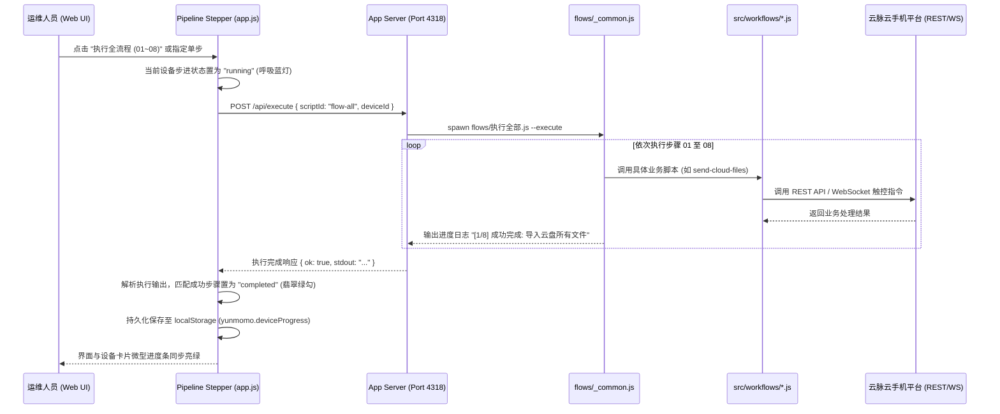
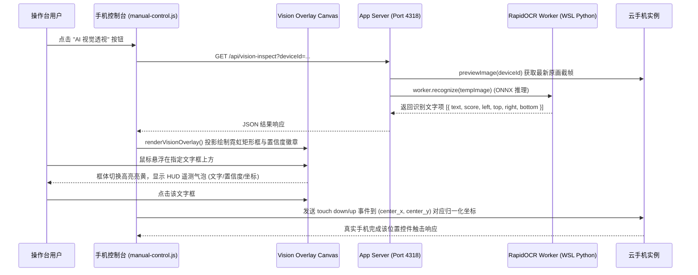

# 📖 云脉云手机自动化代码符号与架构全景索引

> **生成时间**：2026/11/1 03:13:57  
> **服务默认端口**：`4318` (`http://127.0.0.1:4318/`)  
> **GPU 识别常驻端口**：`4329` (`http://127.0.0.1:4329/`)  
> **项目定位**：基于 Yunmomo 云手机平台的高性能自动化控制、YOLO/RapidOCR 本地视觉感知与端到端 RPA 调度中台。

---

## 🏛️ 一、系统全景架构与模块拓扑 (System Architecture)

```mermaid
flowchart TD
    subgraph UI_Console["🖥️ Web 控制台与操作台 (app/ & src/server/)"]
        App["Web 前端 (app.js / index.html)<br/>• 01~08 步进器状态感知<br/>• 云手机集群画面与编号管理"]
        Workstation["原画工作台 (manual-control.js)<br/>• 9:16 真机操控面板<br/>• AI 视觉透视图层 (HUD Overlay)"]
        Server["本地控制台服务 (src/server/app-server.js)<br/>• 默认端口 4318<br/>• REST /api/* 接口网关<br/>• WebSocket 触控中继"]
    end

    subgraph Core_SDK["⚙️ 核心 SDK 与底层协议 (src/)"]
        Client["YunmomoClient (client.js)<br/>• 云机 REST API 封装<br/>• 截图/音频/代理/重置"]
        Control["CloudPhoneControl (control.js)<br/>• WebSocket scrcpy 触控协议<br/>• 键盘/剪贴板/文件推送"]
        Protocol["协议编解码器 (protocol.js)<br/>• scrcpy 二进制帧打包<br/>• Keycode / Touch 序列化"]
        Management["云盘与 VPC 管理 (management.js)<br/>• CloudDisk (文件导入/分发)<br/>• VpcManager (代理池增删改查)"]
        StreamShot["原画抓帧 (stream-screenshot.js)<br/>• 极低延迟视频帧解码<br/>• 1280 高清截图"]
    end

    subgraph Workflows["🚀 01~14 自动化业务流程与消息监听 (src/workflows/ & flows/)"]
        F01["01 导入云盘所有文件 (send-cloud-files.js)"]
        F02["02 上传证书 (upload-certificate.js)"]
        F03["03 设置 VPC 代理 (set-vpc-proxy.js)"]
        F04["04 环境配置 (configure-environment.js)"]
        F05["05 一键生成全部 (generate-all.js)"]
        F06["06 定位到 IP 地 (locate-ip.js)"]
        F07["07 高德初始化 (initialize-gaode.js)"]
        F08["08 输入法初始化 (initialize-input-method.js)"]
        F09["09 改机重置 (change-model-reset.js)"]
        F10["10 增加 VPC 网络 (add-vpc-network.js)"]
        F11["11 MOMO首页养号 (momo-warmup.js)"]
        F12["12 MOMO招呼处理 (momo-greetings.js)"]
        F13["13 MOMO联系人及消息入库 (momo-contact-sync.js)"]
        F14["14 MOMO AI回复 (momo-ai-reply.js)"]
        FWatch["消息列表持续监听 (momo-message-watch.js)"]
        FAll["执行全部 01~08 (flows/执行全部.js)"]
    end

    subgraph Brain_Core["🧠 持续监听与调度中枢 (src/brain/ & src/automation/)"]
        BrainManager["BrainManager (src/brain/manager.js)<br/>• 多设备生命周期总控<br/>• 调度配置与全局状态"]
        DeviceActor["DeviceActor (src/brain/device-actor.js)<br/>• 单设备单串行循环<br/>• 可取消睡眠与事件流"]
        Scheduler["BrainScheduler (src/brain/scheduler.js)<br/>• 0~6 级任务优先级队列<br/>• 单联系人防饥饿公平调度"]
        PageSvc["PageService (src/automation/page-service.js)<br/>• 统一同帧页面/场景/遮挡观测"]
        PageRec["PageRecovery (src/automation/page-recovery.js)<br/>• 单步返回重判与有界上限"]
        BrainStore["BrainStore (src/brain/store.js)<br/>• control.sqlite 调度控制库"]
    end

    subgraph Data_Storage["💾 数据持久化与状态 (SQLite / .runtime/)"]
        MomoDB["MomoDatabase (src/tools/momo/db.js)<br/>• SQLite3 线程安全独立库<br/>• 联系人/消息去重/增量同步"]
    end

    subgraph AI_Engine["🧠 AI大脑与本地视觉感知 (src/ai/ & src/automation/ & python_*)"]
        DeepSeek["DeepSeek API 引擎 (src/ai/)
• 官方 OpenAI 兼容接口
• deepseek-chat 智能会话"]
        OCR["RapidOCR 引擎 (ocr.js & rapidocr_worker.py)<br/>• WSL Python 本地 ONNX 推理<br/>• 控件边界与文字置信度"]
        GPU_Pool["GPU 识别池 (recognition-service.js)<br/>• 端口 4329 常驻 RPC 服务<br/>• YOLO 页面/聊天框/头像检测"]
        TypingEngine["自然拼音打字引擎 (python_typing/ & ws-ime-input.js)<br/>• jieba 分词 + 拼音映射<br/>• 虚拟键盘按键计划生成"]
    end

    App -->|HTTP / API| Server
    Workstation -->|WebSocket /api/control| Server
    Workstation -->|HTTP /api/vision-inspect| Server
    Server --> Client
    Server --> OCR
    Server --> FAll
    FAll --> F01 & F02 & F03 & F04 & F05 & F06 & F07 & F08
    Client --> Control
    Control --> Protocol
    Workflows --> Client
    Workflows --> GPU_Pool
    Workflows --> TypingEngine
    F14 --> DeepSeek
    F13 --> MomoDB
    FWatch --> PageSvc & GPU_Pool
```



---

## 📂 二、目录职责与工程分工

| 目录路径 | 文件数量 | 核心职责与关键技术 |
|---|---|---|
| [`src/`](file:///d:/AA-project/自动化/src) | 核心库 | 云端 REST 客户端、scrcpy 协议帧编解码、WebSocket 实时真机控制器、高清抓帧引擎 |
| [`src/automation/`](file:///d:/AA-project/自动化/src/automation) | 自动化引擎 | 路径/环境隔离、WSL RapidOCR 桥接、4329 GPU 识别常驻服务、并发锁、页面导航恢复 |
| [`src/tools/`](file:///d:/AA-project/自动化/src/tools) | 工具与视觉算子 | 点击/滑动/区域加权采样、MOMO 页面识别、红点候选、聊天详情提取 |
| [`src/workflows/`](file:///d:/AA-project/自动化/src/workflows) | 业务流程实现 | 01~14 业务流程、MOMO 消息持续监听、参数校验、上游调用、重试熔断 |
| [`src/typing/`](file:///d:/AA-project/自动化/src/typing) | 2 个模块 | WebSocket 输入法按键注入、聊天消息自然拼音分词输入控制器 |
| [`src/server/`](file:///d:/AA-project/自动化/src/server) | 本地服务 | 本地 Web 控制台 HTTP/WS 服务（默认端口 4318）、设备锁、真机触控桥接、视频流代理 |
| [`app/`](file:///d:/AA-project/自动化/app) | 5 个前端文件 | 业务控制台 UI、01~08 全流程状态感知步进器、微型进度条、AI 视觉 HUD 覆盖层 |
| [`flows/`](file:///d:/AA-project/自动化/flows) | 流程入口 | 01~14 CLI 规范执行入口、`_common.js` 串行流水线调度执行器 |
| [`python_typing/`](file:///d:/AA-project/自动化/python_typing) | 10 个模块 | 纯 Python 中文分词、拼音拼写转换、候选词匹配、九宫格/全键盘按键动作生成 |
| [`python_workers/`](file:///d:/AA-project/自动化/python_workers) | 3 个 Worker | RapidOCR 常驻进程、输入法候选 OCR 进程、分词拼音计划输出管道 |
| [`docs/`](file:///d:/AA-project/自动化/docs) | 20 篇文档 | API 接口文档、协议定义、MOMO 自动化规范、性能基准、架构约定 |

---

## 📑 三、核心类与导出符号全览 (Classes & Symbols)

### 1. 核心 SDK 与客户端 (src/client, control, protocol, management)

#### 📄 [`src/ai/config.js`](file:///d:/AA-project/自动化/src/ai/config.js) (379 行)

**函数与方法 (Functions)**:
- [`maskApiKey(key)`](file:///d:/AA-project/自动化/src/ai/config.js#L41) —— 第 41 行
- [`ensureConfigDir()`](file:///d:/AA-project/自动化/src/ai/config.js#L48) —— 第 48 行
- [`normalizeSettings(parsed)`](file:///d:/AA-project/自动化/src/ai/config.js#L54) —— 第 54 行
- [`loadSettings()`](file:///d:/AA-project/自动化/src/ai/config.js#L124) —— 第 124 行
- [`listProviders()`](file:///d:/AA-project/自动化/src/ai/config.js#L141) —— 第 141 行
- [`getSanitizedSettings(deviceId = null)`](file:///d:/AA-project/自动化/src/ai/config.js#L160) —— 第 160 行
- [`saveSettings(updates = {}, expectedRevision = null)`](file:///d:/AA-project/自动化/src/ai/config.js#L183) —— 第 183 行
- [`saveProvider(providerData = {})`](file:///d:/AA-project/自动化/src/ai/config.js#L224) —— 第 224 行
- [`deleteProvider(providerId)`](file:///d:/AA-project/自动化/src/ai/config.js#L292) —— 第 292 行
- [`setDefaultProvider(providerId)`](file:///d:/AA-project/自动化/src/ai/config.js#L322) —— 第 322 行
- [`getEffectiveConfig(deviceId = null)`](file:///d:/AA-project/自动化/src/ai/config.js#L338) —— 第 338 行

**关键配置与枚举常量**:
[`CONFIG_DIR`](file:///d:/AA-project/自动化/src/ai/config.js#L17), [`CONFIG_FILE`](file:///d:/AA-project/自动化/src/ai/config.js#L18), [`DEFAULT_SETTINGS`](file:///d:/AA-project/自动化/src/ai/config.js#L20)

#### 📄 [`src/ai/context.js`](file:///d:/AA-project/自动化/src/ai/context.js) (104 行)

**函数与方法 (Functions)**:
- [`buildChatContext(rawMessages = [], config = {}, options = {})`](file:///d:/AA-project/自动化/src/ai/context.js#L35) —— 第 35 行

**关键配置与枚举常量**:
[`INTENT_OUTPUT_CONTRACT`](file:///d:/AA-project/自动化/src/ai/context.js#L9)

**模块导出 (Exports)**: `buildChatContext`

#### 📄 [`src/ai/provider.js`](file:///d:/AA-project/自动化/src/ai/provider.js) (106 行)

**核心类定义 (Classes)**:
- [`DeepSeekProvider`](file:///d:/AA-project/自动化/src/ai/provider.js#L11) —— 第 11 行

**函数与方法 (Functions)**:
- [`resolveChatCompletionsUrl(endpoint)`](file:///d:/AA-project/自动化/src/ai/provider.js#L5) —— 第 5 行

**模块导出 (Exports)**: `DeepSeekProvider`

#### 📄 [`src/ai/reply-service.js`](file:///d:/AA-project/自动化/src/ai/reply-service.js) (98 行)

**函数与方法 (Functions)**:
- [`extractIntentJson(rawText)`](file:///d:/AA-project/自动化/src/ai/reply-service.js#L24) —— 第 24 行
- [`generateReply(rawMessages = [], config = null, options = {})`](file:///d:/AA-project/自动化/src/ai/reply-service.js#L45) *(async)* —— 第 45 行

**关键配置与枚举常量**:
[`MIN_INTENT_MAX_TOKENS`](file:///d:/AA-project/自动化/src/ai/reply-service.js#L19)

#### 📄 [`src/brain/config.js`](file:///d:/AA-project/自动化/src/brain/config.js) (211 行)

**函数与方法 (Functions)**:
- [`validateBrainConfig(updates = {}, current = DEFAULT_BRAIN_CONFIG)`](file:///d:/AA-project/自动化/src/brain/config.js#L43) —— 第 43 行
- [`ensureBrainDir()`](file:///d:/AA-project/自动化/src/brain/config.js#L137) —— 第 137 行
- [`loadBrainConfig()`](file:///d:/AA-project/自动化/src/brain/config.js#L143) —— 第 143 行
- [`saveBrainConfig(updates = {}, expectedRevision = null)`](file:///d:/AA-project/自动化/src/brain/config.js#L159) —— 第 159 行
- [`getEffectiveBrainConfig(deviceId = null)`](file:///d:/AA-project/自动化/src/brain/config.js#L192) —— 第 192 行

**关键配置与枚举常量**:
[`BRAIN_DIR`](file:///d:/AA-project/自动化/src/brain/config.js#L16), [`BRAIN_CONFIG_FILE`](file:///d:/AA-project/自动化/src/brain/config.js#L17), [`VALID_MODES`](file:///d:/AA-project/自动化/src/brain/config.js#L19), [`DEFAULT_BRAIN_CONFIG`](file:///d:/AA-project/自动化/src/brain/config.js#L21)

#### 📄 [`src/brain/device-actor.js`](file:///d:/AA-project/自动化/src/brain/device-actor.js) (418 行)

**核心类定义 (Classes)**:
- [`DeviceActor`](file:///d:/AA-project/自动化/src/brain/device-actor.js#L21) —— 第 21 行

**模块导出 (Exports)**: `DeviceActor`

#### 📄 [`src/brain/manager.js`](file:///d:/AA-project/自动化/src/brain/manager.js) (161 行)

**核心类定义 (Classes)**:
- [`BrainManager`](file:///d:/AA-project/自动化/src/brain/manager.js#L20) —— 第 20 行

**函数与方法 (Functions)**:
- [`getDefaultBrainManager(options = {})`](file:///d:/AA-project/自动化/src/brain/manager.js#L158) —— 第 158 行

**模块导出 (Exports)**: `BrainManager`, `getDefaultBrainManager`

#### 📄 [`src/brain/scheduler.js`](file:///d:/AA-project/自动化/src/brain/scheduler.js) (191 行)

**核心类定义 (Classes)**:
- [`BrainScheduler`](file:///d:/AA-project/自动化/src/brain/scheduler.js#L30) —— 第 30 行

**关键配置与枚举常量**:
[`TASK_PRIORITIES`](file:///d:/AA-project/自动化/src/brain/scheduler.js#L19)

#### 📄 [`src/brain/store.js`](file:///d:/AA-project/自动化/src/brain/store.js) (346 行)

**核心类定义 (Classes)**:
- [`BrainStore`](file:///d:/AA-project/自动化/src/brain/store.js#L21) —— 第 21 行

**关键配置与枚举常量**:
[`DEFAULT_BRAIN_DB_PATH`](file:///d:/AA-project/自动化/src/brain/store.js#L19)

#### 📄 [`src/brain/task-adapters.js`](file:///d:/AA-project/自动化/src/brain/task-adapters.js) (183 行)

**函数与方法 (Functions)**:
- [`runReply(deviceId, task, sessionContext, options = {})`](file:///d:/AA-project/自动化/src/brain/task-adapters.js#L20) *(async)* —— 第 20 行
- [`runGreetings(deviceId, task, sessionContext, options = {})`](file:///d:/AA-project/自动化/src/brain/task-adapters.js#L46) *(async)* —— 第 46 行
- [`runBrowse(deviceId, task, sessionContext, options = {})`](file:///d:/AA-project/自动化/src/brain/task-adapters.js#L77) *(async)* —— 第 77 行
- [`verifyUncertain(deviceId, task, sessionContext, options = {})`](file:///d:/AA-project/自动化/src/brain/task-adapters.js#L101) *(async)* —— 第 101 行

#### 📄 [`src/browser-view.js`](file:///d:/AA-project/自动化/src/browser-view.js) (124 行)

**核心类定义 (Classes)**:
- [`CloudPhoneBrowserView`](file:///d:/AA-project/自动化/src/browser-view.js#L15) —— 第 15 行

**关键配置与枚举常量**:
[`TOOLBAR_ITEMS`](file:///d:/AA-project/自动化/src/browser-view.js#L6)

**模块导出 (Exports)**: `CloudPhoneBrowserView`, `TOOLBAR_ITEMS`

#### 📄 [`src/client.js`](file:///d:/AA-project/自动化/src/client.js) (287 行)

**核心类定义 (Classes)**:
- [`YunmomoHttpError`](file:///d:/AA-project/自动化/src/client.js#L38) *(继承自 `Error`)* —— 第 38 行
- [`YunmomoClient`](file:///d:/AA-project/自动化/src/client.js#L47) —— 第 47 行
- [`CloudPhoneDevice`](file:///d:/AA-project/自动化/src/client.js#L221) —— 第 221 行

**函数与方法 (Functions)**:
- [`appendQuery(url, query, prefix = '')`](file:///d:/AA-project/自动化/src/client.js#L28) —— 第 28 行
- [`proxyAction(version, operation)`](file:///d:/AA-project/自动化/src/client.js#L281) —— 第 281 行

**关键配置与枚举常量**:
[`DEVICE`](file:///d:/AA-project/自动化/src/client.js#L6), [`BACKEND_ACTIONS`](file:///d:/AA-project/自动化/src/client.js#L8)

**模块导出 (Exports)**: `YunmomoClient`, `CloudPhoneControl`, `CloudPhoneDevice`, `YunmomoHttpError`, `BACKEND_ACTIONS`

#### 📄 [`src/control.js`](file:///d:/AA-project/自动化/src/control.js) (479 行)

**核心类定义 (Classes)**:
- [`CloudPhoneControl`](file:///d:/AA-project/自动化/src/control.js#L27) *(继承自 `EventEmitter`)* —— 第 27 行

**函数与方法 (Functions)**:
- [`requiredString(name, value)`](file:///d:/AA-project/自动化/src/control.js#L11) —— 第 11 行
- [`delay(ms, signal)`](file:///d:/AA-project/自动化/src/control.js#L17) —— 第 17 行
- [`abort()`](file:///d:/AA-project/自动化/src/control.js#L22) —— 第 22 行

**模块导出 (Exports)**: `CloudPhoneControl`, `requiredString`

#### 📄 [`src/index.d.ts`](file:///d:/AA-project/自动化/src/index.d.ts) (706 行)

**核心类定义 (Classes)**:
- [`CloudDisk`](file:///d:/AA-project/自动化/src/index.d.ts#L45) —— 第 45 行
- [`VpcManager`](file:///d:/AA-project/自动化/src/index.d.ts#L66) —— 第 66 行
- [`VpcGroupManager`](file:///d:/AA-project/自动化/src/index.d.ts#L83) —— 第 83 行
- [`CloudPhoneControl`](file:///d:/AA-project/自动化/src/index.d.ts#L125) —— 第 125 行
- [`YunmomoHttpError`](file:///d:/AA-project/自动化/src/index.d.ts#L168) *(继承自 `Error`)* —— 第 168 行
- [`YunmomoClient`](file:///d:/AA-project/自动化/src/index.d.ts#L172) —— 第 172 行
- [`CloudPhoneDevice`](file:///d:/AA-project/自动化/src/index.d.ts#L193) —— 第 193 行
- [`MomoMessageListWatcher`](file:///d:/AA-project/自动化/src/index.d.ts#L509) —— 第 509 行
- [`CloudPhoneTools`](file:///d:/AA-project/自动化/src/index.d.ts#L521) —— 第 521 行
- [`RecognitionError`](file:///d:/AA-project/自动化/src/index.d.ts#L644) *(继承自 `Error`)* —— 第 644 行
- [`GpuRecognitionPool`](file:///d:/AA-project/自动化/src/index.d.ts#L648) —— 第 648 行
- [`SharedRecognitionClient`](file:///d:/AA-project/自动化/src/index.d.ts#L664) —— 第 664 行
- [`CloudPhoneBrowserView`](file:///d:/AA-project/自动化/src/index.d.ts#L676) —— 第 676 行

**函数与方法 (Functions)**:
- [`createMessageListWatcher(options: MessageListWatcherOptions)`](file:///d:/AA-project/自动化/src/index.d.ts#L519) —— 第 519 行
- [`createDeviceTools(device: CloudPhoneDevice, options?: DeviceToolsOptions)`](file:///d:/AA-project/自动化/src/index.d.ts#L545) —— 第 545 行
- [`createRecognitionPool(options?: RecognitionPoolOptions)`](file:///d:/AA-project/自动化/src/index.d.ts#L661) —— 第 661 行

#### 📄 [`src/index.js`](file:///d:/AA-project/自动化/src/index.js) (6 行)

#### 📄 [`src/management.js`](file:///d:/AA-project/自动化/src/management.js) (282 行)

**核心类定义 (Classes)**:
- [`CloudDisk`](file:///d:/AA-project/自动化/src/management.js#L91) —— 第 91 行
- [`VpcManager`](file:///d:/AA-project/自动化/src/management.js#L188) —— 第 188 行
- [`VpcGroupManager`](file:///d:/AA-project/自动化/src/management.js#L259) —— 第 259 行

**函数与方法 (Functions)**:
- [`call(client, action, payload = {}, options = {})`](file:///d:/AA-project/自动化/src/management.js#L32) —— 第 32 行
- [`record(value, name = 'record')`](file:///d:/AA-project/自动化/src/management.js#L39) —— 第 39 行
- [`idsCsv(ids)`](file:///d:/AA-project/自动化/src/management.js#L44) —— 第 44 行
- [`pageResult(promise)`](file:///d:/AA-project/自动化/src/management.js#L54) *(async)* —— 第 54 行
- [`channelValue(channel)`](file:///d:/AA-project/自动化/src/management.js#L62) —— 第 62 行
- [`multipart(data, options)`](file:///d:/AA-project/自动化/src/management.js#L67) —— 第 67 行
- [`importFile(client, action, data, options)`](file:///d:/AA-project/自动化/src/management.js#L78) —— 第 78 行
- [`spreadsheet(client, action, query, options)`](file:///d:/AA-project/自动化/src/management.js#L85) *(async)* —— 第 85 行
- [`vpcRecord(config, batch = false)`](file:///d:/AA-project/自动化/src/management.js#L154) —— 第 154 行
- [`vpcRowsForHost(manager, ip, requestOptions)`](file:///d:/AA-project/自动化/src/management.js#L165) *(async)* —— 第 165 行
- [`sameVpcConnection(row, expected)`](file:///d:/AA-project/自动化/src/management.js#L175) —— 第 175 行

**关键配置与枚举常量**:
[`FILE`](file:///d:/AA-project/自动化/src/management.js#L6), [`VPC`](file:///d:/AA-project/自动化/src/management.js#L7), [`GROUP`](file:///d:/AA-project/自动化/src/management.js#L8), [`TRANSFER`](file:///d:/AA-project/自动化/src/management.js#L9), [`MANAGEMENT_ACTIONS`](file:///d:/AA-project/自动化/src/management.js#L12)

**模块导出 (Exports)**: `CloudDisk`, `VpcManager`, `VpcGroupManager`, `MANAGEMENT_ACTIONS`

#### 📄 [`src/protocol.js`](file:///d:/AA-project/自动化/src/protocol.js) (400 行)

**函数与方法 (Functions)**:
- [`integer(name, value, min, max)`](file:///d:/AA-project/自动化/src/protocol.js#L117) —— 第 117 行
- [`screenSize(options)`](file:///d:/AA-project/自动化/src/protocol.js#L125) —— 第 125 行
- [`encodeKey(options)`](file:///d:/AA-project/自动化/src/protocol.js#L132) —— 第 132 行
- [`encodeText(text)`](file:///d:/AA-project/自动化/src/protocol.js#L158) —— 第 158 行
- [`encodeTouch(options)`](file:///d:/AA-project/自动化/src/protocol.js#L167) —— 第 167 行
- [`encodeScroll(options)`](file:///d:/AA-project/自动化/src/protocol.js#L209) —— 第 209 行
- [`encodeSetClipboard(text, options)`](file:///d:/AA-project/自动化/src/protocol.js#L237) —— 第 237 行
- [`encodeScreenPower(on)`](file:///d:/AA-project/自动化/src/protocol.js#L248) —— 第 248 行
- [`encodeCommand(type)`](file:///d:/AA-project/自动化/src/protocol.js#L256) —— 第 256 行
- [`encodeVideoSettings(options = {})`](file:///d:/AA-project/自动化/src/protocol.js#L264) —— 第 264 行
- [`encodePushFile({ id = 0, state, fileName, fileSize, chunk } = {})`](file:///d:/AA-project/自动化/src/protocol.js#L288) —— 第 288 行
- [`binaryReader(data, offset = 0)`](file:///d:/AA-project/自动化/src/protocol.js#L315) —— 第 315 行
- [`decodeVideoSettings(data)`](file:///d:/AA-project/自动化/src/protocol.js#L331) —— 第 331 行
- [`decodeInitial(data)`](file:///d:/AA-project/自动化/src/protocol.js#L343) —— 第 343 行
- [`decodeDeviceMessage(data)`](file:///d:/AA-project/自动化/src/protocol.js#L368) —— 第 368 行

**关键配置与枚举常量**:
[`CONTROL`](file:///d:/AA-project/自动化/src/protocol.js#L3), [`ACTION`](file:///d:/AA-project/自动化/src/protocol.js#L20), [`META`](file:///d:/AA-project/自动化/src/protocol.js#L26), [`KEY_CODES`](file:///d:/AA-project/自动化/src/protocol.js#L37), [`INITIAL_MAGIC`](file:///d:/AA-project/自动化/src/protocol.js#L113), [`MESSAGE_MAGIC`](file:///d:/AA-project/自动化/src/protocol.js#L114), [`FILE_STATE`](file:///d:/AA-project/自动化/src/protocol.js#L115)

#### 📄 [`src/stream-control.js`](file:///d:/AA-project/自动化/src/stream-control.js) (258 行)

**核心类定义 (Classes)**:
- [`StreamInput`](file:///d:/AA-project/自动化/src/stream-control.js#L31) *(继承自 `EventEmitter`)* —— 第 31 行

**函数与方法 (Functions)**:
- [`sleep(ms)`](file:///d:/AA-project/自动化/src/stream-control.js#L23) —— 第 23 行
- [`inputError(code, message)`](file:///d:/AA-project/自动化/src/stream-control.js#L25) —— 第 25 行
- [`sharedStreamInput(options)`](file:///d:/AA-project/自动化/src/stream-control.js#L227) —— 第 227 行
- [`closeStreamInput(deviceId)`](file:///d:/AA-project/自动化/src/stream-control.js#L242) —— 第 242 行
- [`closeAllStreamInputs()`](file:///d:/AA-project/自动化/src/stream-control.js#L247) —— 第 247 行

**关键配置与枚举常量**:
[`FATAL_CLOSE_CODES`](file:///d:/AA-project/自动化/src/stream-control.js#L21), [`POINTER_ID_MOUSE`](file:///d:/AA-project/自动化/src/stream-control.js#L22)

#### 📄 [`src/stream-screenshot.js`](file:///d:/AA-project/自动化/src/stream-screenshot.js) (232 行)

**核心类定义 (Classes)**:
- [`StreamScreenshotError`](file:///d:/AA-project/自动化/src/stream-screenshot.js#L11) *(继承自 `Error`)* —— 第 11 行
- [`StreamCapture`](file:///d:/AA-project/自动化/src/stream-screenshot.js#L16) —— 第 16 行

**函数与方法 (Functions)**:
- [`failure(code, message)`](file:///d:/AA-project/自动化/src/stream-screenshot.js#L14) —— 第 14 行
- [`captureStream(client, deviceId, options = {})`](file:///d:/AA-project/自动化/src/stream-screenshot.js#L193) —— 第 193 行
- [`closeStreams(client)`](file:///d:/AA-project/自动化/src/stream-screenshot.js#L223) *(async)* —— 第 223 行

**关键配置与枚举常量**:
[`PNG`](file:///d:/AA-project/自动化/src/stream-screenshot.js#L8), [`MAX_BUFFER`](file:///d:/AA-project/自动化/src/stream-screenshot.js#L9)

**模块导出 (Exports)**: `captureStream`, `closeStreams`, `StreamScreenshotError`

### 2. 自动化感知与基础服务 (src/automation/)

#### 📄 [`src/automation/app-navigation.js`](file:///d:/AA-project/自动化/src/automation/app-navigation.js) (155 行)

**函数与方法 (Functions)**:
- [`navigationError(code, message, observation, report)`](file:///d:/AA-project/自动化/src/automation/app-navigation.js#L8) —— 第 8 行
- [`recoverySettings(options)`](file:///d:/AA-project/自动化/src/automation/app-navigation.js#L16) —— 第 16 行
- [`pageFingerprint(observation)`](file:///d:/AA-project/自动化/src/automation/app-navigation.js#L31) —— 第 31 行
- [`launcherMatches(observation, launcher)`](file:///d:/AA-project/自动化/src/automation/app-navigation.js#L38) —— 第 38 行
- [`recoverAppPage(phone, control, worker, directory, state, initial, options, config)`](file:///d:/AA-project/自动化/src/automation/app-navigation.js#L52) *(async)* —— 第 52 行
- [`openAppWithRecovery(phone, control, worker, directory, state, found, options, config)`](file:///d:/AA-project/自动化/src/automation/app-navigation.js#L118) *(async)* —— 第 118 行

**模块导出 (Exports)**: `openAppWithRecovery`, `recoverAppPage`

#### 📄 [`src/automation/auth-session.js`](file:///d:/AA-project/自动化/src/automation/auth-session.js) (219 行)

**函数与方法 (Functions)**:
- [`formatDuration(ms)`](file:///d:/AA-project/自动化/src/automation/auth-session.js#L25) —— 第 25 行
- [`recordAuthStart({ deviceId, source = 'yaya', timestamp = Date.now()`](file:///d:/AA-project/自动化/src/automation/auth-session.js#L39) *(async)* —— 第 39 行
- [`getAuthSession(deviceId = null)`](file:///d:/AA-project/自动化/src/automation/auth-session.js#L58) *(async)* —— 第 58 行
- [`logAuthBudget(logger, deviceId, stepDesc = '')`](file:///d:/AA-project/自动化/src/automation/auth-session.js#L115) *(async)* —— 第 115 行
- [`recordPhoneCodeRequested({ deviceId, phoneNumber, sessionId = null, timestamp = Date.now()`](file:///d:/AA-project/自动化/src/automation/auth-session.js#L144) *(async)* —— 第 144 行
- [`getPhoneBindState(deviceId = null, phoneNumber = null)`](file:///d:/AA-project/自动化/src/automation/auth-session.js#L163) *(async)* —— 第 163 行
- [`clearAuthSession()`](file:///d:/AA-project/自动化/src/automation/auth-session.js#L195) *(async)* —— 第 195 行
- [`clearPhoneBindState()`](file:///d:/AA-project/自动化/src/automation/auth-session.js#L201) *(async)* —— 第 201 行

**关键配置与枚举常量**:
[`AUTH_BUDGET_MS`](file:///d:/AA-project/自动化/src/automation/auth-session.js#L18), [`AUTH_WARNING_MS`](file:///d:/AA-project/自动化/src/automation/auth-session.js#L19), [`AUTH_SESSION_FILE`](file:///d:/AA-project/自动化/src/automation/auth-session.js#L21), [`YAYA_HISTORY_FILE`](file:///d:/AA-project/自动化/src/automation/auth-session.js#L22), [`PHONE_BIND_STATE_FILE`](file:///d:/AA-project/自动化/src/automation/auth-session.js#L23)

#### 📄 [`src/automation/cancellation.js`](file:///d:/AA-project/自动化/src/automation/cancellation.js) (28 行)

**函数与方法 (Functions)**:
- [`cancelled(code = 'ABORTED')`](file:///d:/AA-project/自动化/src/automation/cancellation.js#L2) —— 第 2 行
- [`checkSignal(signal)`](file:///d:/AA-project/自动化/src/automation/cancellation.js#L3) —— 第 3 行
- [`waitFor(pending, { signal, timeoutMs, timeoutCode = 'TIMEOUT' } = {})`](file:///d:/AA-project/自动化/src/automation/cancellation.js#L4) —— 第 4 行
- [`sleep(ms, signal)`](file:///d:/AA-project/自动化/src/automation/cancellation.js#L16) —— 第 16 行

#### 📄 [`src/automation/concurrency.js`](file:///d:/AA-project/自动化/src/automation/concurrency.js) (23 行)

**函数与方法 (Functions)**:
- [`mapLimit(values, limit, read, signal)`](file:///d:/AA-project/自动化/src/automation/concurrency.js#L5) *(async)* —— 第 5 行

**模块导出 (Exports)**: `mapLimit`

#### 📄 [`src/automation/coordinates.js`](file:///d:/AA-project/自动化/src/automation/coordinates.js) (12 行)

**函数与方法 (Functions)**:
- [`observedPoint(control, observation, point)`](file:///d:/AA-project/自动化/src/automation/coordinates.js#L5) —— 第 5 行

**模块导出 (Exports)**: `observedPoint`

#### 📄 [`src/automation/log-file.js`](file:///d:/AA-project/自动化/src/automation/log-file.js) (41 行)

**函数与方法 (Functions)**:
- [`rotateIfNeeded(filePath, maxBytes)`](file:///d:/AA-project/自动化/src/automation/log-file.js#L9) *(async)* —— 第 9 行
- [`appendLogLine(filePath, line, { maxBytes = DEFAULT_MAX_BYTES } = {})`](file:///d:/AA-project/自动化/src/automation/log-file.js#L24) —— 第 24 行

**关键配置与枚举常量**:
[`DEFAULT_MAX_BYTES`](file:///d:/AA-project/自动化/src/automation/log-file.js#L6)

**模块导出 (Exports)**: `appendLogLine`

#### 📄 [`src/automation/message-list-navigation.js`](file:///d:/AA-project/自动化/src/automation/message-list-navigation.js) (139 行)

**函数与方法 (Functions)**:
- [`listSignature(obs)`](file:///d:/AA-project/自动化/src/automation/message-list-navigation.js#L6) —— 第 6 行
- [`normalizeOcrFeature(text)`](file:///d:/AA-project/自动化/src/automation/message-list-navigation.js#L12) —— 第 12 行
- [`editDistance(left, right)`](file:///d:/AA-project/自动化/src/automation/message-list-navigation.js#L16) —— 第 16 行
- [`ocrFeatureMatches(text, target)`](file:///d:/AA-project/自动化/src/automation/message-list-navigation.js#L35) —— 第 35 行
- [`topFeatureEvidence(obs)`](file:///d:/AA-project/自动化/src/automation/message-list-navigation.js#L58) —— 第 58 行
- [`hasTopHeader(obs)`](file:///d:/AA-project/自动化/src/automation/message-list-navigation.js#L88) —— 第 88 行
- [`returnMessageListTop(session, observation, options = {})`](file:///d:/AA-project/自动化/src/automation/message-list-navigation.js#L92) *(async)* —— 第 92 行
- [`sameContactNames(before, after)`](file:///d:/AA-project/自动化/src/automation/message-list-navigation.js#L123) —— 第 123 行

#### 📄 [`src/automation/nickname-generator.js`](file:///d:/AA-project/自动化/src/automation/nickname-generator.js) (346 行)

**函数与方法 (Functions)**:
- [`pick(list)`](file:///d:/AA-project/自动化/src/automation/nickname-generator.js#L275) —— 第 275 行
- [`weightedPick(pairs)`](file:///d:/AA-project/自动化/src/automation/nickname-generator.js#L279) —— 第 279 行
- [`makeOne(style)`](file:///d:/AA-project/自动化/src/automation/nickname-generator.js#L288) —— 第 288 行
- [`naturalEnough(name)`](file:///d:/AA-project/自动化/src/automation/nickname-generator.js#L296) —— 第 296 行
- [`generateGirlNicknames({ count = 1, style = "混合" } = {})`](file:///d:/AA-project/自动化/src/automation/nickname-generator.js#L311) —— 第 311 行
- [`generateGirlNickname(options = {})`](file:///d:/AA-project/自动化/src/automation/nickname-generator.js#L330) —— 第 330 行
- [`resolveGirlNickname(setting, style = "混合")`](file:///d:/AA-project/自动化/src/automation/nickname-generator.js#L340) —— 第 340 行

**关键配置与枚举常量**:
[`WORDS`](file:///d:/AA-project/自动化/src/automation/nickname-generator.js#L8), [`RULES`](file:///d:/AA-project/自动化/src/automation/nickname-generator.js#L114), [`STYLE_WEIGHTS`](file:///d:/AA-project/自动化/src/automation/nickname-generator.js#L254), [`ALIASES`](file:///d:/AA-project/自动化/src/automation/nickname-generator.js#L259), [`TEMPLATE_FIELDS`](file:///d:/AA-project/自动化/src/automation/nickname-generator.js#L266)

**模块导出 (Exports)**: `generateGirlNickname`, `generateGirlNicknames`, `resolveGirlNickname`

#### 📄 [`src/automation/ocr.js`](file:///d:/AA-project/自动化/src/automation/ocr.js) (193 行)

**核心类定义 (Classes)**:
- [`LegacyRapidOcrWorker`](file:///d:/AA-project/自动化/src/automation/ocr.js#L37) —— 第 37 行
- [`RapidOcrWorker`](file:///d:/AA-project/自动化/src/automation/ocr.js#L135) —— 第 135 行

**函数与方法 (Functions)**:
- [`numberOr(value, fallback)`](file:///d:/AA-project/自动化/src/automation/ocr.js#L9) —— 第 9 行
- [`shellQuote(value)`](file:///d:/AA-project/自动化/src/automation/ocr.js#L11) —— 第 11 行
- [`toWslPath(filePath)`](file:///d:/AA-project/自动化/src/automation/ocr.js#L15) —— 第 15 行
- [`resolveOcrEnvironment({ runtime = process.platform === 'win32' ? 'wsl' : 'native' } = {})`](file:///d:/AA-project/自动化/src/automation/ocr.js#L26) —— 第 26 行

**关键配置与枚举常量**:
[`DEFAULT_OCR_TIMEOUT_MS`](file:///d:/AA-project/自动化/src/automation/ocr.js#L8)

**模块导出 (Exports)**: `RapidOcrWorker`, `LegacyRapidOcrWorker`, `shellQuote`, `toWslPath`, `resolveOcrEnvironment`

#### 📄 [`src/automation/page-recovery.js`](file:///d:/AA-project/自动化/src/automation/page-recovery.js) (337 行)

**函数与方法 (Functions)**:
- [`cancellableSleep(ms, signal)`](file:///d:/AA-project/自动化/src/automation/page-recovery.js#L30) —— 第 30 行
- [`recoverToAllowedPage(session, allowedPages = ['message_list'], options = {})`](file:///d:/AA-project/自动化/src/automation/page-recovery.js#L55) *(async)* —— 第 55 行

**关键配置与枚举常量**:
[`DEFAULT_RECOVERY_OPTIONS`](file:///d:/AA-project/自动化/src/automation/page-recovery.js#L21)

#### 📄 [`src/automation/page-service.js`](file:///d:/AA-project/自动化/src/automation/page-service.js) (461 行)

**函数与方法 (Functions)**:
- [`classifyApp(pageRaw, ocrItems = [])`](file:///d:/AA-project/自动化/src/automation/page-service.js#L20) —— 第 20 行
- [`classifyOverlay(ocrItems = [], detailRaw = null, h = 1280)`](file:///d:/AA-project/自动化/src/automation/page-service.js#L33) —— 第 33 行
- [`classifyPageAndScene(app, pageRaw, ocrData, listRaw, detailRaw)`](file:///d:/AA-project/自动化/src/automation/page-service.js#L101) —— 第 101 行
- [`detectKeyboardState(page, detailRaw, ocrItems = [], h = 1280)`](file:///d:/AA-project/自动化/src/automation/page-service.js#L146) —— 第 146 行
- [`observePageInternal(session, options = {})`](file:///d:/AA-project/自动化/src/automation/page-service.js#L178) *(async)* —— 第 178 行
- [`observePage(session, options = {})`](file:///d:/AA-project/自动化/src/automation/page-service.js#L444) *(async)* —— 第 444 行

#### 📄 [`src/automation/planner.js`](file:///d:/AA-project/自动化/src/automation/planner.js) (79 行)

**核心类定义 (Classes)**:
- [`PersistentPlanner`](file:///d:/AA-project/自动化/src/automation/planner.js#L9) —— 第 9 行

**关键配置与枚举常量**:
[`ROOT`](file:///d:/AA-project/自动化/src/automation/planner.js#L7)

**模块导出 (Exports)**: `PersistentPlanner`

#### 📄 [`src/automation/recognition-service.js`](file:///d:/AA-project/自动化/src/automation/recognition-service.js) (184 行)

**核心类定义 (Classes)**:
- [`SharedRecognitionClient`](file:///d:/AA-project/自动化/src/automation/recognition-service.js#L100) —— 第 100 行

**函数与方法 (Functions)**:
- [`rpc(session, route, body, { timeoutMs = 30000, signal, settings } = {})`](file:///d:/AA-project/自动化/src/automation/recognition-service.js#L18) —— 第 18 行
- [`discovery()`](file:///d:/AA-project/自动化/src/automation/recognition-service.js#L63) *(async)* —— 第 63 行
- [`ensureService()`](file:///d:/AA-project/自动化/src/automation/recognition-service.js#L75) *(async)* —— 第 75 行
- [`planShared(text, options = {})`](file:///d:/AA-project/自动化/src/automation/recognition-service.js#L162) *(async)* —— 第 162 行
- [`momoShared(route, image, settings, ctx)`](file:///d:/AA-project/自动化/src/automation/recognition-service.js#L167) *(async)* —— 第 167 行
- [`serviceCommand(command)`](file:///d:/AA-project/自动化/src/automation/recognition-service.js#L174) *(async)* —— 第 174 行

**关键配置与枚举常量**:
[`ROOT`](file:///d:/AA-project/自动化/src/automation/recognition-service.js#L13), [`PORT`](file:///d:/AA-project/自动化/src/automation/recognition-service.js#L14), [`SESSION`](file:///d:/AA-project/自动化/src/automation/recognition-service.js#L15)

#### 📄 [`src/automation/runtime.js`](file:///d:/AA-project/自动化/src/automation/runtime.js) (56 行)

**函数与方法 (Functions)**:
- [`loadLocalEnv()`](file:///d:/AA-project/自动化/src/automation/runtime.js#L9) —— 第 9 行
- [`redact(value)`](file:///d:/AA-project/自动化/src/automation/runtime.js#L33) —— 第 33 行
- [`targetDeviceId(explicitId, env = process.env)`](file:///d:/AA-project/自动化/src/automation/runtime.js#L39) —— 第 39 行
- [`launchCli(main)`](file:///d:/AA-project/自动化/src/automation/runtime.js#L47) —— 第 47 行

**关键配置与枚举常量**:
[`PROJECT_ROOT`](file:///d:/AA-project/自动化/src/automation/runtime.js#L7)

**模块导出 (Exports)**: `PROJECT_ROOT`, `redact`, `launchCli`, `targetDeviceId`

#### 📄 [`src/automation/screen.js`](file:///d:/AA-project/自动化/src/automation/screen.js) (486 行)

**函数与方法 (Functions)**:
- [`numberOr(value, fallback)`](file:///d:/AA-project/自动化/src/automation/screen.js#L22) —— 第 22 行
- [`sleep(ms)`](file:///d:/AA-project/自动化/src/automation/screen.js#L27) —— 第 27 行
- [`deviceIdOf(record)`](file:///d:/AA-project/自动化/src/automation/screen.js#L31) —— 第 31 行
- [`normalizeText(value)`](file:///d:/AA-project/自动化/src/automation/screen.js#L35) —— 第 35 行
- [`textOf(items)`](file:///d:/AA-project/自动化/src/automation/screen.js#L42) —— 第 42 行
- [`normalizedTextOf(items)`](file:///d:/AA-project/自动化/src/automation/screen.js#L46) —— 第 46 行
- [`scoreOf(item)`](file:///d:/AA-project/自动化/src/automation/screen.js#L50) —— 第 50 行
- [`validItems(ocr)`](file:///d:/AA-project/自动化/src/automation/screen.js#L54) —— 第 54 行
- [`sameLine(left, right)`](file:///d:/AA-project/自动化/src/automation/screen.js#L70) —— 第 70 行
- [`closeHorizontally(left, right)`](file:///d:/AA-project/自动化/src/automation/screen.js#L77) —— 第 77 行
- [`mergedBox(items)`](file:///d:/AA-project/自动化/src/automation/screen.js#L83) —— 第 83 行
- [`findPhrase(items, phrase, options = {})`](file:///d:/AA-project/自动化/src/automation/screen.js#L93) —— 第 93 行
- [`findStrictPhrase(items, phrase, options = {})`](file:///d:/AA-project/自动化/src/automation/screen.js#L126) —— 第 126 行
- [`hasAllPhrases(items, phrases)`](file:///d:/AA-project/自动化/src/automation/screen.js#L152) —— 第 152 行
- [`homeAnchorMatches(items)`](file:///d:/AA-project/自动化/src/automation/screen.js#L156) —— 第 156 行
- [`clipboardToastVisible(items)`](file:///d:/AA-project/自动化/src/automation/screen.js#L165) —— 第 165 行
- [`appTargetBox(items)`](file:///d:/AA-project/自动化/src/automation/screen.js#L169) —— 第 169 行
- [`pageSignature(items)`](file:///d:/AA-project/自动化/src/automation/screen.js#L181) —— 第 181 行
- [`createOcrDirectory(prefix)`](file:///d:/AA-project/自动化/src/automation/screen.js#L190) *(async)* —— 第 190 行
- [`screenshotAndOcr(phone, worker, directory, counter)`](file:///d:/AA-project/自动化/src/automation/screen.js#L206) *(async)* —— 第 206 行
- [`screenshotAndOcrMeasured(phone, worker, directory, counter)`](file:///d:/AA-project/自动化/src/automation/screen.js#L210) *(async)* —— 第 210 行
- [`observeUntil(phone, worker, directory, state, predicate, timeoutMs, pollMs, label)`](file:///d:/AA-project/自动化/src/automation/screen.js#L234) *(async)* —— 第 234 行
- [`sendHome(control)`](file:///d:/AA-project/自动化/src/automation/screen.js#L247) *(async)* —— 第 247 行
- [`clearAllRecentTasks(phone, control, worker, directory, state, log = console)`](file:///d:/AA-project/自动化/src/automation/screen.js#L252) *(async)* —— 第 252 行
- [`confirmHome(phone, control, worker, directory, state, options)`](file:///d:/AA-project/自动化/src/automation/screen.js#L295) *(async)* —— 第 295 行
- [`swipeHomePage(control, direction)`](file:///d:/AA-project/自动化/src/automation/screen.js#L367) *(async)* —— 第 367 行
- [`tapBox(control, box, observation, yOffset = 0)`](file:///d:/AA-project/自动化/src/automation/screen.js#L450) —— 第 450 行

**关键配置与枚举常量**:
[`SCREENSHOT_LEVEL`](file:///d:/AA-project/自动化/src/automation/screen.js#L8), [`HOME_ANCHORS`](file:///d:/AA-project/自动化/src/automation/screen.js#L9)

#### 📄 [`src/automation/timing.js`](file:///d:/AA-project/自动化/src/automation/timing.js) (161 行)

**函数与方法 (Functions)**:
- [`round(value)`](file:///d:/AA-project/自动化/src/automation/timing.js#L16) —— 第 16 行
- [`outcome(value, error)`](file:///d:/AA-project/自动化/src/automation/timing.js#L18) —— 第 18 行
- [`metadata(input = {})`](file:///d:/AA-project/自动化/src/automation/timing.js#L29) —— 第 29 行
- [`createTimingRecorder({ sink, clock = ()`](file:///d:/AA-project/自动化/src/automation/timing.js#L39) —— 第 39 行
- [`begin(name, info = {})`](file:///d:/AA-project/自动化/src/automation/timing.js#L48) —— 第 48 行
- [`measure(name, info, work)`](file:///d:/AA-project/自动化/src/automation/timing.js#L77) —— 第 77 行
- [`timed(name, fn, selectMetadata = ()`](file:///d:/AA-project/自动化/src/automation/timing.js#L91) —— 第 91 行
- [`warning()`](file:///d:/AA-project/自动化/src/automation/timing.js#L109) —— 第 109 行
- [`flush()`](file:///d:/AA-project/自动化/src/automation/timing.js#L110) —— 第 110 行
- [`warn()`](file:///d:/AA-project/自动化/src/automation/timing.js#L138) —— 第 138 行
- [`timedScript(name, fn)`](file:///d:/AA-project/自动化/src/automation/timing.js#L143) —— 第 143 行

**关键配置与枚举常量**:
[`CODE`](file:///d:/AA-project/自动化/src/automation/timing.js#L12), [`STATES`](file:///d:/AA-project/自动化/src/automation/timing.js#L13), [`NON_EXECUTED`](file:///d:/AA-project/自动化/src/automation/timing.js#L15)

#### 📄 [`src/automation/url-guard.js`](file:///d:/AA-project/自动化/src/automation/url-guard.js) (273 行)

**函数与方法 (Functions)**:
- [`classifyIpv4(ip)`](file:///d:/AA-project/自动化/src/automation/url-guard.js#L43) —— 第 43 行
- [`expandIpv6ToBytes(input)`](file:///d:/AA-project/自动化/src/automation/url-guard.js#L61) —— 第 61 行
- [`classifyIpv6(ip)`](file:///d:/AA-project/自动化/src/automation/url-guard.js#L105) —— 第 105 行
- [`describePrivateAddress(ip)`](file:///d:/AA-project/自动化/src/automation/url-guard.js#L132) —— 第 132 行
- [`isReasonAllowed(reason, { allowLoopback, allowPrivate })`](file:///d:/AA-project/自动化/src/automation/url-guard.js#L139) —— 第 139 行
- [`isObfuscatedIpHost(hostname)`](file:///d:/AA-project/自动化/src/automation/url-guard.js#L151) —— 第 151 行
- [`checkUrlShape(rawUrl, { allowLoopback = false, allowPrivate = false } = {})`](file:///d:/AA-project/自动化/src/automation/url-guard.js#L170) —— 第 170 行
- [`assertSafeOutboundUrlSync(rawUrl, options = {})`](file:///d:/AA-project/自动化/src/automation/url-guard.js#L228) —— 第 228 行
- [`assertSafeOutboundUrl(rawUrl, options = {})`](file:///d:/AA-project/自动化/src/automation/url-guard.js#L237) *(async)* —— 第 237 行

### 3. 视觉算子与工具集 (src/tools/)

#### 📄 [`src/tools/block-layout.js`](file:///d:/AA-project/自动化/src/tools/block-layout.js) (4 行)

**模块导出 (Exports)**: `require`

#### 📄 [`src/tools/block-peer.js`](file:///d:/AA-project/自动化/src/tools/block-peer.js) (255 行)

**核心类定义 (Classes)**:
- [`ScreenText`](file:///d:/AA-project/自动化/src/tools/block-peer.js#L22) —— 第 22 行

**函数与方法 (Functions)**:
- [`topChatAvatar(view)`](file:///d:/AA-project/自动化/src/tools/block-peer.js#L50) —— 第 50 行
- [`normalized(value)`](file:///d:/AA-project/自动化/src/tools/block-peer.js#L78) —— 第 78 行
- [`blockPage(ocr, minimumScore = .55)`](file:///d:/AA-project/自动化/src/tools/block-peer.js#L80) —— 第 80 行
- [`blockPeer(host, options, ctx)`](file:///d:/AA-project/自动化/src/tools/block-peer.js#L130) *(async)* —— 第 130 行
- [`checkControl()`](file:///d:/AA-project/自动化/src/tools/block-peer.js#L152) —— 第 152 行
- [`capture()`](file:///d:/AA-project/自动化/src/tools/block-peer.js#L158) *(async)* —— 第 158 行
- [`tap(frame, target, role)`](file:///d:/AA-project/自动化/src/tools/block-peer.js#L164) *(async)* —— 第 164 行
- [`readPage()`](file:///d:/AA-project/自动化/src/tools/block-peer.js#L178) *(async)* —— 第 178 行
- [`waitPage(wanted, code, message)`](file:///d:/AA-project/自动化/src/tools/block-peer.js#L187) *(async)* —— 第 187 行

**关键配置与枚举常量**:
[`BLOCK_OPTIONS`](file:///d:/AA-project/自动化/src/tools/block-peer.js#L127)

#### 📄 [`src/tools/captcha.js`](file:///d:/AA-project/自动化/src/tools/captcha.js) (350 行)

**函数与方法 (Functions)**:
- [`resolveApiKey(customKey)`](file:///d:/AA-project/自动化/src/tools/captcha.js#L61) —— 第 61 行
- [`getImageDimensions(buffer)`](file:///d:/AA-project/自动化/src/tools/captcha.js#L91) —— 第 91 行
- [`solveCaptcha(imageInput, options = {})`](file:///d:/AA-project/自动化/src/tools/captcha.js#L125) *(async)* —— 第 125 行

#### 📄 [`src/tools/chat-layout.js`](file:///d:/AA-project/自动化/src/tools/chat-layout.js) (4 行)

**模块导出 (Exports)**: `require`

#### 📄 [`src/tools/click.js`](file:///d:/AA-project/自动化/src/tools/click.js) (3 行)

**模块导出 (Exports)**: `require`

#### 📄 [`src/tools/coordinates.js`](file:///d:/AA-project/自动化/src/tools/coordinates.js) (3 行)

**模块导出 (Exports)**: `require`

#### 📄 [`src/tools/gestures.js`](file:///d:/AA-project/自动化/src/tools/gestures.js) (3 行)

**模块导出 (Exports)**: `require`

#### 📄 [`src/tools/index.js`](file:///d:/AA-project/自动化/src/tools/index.js) (358 行)

**核心类定义 (Classes)**:
- [`CloudPhoneTools`](file:///d:/AA-project/自动化/src/tools/index.js#L21) —— 第 21 行

**函数与方法 (Functions)**:
- [`createDeviceTools(device, options)`](file:///d:/AA-project/自动化/src/tools/index.js#L353) —— 第 353 行

#### 📄 [`src/tools/momo/assistant-overlay.js`](file:///d:/AA-project/自动化/src/tools/momo/assistant-overlay.js) (4 行)

**模块导出 (Exports)**: `require`

#### 📄 [`src/tools/momo/chat-bubble-ocr.js`](file:///d:/AA-project/自动化/src/tools/momo/chat-bubble-ocr.js) (4 行)

**模块导出 (Exports)**: `require`

#### 📄 [`src/tools/momo/chat-detail-parser.js`](file:///d:/AA-project/自动化/src/tools/momo/chat-detail-parser.js) (900 行)

**函数与方法 (Functions)**:
- [`normalizeDraftText(text)`](file:///d:/AA-project/自动化/src/tools/momo/chat-detail-parser.js#L20) —— 第 20 行
- [`stripTrailingArtifacts(text)`](file:///d:/AA-project/自动化/src/tools/momo/chat-detail-parser.js#L37) —— 第 37 行
- [`stripPunctuation(text)`](file:///d:/AA-project/自动化/src/tools/momo/chat-detail-parser.js#L42) —— 第 42 行
- [`draftMatches(actual, expected)`](file:///d:/AA-project/自动化/src/tools/momo/chat-detail-parser.js#L47) —— 第 47 行
- [`isTimestampText(text)`](file:///d:/AA-project/自动化/src/tools/momo/chat-detail-parser.js#L66) —— 第 66 行
- [`isChatStatusBannerText(text)`](file:///d:/AA-project/自动化/src/tools/momo/chat-detail-parser.js#L78) —— 第 78 行
- [`isConversationMessage(message)`](file:///d:/AA-project/自动化/src/tools/momo/chat-detail-parser.js#L93) —— 第 93 行
- [`isLikelyChatStatusBanner(text, centerX, centerY, itemWidth, width, height)`](file:///d:/AA-project/自动化/src/tools/momo/chat-detail-parser.js#L102) —— 第 102 行
- [`normalizeOcrShortText(text)`](file:///d:/AA-project/自动化/src/tools/momo/chat-detail-parser.js#L113) —— 第 113 行
- [`levenshteinDistance(left, right)`](file:///d:/AA-project/自动化/src/tools/momo/chat-detail-parser.js#L119) —— 第 119 行
- [`ocrTemplateMatches(text, target, maxDistance = 1, allowSubstring = true)`](file:///d:/AA-project/自动化/src/tools/momo/chat-detail-parser.js#L185) —— 第 185 行
- [`matchesOcrTemplateList(text, templates)`](file:///d:/AA-project/自动化/src/tools/momo/chat-detail-parser.js#L214) —— 第 214 行
- [`isFollowBannerText(text)`](file:///d:/AA-project/自动化/src/tools/momo/chat-detail-parser.js#L223) —— 第 223 行
- [`isSystemNoticeText(text)`](file:///d:/AA-project/自动化/src/tools/momo/chat-detail-parser.js#L227) —— 第 227 行
- [`isPublishedPostNotice(text)`](file:///d:/AA-project/自动化/src/tools/momo/chat-detail-parser.js#L236) —— 第 236 行
- [`centerInBox(item, box)`](file:///d:/AA-project/自动化/src/tools/momo/chat-detail-parser.js#L247) —— 第 247 行
- [`matchCardRegions(items, bubbleRegions, width, height, topBoundary, bottomBoundary)`](file:///d:/AA-project/自动化/src/tools/momo/chat-detail-parser.js#L253) —— 第 253 行
- [`bubbleColorMatch(item, bubbleRegions)`](file:///d:/AA-project/自动化/src/tools/momo/chat-detail-parser.js#L336) —— 第 336 行
- [`parseChatMessages(ocrData, detailData, options = {})`](file:///d:/AA-project/自动化/src/tools/momo/chat-detail-parser.js#L368) —— 第 368 行
- [`finiteBox(box, width, height)`](file:///d:/AA-project/自动化/src/tools/momo/chat-detail-parser.js#L565) —— 第 565 行
- [`boxesOverlap(first, second)`](file:///d:/AA-project/自动化/src/tools/momo/chat-detail-parser.js#L571) —— 第 571 行
- [`pointInBox(x, y, box, padding = 0)`](file:///d:/AA-project/自动化/src/tools/momo/chat-detail-parser.js#L578) —— 第 578 行
- [`assessAssistantOverlay(detailRaw, dimensions = {})`](file:///d:/AA-project/自动化/src/tools/momo/chat-detail-parser.js#L583) —— 第 583 行
- [`chatLayout(view)`](file:///d:/AA-project/自动化/src/tools/momo/chat-detail-parser.js#L661) —— 第 661 行
- [`isPlausibleAnchor(det, name)`](file:///d:/AA-project/自动化/src/tools/momo/chat-detail-parser.js#L671) —— 第 671 行
- [`hasConflictingAnchors(detections)`](file:///d:/AA-project/自动化/src/tools/momo/chat-detail-parser.js#L682) —— 第 682 行
- [`element(name, required = true)`](file:///d:/AA-project/自动化/src/tools/momo/chat-detail-parser.js#L701) —— 第 701 行
- [`inputRegions(layout, candidateRoi)`](file:///d:/AA-project/自动化/src/tools/momo/chat-detail-parser.js#L732) —— 第 732 行
- [`verifyChatScreenAndTarget(ocrData, chatLayoutView, expectedPeerName, options = {})`](file:///d:/AA-project/自动化/src/tools/momo/chat-detail-parser.js#L761) —— 第 761 行
- [`messageEvidence(observation)`](file:///d:/AA-project/自动化/src/tools/momo/chat-detail-parser.js#L824) —— 第 824 行
- [`newOwnBubble(beforeMessages, observation, expectedText, { requireChatPage = true } = {})`](file:///d:/AA-project/自动化/src/tools/momo/chat-detail-parser.js#L832) —— 第 832 行
- [`completeChatBubbleOcr(pool, observation, request = {}, wait = promise => promise)`](file:///d:/AA-project/自动化/src/tools/momo/chat-detail-parser.js#L850) *(async)* —— 第 850 行

**关键配置与枚举常量**:
[`FOLLOW_NOTICE_TEMPLATES`](file:///d:/AA-project/自动化/src/tools/momo/chat-detail-parser.js#L138), [`SYSTEM_NOTICE_TEMPLATES`](file:///d:/AA-project/自动化/src/tools/momo/chat-detail-parser.js#L152)

#### 📄 [`src/tools/momo/chat-frame.js`](file:///d:/AA-project/自动化/src/tools/momo/chat-frame.js) (4 行)

**模块导出 (Exports)**: `require`

#### 📄 [`src/tools/momo/chat-history-sync.js`](file:///d:/AA-project/自动化/src/tools/momo/chat-history-sync.js) (530 行)

**函数与方法 (Functions)**:
- [`textOf(value)`](file:///d:/AA-project/自动化/src/tools/momo/chat-history-sync.js#L27) —— 第 27 行
- [`normalizeText(text)`](file:///d:/AA-project/自动化/src/tools/momo/chat-history-sync.js#L29) —— 第 29 行
- [`normalize(value)`](file:///d:/AA-project/自动化/src/tools/momo/chat-history-sync.js#L34) —— 第 34 行
- [`isMessageEqual(a, b)`](file:///d:/AA-project/自动化/src/tools/momo/chat-history-sync.js#L36) —— 第 36 行
- [`fuzzyTextMatches(first, second)`](file:///d:/AA-project/自动化/src/tools/momo/chat-history-sync.js#L43) —— 第 43 行
- [`sameMessage(a, b)`](file:///d:/AA-project/自动化/src/tools/momo/chat-history-sync.js#L61) —— 第 61 行
- [`alignMessageSequences(archivedMessages = [], observedMessages = [], options = {})`](file:///d:/AA-project/自动化/src/tools/momo/chat-history-sync.js#L83) —— 第 83 行
- [`viewportStable(previous, current, height)`](file:///d:/AA-project/自动化/src/tools/momo/chat-history-sync.js#L184) —— 第 184 行
- [`yOf(message)`](file:///d:/AA-project/自动化/src/tools/momo/chat-history-sync.js#L195) —— 第 195 行
- [`overlapShiftIsConsistent(first, second, height)`](file:///d:/AA-project/自动化/src/tools/momo/chat-history-sync.js#L199) —— 第 199 行
- [`visibleMessages(parsed)`](file:///d:/AA-project/自动化/src/tools/momo/chat-history-sync.js#L209) —— 第 209 行
- [`chatMessagesStable(previous, current, height)`](file:///d:/AA-project/自动化/src/tools/momo/chat-history-sync.js#L213) —— 第 213 行
- [`upwardOverlap(previous, current, height)`](file:///d:/AA-project/自动化/src/tools/momo/chat-history-sync.js#L222) —— 第 222 行
- [`appendChatPage(history, previous, current, height)`](file:///d:/AA-project/自动化/src/tools/momo/chat-history-sync.js#L235) —— 第 235 行
- [`prependChatPage(history, previous, current, height)`](file:///d:/AA-project/自动化/src/tools/momo/chat-history-sync.js#L278) —— 第 278 行
- [`center(box)`](file:///d:/AA-project/自动化/src/tools/momo/chat-history-sync.js#L322) —— 第 322 行
- [`rect(item)`](file:///d:/AA-project/自动化/src/tools/momo/chat-history-sync.js#L323) —— 第 323 行
- [`contains(box, point)`](file:///d:/AA-project/自动化/src/tools/momo/chat-history-sync.js#L324) —— 第 324 行
- [`area(box)`](file:///d:/AA-project/自动化/src/tools/momo/chat-history-sync.js#L325) —— 第 325 行
- [`coverage(inner, outer)`](file:///d:/AA-project/自动化/src/tools/momo/chat-history-sync.js#L327) —— 第 327 行
- [`extractChatContactName(ocr)`](file:///d:/AA-project/自动化/src/tools/momo/chat-history-sync.js#L332) —— 第 332 行
- [`systemText(text)`](file:///d:/AA-project/自动化/src/tools/momo/chat-history-sync.js#L339) —— 第 339 行
- [`parseFrame(ocr, detail)`](file:///d:/AA-project/自动化/src/tools/momo/chat-history-sync.js#L344) —— 第 344 行
- [`readFrame(pool, observation, request = {}, wait = promise => promise)`](file:///d:/AA-project/自动化/src/tools/momo/chat-history-sync.js#L435) *(async)* —— 第 435 行
- [`stableFrames(first, second, tolerance = .015)`](file:///d:/AA-project/自动化/src/tools/momo/chat-history-sync.js#L455) —— 第 455 行
- [`mergeOlder(history, previous, current, height)`](file:///d:/AA-project/自动化/src/tools/momo/chat-history-sync.js#L470) —— 第 470 行
- [`mergeNewer(history, previous, current, height)`](file:///d:/AA-project/自动化/src/tools/momo/chat-history-sync.js#L486) —— 第 486 行

#### 📄 [`src/tools/momo/chat-history.js`](file:///d:/AA-project/自动化/src/tools/momo/chat-history.js) (4 行)

**模块导出 (Exports)**: `require`

#### 📄 [`src/tools/momo/chat-message-parser.js`](file:///d:/AA-project/自动化/src/tools/momo/chat-message-parser.js) (4 行)

**模块导出 (Exports)**: `require`

#### 📄 [`src/tools/momo/contact-layout.js`](file:///d:/AA-project/自动化/src/tools/momo/contact-layout.js) (4 行)

**模块导出 (Exports)**: `require`

#### 📄 [`src/tools/momo/contact-sync-runner.js`](file:///d:/AA-project/自动化/src/tools/momo/contact-sync-runner.js) (4 行)

**模块导出 (Exports)**: `require`

#### 📄 [`src/tools/momo/contact-sync.js`](file:///d:/AA-project/自动化/src/tools/momo/contact-sync.js) (766 行)

**函数与方法 (Functions)**:
- [`storedChatMessages(messages)`](file:///d:/AA-project/自动化/src/tools/momo/contact-sync.js#L45) —— 第 45 行
- [`settingsOf(options, host)`](file:///d:/AA-project/自动化/src/tools/momo/contact-sync.js#L57) —— 第 57 行
- [`realisticSwipePath(w, h, upper, lower, travel, towardsTop, probe = false)`](file:///d:/AA-project/自动化/src/tools/momo/contact-sync.js#L90) —— 第 90 行
- [`adaptiveDistance(frame, isProbe = false)`](file:///d:/AA-project/自动化/src/tools/momo/contact-sync.js#L120) —— 第 120 行
- [`originBridge(previous, current)`](file:///d:/AA-project/自动化/src/tools/momo/contact-sync.js#L135) —— 第 135 行
- [`keyboardStateOf(detail)`](file:///d:/AA-project/自动化/src/tools/momo/contact-sync.js#L151) —— 第 151 行
- [`matchesTailAnchor(msgs, anchors)`](file:///d:/AA-project/自动化/src/tools/momo/contact-sync.js#L162) —— 第 162 行
- [`syncMomoContacts(host, options, ctx)`](file:///d:/AA-project/自动化/src/tools/momo/contact-sync.js#L177) *(async)* —— 第 177 行
- [`assertConnected()`](file:///d:/AA-project/自动化/src/tools/momo/contact-sync.js#L262) —— 第 262 行
- [`capture(purpose)`](file:///d:/AA-project/自动化/src/tools/momo/contact-sync.js#L275) *(async)* —— 第 275 行
- [`observe(purpose)`](file:///d:/AA-project/自动化/src/tools/momo/contact-sync.js#L323) *(async)* —— 第 323 行
- [`readStable(purpose)`](file:///d:/AA-project/自动化/src/tools/momo/contact-sync.js#L433) *(async)* —— 第 433 行
- [`scroll(frame, towardsTop, distance = 0.58, probe = false)`](file:///d:/AA-project/自动化/src/tools/momo/contact-sync.js#L458) *(async)* —— 第 458 行
- [`adaptiveBackstep(previous, current)`](file:///d:/AA-project/自动化/src/tools/momo/contact-sync.js#L499) *(async)* —— 第 499 行
- [`collect(tailAnchors = [])`](file:///d:/AA-project/自动化/src/tools/momo/contact-sync.js#L507) *(async)* —— 第 507 行

**关键配置与枚举常量**:
[`MOMO_SYNC_OPTIONS`](file:///d:/AA-project/自动化/src/tools/momo/contact-sync.js#L24), [`DESCRIPTION`](file:///d:/AA-project/自动化/src/tools/momo/contact-sync.js#L40)

#### 📄 [`src/tools/momo/conversation-reader.js`](file:///d:/AA-project/自动化/src/tools/momo/conversation-reader.js) (4 行)

**模块导出 (Exports)**: `require`

#### 📄 [`src/tools/momo/db.js`](file:///d:/AA-project/自动化/src/tools/momo/db.js) (435 行)

**核心类定义 (Classes)**:
- [`MomoDatabase`](file:///d:/AA-project/自动化/src/tools/momo/db.js#L150) —— 第 150 行

**函数与方法 (Functions)**:
- [`getDeviceDatabasePath(deviceId)`](file:///d:/AA-project/自动化/src/tools/momo/db.js#L16) —— 第 16 行
- [`reconcileMessageSequences(existing = [], incoming = [])`](file:///d:/AA-project/自动化/src/tools/momo/db.js#L35) —— 第 35 行
- [`findNewMessages(existing = [], incoming = [])`](file:///d:/AA-project/自动化/src/tools/momo/db.js#L144) —— 第 144 行
- [`getMomoDatabase(dbPath = DEFAULT_DB_PATH)`](file:///d:/AA-project/自动化/src/tools/momo/db.js#L422) —— 第 422 行

**关键配置与枚举常量**:
[`DEFAULT_DB_DIR`](file:///d:/AA-project/自动化/src/tools/momo/db.js#L11), [`DEFAULT_DB_PATH`](file:///d:/AA-project/自动化/src/tools/momo/db.js#L12)

#### 📄 [`src/tools/momo/greetings-layout.js`](file:///d:/AA-project/自动化/src/tools/momo/greetings-layout.js) (246 行)

**函数与方法 (Functions)**:
- [`extractDistanceKm(text)`](file:///d:/AA-project/自动化/src/tools/momo/greetings-layout.js#L27) —— 第 27 行
- [`isApproveButtonText(text)`](file:///d:/AA-project/自动化/src/tools/momo/greetings-layout.js#L43) —— 第 43 行
- [`isRejectButtonText(text)`](file:///d:/AA-project/自动化/src/tools/momo/greetings-layout.js#L49) —— 第 49 行
- [`expandButtonBox(textItem, width, height, isApprove)`](file:///d:/AA-project/自动化/src/tools/momo/greetings-layout.js#L55) —— 第 55 行
- [`classifyGreetingsScreen(ocrData, pageData, viewData = null)`](file:///d:/AA-project/自动化/src/tools/momo/greetings-layout.js#L101) —— 第 101 行

**关键配置与枚举常量**:
[`RE_RATE_LIMIT`](file:///d:/AA-project/自动化/src/tools/momo/greetings-layout.js#L17), [`RE_LOADING`](file:///d:/AA-project/自动化/src/tools/momo/greetings-layout.js#L18), [`RE_EMPTY_STATE`](file:///d:/AA-project/自动化/src/tools/momo/greetings-layout.js#L19), [`RE_GREETINGS_HEADER`](file:///d:/AA-project/自动化/src/tools/momo/greetings-layout.js#L20), [`RE_LIST_FILTER`](file:///d:/AA-project/自动化/src/tools/momo/greetings-layout.js#L21), [`RE_UNREAD_COUNT`](file:///d:/AA-project/自动化/src/tools/momo/greetings-layout.js#L22), [`RE_STRIP_NON_CHINESE`](file:///d:/AA-project/自动化/src/tools/momo/greetings-layout.js#L23), [`RE_KM`](file:///d:/AA-project/自动化/src/tools/momo/greetings-layout.js#L24), [`RE_METER`](file:///d:/AA-project/自动化/src/tools/momo/greetings-layout.js#L25)

#### 📄 [`src/tools/momo/greetings.js`](file:///d:/AA-project/自动化/src/tools/momo/greetings.js) (655 行)

**函数与方法 (Functions)**:
- [`range(value, fallback, field, min, max)`](file:///d:/AA-project/自动化/src/tools/momo/greetings.js#L41) —— 第 41 行
- [`pick(value)`](file:///d:/AA-project/自动化/src/tools/momo/greetings.js#L50) —— 第 50 行
- [`notify(callback, event)`](file:///d:/AA-project/自动化/src/tools/momo/greetings.js#L54) —— 第 54 行
- [`parseSettings(options, hostDryRun)`](file:///d:/AA-project/自动化/src/tools/momo/greetings.js#L64) —— 第 64 行
- [`greetingsTimeoutMs(options = {})`](file:///d:/AA-project/自动化/src/tools/momo/greetings.js#L100) —— 第 100 行
- [`processMomoGreetings(host, options, ctx)`](file:///d:/AA-project/自动化/src/tools/momo/greetings.js#L109) *(async)* —— 第 109 行
- [`checkControl()`](file:///d:/AA-project/自动化/src/tools/momo/greetings.js#L165) —— 第 165 行
- [`observe()`](file:///d:/AA-project/自动化/src/tools/momo/greetings.js#L174) *(async)* —— 第 174 行
- [`clickBox(box, label)`](file:///d:/AA-project/自动化/src/tools/momo/greetings.js#L206) *(async)* —— 第 206 行
- [`verifyEntryState(deadline)`](file:///d:/AA-project/自动化/src/tools/momo/greetings.js#L227) *(async)* —— 第 227 行
- [`waitNextCardOrTerminal(deadline)`](file:///d:/AA-project/自动化/src/tools/momo/greetings.js#L299) *(async)* —— 第 299 行
- [`exitAndVerify(maxAttempts = 3)`](file:///d:/AA-project/自动化/src/tools/momo/greetings.js#L363) *(async)* —— 第 363 行

**关键配置与枚举常量**:
[`MAX_GREETINGS_TIMEOUT_MS`](file:///d:/AA-project/自动化/src/tools/momo/greetings.js#L12), [`MOMO_GREETINGS_OPTIONS`](file:///d:/AA-project/自动化/src/tools/momo/greetings.js#L14), [`DESCRIPTION`](file:///d:/AA-project/自动化/src/tools/momo/greetings.js#L22), [`CONSTANTS`](file:///d:/AA-project/自动化/src/tools/momo/greetings.js#L24)

#### 📄 [`src/tools/momo/home-feed.js`](file:///d:/AA-project/自动化/src/tools/momo/home-feed.js) (391 行)

**函数与方法 (Functions)**:
- [`nowTime()`](file:///d:/AA-project/自动化/src/tools/momo/home-feed.js#L24) —— 第 24 行
- [`log(msg)`](file:///d:/AA-project/自动化/src/tools/momo/home-feed.js#L30) —— 第 30 行
- [`pick(r)`](file:///d:/AA-project/自动化/src/tools/momo/home-feed.js#L34) —— 第 34 行
- [`pickInterval(cfg)`](file:///d:/AA-project/自动化/src/tools/momo/home-feed.js#L35) —— 第 35 行
- [`parseHomeState(page, view)`](file:///d:/AA-project/自动化/src/tools/momo/home-feed.js#L39) —— 第 39 行
- [`randomFloat(min, max)`](file:///d:/AA-project/自动化/src/tools/momo/home-feed.js#L85) —— 第 85 行
- [`buildHomeGesturePlan(frame, kind, screen, customBox)`](file:///d:/AA-project/自动化/src/tools/momo/home-feed.js#L89) —— 第 89 行
- [`runHome(host, options, ctx, browsing)`](file:///d:/AA-project/自动化/src/tools/momo/home-feed.js#L160) *(async)* —— 第 160 行
- [`checkControl()`](file:///d:/AA-project/自动化/src/tools/momo/home-feed.js#L183) —— 第 183 行
- [`observe()`](file:///d:/AA-project/自动化/src/tools/momo/home-feed.js#L192) *(async)* —— 第 192 行
- [`action(frame, kind, role)`](file:///d:/AA-project/自动化/src/tools/momo/home-feed.js#L214) *(async)* —— 第 214 行
- [`checkIsDesktop(image)`](file:///d:/AA-project/自动化/src/tools/momo/home-feed.js#L221) *(async)* —— 第 221 行
- [`confirmedHome()`](file:///d:/AA-project/自动化/src/tools/momo/home-feed.js#L234) *(async)* —— 第 234 行
- [`refresh(frame, cycleIndex = 1, refreshIndex = 1, refreshTarget = 1)`](file:///d:/AA-project/自动化/src/tools/momo/home-feed.js#L308) *(async)* —— 第 308 行
- [`refreshMomoHome(host, options, ctx)`](file:///d:/AA-project/自动化/src/tools/momo/home-feed.js#L381) —— 第 381 行
- [`browseMomoHome(host, options, ctx)`](file:///d:/AA-project/自动化/src/tools/momo/home-feed.js#L382) —— 第 382 行

**关键配置与枚举常量**:
[`REFRESH_HOME_OPTIONS`](file:///d:/AA-project/自动化/src/tools/momo/home-feed.js#L10), [`BROWSE_HOME_OPTIONS`](file:///d:/AA-project/自动化/src/tools/momo/home-feed.js#L11), [`DESCRIPTION`](file:///d:/AA-project/自动化/src/tools/momo/home-feed.js#L12), [`BUTTON_PROBABILITY`](file:///d:/AA-project/自动化/src/tools/momo/home-feed.js#L15), [`CENTER_FRACTION`](file:///d:/AA-project/自动化/src/tools/momo/home-feed.js#L16), [`CENTER_PROBABILITY`](file:///d:/AA-project/自动化/src/tools/momo/home-feed.js#L17), [`INSET_PX`](file:///d:/AA-project/自动化/src/tools/momo/home-feed.js#L18), [`SETTLE_MS`](file:///d:/AA-project/自动化/src/tools/momo/home-feed.js#L19), [`STEP_TIMEOUT_MS`](file:///d:/AA-project/自动化/src/tools/momo/home-feed.js#L20), [`STABLE_OBSERVATIONS`](file:///d:/AA-project/自动化/src/tools/momo/home-feed.js#L21), [`SWIPE_DURATION_MS`](file:///d:/AA-project/自动化/src/tools/momo/home-feed.js#L22)

#### 📄 [`src/tools/momo/message-list-parser.js`](file:///d:/AA-project/自动化/src/tools/momo/message-list-parser.js) (364 行)

**函数与方法 (Functions)**:
- [`hasReadableName(name)`](file:///d:/AA-project/自动化/src/tools/momo/message-list-parser.js#L45) —— 第 45 行
- [`isConfirmedMessageList(pageData)`](file:///d:/AA-project/自动化/src/tools/momo/message-list-parser.js#L49) —— 第 49 行
- [`isMessageListPage(page, ocr)`](file:///d:/AA-project/自动化/src/tools/momo/message-list-parser.js#L53) —— 第 53 行
- [`area(box)`](file:///d:/AA-project/自动化/src/tools/momo/message-list-parser.js#L78) —— 第 78 行
- [`overlapRatio(a, b)`](file:///d:/AA-project/自动化/src/tools/momo/message-list-parser.js#L85) —— 第 85 行
- [`detectionCenter(box)`](file:///d:/AA-project/自动化/src/tools/momo/message-list-parser.js#L93) —— 第 93 行
- [`messageListEvidence(ocrData, listData)`](file:///d:/AA-project/自动化/src/tools/momo/message-list-parser.js#L100) —— 第 100 行
- [`unreadBadgeForCard(card, otherElements, width)`](file:///d:/AA-project/自动化/src/tools/momo/message-list-parser.js#L117) —— 第 117 行
- [`parseMessageListContacts(ocrData, listData, pageData)`](file:///d:/AA-project/自动化/src/tools/momo/message-list-parser.js#L131) —— 第 131 行
- [`isEdgeCard(box, screenHeight)`](file:///d:/AA-project/自动化/src/tools/momo/message-list-parser.js#L295) —— 第 295 行
- [`scanMessageListCandidates(ocrData, listData, pageData, options = {})`](file:///d:/AA-project/自动化/src/tools/momo/message-list-parser.js#L307) —— 第 307 行

**关键配置与枚举常量**:
[`SYSTEM_CARD_NAMES`](file:///d:/AA-project/自动化/src/tools/momo/message-list-parser.js#L12), [`MATCH_PROMOTION_MARKERS`](file:///d:/AA-project/自动化/src/tools/momo/message-list-parser.js#L38), [`CONTACT_TIME_MARKERS`](file:///d:/AA-project/自动化/src/tools/momo/message-list-parser.js#L39), [`READABLE_NAME_RE`](file:///d:/AA-project/自动化/src/tools/momo/message-list-parser.js#L43)

#### 📄 [`src/tools/momo/message-list-watcher.js`](file:///d:/AA-project/自动化/src/tools/momo/message-list-watcher.js) (932 行)

**核心类定义 (Classes)**:
- [`MomoMessageListWatcher`](file:///d:/AA-project/自动化/src/tools/momo/message-list-watcher.js#L184) —— 第 184 行

**函数与方法 (Functions)**:
- [`asError(error, fallbackCode = 'MESSAGE_WATCH_FAILED')`](file:///d:/AA-project/自动化/src/tools/momo/message-list-watcher.js#L27) —— 第 27 行
- [`watcherFailure(code, message, details = {})`](file:///d:/AA-project/自动化/src/tools/momo/message-list-watcher.js#L34) —— 第 34 行
- [`candidateSignature(candidate)`](file:///d:/AA-project/自动化/src/tools/momo/message-list-watcher.js#L38) —— 第 38 行
- [`normalizeContactName(value)`](file:///d:/AA-project/自动化/src/tools/momo/message-list-watcher.js#L47) —— 第 47 行
- [`editDistance(left, right)`](file:///d:/AA-project/自动化/src/tools/momo/message-list-watcher.js#L51) —— 第 51 行
- [`contactRecordIsRegistered(record)`](file:///d:/AA-project/自动化/src/tools/momo/message-list-watcher.js#L69) —— 第 69 行
- [`findDatabaseContact(database, peerName)`](file:///d:/AA-project/自动化/src/tools/momo/message-list-watcher.js#L73) —— 第 73 行
- [`findCandidateByPeerName(scan, peerName)`](file:///d:/AA-project/自动化/src/tools/momo/message-list-watcher.js#L98) —— 第 98 行
- [`targetPageFailure(observation)`](file:///d:/AA-project/自动化/src/tools/momo/message-list-watcher.js#L121) —— 第 121 行
- [`detailPageFailure(observation)`](file:///d:/AA-project/自动化/src/tools/momo/message-list-watcher.js#L137) —— 第 137 行
- [`viewportSignature(observation, scan)`](file:///d:/AA-project/自动化/src/tools/momo/message-list-watcher.js#L149) —— 第 149 行
- [`safeCandidate(candidate)`](file:///d:/AA-project/自动化/src/tools/momo/message-list-watcher.js#L160) —— 第 160 行
- [`optionInteger(value, name, fallback, min, max)`](file:///d:/AA-project/自动化/src/tools/momo/message-list-watcher.js#L171) —— 第 171 行
- [`currentCandidate(scan, peerName)`](file:///d:/AA-project/自动化/src/tools/momo/message-list-watcher.js#L179) —— 第 179 行
- [`createMessageListWatcher(options)`](file:///d:/AA-project/自动化/src/tools/momo/message-list-watcher.js#L924) —— 第 924 行

**关键配置与枚举常量**:
[`BASELINE_MODES`](file:///d:/AA-project/自动化/src/tools/momo/message-list-watcher.js#L25)

#### 📄 [`src/tools/momo/message-merge.js`](file:///d:/AA-project/自动化/src/tools/momo/message-merge.js) (4 行)

**模块导出 (Exports)**: `require`

#### 📄 [`src/tools/momo/message-watch.js`](file:///d:/AA-project/自动化/src/tools/momo/message-watch.js) (4 行)

**模块导出 (Exports)**: `require`

#### 📄 [`src/tools/momo/recognition-check.js`](file:///d:/AA-project/自动化/src/tools/momo/recognition-check.js) (89 行)

**函数与方法 (Functions)**:
- [`recognitionData(result, model, shot)`](file:///d:/AA-project/自动化/src/tools/momo/recognition-check.js#L6) —— 第 6 行
- [`isChatPage(page, ocr, detailRaw)`](file:///d:/AA-project/自动化/src/tools/momo/recognition-check.js#L23) —— 第 23 行
- [`isMessageListPage(page, ocr)`](file:///d:/AA-project/自动化/src/tools/momo/recognition-check.js#L63) —— 第 63 行

**模块导出 (Exports)**: `recognitionData`, `isChatPage`, `isMessageListPage`

#### 📄 [`src/tools/momo/reply-store.js`](file:///d:/AA-project/自动化/src/tools/momo/reply-store.js) (363 行)

**核心类定义 (Classes)**:
- [`ReplyStore`](file:///d:/AA-project/自动化/src/tools/momo/reply-store.js#L17) —— 第 17 行

**模块导出 (Exports)**: `ReplyStore`

#### 📄 [`src/tools/momo/send-evidence.js`](file:///d:/AA-project/自动化/src/tools/momo/send-evidence.js) (4 行)

**模块导出 (Exports)**: `require`

#### 📄 [`src/tools/momo-vision.js`](file:///d:/AA-project/自动化/src/tools/momo-vision.js) (227 行)

**核心类定义 (Classes)**:
- [`MomoVision`](file:///d:/AA-project/自动化/src/tools/momo-vision.js#L35) —— 第 35 行
- [`ChatDetailVision`](file:///d:/AA-project/自动化/src/tools/momo-vision.js#L154) *(继承自 `MomoVision`)* —— 第 154 行
- [`SharedMomoVision`](file:///d:/AA-project/自动化/src/tools/momo-vision.js#L160) —— 第 160 行
- [`ResidentMomoVision`](file:///d:/AA-project/自动化/src/tools/momo-vision.js#L188) —— 第 188 行

**函数与方法 (Functions)**:
- [`wslPath(value)`](file:///d:/AA-project/自动化/src/tools/momo-vision.js#L11) —— 第 11 行
- [`visionOptions(options = {})`](file:///d:/AA-project/自动化/src/tools/momo-vision.js#L16) —— 第 16 行

**关键配置与枚举常量**:
[`ROOT`](file:///d:/AA-project/自动化/src/tools/momo-vision.js#L9)

#### 📄 [`src/tools/momo.js`](file:///d:/AA-project/自动化/src/tools/momo.js) (238 行)

**函数与方法 (Functions)**:
- [`settingsFor(options, defaultDryRun)`](file:///d:/AA-project/自动化/src/tools/momo.js#L11) —— 第 11 行
- [`similar(a, b)`](file:///d:/AA-project/自动化/src/tools/momo.js#L23) —— 第 23 行
- [`fingerprintDistance(a, b)`](file:///d:/AA-project/自动化/src/tools/momo.js#L29) —— 第 29 行
- [`openMomo(host, options, ctx)`](file:///d:/AA-project/自动化/src/tools/momo.js#L35) *(async)* —— 第 35 行
- [`record(stage, details = {})`](file:///d:/AA-project/自动化/src/tools/momo.js#L45) —— 第 45 行
- [`checkSession()`](file:///d:/AA-project/自动化/src/tools/momo.js#L54) —— 第 54 行
- [`observe()`](file:///d:/AA-project/自动化/src/tools/momo.js#L63) *(async)* —— 第 63 行
- [`stableUntil(predicate, budgetMs, first = null, stability = similar)`](file:///d:/AA-project/自动化/src/tools/momo.js#L85) *(async)* —— 第 85 行
- [`isUpdateBlocked(obs)`](file:///d:/AA-project/自动化/src/tools/momo.js#L97) —— 第 97 行
- [`blocked(observation)`](file:///d:/AA-project/自动化/src/tools/momo.js#L102) —— 第 102 行
- [`ready(first, budgetMs)`](file:///d:/AA-project/自动化/src/tools/momo.js#L109) *(async)* —— 第 109 行
- [`goHome()`](file:///d:/AA-project/自动化/src/tools/momo.js#L146) *(async)* —— 第 146 行
- [`action(kind, planner)`](file:///d:/AA-project/自动化/src/tools/momo.js#L162) *(async)* —— 第 162 行
- [`tryIcon(observation)`](file:///d:/AA-project/自动化/src/tools/momo.js#L172) *(async)* —— 第 172 行

**关键配置与枚举常量**:
[`MOMO_OPTIONS`](file:///d:/AA-project/自动化/src/tools/momo.js#L8)

**模块导出 (Exports)**: `MOMO_OPTIONS`, `openMomo`

#### 📄 [`src/tools/recognition.js`](file:///d:/AA-project/自动化/src/tools/recognition.js) (493 行)

**核心类定义 (Classes)**:
- [`RecognitionError`](file:///d:/AA-project/自动化/src/tools/recognition.js#L13) *(继承自 `Error`)* —— 第 13 行
- [`GpuRecognitionPool`](file:///d:/AA-project/自动化/src/tools/recognition.js#L114) —— 第 114 行
- [`PooledChatDetailVision`](file:///d:/AA-project/自动化/src/tools/recognition.js#L462) —— 第 462 行

**函数与方法 (Functions)**:
- [`errorOf(error, stage = 'validate')`](file:///d:/AA-project/自动化/src/tools/recognition.js#L21) —— 第 21 行
- [`text(value, field)`](file:///d:/AA-project/自动化/src/tools/recognition.js#L28) —— 第 28 行
- [`wslPath(value)`](file:///d:/AA-project/自动化/src/tools/recognition.js#L35) —— 第 35 行
- [`configuration(input)`](file:///d:/AA-project/自动化/src/tools/recognition.js#L39) —— 第 39 行
- [`requestOptions(model, options)`](file:///d:/AA-project/自动化/src/tools/recognition.js#L76) —— 第 76 行
- [`createRecognitionPool(options)`](file:///d:/AA-project/自动化/src/tools/recognition.js#L490) —— 第 490 行

**关键配置与枚举常量**:
[`MODELS`](file:///d:/AA-project/自动化/src/tools/recognition.js#L9), [`ROOT`](file:///d:/AA-project/自动化/src/tools/recognition.js#L10), [`MAX_IMAGE_BYTES`](file:///d:/AA-project/自动化/src/tools/recognition.js#L11)

**模块导出 (Exports)**: `GpuRecognitionPool`, `createRecognitionPool`, `RecognitionError`, `PooledChatDetailVision`

#### 📄 [`src/tools/region-click.js`](file:///d:/AA-project/自动化/src/tools/region-click.js) (3 行)

**模块导出 (Exports)**: `require`

#### 📄 [`src/tools/runtime.js`](file:///d:/AA-project/自动化/src/tools/runtime.js) (164 行)

**核心类定义 (Classes)**:
- [`ToolFailure`](file:///d:/AA-project/自动化/src/tools/runtime.js#L6) *(继承自 `Error`)* —— 第 6 行
- [`OperationContext`](file:///d:/AA-project/自动化/src/tools/runtime.js#L94) —— 第 94 行

**函数与方法 (Functions)**:
- [`fail(code, message, details)`](file:///d:/AA-project/自动化/src/tools/runtime.js#L15) —— 第 15 行
- [`object(value, field = 'options')`](file:///d:/AA-project/自动化/src/tools/runtime.js#L16) —— 第 16 行
- [`keys(value, allowed, field = 'options')`](file:///d:/AA-project/自动化/src/tools/runtime.js#L23) —— 第 23 行
- [`number(value, field, min, max, integral = true)`](file:///d:/AA-project/自动化/src/tools/runtime.js#L29) —— 第 29 行
- [`boolean(value, field)`](file:///d:/AA-project/自动化/src/tools/runtime.js#L36) —— 第 36 行
- [`size(value, field)`](file:///d:/AA-project/自动化/src/tools/runtime.js#L40) —— 第 40 行
- [`snapshot(value, depth = 0)`](file:///d:/AA-project/自动化/src/tools/runtime.js#L47) —— 第 47 行
- [`describeError(error, ctx)`](file:///d:/AA-project/自动化/src/tools/runtime.js#L59) —— 第 59 行

**模块导出 (Exports)**: `ToolFailure`, `fail`, `object`, `keys`, `number`, `boolean`, `size`, `snapshot`, `describeError`, `OperationContext`

#### 📄 [`src/tools/screen-text.js`](file:///d:/AA-project/自动化/src/tools/screen-text.js) (4 行)

**模块导出 (Exports)**: `require`

#### 📄 [`src/tools/screenshot.js`](file:///d:/AA-project/自动化/src/tools/screenshot.js) (94 行)

**函数与方法 (Functions)**:
- [`imageInfo(data)`](file:///d:/AA-project/自动化/src/tools/screenshot.js#L9) —— 第 9 行
- [`screenshot(device, options, ctx)`](file:///d:/AA-project/自动化/src/tools/screenshot.js#L40) *(async)* —— 第 40 行

**关键配置与枚举常量**:
[`PNG`](file:///d:/AA-project/自动化/src/tools/screenshot.js#L5), [`SOF`](file:///d:/AA-project/自动化/src/tools/screenshot.js#L6)

**模块导出 (Exports)**: `screenshot`

#### 📄 [`src/tools/send-chat-message.js`](file:///d:/AA-project/自动化/src/tools/send-chat-message.js) (430 行)

**函数与方法 (Functions)**:
- [`resolveSendButtonTarget(frame, finalObs)`](file:///d:/AA-project/自动化/src/tools/send-chat-message.js#L35) —— 第 35 行
- [`parseSendChatSettings(text, options = {}, hostDryRun = false)`](file:///d:/AA-project/自动化/src/tools/send-chat-message.js#L105) —— 第 105 行
- [`sendChatMessage(host, text, options = {}, ctx = null, dependencies = {})`](file:///d:/AA-project/自动化/src/tools/send-chat-message.js#L145) *(async)* —— 第 145 行
- [`checkControl()`](file:///d:/AA-project/自动化/src/tools/send-chat-message.js#L195) —— 第 195 行
- [`capture()`](file:///d:/AA-project/自动化/src/tools/send-chat-message.js#L202) *(async)* —— 第 202 行
- [`tap(x, y, frame)`](file:///d:/AA-project/自动化/src/tools/send-chat-message.js#L219) *(async)* —— 第 219 行
- [`verifyFrame(frame)`](file:///d:/AA-project/自动化/src/tools/send-chat-message.js#L224) *(async)* —— 第 224 行

**关键配置与枚举常量**:
[`SEND_CHAT_OPTIONS`](file:///d:/AA-project/自动化/src/tools/send-chat-message.js#L24)

#### 📄 [`src/tools/send-contact.js`](file:///d:/AA-project/自动化/src/tools/send-contact.js) (198 行)

**函数与方法 (Functions)**:
- [`contactSettings(contact, options, hostDryRun)`](file:///d:/AA-project/自动化/src/tools/send-contact.js#L14) —— 第 14 行
- [`sendContact(host, contact, options, ctx)`](file:///d:/AA-project/自动化/src/tools/send-contact.js#L53) *(async)* —— 第 53 行
- [`observe()`](file:///d:/AA-project/自动化/src/tools/send-contact.js#L81) *(async)* —— 第 81 行
- [`tap(x, y, frame, jitterPx = 1)`](file:///d:/AA-project/自动化/src/tools/send-contact.js#L107) *(async)* —— 第 107 行
- [`ensureKeyboard()`](file:///d:/AA-project/自动化/src/tools/send-contact.js#L120) *(async)* —— 第 120 行

**关键配置与枚举常量**:
[`CONTACT_OPTIONS`](file:///d:/AA-project/自动化/src/tools/send-contact.js#L10)

**模块导出 (Exports)**: `CONTACT_OPTIONS`, `sendContact`, `contactSettings`

#### 📄 [`src/tools/shared-momo-vision.js`](file:///d:/AA-project/自动化/src/tools/shared-momo-vision.js) (4 行)

**模块导出 (Exports)**: `require`

#### 📄 [`src/tools/swipe.js`](file:///d:/AA-project/自动化/src/tools/swipe.js) (3 行)

**模块导出 (Exports)**: `require`

#### 📄 [`src/tools/target-sampling.js`](file:///d:/AA-project/自动化/src/tools/target-sampling.js) (3 行)

**模块导出 (Exports)**: `require`

#### 📄 [`src/tools/touch-gestures.js`](file:///d:/AA-project/自动化/src/tools/touch-gestures.js) (367 行)

**函数与方法 (Functions)**:
- [`chance(probability)`](file:///d:/AA-project/自动化/src/tools/touch-gestures.js#L22) —— 第 22 行
- [`sampleWeightedBox(box, options = {}, screenSize)`](file:///d:/AA-project/自动化/src/tools/touch-gestures.js#L29) —— 第 29 行
- [`coordinateMapper(options = {}, screenSize)`](file:///d:/AA-project/自动化/src/tools/touch-gestures.js#L91) —— 第 91 行
- [`axis(value, shift, extent, targetExtent, field)`](file:///d:/AA-project/自动化/src/tools/touch-gestures.js#L104) —— 第 104 行
- [`clickPlan(pointOrX, optionsOrY = {}, maybeOptions = {}, maybeScreenSize)`](file:///d:/AA-project/自动化/src/tools/touch-gestures.js#L136) —— 第 136 行
- [`regionClickPlan(box, options = {}, screenSize)`](file:///d:/AA-project/自动化/src/tools/touch-gestures.js#L178) —— 第 178 行
- [`swipePlan(points, options = {}, screenSize)`](file:///d:/AA-project/自动化/src/tools/touch-gestures.js#L186) —— 第 186 行
- [`checkControl(control, snapshot)`](file:///d:/AA-project/自动化/src/tools/touch-gestures.js#L247) —— 第 247 行
- [`dispatch(control, plan, ctx, operation)`](file:///d:/AA-project/自动化/src/tools/touch-gestures.js#L255) *(async)* —— 第 255 行
- [`gesture(control, planner, ctx, operation)`](file:///d:/AA-project/自动化/src/tools/touch-gestures.js#L320) *(async)* —— 第 320 行

**关键配置与枚举常量**:
[`COMMON_GESTURE_OPTIONS`](file:///d:/AA-project/自动化/src/tools/touch-gestures.js#L134), [`REGION_CLICK_OPTIONS`](file:///d:/AA-project/自动化/src/tools/touch-gestures.js#L350)

#### 📄 [`src/tools/vision/bubble_color.py`](file:///d:/AA-project/自动化/src/tools/vision/bubble_color.py) (124 行)

**函数与方法 (Functions)**:
- [`_odd(value)`](file:///d:/AA-project/自动化/src/tools/vision/bubble_color.py#L9) —— 第 9 行
- [`_regions_from_mask(mask, color, sender, cv2, np, width, height)`](file:///d:/AA-project/自动化/src/tools/vision/bubble_color.py#L14) —— 第 14 行
- [`detect_bubble_regions(image, cv2, np)`](file:///d:/AA-project/自动化/src/tools/vision/bubble_color.py#L82) —— 第 82 行

#### 📄 [`src/tools/vision/chat_detail_worker.py`](file:///d:/AA-project/自动化/src/tools/vision/chat_detail_worker.py) (108 行)

**核心类定义 (Classes)**:
- [`WorkerError`](file:///d:/AA-project/自动化/src/tools/vision/chat_detail_worker.py#L16) *(继承自 `Exception`)* —— 第 16 行
- [`Engine`](file:///d:/AA-project/自动化/src/tools/vision/chat_detail_worker.py#L22) —— 第 22 行

**函数与方法 (Functions)**:
- [`main()`](file:///d:/AA-project/自动化/src/tools/vision/chat_detail_worker.py#L83) —— 第 83 行

#### 📄 [`src/tools/vision/momo_worker.py`](file:///d:/AA-project/自动化/src/tools/vision/momo_worker.py) (255 行)

**核心类定义 (Classes)**:
- [`VisionFailure`](file:///d:/AA-project/自动化/src/tools/vision/momo_worker.py#L14) *(继承自 `Exception`)* —— 第 14 行
- [`Engine`](file:///d:/AA-project/自动化/src/tools/vision/momo_worker.py#L25) —— 第 25 行

**函数与方法 (Functions)**:
- [`require(condition, code, message)`](file:///d:/AA-project/自动化/src/tools/vision/momo_worker.py#L20) —— 第 20 行
- [`main()`](file:///d:/AA-project/自动化/src/tools/vision/momo_worker.py#L228) —— 第 228 行

#### 📄 [`src/tools/vision/recognition_worker.py`](file:///d:/AA-project/自动化/src/tools/vision/recognition_worker.py) (410 行)

**核心类定义 (Classes)**:
- [`RecognitionFailure`](file:///d:/AA-project/自动化/src/tools/vision/recognition_worker.py#L29) *(继承自 `Exception`)* —— 第 29 行
- [`Lane`](file:///d:/AA-project/自动化/src/tools/vision/recognition_worker.py#L117) —— 第 117 行
- [`Service`](file:///d:/AA-project/自动化/src/tools/vision/recognition_worker.py#L248) —— 第 248 行

**函数与方法 (Functions)**:
- [`require(condition, code, message, stage, details=None)`](file:///d:/AA-project/自动化/src/tools/vision/recognition_worker.py#L40) —— 第 40 行
- [`send(value)`](file:///d:/AA-project/自动化/src/tools/vision/recognition_worker.py#L45) —— 第 45 行
- [`checked_stop()`](file:///d:/AA-project/自动化/src/tools/vision/recognition_worker.py#L54) —— 第 54 行
- [`load_module(name, source)`](file:///d:/AA-project/自动化/src/tools/vision/recognition_worker.py#L58) —— 第 58 行
- [`legacy_ocr_class(root, configured=None)`](file:///d:/AA-project/自动化/src/tools/vision/recognition_worker.py#L67) —— 第 67 行
- [`classify_exception(error, stage, model=None, lane=None)`](file:///d:/AA-project/自动化/src/tools/vision/recognition_worker.py#L99) —— 第 99 行
- [`read_requests(inbox)`](file:///d:/AA-project/自动化/src/tools/vision/recognition_worker.py#L356) —— 第 356 行
- [`main()`](file:///d:/AA-project/自动化/src/tools/vision/recognition_worker.py#L375) —— 第 375 行

#### 📄 [`src/tools/vpc-dialog.js`](file:///d:/AA-project/自动化/src/tools/vpc-dialog.js) (188 行)

**函数与方法 (Functions)**:
- [`showVpcDialog(options = {})`](file:///d:/AA-project/自动化/src/tools/vpc-dialog.js#L16) —— 第 16 行
- [`promptTerminal(query = '请输入 VPC 代理（5 种格式之一）：')`](file:///d:/AA-project/自动化/src/tools/vpc-dialog.js#L137) —— 第 137 行
- [`promptVpcProxy(options = {})`](file:///d:/AA-project/自动化/src/tools/vpc-dialog.js#L155) *(async)* —— 第 155 行

### 4. 业务工作流核心实现 (src/workflows/)

#### 📄 [`src/workflows/add-vpc-network.js`](file:///d:/AA-project/自动化/src/workflows/add-vpc-network.js) (121 行)

**函数与方法 (Functions)**:
- [`normalized(config, line, defaults)`](file:///d:/AA-project/自动化/src/workflows/add-vpc-network.js#L8) —— 第 8 行
- [`tailFields(value)`](file:///d:/AA-project/自动化/src/workflows/add-vpc-network.js#L19) —— 第 19 行
- [`parseVpcData(text, defaults = {})`](file:///d:/AA-project/自动化/src/workflows/add-vpc-network.js#L32) —— 第 32 行
- [`safeRows(rows)`](file:///d:/AA-project/自动化/src/workflows/add-vpc-network.js#L60) —— 第 60 行
- [`main(argv = process.argv.slice(2)`](file:///d:/AA-project/自动化/src/workflows/add-vpc-network.js#L64) *(async)* —— 第 64 行

**模块导出 (Exports)**: `parseVpcData`, `main`

#### 📄 [`src/workflows/change-model-reset.js`](file:///d:/AA-project/自动化/src/workflows/change-model-reset.js) (10 行)

**模块导出 (Exports)**: `impl`

#### 📄 [`src/workflows/configure-environment.js`](file:///d:/AA-project/自动化/src/workflows/configure-environment.js) (10 行)

**模块导出 (Exports)**: `impl`

#### 📄 [`src/workflows/generate-all.js`](file:///d:/AA-project/自动化/src/workflows/generate-all.js) (10 行)

**模块导出 (Exports)**: `impl`

#### 📄 [`src/workflows/initialize-gaode.js`](file:///d:/AA-project/自动化/src/workflows/initialize-gaode.js) (10 行)

**模块导出 (Exports)**: `impl`

#### 📄 [`src/workflows/initialize-input-method.js`](file:///d:/AA-project/自动化/src/workflows/initialize-input-method.js) (20 行)

**模块导出 (Exports)**: `main`, `impl`

#### 📄 [`src/workflows/locate-ip.js`](file:///d:/AA-project/自动化/src/workflows/locate-ip.js) (10 行)

**模块导出 (Exports)**: `impl`

#### 📄 [`src/workflows/momo-ai-reply.js`](file:///d:/AA-project/自动化/src/workflows/momo-ai-reply.js) (745 行)

**函数与方法 (Functions)**:
- [`getTimestamp()`](file:///d:/AA-project/自动化/src/workflows/momo-ai-reply.js#L55) —— 第 55 行
- [`logLive(step, message)`](file:///d:/AA-project/自动化/src/workflows/momo-ai-reply.js#L61) —— 第 61 行
- [`captureMilestoneScreenshot(phone, tools, dir, filename, desc)`](file:///d:/AA-project/自动化/src/workflows/momo-ai-reply.js#L69) *(async)* —— 第 69 行
- [`acquireWorkflowLock(deviceId, runId, options = {})`](file:///d:/AA-project/自动化/src/workflows/momo-ai-reply.js#L96) —— 第 96 行
- [`persistSentMessage(momoDb, deviceId, contactName, text)`](file:///d:/AA-project/自动化/src/workflows/momo-ai-reply.js#L109) —— 第 109 行
- [`releaseResources({ tools, ownsTools, control, ownsControl, momoDb, deviceId, lease })`](file:///d:/AA-project/自动化/src/workflows/momo-ai-reply.js#L133) *(async)* —— 第 133 行
- [`buildSuccessReport({ runId, mode, contactName, replyText, sendState, screenshotsDir, screenshots, isDraft, aiMetadata = null, outcome = null, handoff = null })`](file:///d:/AA-project/自动化/src/workflows/momo-ai-reply.js#L156) —— 第 156 行
- [`buildFailureReport({ runId, mode, contactName, screenshotsDir, screenshots, error, outcome = 'failed', sendState = 'not_started', aiMetadata = null, handoff = null })`](file:///d:/AA-project/自动化/src/workflows/momo-ai-reply.js#L182) —— 第 182 行
- [`randomSegmentGapMs()`](file:///d:/AA-project/自动化/src/workflows/momo-ai-reply.js#L206) —— 第 206 行
- [`runContactHandoff({ tools, phone, momoDb, deviceId, contactName, segments, screenshotsDir, screenshots, signal, check })`](file:///d:/AA-project/自动化/src/workflows/momo-ai-reply.js#L214) *(async)* —— 第 214 行
- [`runAutoBlockAfterHandoff({ tools, momoDb, contactName, signal })`](file:///d:/AA-project/自动化/src/workflows/momo-ai-reply.js#L266) *(async)* —— 第 266 行
- [`runMomoAiReplyOnce(client, deviceId, options = {})`](file:///d:/AA-project/自动化/src/workflows/momo-ai-reply.js#L291) *(async)* —— 第 291 行
- [`parseArgs(argv = process.argv.slice(2)`](file:///d:/AA-project/自动化/src/workflows/momo-ai-reply.js#L640) —— 第 640 行
- [`printExecutionSummary(result, { contactName, mode })`](file:///d:/AA-project/自动化/src/workflows/momo-ai-reply.js#L675) —— 第 675 行
- [`main(argv = process.argv.slice(2)`](file:///d:/AA-project/自动化/src/workflows/momo-ai-reply.js#L707) *(async)* —— 第 707 行

**关键配置与枚举常量**:
[`DESCRIPTION`](file:///d:/AA-project/自动化/src/workflows/momo-ai-reply.js#L31), [`TIMEOUTS`](file:///d:/AA-project/自动化/src/workflows/momo-ai-reply.js#L34), [`HANDOFF`](file:///d:/AA-project/自动化/src/workflows/momo-ai-reply.js#L42), [`MODES`](file:///d:/AA-project/自动化/src/workflows/momo-ai-reply.js#L48)

**模块导出 (Exports)**: `DESCRIPTION`, `runMomoAiReplyOnce`, `main`

#### 📄 [`src/workflows/momo-block-peer.js`](file:///d:/AA-project/自动化/src/workflows/momo-block-peer.js) (286 行)

**函数与方法 (Functions)**:
- [`getTimestamp()`](file:///d:/AA-project/自动化/src/workflows/momo-block-peer.js#L31) —— 第 31 行
- [`logLive(step, message)`](file:///d:/AA-project/自动化/src/workflows/momo-block-peer.js#L37) —— 第 37 行
- [`captureEvidenceScreenshot(tools, dir, filename, desc)`](file:///d:/AA-project/自动化/src/workflows/momo-block-peer.js#L45) *(async)* —— 第 45 行
- [`runMomoBlockPeerOnce(client, deviceId, options = {})`](file:///d:/AA-project/自动化/src/workflows/momo-block-peer.js#L64) *(async)* —— 第 64 行
- [`checkResult(result)`](file:///d:/AA-project/自动化/src/workflows/momo-block-peer.js#L189) —— 第 189 行
- [`printExecutionSummary(result, { contactName })`](file:///d:/AA-project/自动化/src/workflows/momo-block-peer.js#L199) —— 第 199 行
- [`main(argv = process.argv.slice(2)`](file:///d:/AA-project/自动化/src/workflows/momo-block-peer.js#L223) *(async)* —— 第 223 行

**关键配置与枚举常量**:
[`DESCRIPTION`](file:///d:/AA-project/自动化/src/workflows/momo-block-peer.js#L22), [`TIMEOUTS`](file:///d:/AA-project/自动化/src/workflows/momo-block-peer.js#L24)

**模块导出 (Exports)**: `DESCRIPTION`, `runMomoBlockPeerOnce`, `main`

#### 📄 [`src/workflows/momo-contact-sync.js`](file:///d:/AA-project/自动化/src/workflows/momo-contact-sync.js) (255 行)

**函数与方法 (Functions)**:
- [`runMomoContactSync(client, deviceId, options = {})`](file:///d:/AA-project/自动化/src/workflows/momo-contact-sync.js#L22) *(async)* —— 第 22 行
- [`scriptRunId()`](file:///d:/AA-project/自动化/src/workflows/momo-contact-sync.js#L66) —— 第 66 行
- [`printContactSyncSummary(result)`](file:///d:/AA-project/自动化/src/workflows/momo-contact-sync.js#L71) —— 第 71 行
- [`main(argv = process.argv.slice(2)`](file:///d:/AA-project/自动化/src/workflows/momo-contact-sync.js#L112) *(async)* —— 第 112 行

**关键配置与枚举常量**:
[`DESCRIPTION`](file:///d:/AA-project/自动化/src/workflows/momo-contact-sync.js#L20), [`STEP_NAMES`](file:///d:/AA-project/自动化/src/workflows/momo-contact-sync.js#L53)

#### 📄 [`src/workflows/momo-greetings.js`](file:///d:/AA-project/自动化/src/workflows/momo-greetings.js) (294 行)

**函数与方法 (Functions)**:
- [`formatLogTime()`](file:///d:/AA-project/自动化/src/workflows/momo-greetings.js#L16) —— 第 16 行
- [`createLogger(enabled = true, logFile = null)`](file:///d:/AA-project/自动化/src/workflows/momo-greetings.js#L24) —— 第 24 行
- [`captureStepScreenshot(phone, dir, filename, desc, log = null)`](file:///d:/AA-project/自动化/src/workflows/momo-greetings.js#L36) *(async)* —— 第 36 行
- [`parseArgs(argv = process.argv.slice(2)`](file:///d:/AA-project/自动化/src/workflows/momo-greetings.js#L53) —— 第 53 行
- [`createProgressHandler(log, phone = null, runDir = null)`](file:///d:/AA-project/自动化/src/workflows/momo-greetings.js#L100) —— 第 100 行
- [`runMomoGreetings(client, deviceId, options = {})`](file:///d:/AA-project/自动化/src/workflows/momo-greetings.js#L151) *(async)* —— 第 151 行
- [`main(argv = process.argv.slice(2)`](file:///d:/AA-project/自动化/src/workflows/momo-greetings.js#L172) *(async)* —— 第 172 行

**模块导出 (Exports)**: `runMomoGreetings`, `main`

#### 📄 [`src/workflows/momo-message-watch.js`](file:///d:/AA-project/自动化/src/workflows/momo-message-watch.js) (1127 行)

**核心类定义 (Classes)**:
- [`IgnoredCards`](file:///d:/AA-project/自动化/src/workflows/momo-message-watch.js#L204) —— 第 204 行
- [`WatchHub`](file:///d:/AA-project/自动化/src/workflows/momo-message-watch.js#L248) —— 第 248 行

**函数与方法 (Functions)**:
- [`nowTime()`](file:///d:/AA-project/自动化/src/workflows/momo-message-watch.js#L66) —— 第 66 行
- [`log(level, message, meta = null)`](file:///d:/AA-project/自动化/src/workflows/momo-message-watch.js#L72) *(async)* —— 第 72 行
- [`captureStepScreenshot(tools, dir, filename, desc)`](file:///d:/AA-project/自动化/src/workflows/momo-message-watch.js#L84) *(async)* —— 第 84 行
- [`safeDirName(value)`](file:///d:/AA-project/自动化/src/workflows/momo-message-watch.js#L104) —— 第 104 行
- [`fatal(code, message)`](file:///d:/AA-project/自动化/src/workflows/momo-message-watch.js#L109) —— 第 109 行
- [`minutes(ms)`](file:///d:/AA-project/自动化/src/workflows/momo-message-watch.js#L113) —— 第 113 行
- [`calcNextWarmupIntervalMs(options = {})`](file:///d:/AA-project/自动化/src/workflows/momo-message-watch.js#L117) —— 第 117 行
- [`calcNextGreetingsIntervalMs()`](file:///d:/AA-project/自动化/src/workflows/momo-message-watch.js#L126) —— 第 126 行
- [`pageKey(obs)`](file:///d:/AA-project/自动化/src/workflows/momo-message-watch.js#L132) —— 第 132 行
- [`listReady(obs, options = {})`](file:///d:/AA-project/自动化/src/workflows/momo-message-watch.js#L140) —— 第 140 行
- [`findBottomMessageTab(obs)`](file:///d:/AA-project/自动化/src/workflows/momo-message-watch.js#L150) —— 第 150 行
- [`hasBottomTabs(obs)`](file:///d:/AA-project/自动化/src/workflows/momo-message-watch.js#L162) —— 第 162 行
- [`findTopMessageTab(obs)`](file:///d:/AA-project/自动化/src/workflows/momo-message-watch.js#L168) —— 第 168 行
- [`findGreetingsEntry(obs)`](file:///d:/AA-project/自动化/src/workflows/momo-message-watch.js#L176) —— 第 176 行
- [`contactClickBox(candidate, obs)`](file:///d:/AA-project/自动化/src/workflows/momo-message-watch.js#L190) —— 第 190 行
- [`ignoredCardsPath(deviceId, dbPath)`](file:///d:/AA-project/自动化/src/workflows/momo-message-watch.js#L243) —— 第 243 行
- [`runMomoMessageWatch(client, deviceId, options = {})`](file:///d:/AA-project/自动化/src/workflows/momo-message-watch.js#L1025) *(async)* —— 第 1025 行
- [`intOption(raw, min, fallback)`](file:///d:/AA-project/自动化/src/workflows/momo-message-watch.js#L1035) —— 第 1035 行
- [`parseArgs(argv)`](file:///d:/AA-project/自动化/src/workflows/momo-message-watch.js#L1040) —— 第 1040 行
- [`main(argv = process.argv.slice(2)`](file:///d:/AA-project/自动化/src/workflows/momo-message-watch.js#L1088) *(async)* —— 第 1088 行

**关键配置与枚举常量**:
[`DESCRIPTION`](file:///d:/AA-project/自动化/src/workflows/momo-message-watch.js#L40), [`DEFAULT_GREETINGS_MIN_MINUTES`](file:///d:/AA-project/自动化/src/workflows/momo-message-watch.js#L42), [`DEFAULT_GREETINGS_MAX_MINUTES`](file:///d:/AA-project/自动化/src/workflows/momo-message-watch.js#L43), [`DEFAULT_WARMUP_MIN_MINUTES`](file:///d:/AA-project/自动化/src/workflows/momo-message-watch.js#L44), [`DEFAULT_WARMUP_MAX_MINUTES`](file:///d:/AA-project/自动化/src/workflows/momo-message-watch.js#L45), [`DEFAULT_MAX_WATCH_PAGES`](file:///d:/AA-project/自动化/src/workflows/momo-message-watch.js#L46), [`DEFAULT_MAX_GREETINGS`](file:///d:/AA-project/自动化/src/workflows/momo-message-watch.js#L47), [`DEFAULT_IDLE_INTERVAL_MS`](file:///d:/AA-project/自动化/src/workflows/momo-message-watch.js#L48), [`DRAIN_MAX_PAGES`](file:///d:/AA-project/自动化/src/workflows/momo-message-watch.js#L49), [`DRAIN_MAX_ROUNDS`](file:///d:/AA-project/自动化/src/workflows/momo-message-watch.js#L50), [`PEER_COOLDOWN_MS`](file:///d:/AA-project/自动化/src/workflows/momo-message-watch.js#L51), [`GREETINGS_RETRY_MS`](file:///d:/AA-project/自动化/src/workflows/momo-message-watch.js#L52), [`NAV_MAX_STEPS`](file:///d:/AA-project/自动化/src/workflows/momo-message-watch.js#L53), [`NAV_MAX_SAME_STATE`](file:///d:/AA-project/自动化/src/workflows/momo-message-watch.js#L54), [`MAX_OBSERVE_FAILURES`](file:///d:/AA-project/自动化/src/workflows/momo-message-watch.js#L55), [`MAX_LIST_MODEL_MISSING`](file:///d:/AA-project/自动化/src/workflows/momo-message-watch.js#L56), [`RISK_RECHECKS`](file:///d:/AA-project/自动化/src/workflows/momo-message-watch.js#L57), [`RISK_WAIT_MS`](file:///d:/AA-project/自动化/src/workflows/momo-message-watch.js#L58), [`MAX_OPEN_FAILURES`](file:///d:/AA-project/自动化/src/workflows/momo-message-watch.js#L59), [`MAX_REPLY_FAILURES`](file:///d:/AA-project/自动化/src/workflows/momo-message-watch.js#L60), [`STOP_OVERLAYS`](file:///d:/AA-project/自动化/src/workflows/momo-message-watch.js#L61)

#### 📄 [`src/workflows/momo-warmup.js`](file:///d:/AA-project/自动化/src/workflows/momo-warmup.js) (140 行)

**函数与方法 (Functions)**:
- [`parseRange(str, fallback)`](file:///d:/AA-project/自动化/src/workflows/momo-warmup.js#L24) —— 第 24 行
- [`parseCliArgs(argv)`](file:///d:/AA-project/自动化/src/workflows/momo-warmup.js#L30) —— 第 30 行
- [`printSummary(result)`](file:///d:/AA-project/自动化/src/workflows/momo-warmup.js#L64) —— 第 64 行
- [`runMomoWarmup(client, deviceId, options = {})`](file:///d:/AA-project/自动化/src/workflows/momo-warmup.js#L86) *(async)* —— 第 86 行
- [`main(argv = process.argv.slice(2)`](file:///d:/AA-project/自动化/src/workflows/momo-warmup.js#L105) *(async)* —— 第 105 行

**关键配置与枚举常量**:
[`DESCRIPTION`](file:///d:/AA-project/自动化/src/workflows/momo-warmup.js#L11), [`HELP_TEXT`](file:///d:/AA-project/自动化/src/workflows/momo-warmup.js#L13)

**模块导出 (Exports)**: `main`, `runMomoWarmup`, `DESCRIPTION`

#### 📄 [`src/workflows/reset-data.js`](file:///d:/AA-project/自动化/src/workflows/reset-data.js) (9 行)

**模块导出 (Exports)**: `impl`

#### 📄 [`src/workflows/send-cloud-files.js`](file:///d:/AA-project/自动化/src/workflows/send-cloud-files.js) (10 行)

**模块导出 (Exports)**: `impl`

#### 📄 [`src/workflows/set-vpc-proxy.js`](file:///d:/AA-project/自动化/src/workflows/set-vpc-proxy.js) (10 行)

**模块导出 (Exports)**: `impl`

#### 📄 [`src/workflows/upload-certificate.js`](file:///d:/AA-project/自动化/src/workflows/upload-certificate.js) (10 行)

**模块导出 (Exports)**: `impl`

#### 📄 [`src/workflows/v2/bind-phone.js`](file:///d:/AA-project/自动化/src/workflows/v2/bind-phone.js) (994 行)

**函数与方法 (Functions)**:
- [`formatLogTime()`](file:///d:/AA-project/自动化/src/workflows/v2/bind-phone.js#L57) —— 第 57 行
- [`createLogger(logFilePath)`](file:///d:/AA-project/自动化/src/workflows/v2/bind-phone.js#L63) —— 第 63 行
- [`captureMilestoneScreenshot(phone, dir, filename, desc, log = null)`](file:///d:/AA-project/自动化/src/workflows/v2/bind-phone.js#L85) *(async)* —— 第 85 行
- [`matchesDevice(record, targetId)`](file:///d:/AA-project/自动化/src/workflows/v2/bind-phone.js#L101) —— 第 101 行
- [`isBindPhoneScreen(items)`](file:///d:/AA-project/自动化/src/workflows/v2/bind-phone.js#L109) —— 第 109 行
- [`isCaptchaVerifyScreen(items)`](file:///d:/AA-project/自动化/src/workflows/v2/bind-phone.js#L119) —— 第 119 行
- [`findPhoneInputBox(items)`](file:///d:/AA-project/自动化/src/workflows/v2/bind-phone.js#L126) —— 第 126 行
- [`findVerifyCodeInputBox(items)`](file:///d:/AA-project/自动化/src/workflows/v2/bind-phone.js#L139) —— 第 139 行
- [`getExistingVerifyCodeOnScreen(items)`](file:///d:/AA-project/自动化/src/workflows/v2/bind-phone.js#L152) —— 第 152 行
- [`findGetCodeBtn(items)`](file:///d:/AA-project/自动化/src/workflows/v2/bind-phone.js#L165) —— 第 165 行
- [`findSubmitBtn(items)`](file:///d:/AA-project/自动化/src/workflows/v2/bind-phone.js#L175) —— 第 175 行
- [`isMomoHomeScreen(items, screenHeight = 640)`](file:///d:/AA-project/自动化/src/workflows/v2/bind-phone.js#L183) —— 第 183 行
- [`findContactsDismissButton(items)`](file:///d:/AA-project/自动化/src/workflows/v2/bind-phone.js#L228) —— 第 228 行
- [`findGeneralDismissAction(items)`](file:///d:/AA-project/自动化/src/workflows/v2/bind-phone.js#L237) —— 第 237 行
- [`handleCaptchaChallenge(phone, control, worker, ocrDir, screenshotsDir, log, maxRounds = 3)`](file:///d:/AA-project/自动化/src/workflows/v2/bind-phone.js#L249) *(async)* —— 第 249 行
- [`runBindPhone(client, targetDeviceId, options = {}, logger = console)`](file:///d:/AA-project/自动化/src/workflows/v2/bind-phone.js#L352) *(async)* —— 第 352 行
- [`parseCliArgs(argv)`](file:///d:/AA-project/自动化/src/workflows/v2/bind-phone.js#L867) —— 第 867 行
- [`printSummary(result, duration, error = null)`](file:///d:/AA-project/自动化/src/workflows/v2/bind-phone.js#L895) —— 第 895 行
- [`main()`](file:///d:/AA-project/自动化/src/workflows/v2/bind-phone.js#L954) *(async)* —— 第 954 行

**关键配置与枚举常量**:
[`DEFAULT_DEVICE_ID`](file:///d:/AA-project/自动化/src/workflows/v2/bind-phone.js#L42), [`DEFAULT_POLL_MS`](file:///d:/AA-project/自动化/src/workflows/v2/bind-phone.js#L43), [`DEFAULT_PROJECT_CODE`](file:///d:/AA-project/自动化/src/workflows/v2/bind-phone.js#L45), [`DEFAULT_FIXED_PHONE`](file:///d:/AA-project/自动化/src/workflows/v2/bind-phone.js#L47), [`DEFAULT_VERIFY_CODE`](file:///d:/AA-project/自动化/src/workflows/v2/bind-phone.js#L49), [`PHONE_POLL_INTERVAL_MS`](file:///d:/AA-project/自动化/src/workflows/v2/bind-phone.js#L51), [`PHONE_POLL_MAX_ATTEMPTS`](file:///d:/AA-project/自动化/src/workflows/v2/bind-phone.js#L52), [`SMS_POLL_INTERVAL_MS`](file:///d:/AA-project/自动化/src/workflows/v2/bind-phone.js#L54), [`SMS_POLL_MAX_ATTEMPTS`](file:///d:/AA-project/自动化/src/workflows/v2/bind-phone.js#L55)

#### 📄 [`src/workflows/v2/change-model-reset.js`](file:///d:/AA-project/自动化/src/workflows/v2/change-model-reset.js) (167 行)

**函数与方法 (Functions)**:
- [`countryOptions(raw)`](file:///d:/AA-project/自动化/src/workflows/v2/change-model-reset.js#L12) —— 第 12 行
- [`prepareChangeModelReset(client, deviceId, options = {})`](file:///d:/AA-project/自动化/src/workflows/v2/change-model-reset.js#L30) *(async)* —— 第 30 行
- [`publicPlan(plan)`](file:///d:/AA-project/自动化/src/workflows/v2/change-model-reset.js#L70) —— 第 70 行
- [`submitChangeModelReset(client, plan)`](file:///d:/AA-project/自动化/src/workflows/v2/change-model-reset.js#L76) *(async)* —— 第 76 行
- [`parseArguments(argv)`](file:///d:/AA-project/自动化/src/workflows/v2/change-model-reset.js#L89) —— 第 89 行
- [`main(argv = process.argv.slice(2)`](file:///d:/AA-project/自动化/src/workflows/v2/change-model-reset.js#L103) *(async)* —— 第 103 行

**关键配置与枚举常量**:
[`WEB_ANDROID_VERSIONS`](file:///d:/AA-project/自动化/src/workflows/v2/change-model-reset.js#L10)

**模块导出 (Exports)**: `WEB_ANDROID_VERSIONS`, `countryOptions`, `prepareChangeModelReset`, `submitChangeModelReset`, `main`

#### 📄 [`src/workflows/v2/check-home.js`](file:///d:/AA-project/自动化/src/workflows/v2/check-home.js) (118 行)

**函数与方法 (Functions)**:
- [`isDesktopScreen(items)`](file:///d:/AA-project/自动化/src/workflows/v2/check-home.js#L9) —— 第 9 行
- [`ensureHomeScreen(phone, control, worker, directory, state, options = {})`](file:///d:/AA-project/自动化/src/workflows/v2/check-home.js#L29) *(async)* —— 第 29 行
- [`main()`](file:///d:/AA-project/自动化/src/workflows/v2/check-home.js#L68) *(async)* —— 第 68 行

**模块导出 (Exports)**: `isDesktopScreen`, `ensureHomeScreen`, `main`

#### 📄 [`src/workflows/v2/configure-environment.js`](file:///d:/AA-project/自动化/src/workflows/v2/configure-environment.js) (310 行)

**函数与方法 (Functions)**:
- [`successState(items)`](file:///d:/AA-project/自动化/src/workflows/v2/configure-environment.js#L21) —— 第 21 行
- [`failureState(items)`](file:///d:/AA-project/自动化/src/workflows/v2/configure-environment.js#L34) —— 第 34 行
- [`keyAuthLoading(items)`](file:///d:/AA-project/自动化/src/workflows/v2/configure-environment.js#L47) —— 第 47 行
- [`isDesktopScreen(items)`](file:///d:/AA-project/自动化/src/workflows/v2/configure-environment.js#L55) —— 第 55 行
- [`ensureHomeScreen(phone, control, worker, directory, state, options)`](file:///d:/AA-project/自动化/src/workflows/v2/configure-environment.js#L75) *(async)* —— 第 75 行
- [`keyAuthEvidence(items)`](file:///d:/AA-project/自动化/src/workflows/v2/configure-environment.js#L112) —— 第 112 行
- [`openKeyAuth(phone, control, worker, directory, state, found, options)`](file:///d:/AA-project/自动化/src/workflows/v2/configure-environment.js#L126) *(async)* —— 第 126 行
- [`main()`](file:///d:/AA-project/自动化/src/workflows/v2/configure-environment.js#L156) *(async)* —— 第 156 行

**关键配置与枚举常量**:
[`DEFAULT_POLL_MS`](file:///d:/AA-project/自动化/src/workflows/v2/configure-environment.js#L12), [`DEFAULT_HOME_TIMEOUT_MS`](file:///d:/AA-project/自动化/src/workflows/v2/configure-environment.js#L13), [`DEFAULT_APP_TIMEOUT_MS`](file:///d:/AA-project/自动化/src/workflows/v2/configure-environment.js#L14), [`DEFAULT_MAX_PAGES_PER_DIRECTION`](file:///d:/AA-project/自动化/src/workflows/v2/configure-environment.js#L15)

**模块导出 (Exports)**: `main`

#### 📄 [`src/workflows/v2/generate-all.js`](file:///d:/AA-project/自动化/src/workflows/v2/generate-all.js) (609 行)

**函数与方法 (Functions)**:
- [`matchesDevice(record, identifier)`](file:///d:/AA-project/自动化/src/workflows/v2/generate-all.js#L40) —— 第 40 行
- [`statsFingerprint(items)`](file:///d:/AA-project/自动化/src/workflows/v2/generate-all.js#L48) —— 第 48 行
- [`toolBox(items)`](file:///d:/AA-project/自动化/src/workflows/v2/generate-all.js#L56) —— 第 56 行
- [`toolReady(items)`](file:///d:/AA-project/自动化/src/workflows/v2/generate-all.js#L60) —— 第 60 行
- [`generatingState(items)`](file:///d:/AA-project/自动化/src/workflows/v2/generate-all.js#L66) —— 第 66 行
- [`permissionPrompt(items)`](file:///d:/AA-project/自动化/src/workflows/v2/generate-all.js#L79) —— 第 79 行
- [`allowButtonBox(items)`](file:///d:/AA-project/自动化/src/workflows/v2/generate-all.js#L106) —— 第 106 行
- [`completionEvidence(items)`](file:///d:/AA-project/自动化/src/workflows/v2/generate-all.js#L130) —— 第 130 行
- [`tapToolAndWaitReady(phone, control, worker, directory, state, found, options)`](file:///d:/AA-project/自动化/src/workflows/v2/generate-all.js#L140) *(async)* —— 第 140 行
- [`clickGenerateAllAndWait(phone, control, worker, directory, state, ready, options)`](file:///d:/AA-project/自动化/src/workflows/v2/generate-all.js#L168) *(async)* —— 第 168 行
- [`uninstallToolBox(phone, control, worker, directory, state, options)`](file:///d:/AA-project/自动化/src/workflows/v2/generate-all.js#L349) *(async)* —— 第 349 行
- [`main()`](file:///d:/AA-project/自动化/src/workflows/v2/generate-all.js#L447) *(async)* —— 第 447 行

**关键配置与枚举常量**:
[`DEFAULT_DEVICE_ID`](file:///d:/AA-project/自动化/src/workflows/v2/generate-all.js#L30), [`DEFAULT_POLL_MS`](file:///d:/AA-project/自动化/src/workflows/v2/generate-all.js#L31), [`DEFAULT_HOME_TIMEOUT_MS`](file:///d:/AA-project/自动化/src/workflows/v2/generate-all.js#L32), [`DEFAULT_APP_TIMEOUT_MS`](file:///d:/AA-project/自动化/src/workflows/v2/generate-all.js#L33), [`DEFAULT_GENERATION_TIMEOUT_MS`](file:///d:/AA-project/自动化/src/workflows/v2/generate-all.js#L34), [`DEFAULT_COMPLETION_STABLE_OBSERVATIONS`](file:///d:/AA-project/自动化/src/workflows/v2/generate-all.js#L35), [`DEFAULT_MIN_POST_GENERATION_WAIT_MS`](file:///d:/AA-project/自动化/src/workflows/v2/generate-all.js#L36), [`DEFAULT_COMPLETION_QUIET_MS`](file:///d:/AA-project/自动化/src/workflows/v2/generate-all.js#L37), [`DEFAULT_MAX_PAGES_PER_DIRECTION`](file:///d:/AA-project/自动化/src/workflows/v2/generate-all.js#L38)

#### 📄 [`src/workflows/v2/import-real-params.js`](file:///d:/AA-project/自动化/src/workflows/v2/import-real-params.js) (323 行)

**函数与方法 (Functions)**:
- [`assertInsideCloudDisk(targetPath)`](file:///d:/AA-project/自动化/src/workflows/v2/import-real-params.js#L19) —— 第 19 行
- [`deviceIdOf(record)`](file:///d:/AA-project/自动化/src/workflows/v2/import-real-params.js#L28) —— 第 28 行
- [`matchesDevice(record, identifier)`](file:///d:/AA-project/自动化/src/workflows/v2/import-real-params.js#L32) —— 第 32 行
- [`extractDeviceInfo(parsed)`](file:///d:/AA-project/自动化/src/workflows/v2/import-real-params.js#L45) —— 第 45 行
- [`resolveRealParamsFile(authService, forceReimport = false)`](file:///d:/AA-project/自动化/src/workflows/v2/import-real-params.js#L84) *(async)* —— 第 84 行
- [`main()`](file:///d:/AA-project/自动化/src/workflows/v2/import-real-params.js#L173) *(async)* —— 第 173 行

**关键配置与枚举常量**:
[`CLOUD_DISK_ZHENCAN_DIR`](file:///d:/AA-project/自动化/src/workflows/v2/import-real-params.js#L14)

**模块导出 (Exports)**: `main`, `extractDeviceInfo`, `resolveRealParamsFile`

#### 📄 [`src/workflows/v2/initialize-gaode.js`](file:///d:/AA-project/自动化/src/workflows/v2/initialize-gaode.js) (485 行)

**核心类定义 (Classes)**:
- [`Logger`](file:///d:/AA-project/自动化/src/workflows/v2/initialize-gaode.js#L242) —— 第 242 行

**函数与方法 (Functions)**:
- [`matchesDevice(record, targetId)`](file:///d:/AA-project/自动化/src/workflows/v2/initialize-gaode.js#L41) —— 第 41 行
- [`gaodeTargetBox(items)`](file:///d:/AA-project/自动化/src/workflows/v2/initialize-gaode.js#L49) —— 第 49 行
- [`launcherVisible(items)`](file:///d:/AA-project/自动化/src/workflows/v2/initialize-gaode.js#L57) —— 第 57 行
- [`mapEvidenceCount(items)`](file:///d:/AA-project/自动化/src/workflows/v2/initialize-gaode.js#L65) —— 第 65 行
- [`gaodeLaunchEvidence(items)`](file:///d:/AA-project/自动化/src/workflows/v2/initialize-gaode.js#L73) —— 第 73 行
- [`gaodeMapReady(items)`](file:///d:/AA-project/自动化/src/workflows/v2/initialize-gaode.js#L95) —— 第 95 行
- [`promptCue(items)`](file:///d:/AA-project/自动化/src/workflows/v2/initialize-gaode.js#L104) —— 第 104 行
- [`exactActionBox(items, phrases)`](file:///d:/AA-project/自动化/src/workflows/v2/initialize-gaode.js#L113) —— 第 113 行
- [`findPromptAction(observation)`](file:///d:/AA-project/自动化/src/workflows/v2/initialize-gaode.js#L121) —— 第 121 行
- [`openGaode(phone, control, worker, directory, state, found, options)`](file:///d:/AA-project/自动化/src/workflows/v2/initialize-gaode.js#L183) *(async)* —— 第 183 行
- [`initializeGaode(phone, control, worker, directory, state, opened, options, logger)`](file:///d:/AA-project/自动化/src/workflows/v2/initialize-gaode.js#L192) *(async)* —— 第 192 行
- [`ensureToken()`](file:///d:/AA-project/自动化/src/workflows/v2/initialize-gaode.js#L275) *(async)* —— 第 275 行
- [`main()`](file:///d:/AA-project/自动化/src/workflows/v2/initialize-gaode.js#L294) *(async)* —— 第 294 行

**关键配置与枚举常量**:
[`DEFAULT_DEVICE_ID`](file:///d:/AA-project/自动化/src/workflows/v2/initialize-gaode.js#L30), [`DEFAULT_POLL_MS`](file:///d:/AA-project/自动化/src/workflows/v2/initialize-gaode.js#L31), [`DEFAULT_HOME_TIMEOUT_MS`](file:///d:/AA-project/自动化/src/workflows/v2/initialize-gaode.js#L32), [`DEFAULT_APP_TIMEOUT_MS`](file:///d:/AA-project/自动化/src/workflows/v2/initialize-gaode.js#L33), [`DEFAULT_OPEN_ATTEMPT_TIMEOUT_MS`](file:///d:/AA-project/自动化/src/workflows/v2/initialize-gaode.js#L34), [`DEFAULT_INIT_TIMEOUT_MS`](file:///d:/AA-project/自动化/src/workflows/v2/initialize-gaode.js#L35), [`DEFAULT_PROMPT_SETTLE_MS`](file:///d:/AA-project/自动化/src/workflows/v2/initialize-gaode.js#L36), [`DEFAULT_APP_VISIBLE_MS`](file:///d:/AA-project/自动化/src/workflows/v2/initialize-gaode.js#L37), [`DEFAULT_STABLE_OBSERVATIONS`](file:///d:/AA-project/自动化/src/workflows/v2/initialize-gaode.js#L38), [`DEFAULT_MAX_PAGES_PER_DIRECTION`](file:///d:/AA-project/自动化/src/workflows/v2/initialize-gaode.js#L39)

#### 📄 [`src/workflows/v2/locate-ip.js`](file:///d:/AA-project/自动化/src/workflows/v2/locate-ip.js) (951 行)

**函数与方法 (Functions)**:
- [`matchesDevice(record, identifier)`](file:///d:/AA-project/自动化/src/workflows/v2/locate-ip.js#L37) —— 第 37 行
- [`virtualLocationBox(items)`](file:///d:/AA-project/自动化/src/workflows/v2/locate-ip.js#L45) —— 第 45 行
- [`permissionScreenEvidence(items)`](file:///d:/AA-project/自动化/src/workflows/v2/locate-ip.js#L50) —— 第 50 行
- [`continueButtonBox(items)`](file:///d:/AA-project/自动化/src/workflows/v2/locate-ip.js#L60) —— 第 60 行
- [`mapPageEvidence(items)`](file:///d:/AA-project/自动化/src/workflows/v2/locate-ip.js#L65) —— 第 65 行
- [`searchPageEvidence(items)`](file:///d:/AA-project/自动化/src/workflows/v2/locate-ip.js#L78) —— 第 78 行
- [`isSoftKeyboardVisible(items)`](file:///d:/AA-project/自动化/src/workflows/v2/locate-ip.js#L89) —— 第 89 行
- [`searchResultsEvidence(items, observation)`](file:///d:/AA-project/自动化/src/workflows/v2/locate-ip.js#L96) —— 第 96 行
- [`mapCenterBubbleEvidence(items, observation, targetAddress)`](file:///d:/AA-project/自动化/src/workflows/v2/locate-ip.js#L114) —— 第 114 行
- [`traverseDialogEvidence(items, observation)`](file:///d:/AA-project/自动化/src/workflows/v2/locate-ip.js#L132) —— 第 132 行
- [`traverseSuccessEvidence(items)`](file:///d:/AA-project/自动化/src/workflows/v2/locate-ip.js#L149) —— 第 149 行
- [`mapSearchBarBox(items, observation)`](file:///d:/AA-project/自动化/src/workflows/v2/locate-ip.js#L158) —— 第 158 行
- [`searchInputBox(items, observation)`](file:///d:/AA-project/自动化/src/workflows/v2/locate-ip.js#L186) —— 第 186 行
- [`searchSubmitButtonBox(items, observation)`](file:///d:/AA-project/自动化/src/workflows/v2/locate-ip.js#L209) —— 第 209 行
- [`findSearchResultItem(items, observation, targetAddress)`](file:///d:/AA-project/自动化/src/workflows/v2/locate-ip.js#L233) —— 第 233 行
- [`findCenterLocationBubble(items, observation, targetAddress)`](file:///d:/AA-project/自动化/src/workflows/v2/locate-ip.js#L283) —— 第 283 行
- [`ipLocationButtonBox(items)`](file:///d:/AA-project/自动化/src/workflows/v2/locate-ip.js#L312) —— 第 312 行
- [`traverseButtonBox(items, observation)`](file:///d:/AA-project/自动化/src/workflows/v2/locate-ip.js#L322) —— 第 322 行
- [`extractLocationTarget(items)`](file:///d:/AA-project/自动化/src/workflows/v2/locate-ip.js#L375) —— 第 375 行
- [`tapAppAndWaitMap(phone, control, worker, directory, state, found, options)`](file:///d:/AA-project/自动化/src/workflows/v2/locate-ip.js#L388) *(async)* —— 第 388 行
- [`clickIpLocationAndTraverse(phone, control, worker, directory, state, mapObs, options)`](file:///d:/AA-project/自动化/src/workflows/v2/locate-ip.js#L450) *(async)* —— 第 450 行
- [`searchAddressAndTraverse(phone, control, worker, directory, state, mapObs, address, options)`](file:///d:/AA-project/自动化/src/workflows/v2/locate-ip.js#L546) *(async)* —— 第 546 行
- [`main()`](file:///d:/AA-project/自动化/src/workflows/v2/locate-ip.js#L781) *(async)* —— 第 781 行

**关键配置与枚举常量**:
[`DEFAULT_DEVICE_ID`](file:///d:/AA-project/自动化/src/workflows/v2/locate-ip.js#L30), [`DEFAULT_POLL_MS`](file:///d:/AA-project/自动化/src/workflows/v2/locate-ip.js#L31), [`DEFAULT_HOME_TIMEOUT_MS`](file:///d:/AA-project/自动化/src/workflows/v2/locate-ip.js#L32), [`DEFAULT_APP_TIMEOUT_MS`](file:///d:/AA-project/自动化/src/workflows/v2/locate-ip.js#L33), [`DEFAULT_ACTION_TIMEOUT_MS`](file:///d:/AA-project/自动化/src/workflows/v2/locate-ip.js#L34), [`DEFAULT_MAX_PAGES_PER_DIRECTION`](file:///d:/AA-project/自动化/src/workflows/v2/locate-ip.js#L35)

#### 📄 [`src/workflows/v2/login-momo.js`](file:///d:/AA-project/自动化/src/workflows/v2/login-momo.js) (1148 行)

**函数与方法 (Functions)**:
- [`formatLogTime()`](file:///d:/AA-project/自动化/src/workflows/v2/login-momo.js#L54) —— 第 54 行
- [`createLogger(logFilePath)`](file:///d:/AA-project/自动化/src/workflows/v2/login-momo.js#L60) —— 第 60 行
- [`captureMilestoneScreenshot(phone, dir, filename, desc, log = null)`](file:///d:/AA-project/自动化/src/workflows/v2/login-momo.js#L85) *(async)* —— 第 85 行
- [`matchesDevice(record, targetId)`](file:///d:/AA-project/自动化/src/workflows/v2/login-momo.js#L101) —— 第 101 行
- [`momoTargetBox(items)`](file:///d:/AA-project/自动化/src/workflows/v2/login-momo.js#L110) —— 第 110 行
- [`isLauncherScreen(items)`](file:///d:/AA-project/自动化/src/workflows/v2/login-momo.js#L127) —— 第 127 行
- [`isPrivacyDialog(items)`](file:///d:/AA-project/自动化/src/workflows/v2/login-momo.js#L140) —— 第 140 行
- [`findPrivacyAgreeBox(items)`](file:///d:/AA-project/自动化/src/workflows/v2/login-momo.js#L149) —— 第 149 行
- [`isMomoFeedScreen(items)`](file:///d:/AA-project/自动化/src/workflows/v2/login-momo.js#L155) —— 第 155 行
- [`findFeedLoginButton(items)`](file:///d:/AA-project/自动化/src/workflows/v2/login-momo.js#L168) —— 第 168 行
- [`isLoginPage(items)`](file:///d:/AA-project/自动化/src/workflows/v2/login-momo.js#L176) —— 第 176 行
- [`isUserAgreementDialog(items)`](file:///d:/AA-project/自动化/src/workflows/v2/login-momo.js#L192) —— 第 192 行
- [`findUserAgreementAgreeBox(items)`](file:///d:/AA-project/自动化/src/workflows/v2/login-momo.js#L202) —— 第 202 行
- [`isSystemPermissionDialog(items)`](file:///d:/AA-project/自动化/src/workflows/v2/login-momo.js#L218) —— 第 218 行
- [`findSystemPermissionAllowButton(items)`](file:///d:/AA-project/自动化/src/workflows/v2/login-momo.js#L228) —— 第 228 行
- [`isProfileSetupStage(items)`](file:///d:/AA-project/自动化/src/workflows/v2/login-momo.js#L236) —— 第 236 行
- [`isFinalPhoneBindScreen(items)`](file:///d:/AA-project/自动化/src/workflows/v2/login-momo.js#L251) —— 第 251 行
- [`isMomoHomeScreen(items, screenHeight = 640)`](file:///d:/AA-project/自动化/src/workflows/v2/login-momo.js#L267) —— 第 267 行
- [`recoverViaRescan(client, resolvedDeviceId, options, ctx)`](file:///d:/AA-project/自动化/src/workflows/v2/login-momo.js#L317) *(async)* —— 第 317 行
- [`runMomoLogin(client, targetDeviceId, options = {}, logger = console)`](file:///d:/AA-project/自动化/src/workflows/v2/login-momo.js#L421) *(async)* —— 第 421 行
- [`createPhoneGrabber(smsClient, projectCode, log)`](file:///d:/AA-project/自动化/src/workflows/v2/login-momo.js#L850) —— 第 850 行
- [`doGrab(reason)`](file:///d:/AA-project/自动化/src/workflows/v2/login-momo.js#L859) *(async)* —— 第 859 行
- [`keeperTick()`](file:///d:/AA-project/自动化/src/workflows/v2/login-momo.js#L879) *(async)* —— 第 879 行
- [`stopKeeper()`](file:///d:/AA-project/自动化/src/workflows/v2/login-momo.js#L889) —— 第 889 行
- [`preparePhoneSession(grabber, ctx, log)`](file:///d:/AA-project/自动化/src/workflows/v2/login-momo.js#L951) *(async)* —— 第 951 行
- [`runBindWithSessions(client, resolvedDeviceId, options, ctx, grabber, log)`](file:///d:/AA-project/自动化/src/workflows/v2/login-momo.js#L969) *(async)* —— 第 969 行
- [`parseCliArgs(argv)`](file:///d:/AA-project/自动化/src/workflows/v2/login-momo.js#L1003) —— 第 1003 行
- [`printSummary(result, duration, error = null)`](file:///d:/AA-project/自动化/src/workflows/v2/login-momo.js#L1045) —— 第 1045 行
- [`main()`](file:///d:/AA-project/自动化/src/workflows/v2/login-momo.js#L1106) *(async)* —— 第 1106 行

**关键配置与枚举常量**:
[`DEFAULT_DEVICE_ID`](file:///d:/AA-project/自动化/src/workflows/v2/login-momo.js#L48), [`DEFAULT_POLL_MS`](file:///d:/AA-project/自动化/src/workflows/v2/login-momo.js#L49), [`DEFAULT_TARGET_TIME`](file:///d:/AA-project/自动化/src/workflows/v2/login-momo.js#L50), [`DEFAULT_YAYA_MODE`](file:///d:/AA-project/自动化/src/workflows/v2/login-momo.js#L52), [`PHONE_KEEPER_INTERVAL_MS`](file:///d:/AA-project/自动化/src/workflows/v2/login-momo.js#L844), [`PHONE_KEEPER_MAX_AGE_MS`](file:///d:/AA-project/自动化/src/workflows/v2/login-momo.js#L845), [`PHONE_DOCK_MAX_AGE_MS`](file:///d:/AA-project/自动化/src/workflows/v2/login-momo.js#L846), [`AUTH_RESUME_MIN_MS`](file:///d:/AA-project/自动化/src/workflows/v2/login-momo.js#L847), [`MAX_BIND_ROUNDS`](file:///d:/AA-project/自动化/src/workflows/v2/login-momo.js#L848)

#### 📄 [`src/workflows/v2/login-yaya.js`](file:///d:/AA-project/自动化/src/workflows/v2/login-yaya.js) (1261 行)

**核心类定义 (Classes)**:
- [`Logger`](file:///d:/AA-project/自动化/src/workflows/v2/login-yaya.js#L993) —— 第 993 行

**函数与方法 (Functions)**:
- [`formatDateTime(timestamp)`](file:///d:/AA-project/自动化/src/workflows/v2/login-yaya.js#L53) —— 第 53 行
- [`recordAuthHistory(record)`](file:///d:/AA-project/自动化/src/workflows/v2/login-yaya.js#L65) *(async)* —— 第 65 行
- [`getLatestAuthHistory(deviceId)`](file:///d:/AA-project/自动化/src/workflows/v2/login-yaya.js#L81) *(async)* —— 第 81 行
- [`getLatestAuthTargetTime(deviceId)`](file:///d:/AA-project/自动化/src/workflows/v2/login-yaya.js#L92) *(async)* —— 第 92 行
- [`parseYayaOrderTime(rawText)`](file:///d:/AA-project/自动化/src/workflows/v2/login-yaya.js#L111) —— 第 111 行
- [`extractScreenOrderTimes(items, screenHeight = 640)`](file:///d:/AA-project/自动化/src/workflows/v2/login-yaya.js#L168) —— 第 168 行
- [`isHistoryListAtTop(items)`](file:///d:/AA-project/自动化/src/workflows/v2/login-yaya.js#L238) —— 第 238 行
- [`matchesDevice(record, targetId)`](file:///d:/AA-project/自动化/src/workflows/v2/login-yaya.js#L250) —— 第 250 行
- [`yayaTargetBox(items)`](file:///d:/AA-project/自动化/src/workflows/v2/login-yaya.js#L258) —— 第 258 行
- [`launcherVisible(items)`](file:///d:/AA-project/自动化/src/workflows/v2/login-yaya.js#L292) —— 第 292 行
- [`isYayaLoginScreen(items)`](file:///d:/AA-project/自动化/src/workflows/v2/login-yaya.js#L299) —— 第 299 行
- [`isYayaHomeScreen(items)`](file:///d:/AA-project/自动化/src/workflows/v2/login-yaya.js#L306) —— 第 306 行
- [`isYayaProjectListScreen(items)`](file:///d:/AA-project/自动化/src/workflows/v2/login-yaya.js#L313) —— 第 313 行
- [`isYayaAuthDetailScreen(items)`](file:///d:/AA-project/自动化/src/workflows/v2/login-yaya.js#L323) —— 第 323 行
- [`isMomoTargetScreen(items)`](file:///d:/AA-project/自动化/src/workflows/v2/login-yaya.js#L329) —— 第 329 行
- [`findPromptAction(observation)`](file:///d:/AA-project/自动化/src/workflows/v2/login-yaya.js#L339) —— 第 339 行
- [`openYaya(phone, control, worker, directory, state, found, options)`](file:///d:/AA-project/自动化/src/workflows/v2/login-yaya.js#L374) *(async)* —— 第 374 行
- [`ensureYayaLoggedInAndReady(phone, control, worker, directory, state, opened, credentials, options, logger)`](file:///d:/AA-project/自动化/src/workflows/v2/login-yaya.js#L387) *(async)* —— 第 387 行
- [`ensureProjectTab(phone, control, worker, directory, state, initialObservation, logger)`](file:///d:/AA-project/自动化/src/workflows/v2/login-yaya.js#L549) *(async)* —— 第 549 行
- [`executeDirectMode(phone, control, worker, directory, state, initialObservation, deviceId, options, logger)`](file:///d:/AA-project/自动化/src/workflows/v2/login-yaya.js#L586) *(async)* —— 第 586 行
- [`executeReloginMode(phone, control, worker, directory, state, initialObservation, deviceId, options, logger)`](file:///d:/AA-project/自动化/src/workflows/v2/login-yaya.js#L703) *(async)* —— 第 703 行
- [`ensureToken()`](file:///d:/AA-project/自动化/src/workflows/v2/login-yaya.js#L1026) *(async)* —— 第 1026 行
- [`parseCliArgs()`](file:///d:/AA-project/自动化/src/workflows/v2/login-yaya.js#L1041) —— 第 1041 行
- [`runYayaWorkflow(customParams = {})`](file:///d:/AA-project/自动化/src/workflows/v2/login-yaya.js#L1061) *(async)* —— 第 1061 行
- [`main()`](file:///d:/AA-project/自动化/src/workflows/v2/login-yaya.js#L1214) *(async)* —— 第 1214 行

**关键配置与枚举常量**:
[`DEFAULT_DEVICE_ID`](file:///d:/AA-project/自动化/src/workflows/v2/login-yaya.js#L39), [`DEFAULT_ACCOUNT`](file:///d:/AA-project/自动化/src/workflows/v2/login-yaya.js#L40), [`DEFAULT_PASSWORD`](file:///d:/AA-project/自动化/src/workflows/v2/login-yaya.js#L41), [`DEFAULT_MODE`](file:///d:/AA-project/自动化/src/workflows/v2/login-yaya.js#L42), [`DEFAULT_POLL_MS`](file:///d:/AA-project/自动化/src/workflows/v2/login-yaya.js#L43), [`DEFAULT_HOME_TIMEOUT_MS`](file:///d:/AA-project/自动化/src/workflows/v2/login-yaya.js#L44), [`DEFAULT_APP_TIMEOUT_MS`](file:///d:/AA-project/自动化/src/workflows/v2/login-yaya.js#L45), [`DEFAULT_OPEN_ATTEMPT_TIMEOUT_MS`](file:///d:/AA-project/自动化/src/workflows/v2/login-yaya.js#L46), [`DEFAULT_LOGIN_TIMEOUT_MS`](file:///d:/AA-project/自动化/src/workflows/v2/login-yaya.js#L47), [`DEFAULT_PROMPT_SETTLE_MS`](file:///d:/AA-project/自动化/src/workflows/v2/login-yaya.js#L48), [`DEFAULT_MAX_PAGES_PER_DIRECTION`](file:///d:/AA-project/自动化/src/workflows/v2/login-yaya.js#L49), [`HISTORY_FILE`](file:///d:/AA-project/自动化/src/workflows/v2/login-yaya.js#L51)

#### 📄 [`src/workflows/v2/reset-data.js`](file:///d:/AA-project/自动化/src/workflows/v2/reset-data.js) (155 行)

**函数与方法 (Functions)**:
- [`deviceIdOf(record)`](file:///d:/AA-project/自动化/src/workflows/v2/reset-data.js#L8) —— 第 8 行
- [`matchesDevice(record, identifier)`](file:///d:/AA-project/自动化/src/workflows/v2/reset-data.js#L12) —— 第 12 行
- [`prepareResetData(client, identifier, options = {})`](file:///d:/AA-project/自动化/src/workflows/v2/reset-data.js#L25) *(async)* —— 第 25 行
- [`publicPlan(plan)`](file:///d:/AA-project/自动化/src/workflows/v2/reset-data.js#L52) —— 第 52 行
- [`submitResetData(client, plan)`](file:///d:/AA-project/自动化/src/workflows/v2/reset-data.js#L62) *(async)* —— 第 62 行
- [`parseArguments(argv)`](file:///d:/AA-project/自动化/src/workflows/v2/reset-data.js#L72) —— 第 72 行
- [`main(argv = process.argv.slice(2)`](file:///d:/AA-project/自动化/src/workflows/v2/reset-data.js#L82) *(async)* —— 第 82 行

**模块导出 (Exports)**: `prepareResetData`, `submitResetData`, `main`

#### 📄 [`src/workflows/v2/send-cloud-files.js`](file:///d:/AA-project/自动化/src/workflows/v2/send-cloud-files.js) (194 行)

**函数与方法 (Functions)**:
- [`asBoolean(value)`](file:///d:/AA-project/自动化/src/workflows/v2/send-cloud-files.js#L21) —— 第 21 行
- [`numberOr(value, fallback)`](file:///d:/AA-project/自动化/src/workflows/v2/send-cloud-files.js#L25) —— 第 25 行
- [`summarizeStatus(raw)`](file:///d:/AA-project/自动化/src/workflows/v2/send-cloud-files.js#L30) —— 第 30 行
- [`deviceIdOf(record)`](file:///d:/AA-project/自动化/src/workflows/v2/send-cloud-files.js#L55) —— 第 55 行
- [`matchesDevice(record, identifier)`](file:///d:/AA-project/自动化/src/workflows/v2/send-cloud-files.js#L59) —— 第 59 行
- [`selectPublicFiles(allPublicFiles, targets = DEFAULT_PUBLIC_FILE_TARGETS)`](file:///d:/AA-project/自动化/src/workflows/v2/send-cloud-files.js#L67) —— 第 67 行
- [`sleep(ms)`](file:///d:/AA-project/自动化/src/workflows/v2/send-cloud-files.js#L86) —— 第 86 行
- [`renderProgressBar(current, total, length = 20)`](file:///d:/AA-project/自动化/src/workflows/v2/send-cloud-files.js#L90) —— 第 90 行
- [`waitForTransfer(disk, totalCount, stageLabel, options = {})`](file:///d:/AA-project/自动化/src/workflows/v2/send-cloud-files.js#L97) *(async)* —— 第 97 行
- [`main()`](file:///d:/AA-project/自动化/src/workflows/v2/send-cloud-files.js#L124) *(async)* —— 第 124 行

**关键配置与枚举常量**:
[`DEFAULT_DEVICE_ID`](file:///d:/AA-project/自动化/src/workflows/v2/send-cloud-files.js#L8), [`DEFAULT_POLL_MS`](file:///d:/AA-project/自动化/src/workflows/v2/send-cloud-files.js#L9), [`DEFAULT_WAIT_MS`](file:///d:/AA-project/自动化/src/workflows/v2/send-cloud-files.js#L10), [`DEFAULT_PUBLIC_FILE_TARGETS`](file:///d:/AA-project/自动化/src/workflows/v2/send-cloud-files.js#L12)

**模块导出 (Exports)**: `main`, `summarizeStatus`, `waitForTransfer`

#### 📄 [`src/workflows/v2/set-vpc-proxy.js`](file:///d:/AA-project/自动化/src/workflows/v2/set-vpc-proxy.js) (383 行)

**核心类定义 (Classes)**:
- [`Logger`](file:///d:/AA-project/自动化/src/workflows/v2/set-vpc-proxy.js#L80) —— 第 80 行

**函数与方法 (Functions)**:
- [`deviceIdOf(record)`](file:///d:/AA-project/自动化/src/workflows/v2/set-vpc-proxy.js#L19) —— 第 19 行
- [`matchesDevice(record, targetId)`](file:///d:/AA-project/自动化/src/workflows/v2/set-vpc-proxy.js#L23) —— 第 23 行
- [`requestedVpcId()`](file:///d:/AA-project/自动化/src/workflows/v2/set-vpc-proxy.js#L31) *(async)* —— 第 31 行
- [`isExpired(record)`](file:///d:/AA-project/自动化/src/workflows/v2/set-vpc-proxy.js#L44) —— 第 44 行
- [`selectLine(records, requestedId)`](file:///d:/AA-project/自动化/src/workflows/v2/set-vpc-proxy.js#L50) —— 第 50 行
- [`ensureToken()`](file:///d:/AA-project/自动化/src/workflows/v2/set-vpc-proxy.js#L61) *(async)* —— 第 61 行
- [`main()`](file:///d:/AA-project/自动化/src/workflows/v2/set-vpc-proxy.js#L115) *(async)* —— 第 115 行

**关键配置与枚举常量**:
[`DEFAULT_DEVICE_ID`](file:///d:/AA-project/自动化/src/workflows/v2/set-vpc-proxy.js#L16), [`DEFAULT_VPC_ID`](file:///d:/AA-project/自动化/src/workflows/v2/set-vpc-proxy.js#L17)

**模块导出 (Exports)**: `main`, `selectLine`, `requestedVpcId`

#### 📄 [`src/workflows/v2/setup-profile.js`](file:///d:/AA-project/自动化/src/workflows/v2/setup-profile.js) (1014 行)

**函数与方法 (Functions)**:
- [`formatLogTime()`](file:///d:/AA-project/自动化/src/workflows/v2/setup-profile.js#L54) —— 第 54 行
- [`createLogger(logFilePath)`](file:///d:/AA-project/自动化/src/workflows/v2/setup-profile.js#L60) —— 第 60 行
- [`captureMilestoneScreenshot(phone, dir, filename, desc, log = null)`](file:///d:/AA-project/自动化/src/workflows/v2/setup-profile.js#L82) *(async)* —— 第 82 行
- [`matchesDevice(record, targetId)`](file:///d:/AA-project/自动化/src/workflows/v2/setup-profile.js#L98) —— 第 98 行
- [`isGenderScreen(items)`](file:///d:/AA-project/自动化/src/workflows/v2/setup-profile.js#L106) —— 第 106 行
- [`isNicknameAndBirthdayScreen(items)`](file:///d:/AA-project/自动化/src/workflows/v2/setup-profile.js#L113) —— 第 113 行
- [`isAvatarScreen(items)`](file:///d:/AA-project/自动化/src/workflows/v2/setup-profile.js#L120) —— 第 120 行
- [`isKeyboardVisible(items)`](file:///d:/AA-project/自动化/src/workflows/v2/setup-profile.js#L127) —— 第 127 行
- [`isBirthdayWheelDialog(items)`](file:///d:/AA-project/自动化/src/workflows/v2/setup-profile.js#L134) —— 第 134 行
- [`isPermissionDialog(items)`](file:///d:/AA-project/自动化/src/workflows/v2/setup-profile.js#L140) —— 第 140 行
- [`findPermissionAllowButton(items)`](file:///d:/AA-project/自动化/src/workflows/v2/setup-profile.js#L150) —— 第 150 行
- [`isPhotoPickerScreen(items)`](file:///d:/AA-project/自动化/src/workflows/v2/setup-profile.js#L157) —— 第 157 行
- [`isMaterialPackUpdateDialog(items)`](file:///d:/AA-project/自动化/src/workflows/v2/setup-profile.js#L164) —— 第 164 行
- [`isCropScreen(items)`](file:///d:/AA-project/自动化/src/workflows/v2/setup-profile.js#L171) —— 第 171 行
- [`isPhotoEditScreen(items)`](file:///d:/AA-project/自动化/src/workflows/v2/setup-profile.js#L178) —— 第 178 行
- [`isEnterMomoButton(items)`](file:///d:/AA-project/自动化/src/workflows/v2/setup-profile.js#L184) —— 第 184 行
- [`isBindPhoneOrHomeScreen(items)`](file:///d:/AA-project/自动化/src/workflows/v2/setup-profile.js#L188) —— 第 188 行
- [`detectPlatformError(items)`](file:///d:/AA-project/自动化/src/workflows/v2/setup-profile.js#L200) —— 第 200 行
- [`parseProxyAddress(rawAddr)`](file:///d:/AA-project/自动化/src/workflows/v2/setup-profile.js#L210) —— 第 210 行
- [`parseDownloadSpeed(items)`](file:///d:/AA-project/自动化/src/workflows/v2/setup-profile.js#L234) —— 第 234 行
- [`runSetupProfile(client, targetDeviceId, options = {}, logger = console)`](file:///d:/AA-project/自动化/src/workflows/v2/setup-profile.js#L253) *(async)* —— 第 253 行
- [`parseCliArgs(argv)`](file:///d:/AA-project/自动化/src/workflows/v2/setup-profile.js#L931) —— 第 931 行
- [`printSummary(result, duration, error = null)`](file:///d:/AA-project/自动化/src/workflows/v2/setup-profile.js#L950) —— 第 950 行
- [`main()`](file:///d:/AA-project/自动化/src/workflows/v2/setup-profile.js#L975) *(async)* —— 第 975 行

**关键配置与枚举常量**:
[`DEFAULT_DEVICE_ID`](file:///d:/AA-project/自动化/src/workflows/v2/setup-profile.js#L51), [`DEFAULT_POLL_MS`](file:///d:/AA-project/自动化/src/workflows/v2/setup-profile.js#L52)

#### 📄 [`src/workflows/v2/upload-certificate.js`](file:///d:/AA-project/自动化/src/workflows/v2/upload-certificate.js) (77 行)

**函数与方法 (Functions)**:
- [`deviceIdOf(record)`](file:///d:/AA-project/自动化/src/workflows/v2/upload-certificate.js#L12) —— 第 12 行
- [`matchesDevice(record, identifier)`](file:///d:/AA-project/自动化/src/workflows/v2/upload-certificate.js#L16) —— 第 16 行
- [`main()`](file:///d:/AA-project/自动化/src/workflows/v2/upload-certificate.js#L29) *(async)* —— 第 29 行

**关键配置与枚举常量**:
[`DEFAULT_DEVICE_ID`](file:///d:/AA-project/自动化/src/workflows/v2/upload-certificate.js#L9), [`DEFAULT_CERT_PATH`](file:///d:/AA-project/自动化/src/workflows/v2/upload-certificate.js#L10)

**模块导出 (Exports)**: `main`

#### 📄 [`src/workflows/v3/change-model-reset.js`](file:///d:/AA-project/自动化/src/workflows/v3/change-model-reset.js) (167 行)

**函数与方法 (Functions)**:
- [`countryOptions(raw)`](file:///d:/AA-project/自动化/src/workflows/v3/change-model-reset.js#L12) —— 第 12 行
- [`prepareChangeModelReset(client, deviceId, options = {})`](file:///d:/AA-project/自动化/src/workflows/v3/change-model-reset.js#L30) *(async)* —— 第 30 行
- [`publicPlan(plan)`](file:///d:/AA-project/自动化/src/workflows/v3/change-model-reset.js#L70) —— 第 70 行
- [`submitChangeModelReset(client, plan)`](file:///d:/AA-project/自动化/src/workflows/v3/change-model-reset.js#L76) *(async)* —— 第 76 行
- [`parseArguments(argv)`](file:///d:/AA-project/自动化/src/workflows/v3/change-model-reset.js#L89) —— 第 89 行
- [`main(argv = process.argv.slice(2)`](file:///d:/AA-project/自动化/src/workflows/v3/change-model-reset.js#L103) *(async)* —— 第 103 行

**关键配置与枚举常量**:
[`WEB_ANDROID_VERSIONS`](file:///d:/AA-project/自动化/src/workflows/v3/change-model-reset.js#L10)

**模块导出 (Exports)**: `WEB_ANDROID_VERSIONS`, `countryOptions`, `prepareChangeModelReset`, `submitChangeModelReset`, `main`

#### 📄 [`src/workflows/v3/configure-environment.js`](file:///d:/AA-project/自动化/src/workflows/v3/configure-environment.js) (128 行)

**函数与方法 (Functions)**:
- [`successState(items)`](file:///d:/AA-project/自动化/src/workflows/v3/configure-environment.js#L20) —— 第 20 行
- [`openKeyAuth(phone, control, worker, directory, state, found, options)`](file:///d:/AA-project/自动化/src/workflows/v3/configure-environment.js#L33) *(async)* —— 第 33 行
- [`main()`](file:///d:/AA-project/自动化/src/workflows/v3/configure-environment.js#L42) *(async)* —— 第 42 行

**关键配置与枚举常量**:
[`DEFAULT_DEVICE_ID`](file:///d:/AA-project/自动化/src/workflows/v3/configure-environment.js#L10), [`DEFAULT_POLL_MS`](file:///d:/AA-project/自动化/src/workflows/v3/configure-environment.js#L11), [`DEFAULT_HOME_TIMEOUT_MS`](file:///d:/AA-project/自动化/src/workflows/v3/configure-environment.js#L12), [`DEFAULT_APP_TIMEOUT_MS`](file:///d:/AA-project/自动化/src/workflows/v3/configure-environment.js#L13), [`DEFAULT_MAX_PAGES_PER_DIRECTION`](file:///d:/AA-project/自动化/src/workflows/v3/configure-environment.js#L14)

**模块导出 (Exports)**: `main`

#### 📄 [`src/workflows/v3/generate-all.js`](file:///d:/AA-project/自动化/src/workflows/v3/generate-all.js) (335 行)

**函数与方法 (Functions)**:
- [`statsFingerprint(items)`](file:///d:/AA-project/自动化/src/workflows/v3/generate-all.js#L37) —— 第 37 行
- [`toolBox(items)`](file:///d:/AA-project/自动化/src/workflows/v3/generate-all.js#L45) —— 第 45 行
- [`toolReady(items)`](file:///d:/AA-project/自动化/src/workflows/v3/generate-all.js#L49) —— 第 49 行
- [`generatingState(items)`](file:///d:/AA-project/自动化/src/workflows/v3/generate-all.js#L53) —— 第 53 行
- [`smsPermissionPrompt(items)`](file:///d:/AA-project/自动化/src/workflows/v3/generate-all.js#L62) —— 第 62 行
- [`allowButtonBox(items)`](file:///d:/AA-project/自动化/src/workflows/v3/generate-all.js#L70) —— 第 70 行
- [`completionEvidence(items)`](file:///d:/AA-project/自动化/src/workflows/v3/generate-all.js#L87) —— 第 87 行
- [`tapToolAndWaitReady(phone, control, worker, directory, state, found, options)`](file:///d:/AA-project/自动化/src/workflows/v3/generate-all.js#L95) *(async)* —— 第 95 行
- [`clickGenerateAllAndWait(phone, control, worker, directory, state, ready, options)`](file:///d:/AA-project/自动化/src/workflows/v3/generate-all.js#L105) *(async)* —— 第 105 行
- [`main()`](file:///d:/AA-project/自动化/src/workflows/v3/generate-all.js#L219) *(async)* —— 第 219 行

**关键配置与枚举常量**:
[`DEFAULT_DEVICE_ID`](file:///d:/AA-project/自动化/src/workflows/v3/generate-all.js#L26), [`DEFAULT_POLL_MS`](file:///d:/AA-project/自动化/src/workflows/v3/generate-all.js#L27), [`DEFAULT_HOME_TIMEOUT_MS`](file:///d:/AA-project/自动化/src/workflows/v3/generate-all.js#L28), [`DEFAULT_APP_TIMEOUT_MS`](file:///d:/AA-project/自动化/src/workflows/v3/generate-all.js#L29), [`DEFAULT_GENERATION_TIMEOUT_MS`](file:///d:/AA-project/自动化/src/workflows/v3/generate-all.js#L30), [`DEFAULT_COMPLETION_STABLE_OBSERVATIONS`](file:///d:/AA-project/自动化/src/workflows/v3/generate-all.js#L31), [`DEFAULT_MIN_POST_GENERATION_WAIT_MS`](file:///d:/AA-project/自动化/src/workflows/v3/generate-all.js#L32), [`DEFAULT_COMPLETION_QUIET_MS`](file:///d:/AA-project/自动化/src/workflows/v3/generate-all.js#L33), [`DEFAULT_MAX_PAGES_PER_DIRECTION`](file:///d:/AA-project/自动化/src/workflows/v3/generate-all.js#L34), [`SCREENSHOT_LEVEL`](file:///d:/AA-project/自动化/src/workflows/v3/generate-all.js#L35)

**模块导出 (Exports)**: `main`, `statsFingerprint`, `toolBox`, `toolReady`, `generatingState`, `completionEvidence`

#### 📄 [`src/workflows/v3/initialize-gaode.js`](file:///d:/AA-project/自动化/src/workflows/v3/initialize-gaode.js) (357 行)

**函数与方法 (Functions)**:
- [`gaodeTargetBox(items)`](file:///d:/AA-project/自动化/src/workflows/v3/initialize-gaode.js#L39) —— 第 39 行
- [`launcherVisible(items)`](file:///d:/AA-project/自动化/src/workflows/v3/initialize-gaode.js#L47) —— 第 47 行
- [`mapEvidenceCount(items)`](file:///d:/AA-project/自动化/src/workflows/v3/initialize-gaode.js#L55) —— 第 55 行
- [`gaodeLaunchEvidence(items)`](file:///d:/AA-project/自动化/src/workflows/v3/initialize-gaode.js#L63) —— 第 63 行
- [`gaodeMapReady(items)`](file:///d:/AA-project/自动化/src/workflows/v3/initialize-gaode.js#L87) —— 第 87 行
- [`promptCue(items)`](file:///d:/AA-project/自动化/src/workflows/v3/initialize-gaode.js#L97) —— 第 97 行
- [`exactActionBox(items, phrases)`](file:///d:/AA-project/自动化/src/workflows/v3/initialize-gaode.js#L106) —— 第 106 行
- [`findPromptAction(observation)`](file:///d:/AA-project/自动化/src/workflows/v3/initialize-gaode.js#L116) —— 第 116 行
- [`openGaode(phone, control, worker, directory, state, found, options)`](file:///d:/AA-project/自动化/src/workflows/v3/initialize-gaode.js#L157) *(async)* —— 第 157 行
- [`initializeGaode(phone, control, worker, directory, state, opened, options)`](file:///d:/AA-project/自动化/src/workflows/v3/initialize-gaode.js#L166) *(async)* —— 第 166 行
- [`main()`](file:///d:/AA-project/自动化/src/workflows/v3/initialize-gaode.js#L210) *(async)* —— 第 210 行

**关键配置与枚举常量**:
[`DEFAULT_DEVICE_ID`](file:///d:/AA-project/自动化/src/workflows/v3/initialize-gaode.js#L27), [`DEFAULT_POLL_MS`](file:///d:/AA-project/自动化/src/workflows/v3/initialize-gaode.js#L28), [`DEFAULT_HOME_TIMEOUT_MS`](file:///d:/AA-project/自动化/src/workflows/v3/initialize-gaode.js#L29), [`DEFAULT_APP_TIMEOUT_MS`](file:///d:/AA-project/自动化/src/workflows/v3/initialize-gaode.js#L30), [`DEFAULT_OPEN_ATTEMPT_TIMEOUT_MS`](file:///d:/AA-project/自动化/src/workflows/v3/initialize-gaode.js#L31), [`DEFAULT_INIT_TIMEOUT_MS`](file:///d:/AA-project/自动化/src/workflows/v3/initialize-gaode.js#L32), [`DEFAULT_PROMPT_SETTLE_MS`](file:///d:/AA-project/自动化/src/workflows/v3/initialize-gaode.js#L33), [`DEFAULT_APP_VISIBLE_MS`](file:///d:/AA-project/自动化/src/workflows/v3/initialize-gaode.js#L34), [`DEFAULT_STABLE_OBSERVATIONS`](file:///d:/AA-project/自动化/src/workflows/v3/initialize-gaode.js#L35), [`DEFAULT_MAX_PAGES_PER_DIRECTION`](file:///d:/AA-project/自动化/src/workflows/v3/initialize-gaode.js#L36), [`SCREENSHOT_LEVEL`](file:///d:/AA-project/自动化/src/workflows/v3/initialize-gaode.js#L37)

#### 📄 [`src/workflows/v3/initialize-input-method.js`](file:///d:/AA-project/自动化/src/workflows/v3/initialize-input-method.js) (889 行)

**函数与方法 (Functions)**:
- [`exactBox(items, labels)`](file:///d:/AA-project/自动化/src/workflows/v3/initialize-input-method.js#L42) —— 第 42 行
- [`phraseBox(items, phrases)`](file:///d:/AA-project/自动化/src/workflows/v3/initialize-input-method.js#L49) —— 第 49 行
- [`sogouTargetBox(items)`](file:///d:/AA-project/自动化/src/workflows/v3/initialize-input-method.js#L59) —— 第 59 行
- [`namedInputMethodBox(items, aliases)`](file:///d:/AA-project/自动化/src/workflows/v3/initialize-input-method.js#L63) —— 第 63 行
- [`inputMethodListReady(items)`](file:///d:/AA-project/自动化/src/workflows/v3/initialize-input-method.js#L71) —— 第 71 行
- [`inputSettingsRoot(items)`](file:///d:/AA-project/自动化/src/workflows/v3/initialize-input-method.js#L83) —— 第 83 行
- [`inputSettingsEvidence(items)`](file:///d:/AA-project/自动化/src/workflows/v3/initialize-input-method.js#L93) —— 第 93 行
- [`sogouAppReady(items)`](file:///d:/AA-project/自动化/src/workflows/v3/initialize-input-method.js#L97) —— 第 97 行
- [`sogouLaunchEvidence(items)`](file:///d:/AA-project/自动化/src/workflows/v3/initialize-input-method.js#L103) —— 第 103 行
- [`enableButtonBox(items)`](file:///d:/AA-project/自动化/src/workflows/v3/initialize-input-method.js#L115) —— 第 115 行
- [`switchButtonBox(items)`](file:///d:/AA-project/自动化/src/workflows/v3/initialize-input-method.js#L124) —— 第 124 行
- [`virtualKeyboardEntryBox(items)`](file:///d:/AA-project/自动化/src/workflows/v3/initialize-input-method.js#L134) —— 第 134 行
- [`inputMethodWarning(items)`](file:///d:/AA-project/自动化/src/workflows/v3/initialize-input-method.js#L138) —— 第 138 行
- [`settingsConfirmBox(observation)`](file:///d:/AA-project/自动化/src/workflows/v3/initialize-input-method.js#L147) —— 第 147 行
- [`pickerVisible(items)`](file:///d:/AA-project/自动化/src/workflows/v3/initialize-input-method.js#L159) —— 第 159 行
- [`pickerOptionBox(items)`](file:///d:/AA-project/自动化/src/workflows/v3/initialize-input-method.js#L173) —— 第 173 行
- [`pickerSogouOptionBox(items)`](file:///d:/AA-project/自动化/src/workflows/v3/initialize-input-method.js#L177) —— 第 177 行
- [`sogouAgreementButtonBox(items)`](file:///d:/AA-project/自动化/src/workflows/v3/initialize-input-method.js#L192) —— 第 192 行
- [`sogouAgreementVisible(items)`](file:///d:/AA-project/自动化/src/workflows/v3/initialize-input-method.js#L199) —— 第 199 行
- [`sogouNotificationPermissionButtonBox(items)`](file:///d:/AA-project/自动化/src/workflows/v3/initialize-input-method.js#L205) —— 第 205 行
- [`sameRow(left, right)`](file:///d:/AA-project/自动化/src/workflows/v3/initialize-input-method.js#L211) —— 第 211 行
- [`inputMethodState(observation, labelBox)`](file:///d:/AA-project/自动化/src/workflows/v3/initialize-input-method.js#L217) —— 第 217 行
- [`inputMethodSwitch(observation, labelBox)`](file:///d:/AA-project/自动化/src/workflows/v3/initialize-input-method.js#L231) —— 第 231 行
- [`togglePoint(control, observation, labelBox)`](file:///d:/AA-project/自动化/src/workflows/v3/initialize-input-method.js#L238) —— 第 238 行
- [`capture(phone, worker, directory, state, label)`](file:///d:/AA-project/自动化/src/workflows/v3/initialize-input-method.js#L253) *(async)* —— 第 253 行
- [`chooseSogouFromPicker(phone, control, worker, directory, state, picker, options)`](file:///d:/AA-project/自动化/src/workflows/v3/initialize-input-method.js#L260) *(async)* —— 第 260 行
- [`acceptSogouAgreement(phone, control, worker, directory, state, page, options)`](file:///d:/AA-project/自动化/src/workflows/v3/initialize-input-method.js#L282) *(async)* —— 第 282 行
- [`settleSogouStartup(phone, control, worker, directory, state, page, options)`](file:///d:/AA-project/自动化/src/workflows/v3/initialize-input-method.js#L296) *(async)* —— 第 296 行
- [`openSogou(phone, control, worker, directory, state, found, options)`](file:///d:/AA-project/自动化/src/workflows/v3/initialize-input-method.js#L323) *(async)* —— 第 323 行
- [`waitForInputSettings(phone, control, worker, directory, state, options, initial)`](file:///d:/AA-project/自动化/src/workflows/v3/initialize-input-method.js#L333) *(async)* —— 第 333 行
- [`enterInputMethodList(phone, control, worker, directory, state, page, options)`](file:///d:/AA-project/自动化/src/workflows/v3/initialize-input-method.js#L353) *(async)* —— 第 353 行
- [`findInputMethodRow(phone, control, worker, directory, state, initial, aliases, options)`](file:///d:/AA-project/自动化/src/workflows/v3/initialize-input-method.js#L387) *(async)* —— 第 387 行
- [`enableOneInputMethod(phone, control, worker, directory, state, initial, aliases, options)`](file:///d:/AA-project/自动化/src/workflows/v3/initialize-input-method.js#L413) *(async)* —— 第 413 行
- [`returnToSogou(phone, control, worker, directory, state, page, options, home)`](file:///d:/AA-project/自动化/src/workflows/v3/initialize-input-method.js#L488) *(async)* —— 第 488 行
- [`clickSwitchAndChooseIfly(phone, control, worker, directory, state, app, options)`](file:///d:/AA-project/自动化/src/workflows/v3/initialize-input-method.js#L500) *(async)* —— 第 500 行
- [`main()`](file:///d:/AA-project/自动化/src/workflows/v3/initialize-input-method.js#L592) *(async)* —— 第 592 行

**关键配置与枚举常量**:
[`DEFAULT_DEVICE_ID`](file:///d:/AA-project/自动化/src/workflows/v3/initialize-input-method.js#L27), [`DEFAULT_POLL_MS`](file:///d:/AA-project/自动化/src/workflows/v3/initialize-input-method.js#L28), [`DEFAULT_HOME_TIMEOUT_MS`](file:///d:/AA-project/自动化/src/workflows/v3/initialize-input-method.js#L29), [`DEFAULT_APP_TIMEOUT_MS`](file:///d:/AA-project/自动化/src/workflows/v3/initialize-input-method.js#L30), [`DEFAULT_SETTINGS_TIMEOUT_MS`](file:///d:/AA-project/自动化/src/workflows/v3/initialize-input-method.js#L31), [`DEFAULT_TOGGLE_TIMEOUT_MS`](file:///d:/AA-project/自动化/src/workflows/v3/initialize-input-method.js#L32), [`DEFAULT_PICKER_TIMEOUT_MS`](file:///d:/AA-project/自动化/src/workflows/v3/initialize-input-method.js#L33), [`DEFAULT_MAX_PAGES_PER_DIRECTION`](file:///d:/AA-project/自动化/src/workflows/v3/initialize-input-method.js#L34), [`DEFAULT_MAX_SETTINGS_SWIPES`](file:///d:/AA-project/自动化/src/workflows/v3/initialize-input-method.js#L35), [`DEFAULT_PROMPT_SETTLE_MS`](file:///d:/AA-project/自动化/src/workflows/v3/initialize-input-method.js#L36), [`DEFAULT_APP_VISIBLE_MS`](file:///d:/AA-project/自动化/src/workflows/v3/initialize-input-method.js#L37), [`SOGOU_ALIASES`](file:///d:/AA-project/自动化/src/workflows/v3/initialize-input-method.js#L39)

#### 📄 [`src/workflows/v3/locate-ip.js`](file:///d:/AA-project/自动化/src/workflows/v3/locate-ip.js) (695 行)

**函数与方法 (Functions)**:
- [`extensionServicesBox(items)`](file:///d:/AA-project/自动化/src/workflows/v3/locate-ip.js#L51) —— 第 51 行
- [`extensionServicesReady(items)`](file:///d:/AA-project/自动化/src/workflows/v3/locate-ip.js#L55) —— 第 55 行
- [`extensionServicesChildPage(items)`](file:///d:/AA-project/自动化/src/workflows/v3/locate-ip.js#L62) —— 第 62 行
- [`virtualLocationTitleBox(items)`](file:///d:/AA-project/自动化/src/workflows/v3/locate-ip.js#L70) —— 第 70 行
- [`amapTabBox(items)`](file:///d:/AA-project/自动化/src/workflows/v3/locate-ip.js#L74) —— 第 74 行
- [`ipLocationButtonBox(items)`](file:///d:/AA-project/自动化/src/workflows/v3/locate-ip.js#L84) —— 第 84 行
- [`mapEvidence(items)`](file:///d:/AA-project/自动化/src/workflows/v3/locate-ip.js#L102) —— 第 102 行
- [`mapPageReady(items)`](file:///d:/AA-project/自动化/src/workflows/v3/locate-ip.js#L111) —— 第 111 行
- [`locationLoading(items)`](file:///d:/AA-project/自动化/src/workflows/v3/locate-ip.js#L119) —— 第 119 行
- [`settleHome(phone, control, worker, directory, state, options)`](file:///d:/AA-project/自动化/src/workflows/v3/locate-ip.js#L129) *(async)* —— 第 129 行
- [`openVirtualLocation(phone, control, worker, directory, state, opened, options)`](file:///d:/AA-project/自动化/src/workflows/v3/locate-ip.js#L154) *(async)* —— 第 154 行
- [`openAmapAndWaitMap(phone, control, worker, directory, state, page, options)`](file:///d:/AA-project/自动化/src/workflows/v3/locate-ip.js#L196) *(async)* —— 第 196 行
- [`mapDifference(left, right)`](file:///d:/AA-project/自动化/src/workflows/v3/locate-ip.js#L231) —— 第 231 行
- [`locationToastVisible(items)`](file:///d:/AA-project/自动化/src/workflows/v3/locate-ip.js#L238) —— 第 238 行
- [`randomLocationConfirmationBox(items)`](file:///d:/AA-project/自动化/src/workflows/v3/locate-ip.js#L242) —— 第 242 行
- [`waitForLocationComplete(phone, worker, directory, state, map, options, phase = 'ip')`](file:///d:/AA-project/自动化/src/workflows/v3/locate-ip.js#L260) *(async)* —— 第 260 行
- [`locationIconPoint(control, options)`](file:///d:/AA-project/自动化/src/workflows/v3/locate-ip.js#L313) —— 第 313 行
- [`clamp(value, minimum, maximum)`](file:///d:/AA-project/自动化/src/workflows/v3/locate-ip.js#L320) —— 第 320 行
- [`randomNearbyLocationPoint(control, options, anchor = null)`](file:///d:/AA-project/自动化/src/workflows/v3/locate-ip.js#L324) —— 第 324 行
- [`randomLocationMarkerPoint(control, observation)`](file:///d:/AA-project/自动化/src/workflows/v3/locate-ip.js#L339) —— 第 339 行
- [`waitForRandomLocationMarker(phone, control, worker, directory, state, options, centeredMap)`](file:///d:/AA-project/自动化/src/workflows/v3/locate-ip.js#L354) *(async)* —— 第 354 行
- [`main()`](file:///d:/AA-project/自动化/src/workflows/v3/locate-ip.js#L472) *(async)* —— 第 472 行

**关键配置与枚举常量**:
[`TARGET_DEVICE_ID`](file:///d:/AA-project/自动化/src/workflows/v3/locate-ip.js#L30), [`DEFAULT_POLL_MS`](file:///d:/AA-project/自动化/src/workflows/v3/locate-ip.js#L31), [`DEFAULT_HOME_TIMEOUT_MS`](file:///d:/AA-project/自动化/src/workflows/v3/locate-ip.js#L32), [`DEFAULT_HOME_SETTLE_MS`](file:///d:/AA-project/自动化/src/workflows/v3/locate-ip.js#L33), [`DEFAULT_APP_TIMEOUT_MS`](file:///d:/AA-project/自动化/src/workflows/v3/locate-ip.js#L34), [`DEFAULT_ENTRY_ATTEMPT_TIMEOUT_MS`](file:///d:/AA-project/自动化/src/workflows/v3/locate-ip.js#L35), [`DEFAULT_AMAP_ENTRY_WAIT_MS`](file:///d:/AA-project/自动化/src/workflows/v3/locate-ip.js#L36), [`DEFAULT_LOCATION_TIMEOUT_MS`](file:///d:/AA-project/自动化/src/workflows/v3/locate-ip.js#L37), [`DEFAULT_LOCATION_MIN_WAIT_MS`](file:///d:/AA-project/自动化/src/workflows/v3/locate-ip.js#L38), [`DEFAULT_LOCATION_STABLE_OBSERVATIONS`](file:///d:/AA-project/自动化/src/workflows/v3/locate-ip.js#L39), [`DEFAULT_AFTER_ICON_WAIT_MS`](file:///d:/AA-project/自动化/src/workflows/v3/locate-ip.js#L40), [`DEFAULT_MAX_PAGES_PER_DIRECTION`](file:///d:/AA-project/自动化/src/workflows/v3/locate-ip.js#L41), [`DEFAULT_LOCATION_ICON_X_RATIO`](file:///d:/AA-project/自动化/src/workflows/v3/locate-ip.js#L42), [`DEFAULT_LOCATION_ICON_Y_RATIO`](file:///d:/AA-project/自动化/src/workflows/v3/locate-ip.js#L43), [`DEFAULT_MAP_CENTER_X_RATIO`](file:///d:/AA-project/自动化/src/workflows/v3/locate-ip.js#L44), [`DEFAULT_MAP_CENTER_Y_RATIO`](file:///d:/AA-project/自动化/src/workflows/v3/locate-ip.js#L45), [`DEFAULT_RANDOM_RADIUS_X_RATIO`](file:///d:/AA-project/自动化/src/workflows/v3/locate-ip.js#L46), [`DEFAULT_RANDOM_RADIUS_Y_RATIO`](file:///d:/AA-project/自动化/src/workflows/v3/locate-ip.js#L47), [`RANDOM_LOCATION_MARKER_SETTLE_MS`](file:///d:/AA-project/自动化/src/workflows/v3/locate-ip.js#L48), [`SCREENSHOT_LEVEL`](file:///d:/AA-project/自动化/src/workflows/v3/locate-ip.js#L49)

#### 📄 [`src/workflows/v3/send-cloud-files.js`](file:///d:/AA-project/自动化/src/workflows/v3/send-cloud-files.js) (133 行)

**函数与方法 (Functions)**:
- [`asBoolean(value)`](file:///d:/AA-project/自动化/src/workflows/v3/send-cloud-files.js#L12) —— 第 12 行
- [`numberOr(value, fallback)`](file:///d:/AA-project/自动化/src/workflows/v3/send-cloud-files.js#L16) —— 第 16 行
- [`summarizeStatus(raw)`](file:///d:/AA-project/自动化/src/workflows/v3/send-cloud-files.js#L21) —— 第 21 行
- [`deviceIdOf(record)`](file:///d:/AA-project/自动化/src/workflows/v3/send-cloud-files.js#L45) —— 第 45 行
- [`matchesDevice(record, identifier)`](file:///d:/AA-project/自动化/src/workflows/v3/send-cloud-files.js#L49) —— 第 49 行
- [`sleep(ms)`](file:///d:/AA-project/自动化/src/workflows/v3/send-cloud-files.js#L57) —— 第 57 行
- [`waitForTransfer(disk, totalCount, options = {})`](file:///d:/AA-project/自动化/src/workflows/v3/send-cloud-files.js#L61) *(async)* —— 第 61 行
- [`main()`](file:///d:/AA-project/自动化/src/workflows/v3/send-cloud-files.js#L75) *(async)* —— 第 75 行

**关键配置与枚举常量**:
[`DEFAULT_DEVICE_ID`](file:///d:/AA-project/自动化/src/workflows/v3/send-cloud-files.js#L8), [`DEFAULT_POLL_MS`](file:///d:/AA-project/自动化/src/workflows/v3/send-cloud-files.js#L9), [`DEFAULT_WAIT_MS`](file:///d:/AA-project/自动化/src/workflows/v3/send-cloud-files.js#L10)

**模块导出 (Exports)**: `main`, `summarizeStatus`, `waitForTransfer`

#### 📄 [`src/workflows/v3/set-vpc-proxy.js`](file:///d:/AA-project/自动化/src/workflows/v3/set-vpc-proxy.js) (232 行)

**函数与方法 (Functions)**:
- [`requestedVpcId()`](file:///d:/AA-project/自动化/src/workflows/v3/set-vpc-proxy.js#L15) *(async)* —— 第 15 行
- [`deviceIdOf(record)`](file:///d:/AA-project/自动化/src/workflows/v3/set-vpc-proxy.js#L28) —— 第 28 行
- [`isExpired(record)`](file:///d:/AA-project/自动化/src/workflows/v3/set-vpc-proxy.js#L32) —— 第 32 行
- [`safeShape(raw)`](file:///d:/AA-project/自动化/src/workflows/v3/set-vpc-proxy.js#L38) —— 第 38 行
- [`selectLine(records, requestedId)`](file:///d:/AA-project/自动化/src/workflows/v3/set-vpc-proxy.js#L45) —— 第 45 行
- [`ensureToken()`](file:///d:/AA-project/自动化/src/workflows/v3/set-vpc-proxy.js#L56) *(async)* —— 第 56 行
- [`main()`](file:///d:/AA-project/自动化/src/workflows/v3/set-vpc-proxy.js#L75) *(async)* —— 第 75 行

**关键配置与枚举常量**:
[`DEFAULT_DEVICE_ID`](file:///d:/AA-project/自动化/src/workflows/v3/set-vpc-proxy.js#L12), [`DEFAULT_VPC_ID`](file:///d:/AA-project/自动化/src/workflows/v3/set-vpc-proxy.js#L13)

**模块导出 (Exports)**: `main`, `selectLine`, `requestedVpcId`

#### 📄 [`src/workflows/v3/upload-certificate.js`](file:///d:/AA-project/自动化/src/workflows/v3/upload-certificate.js) (68 行)

**函数与方法 (Functions)**:
- [`deviceIdOf(record)`](file:///d:/AA-project/自动化/src/workflows/v3/upload-certificate.js#L12) —— 第 12 行
- [`main()`](file:///d:/AA-project/自动化/src/workflows/v3/upload-certificate.js#L16) *(async)* —— 第 16 行

**关键配置与枚举常量**:
[`DEFAULT_DEVICE_ID`](file:///d:/AA-project/自动化/src/workflows/v3/upload-certificate.js#L9), [`DEFAULT_CERT_PATH`](file:///d:/AA-project/自动化/src/workflows/v3/upload-certificate.js#L10)

**模块导出 (Exports)**: `main`

#### 📄 [`src/workflows/vpc-dialog.js`](file:///d:/AA-project/自动化/src/workflows/vpc-dialog.js) (4 行)

**模块导出 (Exports)**: `require`

### 4.6 持续监听与调度中枢 (src/brain/)

#### 📄 [`src/brain/config.js`](file:///d:/AA-project/自动化/src/brain/config.js) (211 行)

**函数与方法 (Functions)**:
- [`validateBrainConfig(updates = {}, current = DEFAULT_BRAIN_CONFIG)`](file:///d:/AA-project/自动化/src/brain/config.js#L43) —— 第 43 行
- [`ensureBrainDir()`](file:///d:/AA-project/自动化/src/brain/config.js#L137) —— 第 137 行
- [`loadBrainConfig()`](file:///d:/AA-project/自动化/src/brain/config.js#L143) —— 第 143 行
- [`saveBrainConfig(updates = {}, expectedRevision = null)`](file:///d:/AA-project/自动化/src/brain/config.js#L159) —— 第 159 行
- [`getEffectiveBrainConfig(deviceId = null)`](file:///d:/AA-project/自动化/src/brain/config.js#L192) —— 第 192 行

**关键配置与枚举常量**:
[`BRAIN_DIR`](file:///d:/AA-project/自动化/src/brain/config.js#L16), [`BRAIN_CONFIG_FILE`](file:///d:/AA-project/自动化/src/brain/config.js#L17), [`VALID_MODES`](file:///d:/AA-project/自动化/src/brain/config.js#L19), [`DEFAULT_BRAIN_CONFIG`](file:///d:/AA-project/自动化/src/brain/config.js#L21)

#### 📄 [`src/brain/device-actor.js`](file:///d:/AA-project/自动化/src/brain/device-actor.js) (418 行)

**核心类定义 (Classes)**:
- [`DeviceActor`](file:///d:/AA-project/自动化/src/brain/device-actor.js#L21) —— 第 21 行

**模块导出 (Exports)**: `DeviceActor`

#### 📄 [`src/brain/manager.js`](file:///d:/AA-project/自动化/src/brain/manager.js) (161 行)

**核心类定义 (Classes)**:
- [`BrainManager`](file:///d:/AA-project/自动化/src/brain/manager.js#L20) —— 第 20 行

**函数与方法 (Functions)**:
- [`getDefaultBrainManager(options = {})`](file:///d:/AA-project/自动化/src/brain/manager.js#L158) —— 第 158 行

**模块导出 (Exports)**: `BrainManager`, `getDefaultBrainManager`

#### 📄 [`src/brain/scheduler.js`](file:///d:/AA-project/自动化/src/brain/scheduler.js) (191 行)

**核心类定义 (Classes)**:
- [`BrainScheduler`](file:///d:/AA-project/自动化/src/brain/scheduler.js#L30) —— 第 30 行

**关键配置与枚举常量**:
[`TASK_PRIORITIES`](file:///d:/AA-project/自动化/src/brain/scheduler.js#L19)

#### 📄 [`src/brain/store.js`](file:///d:/AA-project/自动化/src/brain/store.js) (346 行)

**核心类定义 (Classes)**:
- [`BrainStore`](file:///d:/AA-project/自动化/src/brain/store.js#L21) —— 第 21 行

**关键配置与枚举常量**:
[`DEFAULT_BRAIN_DB_PATH`](file:///d:/AA-project/自动化/src/brain/store.js#L19)

#### 📄 [`src/brain/task-adapters.js`](file:///d:/AA-project/自动化/src/brain/task-adapters.js) (183 行)

**函数与方法 (Functions)**:
- [`runReply(deviceId, task, sessionContext, options = {})`](file:///d:/AA-project/自动化/src/brain/task-adapters.js#L20) *(async)* —— 第 20 行
- [`runGreetings(deviceId, task, sessionContext, options = {})`](file:///d:/AA-project/自动化/src/brain/task-adapters.js#L46) *(async)* —— 第 46 行
- [`runBrowse(deviceId, task, sessionContext, options = {})`](file:///d:/AA-project/自动化/src/brain/task-adapters.js#L77) *(async)* —— 第 77 行
- [`verifyUncertain(deviceId, task, sessionContext, options = {})`](file:///d:/AA-project/自动化/src/brain/task-adapters.js#L101) *(async)* —— 第 101 行

### 4.5 AI 回复与大模型接入 (src/ai/)

#### 📄 [`src/ai/config.js`](file:///d:/AA-project/自动化/src/ai/config.js) (379 行)

**函数与方法 (Functions)**:
- [`maskApiKey(key)`](file:///d:/AA-project/自动化/src/ai/config.js#L41) —— 第 41 行
- [`ensureConfigDir()`](file:///d:/AA-project/自动化/src/ai/config.js#L48) —— 第 48 行
- [`normalizeSettings(parsed)`](file:///d:/AA-project/自动化/src/ai/config.js#L54) —— 第 54 行
- [`loadSettings()`](file:///d:/AA-project/自动化/src/ai/config.js#L124) —— 第 124 行
- [`listProviders()`](file:///d:/AA-project/自动化/src/ai/config.js#L141) —— 第 141 行
- [`getSanitizedSettings(deviceId = null)`](file:///d:/AA-project/自动化/src/ai/config.js#L160) —— 第 160 行
- [`saveSettings(updates = {}, expectedRevision = null)`](file:///d:/AA-project/自动化/src/ai/config.js#L183) —— 第 183 行
- [`saveProvider(providerData = {})`](file:///d:/AA-project/自动化/src/ai/config.js#L224) —— 第 224 行
- [`deleteProvider(providerId)`](file:///d:/AA-project/自动化/src/ai/config.js#L292) —— 第 292 行
- [`setDefaultProvider(providerId)`](file:///d:/AA-project/自动化/src/ai/config.js#L322) —— 第 322 行
- [`getEffectiveConfig(deviceId = null)`](file:///d:/AA-project/自动化/src/ai/config.js#L338) —— 第 338 行

**关键配置与枚举常量**:
[`CONFIG_DIR`](file:///d:/AA-project/自动化/src/ai/config.js#L17), [`CONFIG_FILE`](file:///d:/AA-project/自动化/src/ai/config.js#L18), [`DEFAULT_SETTINGS`](file:///d:/AA-project/自动化/src/ai/config.js#L20)

#### 📄 [`src/ai/context.js`](file:///d:/AA-project/自动化/src/ai/context.js) (104 行)

**函数与方法 (Functions)**:
- [`buildChatContext(rawMessages = [], config = {}, options = {})`](file:///d:/AA-project/自动化/src/ai/context.js#L35) —— 第 35 行

**关键配置与枚举常量**:
[`INTENT_OUTPUT_CONTRACT`](file:///d:/AA-project/自动化/src/ai/context.js#L9)

**模块导出 (Exports)**: `buildChatContext`

#### 📄 [`src/ai/provider.js`](file:///d:/AA-project/自动化/src/ai/provider.js) (106 行)

**核心类定义 (Classes)**:
- [`DeepSeekProvider`](file:///d:/AA-project/自动化/src/ai/provider.js#L11) —— 第 11 行

**函数与方法 (Functions)**:
- [`resolveChatCompletionsUrl(endpoint)`](file:///d:/AA-project/自动化/src/ai/provider.js#L5) —— 第 5 行

**模块导出 (Exports)**: `DeepSeekProvider`

#### 📄 [`src/ai/reply-service.js`](file:///d:/AA-project/自动化/src/ai/reply-service.js) (98 行)

**函数与方法 (Functions)**:
- [`extractIntentJson(rawText)`](file:///d:/AA-project/自动化/src/ai/reply-service.js#L24) —— 第 24 行
- [`generateReply(rawMessages = [], config = null, options = {})`](file:///d:/AA-project/自动化/src/ai/reply-service.js#L45) *(async)* —— 第 45 行

**关键配置与枚举常量**:
[`MIN_INTENT_MAX_TOKENS`](file:///d:/AA-project/自动化/src/ai/reply-service.js#L19)

### 5. 拼音打字与输入法系统 (src/typing/ & python_typing/)

#### 📄 [`src/typing/chat-input.js`](file:///d:/AA-project/自动化/src/typing/chat-input.js) (379 行)

**核心类定义 (Classes)**:
- [`ChatInput`](file:///d:/AA-project/自动化/src/typing/chat-input.js#L111) —— 第 111 行

**函数与方法 (Functions)**:
- [`prepareMessages(messages, python, ctx)`](file:///d:/AA-project/自动化/src/typing/chat-input.js#L12) *(async)* —— 第 12 行
- [`normalizeDraftText(text)`](file:///d:/AA-project/自动化/src/typing/chat-input.js#L44) —— 第 44 行
- [`stripTrailingArtifacts(text)`](file:///d:/AA-project/自动化/src/typing/chat-input.js#L64) —— 第 64 行
- [`stripPunctuation(text)`](file:///d:/AA-project/自动化/src/typing/chat-input.js#L70) —— 第 70 行
- [`similarity(a, b)`](file:///d:/AA-project/自动化/src/typing/chat-input.js#L75) —— 第 75 行
- [`draftMatches(actual, expected)`](file:///d:/AA-project/自动化/src/typing/chat-input.js#L93) —— 第 93 行

**模块导出 (Exports)**: `ChatInput`, `prepareMessages`, `normalizeDraftText`, `draftMatches`

#### 📄 [`src/typing/ws-ime-input.js`](file:///d:/AA-project/自动化/src/typing/ws-ime-input.js) (250 行)

**函数与方法 (Functions)**:
- [`sleep(ms)`](file:///d:/AA-project/自动化/src/typing/ws-ime-input.js#L19) —— 第 19 行
- [`planText(text, python = path.join(ROOT, '.venv-zhtyping', 'Scripts', 'python.exe')`](file:///d:/AA-project/自动化/src/typing/ws-ime-input.js#L21) *(async)* —— 第 21 行
- [`directKey(char)`](file:///d:/AA-project/自动化/src/typing/ws-ime-input.js#L50) —— 第 50 行
- [`selectExactCandidate(candidates, wanted, minimumScore = 0.8)`](file:///d:/AA-project/自动化/src/typing/ws-ime-input.js#L63) —— 第 63 行
- [`runWsImeInput(options)`](file:///d:/AA-project/自动化/src/typing/ws-ime-input.js#L77) *(async)* —— 第 77 行
- [`capture(label, fullField = false)`](file:///d:/AA-project/自动化/src/typing/ws-ime-input.js#L95) *(async)* —— 第 95 行
- [`key(code, meta = 0)`](file:///d:/AA-project/自动化/src/typing/ws-ime-input.js#L106) *(async)* —— 第 106 行
- [`tapNormalized(x, y)`](file:///d:/AA-project/自动化/src/typing/ws-ime-input.js#L113) *(async)* —— 第 113 行
- [`verify(expected, label, empty = false)`](file:///d:/AA-project/自动化/src/typing/ws-ime-input.js#L117) *(async)* —— 第 117 行
- [`main()`](file:///d:/AA-project/自动化/src/typing/ws-ime-input.js#L223) *(async)* —— 第 223 行

**关键配置与枚举常量**:
[`BROWSER_NINE_KEY`](file:///d:/AA-project/自动化/src/typing/ws-ime-input.js#L13)

**模块导出 (Exports)**: `main`, `BROWSER_NINE_KEY`, `planText`, `directKey`, `selectExactCandidate`, `runWsImeInput`

#### 📄 [`python_typing/candidate.py`](file:///d:/AA-project/自动化/python_typing/candidate.py) (34 行)

**核心类定义 (Classes)**:
- [`KeyboardLike`](file:///d:/AA-project/自动化/python_typing/candidate.py#L14) *(继承自 `Protocol`)* —— 第 14 行
- [`CandidateConfirmer`](file:///d:/AA-project/自动化/python_typing/candidate.py#L18) *(继承自 `Protocol`)* —— 第 18 行
- [`SpaceCandidateConfirmer`](file:///d:/AA-project/自动化/python_typing/candidate.py#L22) —— 第 22 行
- [`NoopCandidateConfirmer`](file:///d:/AA-project/自动化/python_typing/candidate.py#L29) —— 第 29 行

#### 📄 [`python_typing/cli.py`](file:///d:/AA-project/自动化/python_typing/cli.py) (66 行)

**函数与方法 (Functions)**:
- [`parser()`](file:///d:/AA-project/自动化/python_typing/cli.py#L13) `-> argparse.ArgumentParser` —— 第 13 行
- [`_load_segments(args: argparse.Namespace)`](file:///d:/AA-project/自动化/python_typing/cli.py#L26) `-> Any | None` —— 第 26 行
- [`main(argv: list[str] | None = None)`](file:///d:/AA-project/自动化/python_typing/cli.py#L36) `-> int` —— 第 36 行

#### 📄 [`python_typing/engine.py`](file:///d:/AA-project/自动化/python_typing/engine.py) (142 行)

**核心类定义 (Classes)**:
- [`TypingConfig`](file:///d:/AA-project/自动化/python_typing/engine.py#L17) —— 第 17 行

**函数与方法 (Functions)**:
- [`_countdown(seconds: int, sleep_fn: Callable[[float], None], output: Callable[[str], None])`](file:///d:/AA-project/自动化/python_typing/engine.py#L30) `-> None` —— 第 30 行
- [`report_json(report: dict[str, Any])`](file:///d:/AA-project/自动化/python_typing/engine.py#L140) `-> str` —— 第 140 行

#### 📄 [`python_typing/keyboard.py`](file:///d:/AA-project/自动化/python_typing/keyboard.py) (44 行)

**核心类定义 (Classes)**:
- [`KeyboardBackend`](file:///d:/AA-project/自动化/python_typing/keyboard.py#L10) *(继承自 `Protocol`)* —— 第 10 行
- [`RecordingKeyboard`](file:///d:/AA-project/自动化/python_typing/keyboard.py#L16) —— 第 16 行
- [`PyAutoGUIKeyboard`](file:///d:/AA-project/自动化/python_typing/keyboard.py#L29) —— 第 29 行

#### 📄 [`python_typing/models.py`](file:///d:/AA-project/自动化/python_typing/models.py) (44 行)

**核心类定义 (Classes)**:
- [`KeyAction`](file:///d:/AA-project/自动化/python_typing/models.py#L13) —— 第 13 行
- [`InputUnit`](file:///d:/AA-project/自动化/python_typing/models.py#L24) —— 第 24 行

#### 📄 [`python_typing/pinyin.py`](file:///d:/AA-project/自动化/python_typing/pinyin.py) (34 行)

**函数与方法 (Functions)**:
- [`contains_cjk(value: str)`](file:///d:/AA-project/自动化/python_typing/pinyin.py#L14) `-> bool` —— 第 14 行
- [`chinese_runs(value: str)`](file:///d:/AA-project/自动化/python_typing/pinyin.py#L18) `-> list[str]` —— 第 18 行
- [`to_pinyin(value: str)`](file:///d:/AA-project/自动化/python_typing/pinyin.py#L22) `-> str` —— 第 22 行

#### 📄 [`python_typing/pipeline.py`](file:///d:/AA-project/自动化/python_typing/pipeline.py) (130 行)

**函数与方法 (Functions)**:
- [`_pinyin_unit(text: str, pinyin: str | None, source: str)`](file:///d:/AA-project/自动化/python_typing/pipeline.py#L18) `-> InputUnit` —— 第 18 行
- [`_units_for_token(token: str, source: str = "jieba", explicit_pinyin: str | None = None)`](file:///d:/AA-project/自动化/python_typing/pipeline.py#L32) `-> list[InputUnit]` —— 第 32 行
- [`merge_cjk_tokens(tokens: Iterable[str], max_phrase_len: int = 4)`](file:///d:/AA-project/自动化/python_typing/pipeline.py#L50) `-> list[str]` —— 第 50 行
- [`units_from_tokens(tokens: Iterable[str], source: str = "jieba")`](file:///d:/AA-project/自动化/python_typing/pipeline.py#L73) `-> list[InputUnit]` —— 第 73 行
- [`text_to_units(text: str, userdict: str | None = None)`](file:///d:/AA-project/自动化/python_typing/pipeline.py#L80) `-> tuple[list[str], list[InputUnit]]` —— 第 80 行
- [`_segment_items(payload: Any)`](file:///d:/AA-project/自动化/python_typing/pipeline.py#L86) `-> list[Any]` —— 第 86 行
- [`ai_segments_to_units(original: str, payload: Any)`](file:///d:/AA-project/自动化/python_typing/pipeline.py#L97) `-> tuple[list[str], list[InputUnit]]` —— 第 97 行

#### 📄 [`python_typing/punctuation.py`](file:///d:/AA-project/自动化/python_typing/punctuation.py) (73 行)

**函数与方法 (Functions)**:
- [`direct_actions(value: str)`](file:///d:/AA-project/自动化/python_typing/punctuation.py#L51) `-> tuple[KeyAction, ...]` —— 第 51 行

#### 📄 [`python_typing/segmenter.py`](file:///d:/AA-project/自动化/python_typing/segmenter.py) (58 行)

**函数与方法 (Functions)**:
- [`_tokenizer(dictionary_path, dictionary_content)`](file:///d:/AA-project/自动化/python_typing/segmenter.py#L18) —— 第 18 行
- [`segment_text(text: str, userdict: str | os.PathLike[str] | None = None)`](file:///d:/AA-project/自动化/python_typing/segmenter.py#L26) `-> list[str]` —— 第 26 行
- [`tokens_text(tokens: Iterable[str])`](file:///d:/AA-project/自动化/python_typing/segmenter.py#L51) `-> str` —— 第 51 行

#### 📄 [`python_typing/__init__.py`](file:///d:/AA-project/自动化/python_typing/__init__.py) (21 行)

### 6. Web 服务端与前端控制台 (src/server/ & app/)

#### 📄 [`src/server/ai-reply-routes.js`](file:///d:/AA-project/自动化/src/server/ai-reply-routes.js) (240 行)

**函数与方法 (Functions)**:
- [`sendJson(res, statusCode, data)`](file:///d:/AA-project/自动化/src/server/ai-reply-routes.js#L24) —— 第 24 行
- [`handleAiReplyRoutes(req, res, urlObj, bodyJson = null, clientInstance = null)`](file:///d:/AA-project/自动化/src/server/ai-reply-routes.js#L32) —— 第 32 行

#### 📄 [`src/server/app-server.js`](file:///d:/AA-project/自动化/src/server/app-server.js) (175 行)

**函数与方法 (Functions)**:
- [`handler(request, response)`](file:///d:/AA-project/自动化/src/server/app-server.js#L38) *(async)* —— 第 38 行
- [`createServer()`](file:///d:/AA-project/自动化/src/server/app-server.js#L121) —— 第 121 行
- [`start()`](file:///d:/AA-project/自动化/src/server/app-server.js#L144) *(async)* —— 第 144 行

**模块导出 (Exports)**: `start`, `createServer`, `SCRIPT_DEFINITIONS`

#### 📄 [`src/server/auth/captcha.js`](file:///d:/AA-project/自动化/src/server/auth/captcha.js) (214 行)

**函数与方法 (Functions)**:
- [`cleanupExpired()`](file:///d:/AA-project/自动化/src/server/auth/captcha.js#L36) —— 第 36 行
- [`getRandomChar()`](file:///d:/AA-project/自动化/src/server/auth/captcha.js#L48) —— 第 48 行
- [`getRandomColor(palette)`](file:///d:/AA-project/自动化/src/server/auth/captcha.js#L52) —— 第 52 行
- [`createCaptcha()`](file:///d:/AA-project/自动化/src/server/auth/captcha.js#L59) —— 第 59 行
- [`verifyCaptcha(id, userInput)`](file:///d:/AA-project/自动化/src/server/auth/captcha.js#L182) —— 第 182 行

**关键配置与枚举常量**:
[`CAPTCHA_CHARS`](file:///d:/AA-project/自动化/src/server/auth/captcha.js#L6), [`TEXT_COLORS`](file:///d:/AA-project/自动化/src/server/auth/captcha.js#L9), [`NOISE_COLORS`](file:///d:/AA-project/自动化/src/server/auth/captcha.js#L16), [`FONT_FAMILIES`](file:///d:/AA-project/自动化/src/server/auth/captcha.js#L22), [`CAPTCHA_TTL_MS`](file:///d:/AA-project/自动化/src/server/auth/captcha.js#L33), [`MAX_STORE_SIZE`](file:///d:/AA-project/自动化/src/server/auth/captcha.js#L34)

#### 📄 [`src/server/auth/db.js`](file:///d:/AA-project/自动化/src/server/auth/db.js) (933 行)

**核心类定义 (Classes)**:
- [`AuthDatabase`](file:///d:/AA-project/自动化/src/server/auth/db.js#L47) —— 第 47 行

**函数与方法 (Functions)**:
- [`ensureDir(dir)`](file:///d:/AA-project/自动化/src/server/auth/db.js#L16) —— 第 16 行
- [`escapeLikePattern(input)`](file:///d:/AA-project/自动化/src/server/auth/db.js#L24) —— 第 24 行
- [`normalizeLimit(value)`](file:///d:/AA-project/自动化/src/server/auth/db.js#L33) —— 第 33 行
- [`normalizeOffset(value)`](file:///d:/AA-project/自动化/src/server/auth/db.js#L40) —— 第 40 行
- [`getAuthDb()`](file:///d:/AA-project/自动化/src/server/auth/db.js#L924) —— 第 924 行

**关键配置与枚举常量**:
[`AUTH_DB_DIR`](file:///d:/AA-project/自动化/src/server/auth/db.js#L9), [`AUTH_DB_PATH`](file:///d:/AA-project/自动化/src/server/auth/db.js#L10), [`LIST_DEFAULT_LIMIT`](file:///d:/AA-project/自动化/src/server/auth/db.js#L13), [`LIST_MAX_LIMIT`](file:///d:/AA-project/自动化/src/server/auth/db.js#L14)

#### 📄 [`src/server/auth/guard.js`](file:///d:/AA-project/自动化/src/server/auth/guard.js) (111 行)

**函数与方法 (Functions)**:
- [`normalizeEmail(email)`](file:///d:/AA-project/自动化/src/server/auth/guard.js#L19) —— 第 19 行
- [`clientIp(request)`](file:///d:/AA-project/自动化/src/server/auth/guard.js#L23) —— 第 23 行
- [`sweep()`](file:///d:/AA-project/自动化/src/server/auth/guard.js#L28) —— 第 28 行
- [`inspect(email, ip, realm = 'auth')`](file:///d:/AA-project/自动化/src/server/auth/guard.js#L47) —— 第 47 行
- [`registerFailure(email, ip, realm = 'auth')`](file:///d:/AA-project/自动化/src/server/auth/guard.js#L68) —— 第 68 行
- [`registerSuccess(email, realm = 'auth')`](file:///d:/AA-project/自动化/src/server/auth/guard.js#L98) —— 第 98 行
- [`redact(url)`](file:///d:/AA-project/自动化/src/server/auth/guard.js#L106) —— 第 106 行

**关键配置与枚举常量**:
[`MINUTE`](file:///d:/AA-project/自动化/src/server/auth/guard.js#L7), [`REALMS`](file:///d:/AA-project/自动化/src/server/auth/guard.js#L10), [`SWEEP_INTERVAL_MS`](file:///d:/AA-project/自动化/src/server/auth/guard.js#L15)

**模块导出 (Exports)**: `inspect`, `registerFailure`, `registerSuccess`, `clientIp`, `normalizeEmail`, `redact`, `REALMS`

#### 📄 [`src/server/auth/service.js`](file:///d:/AA-project/自动化/src/server/auth/service.js) (624 行)

**核心类定义 (Classes)**:
- [`AuthService`](file:///d:/AA-project/自动化/src/server/auth/service.js#L58) —— 第 58 行

**函数与方法 (Functions)**:
- [`generateSalt()`](file:///d:/AA-project/自动化/src/server/auth/service.js#L6) —— 第 6 行
- [`hashPasswordSync(password, salt)`](file:///d:/AA-project/自动化/src/server/auth/service.js#L22) —— 第 22 行
- [`hashPassword(password, salt)`](file:///d:/AA-project/自动化/src/server/auth/service.js#L28) —— 第 28 行
- [`verifyPassword(password, salt, expectedHash)`](file:///d:/AA-project/自动化/src/server/auth/service.js#L37) *(async)* —— 第 37 行
- [`base64UrlEncode(str)`](file:///d:/AA-project/自动化/src/server/auth/service.js#L44) —— 第 44 行
- [`base64UrlDecode(str)`](file:///d:/AA-project/自动化/src/server/auth/service.js#L52) —— 第 52 行
- [`formatRemainingTime(ms)`](file:///d:/AA-project/自动化/src/server/auth/service.js#L603) —— 第 603 行
- [`getAuthService()`](file:///d:/AA-project/自动化/src/server/auth/service.js#L615) —— 第 615 行

**关键配置与枚举常量**:
[`QUERY_TOKEN_PATHS`](file:///d:/AA-project/自动化/src/server/auth/service.js#L11), [`SCRYPT_KEYLEN`](file:///d:/AA-project/自动化/src/server/auth/service.js#L19)

#### 📄 [`src/server/context.js`](file:///d:/AA-project/自动化/src/server/context.js) (306 行)

**函数与方法 (Functions)**:
- [`brainManager()`](file:///d:/AA-project/自动化/src/server/context.js#L41) —— 第 41 行
- [`parseLocalEnv(source)`](file:///d:/AA-project/自动化/src/server/context.js#L59) —— 第 59 行
- [`loadLocalEnv()`](file:///d:/AA-project/自动化/src/server/context.js#L81) *(async)* —— 第 81 行
- [`configuredValue(name)`](file:///d:/AA-project/自动化/src/server/context.js#L90) —— 第 90 行
- [`quoteEnvValue(value)`](file:///d:/AA-project/自动化/src/server/context.js#L94) —— 第 94 行
- [`persistToken(token)`](file:///d:/AA-project/自动化/src/server/context.js#L98) *(async)* —— 第 98 行
- [`portValue(value)`](file:///d:/AA-project/自动化/src/server/context.js#L107) —— 第 107 行
- [`activeToken()`](file:///d:/AA-project/自动化/src/server/context.js#L115) —— 第 115 行
- [`client()`](file:///d:/AA-project/自动化/src/server/context.js#L119) —— 第 119 行
- [`deviceIdOf(record)`](file:///d:/AA-project/自动化/src/server/context.js#L128) —— 第 128 行
- [`deviceNameOf(record)`](file:///d:/AA-project/自动化/src/server/context.js#L132) —— 第 132 行
- [`extractHost(address)`](file:///d:/AA-project/自动化/src/server/context.js#L136) —— 第 136 行
- [`resolveDeviceProxy(owner, deviceId, useIpFallback = null)`](file:///d:/AA-project/自动化/src/server/context.js#L148) *(async)* —— 第 148 行
- [`publicDevice(record)`](file:///d:/AA-project/自动化/src/server/context.js#L180) —— 第 180 行
- [`listDevices()`](file:///d:/AA-project/自动化/src/server/context.js#L195) *(async)* —— 第 195 行
- [`selectedDevice(deviceId)`](file:///d:/AA-project/自动化/src/server/context.js#L240) *(async)* —— 第 240 行

**关键配置与枚举常量**:
[`APP_ROOT`](file:///d:/AA-project/自动化/src/server/context.js#L13), [`CLOUD_DISK_ROOT`](file:///d:/AA-project/自动化/src/server/context.js#L14), [`LOCAL_ENV_FILE`](file:///d:/AA-project/自动化/src/server/context.js#L19), [`HOST`](file:///d:/AA-project/自动化/src/server/context.js#L20), [`DEFAULT_PORT`](file:///d:/AA-project/自动化/src/server/context.js#L21), [`MAX_BODY_BYTES`](file:///d:/AA-project/自动化/src/server/context.js#L22), [`MAX_OUTPUT_BYTES`](file:///d:/AA-project/自动化/src/server/context.js#L23), [`SCRIPT_STOP_INTENT_TTL_MS`](file:///d:/AA-project/自动化/src/server/context.js#L35), [`SCRIPT_STOP_INTENT_MAX`](file:///d:/AA-project/自动化/src/server/context.js#L36)

#### 📄 [`src/server/device-arbiter.js`](file:///d:/AA-project/自动化/src/server/device-arbiter.js) (78 行)

**核心类定义 (Classes)**:
- [`DeviceArbiter`](file:///d:/AA-project/自动化/src/server/device-arbiter.js#L3) —— 第 3 行

**模块导出 (Exports)**: `DeviceArbiter`, `defaultArbiter`

#### 📄 [`src/server/http.js`](file:///d:/AA-project/自动化/src/server/http.js) (176 行)

**函数与方法 (Functions)**:
- [`json(response, status, value, headers = {})`](file:///d:/AA-project/自动化/src/server/http.js#L55) —— 第 55 行
- [`readJsonBody(request, limit = MAX_BODY_BYTES)`](file:///d:/AA-project/自动化/src/server/http.js#L66) *(async)* —— 第 66 行
- [`staticFile(request, response, pathname)`](file:///d:/AA-project/自动化/src/server/http.js#L95) *(async)* —— 第 95 行
- [`errorStatus(error)`](file:///d:/AA-project/自动化/src/server/http.js#L130) —— 第 130 行
- [`allowedRequest(request)`](file:///d:/AA-project/自动化/src/server/http.js#L141) —— 第 141 行
- [`redact(value)`](file:///d:/AA-project/自动化/src/server/http.js#L152) —— 第 152 行
- [`appendServerLog(level, message, details = '')`](file:///d:/AA-project/自动化/src/server/http.js#L159) *(async)* —— 第 159 行

**关键配置与枚举常量**:
[`PUBLIC_ENTRIES`](file:///d:/AA-project/自动化/src/server/http.js#L11), [`MIME_TYPES`](file:///d:/AA-project/自动化/src/server/http.js#L24), [`SECURITY_HEADERS`](file:///d:/AA-project/自动化/src/server/http.js#L35)

#### 📄 [`src/server/manual-control.js`](file:///d:/AA-project/自动化/src/server/manual-control.js) (318 行)

**函数与方法 (Functions)**:
- [`attachManualControl(server, { allowedRequest, selectedDevice, client, busyDevices, redact, authService })`](file:///d:/AA-project/自动化/src/server/manual-control.js#L10) —— 第 10 行
- [`clearIdle()`](file:///d:/AA-project/自动化/src/server/manual-control.js#L83) —— 第 83 行
- [`canSendInput(owner)`](file:///d:/AA-project/自动化/src/server/manual-control.js#L84) —— 第 84 行
- [`resetInput()`](file:///d:/AA-project/自动化/src/server/manual-control.js#L88) —— 第 88 行
- [`armRelease()`](file:///d:/AA-project/自动化/src/server/manual-control.js#L106) —— 第 106 行
- [`resetDeviceInput()`](file:///d:/AA-project/自动化/src/server/manual-control.js#L116) —— 第 116 行
- [`processInput(message)`](file:///d:/AA-project/自动化/src/server/manual-control.js#L120) —— 第 120 行
- [`queueInput(message, allowClosed = false)`](file:///d:/AA-project/自动化/src/server/manual-control.js#L200) —— 第 200 行
- [`close()`](file:///d:/AA-project/自动化/src/server/manual-control.js#L220) *(async)* —— 第 220 行

**模块导出 (Exports)**: `attachManualControl`

#### 📄 [`src/server/momo-brain-routes.js`](file:///d:/AA-project/自动化/src/server/momo-brain-routes.js) (167 行)

**函数与方法 (Functions)**:
- [`sendJson(res, statusCode, data)`](file:///d:/AA-project/自动化/src/server/momo-brain-routes.js#L20) —— 第 20 行
- [`handleMomoBrainRoutes(req, res, urlObj, bodyJson = null, brainManager = null)`](file:///d:/AA-project/自动化/src/server/momo-brain-routes.js#L28) —— 第 28 行

#### 📄 [`src/server/routes/admin-routes.js`](file:///d:/AA-project/自动化/src/server/routes/admin-routes.js) (400 行)

**函数与方法 (Functions)**:
- [`requireAdmin(user, response)`](file:///d:/AA-project/自动化/src/server/routes/admin-routes.js#L11) —— 第 11 行
- [`handleAdminRoutes(ctx, request, response, url)`](file:///d:/AA-project/自动化/src/server/routes/admin-routes.js#L19) *(async)* —— 第 19 行

**模块导出 (Exports)**: `handleAdminRoutes`, `requireAdmin`

#### 📄 [`src/server/routes/auth-routes.js`](file:///d:/AA-project/自动化/src/server/routes/auth-routes.js) (140 行)

**函数与方法 (Functions)**:
- [`handleAuthRoutes(ctx, request, response, url)`](file:///d:/AA-project/自动化/src/server/routes/auth-routes.js#L10) *(async)* —— 第 10 行

**模块导出 (Exports)**: `handleAuthRoutes`

#### 📄 [`src/server/routes/console-routes.js`](file:///d:/AA-project/自动化/src/server/routes/console-routes.js) (615 行)

**函数与方法 (Functions)**:
- [`requireAdmin(user, response)`](file:///d:/AA-project/自动化/src/server/routes/console-routes.js#L30) —— 第 30 行
- [`safeCloudDiskDir(dir)`](file:///d:/AA-project/自动化/src/server/routes/console-routes.js#L38) —— 第 38 行
- [`getCloudDiskFiles(dirName)`](file:///d:/AA-project/自动化/src/server/routes/console-routes.js#L42) —— 第 42 行
- [`previewImage(deviceId)`](file:///d:/AA-project/自动化/src/server/routes/console-routes.js#L100) *(async)* —— 第 100 行
- [`getOcrWorker()`](file:///d:/AA-project/自动化/src/server/routes/console-routes.js#L120) —— 第 120 行
- [`inspectVision(deviceId)`](file:///d:/AA-project/自动化/src/server/routes/console-routes.js#L127) *(async)* —— 第 127 行
- [`handleConsoleRoutes(ctx, request, response, url)`](file:///d:/AA-project/自动化/src/server/routes/console-routes.js#L152) *(async)* —— 第 152 行

#### 📄 [`src/server/routes/execute-routes.js`](file:///d:/AA-project/自动化/src/server/routes/execute-routes.js) (177 行)

**函数与方法 (Functions)**:
- [`requireAdmin(user, response)`](file:///d:/AA-project/自动化/src/server/routes/execute-routes.js#L27) —— 第 27 行
- [`handleExecuteRoutes(ctx, request, response, url)`](file:///d:/AA-project/自动化/src/server/routes/execute-routes.js#L35) *(async)* —— 第 35 行

#### 📄 [`src/server/script-catalog.js`](file:///d:/AA-project/自动化/src/server/script-catalog.js) (156 行)

**函数与方法 (Functions)**:
- [`scriptById(id)`](file:///d:/AA-project/自动化/src/server/script-catalog.js#L145) —— 第 145 行

**关键配置与枚举常量**:
[`SCRIPT_DEFINITIONS`](file:///d:/AA-project/自动化/src/server/script-catalog.js#L6)

**模块导出 (Exports)**: `SCRIPT_DEFINITIONS`, `scriptById`

#### 📄 [`src/server/script-runner.js`](file:///d:/AA-project/自动化/src/server/script-runner.js) (559 行)

**函数与方法 (Functions)**:
- [`appendOutput(current, chunk)`](file:///d:/AA-project/自动化/src/server/script-runner.js#L33) —— 第 33 行
- [`createScriptRunRecord(scriptRunId, script, ownerUserId = '')`](file:///d:/AA-project/自动化/src/server/script-runner.js#L40) —— 第 40 行
- [`runOwnerFilePath(scriptRunId)`](file:///d:/AA-project/自动化/src/server/script-runner.js#L64) —— 第 64 行
- [`writeRunOwner(scriptRunId, ownerUserId)`](file:///d:/AA-project/自动化/src/server/script-runner.js#L68) *(async)* —— 第 68 行
- [`readRunOwner(scriptRunId)`](file:///d:/AA-project/自动化/src/server/script-runner.js#L77) *(async)* —— 第 77 行
- [`pruneScriptStopState(now = Date.now()`](file:///d:/AA-project/自动化/src/server/script-runner.js#L85) —— 第 85 行
- [`rememberScriptRun(map, scriptRunId, expiresAt)`](file:///d:/AA-project/自动化/src/server/script-runner.js#L94) —— 第 94 行
- [`settleScriptChild(run, result)`](file:///d:/AA-project/自动化/src/server/script-runner.js#L100) —— 第 100 行
- [`runTaskkill(pid)`](file:///d:/AA-project/自动化/src/server/script-runner.js#L106) —— 第 106 行
- [`signalProcessGroup(pid, signal)`](file:///d:/AA-project/自动化/src/server/script-runner.js#L117) —— 第 117 行
- [`terminateScriptProcess(run)`](file:///d:/AA-project/自动化/src/server/script-runner.js#L125) *(async)* —— 第 125 行
- [`runScript(script, env, run)`](file:///d:/AA-project/自动化/src/server/script-runner.js#L152) *(async)* —— 第 152 行
- [`runScriptMeasured(script, env, run)`](file:///d:/AA-project/自动化/src/server/script-runner.js#L157) *(async)* —— 第 157 行
- [`stopActiveScript(body = {}, user = null)`](file:///d:/AA-project/自动化/src/server/script-runner.js#L270) *(async)* —— 第 270 行
- [`executeScript(body, user = null)`](file:///d:/AA-project/自动化/src/server/script-runner.js#L329) *(async)* —— 第 329 行
- [`executeScriptMeasured(body, user = null)`](file:///d:/AA-project/自动化/src/server/script-runner.js#L344) *(async)* —— 第 344 行
- [`invalidOptions(message)`](file:///d:/AA-project/自动化/src/server/script-runner.js#L438) —— 第 438 行
- [`assertScriptVisibleToUser(script, user)`](file:///d:/AA-project/自动化/src/server/script-runner.js#L442) —— 第 442 行
- [`configureScript(script, body, env)`](file:///d:/AA-project/自动化/src/server/script-runner.js#L454) —— 第 454 行

#### 📄 [`src/server/sms/service.js`](file:///d:/AA-project/自动化/src/server/sms/service.js) (237 行)

**核心类定义 (Classes)**:
- [`SmsService`](file:///d:/AA-project/自动化/src/server/sms/service.js#L13) —— 第 13 行

**函数与方法 (Functions)**:
- [`maskApiKey(key)`](file:///d:/AA-project/自动化/src/server/sms/service.js#L6) —— 第 6 行
- [`getSmsService()`](file:///d:/AA-project/自动化/src/server/sms/service.js#L229) —— 第 229 行

#### 📄 [`src/server/sms/xuanwu-client.js`](file:///d:/AA-project/自动化/src/server/sms/xuanwu-client.js) (429 行)

**核心类定义 (Classes)**:
- [`XuanwuError`](file:///d:/AA-project/自动化/src/server/sms/xuanwu-client.js#L25) *(继承自 `Error`)* —— 第 25 行
- [`XuanwuClient`](file:///d:/AA-project/自动化/src/server/sms/xuanwu-client.js#L40) —— 第 40 行

**函数与方法 (Functions)**:
- [`smsGuardOptions()`](file:///d:/AA-project/自动化/src/server/sms/xuanwu-client.js#L18) —— 第 18 行
- [`tryLogCall(log)`](file:///d:/AA-project/自动化/src/server/sms/xuanwu-client.js#L33) —— 第 33 行

**关键配置与枚举常量**:
[`DEFAULT_HOST`](file:///d:/AA-project/自动化/src/server/sms/xuanwu-client.js#L8), [`DEFAULT_PREFIX`](file:///d:/AA-project/自动化/src/server/sms/xuanwu-client.js#L9), [`IPV4_PATTERN`](file:///d:/AA-project/自动化/src/server/sms/xuanwu-client.js#L10)

#### 📄 [`src/server/video-stream.js`](file:///d:/AA-project/自动化/src/server/video-stream.js) (207 行)

**函数与方法 (Functions)**:
- [`physicalDisplayBounds(control)`](file:///d:/AA-project/自动化/src/server/video-stream.js#L12) —— 第 12 行
- [`createVideoStreams({ client })`](file:///d:/AA-project/自动化/src/server/video-stream.js#L22) —— 第 22 行
- [`getOrCreate(device)`](file:///d:/AA-project/自动化/src/server/video-stream.js#L25) —— 第 25 行
- [`scheduleIdleClose(entry)`](file:///d:/AA-project/自动化/src/server/video-stream.js#L35) —— 第 35 行
- [`subscribe(device, ws, { onSize, onClose, onError })`](file:///d:/AA-project/自动化/src/server/video-stream.js#L41) —— 第 41 行
- [`hold(device, { onSize = ()`](file:///d:/AA-project/自动化/src/server/video-stream.js#L62) —— 第 62 行
- [`create(device)`](file:///d:/AA-project/自动化/src/server/video-stream.js#L79) —— 第 79 行

**关键配置与枚举常量**:
[`SETTINGS`](file:///d:/AA-project/自动化/src/server/video-stream.js#L5), [`MAX_BUFFER`](file:///d:/AA-project/自动化/src/server/video-stream.js#L7), [`UPSTREAM_PING_MS`](file:///d:/AA-project/自动化/src/server/video-stream.js#L8), [`UPSTREAM_PONG_MS`](file:///d:/AA-project/自动化/src/server/video-stream.js#L9), [`FRAME_STALL_MS`](file:///d:/AA-project/自动化/src/server/video-stream.js#L10)

**模块导出 (Exports)**: `createVideoStreams`

#### 📄 [`app/admin/base.js`](file:///d:/AA-project/自动化/app/admin/base.js) (373 行)

**函数与方法 (Functions)**:
- [`formatDate(ts)`](file:///d:/AA-project/自动化/app/admin/base.js#L93) —— 第 93 行
- [`formatRemaining(ms)`](file:///d:/AA-project/自动化/app/admin/base.js#L100) —— 第 100 行
- [`escapeHtml(str)`](file:///d:/AA-project/自动化/app/admin/base.js#L111) —— 第 111 行
- [`showToast(message, type = 'info', duration = 2200)`](file:///d:/AA-project/自动化/app/admin/base.js#L123) —— 第 123 行
- [`showConfirm({ title = '确认操作', desc = '', okText = '确定', cancelText = '取消', isDanger = true, icon = '⚠️' } = {})`](file:///d:/AA-project/自动化/app/admin/base.js#L145) —— 第 145 行
- [`checkAuth()`](file:///d:/AA-project/自动化/app/admin/base.js#L212) *(async)* —— 第 212 行
- [`getTabFromUrl()`](file:///d:/AA-project/自动化/app/admin/base.js#L233) —— 第 233 行
- [`switchTab(targetTab, { updateHistory = true } = {})`](file:///d:/AA-project/自动化/app/admin/base.js#L243) —— 第 243 行
- [`debounce(fn, delay = 300)`](file:///d:/AA-project/自动化/app/admin/base.js#L366) —— 第 366 行

**关键配置与枚举常量**:
[`TAB_CONFIG`](file:///d:/AA-project/自动化/app/admin/base.js#L26)

#### 📄 [`app/admin/boot.js`](file:///d:/AA-project/自动化/app/admin/boot.js) (8 行)

#### 📄 [`app/admin/disk.js`](file:///d:/AA-project/自动化/app/admin/disk.js) (623 行)

**函数与方法 (Functions)**:
- [`loadAdminDiskDevices()`](file:///d:/AA-project/自动化/app/admin/disk.js#L10) *(async)* —— 第 10 行
- [`loadAdminDiskFiles()`](file:///d:/AA-project/自动化/app/admin/disk.js#L32) *(async)* —— 第 32 行
- [`updateAvatarOperationBar()`](file:///d:/AA-project/自动化/app/admin/disk.js#L91) —— 第 91 行
- [`renderAdminDiskFileList()`](file:///d:/AA-project/自动化/app/admin/disk.js#L120) —— 第 120 行
- [`clearAdminDiskActivePreviewUrl()`](file:///d:/AA-project/自动化/app/admin/disk.js#L246) —— 第 246 行
- [`formatDiskFileSize(bytes)`](file:///d:/AA-project/自动化/app/admin/disk.js#L253) —— 第 253 行
- [`uploadAdminDiskFiles(files)`](file:///d:/AA-project/自动化/app/admin/disk.js#L448) *(async)* —— 第 448 行
- [`readFileAsBase64Admin(file)`](file:///d:/AA-project/自动化/app/admin/disk.js#L474) —— 第 474 行
- [`loadAdminDisk()`](file:///d:/AA-project/自动化/app/admin/disk.js#L487) —— 第 487 行

#### 📄 [`app/admin/services.js`](file:///d:/AA-project/自动化/app/admin/services.js) (1005 行)

**函数与方法 (Functions)**:
- [`parseServerLogLine(line)`](file:///d:/AA-project/自动化/app/admin/services.js#L4) —— 第 4 行
- [`formatLogMessageHtml(rawMsg)`](file:///d:/AA-project/自动化/app/admin/services.js#L39) —— 第 39 行
- [`fetchServerLogs()`](file:///d:/AA-project/自动化/app/admin/services.js#L70) *(async)* —— 第 70 行
- [`mergeSystemLogs(newEntries)`](file:///d:/AA-project/自动化/app/admin/services.js#L82) —— 第 82 行
- [`updateNavErrorBadge()`](file:///d:/AA-project/自动化/app/admin/services.js#L100) —— 第 100 行
- [`getSanitizedLogSearch()`](file:///d:/AA-project/自动化/app/admin/services.js#L108) —— 第 108 行
- [`syncAdminLogSearchClearBtn()`](file:///d:/AA-project/自动化/app/admin/services.js#L129) —— 第 129 行
- [`renderSystemLogs()`](file:///d:/AA-project/自动化/app/admin/services.js#L135) —— 第 135 行
- [`loadAdminAiSettings()`](file:///d:/AA-project/自动化/app/admin/services.js#L275) *(async)* —— 第 275 行
- [`renderAiProvidersTable()`](file:///d:/AA-project/自动化/app/admin/services.js#L298) —— 第 298 行
- [`initAdminAiEvents()`](file:///d:/AA-project/自动化/app/admin/services.js#L334) —— 第 334 行
- [`openAiProviderModal(providerId = null)`](file:///d:/AA-project/自动化/app/admin/services.js#L395) —— 第 395 行
- [`closeAiProviderModal()`](file:///d:/AA-project/自动化/app/admin/services.js#L450) —— 第 450 行
- [`handleSaveAiProvider()`](file:///d:/AA-project/自动化/app/admin/services.js#L455) *(async)* —— 第 455 行
- [`handleTestCurrentModalProvider()`](file:///d:/AA-project/自动化/app/admin/services.js#L529) *(async)* —— 第 529 行
- [`getSanitizedSmsSearch()`](file:///d:/AA-project/自动化/app/admin/services.js#L661) —— 第 661 行
- [`syncSmsSearchClearBtn()`](file:///d:/AA-project/自动化/app/admin/services.js#L682) —— 第 682 行
- [`loadSmsManagement()`](file:///d:/AA-project/自动化/app/admin/services.js#L688) *(async)* —— 第 688 行
- [`loadSmsConfig()`](file:///d:/AA-project/自动化/app/admin/services.js#L695) *(async)* —— 第 695 行
- [`loadSmsLogs()`](file:///d:/AA-project/自动化/app/admin/services.js#L831) *(async)* —— 第 831 行

#### 📄 [`app/admin/users.js`](file:///d:/AA-project/自动化/app/admin/users.js) (420 行)

**函数与方法 (Functions)**:
- [`loadUsers()`](file:///d:/AA-project/自动化/app/admin/users.js#L4) *(async)* —— 第 4 行
- [`updateBenefitUI()`](file:///d:/AA-project/自动化/app/admin/users.js#L77) —— 第 77 行
- [`loadCards()`](file:///d:/AA-project/自动化/app/admin/users.js#L92) *(async)* —— 第 92 行
- [`copyToClipboard(text, successMsg = '已成功复制到剪贴板！')`](file:///d:/AA-project/自动化/app/admin/users.js#L179) *(async)* —— 第 179 行
- [`loadPool()`](file:///d:/AA-project/自动化/app/admin/users.js#L342) *(async)* —— 第 342 行

#### 📄 [`app/admin.css`](file:///d:/AA-project/自动化/app/admin.css) (781 行)

#### 📄 [`app/admin.html`](file:///d:/AA-project/自动化/app/admin.html) (653 行)

#### 📄 [`app/ai-reply.js`](file:///d:/AA-project/自动化/app/ai-reply.js) (129 行)

**函数与方法 (Functions)**:
- [`canManage()`](file:///d:/AA-project/自动化/app/ai-reply.js#L20) —— 第 20 行
- [`setSaveBadge(text, tone = '')`](file:///d:/AA-project/自动化/app/ai-reply.js#L22) —— 第 22 行
- [`setStatus(text, tone = '')`](file:///d:/AA-project/自动化/app/ai-reply.js#L28) —— 第 28 行
- [`applyRole()`](file:///d:/AA-project/自动化/app/ai-reply.js#L34) —— 第 34 行
- [`loadSettings()`](file:///d:/AA-project/自动化/app/ai-reply.js#L50) *(async)* —— 第 50 行
- [`saveConfig()`](file:///d:/AA-project/自动化/app/ai-reply.js#L67) *(async)* —— 第 67 行
- [`testApi()`](file:///d:/AA-project/自动化/app/ai-reply.js#L98) *(async)* —— 第 98 行

#### 📄 [`app/console/core.js`](file:///d:/AA-project/自动化/app/console/core.js) (607 行)

**函数与方法 (Functions)**:
- [`getPageFromUrl()`](file:///d:/AA-project/自动化/app/console/core.js#L24) —— 第 24 行
- [`escapeHtml(str)`](file:///d:/AA-project/自动化/app/console/core.js#L31) —— 第 31 行
- [`createPageId()`](file:///d:/AA-project/自动化/app/console/core.js#L41) —— 第 41 行
- [`byId(id)`](file:///d:/AA-project/自动化/app/console/core.js#L84) —— 第 84 行
- [`ic(name, size = 17)`](file:///d:/AA-project/自动化/app/console/core.js#L144) —— 第 144 行
- [`copyToClipboard(text, successToast = '已复制到剪贴板')`](file:///d:/AA-project/自动化/app/console/core.js#L151) —— 第 151 行
- [`fallbackCopy(text, successToast)`](file:///d:/AA-project/自动化/app/console/core.js#L160) —— 第 160 行
- [`revalidateSession()`](file:///d:/AA-project/自动化/app/console/core.js#L183) —— 第 183 行
- [`requestJson(url, options = {})`](file:///d:/AA-project/自动化/app/console/core.js#L205) *(async)* —— 第 205 行
- [`showToast(message)`](file:///d:/AA-project/自动化/app/console/core.js#L229) —— 第 229 行
- [`setService(kind, text)`](file:///d:/AA-project/自动化/app/console/core.js#L239) —— 第 239 行
- [`createScriptRunId()`](file:///d:/AA-project/自动化/app/console/core.js#L244) —— 第 244 行
- [`cleanScriptLines(stdout, stderr)`](file:///d:/AA-project/自动化/app/console/core.js#L248) —— 第 248 行
- [`writeOutput(title, lines, meta = {})`](file:///d:/AA-project/自动化/app/console/core.js#L269) —— 第 269 行
- [`updateLogMeta()`](file:///d:/AA-project/自动化/app/console/core.js#L297) —— 第 297 行
- [`isExplicitOffline(device)`](file:///d:/AA-project/自动化/app/console/core.js#L319) —— 第 319 行
- [`isOnline(device)`](file:///d:/AA-project/自动化/app/console/core.js#L325) —— 第 325 行
- [`shortDeviceId(device)`](file:///d:/AA-project/自动化/app/console/core.js#L329) —— 第 329 行
- [`deviceLabel(device)`](file:///d:/AA-project/自动化/app/console/core.js#L334) —— 第 334 行
- [`currentDevice()`](file:///d:/AA-project/自动化/app/console/core.js#L338) —— 第 338 行
- [`externalScriptForDevice(deviceId)`](file:///d:/AA-project/自动化/app/console/core.js#L347) —— 第 347 行
- [`manualWindowsForDevice(deviceId)`](file:///d:/AA-project/自动化/app/console/core.js#L351) —— 第 351 行
- [`remoteRunForScript(script)`](file:///d:/AA-project/自动化/app/console/core.js#L355) —— 第 355 行
- [`showInPageConfirm({ title, message, okText = '确定', cancelText = '取消', isDanger = true, icon = '!' } = {})`](file:///d:/AA-project/自动化/app/console/core.js#L368) —— 第 368 行
- [`navButtonHtml(page, title, icon)`](file:///d:/AA-project/自动化/app/console/core.js#L429) —— 第 429 行
- [`navDevicesGroupHtml()`](file:///d:/AA-project/自动化/app/console/core.js#L433) —— 第 433 行
- [`renderShell()`](file:///d:/AA-project/自动化/app/console/core.js#L473) —— 第 473 行
- [`setPage(page, { updateHash = true } = {})`](file:///d:/AA-project/自动化/app/console/core.js#L495) —— 第 495 行
- [`applyTheme(theme)`](file:///d:/AA-project/自动化/app/console/core.js#L533) —— 第 533 行
- [`toggleTheme()`](file:///d:/AA-project/自动化/app/console/core.js#L543) —— 第 543 行
- [`initTheme()`](file:///d:/AA-project/自动化/app/console/core.js#L548) —— 第 548 行

**关键配置与枚举常量**:
[`ICON_PATHS`](file:///d:/AA-project/自动化/app/console/core.js#L122), [`NAVS`](file:///d:/AA-project/自动化/app/console/core.js#L420)

#### 📄 [`app/console/devices.js`](file:///d:/AA-project/自动化/app/console/devices.js) (572 行)

**函数与方法 (Functions)**:
- [`deviceIndexLabel(device)`](file:///d:/AA-project/自动化/app/console/devices.js#L10) —— 第 10 行
- [`deviceRunning(deviceId)`](file:///d:/AA-project/自动化/app/console/devices.js#L15) —— 第 15 行
- [`deviceStatusKey(device)`](file:///d:/AA-project/自动化/app/console/devices.js#L22) —— 第 22 行
- [`renderStatusBadges(force = false)`](file:///d:/AA-project/自动化/app/console/devices.js#L39) —— 第 39 行
- [`deviceStatusBadge(device)`](file:///d:/AA-project/自动化/app/console/devices.js#L51) —— 第 51 行
- [`selectDevice(deviceId)`](file:///d:/AA-project/自动化/app/console/devices.js#L57) —— 第 57 行
- [`renderStatusBar()`](file:///d:/AA-project/自动化/app/console/devices.js#L76) —— 第 76 行
- [`renderDeviceChips()`](file:///d:/AA-project/自动化/app/console/devices.js#L93) —— 第 93 行
- [`renderViewer()`](file:///d:/AA-project/自动化/app/console/devices.js#L104) —— 第 104 行
- [`closeAllPlayers()`](file:///d:/AA-project/自动化/app/console/devices.js#L112) —— 第 112 行
- [`stopPreview()`](file:///d:/AA-project/自动化/app/console/devices.js#L123) —— 第 123 行
- [`hasLiveFrame(player)`](file:///d:/AA-project/自动化/app/console/devices.js#L128) —— 第 128 行
- [`renderSingleViewer()`](file:///d:/AA-project/自动化/app/console/devices.js#L133) —— 第 133 行
- [`updateDeviceMeta(device, stats = null)`](file:///d:/AA-project/自动化/app/console/devices.js#L195) —— 第 195 行
- [`createPreviewPlayer(device, canvas, hint, cover)`](file:///d:/AA-project/自动化/app/console/devices.js#L229) —— 第 229 行
- [`renderViewerCaption()`](file:///d:/AA-project/自动化/app/console/devices.js#L276) —— 第 276 行
- [`renderGridViewer()`](file:///d:/AA-project/自动化/app/console/devices.js#L304) —— 第 304 行
- [`queueTileShot(device)`](file:///d:/AA-project/自动化/app/console/devices.js#L322) —— 第 322 行
- [`fetchTileShot(device)`](file:///d:/AA-project/自动化/app/console/devices.js#L336) *(async)* —— 第 336 行
- [`drawTileShot(deviceId, entry)`](file:///d:/AA-project/自动化/app/console/devices.js#L363) —— 第 363 行
- [`refreshTileShots()`](file:///d:/AA-project/自动化/app/console/devices.js#L377) —— 第 377 行
- [`renderDeviceTable()`](file:///d:/AA-project/自动化/app/console/devices.js#L386) —— 第 386 行
- [`renderMiniStepper(device)`](file:///d:/AA-project/自动化/app/console/devices.js#L437) —— 第 437 行
- [`renderRecentActivity()`](file:///d:/AA-project/自动化/app/console/devices.js#L449) —— 第 449 行
- [`requestAllPreviews()`](file:///d:/AA-project/自动化/app/console/devices.js#L475) —— 第 475 行

**关键配置与枚举常量**:
[`TILE_SHOT_TTL`](file:///d:/AA-project/自动化/app/console/devices.js#L5), [`SHOT_CONCURRENCY`](file:///d:/AA-project/自动化/app/console/devices.js#L6), [`STATUS_TEXT`](file:///d:/AA-project/自动化/app/console/devices.js#L31)

#### 📄 [`app/console/scripts.js`](file:///d:/AA-project/自动化/app/console/scripts.js) (1848 行)

**函数与方法 (Functions)**:
- [`formatStepOrder(order)`](file:///d:/AA-project/自动化/app/console/scripts.js#L37) —— 第 37 行
- [`saveDeviceProgress()`](file:///d:/AA-project/自动化/app/console/scripts.js#L43) —— 第 43 行
- [`getStepState(deviceId, order)`](file:///d:/AA-project/自动化/app/console/scripts.js#L47) —— 第 47 行
- [`setStepState(deviceId, order, status)`](file:///d:/AA-project/自动化/app/console/scripts.js#L53) —— 第 53 行
- [`scriptTitle(script)`](file:///d:/AA-project/自动化/app/console/scripts.js#L60) —— 第 60 行
- [`isScriptManageMode()`](file:///d:/AA-project/自动化/app/console/scripts.js#L64) —— 第 64 行
- [`scriptVisible(script)`](file:///d:/AA-project/自动化/app/console/scripts.js#L69) —— 第 69 行
- [`groupVisible(key)`](file:///d:/AA-project/自动化/app/console/scripts.js#L73) —— 第 73 行
- [`currentTaskScript()`](file:///d:/AA-project/自动化/app/console/scripts.js#L79) —— 第 79 行
- [`currentTaskBundle()`](file:///d:/AA-project/自动化/app/console/scripts.js#L84) —— 第 84 行
- [`bundleSteps(bundle)`](file:///d:/AA-project/自动化/app/console/scripts.js#L93) —— 第 93 行
- [`renderTasksPage()`](file:///d:/AA-project/自动化/app/console/scripts.js#L97) —— 第 97 行
- [`onTaskGroupsClick(event)`](file:///d:/AA-project/自动化/app/console/scripts.js#L131) —— 第 131 行
- [`onDetailInput(event)`](file:///d:/AA-project/自动化/app/console/scripts.js#L202) —— 第 202 行
- [`groupScripts(key)`](file:///d:/AA-project/自动化/app/console/scripts.js#L225) —— 第 225 行
- [`taskCardHtml(script)`](file:///d:/AA-project/自动化/app/console/scripts.js#L242) —— 第 242 行
- [`bundleCardHtml(bundle)`](file:///d:/AA-project/自动化/app/console/scripts.js#L260) —— 第 260 行
- [`renderTaskGroups()`](file:///d:/AA-project/自动化/app/console/scripts.js#L291) —— 第 291 行
- [`saveVisibilityConfig({ type, id, visible })`](file:///d:/AA-project/自动化/app/console/scripts.js#L339) *(async)* —— 第 339 行
- [`parameterChoiceLabel(field, value)`](file:///d:/AA-project/自动化/app/console/scripts.js#L360) —— 第 360 行
- [`renderTaskDetail()`](file:///d:/AA-project/自动化/app/console/scripts.js#L372) —— 第 372 行
- [`bundleRunParamKey(bundleId, stepIndex, fieldName)`](file:///d:/AA-project/自动化/app/console/scripts.js#L446) —— 第 446 行
- [`bundleRunFieldHtml(bundle, script, stepIndex, field)`](file:///d:/AA-project/自动化/app/console/scripts.js#L450) —— 第 450 行
- [`renderBundleDetail(panel, bundle)`](file:///d:/AA-project/自动化/app/console/scripts.js#L470) —— 第 470 行
- [`collectBundleRunOptions(bundle)`](file:///d:/AA-project/自动化/app/console/scripts.js#L508) —— 第 508 行
- [`startBundleBatch()`](file:///d:/AA-project/自动化/app/console/scripts.js#L530) *(async)* —— 第 530 行
- [`renderDevicePicker()`](file:///d:/AA-project/自动化/app/console/scripts.js#L579) —— 第 579 行
- [`renderBatchResults()`](file:///d:/AA-project/自动化/app/console/scripts.js#L605) —— 第 605 行
- [`updateBatchCount()`](file:///d:/AA-project/自动化/app/console/scripts.js#L620) —— 第 620 行
- [`resolveBatchDevices(script)`](file:///d:/AA-project/自动化/app/console/scripts.js#L638) —— 第 638 行
- [`collectTaskOptions(script)`](file:///d:/AA-project/自动化/app/console/scripts.js#L644) —— 第 644 行
- [`onDetailClick(event)`](file:///d:/AA-project/自动化/app/console/scripts.js#L660) *(async)* —— 第 660 行
- [`startTaskBatch()`](file:///d:/AA-project/自动化/app/console/scripts.js#L737) *(async)* —— 第 737 行
- [`stopTaskBatch()`](file:///d:/AA-project/自动化/app/console/scripts.js#L798) —— 第 798 行
- [`renderBatchResultsOnly()`](file:///d:/AA-project/自动化/app/console/scripts.js#L806) —— 第 806 行
- [`runScriptDirect(script, deviceId)`](file:///d:/AA-project/自动化/app/console/scripts.js#L821) *(async)* —— 第 821 行
- [`runScriptOnDevice(script, deviceId, options = {})`](file:///d:/AA-project/自动化/app/console/scripts.js#L853) *(async)* —— 第 853 行
- [`confirmDestructive(script, options, deviceIds)`](file:///d:/AA-project/自动化/app/console/scripts.js#L934) *(async)* —— 第 934 行
- [`stopRunningScript()`](file:///d:/AA-project/自动化/app/console/scripts.js#L959) *(async)* —— 第 959 行
- [`isVpcProxyScript(script)`](file:///d:/AA-project/自动化/app/console/scripts.js#L989) —— 第 989 行
- [`executeSingleStep(script, targetId, options = {})`](file:///d:/AA-project/自动化/app/console/scripts.js#L993) *(async)* —— 第 993 行
- [`executeBundle(bundle, targetId = null, stepOptions = null)`](file:///d:/AA-project/自动化/app/console/scripts.js#L997) *(async)* —— 第 997 行
- [`describeStepOptions(step)`](file:///d:/AA-project/自动化/app/console/scripts.js#L1088) —— 第 1088 行
- [`stopRunningBundle()`](file:///d:/AA-project/自动化/app/console/scripts.js#L1100) —— 第 1100 行
- [`promptVpcProxyDialog()`](file:///d:/AA-project/自动化/app/console/scripts.js#L1110) —— 第 1110 行
- [`openBundleModal(bundle = null)`](file:///d:/AA-project/自动化/app/console/scripts.js#L1155) —— 第 1155 行
- [`bundleStepParamHtml(script, index)`](file:///d:/AA-project/自动化/app/console/scripts.js#L1195) —— 第 1195 行
- [`renderModalSelectedSteps()`](file:///d:/AA-project/自动化/app/console/scripts.js#L1214) —— 第 1214 行
- [`initBundleModalEvents()`](file:///d:/AA-project/自动化/app/console/scripts.js#L1240) —— 第 1240 行
- [`syncBundleStepOptionsFromDom()`](file:///d:/AA-project/自动化/app/console/scripts.js#L1288) —— 第 1288 行
- [`normalizeBundleStepOptions()`](file:///d:/AA-project/自动化/app/console/scripts.js#L1302) —— 第 1302 行
- [`handleSaveBundleModal()`](file:///d:/AA-project/自动化/app/console/scripts.js#L1319) *(async)* —— 第 1319 行
- [`saveBundleDirect(bundle)`](file:///d:/AA-project/自动化/app/console/scripts.js#L1356) *(async)* —— 第 1356 行
- [`deleteBundle(bundleId)`](file:///d:/AA-project/自动化/app/console/scripts.js#L1373) *(async)* —— 第 1373 行
- [`isScriptVisibleForOverview(script)`](file:///d:/AA-project/自动化/app/console/scripts.js#L1393) —— 第 1393 行
- [`isBundleVisibleForOverview(bundle)`](file:///d:/AA-project/自动化/app/console/scripts.js#L1405) —— 第 1405 行
- [`getOverviewFilteredTasks()`](file:///d:/AA-project/自动化/app/console/scripts.js#L1414) —— 第 1414 行
- [`renderOverviewTasks()`](file:///d:/AA-project/自动化/app/console/scripts.js#L1433) —— 第 1433 行
- [`updateOverviewWorkbenchFooter(currentDev, isRunning)`](file:///d:/AA-project/自动化/app/console/scripts.js#L1520) —— 第 1520 行
- [`renderOverviewTaskConfig(container, currentDev, isRunning, forceRebuild = false)`](file:///d:/AA-project/自动化/app/console/scripts.js#L1552) —— 第 1552 行
- [`updateOverviewRuntime()`](file:///d:/AA-project/自动化/app/console/scripts.js#L1663) —— 第 1663 行
- [`renderQuickTasks()`](file:///d:/AA-project/自动化/app/console/scripts.js#L1707) —— 第 1707 行
- [`onOvParamChange(event)`](file:///d:/AA-project/自动化/app/console/scripts.js#L1792) —— 第 1792 行
- [`updateTaskRuntime()`](file:///d:/AA-project/自动化/app/console/scripts.js#L1804) —— 第 1804 行

**关键配置与枚举常量**:
[`STEPS_META`](file:///d:/AA-project/自动化/app/console/scripts.js#L6), [`STATUS_LABELS`](file:///d:/AA-project/自动化/app/console/scripts.js#L19), [`GROUPS`](file:///d:/AA-project/自动化/app/console/scripts.js#L28), [`RUN_STATE_TEXT`](file:///d:/AA-project/自动化/app/console/scripts.js#L35)

#### 📄 [`app/console/session.js`](file:///d:/AA-project/自动化/app/console/session.js) (583 行)

**函数与方法 (Functions)**:
- [`renderSharedActivity()`](file:///d:/AA-project/自动化/app/console/session.js#L7) —— 第 7 行
- [`checkAuth()`](file:///d:/AA-project/自动化/app/console/session.js#L35) *(async)* —— 第 35 行
- [`renderSettingsAccount()`](file:///d:/AA-project/自动化/app/console/session.js#L85) —— 第 85 行
- [`loadStatus()`](file:///d:/AA-project/自动化/app/console/session.js#L106) *(async)* —— 第 106 行
- [`loadScripts()`](file:///d:/AA-project/自动化/app/console/session.js#L125) *(async)* —— 第 125 行
- [`loadDevices(isBackground = false)`](file:///d:/AA-project/自动化/app/console/session.js#L145) *(async)* —— 第 145 行
- [`loadSharedRuntimeState()`](file:///d:/AA-project/自动化/app/console/session.js#L181) *(async)* —— 第 181 行
- [`updateStopButton()`](file:///d:/AA-project/自动化/app/console/session.js#L207) —— 第 207 行
- [`updateSystemLogView()`](file:///d:/AA-project/自动化/app/console/session.js#L224) —— 第 224 行
- [`updateSystemLogBadge()`](file:///d:/AA-project/自动化/app/console/session.js#L242) —— 第 242 行
- [`switchLogTab(target)`](file:///d:/AA-project/自动化/app/console/session.js#L264) —— 第 264 行
- [`initLogPage()`](file:///d:/AA-project/自动化/app/console/session.js#L278) —— 第 278 行
- [`initOverviewLogDock()`](file:///d:/AA-project/自动化/app/console/session.js#L335) —— 第 335 行
- [`setDockCollapsed(val)`](file:///d:/AA-project/自动化/app/console/session.js#L346) —— 第 346 行
- [`initSettingsPage()`](file:///d:/AA-project/自动化/app/console/session.js#L408) —— 第 408 行
- [`showPasswordAlert(text, tone)`](file:///d:/AA-project/自动化/app/console/session.js#L415) —— 第 415 行
- [`doLogout()`](file:///d:/AA-project/自动化/app/console/session.js#L482) *(async)* —— 第 482 行
- [`initRedeemDialog()`](file:///d:/AA-project/自动化/app/console/session.js#L489) —— 第 489 行
- [`init()`](file:///d:/AA-project/自动化/app/console/session.js#L535) *(async)* —— 第 535 行

#### 📄 [`app/console-v3.css`](file:///d:/AA-project/自动化/app/console-v3.css) (1849 行)

#### 📄 [`app/console.css`](file:///d:/AA-project/自动化/app/console.css) (3199 行)

#### 📄 [`app/index.html`](file:///d:/AA-project/自动化/app/index.html) (442 行)

#### 📄 [`app/logger.js`](file:///d:/AA-project/自动化/app/logger.js) (360 行)

**核心类定义 (Classes)**:
- [`InstrumentedWebSocket`](file:///d:/AA-project/自动化/app/logger.js#L284) *(继承自 `RawWebSocket`)* —— 第 284 行

**函数与方法 (Functions)**:
- [`formatTime(date)`](file:///d:/AA-project/自动化/app/logger.js#L39) —— 第 39 行
- [`persistToSession()`](file:///d:/AA-project/自动化/app/logger.js#L44) —— 第 44 行
- [`notifySubscribers(entry)`](file:///d:/AA-project/自动化/app/logger.js#L51) —— 第 51 行
- [`scheduleReport(entry)`](file:///d:/AA-project/自动化/app/logger.js#L57) —— 第 57 行
- [`flushReports()`](file:///d:/AA-project/自动化/app/logger.js#L65) *(async)* —— 第 65 行
- [`record(level, tag, message, details = null)`](file:///d:/AA-project/自动化/app/logger.js#L100) —— 第 100 行

#### 📄 [`app/login.html`](file:///d:/AA-project/自动化/app/login.html) (396 行)

#### 📄 [`app/manual-control.js`](file:///d:/AA-project/自动化/app/manual-control.js) (954 行)

**函数与方法 (Functions)**:
- [`getActiveDeviceId()`](file:///d:/AA-project/自动化/app/manual-control.js#L42) —— 第 42 行
- [`stopManualInput()`](file:///d:/AA-project/自动化/app/manual-control.js#L46) —— 第 46 行
- [`escapeHtml(str)`](file:///d:/AA-project/自动化/app/manual-control.js#L76) —— 第 76 行
- [`sendInput(message)`](file:///d:/AA-project/自动化/app/manual-control.js#L80) —— 第 80 行
- [`releaseManual()`](file:///d:/AA-project/自动化/app/manual-control.js#L98) —— 第 98 行
- [`isControlOpen()`](file:///d:/AA-project/自动化/app/manual-control.js#L102) —— 第 102 行
- [`captureManual()`](file:///d:/AA-project/自动化/app/manual-control.js#L107) —— 第 107 行
- [`activeControlCanvas()`](file:///d:/AA-project/自动化/app/manual-control.js#L116) —— 第 116 行
- [`latestControlFrameAt()`](file:///d:/AA-project/自动化/app/manual-control.js#L120) —— 第 120 行
- [`getImageDisplayGeometry()`](file:///d:/AA-project/自动化/app/manual-control.js#L124) —— 第 124 行
- [`clearVisionCanvas()`](file:///d:/AA-project/自动化/app/manual-control.js#L150) —— 第 150 行
- [`renderVisionOverlay()`](file:///d:/AA-project/自动化/app/manual-control.js#L156) —— 第 156 行
- [`renderVisionItemsList()`](file:///d:/AA-project/自动化/app/manual-control.js#L228) —— 第 228 行
- [`inspectVisionCurrentFrame()`](file:///d:/AA-project/自动化/app/manual-control.js#L282) *(async)* —— 第 282 行
- [`setVisionActive(active)`](file:///d:/AA-project/自动化/app/manual-control.js#L310) —— 第 310 行
- [`handleVisionPointerMove(event)`](file:///d:/AA-project/自动化/app/manual-control.js#L332) —— 第 332 行
- [`updateDeckTelemetry(device)`](file:///d:/AA-project/自动化/app/manual-control.js#L381) —— 第 381 行
- [`openManualControl(device)`](file:///d:/AA-project/自动化/app/manual-control.js#L391) —— 第 391 行
- [`startManualInput()`](file:///d:/AA-project/自动化/app/manual-control.js#L498) —— 第 498 行
- [`startManualVideo()`](file:///d:/AA-project/自动化/app/manual-control.js#L587) —— 第 587 行
- [`stopManualVideo()`](file:///d:/AA-project/自动化/app/manual-control.js#L676) —— 第 676 行
- [`bindCopyBtn(btnId, getText)`](file:///d:/AA-project/自动化/app/manual-control.js#L695) —— 第 695 行
- [`closeManualControl()`](file:///d:/AA-project/自动化/app/manual-control.js#L718) —— 第 718 行
- [`normalizedPoint(event, clamp = false)`](file:///d:/AA-project/自动化/app/manual-control.js#L840) —— 第 840 行
- [`keyboard(event, action)`](file:///d:/AA-project/自动化/app/manual-control.js#L907) —— 第 907 行
- [`updatePreviewSize(val)`](file:///d:/AA-project/自动化/app/manual-control.js#L934) —— 第 934 行

#### 📄 [`app/momo-brain.js`](file:///d:/AA-project/自动化/app/momo-brain.js) (135 行)

**函数与方法 (Functions)**:
- [`getSelectedDeviceId()`](file:///d:/AA-project/自动化/app/momo-brain.js#L21) —— 第 21 行
- [`canManage()`](file:///d:/AA-project/自动化/app/momo-brain.js#L30) —— 第 30 行
- [`currentMode()`](file:///d:/AA-project/自动化/app/momo-brain.js#L32) —— 第 32 行
- [`setMode(mode)`](file:///d:/AA-project/自动化/app/momo-brain.js#L36) —— 第 36 行
- [`setSwitch(node, on)`](file:///d:/AA-project/自动化/app/momo-brain.js#L42) —— 第 42 行
- [`setConfigBadge(text, tone = '')`](file:///d:/AA-project/自动化/app/momo-brain.js#L46) —— 第 46 行
- [`applyRole()`](file:///d:/AA-project/自动化/app/momo-brain.js#L50) —— 第 50 行
- [`loadBrainConfig()`](file:///d:/AA-project/自动化/app/momo-brain.js#L62) *(async)* —— 第 62 行
- [`saveBrainConfig()`](file:///d:/AA-project/自动化/app/momo-brain.js#L84) *(async)* —— 第 84 行

#### 📄 [`app/theme-b.css`](file:///d:/AA-project/自动化/app/theme-b.css) (3060 行)

#### 📄 [`app/tokens.css`](file:///d:/AA-project/自动化/app/tokens.css) (315 行)

#### 📄 [`app/ui.css`](file:///d:/AA-project/自动化/app/ui.css) (936 行)

#### 📄 [`app/vendor/open-props.min.css`](file:///d:/AA-project/自动化/app/vendor/open-props.min.css) (3 行)

#### 📄 [`app/video-player.js`](file:///d:/AA-project/自动化/app/video-player.js) (334 行)

**核心类定义 (Classes)**:
- [`CloudVideoPlayer`](file:///d:/AA-project/自动化/app/video-player.js#L25) —— 第 25 行

**函数与方法 (Functions)**:
- [`nalUnits(data)`](file:///d:/AA-project/自动化/app/video-player.js#L8) —— 第 8 行
- [`join(parts)`](file:///d:/AA-project/自动化/app/video-player.js#L18) —— 第 18 行

### 7. 流程执行入口 (flows/)

#### 📄 [`flows/momo/11-momo首页养号.js`](file:///d:/AA-project/自动化/flows/momo/11-momo首页养号.js) (6 行)

#### 📄 [`flows/momo/12-momo招呼处理.js`](file:///d:/AA-project/自动化/flows/momo/12-momo招呼处理.js) (6 行)

#### 📄 [`flows/momo/13-momo联系人及消息入库.js`](file:///d:/AA-project/自动化/flows/momo/13-momo联系人及消息入库.js) (11 行)

#### 📄 [`flows/momo/14-momoAI回复.js`](file:///d:/AA-project/自动化/flows/momo/14-momoAI回复.js) (6 行)

#### 📄 [`flows/momo/15-momo监听中枢.js`](file:///d:/AA-project/自动化/flows/momo/15-momo监听中枢.js) (6 行)

#### 📄 [`flows/momo/16-momo一键上号.js`](file:///d:/AA-project/自动化/flows/momo/16-momo一键上号.js) (6 行)

#### 📄 [`flows/momo/17-momo绑定手机.js`](file:///d:/AA-project/自动化/flows/momo/17-momo绑定手机.js) (10 行)

#### 📄 [`flows/momo/18-momo拉黑当前联系人.js`](file:///d:/AA-project/自动化/flows/momo/18-momo拉黑当前联系人.js) (6 行)

#### 📄 [`flows/v2/01-导入云盘所有文件.js`](file:///d:/AA-project/自动化/flows/v2/01-导入云盘所有文件.js) (3 行)

#### 📄 [`flows/v2/02-上传证书.js`](file:///d:/AA-project/自动化/flows/v2/02-上传证书.js) (3 行)

#### 📄 [`flows/v2/02.1-导入真参.js`](file:///d:/AA-project/自动化/flows/v2/02.1-导入真参.js) (3 行)

#### 📄 [`flows/v2/03-设置VPC代理.js`](file:///d:/AA-project/自动化/flows/v2/03-设置VPC代理.js) (16 行)

#### 📄 [`flows/v2/04-环境配置.js`](file:///d:/AA-project/自动化/flows/v2/04-环境配置.js) (3 行)

#### 📄 [`flows/v2/05-一键生成全部.js`](file:///d:/AA-project/自动化/flows/v2/05-一键生成全部.js) (3 行)

#### 📄 [`flows/v2/06-定位到ip地.js`](file:///d:/AA-project/自动化/flows/v2/06-定位到ip地.js) (3 行)

#### 📄 [`flows/v2/07-高德初始化.js`](file:///d:/AA-project/自动化/flows/v2/07-高德初始化.js) (12 行)

#### 📄 [`flows/v2/08-丫丫登录.js`](file:///d:/AA-project/自动化/flows/v2/08-丫丫登录.js) (12 行)

#### 📄 [`flows/v2/09-改机重置.js`](file:///d:/AA-project/自动化/flows/v2/09-改机重置.js) (8 行)

#### 📄 [`flows/v2/09-重置数据.js`](file:///d:/AA-project/自动化/flows/v2/09-重置数据.js) (7 行)

#### 📄 [`flows/v2/_common.js`](file:///d:/AA-project/自动化/flows/v2/_common.js) (140 行)

**函数与方法 (Functions)**:
- [`formatStepOrder(order)`](file:///d:/AA-project/自动化/flows/v2/_common.js#L21) —— 第 21 行
- [`runStep(order, { env = process.env, onOutput = text => process.stdout.write(text)`](file:///d:/AA-project/自动化/flows/v2/_common.js#L27) *(async)* —— 第 27 行
- [`launch(order)`](file:///d:/AA-project/自动化/flows/v2/_common.js#L116) —— 第 116 行

**关键配置与枚举常量**:
[`STEPS`](file:///d:/AA-project/自动化/flows/v2/_common.js#L9)

**模块导出 (Exports)**: `STEPS`, `PROJECT_ROOT`, `redact`, `runStep`, `launch`

#### 📄 [`flows/v2/执行全部.js`](file:///d:/AA-project/自动化/flows/v2/执行全部.js) (142 行)

**函数与方法 (Functions)**:
- [`writeReport(directory, report)`](file:///d:/AA-project/自动化/flows/v2/执行全部.js#L10) *(async)* —— 第 10 行
- [`retainOcr(output, directory)`](file:///d:/AA-project/自动化/flows/v2/执行全部.js#L23) *(async)* —— 第 23 行
- [`main()`](file:///d:/AA-project/自动化/flows/v2/执行全部.js#L34) *(async)* —— 第 34 行

#### 📄 [`flows/v3/01-导入云盘所有文件.js`](file:///d:/AA-project/自动化/flows/v3/01-导入云盘所有文件.js) (3 行)

#### 📄 [`flows/v3/02-上传证书.js`](file:///d:/AA-project/自动化/flows/v3/02-上传证书.js) (3 行)

#### 📄 [`flows/v3/03-设置VPC代理.js`](file:///d:/AA-project/自动化/flows/v3/03-设置VPC代理.js) (3 行)

#### 📄 [`flows/v3/04-环境配置.js`](file:///d:/AA-project/自动化/flows/v3/04-环境配置.js) (3 行)

#### 📄 [`flows/v3/05-一键生成全部.js`](file:///d:/AA-project/自动化/flows/v3/05-一键生成全部.js) (3 行)

#### 📄 [`flows/v3/06-定位到ip地.js`](file:///d:/AA-project/自动化/flows/v3/06-定位到ip地.js) (3 行)

#### 📄 [`flows/v3/07-高德初始化.js`](file:///d:/AA-project/自动化/flows/v3/07-高德初始化.js) (3 行)

#### 📄 [`flows/v3/08-输入法初始化.js`](file:///d:/AA-project/自动化/flows/v3/08-输入法初始化.js) (3 行)

#### 📄 [`flows/v3/09-改机重置.js`](file:///d:/AA-project/自动化/flows/v3/09-改机重置.js) (7 行)

#### 📄 [`flows/v3/_common.js`](file:///d:/AA-project/自动化/flows/v3/_common.js) (70 行)

**函数与方法 (Functions)**:
- [`runStep(order, { env = process.env, onOutput = text => process.stdout.write(text)`](file:///d:/AA-project/自动化/flows/v3/_common.js#L20) *(async)* —— 第 20 行
- [`launch(order)`](file:///d:/AA-project/自动化/flows/v3/_common.js#L60) —— 第 60 行

**关键配置与枚举常量**:
[`STEPS`](file:///d:/AA-project/自动化/flows/v3/_common.js#L9)

**模块导出 (Exports)**: `STEPS`, `PROJECT_ROOT`, `redact`, `runStep`, `launch`

#### 📄 [`flows/v3/执行全部.js`](file:///d:/AA-project/自动化/flows/v3/执行全部.js) (143 行)

**函数与方法 (Functions)**:
- [`writeReport(directory, report)`](file:///d:/AA-project/自动化/flows/v3/执行全部.js#L10) *(async)* —— 第 10 行
- [`retainOcr(output, directory)`](file:///d:/AA-project/自动化/flows/v3/执行全部.js#L24) *(async)* —— 第 24 行
- [`main()`](file:///d:/AA-project/自动化/flows/v3/执行全部.js#L35) *(async)* —— 第 35 行

#### 📄 [`flows/_common.js`](file:///d:/AA-project/自动化/flows/_common.js) (9 行)

---

## 🌐 四、本地 Web 控制台 API 与 WebSocket 路由索引 (HTTP / WS Endpoints)

控制台核心网关位于 [`src/server/app-server.js`](file:///d:/AA-project/自动化/src/server/app-server.js)，默认运行在 **`http://127.0.0.1:4318`**：

| 协议 / Method | 路由路径 | 核心处理逻辑 | 请求参数 / 数据载荷 | 响应规范 |
|---|---|---|---|---|
| **GET** | `/api/status` | 获取本地控制台服务与登录态状态 | 无 | `{ ok: true, tokenConfigured: boolean, sessionSource: string, host: string }` |
| **GET** | `/api/devices` | 获取当前账号下的云手机列表及在线状态 | 无 | `{ ok: true, devices: Array<CloudDeviceInfo> }` |
| **GET** | `/api/scripts` | 获取 01~14 流程、MOMO 监听及执行全部定义 | 无 | `{ ok: true, scripts: Array<ScriptDefinition> }` |
| **GET** | `/api/screenshot` | 高速读取单台云手机的最新高清原画画面 | `deviceId` (云机 ID) | 二进制图片流 (`image/jpeg` / `image/png`) |
| **GET** | `/api/vision-inspect` | **AI 视觉识别透视**：调用 RapidOCR 解析当前画面所有文字及坐标 | `deviceId` (云机 ID) | `{ ok: true, width, height, count, items: Array<{text, score, left, top, right, bottom, center_x, center_y}> }` |
| **POST** | `/api/execute` | 执行指定的自动化业务脚本（01~10 或执行全部） | `{ scriptId, deviceId, options, resetConfirmed }` | `{ ok: boolean, exitCode: number, stdout: string, stderr: string }` |
| **POST** | `/api/session` | 保存更新本地浏览器登录 Token 到 `.env.local` | `{ token: string }` | `{ ok: true }` |
| **GET** | `/api/runtime-state` | 查询正在运行的脚本、停止请求和设备占用状态 | 无 | `{ ok: true, runs: Array<ScriptRun> }` |
| **POST** | `/api/execute/stop` / `/api/scripts/stop` | 请求停止指定脚本运行 | `{ scriptRunId, scriptId?, deviceId? }` | 停止意图与运行状态 |
| **GET/POST** | `/api/ai-reply/*` | AI 配置、连通性测试、回复任务和取消 | 见 `src/server/ai-reply-routes.js` | 脱敏配置或异步 run 状态 |
| **GET/POST** | `/api/momo-brain/*` | Brain 配置、设备启动/暂停/恢复/停止、状态和事件 | 见 `src/server/momo-brain-routes.js` | 调度状态与脱敏事件 |
| **WS** | `/api/control` | **实时真机触控桥**：双向中继网页触控/滚动/按键到手机 scrcpy 协议 | `deviceId` (URL Query) | 客户端发送 JSON 触控包，中继到云端二进制协议 |
| **WS** | `/api/control-input` / `/api/video` | 手动输入与视频流通道 | `deviceId` (URL Query) | 输入确认或 H264 视频帧 |

---

## 🔄 五、业务数据流与执行链路 (Data Flow Sequences)

### 1. 01~08 全流程状态感知步进链路



### 2. AI 视觉识别与一键触击定位链路



---

## ⚡ 六、快速开发与调用指引 (Quick Reference)

### 1. 运行本地控制台
```powershell
# 启动本地控制台（默认运行在 4318 端口）
npm run app

# 打开浏览器访问
http://127.0.0.1:4318/
```

### 2. 命令行执行独立流程
```powershell
# 对指定云手机执行 01 导入云盘
$env:YUNMOMO_DEVICE_ID = "2033060279606353921"
npm run flow:01 -- --execute

# 执行全部 01~08 初始化
npm run flow:all -- --execute
```

### 3. 刷新本索引
```powershell
node scripts/generate-code-index.js
```
