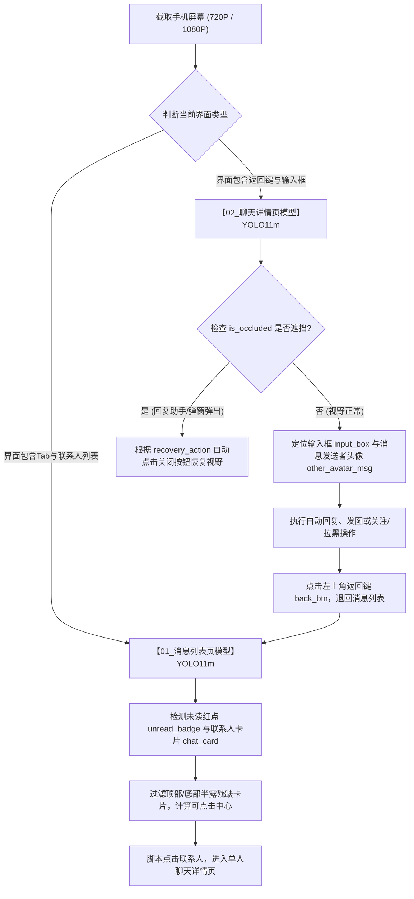

# 自动化视觉感知模型体系 (Vision Models Hub)

本项目为社交/聊天 App 自动化 RPA 核心视觉感知底座。针对 App 核心生命周期的不同界面，全部统一采用 **YOLO11m 端到端深度学习目标检测模型** 架构，充分发挥本地 **NVIDIA GeForce RTX 3060 (CUDA GPU)** 硬件加速优势，提供毫秒级高吞吐量与精准无漂移的控件定位。

---

## 一、模型库全景总览

```
D:\AA-project\自动化\models/
├── 01_消息列表页识别模型/          # 【模块一】消息列表全界面 YOLO11m 10分类目标检测模型
│   ├── weights/                    # 最佳权重 best.pt (mAP50=98.7%, 39MB), last.pt
│   ├── dataset/                    # 完整标注训练集与验证集 (images, labels, data.yaml)
│   ├── training_metrics/           # 逐轮收敛曲线 (results.png, BoxF1, confusion_matrix)
│   ├── train_10class_yolo11m.py    # 训练/微调脚本
│   ├── predict_chat_list.py        # 纯 YOLO 推理与首尾半露卡片过滤引擎
│   └── README.md                   # 详细技术文档与微调指南
│
├── 02_聊天详情页识别模型/          # 【模块二】单人聊天详情页 YOLO11m 9分类目标检测模型
│   ├── weights/                    # 最佳权重 best.pt (mAP50=99.5%, 40.6MB), last.pt
│   ├── yolo_dataset/               # 86张全量标注训练集与验证集 (images, labels, data.yaml)
│   ├── training_metrics/           # 逐轮收敛曲线 (results.png, BoxF1, confusion_matrix)
│   ├── yolo_finetune_tools/        # 一键微调训练脚本 (train_chat_detail_yolo.py)
│   ├── predict_chat_detail.py      # 纯 YOLO 推理与悬浮窗遮挡检测引擎
│   ├── eval_benchmark/             # 86张真实素材评测基准 (benchmark_results.json 等)
│   └── README.md                   # 详细技术文档与迭代指南
│
└── README.md                       # 本说明文档 (模型库总览与调用关系)
```

> **兼容性说明**：各中文主目录均映射保留了原英文别名（`chat_list_model`、`chat_detail_parser`），历史脚本或旧代码引用无须做任何路径改动。

---

## 二、双模型协同业务调用链 (Pipeline)



---

## 三、两套模型指标对比

| 模块名称 | 模型架构 | 模型权重路径 | 目标类别数 | 验证集 mAP50 | 单图纯 GPU 推理耗时 |
| :--- | :--- | :--- | :---: | :---: | :---: |
| **`01_消息列表页识别模型`** | YOLO11m (PyTorch CUDA) | `01_消息列表页识别模型/weights/best.pt` | **10 分类** | **98.7%** | $\approx 25\text{ms}$ |
| **`02_聊天详情页识别模型`** | YOLO11m (PyTorch CUDA) | `02_聊天详情页识别模型/weights/best.pt` | **9 分类** | **99.5%** | $\approx 15.7\text{ms}$ |

---

## 四、硬件加速与运行环境

- **运行平台**：Windows 11 / WSL2 Linux
- **显卡配置**：NVIDIA GeForce RTX 3060 Laptop GPU (CUDA 12.x)
- **Python 环境**：`/root/screenparser/venv/bin/python3`
- **加速核心**：PyTorch CUDA (`torch.cuda.is_available() == True`) + Ultralytics YOLO
