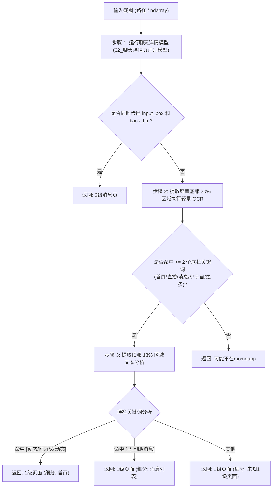

# 识别app页面 (Momo Page Level Detector)

本模块用于自动化流程中的全局页面路由分发。输入任意手机端截图，快速判断当前是否处于陌陌应用中，并识别具体的页面层级。

---

## 1. 功能特性与输出规范

### 1.1 核心状态定义
模块默认返回三类标准状态字符串：
- **`1级页面`**：当前处于陌陌一级 Tab 导航体系内（首页、消息列表、直播、小宇宙、更多）。
- **`2级消息页`**：当前处于与具体用户的聊天详情页。
- **`可能不在momoapp`**：未检测到上述两类目标特征（如手机桌面、其他 App、锁屏等）。

### 1.2 详细输出模式 (`return_detail=True`)
开启详细模式后，返回字典结构，可进一步细分一级页面类型：
```python
{
    "page_level": "1级页面",      # "1级页面" | "2级消息页" | "可能不在momoapp"
    "sub_page": "首页",           # "首页" | "消息列表" | "聊天详情页" | None
    "is_momo": True,              # True | False
    "matched_tabs": ["首页", "直播", "消息", "小宇宙", "更多"],
    "top_keywords": ["动态", "附近", "发动态"]
}
```

---

## 2. 识别原理与判定逻辑



1. **聊天详情页（2级消息页）**：
   - 调用已训练完成的 `02_聊天详情页识别模型`（YOLOv8）。
   - 同时存在 `input_box`（输入框）和 `back_btn`（顶部返回按键）时，置信度极高，直接判定为 2 级消息页。
2. **一级页面（1级页面）**：
   - 截取图片底部 20% 范围，使用 RapidOCR 检索 `首页`、`直播`、`消息`、`小宇宙`、`更多` 5 大 Tab 文字。
   - 只要识别出 2 个或以上 Tab 关键词，即可完全规避坐标偏移或虚拟导航按键干扰，确认处于 1 级页面。
   - 提取顶部 18% 区域文本，互斥判断当前激活的一级子页面（首页 vs 消息列表）。

---

## 3. 依赖项与环境配置

本模块依托于本项目统一配置的 WSL2 Python 环境：

- **Python**: `>= 3.10` (WSL2 Python: `/root/screenparser/venv/bin/python3`)
- **核心依赖包**:
  - `ultralytics`（YOLOv8 模型推理）
  - `rapidocr_onnxruntime`（极轻量 CPU OCR 引擎）
  - `opencv-python` (`cv2`)
  - `numpy`
- **关联权重路径**:
  - `models/02_聊天详情页识别模型/weights/best.pt`

---

## 4. 接口调用说明

### 4.1 Python 代码导入调用

```python
from models.识别app页面 import check_momo_page, MomoPageDetector

# 方式 A：单例快捷调用（推荐）
result = check_momo_page("path/to/screenshot.png")
print("当前页面状态:", result)
# 输出: 1级页面 / 2级消息页 / 可能不在momoapp

# 方式 B：获取详细子页面信息
detail = check_momo_page("path/to/screenshot.png", return_detail=True)
print(detail["page_level"], detail["sub_page"])
# 输出: 1级页面 首页

# 方式 C：实例化管理
detector = MomoPageDetector()
result = detector.detect(img_bgr_numpy_array)
```

### 4.2 命令行直接运行测试

```bash
# 基础状态输出
python models/识别app页面/detector.py path/to/screenshot.png

# 详细信息输出
python models/识别app页面/detector.py path/to/screenshot.png --detail
```

---

## 5. 实测基准数据

在真实截图中实测表现：

| 场景 | 输入样例 | 输出结果 | 耗时说明 |
| :--- | :--- | :--- | :--- |
| **首页动态** | 包含“动态/附近/发动态”及底部 5 Tab | `1级页面` (细分: `首页`) | YOLO 6ms + 局部OCR 150ms |
| **消息列表** | 包含“马上聊/消息”及底部 5 Tab | `1级页面` (细分: `消息列表`) | YOLO 6ms + 局部OCR 140ms |
| **聊天详情** | 包含 `<` 返回箭头与输入框 | `2级消息页` (细分: `聊天详情页`) | YOLO 6ms (直接命中，无需OCR) |
| **桌面/干扰** | 手机桌面或局部裁剪图 | `可能不在momoapp` | 局部OCR未命中后返回 |
